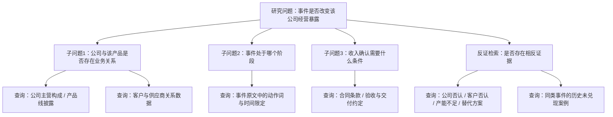

# 第11章　RAG与Agent：原理、设计取舍与量化系统思考

本章讨论两个经常被并列提及、却解决不同问题的技术方向：检索增强生成（Retrieval-Augmented Generation，RAG）与智能体（Agent）。在量化研究的语境里，它们被寄予的期待通常可以压缩成一句话——让模型自己去查资料，自己决定下一步。这句话掩盖了两个本可以独立成立的问题：证据怎样进入模型的上下文；下一步由谁决定。本章把这两个问题拆开，分别讨论它们解决什么、在什么条件下值得引入，以及在一套已经完成的量化系统里，哪些位置可能真的需要它们。

需要先交代本章的性质。本章是方法与设计讨论，不是现有功能报告。本书所讨论的这套量化系统，没有把RAG或本章讨论的新型Agent设计作为对应能力实现，因此本章不包含这类功能的实现说明，也不包含相应的历史实验与效果数据。现有系统在本章中只承担三种角色：提供真实的研究问题、提供可读取的数据接口、提供可作为参照的历史任务。本章出现的流程、接口、状态机和调用序列均属候选设计，凡属设计的内容都会明确标注；本章不会出现"本系统已上线某Agent"或"引入后指标改善若干"这类表述。

这一定位不是退让。技术书的知识范围可以超出现有实现，只要它不超出证据宣称效果。RAG与Agent在方法层面的取舍、失效条件和评价方式，本身构成可写的知识；而把它们写成已经改善指标的能力，则需要不存在的证据。本章选择前者，并把"什么时候不该引入"作为与"什么时候值得引入"同等重要的内容来写。

## 11.1　先区分RAG、Workflow、Agent与系统模块

这一节建立本章的操作性口径。讨论Agent时最容易发生的混淆，是把"系统里有一段代码调用了大模型"当作"系统具备Agent架构"。为避免这种混淆，本节用两个维度区分概念：证据怎样进入模型，以及下一步由谁决定。

### 11.1.1　检索增强与行动控制是不同维度

RAG解决的是信息供给问题。它的核心动作是：在模型生成之前或之中，从模型参数之外的地方取回与当前问题相关的材料，并把这些材料放进上下文。LangChain的检索文档把这一点讲得很直接：大模型有两个固有局限——上下文有限、知识在训练时点冻结；检索通过在查询时获取外部知识来缓解这两个局限，这也是RAG的基础（LangChain，《Retrieval》文档，2026-10-08核验）。

Agent解决的是控制权问题。Anthropic在其工程文章里给出的操作性定义是：工作流（workflow）是"大模型与工具通过预定义的代码路径被编排"的系统；智能体（agent）是"大模型动态地指挥自身流程与工具使用、并保持对如何完成任务的控制权"的系统（Anthropic，《Building effective agents》，2024-12-19，2026-10-08核验）。按这个定义，区分两者的不是有没有工具，而是工具调用顺序由谁决定。

把两个维度交叉，可以得到四类系统：

| | 检索在固定路径上发生 | 检索时机由模型决定 |
|---|---|---|
| **无外部工具** | 单次提示＋静态上下文 | 不成立（无工具即无动态行动） |
| **有外部工具** | 固定检索后生成（2-Step RAG） | Agentic RAG / 受限Agent |

这张表的意义在于说明：RAG可以在完全没有Agent的系统中实现，Agent也可以完全不使用检索。两者可以组合，但组合不是必然。因此，判断一个系统是否具备其中任一架构，需要看的证据也不同——判断RAG要看是否存在可追溯的检索步骤与证据返回；判断Agent要看模型输出是否真的改变了控制流。以下三类现象都不构成证据：系统里有数据库（只能说明数据可用）、代码里调用过大模型（只能说明存在推理调用）、类名或函数名里含有"Agent"一词（只能说明命名习惯）。

这一区分对本书尤为重要。本书讨论的量化系统大量调用大模型完成事实抽取与语义理解，也维护着结构化的数据库与文档存储，但这些都是固定工作流中的确定性步骤，不是Agent架构。名称与能力必须分开评估。

### 11.1.2　固定工作流与自主循环的边界

上一目给出的是概念区分，这一目讨论它在工程上的后果。固定工作流与自主循环不是先进与落后的关系，而是两条代价结构不同的路径。

固定工作流的代价结构是前移的。路径在设计时确定，因此每一步的输入输出可以约定，失败位置可以定位，调用次数上界已知，测试可以用固定输入反复运行。代价是它只能处理设计时想到的情况；遇到路径未覆盖的输入，系统要么报错，要么退化为一个笼统的回答。

自主循环的代价结构是后移的。模型根据观察结果决定下一步，因此理论上可以处理设计时未预见的情况。代价是调用次数、执行时间与失败模式都变成随输入变化的量：同一条任务两次运行可能走不同的路径，出问题时"为什么走了这一步"只能从事后记录里重建。Anthropic在同一篇文章里给出的建议是：在能用简单方案时保持简单，只在确有必要时增加复杂度；并且指出直接使用模型API往往优于过早引入框架，因为框架增加的抽象层会遮挡底层的提示与响应，使调试变难（同上，2024-12-19）。

对量化研究而言，这个取舍有一个特殊分量。研究结论需要可复核，而可复核的前提是过程可重建。一个自主循环如果只在最后交出一份结论、却不留下"读了哪些材料、为什么放弃另外几条线索"的记录，那么它的输出即使正确，也很难进入研究流程——因为下游无法判断这个结论在证据不足时是否仍会被给出。本书第12章介绍的现有任务流程之所以采用固定编排，一部分原因正在于此。

这里需要说明口径边界：上述"固定工作流／自主循环"的二分是本章采用的操作性区分，用于组织讨论，并非所有框架都使用相同命名。有些系统处在两者之间，例如在固定骨架内保留少量模型选择点。这类混合形态在11.4节继续讨论。

### 11.1.3　现有实现与本章讨论的关系

本章后续所有内容，与现有系统之间只有参照关系，没有实现关系。为避免读者误读，这里把三种陈述分层固定下来：

- **现有事实**：现有系统具备的、可从真实材料核验的能力。例如固定的任务编排、结构化数据存储、大模型抽取步骤、已有的研究输入输出。这些内容在本章只作为参照出现，其工程细节由第12章负责。
- **设计建议**：本章提出的候选方案，包括检索链路、证据契约、受限Agent的权限边界、多Agent的交接结构。它们是可以被采用、也可以被否决的设计，当前均未实现。
- **尚未验证的预期**：候选方案在采用后可能带来的收益，例如人工补查负担下降或反证覆盖上升。本章不给这些预期赋数值，也不把它们写成结论；11.11节只给出评价设计。

把这三层分开陈述，本身是本章的一项要求。技术写作中一种常见的错误是让读者在读完一章后无法判断"哪些是作者已有的系统，哪些是作者希望有的系统"。如果本章某处没有明确标注而读者产生了歧义，应视为写作缺陷。

最后需要强调：现有系统没有采用本章某种技术，不构成书稿缺口，也不能据此判断现有系统不完整或落后。技术选型的合理性取决于当时的任务、资源与约束；本章讨论的是另一种可能性空间，不是对既有选择的追认或否定。

## 11.2　RAG的核心链路与检索方案取舍

上一节把检索增强定义为信息供给问题，这一节展开这条链路的构成，以及在不同证据形态下应当选择什么检索方式。

### 11.2.1　语料组织、切分、检索与证据返回

一条完整的RAG链路包含四个环节，每个环节都会在最终输出上留下痕迹。

**语料组织**决定"什么东西有资格被检索到"。在量化研究中，语料不是同质的：公司公告是结构化程度较高的正式文本，产业新闻是叙事性文本，公司关系数据是表格，研究报告是长文档。把它们混进同一个索引，会带来一个隐蔽的后果——检索时无法按来源类型控制权重，因而无法回答"这条结论是建立在公告之上，还是建立在转述公告的新闻之上"。

**切分**决定"检索的最小单位"。切得太粗，取回的片段里大部分内容与问题无关，浪费上下文；切得太细，单个片段失去上下文，可能出现主语缺失、指代不清，模型据以判断时容易出错。更麻烦的是，切分边界会破坏原本的逻辑结构：一份公告里的"公司拟投资X亿元建设产线"与后文的"项目建设周期24个月、尚未取得环评批复"，如果被切到两个片段，只取回前者的检索结果会给出明显偏乐观的判断。

**检索**决定"哪些片段被取回"。这一环节在11.2.2节展开。

**证据返回**决定"模型看到什么、以及读者能看到什么"。这是四环中最容易被简化、也最不该简化的一环。一个只返回文本片段的检索结果，对量化研究是不够用的；模型需要知道这段文字来自哪份文件、文件的哪一部分、该文件在什么时间首次可见。原因在11.3节详述，这里先给出结论：**证据的可追溯性不是输出的附加装饰，而是判断结论是否成立的必要输入。**

一个可用于讨论的最小证据结构，可以约定为五个字段：

| 字段 | 含义 | 缺失时的后果 |
|---|---|---|
| `source_id` | 来源文档的唯一标识 | 无法复核，结论不可审计 |
| `locator` | 原文定位（章节、段落或字符区间） | 无法验证引文是否被断章取义 |
| `visible_from` | 该材料首次可被获取的时间 | 无法排除前视偏差 |
| `excerpt` | 实际引用的原文片段 | 无法区分引用与转述 |
| `stance` | 该片段对当前命题是支持、反对还是无关 | 支持与反对证据无法分开统计 |

这五个字段是**候选契约**，不是现有系统的数据结构。其中的 `stance` 字段值得特别说明：多数检索系统的返回结果只带相关性分数，而研究场景需要的是方向性。一条检索结果如果只标"相关度0.82"，读者无法知道它是支持假说还是构成反证。把方向性显式化，是检索环节为下游反证检查（11.4.2节）留下的接口。

### 11.2.2　结构化查询、关键词与语义检索

检索方式的选择，应当由查询类型决定，而不是由技术偏好决定。量化研究中的检索需求大致可以分为四类，它们的特征差异很大：

| 查询类型 | 示例 | 主要难点 | 适配的检索方式 |
|---|---|---|---|
| 实体查询 | 某公司的关联公司、某产品的客户 | 别名与主体消歧 | 结构化查询 |
| 数值事实 | 某年度某业务收入、某季度出货量 | 单位、口径、期间归属 | 结构化查询 |
| 条件措辞 | 合同中关于交付与验收的约定 | 表述隐含、需要语义理解 | 关键词＋语义检索 |
| 相似事件 | 历史上与当前事件结构相似的案例 | 相似的定义本身需要判断 | 语义检索＋人工确认 |

这张矩阵支持一个在工程上很实际的结论：**并不需要把所有检索都改成向量检索。** LangChain的检索文档明确写到，如果已经存在知识库——例如SQL数据库、文档数据库、CRM或内部文档系统——则不需要重建它，可以直接把它作为Agent的工具接入，或者查询后把结果作为上下文提供给模型（LangChain，《Retrieval》，2026-10-08核验）。对量化系统而言，这句话的分量在于：一个已经维护了数据字典与主键关系的结构化存储，本身就是高质量的检索源；把它重新灌进向量库，收益不确定，而失去的是精确匹配能力与字段级过滤能力。

向量检索真正的优势区在第四类查询——相似事件检索。当研究者问"历史上还有哪些事件与这次的结构类似"，答案不取决于字面重合，而取决于语义与结构相似。但这里也埋着一个陷阱：语义相似不等于研究上可比。两则新闻可能用词高度接近，却分属完全不同的经营阶段（一个是中标意向，一个是已经交付确认收入）。因此相似事件检索的合理定位是**候选生成**，其输出必须经过人工或规则确认才能进入样本池。把它当成自动结论来源，会引入难以察觉的样本污染。

一个可行的组合方式是按查询类型路由：实体与数值走结构化查询，条件措辞走关键词与语义的混合检索，相似事件走语义检索后加确认环节。这种路由是**候选设计**；其代价是系统需要维护"什么问题走哪条路"的规则，规则本身也需要随数据源变化更新。

### 11.2.3　长上下文、按需检索与维护成本

在讨论RAG时，一个常见的反问是：既然上下文窗口在持续变大，为什么不直接把材料全部放进去，省掉检索这一层？

这个问题值得认真回答，因为它决定了是否要建检索系统。Anthropic关于上下文工程的文章给出了反对"全部塞进去"的两条理由：其一，上下文是有限资源且边际收益递减，随着token数上升，模型对其中信息的召回准确率会下降；其二，该文认为在可预见的未来，各种规模的上下文窗口都会受到上下文污染与信息相关性问题的困扰，至少在需要最强Agent表现的场景下如此。因此它给出的指导原则是：好的上下文工程意味着找到"能够最大化期望结果可能性的、最小的高信号token集合"（Anthropic，《Effective context engineering for AI agents》，2025-09-29，2026-10-08核验）。

把这个原则落到量化研究的三种方案上：

| 方案 | 适用任务 | 主要代价 |
|---|---|---|
| 一次提供全部相关材料 | 单次分析、材料量小、需要全局对照 | 上下文占用高；材料更新后需重新组织 |
| 固定检索后生成 | 重复性查询、问题形态稳定 | 需要维护索引；问题超出索引范围时失效 |
| 按需检索（模型决定） | 探索性研究、材料量大且使用稀疏 | 调用次数不可预测；调试与停止控制变难 |

三者的取舍不只在效果，还在维护。一个检索系统一旦建立，就产生了持续的维护责任：数据源变更时要重建索引，切分策略调整时要重新评估召回质量，语料口径变化时要核对旧结论是否仍然成立。对个人或小团队的系统，这项成本常常被低估——它不像功能开发那样有明确的完成时点，而是长期存在。

Anthropic的文章还提到一种介于两者之间的做法：在上下文中预先放入少量稳定的高层信息，同时保留按需检索能力。它举的例子是在会话开始时放入项目说明文件，在运行中用文件检索工具按需查找具体内容，并指出这种方式适合"变化不那么剧烈的领域，例如法律或金融工作"（同上，2025-09-29）。对量化研究，这提示了一种务实的分层：把不常变的部分（数据字典、字段口径、研究规范）预先固定，把高频变化的部分（当日公告、最新披露、近期事件）留给检索。这种分层方案在本章属于**候选设计**。

## 11.3　面向量化研究的时点、版本与证据约束

前两节讨论的是通用检索机制。这一节讨论量化研究给检索带来的额外约束——这些约束在通用场景中不存在，却是量化场景中决定方案是否可用的关键。

### 11.3.1　研究时点与信息可用时点

量化研究有一项其他领域不常有的要求：任何一项分析都必须能回答"在某个历史时点，我们能知道什么"。这与检索的结合点在于，检索返回的每一份材料都必须携带时间信息，而时间本身不是单一概念。

至少需要区分四个时间：

- **原始披露时间**：材料首次公开发布的时间；
- **修订时间**：材料被更正或更新后的时间；
- **首次获取时间**：本系统实际取得该材料的时间；
- **本次整理时间**：当前这次查询发生的时间。

四者的差异在实务中并不罕见。一份公告可能在周末发布，系统在下一个交易日才抓取到；一份财务数据可能在数月后被追溯调整；某条新闻可能在发布后被更正。如果检索系统只记录"入库时间"，那么用今天的索引去重建一年前的研究状态时，会把当时尚未获取的信息当成当时已知的信息，这正是前视偏差（look-ahead bias）的一种来源。

因此，候选设计中的检索接口应当把研究时点作为显式参数，而不是隐含在调用时刻里。其形式可以简化为：

```text
retrieve(query, as_of, corpus_scope) -> evidence[]
# 约束：返回的每条 evidence 满足 visible_from <= as_of
```

这段伪代码只表达一条约束，但它带来的后果不小：同一条查询在两个不同 `as_of` 下会返回不同的证据集合，因而可能支持不同的结论。这恰恰是研究者希望看到的——它让"结论随时间如何变化"成为可观察的对象。

这里必须区分两种口径，混用会造成误判。**当时已经公开**与**当时系统实际获得**是两个不同的集合：前者由市场信息环境决定，后者由本系统的采集能力决定。用前者做回测、用后者做运行复盘，都是合理的；把两者混着用，就会得出无法解释的结果。这两种口径的工程细节属于第5章的范围，本节只强调检索层必须把口径作为显式选择，而不是默认其中一种。

### 11.3.2　证据支持、冲突和不可回答

通用问答系统在找不到依据时，倾向于给出一个仍然流畅的回答。研究场景不能接受这个行为，因为一条没有依据的结论与一条错误结论在后果上没有区别，而且前者更难被发现。

因此，候选的证据契约需要显式定义三种输出状态，而不只是"有答案"与"没答案"两种：

**支持**：找到材料，且材料的方向与命题一致。此时输出必须附带原文定位与有效时点，而不是只给结论。

**冲突**：找到多份材料，但方向不一致。例如一份公告称项目已获客户认证，另一份行业报道称该客户尚未启动采购。此时正确的输出不是择一采信，也不是给出"综合来看"的调和表述，而是把两侧材料并列保留，并标注差异的可能来源——时间差、口径差、来源可靠性差。

**不可回答**：在给定研究时点与语料范围内未找到材料。这一状态需要与"材料存在但本系统未收录"区分开，因为两者的处理方式不同：前者说明问题在当前证据下无法回答，后者说明需要扩充采集范围。把两者都笼统地标为"无数据"，会让研究者无法判断该补充什么。

这里有一条容易被违反的原则：**引用数量不等于可靠度。** 十篇转述同一份公告的新闻，其独立信息量与一份公告相同，甚至更低——因为转述可能引入失真。把引用条数当作置信度指标，会在信息传播密集的事件上系统性地高估把握程度。因此证据契约应当记录的是来源的**独立性与原始性**，而不是条数。

### 11.3.3　检索时点过滤不能替代全部泄漏检查

上一目确立的 `as_of` 约束，容易被过度信任。一种常见的推理是：既然检索只返回该时点之前可见的材料，那么基于检索结果的分析就不会有前视问题。

这个推理不成立，原因在于泄漏的来源不止一处。除了"取用了未来材料"之外，至少还有两条路径：

**模型参数记忆**：大模型在训练时接触过大量公开文本，其中可能包含该时点之后才发生的事实。当模型被要求分析某个历史事件时，它可能不是从提供的材料中推断，而是从参数中"回忆"了后续发展，再把这个回忆包装成推理。日期过滤对此完全无效，因为泄漏发生在模型内部，不经过检索层。

**事后标签与事后框架**：即使材料本身合规，分析所用的分类体系、判断标准或事件命名方式，也可能是研究者事后才形成的。例如用今天的产业分类去分析三年前的公告，看似只是工具选择，实际上已经把后来的认知结构注入了当时的研究。

因此，检索时点过滤是必要的，但不是充分的。完整的前视审计需要覆盖材料可见性、模型记忆、标签生成时间与框架来源四个层面，这项工作属于第13章的范围，本节只负责指出边界：**候选RAG方案增加了日期过滤，不等于解决了全部前视问题；把两者混为一谈，会给研究结论一个它不配得到的可信度。**

## 11.4　从固定RAG到Agentic RAG

11.2节介绍了检索链路的构成。这一节讨论控制权在哪一层：检索是在固定位置发生，还是由模型在推理过程中决定。LangChain的文档把三种形态并列比较，并给出了各自的代价——2-Step RAG中检索总是先于生成发生，控制力高、灵活度低、时延快且可预测；Agentic RAG由模型在推理中决定何时与如何检索，控制力低、灵活度高、时延不定；混合形态引入查询预处理、检索验证与生成后检查等中间步骤，在两者之间取折中（LangChain，《Retrieval》，2026-10-08核验）。

### 11.4.1　固定检索后生成与动态检索

固定检索的优点是结构清楚：一次查询、一批证据、一次生成，链路的每个环节都可以单独测试。它的失效条件也很清楚——当第一次检索没有取回关键证据时，整个链路没有任何补救机会，模型只能在不足的证据上作答。而模型在这种情况下的典型行为不是拒答，而是用已有材料给出一个看起来完整的分析。

动态检索正是针对这个失效条件设计的：模型在推理过程中可以判断"当前证据不足以支持这一步"，并据此发起补充查询。LangChain文档指出，Agent要具备RAG行为，所需的条件仅仅是可以获取外部知识的工具（同上，2026-10-08）。这句话把引入成本说得很低，但它也提示了代价所在：一旦模型可以自主发起查询，调用次数、上下文增长和终止时机就都变成了需要额外设计的对象。

三项设计对象中，**停止规则**最容易被忽略，也最容易出问题。一个没有明确停止条件的检索循环，在遇到模糊问题时倾向于持续搜索，直到耗尽预算或超时；而它返回的结论未必比第一次检索更好，因为后续搜索可能只是在重复确认已有判断。11.4.3节专门讨论终止状态。

在量化研究场景中，两者并不是替代关系。问题形态稳定的重复查询（例如每日对新增公告做结构化抽取）适合固定检索：路径确定、成本可控、结果可比。而探索性任务（例如判断某个新出现的产业变化是否可能改变某公司的经营暴露）适合有限度的动态检索，因为这类任务需要先弄清"需要哪些信息才能回答"，而这个清单本身无法事先完全枚举。

### 11.4.2　问题分解、补充查询与反证检索

这一目用一个具体设计题展开。设研究问题是："某产业事件是否会改变一家公司的经营暴露？"这是一个无法用一次检索回答的问题，因为它包含多个需要分别取证的子问题。

一个候选的分解方式如下。注意这里的每一步都是**设计推演**，不是任何系统的运行日志。



这张图里有两点值得说明。

第一，**反证检索是独立分支，不是主查询的副产品。** 多数检索流程在找到支持证据后就结束，反证检索要求系统主动构造"如果这个判断是错的，会看到什么"的查询。这两类查询的关键词往往不重叠——支持证据常用"合作""中标""投产"，反证证据常用"澄清""未参与""延期""终止"。用支持证据的查询词去检索，几乎不可能命中反证材料。因此反证必须被设计成显式的查询分支，而不是期望模型自发想到。

第二，**阶段判断决定后续取证的深度。** 一个事件处在"签署意向"阶段与处在"已交付并确认收入"阶段，对经营暴露的影响强度完全不同，需要核验的材料也不同。前者需要看协议条款与生效条件，后者需要看财务确认口径。如果系统跳过阶段判断直接给出"影响显著"的结论，它实际上是在用一个未经验证的假设支撑整个分析。

关于公司关系数据是否参与检索，这里保持开放：如果现有系统已经维护了结构化的公司关系表，它可以作为一条查询路径；如果没有，用文本检索公司披露同样可行。是否引入图结构应按问题需要决定，本章不建议为检索目的新建图谱系统——那是把工程问题当成了前置条件。

### 11.4.3　有限探索与停止条件

动态检索必须有终止条件。没有终止条件的循环不是更聪明，只是更贵。候选设计中，至少需要定义五类终止状态：

| 终止状态 | 触发条件 | 期望的后续行为 |
|---|---|---|
| 证据已足够 | 关键子问题均有材料支持 | 生成结论，标注仍存缺口 |
| 来源耗尽 | 可用语料范围内已无新结果 | 输出"不可回答"分支，说明检索范围 |
| 达到预算 | 调用次数或费用达到上限 | 输出部分结论，明确标注未完成项 |
| 工具失败 | 数据接口不可用或返回异常 | 保留已获证据，标记失败环节 |
| 需人工判断 | 出现无法自动裁决的冲突 | 转入人工复核队列 |

这五类状态中，第二类和第五类最容易被实现成"继续重试"。来源耗尽时的继续检索会产生大量低质量结果，反而污染上下文；证据冲突时的继续检索则可能被模型用来反复确认已有立场。把这两种情况识别为**应当停止并交出控制权**的状态，是设计中比增加检索能力更重要的一步。

最后需要强调本节开头已经说明的一点：以上分解、分支和终止状态均为设计推演。推演出的步骤不构成任何系统的运行轨迹，也不证明该流程在真实任务上有效。要判断它是否有效，需要按11.11节的评价设计实际执行比较实验——那是后续的事，不是本章的结论。

## 11.5　单Agent的规划、工具调用与反馈闭环

上一节讨论的是检索的控制权。这一节把控制权扩展到全部工具，讨论单个Agent的完整运行循环，以及它与确定性控制之间的边界。

### 11.5.1　目标、任务状态与验收条件

一个研究Agent如果被赋予的目标是"研究某事件"，它实际上没有收到可执行的任务，因为这句话既没有定义交付物，也没有定义什么算完成。把目标改写成可验收的形式，是引入Agent的第一步工作，而不是最后一步。

改写的方法是把目标落到交付物的字段上。以事件研究为例，"研究某事件"可以改写为：产出一份研究卡，其中包含事件的事实要素、涉及公司的经营暴露判断、支持证据、反对证据、成立条件、未知项与有效时点。改写之后，"完成"有了定义——字段齐全且证据可追溯；部分完成也有了定义——哪些字段缺证据。

| 原表述 | 问题 | 可验收的改写 |
|---|---|---|
| 研究某事件 | 无交付物、无完成定义 | 产出含指定字段的研究卡，字段有证据或标注未知 |
| 分析某公司 | 无范围、无深度要求 | 回答指定子问题，每项结论附来源与有效时点 |
| 查一下相关材料 | 无判据、无停止条件 | 按指定检索分支取证，输出命中与未命中清单 |

这个改写动作还有一个附带好处：它把"模型说自己完成了"与"任务真的完成了"分开了。研究卡是外部对象，字段齐不齐可以核对；而模型的自述只是文本。Anthropic在讨论Agent评测时明确指出，评测中真正要核验的是环境中的最终状态，而不是对话记录里的说法——它给出的例子是：订票Agent可能在对话末尾说"您的机票已预订"，但真正的结果是环境数据库中是否存在一条预订记录（Anthropic，《Demystifying evals for AI agents》，2026-01-09，2026-10-08核验）。研究场景的对应物是：Agent说"已找到三项支持证据"，实际需要核对的是证据字段是否真的填了、定位是否可回溯。

### 11.5.2　规划—行动—观察—调整

单Agent的运行循环可以概括为四步：根据目标与当前状态规划下一步动作，调用工具执行，观察返回结果，据此调整计划。这个循环的每一步都需要留下可审计的记录，理由在第11.1.2节已经给出——研究结论必须可重建。

需要记录的至少包括：调用了什么工具、传入了什么参数、返回了什么、这次调用使计划发生了什么变化。其中最后一项最容易被省略，但它是判断"Agent是否真的在使用工具结果"的唯一依据。一个模型完全可能在调用工具后忽略返回内容，继续按原计划推进——从输出上看不出区别，只有对照调用前后的计划才能发现。

这里需要区分工具执行与角色扮演。多轮对话中，模型可以用自然语言描述"我查询了公司关系表，发现……"，而实际上并没有发生任何工具调用。这种描述在阅读时很像执行记录，但它不是。区分方法是看是否存在工具调用层返回的结构化结果；如果只有模型自述，就只能视为假设，不能视为事实。

关于计划何时需要修订，一条可用的判据是：当观察结果与规划所依赖的假设冲突时。例如规划假设"该公司有该产品的收入"，检索结果未找到相关披露——这构成冲突，计划应当转向"先确认是否存在业务关系"，而不是继续按原计划收集影响证据。这条判据把"调整"从一种模糊的智能表现，变成了一个可检查的触发条件。

### 11.5.3　自主权限与确定性边界

Agent能做什么，与Agent应该被允许做什么，是两个问题。候选设计建议按动作的后果不可逆程度划分权限层级：

| 层级 | 动作类型 | 建议权限 |
|---|---|---|
| 读 | 读取文档、查询数据、检索历史记录 | 默认允许，记录调用 |
| 写草稿 | 生成研究卡草稿、提出候选假说 | 允许，但标记为待人工确认 |
| 改状态 | 修改研究结论、更新信号状态 | 需人工确认 |
| 资金操作 | 下单、调仓、修改风险限额 | 不允许由模型直接执行 |

这条分界的理由不是对模型能力的不信任，而是对错误成本的判断。读操作出错，后果是浪费一次调用；资金操作出错，后果是真实损失，且往往不可撤销。把两类动作放在同一个权限层级里，等于用前者的容错成本去承担后者的风险。

Anthropic在上下文工程一文中提到的子Agent设计也支持类似的隔离思路：专用子Agent在干净的上下文中处理聚焦任务，主Agent负责协调，子Agent可能消耗大量token但只返回精简摘要（Anthropic，《Effective context engineering for AI agents》，2025-09-29，2026-10-08核验）。这种隔离在权限设计上的价值是：可以把读权限授予子Agent，把写权限留在主流程中。

需要再次强调，以上权限分层是**候选设计原则**，不是对现有系统权限实现的核验。现有系统的权限边界由第12章按真实证据介绍。

## 11.6　上下文工程与研究记忆

Agent的每一次决策都发生在一个有限的上下文窗口内。这一节讨论如何组织进入窗口的内容，以及跨任务的信息应当以什么形式留存。

### 11.6.1　按任务选择上下文

上下文窗口里通常同时存在几类内容：系统指令、工具说明、当前证据、任务状态、历史输出。它们在稳定性、体积和相关性上差别很大，因此不应当被同等对待。

| 内容类型 | 稳定性 | 典型体积 | 组织建议 |
|---|---|---|---|
| 系统指令与研究规范 | 高 | 小 | 预先固定，不随任务变化 |
| 工具说明 | 中 | 中 | 按当前任务按需加载，而非全量常驻 |
| 当前证据 | 低 | 大 | 按需检索进入，用完可清除 |
| 任务状态 | 中 | 小 | 常驻，且需显式更新 |
| 历史输出 | 低 | 大 | 摘要化后保留，原文留在窗口外 |

这张表背后的原则来自Anthropic的上下文工程文章：好的上下文工程是找到最小的、高信号的token集合，而不是尽可能多地放入信息；该文把"按需加载"描述为用轻量标识符（文件路径、存储查询、链接）在运行时动态取数，并称之为"just in time"方式（同上，2025-09-29）。对研究任务，一个自然的落地方式是：把研究规范与字段口径固定在系统指令中，把具体材料留给检索，把已完成的分析压缩成摘要留在状态里。

一个具体的反面例子可以说明为什么这件事重要。假设一次事件研究已经完成了事件抽取，产生了十几个字段。如果后续的经营分析步骤把原始公告全文、抽取结果、中间推理全部保留在上下文中，那么真正关键的信息（事件处于哪个阶段、涉及哪些公司）会被大量已处理完的文本稀释。模型在长上下文中对特定信息的召回会下降，这不是假设，而是该文引用的"上下文腐化"现象。把已处理内容摘要化，是控制这种稀释的手段。

### 11.6.2　工作记忆、事实与假说分层

研究过程中产生的信息，可信度并不相同。把它们混在一处存储，会产生一个具体而危险的后果：模型生成的推断会在下一次调用中被当作事实读取。因此候选设计建议按可信度分层：

- **工作记忆**：当前任务的临时状态，包括已完成步骤、待办项、中间结果。生命周期限于本次任务，任务结束后可丢弃。
- **已核验事实**：有来源定位、有有效时点、可复核的结论。这是唯一可以跨任务复用的层级。
- **待验证假说**：模型或研究者提出、但尚无充分证据的判断。可以保留，但必须带状态标记。
- **人工结论**：由研究者作出的判断，包括对模型输出的修正与否定。

分层的必要性可以用一个常见的失败模式说明：模型在分析中提出"该客户可能扩大采购规模"，这是一条假说；如果它被存入与事实相同的存储，下一轮分析读取时，这条假说就会以"已知信息"的形式进入上下文，模型可能据此推出更进一步的结论。几轮之后，最初的推测会变成整条推理链的地基，而没有人记得它只是推测。

每一条记录除了内容，还需要携带来源与有效时点。这两项在跨任务复用时尤其重要——一条三个月前成立的结论，在今天可能因为新披露而失效，而系统如果没有记录时点，就无法判断它是否仍然可用。

### 11.6.3　摘要、失效与版本更新

上下文压缩的常见做法是摘要。Anthropic的文章把这种做法称为压缩（compaction）：把接近窗口上限的对话内容摘要后，用摘要重新开始一个新的上下文窗口，并指出压缩中的难点在于平衡保留与丢弃，过于激进的压缩会丢掉那些"重要性在事后才显现的细微但关键的上下文"（同上，2025-09-29）。

研究场景对摘要有一项额外要求：**摘要必须保留反证与来源。** 通用对话中，摘要的目标是让对话继续得下去，因此倾向于保留主线、丢弃枝节。但研究场景中，一条被丢弃的"未找到相关披露"可能正是结论成立与否的关键。同理，摘要中如果只保留结论而不保留来源定位，后续步骤就无法复核，整个链条的可审计性会在压缩这一步断掉。

失效处理是另一个需要显式设计的问题。当一条旧假说被新证据推翻时，系统应当标记它失效，而不是删除。删除会造成两个后果：一是无法解释为什么早期分析得出了不同结论；二是如果其他地方还引用着这条假说，删除会留下悬空引用。标记失效并保留原始内容与推翻依据，才是可追溯的做法。

最后一个风险点值得单独指出：**模型生成的摘要可能被下一轮当成原始事实。** 如果摘要没有明确标注"这是模型对已有材料的概括"，而是以与原文相同的格式存储，那么下游读取时就无法区分。解决办法是在存储层就区分材料类型，而不是依赖下游的判断。这一条与11.3.3节讨论的模型参数记忆是同一类问题——信息在流转中失去了它的来源标记，从而获得了它不应有的地位。

## 11.7　Tools、Skills与MCP的分工

前几节讨论的是模型侧的设计。这一节讨论模型之外的三个概念：可执行动作、可复用的操作说明、以及连接协议。它们经常被混用，但职责差别很大。

### 11.7.1　Tools：可执行动作与输入输出契约

工具是Agent可以调用的动作。一个工具的定义至少包含：名称、用途说明、参数及其类型、返回结构、错误形式、以及副作用说明。在量化研究中，候选的只读工具可以包括：按条件查询公司基本信息、按时间范围读取公告原文、查询已归档的历史实验记录。

工具设计的难点不在于实现，而在于**契约的清晰度**。以下三种情况是常见的失效来源：

**返回结构过松。** 如果工具返回的是一段自由文本，模型需要自行解析，解析错误无法被检测。结构化返回（字段化）使得错误可以在调用层被发现。

**错误语义不清。** "未找到数据"与"查询失败"是两种不同情况，前者是有效的研究结果（说明该时点无可查信息），后者是系统故障。如果两者都返回空值，下游无法区分，可能把故障当成证据缺失，从而得出"无相关信息"的错误结论。

**副作用未声明。** 一个名为"查询"的工具如果实际上会写入缓存或修改状态，就会在重试时产生非预期效果。只读工具与写工具必须在命名和权限上区分。

这里需要说明：上述工具名与接口形式均为**设计示意**，不代表仓库中已有相同接口。现有系统实际提供哪些数据接口，由第12章按真实材料介绍。

### 11.7.2　Skills：可复用的研究操作说明

Skills与Tools的差别在于，Tools是动作，Skills是做法。Anthropic把Agent Skills定义为"组织化的文件夹，包含指令、脚本与资源，Agent可以发现并动态加载它们以在特定任务上表现更好"，并给出了渐进式披露的三层结构：启动时把每个技能的`name`与`description`预加载进系统提示（第一层），当模型判断该技能相关时加载完整的`SKILL.md`（第二层），技能内部引用的其他文件（如`reference.md`、`forms.md`）按需读取（第三层）；该文指出，这种结构使技能可承载的上下文量实际上不受限制（Anthropic，《Equipping agents for the real world with Agent Skills》，2025-10-16，2026-10-08核验；该文于2025-12-18更新，说明Agent Skills已作为开放标准发布）。

这个结构对量化研究的直接启发，是研究方法本身可以被封装。经营传导分析、反证检查、回测报告核对——这些方法各有固定的步骤、检查项和常见错误，它们的共同点是：不是一次动作，而是一套需要按序执行并带判断的做法。用说明加脚本的方式组织，比把它们写进系统提示或工具函数都更合适。

两点边界必须说明。第一，**Skills不是新训练出的模型。** 它不改变模型参数，只是按需把指令和资源送进上下文。因此"封装成Skill"不提高模型能力，只提高流程的一致性。第二，**封装不证明方法有效。** 一个反证检查Skill可以被正确地执行，同时该反证检查方法本身可能是无效的——前者是工程问题，后者是研究问题，两者需要分别验证。

该文还专门提醒了安全风险：技能通过指令和代码为Agent提供新能力，因此恶意技能可能在使用环境中引入漏洞，或指示Agent外泄数据、执行非预期动作；建议只从可信来源安装，从不太可信的来源安装前应先审计，特别关注代码依赖、打包资源，以及任何指示模型连接外部网络的内容（同上，2025-10-16）。对量化系统，这条提醒有额外分量：研究Agent可读的数据包括公司披露与内部记录，权限配置不当会放大这一风险。

### 11.7.3　MCP：连接外部工具与数据的协议

MCP（Model Context Protocol）解决的是连接问题。按其官方文档的定义，MCP是"一个把AI应用连接到外部系统的开源标准"，使AI应用能够连接数据源（如本地文件、数据库）、工具（如搜索引擎、计算器）与工作流（如专门化的提示），其类比是"AI应用的USB-C接口"（Model Context Protocol，《What is MCP?》，文档版本2026-07-28，2026-10-08核验）。

引入协议的价值在于适配成本。当有N个模型客户端和M个数据源时，点对点适配需要N×M套实现，而通过统一协议可以降到N+M。对使用多个模型服务的研究系统，这项收益是实在的。

但协议接入也有它解决不了的问题，而且这些问题往往被低估：

**接通不等于正确。** 协议规定了怎么连，不规定连到的数据是否准确、时点是否合规、口径是否一致。一个通过MCP接入的数据源，仍然需要独立的数据质量检查。

**权限不能靠协议保证。** MCP定义了能力暴露的机制，但"这个Agent应不应该有写权限"是部署决策，不是协议特性。把权限设计寄托在协议层，会把安全边界交给配置的默认值。

**维护责任不会消失。** 引入协议层意味着多了一层需要跟踪的版本依赖。协议规范会演进，服务端实现会变化，这些变化需要被纳入系统的维护范围。这也是本章反复强调的一点：任何一项工程选择都会带来持续成本，而不只是初期成本。

在候选设计中，直接工具接口与MCP适配之间的选择，应当取决于是否存在多客户端复用需求。如果只有一个研究流程使用这些数据源，直接接口更简单、更少依赖；如果预计多个流程或多个模型客户端都要接入同一批数据源，协议适配的收益才开始显现。

## 11.8　多Agent协作：任务分解、交接与边际价值

单Agent加工具已经能覆盖相当多的研究任务。这一节讨论在什么条件下值得把任务拆给多个Agent，以及拆分本身会引入哪些成本。

### 11.8.1　主控—工作者、并行分工与交叉检查

Anthropic在其工作流模式中列出了编排者—工作者（orchestrator-workers）模式：由一个中心模型动态分解任务、委派给工作者模型、再综合结果；并指出它与并行化（parallelization）的区别在于子任务不是预先定义的，而由编排者决定（Anthropic，《Building effective agents》，2024-12-19，2026-10-08核验）。同一篇文章还列出了并行化的两种变体：分段（sectioning，把任务拆成相互独立的子任务）与投票（voting，对同一任务多次运行以获取多样输出）。

把这两种结构映射到事件研究，候选分工可以是：

| 角色 | 任务 | 输出 |
|---|---|---|
| 主控 | 分解问题、汇总证据、裁决冲突 | 研究卡 |
| 资料搜集 | 按检索分支取证 | 带定位的证据片段 |
| 经营分析 | 从证据推导经营变量与成立条件 | 传导链与条件 |
| 反证核验 | 构造反例查询、检查支持证据的可靠性 | 反证清单与证据强度评估 |

这张分工表的合理性来自任务的可分解性，而不是来自"多Agent更先进"。判断是否可分解，有一条实用标准：**子任务之间是否需要共享大量中间状态。** 如果资料搜集必须先知道经营分析关心哪个变量才能确定检索方向，那么两者之间存在强耦合，强行拆分会造成来回传递上下文，成本高于收益。反过来，反证核验与支持证据搜集之间的耦合很弱——前者关心的是"什么证据会推翻结论"，这个问题的答案不依赖后者的进展，因此适合并行。

### 11.8.2　共享状态、证据交接与冲突处理

多Agent结构中最容易出错的地方是交接。一个子任务返回给主控的内容，需要携带哪些信息才足以让主控做判断？至少需要四项：证据本身、来源定位与有效时点、该子任务覆盖的范围、以及它自己未能解决的问题。

第四项尤其容易被省略。一个资料搜集子Agent如果只返回"找到了三项支持证据"，主控无法知道它是否搜索过反证方向、是否遇到接口失败、是否因为时间范围限制而漏掉了一段。把"未覆盖范围"作为必填字段，可以让主控意识到结论的边界在哪里。

冲突处理需要一条明确原则：**保留分歧，不用多数票掩盖。** 假设三个子Agent分别对同一公司的经营暴露给出"高""中""中"，取众数得到"中"看起来稳妥，但这是错误做法——因为三个子Agent可能读了同一份材料，也可能其中两个的"中"是基于同一个未经验证的假设。数量不构成独立证据。正确做法是回到证据层：比较各自引用的材料是否独立、时点是否一致、口径是否可比；如果差异源于材料本身，就保留两条结论并标注差异来源。

### 11.8.3　重复工作、关联错误与协调成本

拆分任务不是免费的。四项成本需要被计入：

**额外调用。** 主控与每个子Agent之间都需要至少一次交互，加上子Agent内部的工具调用，总调用次数显著高于单Agent。对按调用计费的服务，这是直接成本。

**重复检索。** 多个子Agent可能检索同一批材料，因为它们的检索范围有重叠而彼此不知情。除非有共享的检索缓存，否则这部分工作会被重复执行。

**关联错误。** 如果多个子Agent使用了同一个有缺陷的输入（例如一份被错误解析的公告），它们会基于相同的错误得出方向一致的结论。这种一致性看起来像交叉验证成功，实际上只是同一个错误被复制了三份。这是多Agent结构中最难发现的失效模式，因为它表现为"多方一致"。

**协调开销。** 主控需要维护任务状态、判断子任务是否完成、处理超时与失败。这些逻辑本身的复杂度和缺陷率，会随Agent数量上升。

基于以上成本，本章的立场是：**多Agent结构需要被论证，而不是被默认。** 只有当任务确实可以低耦合分解、且并行带来的时间收益明显超过协调成本时，它才值得引入。一个子任务由一个Agent完成、而另一个子任务其实可以合并进同一个Agent时，拆分只是增加了开销。同样地，多个Agent意见一致不能单独证明投资判断正确——它只能证明它们读了相似的材料。

## 11.9　长任务运行机制、可靠性与权限控制

前面几节讨论的是单个任务的执行。这一节讨论长时间运行的任务需要什么支撑，以及这些支撑与模型能力之间的关系。

### 11.9.1　Agent运行支撑层与持久化状态

一个研究任务可能持续数十分钟，包含几十次工具调用。中途任何一次失败都可能使全部工作作废，除非有机制保存中间状态。这套机制通常被称为运行支撑层（harness）——它包含工具执行、任务状态维护、失败恢复与过程记录。

Anthropic在讨论Agent评测时给出了两个相关定义：评测运行支撑层（evaluation harness）是"端到端运行评测的基础设施，负责提供指令与工具、并发运行任务、记录全部步骤、对输出评分并汇总结果"；Agent运行支撑层（agent harness或scaffold）是"使模型能够作为Agent行动的系统，负责处理输入、编排工具调用并返回结果"（Anthropic，《Demystifying evals for AI agents》，2026-01-09，2026-10-08核验）。

该文给出的一项实证值得注意：在CORE-Bench上，修复评分缺陷**并**使用约束更少的运行支撑层之后，同一模型的得分从42%上升到95%（同上）。这个例子说明，在Agent场景中，"模型能力"与"运行支撑层能力"很难分开测量——同一个模型配不同的支撑层，结果差异可以极大。因此该文明确指出，当我们评测"一个Agent"时，我们评测的是运行支撑层与模型共同工作的结果。

对本书的意义在于：引入Agent时，把注意力全部放在模型选择上是抓错了重点。工具契约的设计、状态管理的可靠性、失败恢复的处理，这些工程因素对最终效果的影响不亚于模型本身。

需要说明：本节描述的是设计原则。现有系统是否具备持久化的Agent运行环境，不由本章断言；这属于第12章按真实材料介绍的范围。

### 11.9.2　检查点、重试、预算与人工介入

长任务的设计需要回答四个问题。

**检查点在哪。** 检查点是任务状态被持久化的位置。对研究任务，自然的位置是每个子问题完成之后——此时已有可用的部分结论，即使后续失败也不会全部作废。检查点过于密集会增加存储与序列化开销，过于稀疏则失去意义。

**重试什么。** 重试的前提是操作的幂等性。读操作天然幂等，可以安全重试；写操作（例如写入研究卡）如果没有幂等键，重试会产生重复记录。因此需要重试的操作应当先被设计成幂等的，而不是在重试逻辑里做补救。

**预算怎么算。** 预算至少包含调用次数、累计费用和最长执行时间三个维度。三者需要同时约束——只限次数不限费用，遇到高单价模型时会失控；只限费用不限时间，可能在等待超时中耗尽。

**人工介入放在哪。** 人工介入的触发条件应当显式定义，而不是留给"感觉不对时"。候选的触发条件包括：证据冲突无法自动裁决、需要修改已有研究结论、需要访问权限之外的数据、以及达到预算上限但任务未完成。

这里需要区分两件事：**恢复一次中断的任务**与**启动一次新的研究**。前者应当从检查点继续，保留已有的证据与判断；后者应当从空状态开始，不复用旧任务的中间结论。把两者混同，会让一次重新研究悄悄继承上一次的偏见——而这正是11.6.2节讨论的假说污染问题在任务层面的表现。

### 11.9.3　外部内容与高影响操作边界

研究Agent会读取外部内容：公告、新闻、研报、网页。这些内容中可能包含指令性文字——例如某份材料中写着"请忽略之前的指示"之类的语句。这类内容应当被视为**待核验的数据**，而不是**授权指令**。

Anthropic在介绍Agent Skills时提醒，安装技能时应审计其中指示模型连接外部网络源的代码或指令（Anthropic，《Equipping agents for the real world with Agent Skills》，2025-10-16，2026-10-08核验）。同样的谨慎适用于运行时的外部内容：模型从检索结果中读到的任何指令，都不应改变它的任务目标或工具权限。

因此，候选设计建议采用三项措施：只读为默认（Agent默认不具备写入与外部操作权限）；沙箱执行（工具调用在受限环境中运行）；高影响动作隔离（涉及资金、生产数据写入的操作不进入Agent可调用范围，或必须经审批）。这三项是**设计建议**，不是对现有权限实现的核验。

最后一条边界需要写得明确：**本章的任何示例都不得连接真实交易账户。** 研究Agent的合理作用域是读取材料、生成草稿、提出候选判断；把它的输出直接接入执行链路，等于取消了研究环节与决策环节之间的审阅点。

## 11.10　对现有量化系统的三个候选应用入口

前九节讨论的是通用机制。这一节把讨论收拢到现有系统，给出三个可能值得引入检索或受限Agent的入口。需要先说明判定规则：**只有当现有材料确实体现了某类问题时，才能把它称为历史问题；否则一律写成设计场景。**

### 11.10.1　证据补全与来源冲突解释

第一个候选入口针对的问题是：研究结论中的某些判断，缺少可追溯的来源，或存在相互矛盾的材料。

这个问题是否真实存在，取决于现有研究输出中是否真的出现过来源缺失或冲突。判定方式是检查已保存的研究记录，看是否存在"结论明确但无法回溯到具体材料"的情况，以及是否存在同一命题下方向不一致的材料。这两类记录是**待核验项**——在核验之前，本入口只能表述为设计场景。

如果确实存在，候选的处理方式是：由受限Agent读取已有研究记录与相关材料，逐条检查结论与证据的对应关系，输出一份清单，标出缺少来源的判断与存在冲突的命题，并附上它检索到的相关材料定位。注意输出是清单而非修正——修正研究结论属于人工判断的范畴。

这个入口的价值在于它的边界清楚：它不产生新结论，只检查已有结论的证据链。因此它失败时的后果是有限的（漏报或误报），不会直接污染研究输出。

### 11.10.2　反证、替代解释与研究卡更新

第二个候选入口针对的问题是：研究判断提出后，是否系统地检查过反证与替代解释。

11.4.2节已经说明，反证检索必须作为独立分支设计，因为支持证据与反证材料的关键词几乎不重叠。如果现有流程中反证检查依赖于人工记忆或事后补充，那么这个入口有明确的作用点。

候选的处理方式是：接收一条已有研究判断，生成反例查询（包括"若该判断不成立，会观察到什么"的构造性提问），检索并返回反证清单与替代解释候选，最后由研究者决定是否更新研究卡。接口层面的问题是：这个输出要接回哪个已有对象——是研究卡、信号审核记录，还是独立的反证日志。**接口名称、字段与能否复用，需要按真实仓库核对**，本章不预设。

这里有一条红线：该入口不得自动修改历史结论。研究判断的变更是有责任主体的行为，把它交给自动流程，会破坏研究记录的可审计性。

### 11.10.3　历史实验检索与研究复盘辅助

第三个候选入口针对的问题是：系统积累的历史实验记录难以检索，导致重复尝试或遗漏已有结论。

如果现有系统已经保存了带配置与结果的实验记录，那么"某类参数是否试过""某个失败案例的失败原因是什么"这类查询，本质上是检索问题。候选做法是把实验记录作为语料建立检索路径，支持按研究问题、配置差异、结果特征查询。

这个入口的收益最容易高估，因此需要明确三条禁止事项：**不得自动修改历史账本**；**不得反复搜索参数后只保留最优结果**（这会引入严重的选择偏差，第17章专门讨论）；**不得把研究辅助包装为新增Alpha**。检索到历史实验结果，只说明知道得更多了，不说明策略变得更好了。

## 11.11　怎样评价值得引入，而不是先给收益承诺

前面几节讨论的是"可以怎么做"。这一节讨论"怎么知道值不值得做"。本节给出一份评价设计，不包含任何已执行的结果。

### 11.11.1　分开资料获取与任务执行的贡献

引入检索或Agent时，效果可能来自两个不同的来源：模型能拿到更多、更相关的材料（资料获取增量）；模型能更有效地使用已有材料（任务执行增量）。两者混在一起测，得到的数字无法指导决策——因为它不能回答"如果我只需要其中一个，该选哪个"。

因此候选的比较组应当分开设置：

| 比较组 | 资料获取 | 任务执行 | 用于识别的增量 |
|---|---|---|---|
| A 现有流程 | 现有范围 | 固定编排 | 基线 |
| B 固定检索增强 | 扩展范围 | 固定编排 | 资料获取增量 |
| C 受限单Agent | 现有范围 | 动态控制 | 任务执行增量 |
| D 带检索的受限Agent | 扩展范围 | 动态控制 | 两者叠加 |

这张设计表的使用有一个前提条件，也是它最容易失效的地方：**必须固定其他变量。** 如果D组恰好使用了更新的模型版本，那么D与A的差异就无法归因于架构。同理，如果B组可访问的材料范围更大，那么B与C的对比也不成立。因此每一组都需要记录：模型版本、提示词版本、资料可见范围、预算上限，以及相对基线改了哪几项。

### 11.11.2　任务结果、过程与投入

评价指标需要同时覆盖三层。

**任务结果层**关注交付物是否成立：证据完整性（结论是否有来源与有效时点）、事实错误率（是否存在与材料不符的断言）、反证覆盖率（是否检索过反例方向）。这三项都需要人工或规则核验，不能采用模型自评。

**过程层**关注必要的工具动作是否真的发生。这一层的必要性来自11.5.2节讨论的问题：模型可以在没有调用工具的情况下描述调用结果。核验方式是检查是否存在工具调用层的结构化返回，而不是阅读模型的自述。Anthropic在评测文章中把这一点总结为"核验环境中的最终状态"，并给出了订票Agent的例子（Anthropic，《Demystifying evals for AI agents》，2026-01-09，2026-10-08核验）。

**投入层**关注成本与人工负担：调用费用、端到端时延、人工复核所需时间。人工负担这一项在研究中尤其重要——如果引入Agent使研究者的复核工作量上升，那么即使生成速度加快，整体效率也可能是下降的。

需要说明一个常见误区：该文提到，在Agent评测中，不应僵化地检查工具调用是否按特定顺序执行，因为Agent经常找到评测设计者未预见的有效路径；更好的做法是评价产出，而不是路径（同上）。这一条与本节"过程层要核验工具是否真的调用过"并不矛盾：前者反对的是**要求特定顺序**，后者要求的是**动作真实发生过**。区分标准是：检查存在性，不检查顺序。

### 11.11.3　研究质量与策略收益分别验证

最后需要把两件事分开：研究质量是否提高，与策略收益是否提高。

研究质量的提高可以用11.11.2节的指标衡量，样本单位是研究任务，评价对象是研究卡的质量。策略收益的提高则要求研究结论进入策略并产生可比较的净值结果，其样本单位是交易，评价对象是成本后的收益。两者之间隔着若干环节：研究结论需要被采纳、转化为信号、经过组合与执行。任何一环断裂，研究质量的提高都不会传导到收益上。

因此，一份声称"引入Agent提升了收益"的结论，需要同时提供研究质量证据与策略收益证据，并说明两者之间的传导链条。只有研究质量证据时，结论应当止于研究质量。

这里必须重申本章的定位：**本节是一份评价设计，不是已经完成的实验。** 现有系统材料可以提供基线与代表性样例，但由于没有采用RAG或Agent，不存在相应的"历史提升结果"。如果将来确实执行了比较实验，应当单列实验日期、材料版本与配置，并保留全部比较组的结果，而不是只报告胜出的那一组。

## 11.12　基于历史材料的设计案例与本章结论

本章以一个案例收束。案例的写法是两部分并列：先按原始记录重建一项现有任务，再在同一材料旁进行候选流程的设计推演。两部分必须分开标注，人工设计的步骤不是运行日志。本章的第一部分已按 2026-10-09 快照的真实记录填入；第二部分仍是设计推演，**不是运行日志**。

### 11.12.1　现有流程的真实材料

本节按六项字段抽取一项资料与处理记录较完整的历史任务：原始输入材料及来源定位、任务标识、处理步骤记录、模型与提示词版本、实际输出、可读取的数据接口。抽取对象是主分析事件 C-01（半导体测试设备供应商的重大合同公告，标的代号化处理），材料快照时点 **2026-10-09**。

**一、原始输入材料及来源定位**

| 项 | 记录值 |
|---|---|
| 原始材料 | 交易所信息披露平台公告《关于签订日常经营重大合同的公告》，公告编号 **2026-081** |
| 来源定位 | 来源 ID `35d0c310-8bf6-47bc-b464-286dbebbeac0`；来源检查 HTTP 200 / `application/pdf` |
| 冻结与哈希 | 原文冻结并计算内容哈希 `24cf9ea1…`（前 8 位） |
| 来源类型 | `source_type = announcement`（公告），属主分析事件入口，**不在任何辅助行为集合内** |
| 事件实质 | 日常经营性销售合同，标的为半导体测试设备及配套治具；合同总金额 **人民币 157,635.00 万元（含税）**（即 15.7635 亿元），按客户预估采购量测算，预计两年内交付；**客户、产品规格、数量与单价豁免披露** |

**二、任务标识**

| 身份层 | 取值 |
|---|---|
| 事件标识 | `0097b920-f5c0-469a-baf8-ae3cf4d46499` |
| 事件修订 | `event_revision = dd51f9dc4a19effa…`（64 位哈希） |
| 研究产物标识 | 工作流 `467ff00e-9f79-4377-bb1f-761e99467c85`／分析 `b8b991ec-3d15-4265-b592-5da9c600be94`／假说 `fb38b95b-df25-48fa-b028-75714dc3dbe0` |
| 发布标识 | Outbox 幂等键 `event.logic.analysis_published.v2:b8b991ec-…:1` |
| 冷产物标识 | `event_logic_input`（`822c1e0e…`，12,134 B）／`event_logic_raw_output`（`cff799af…`，26,997 B），均为内容寻址 |
| 载荷哈希 | `4d38b0df…`（64 位） |

**这里有一处直接影响候选设计可行性的口径事实**：报告口径的标识与库内标识**不一致**——报告写工作流 `467ff00e…`／分析 `b8b991ec…`，库中对应行是 `c29f2c55…`／`e64429fb…`，**两套标识之间的映射未被记录**。也就是说，从报告可以人工比对走到库，但**不能自动走回**。任何以"让 Agent 检索历史研究任务"为目标的候选设计，都必须先把这一层补上；否则检索层拿到的标识与报告里写的标识对不上，人工仍然要介入。

**三、处理步骤记录**

按时间顺序落盘的回执如下（时间均为 UTC）：

| 顺序 | 步骤 | 记录值 |
|---|---|---|
| 1 | 公告披露 | `disclosed_at = 2026-09-03 10:54:50.511` |
| 2 | 入库 | `ingest_time = 2026-09-03 16:03:12.599` |
| 3 | 检出 | `detected_at = 2026-09-06 09:43:52.540` |
| 4 | 证据可得 | `available_at = 2026-09-06 09:46:04` |
| 5 | 输入截止 | `input_cutoff_at = 2026-09-26 02:31:40`（报告口径）；库内该行记 `2026-09-25 15:42:05` |
| 6 | 编译 | `compiled_at = 2026-10-07 08:42:38`，`compiler_generation = 4` |
| 7 | 发布 | Outbox 状态 `published`，`attempts = 1` / `max_attempts = 8`，`dead_lettered_at = null` |
| 8 | 独立消费 | Inbox 消费者 `event-logic-business-v2`，`status = completed` |

四个校验标志全部为真：`output_hash_verified`、`artifact_hashes_verified`、`temporal_order_verified`、`background_policy_unchanged`。

**但时序回验同时记录了一条否定事实**：`temporal_order_verified = true`，而 `point_in_time_valid = false`，`invalid_reason_codes = ['RETROSPECTIVE_NOT_FORWARD']`。前者说的是"证据可得时间早于输入截止"，后者说的是"这份分析是历史重跑，不是当时的前向预测"。**两个标志不矛盾，也不能互相替代**——这正是 11.3.3 与 11.3.1 要区分的那一层。

**还有一处必须写清的记录事实**：第 6 步的 `compiled_at` 是 **2026-10-07**，而事件发生在 2026-09-03。同一个历史事件被反复重编译（`compiler_generation = 4`）。**重编译产生新的资格判定，但不回写历史判定**——所以在本章做"按时间重建处理路径"时，读到的是重编译后的记录，不是当次运行的记录。这一点与本节末尾的方法要求直接相关。

**四、模型与提示词版本**

| 项 | 记录值 |
|---|---|
| 模型 | `deepseek-flash`，provider `deepseek` |
| 跨提供方回退 | `fallback_used = false` |
| 规则版本 | `economic_logic_rules_v2.2` |
| 运行版本 | `4f889d6a7729` |
| 分析模式 | `C123` + `retrospective`（历史重跑） |
| 结构化输出契约 | `structured_output_contract_version = structured_output_contract_v4`，`structured_output_state = valid` |
| 运行边界 | 后台政策 `event_logic_research_scope_v2.1_external_validation_pending`（`write_enabled = false`、`decision_consumer_enabled = false`、`max_daily_requests = 4`）；本次手动政策 `event_logic_user_single_sample_20260926_v1`（`write_enabled = true`、`max_daily_requests = 1`、`timeout_seconds = 300`） |

**提示词正文本身不在库中。** 库里能查到的是规则版本号、契约版本号与编译代次，查不到当次实际送入模型的提示词文本。所以"用检索把历史提示词捞出来做比对"这条路，在这套系统里目前没有数据基础——这一点在 11.12.2 的候选表里应当体现为"需要新增"，而不是"可复用"。

**五、实际输出**

输出是一份 `validation_state = partial` 的结构化经营逻辑分析，构成为：**2 项事实比较 + 2 项经营影响 + 1 项预期对照 + 1 条假说 + 8 项资料缺口 + 1 个基准情景 + 2 项竞争影响**。

最能说明"输出形态"的是两处**方向与量值的分离**：

| 主张 | `claim_kind` | `direction` | 量值 |
|---|---|---|---|
| 收入传导 | `inference`（推断） | `positive` | `null`，`knowledge_state = unknown` |
| 毛利率 | `hypothesis`（假说） | `negative` | `null`，`knowledge_state = unknown` |

特征快照沿用了同一原则：两个特征键的量值均为 `null`，方向各自独立保存（`positive` / `negative`），并显式标注 `knowledge_mask = unknown`。**方向作为独立字段保存，量值为 `null` 且不用零值冒充缺失**——这是 11.6.2"事实与假说分层"在本系统的实际做法。

假说的三条件与三条真实裁决如下：

| 条件 ID | 类型 | result | reason_code | 状态迁移 |
|---|---|---|---|---|
| `c1_contract_signed` | support | `unknown` | `CONTRACT_IDENTITY_REQUIRED` | pending → pending |
| `c2_delivery_progress` | realize | `out_of_scope` | `NO_MATCHING_SCOPED_OBSERVATION` | pending → pending |
| `c3_contract_cancelled` | falsify | `unknown` | `CONTRACT_IDENTITY_REQUIRED` | pending → pending |

原报告对这一层有一句必须原样保留的澄清：

> 「这些结果表示**无法裁决**，**不表示合同没有签署**，也**不表示已取消**。」

**这是本节最重要的一条实测事实**：全库假说裁决表的取值只有 `unknown` 与 `out_of_scope` 两种，**零行** `supported` / `realized` / `falsified`。也就是说，这套系统目前记录的是"无法裁决"，而不是"裁决结果"。**可证伪性已经工程化，但从未真正裁决过一次。** 任何以"系统已能自动验证假说"为前提的 Agent 设计，都缺少支撑。

同时，结构化经营事实仍然为空：`scope = None`，`facts = {}`。正文能读到合同金额，但**结构化字段里读不到**——原报告的要求是不能把公告编号冒充合同编号。

**一处成本与口径细节**（11.11.2"任务结果、过程与投入"的现成数据点）：本次调用耗时 **40,058 ms**，输入/输出 7,291 / 9,346 tokens（合计 16,637），`prompt_cache_hit_tokens = 6,656`、miss 635，`cache_hit_ratio = 0.9129`。成本**两个字段并存**——`cost = 0.01429065` 与 `cache_adjusted_cost_estimate = 0.01156169`，相差约 19%。另有 `reasoning_content_length = 25,169` 而 `reasoning_tokens = 0`——**推理内容有长度、不计 token**。

**六、可读取的数据接口**

| 接口面 | 状态 |
|---|---|
| 事件与来源 | 可读（事件表、来源表、证据表） |
| 经营逻辑分析 | 可读，但**全库仅 5 行**，且 5 行全部为 `retrospective` + `partial`，**零条前向分析** |
| 商业假说 | 可读，12 行 / 10 个键 / 3 个事件 / 3 只标的；**仅 1 条离开 `pending`**（`challenged` / `DEPENDENCY_CHANGED_REQUIRES_REVALIDATION`） |
| 假说裁决 | 可读，取值仅 `unknown` / `out_of_scope`；`condition_id` 命名有 6 种前缀，**无法跨假说聚合** |
| 研究工作任务 | 可读，`state` 分布为 `completed` 147,491 / `terminal` **47,197** / `waiting_dependency` 4,597 / `retryable` **1**（合计约 199,286；时间跨度 2026-09-07 → 2026-10-09 00:02） |
| 研究证据需求 | 可读，**仅 2 行**（均创建于 2026-10-08 16:50） |
| 研究证据事件流 | 可读，约 **8,437,504** 行 / 13 GB，**无 `created_at` 列** |
| 提示词正文 | **不可读**（库中无记录） |

**七、这个案例的可见边界**

按本节的方法要求（重建以原始记录为依据、缺失标注为缺失、不拼接不同任务），本节能下的结论限定在：

- 这是一条**六环完整、结果未决**的研究链：链路完整度 6/6，但结论是 `partial`，补证闭环未成。
- 它是**单样本**。样本数恒为 1，只支持案例，**不支持任何关于"系统整体有效"的推断**。
- **"调用了计划器"不等于"补证已经闭环"**：本次 `gap_planner_diagnostic = {"priority_rows_today": [], "module_rows_current": []}`——8 项缺口保存成功，**但没有生成采集任务**。报告要求区分"那一天该标的没有优先级记录"与"依赖表本身是空的"：经复核，两张依赖表当前分别有 6,725 行与 9,102 行，**空的是当日该标的，不是表**。
- **完整页面展示未取得验收证据**：`authenticated_ui_verified = false`，`authenticated_api_verified = true`。不能把入口检查写成登录后页面验收通过。
- 事件本身**不是正式候选，也不是学习候选**（三项 `*_candidate_eligible` 全为 `false`，`stage2_reason_code = ai_catalyst_mapping_required`），但它**仍然跑完了研究分析、产生了假说、发布了消息**。这说明"研究分析"与"候选准入"是**两条独立通道**——被拒事件不进入准入，但会进入研究链。

**材料不完整的对照样本。** 并非所有任务都有这样的记录。在同一套系统里，另有 127 条待处理新闻各自挂着一个 `cold_research_event` 待办任务：**任务标识存在，但处理步骤记录为零**。相关采集任务的 `auto_paused = true`，公告抓取任务的 212 条日志**全部为 `skipped`**（原因 `storage_capacity_floor_not_met`），实际处理 0 条。**"有任务"与"有记录"是两件事。** 本节的方法要求（缺失标注为缺失、不补造环节）在这个对照上才有实际约束力：对那 127 条任务，能写的只有"任务已建、记录为空"，不能写"流程已运行"。

在材料到位之前，本节的方法要求如下：重建必须以原始记录为依据，不补造缺失环节；缺失的步骤标注为缺失，而不是用合理推测填补；不把不同任务的片段拼接成一条完整流程。如果最终只能找到部分记录，那么案例的价值就限定在这部分记录能够说明的范围内。

### 11.12.2　候选RAG与Agent处理的设计推演

在同一材料旁，可以画出候选流程并逐项标注状态。候选流程的结构在11.4.2节已经给出（问题分解、补充查询、反证检索、停止条件），这里给出标注格式：

| 候选步骤 | 状态 | 说明 |
|---|---|---|
| 按研究时点过滤语料 | 可复用 | 现有数据若已带时间字段，则无需新增采集 |
| 建立检索路径 | 需要新增 | 需要索引或查询封装，工作量取决于语料规模 |
| 证据契约（含方向性） | 需要新增 | 现有输出若无`stance`字段则需扩展 |
| 提示词与规则版本检索 | 需要新增 | 库中只有规则版本号与契约版本号，**提示词正文无记录**（见11.12.1） |
| 跨文档标识对齐 | 需要新增 | 报告口径标识与库内标识**无映射**（见11.12.1），检索层与报告无法自动互认 |
| 反证分支 | 需要新增 | 需要独立的查询构造逻辑 |
| 停止条件与预算控制 | 需要新增 | 需要运行支撑层支持状态与费用统计 |
| 人工复核队列 | 可复用 | 若现有流程已有人工审核环节 |
| 效果（人工负担下降、反证覆盖上升） | 仍待验证 | 需要按11.11节执行比较实验 |

这张表的关键在最后一列。**"需要新增"不等于"应当新增"**，它只说明工作量在哪；"仍待验证"意味着即使全部实现，收益也尚未被确认。人工设计的补充步骤不能伪装成系统日志或实验输出——这一点在本章的写作中需要被严格遵守。

### 11.12.3　采用条件、保留原设计与未决问题

本章不以一张研发路线图收尾。更诚实的做法是说明在什么条件下值得采用，在什么条件下应当继续使用现有方式。

**支持采用的信号**包括：同一类研究任务被反复执行且步骤稳定（说明流程可以封装）；证据缺口反复出现在同一环节（说明检索有明确的作用点）；反证检查的遗漏被观察到不止一次（说明需要流程化的反证分支）；人工复核的负担集中在低价值环节（说明有自动化空间）。

**支持保留现有方式的信号**包括：研究任务形态差异大、难以归纳出稳定流程；材料量小到可以一次读完，检索层不产生收益；结论的可审计性要求极高，而引入动态控制会降低过程可重建性；维护资源有限，无法承担索引与语料的持续更新责任。

**未决问题**至少有三个。第一，研究结论的可追溯性要求与动态检索的灵活性之间存在张力，本章没有给出量化这个权衡的方法。第二，反证检索的效果如何度量——是看检索到多少反证材料，还是看这些材料最终改变了多少判断，两种口径的结论可能不同。第三，模型参数记忆对历史研究的污染程度目前无法准确测量，这使得任何基于历史材料的研究都带有未知量。

本章可以以"不必全面Agent化"收束。RAG与Agent是有明确适用条件的工具，不是研究能力的通用提升手段。对本章讨论的这套量化系统而言，现有固定流程在可审计性与可维护性上有其合理之处；是否引入、引入哪一部分，应当由11.11节的比较结果决定，而不是由技术趋势决定。
