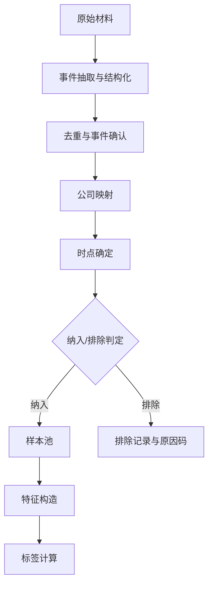
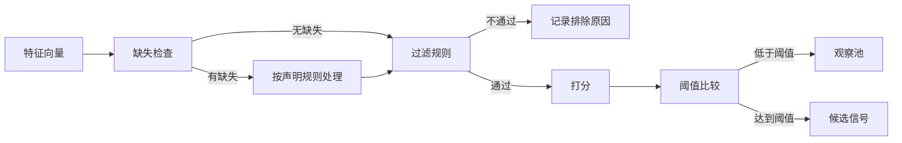

# 第14章　事件Alpha：假说、特征、标签与样本构造

第10章把产业事件推进到了经营变量、成立条件与可观察的证伪路径。但一份经营假说无论写得多严谨，只要它还停留在文字层面，就无法被回测、无法被比较，也无法被证伪。把假说变成可计算对象，需要完成四项转换：把机制陈述转成可观测关系，把事件与公司转成样本，把判断依据转成特征，把预期结果转成标签。

这四项转换中的每一项都会引入新的自由度，而自由度正是研究结论不可复现的主要来源。同一个经营假说，用不同的样本纳入规则、不同的特征计算口径、不同的标签起点，会得到不同的结果——这不是方法论的细节差异，而是研究结论本身的一部分。因此本章的重点不在于给出"正确"的转换方式，而在于**让每一项转换的口径被显式声明，从而使结论可被他人复现或反驳**。

本章与相邻章节的分工是：本章负责假说、特征、标签与样本这四项转换；回测引擎的运行机制由第16章负责；样本外验证与统计不确定性由第17章负责；收益归因与容量由第18章负责。本章出现的方法论算例，凡未标明来源者均为明确标注的教学示例，不代表本系统的历史结果。

## 14.1　从经营假说到量化研究命题

### 14.1.1　假说必须被翻译成可观测关系

经营假说的自然语言形式通常是："某类事件会改善相关公司的经营。"这句话无法直接检验，因为它没有指明三件事：**谁被预测、预测什么、在什么范围内成立**。

翻译成量化研究命题，需要补齐四项：

| 要素 | 内容 | 缺失时的后果 |
|---|---|---|
| 目标对象 | 被预测的标的（个股、组合、行业） | 无法确定样本单位 |
| 预测目标 | 预测的是绝对收益、相对基准收益还是排序 | 标签无法定义 |
| 可观测关系 | 哪个特征与哪个结果之间存在方向性关系 | 无法构造检验 |
| 成立条件 | 机制在什么市场状态、什么事件阶段下成立 | 无法解释失效 |

以第10章的教学情景为例。经营假说是"通过客户认证的公司，其经营将改善"。翻译后的研究命题可以是：

```text
目标对象：公告通过客户认证的A股上市公司（教学示例）
预测目标：事件后相对同行业指数的超额收益
可观测关系：认证类事件的公告 → 正向超额收益，且强度与
            该产品线在公司收入中的占比正相关
成立条件：行业景气度处于扩张期；公司此前未公告过同类认证
```

这段翻译里已经包含了两处必须显式声明的判断：预测目标选的是**相对行业**而非绝对收益（理由见14.6）；成立条件中加入了"此前未公告过同类认证"（理由见10.1.2 的新增信息量）。

### 14.1.2　当时提出的假说与事后解释

这是本节最重要的一条边界。研究记录中常见两种陈述，它们在形式上相似，在证据价值上完全不同：

- **事前假说**：在某事件发生之前或发生时，以书面形式记录了机制、方向与条件。它有提出时间戳。
- **事后解释**：在某事件的价格结果已知之后，用经营逻辑为该结果提供解释。它没有提出时间戳，或者时间戳晚于结果。

判断两者的唯一依据是**带时间戳的记录**。没有记录，就不能声称当时已有该假说——无论该假说在事后看来多么合理。

由此产生一条具体禁令：**不能因为历史上某个事件赚钱，就反推当初已经具有相同的机制假说。**

这条禁令的意义在于区分两种完全不同的能力。第一种是"识别机制的能力"，它体现为事前记录中的判断在后来的事实中得到验证；第二种是"构造解释的能力"，它对任何已发生的结果都能给出连贯的产业逻辑。第二种能力在写作和复盘时极具诱惑力，因为它可以让历史记录看起来远比实际更有前瞻性——但它不是研究能力，而是叙事能力。

因此在整理历史材料时，正确的处理是：

- 有带时间戳的假说记录 → 作为事前假说使用，保留原始时间与版本。
- 只有分析输出、无提出时间 → 标注为"整理时可获得的输出，提出时间不可考"。
- 只有结果、无分析记录 → 标注为案例，不作为假说证据。

**真实材料：C-01 的假说卡（本节最核心的实例）。**

系统里与 C-01 关联的假说记录共 **12 行**，落在 **10 个机制键**上，覆盖 **3 个事件**与 **3 个标的**。以下是其中一条的完整字段构成。

| 字段 | C-01 的实际值 |
|---|---|
| 机制码 | `order_backlog_conversion` |
| 提出时间 | 2026-09-26 02:32（该机制的 v1） |
| 状态 | `pending` |
| 状态理由码 | `AWAITING_VERIFIED_OBSERVATION` |
| 版本号 | v2（当前可见） |
| 兑现规则 | `realize_rule = all` |
| 证伪规则 | `falsify_rule = any` |
| 主键字段 | `root_event_id`（**不是** `event_id`） |

**这张表回答了本节的核心问题：本系统确实保留了带时间戳的事前假说。** 提出时间早于结果、早于 2026-10-07 的重新编译，且带有状态与理由码。**但"保留了假说"不等于"假说已被检验"**——`state = pending` 与 `AWAITING_VERIFIED_OBSERVATION` 两个字段说的都是"还在等观测"，不是"已得出结果"。

**可观测关系写在三个条件上，而不是写在一段文字里。**

| 条件 ID | 类型 | 观测字段 | 算子 | 目标值 | 允许来源 |
|---|---|---|---|---|---|
| `c1_contract_signed` | support | `contract_status` | `eq` | `signed` | announcement |
| `c2_delivery_progress` | realize | `delivery_stage` | **`exists`** | `true` | announcement, periodic_report |
| `c3_contract_cancelled` | falsify | `contract_status` | `eq` | `cancelled` | announcement |

**这张表是 14.1.1 四项要素的真实落点**：目标对象由 `root_event_id` 关联的标的给出；可观测关系由"字段—算子—目标值"三元组给出；成立条件由 `realize_rule = all` 给出（三个 realize 条件须全部成立）；失效条件由 `falsify_rule = any` 给出（任一 falsify 条件成立即失效）。**"兑现要全满足、证伪只要一条"是不对称的**，这个不对称写在了规则字段里，而不是留给读者去猜。

**三条裁决，全部为"无法裁决"。**

| 条件 | 裁决 | 理由码 |
|---|---|---|
| `c1` | `unknown` | `CONTRACT_IDENTITY_REQUIRED` |
| `c2` | **`out_of_scope`** | `NO_MATCHING_SCOPED_OBSERVATION` |
| `c3` | `unknown` | `CONTRACT_IDENTITY_REQUIRED` |

复核报告的原文澄清必须原样引用：

> 「这些结果表示**无法裁决**，**不表示合同没有签署**，也**不表示已取消**。」

**这三行是 14.1.2 的直接证据，也是本节的边界所在。** 一条假说被记录了、被结构化了、被裁决过了——**但裁决结果是"证据不在范围内"，不是"假说成立"或"假说被推翻"。** 把 `out_of_scope` 读成"阶段未发生"，就是本节禁令在真实材料上的第一次违反。

**版本链：6 行，两条并行谱系，两条都标 `is_current = true`。**

| 机制码 | 版本 | 写入时间 | `is_current` |
|---|---|---|---|
| `contract_delivery_to_revenue` | v1 | 2026-09-25 | false |
| `order_backlog_conversion` | v1 | 2026-09-26 02:32 | false |
| `order_backlog_conversion` | v1 | 2026-09-26 04:24 | false |
| `order_backlog_conversion` | v2 | 2026-09-28 15:09 | **true** |
| `contract_delivery_to_revenue` | v2 | 2026-09-28 17:26 | **true** |
| `order_backlog_conversion` | v2 | 2026-09-28 17:36 | **true** |

**替换字段（`supersedes_id` / `replaces_hypothesis_id`）本身是正确的**——每一行都指向了它替换的那一行。**缺陷在于：两条并行谱系各自都留下了 `is_current = true` 的行。** 按 14.1.2 的"保留原始时间与版本"，保留历史版本是对的；**但"保留了历史"与"任何时点的可见版本唯一"是两件独立的事**，后者在本例中不成立。因此**引用本条假说时必须同时给出机制码**，只说"当前版本"会产生歧义。

**本节的落点。** 本系统保留的事前假说**带时间戳、带版本、带条件、带裁决**——这四项都做到了。**但它在两点上不能作为"事前假说已被验证"的证据**：一是样本数恒为 1；二是当前可见版本不唯一。按 14.1.2 的三分法，C-01 属于第一类（有带时间戳的假说记录），使用时**保留原始时间与版本**，并且**必须同时声明样本数与版本歧义**。

## 14.2　公司—事件—时点与样本选择

### 14.2.1　研究单位是三元素

事件研究的最小研究单位不是"事件"，也不是"公司"，而是**公司—事件—时点**三元组。

原因在于两条映射都不是一一对应的。一个产业事件可以映射到多家公司（第6章讨论的产业关系映射），因此一个事件可能产生多个研究单位；一家公司可以在研究期内对应多个事件，因此一家公司可能进入样本多次。若研究单位只取"事件"，则无法处理多公司映射；若只取"公司"，则无法处理多事件。

把研究单位定义为三元组，还有一个直接的好处：它使"同一公司同一事件的重复出现"变成一个可以检查的问题，而不是一个隐性的重复计数。

### 14.2.2　样本构造流程



流程中有两处设计需要说明。

**排除记录必须保留。** 只保留纳入样本、丢弃排除样本的做法，会使研究者无法回答"我的结论是否依赖于排除规则"。排除原因码与计数应当作为研究记录的一部分保存——这与第19章讨论的信号处置总账是同一个要求：**不行动与拒绝同样是研究结果**。

**去重与公司映射的顺序会影响样本量。** 若先去重再映射，则一个事件只映射一次；若先映射再去重，则可能对每个映射对象分别去重。两种顺序的样本量不同，必须在方法中声明。

### 14.2.3　排除原因表

| 排除原因 | 判据 | 事前可判 |
|---|---|---|
| 事件类型不在研究范围 | 事件分类字段 | 是 |
| 无可映射公司 | 关系数据无匹配 | 是 |
| 映射置信度低于阈值 | 关系置信度字段 | 是 |
| 时点不可确定 | 缺少可用时间字段 | 是 |
| 标的事前不可交易 | 停牌、退市、上市未满观察期 | 是 |
| 信息可用时点晚于决策时点 | 时点检查 | 是 |
| 重复样本 | 同一公司同一事件 | 是 |

这张表的最后一列是它存在的理由。**排除规则必须在事前可判。** 如果一条规则需要知道事件发生后的结果才能应用——例如"排除后来业绩未兑现的事件"——那么它就不是样本构造规则，而是事后筛选。事后筛选会系统性地提高回测结果，而这个提高完全来自使用了未来信息。

实践中一个容易混淆的边界是"标的上市未满观察期"。这条规则看起来用了未来信息（需要知道观察期内是否一直上市），但它实际是事前可判的：在事件日就能确定该公司是否已上市足够长时间。判断标准始终是**决策时点能否获得该信息**，而不是该信息涉及哪段时间。

### 14.2.4　独立样本问题

这是事件研究中最容易被高估的地方。以下三种情况都会让观测数大于独立样本数：

**一份报道与多条转载。** 同一事实被十家媒体转载，产生十条材料记录。若不去重，样本量虚增十倍，而信息量没有增加。

**一个事件与多个映射对象。** 一项行业政策影响二十家公司，产生二十个样本。这二十个样本共享同一个事件源，其收益高度相关。

**同一事件的连续进展。** 一条公告及其后续更新（追加订单、调整规模）可能被记为多个事件，但它们的标签区间高度重叠。

三种情况的共同后果是：标准误被低估，显著性被高估。附录A.5 给出的有效样本量关系 `N_eff ≈ N_obs × (1-ρ)/(1+ρ)` 在这里直接适用——如果同一事件源下的样本相关系数为 0.5，那么二十个样本只相当于约七个独立观测。

因此，样本清单中必须保留能够识别相关结构的标识：**事件源标识**（同一源下的样本属于同一簇）、**事件簇标识**、以及标签区间。缺少这些标识，后续无法计算有效样本量，也无法做按簇的稳健性检验。

## 14.3　事件、公司与机制特征

### 14.3.1　特征字典的字段

特征是把判断变成可计算对象的环节。一个可复现的特征定义至少包含八项：

| 字段 | 作用 | 缺失时的后果 |
|---|---|---|
| 特征名 | 唯一标识 | 无法引用 |
| 经济含义 | 该特征代表什么机制判断 | 无法判断取值是否合理 |
| 计算方式 | 输入、公式、窗口 | 无法复现 |
| 取值域 | 类型、单位、范围 | 异常值无法识别 |
| 可用时点 | 该特征值最早何时可用 | 前视风险 |
| 缺失处理 | 缺失时的行为 | 静默填补掩盖问题 |
| 更新规则 | 何时重算、是否覆盖 | 版本混乱 |
| 版本 | 定义变更记录 | 无法追溯口径变化 |

其中**可用时点**是唯一一个直接决定研究有效性的字段。一个特征定义在其他七项上都写得很清楚，但可用时点标错，整个研究就会前视。

### 14.3.2　三类特征

| 类别 | 内容 | 典型可用时点 |
|---|---|---|
| 事件特征 | 事件类型、阶段、来源可靠性、新增信息量 | 事件公告时间 |
| 公司特征 | 规模、行业、客户集中度、产品线占比 | 最近一期定期报告披露日 |
| 机制特征 | 经营暴露强度、证据强度、预期差方向 | 各构成要素可用时点的较晚者 |

机制特征的可用时点值得单独说明：它通常由多个要素合成，因此其可用时点等于**所有构成要素中最后一个的可用时点**。若用较晚的要素与较早的要素合成一个特征，却把特征的可用时点记为较早者，就会产生前视。这是一个在实现中很容易发生的错误，因为合成逻辑本身看起来只是一次计算，没有时间维度。

### 14.3.3　两条红线

**禁止事后补填正确经营结论到历史输入。** 特征在时点 `t` 的取值，只能由 `t` 时刻可获得的信息构成。第10章 10.8.2 用"认证后是否获得订单"这个例子说明了这条约束在经营分析中的表现；在特征构造中，它的形式是：**特征值的计算过程不得引用任何晚于该特征可用时点的输入。**

一个具体的检查方法是对每个特征做一次"时间旅行测试"：假设当前时刻是特征的可用时点，只用手头能拿到的数据，能否算出同样的值？如果不能，说明该特征引入了未来信息。

**不能把置信度视为已校准概率。** 模型输出的置信度、评分或相似度是**排序信号**，不是概率。它满足"分数高的事件结果更好"这一单调关系，但不满足"分数0.8的事件有80%的概率成功"。要把评分变成概率，需要校准过程以及用于校准的独立数据；在校准完成之前，任何基于分数的概率表述都是没有依据的。

这个区分在实务中的后果很直接：一个"置信度0.8"的信号，不能据此说"该事件有八成的概率兑现"，也不能据此计算期望收益。它只能用于排序与阈值筛选。

### 14.3.4　从证据到特征的核对实例

以下为一条明确标注的教学实例，用于展示证据到特征的完整链路。

```text
证据：某公告（教学虚构）称"公司某产品线通过某客户认证"
      公告时间 T0；公告中未披露该产品线收入占比

事件特征
  event_stage      = 3        （阶段序号，对应第10章10.4.2的"客户认证"）
  stage_source     = 公告原文
  available_from   = T0

公司特征
  product_share    = 缺失       （公告未披露）
  share_source     = 最近一期定期报告（披露日 T_{-1} < T0）
  available_from   = T_{-1}

机制特征
  exposure_strength = 未知      （因 product_share 缺失，无法计算）
  available_from    = T0        （较早者，但由于缺失，该特征此时不可用）

记录：
  在 T0 时刻，exposure_strength 不可用；不得用后续年报中
  补披露的产品线占比回填至 T0。
```

这段记录的关键在最后两行。产品线占比在 T0 时确实不可得，因为公告没有披露；它在下一期定期报告中才出现。把定期报告中的占比回填到 T0，就是 14.3.3 所说的"事后补填"。正确的处理是把 `exposure_strength` 标注为在该时点不可用，并让下游流程按缺失处理——而不是用一个看似合理的值把它填满。

## 14.4　收益标签、观察窗口与交易规则

### 14.4.1　五个不同的时间概念

这一节的口径混乱是事件研究中最常见的错误来源。以下五个概念必须分别定义，它们由不同的设计决策决定，且没有必然的数值关系。

| 概念 | 含义 | 由谁决定 | 典型错误 |
|---|---|---|---|
| 标签期限 `h` | 计算标签收益所用的未来区间长度 | 研究设计 | 与持有时长混同 |
| 事件观察窗口 `w` | 从事件日起观察"判断是否成立"的区间 | 研究设计 | 与标签期限混同 |
| 调仓触发 | 什么条件触发下单 | 策略设计 | 未定义 |
| 持有时长 | 实际持有时间 | 策略设计 | 被假设为等于 `h` |
| 退出条件 | 什么条件下平仓 | 策略设计 | 未定义 |

**标签期限不替代调仓周期，观察窗口也不替代持有期。** 一个研究可以用 20 个交易日的标签期限来度量事件的短期反应，同时策略的持有期可能是 60 个交易日——两者服务于不同问题，不构成矛盾。目录规范中反复强调的一点正源于此：**20 或 60 个交易日只是前向观察时间的示例，不是交易周期，也不是研究必须等待的时长。** 把标签期限直接当作持有期，会让研究设计与策略设计混为一谈。

### 14.4.2　同一事件的时间轴

```text
T0 ──── 事件发生（事实时点）
T0+δ ── 信息可用（公告发布，δ 为发布延迟）
T1 ──── 决策时点（≥ T0+δ）
T2 ──── 成交时点（≥ T1）
T3 ──── 标签计算起点（= T1 或 T2，必须声明）
T3+h ── 标签终点
[T0, T0+w] ── 事件观察窗口（用于判断机制是否兑现）
```

这张时间轴上有三处必须显式声明。

**`δ` 的取值。** 公告发布到系统获取之间存在延迟。若把 `T1` 设为 `T0`，等于假设在信息可用之前就完成了决策，构成前视。

**`T3` 的选择。** 标签计算起点应当等于实际可成交的时点。若标签从 `T1`（决策时点）起算，而实际成交在 `T2`，那么标签包含了从 `T1` 到 `T2` 这段尚未建仓期间的收益，标签收益将不可实现。**标签计算起点与成交时点必须一致。**

**观察窗口与标签期限的关系。** 观察窗口用于判断经营机制是否兑现（例如"认证后是否获得订单"），标签期限用于度量收益。两者可以长度不同，但都必须在方法中写明。

### 14.4.3　标签收益与实际可得交易收益的差异

即使标签计算起点设置正确，标签收益仍然与策略可实现的收益存在系统性差异。差异来源如下：

| 差异来源 | 标签的典型假设 | 实际情形 |
|---|---|---|
| 成交价 | 事件后某时点价格 | 受价差、滑点影响 |
| 成本 | 不含 | 佣金、税费、冲击成本（附录A.6） |
| 资金约束 | 满仓、无约束 | 现金、持仓上限 |
| 仓位 | 单一标的 | 组合中的权重 |
| 可交易性 | 假设可成交 | 停牌、涨跌停、流动性不足 |
| 再平衡 | 无 | 组合层面的调仓 |

因此，标签收益是**研究指标**，不是策略收益。用它评价策略表现会系统性高估，而高估的幅度随换手率与流动性上升。这一区分与第18章讨论的收益归因是同一个问题的两端：本章定义标签，第18章负责说明从标签到实际收益的衰减来自哪里。

### 14.4.4　不可用标签生成信号

最后一条红线：**信号生成不得使用标签数据。** 信号在 `T1` 生成，只能使用 `T1` 及之前可获得的信息；标签使用的是 `T3` 之后的收益，只能用于评价信号，不能用于生成信号。

这条约束看似显然，但在实践中会以隐蔽的形式被违反。典型形式是**标签衍生的过滤条件**：先按标签收益筛选出"有效样本"，再在这些样本上总结信号特征，最后把总结出的特征用于信号生成。这个流程在形式上把标签与信号分开了，实际上信号定义已经吸收了标签信息。判断方法是检查信号定义的每一个输入，看它能否在 `T1` 时刻独立计算——如果某个输入的构造过程用到了 `T3` 之后的数据，它就不能作为信号输入。

## 14.5　评分、过滤与信号形成

### 14.5.1　顺序本身是设计决策

从特征到候选信号，中间包含过滤与打分两步。这两步的顺序会影响结果，因此必须声明。

**先过滤后打分。** 先按硬性条件剔除不合格标的，再在剩余集合内打分。这种顺序的问题在于：如果打分使用截面标准化（例如按分位数），那么标准化的参照系是过滤后的子集，而不是全市场。当过滤规则在不同时期剔除不同比例的标的时，同一个原始特征值会得到不同的分数，跨期不可比。

**先打分后过滤。** 在全市场范围内打分，再按硬性条件剔除。这种顺序保持了分数的跨期可比性，但代价是打分样本中包含大量不会被交易的标的，如果打分过程涉及横截面排序，这些标的会影响排序结果。

两种顺序都可以，但必须声明，并且**在整个研究期内保持一致**。中途更换顺序会使前后期的分数不可比。

### 14.5.2　阈值的来源

任何阈值都必须说明来源，常见有三类：

| 来源 | 说明 | 主要风险 |
|---|---|---|
| 历史分位 | 按历史分布取分位点 | 若用全样本分位，构成前视 |
| 经济含义 | 由机制决定，例如"占比超过某水平" | 需要机制支持，否则是任意选择 |
| 样本外确定 | 在训练段确定，在测试段应用 | 需要明确切分 |

第一类的风险需要具体说明。按"历史上该特征的前20%分位"设定阈值，如果这个"历史"包含了事件发生之后的数据，那么阈值本身使用了未来信息。正确做法是用**滚动窗口**：在时点 `t` 只使用 `t` 之前的窗口计算分位点。这个要求与第5章的时点查询是同一件事。

### 14.5.3　未知特征与冲突处理

**未知特征的处理必须显式声明。** 常见选项有三：跳过该标的（相当于隐含了"缺失即不合格"的判断）、用截面中位数填补（会削弱特征的区分度）、或将该特征视为独立类别。三种处理会产生不同的样本量与结果，不能默认其中一种。

需要特别指出：用中位数填补看似中性，实际会引入一个方向性假设——它假设缺失标的的特征值处于分布中部。如果缺失的原因是"公司没有披露"，而这个原因本身与经营状况相关（不披露往往与不利信息相关），那么中位数填补会把一批实际处于尾部的标的移到中部，系统性地削弱信号。

**冲突处理同样需要声明。** 当多个特征指向相反时，可选的处理包括：按优先级覆盖、加权合成、或直接标记为冲突并交由人工复核。本章不预设哪一种更好，但要求声明——因为"冲突时怎么办"往往决定了信号在边界情况下的行为，而边界情况正是回测结果与实盘差异的主要来源。

### 14.5.4　局部流程与边界样例



**边界样例**（教学示例）：某标的通过全部硬性过滤，但在机制特征上存在冲突——事件阶段较晚（对应较弱的增量信息），而证据强度较高（有原始披露支持）。此时按"阶段优先"规则应被排除，按"证据优先"规则应进入候选。这个样例说明的是：冲突处理规则不是边缘细节，它直接决定了这类标的的归属，而这类标的在样本中往往占据相当比例。

### 14.5.5　两条红线

**不预设必须使用机器学习。** 规则打分、线性模型、树模型都是候选方案，选择应由问题形态与可用样本量决定，而不是由技术偏好决定。在小样本场景下，规则打分往往比复杂模型更稳健，因为它的自由度更低、更容易解释、也更不容易过拟合。

**不把分数变化自动等价为收益增量。** 一个信号的评分从 0.6 升到 0.8，不意味着预期收益按比例上升。要建立分数与收益的对应关系，需要的是分组收益的单调性检验（附录A.4）——而这本身是一项需要样本的实证工作，不是分数定义的推论。

**真实材料：本系统实际的过滤与评分输出。**

**过滤不是一道门，是两道。** C-01 同时被两个独立字段否决：

| 门 | 字段 | C-01 的值 |
|---|---|---|
| 正式候选资格 | `formal_candidate_eligible` | `false` |
| 是否生成候选信号 | `should_generate_candidate_signal` | `false` |

**两个字段不能互相替代。** 这与第7章 7.2.4 的"两条独立过滤"是同一种设计缺陷的另一面：**看到一道门是 `false` 就断言"已被过滤"，会漏掉另一道门的独立判据。**

**过滤的判据不是"不合格"，而是"卡在哪一步"——用理由码记录。** 全库 55,321 条事件按 `stage2_reason_code` 分成 18 类，C-01 落在 `ai_catalyst_mapping_required`：

| 理由码 | 行数 | 占比 |
|---|---|---|
| `ai_classification_pending_research_only` | 11,186 | 20.22% |
| `verified_topic_non_ai` | 10,488 | 18.96% |
| `issuer_ai_membership_without_event_ai_causality` | 8,670 | 15.67% |
| `ai_related_no_new_catalyst` | 5,845 | 10.57% |
| `issuer_ai_material_event_causality_pending` | 5,720 | 10.34% |
| **`ai_catalyst_mapping_required`（C-01）** | **5,628** | **10.17%** |
| …（其余 12 类） | … | … |
| **`formal_candidate_compiled`（真正成为正式候选）** | **114** | **0.206%** |

**这张表是 14.5.1"顺序本身是设计决策"的真实落点。** 过滤顺序决定了理由码的归属：一条事件若先被判为非 AI 主题，就永远不会走到"催化剂映射"这一步。**更重要的是这个比例：83.5% 的拒绝理由属于"口径与因果未定"，不属于"数据缺失"。** 换言之，**拒绝是这套流程的正常输出，不是异常**——把"大量事件被拒绝"当作系统失效的证据，会误读这条链路的设计意图。

**评分输出是三档结构，不是一个分数。** 全库 42,972 张机会卡的实际分布：

| 档位字段 | 取值 | 行数 |
|---|---|---|
| `final_grade` | A / **U** / O / B | 2,591 / **20,159** / 18,820 / 1,402 |
| `readiness_band` | ready / observe / blocked | 15,972 / 6,841 / **20,159** |
| `retail_action_code` | `wait_confirm` / `watch` / **`avoid`** / `small_probe` | 2,591 / 18,820 / **20,159** / 1,402 |

**三行是同一批记录的三个投影，不是三个独立指标。** `U` 档 20,159 行同时对应 `blocked` 与 `avoid`——**"不可评级"是这套评分的一个正式档位，而不是评分失败的兜底值。** 这正是 14.5.2 要求的"阈值的来源"必须显式：**如果 `U` 档的阈值没有声明，20,159 行就会被读成"系统没有能力评分"。**

**评分跑出来了，但"执行授权"这一步从未评估过。** `opportunity_candidates` 全库 68,569 行：

| 字段 | 分布 |
|---|---|
| `execution_authority_state` | **`not_evaluated` 100%** |
| `execution_authority_tier` | **NULL 100%** |
| `execution_passport_id` | **NULL 100%** |

**这是 14.5.4 的"局部流程"最需要读者注意的地方**：**流程图画到了"候选信号"，但候选之后还有一步没有接线。** 因此**不得把"候选数量"当作"可执行数量"**——候选层与执行层之间的这段空白，是 14.5.5 第二条红线（不把分数变化等价为收益增量）在工程层面的同类问题。

**未知特征的处理：系统没有填补，而是分列。** C-01 的三对字段互相矛盾，系统**保留了两列而不是取其一**：

| 字段对 | 值一 | 值二 |
|---|---|---|
| AI 归属 | `ai_tier = L3` | `ai_relevance_score = 0.1000` |
| 置信 | `confidence = 0.540` | `data_confidence_score = 0.7800` |
| 影响 | `impact_level = 4` | `final_impact_level = 4`（一致） |

**前两对是 14.5.3 的"未知特征处理必须显式声明"的真实答案**：本系统的做法是**不填补、不合成、分列保留**。这与 14.5.3 的"用中位数填补会引入方向性假设"一致——**当两个字段矛盾时，合成会掩盖矛盾本身**。第三对（`impact_level` / `final_impact_level`）取值一致，说明**分列保留不等于一定有分歧**；它的价值在于**当两者不一致时，分歧会被看到**。

**冲突处理的真实形态：声明了 10 个维度，实现了 6 个。** 集中度门在声明层列出 10 个维度，`check()` 只实现 6 个；其余三个（`max_common_upstream` / `max_overseas_catalyst` / `max_correlation_cluster`）在组合优化器里实现。**因此"集中度门实现了几个维度"这个问题没有单一答案**——答案取决于问的是声明层、检查函数，还是组合优化器。**这是 14.5.3 的"冲突处理需要声明"在工程层面的延伸：不仅冲突时怎么办要声明，"这道检查覆盖哪些维度"也要声明。**

**本节的落点。** 本系统的过滤与评分**实际运行过**（55,321 条事件走完理由码分类、42,972 张卡打出三档、68,569 个候选入池），**但它在三处留下了未闭合**：执行授权 100% 未评估、`U` 档阈值来源未声明、集中度门的维度数三处不同。**因此本节只能说"流程的顺序与边界行为已被观察到"，不能说"评分体系已被验证"。** 按 14.5.5 的红线，**分数与收益的对应关系在本系统中尚未建立**——`alpha_forecasts` 45,140 行中 32,098 行（71.11%）处于 `superseded`，而全库 `production_candidate_eligible` 为 **0**。

## 14.6　市场、行业与可比较对象

### 14.6.1　三类对照回答不同问题

选择对照不是技术细节，它决定了结论能被解释到什么程度。

| 目的 | 对照选择 | 能得出的结论 | 不能得出的结论 |
|---|---|---|---|
| 基准调整 | 市场指数或行业指数 | 相对表现 | 事件是否导致该表现 |
| 预测比较 | 同期同行业可比公司 | 该标的是否优于同类 | 事件效应的大小 |
| 因果识别 | 反事实构造（匹配、双重差分等） | 事件的因果效应 | 需要额外的识别假设 |

三者的差别在于**排除了哪些共同因素**。基准调整排除了市场或行业的共同涨跌；预测比较进一步排除了行业内的共同因素；因果识别还需要排除"有事件的公司与无事件的公司本身不同"这一选择效应。

### 14.6.2　调整收益的计算

```text
简单超额收益   AR_i = r_i - r_benchmark

风险调整超额   AR_i = r_i - ( α_i + β_i · r_m )
                       其中 β_i 由事件前的估计窗口回归得到
```

**教学计算**（数值为教学示例）：

```text
事件窗 [T0, T0+5] 内：
  个股收益 r_i     = 3.2%
  行业指数收益 r_b = 1.1%
  → 简单超额收益   = 3.2% - 1.1% = 2.1%

风险调整（用事件前 120 个交易日估计 β_i = 1.15）：
  事件窗内市场指数收益 r_m = 1.0%
  预期收益 = β_i × r_m = 1.15%
  → 异常收益 AR = 3.2% - 1.15% = 2.05%
```

两种口径给出的结果接近（2.1% 与 2.05%），但这只是本例的巧合。当个股的 β 显著偏离 1、或行业与市场的表现分化时，两者的差异会明显放大。

**β 的估计窗口必须早于事件。** 这一点需要强调：如果 `β_i` 用事件窗内或全样本数据估计，估计过程就使用了事件后的收益信息，构成前视。用事件前的窗口估计 `β`，是事件研究方法的标准要求，也是本章 14.4.4 那条红线在对照选择环节的具体表现。

### 14.6.3　两条红线

**超额于某基准不自动证明事件因果。** 基准调整只能剔除共同因素，无法剔除同一时期影响该个股的其他特质因素。一家公司在公告认证的同一天可能还发布了业绩预告、发生了大股东增减持、或被纳入某指数——这些都会进入"超额收益"，却被归因给了认证事件。要排除这类混淆，需要的是事件窗内的其他公告检查、以及更严格的识别设计，而不是换一个基准。

**不要用事后知道的相似赢家作对照。** 如果对照对象是在知道结果之后、从"后来表现好的公司"中挑选出来的，那么这个对照不构成反事实——它是从结果反推的。这种做法会产生极强但完全虚假的"事件效应"。正确的对照选择规则必须**在事件时点可执行**，与 14.2.3 对排除规则的要求一致。

## 14.7　事件簇、横截面与市场状态

### 14.7.1　横截面异质性

同一事件对不同公司的影响不同，差异来自经营暴露的强度（第6章）、产品线占比、以及公司在产业链中的位置。因此，把同一事件下的所有映射对象合并为一个样本，会掩盖这种异质性；而按暴露强度分组，又需要保证分组依据在事件时点可得（14.3.3）。

### 14.7.2　共同事件源与窗口重叠

**共同事件源。** 一项行业政策、一次行业性的价格变动、一家下游龙头的资本开支计划，都可能同时影响数十家公司。这些样本共享同一个事件源，收益高度相关。若把它们视为独立样本，会显著低估标准误。

**窗口重叠。** 同一家公司在短期内发生多个事件时，各事件的标签区间可能重叠。重叠区间的收益无法归因给其中任何一个事件。

**处理方式。** 样本清单中必须保留三类标识，否则后续无法做任何按相关结构的调整：

| 标识 | 作用 |
|---|---|
| 事件源标识 | 把同一源下的样本归为一簇 |
| 事件簇标识 | 把同一事件的多个映射对象归为一簇 |
| 标签区间 | 识别区间重叠 |

保留这三类标识的成本很低——它们只是在样本记录中多加几个字段；缺失的代价很高——事后无法重建，只能重新构造整个样本池。

### 14.7.3　市场状态

事件效应可能随市场状态变化。按状态分组的结果通常呈现明显差异，而这正是最容易出错的地方。

**不能把分组后最优的状态当作事前已知的适用条件。** 如果分析流程是"先按市场状态分组，再看哪一组效果最好"，那么被发现的最优组是**在结果已知之后**选出的。把它作为策略的适用条件，等于用未来信息筛选样本，其表现无法在样本外重现。

这个错误有一个隐蔽的变体：把"分组后最优"表述为"策略在市场状态X下更有效"，听起来像是一条经过验证的经验规律，实际上它的验证过程使用了被验证的数据本身。要把它变成可用条件，需要的是**在独立样本上检验该条件**，或者有事先的机制解释说明为什么该状态下应当更有效。仅有分组结果不构成依据。

### 14.7.4　分组表

| 分组维度 | 分组依据 | 可判时点 | 需要保留的标识 |
|---|---|---|---|
| 事件类型 | 事件分类 | 事件日 | 事件源标识 |
| 事件阶段 | 阶段序号（10.4.2） | 事件日 | 事件簇标识 |
| 经营暴露强度 | 机制特征 | 各要素可用时点的较晚者 | 特征版本 |
| 市场状态 | 波动率或趋势指标 | 事件日 | 状态定义版本 |
| 行业 | 行业分类 | 事件日 | 分类标准版本 |

最后一列的"版本"字段是必要的：市场状态的定义（用多长的窗口、用什么指标、阈值取多少）会随时间调整，行业分类标准也会修订。缺少版本记录，跨期的分组结果无法比较。

## 14.8　失败假说、证伪与研究结论

### 14.8.1　三种情况必须分开

研究结果中"没有发现效果"与"证明了没有效果"是两回事。以下三种情况在证据要求上不同，在表述上也必须分开。

| 情况 | 含义 | 需要的证据 | 常见误述 |
|---|---|---|---|
| 未发现效果 | 检验统计量未达显著水平 | 样本量、检验力说明 | 表述为"该机制无效" |
| 证据不足 | 样本量小、数据缺失、无法判断 | 检验力分析、缺失原因 | 表述为"未发现效果" |
| 证据反对 | 效应方向与假说相反且显著 | 方向、显著性、稳健性 | 与"未发现效果"混同 |

**未显著不等于严格证明无效。** 一个不显著的结果可能来自三种原因：效应确实不存在、样本量不足以检出该效应、或效应存在但被其他因素掩盖。区分这三种原因需要检验力分析——即回答"以当前样本量，能检出多大的效应"。缺少这一步，不显著的结果无法被解释。

**负结果不阻塞书稿。** 这一点需要在写作层面明确：一项被证伪的假说、一项证据不足的尝试、一个方向相反的发现，都是研究过程的一部分，都应当被写入。只呈现成功结果的记录无法反映真实的研究范围，也无法让读者判断结论的可靠性。这与第17章讨论的"实验总账"是同一个要求。

### 14.8.2　假说—结果—替代解释—决定

| 假说 | 结果 | 替代解释 | 决定 |
|---|---|---|---|
| 认证事件带来正向超额收益 | 未发现效果 | 样本量不足；认证类事件的信息量已被其他渠道提前反映 | 保留假说，扩大样本后重检 |
| 效应强度与产品线占比正相关 | 证据不足 | 产品线占比披露不完整，多数样本该特征缺失 | 保留假说，补充数据来源 |
| 事件阶段越早效应越强 | 证据反对 | 早期阶段事件的市场关注度低，流动性不足导致收益不可实现 | 修订假说，加入可交易性条件 |
| 效应在行业景气扩张期更强 | 未发现效果 | 景气指标定义敏感，不同定义下结果不一致 | 修订假说，先固定景气指标定义 |

四行分别对应四种决定类型。需要说明的是"证据反对"那一行：效应方向与假说相反，且达到显著——但替代解释指出这可能不是机制不成立，而是早期阶段事件缺乏流动性，标签收益不可实现。这类情况下，正确的处理不是简单地放弃假说，而是**修订假说**，把可交易性作为条件加入。

### 14.8.3　决定类型

| 决定 | 适用情况 | 记录要求 |
|---|---|---|
| 保留 | 证据支持，或证据不足但机制成立 | 保留原始假说与证据 |
| 降权 | 证据部分支持，或稳健性不足 | 记录降权依据 |
| 修订 | 证据反对，但有合理的替代解释 | 保留旧版本，新增修订版本（第10章 10.8.3） |
| 停止 | 证据反对且无合理替代解释 | 保留记录，说明停止依据 |

四种决定都必须留下记录，包括"停止"。一个被停止的假说同样是研究产出——它避免了后续重复投入同一方向。若只保留"保留"与"降权"的记录，研究历史会显得比实际更成功，而后来者会重新踩进已经验证过的坑。

### 14.8.4　本章的定位

本章提供的是把产业研究变成可回测对象的**转换规范**，而不是转换的结果。规范的价值在于它使结果可复现、可反驳；至于某个具体的假说在转换之后是否显示效果，取决于数据、样本与检验，属于第16章与第17章的范围。

本章的特别结论边界也需要重申：**研究窗口不替代调仓周期；历史结果不足时写方法与已知边界，不补造有效性。** 本章没有给出任何事件策略的有效性结论，这是本章性质决定的，不是材料缺口的产物。

下一章讨论多因子研究、风险基线与EQ-MF的独立评价。它与本章的关系是：本章处理的是单个事件类假说如何变成研究对象，下一章处理的是在同一工程底座上，风险因子与预测因子的分工，以及独立研究线如何被分别核算。
