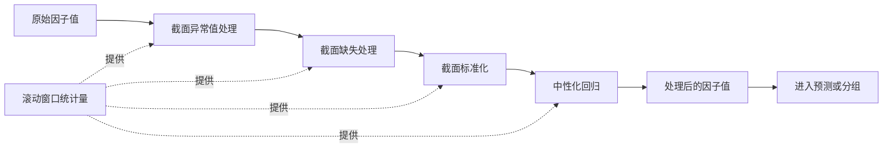

# 第15章　多因子研究、风险基线与EQ-MF的独立评价

第14章把产业假说变成了可回测的对象。但事件研究只是研究线之一。在同一套工程底座上，还存在另一类研究：用一组可横截面比较的特征来解释收益的共同来源，并尝试预测收益的横截面差异。这类研究通常被称为多因子研究。

把它与事件研究放在一起讨论，容易产生三种混淆。第一种是**把风险解释当成收益预测**：一个因子能解释组合收益的共同波动，并不说明它能预测未来收益。第二种是**把风控动作当成投资动作**：风险中性化的目的是消除暴露，而多因子配置的目的是利用暴露，两者方向相反。第三种是**把两条研究线的结果直接合并**：两条净值相加既不是组合收益，也不能说明分散效果。

本章的目标是把这三件事分开。15.1 建立角色区分，15.2 到 15.6 讨论多因子研究自身的构造与检验，15.7 界定独立研究线（EQ-MF）的核算边界，15.8 回到两条研究线之间的关系。本章与相邻章节的分工是：通用的组合构建方法由第20章展开；本章只处理因子层面与独立研究线的评价边界。

一条贯穿本章的结论边界需要开篇说明：**用户确认整体系统已完成，但这不自动证明每个历史设想均已上线。** 本章按实际可核验的范围写作，对未核验的部分明确标注状态，而不是默认其存在。

## 15.1　风险因子、预测因子与策略目标

### 15.1.1　三种角色

同一个变量可以在三个不同的位置上出现，承担三种不同的任务。

| 角色 | 目的 | 输入 | 输出 | 检验方式 |
|---|---|---|---|---|
| 风险因子 | 解释收益的共同来源 | 历史收益序列 | 暴露度 | 解释力、残差结构 |
| 预测因子 | 预测横截面收益差异 | 当期特征值 | 排序或评分 | 信息系数、分组单调性 |
| 策略配置 | 在约束下形成组合 | 预测结果＋风险约束＋资金约束 | 目标权重 | 成本后的净值 |

三者的差别不只在输出，更在**检验什么**。风险因子的检验问的是"它解释了多少共同波动"；预测因子的检验问的是"它与未来收益是否相关"；策略配置的检验问的是"在成本与约束下是否仍然有利"。一个变量在三处都合格，需要三套不同的证据。

### 15.1.2　同一因子的双重身份

多个常见变量同时具备风险因子与预测因子的身份，这不是矛盾，而是它们的用途被分开使用。

| 变量 | 作为风险因子 | 作为预测因子 |
|---|---|---|
| 规模 | 控制组合的规模暴露 | 规模效应 |
| 估值 | 控制价值与成长风格暴露 | 估值溢价 |
| 动量 | 控制动量暴露 | 动量效应 |
| 波动率 | 控制低波动暴露 | 低波动异象 |

以规模为例。在风险模型中，研究者希望组合不因小盘股的系统性涨跌而获得或损失超额收益，因此把规模作为暴露来控制——目标是把该暴露调到接近零。在预测模型中，研究者可能恰恰认为小盘股有更高的预期收益，因此把规模作为选股依据——目标是利用该暴露。**同一个变量，一个要消除，一个要利用。**

因此，**风险中性化模块不等于独立的多因子Alpha产品线。** 中性化是一个风控动作，它的输出是一个暴露被约束后的组合，其目的是让收益归因更干净；多因子Alpha是一个投资动作，它的输出是基于预测的配置，其目的是获取收益。把前者称为后者，会把一个用于解释的工具说成用于获利的策略。

### 15.1.3　两类范畴错误

**用解释力论证预测能力。** 一个因子对历史收益的解释力高（例如回归的判定系数高），只说明它与已实现的收益共变，不说明它能预测未来收益。解释是回溯的，预测是前瞻的，两者的检验方式不同。

**用预测能力论证策略可行性。** 一个因子的信息系数为正，说明它与未来收益有排序关系，不说明按它构建的组合在扣费后仍然有利。从因子到策略，中间隔着组合构建、换手控制、成本与约束（第16章、第20章）。

**本系统的实际角色分配（真实材料，快照时点 2026-10-09）。**

**三类角色在本系统**没有**对应的模块边界。** 实测如下：

| 角色 | 本系统的实际情况 |
|---|---|
| **风险因子** | **不存在风险模型**——**全库没有任何暴露归因、风险模型或残差列**；也没有 ADV 序列、没有 `k` 校准、没有容量敏感性分析。风险侧只有**集中度闸门**（见下） |
| **预测因子** | 特征是有的，但**用途是"配对匹配"而不是"收益预测"**——基准的六个设计要素中包含五个横截面特征（市值 / 换手 / 20 日动量 / 波动率 / AI 池成员），它们用于**构造可比同业集**，不用于预测收益 |
| **策略配置** | 以**评级与档位**的形式存在——`opportunity_cards` 的 `final_grade` / `readiness_band`：U/blocked **20,159（46.9%）** / B/ready 17,096 / O/observe 3,157 / A/ready 2,591；以及 `opportunity_candidates.permission_lane`（`research` 57,961 / `learning` 10,608） |

**风险侧的唯一实现是集中度闸门，而它同时是"声明与实现不一致"的实例：** 闸门**声明 10 个维度**，`check()` **只实现 6 个**；其余三个（`max_common_upstream` / `max_overseas_catalyst` / `max_correlation_cluster`）在 `portfolio_optimizer.py` 中执行。严重度模型为**按次数计**：每次违规减半仓位，≥3 次归零。且 `layered_portfolio_construction_service.py` 把 `layer == "alpha"` 的约束**放宽为 `1.0`**，代码注释为：「Alpha is a hypothesis portfolio, not the production risk book.」

**这一行注释本身就是 15.1.1 三种角色的分离声明**——系统明确把 alpha 层视为"假说组合"而非"生产风险账本"。**但它是注释，不是模块边界。**

**基准的六个设计要素（`src/services/alpha_benchmark_service.py:241` 一带）：**

| 要素 | 实现位置 | 评价 |
|---|---|---|
| 前视隔离 | `DailyBasic.trade_date < entry_date`（`:346,380`） | ✅ 已实现 |
| 目标剔除 | `target_excluded: True`（`:314`） | ✅ 已实现 |
| p10 / p90 缩尾 | `:293-294` | ✅ 已实现 |
| 行业 +1.0 距离惩罚 | `:280-281` | ✅ 已实现 |
| 特征集（市值 / 换手 / 20 日动量 / 波动率 / AI 池） | `:411-417` | ✅ 已实现 |
| 距离加权 `1/(1+distance)` | `:295` | ⚠️ 唯一被标记的要素 |

报告原文（值得逐字保留）：「**尺子是好的，量出来的样本是空的。**」

> **本节的口径留白（刻意）**：本节**不给出"本系统的风险因子清单"**。原因是**没有风险模型**——不存在暴露、残差或因子载荷列。**给出一个因子清单等于宣称存在一个并不存在的模型。**

## 15.2　历史可投资池与比较基准

### 15.2.1　可投资池必须是历史时点的

**当前成分与当前存续股票不能替代当时的集合。** 这条约束有两个独立的来源。

**成分变更。** 指数的成分股会定期调整。用今天的成分股去回测十年前，等于用一组"后来被证明足够重要"的股票做样本。这不是幸存者偏差的简单形式，而是更一般的**选择效应**：成分股的纳入本身包含了历史信息。

**存续状态。** 退市、被并购、长期停牌的股票在今天已经不在数据中。把它们排除在外，样本就只包含"活到今天"的公司。这构成幸存者偏差（第17章 17.4.1）。

因此，可投资池必须按研究时点构造：在每个调仓时点，使用该时点可观察到的成分与状态。

### 15.2.2　筛选维度

| 维度 | 处理方式 | 主要影响 |
|---|---|---|
| 上市时长 | 上市满若干期后纳入 | 剔除新股的价格异常与流动性不足 |
| 交易状态 | 排除停牌、特殊处理状态 | 影响可交易性与价格可信度 |
| 流动性 | 按成交额或换手率筛选 | 影响容量与成本 |
| 数据完整性 | 要求特征齐全 | 影响样本量；需声明缺失机制 |

第四个维度需要特别注意。要求特征齐全看似中性，实际会引入选择：特征缺失的公司往往在规模、行业或经营状态上有共性（第17章 17.4.2）。因此，因数据不完整而被排除的样本数量与其分布特征，应当被记录。

### 15.2.3　比较基准

| 基准类型 | 构造方式 | 适用 | 局限 |
|---|---|---|---|
| 宽基市场指数 | 直接使用指数收益 | 判断是否跑赢市场 | 无法分离行业与风格 |
| 行业指数 | 按行业分类加权 | 判断行业内的相对表现 | 需要历史行业分类 |
| 可投资池基准 | 按同一可投资池等权或市值加权 | 判断选股是否有效 | 与可投资池定义强绑定 |

第三种基准在因子研究中常用，因为它的构造与可投资池一致，因而能直接回答"在同样的股票池中，选股是否产生了差异"。它的局限是：结果依赖于可投资池的定义，池子一改，基准与结果同时改变。

**不预设全市场都可交易。** 一个常见的简化是把全部上市股票视为可选集合，这在容量分析中会导致严重高估（第18章）。可投资池应当反映真实的交易约束，而不是全部存在的证券。

**本系统的实际可投资池与基准（真实材料，快照时点 2026-10-09）。**

**没有按研究时点构造的可投资池。** 三重证据：

| 证据 | 实测 |
|---|---|
| 无带期间的覆盖表 | `company_research_module_snapshots` **6,725 行**、`company_research_priority_snapshots` **9,102 行**均为**日快照**，不是"某期间内有效的池" |
| 研究需求通路近乎未建 | `research_evidence_needs` 仅 **2 行**（2026-10-08 16:50 创建） |
| 主体标识不精确 | `stock_code` 空串 **33,068 行（5.7%）**——池无法被精确枚举 |

**基准侧反而是本系统做得最实的一处。** `benchmark_status` 分布：

| 状态 | 行数 | 占比 |
|---|---|---|
| `complete` | 44,181 | **53.5%** |
| **`missing`** | **33,844** | **41.0%** |
| `benchmark_window_pending` | 3,062 | 3.7% |
| `invalid_window` | 1,458 | 1.8% |
| `adj_factor_incomplete` | 18 | 0.02% |

**`benchmark_source` 分布：** `conditional_matched_peers_v2` **31,514** / `industry_median` **10,740** / `active_market_median` **1,911** / `analysis_pool_median` **16**。

**基准覆盖率有四个分母，而报告声称的那个无法复现：**

| 口径 | 覆盖率 |
|---|---|
| 全量分母 | **53.5%** |
| 剥离某种缺失后 | 84.6% |
| 再剥离后 | 89.6% |
| **报告声称** | **93.7%（无法用任何算法复现）** |

**C-01 的基准记录为空：** `benchmark_type = market_consensus`，但 `benchmark_ref = null`，`comparability_state = unknown`。**即：基准类型被声明了，基准引用为空，可比性状态未知。**

**前视隔离确实实现了（本节 15.2.1 的核心要求）：** 基准匹配使用 `DailyBasic.trade_date < entry_date`（`src/services/alpha_benchmark_service.py:346,380`）——**严格早于入场日**。这是本系统在 PIT 方面最可靠的一处实现。

**行业分类版本的实测状态：** 基准使用**行业距离惩罚**（+1.0），说明存在行业分类；但**库中无行业分类版本号字段**。因此本节"基准与可投资池口径是否一致"这一问题**在本系统无法回答**——**可投资池不存在，所以没有可比较的对象。**

> **本节的口径留白（刻意）**：本节**不给出"本系统的可投资池规模"或"基准覆盖率"的单一数字**。原因是：① 可投资池**未按期间构造**，规模随时点而变；② 基准覆盖率有**四个分母**，且报告值不可复现。**给出单一数字等于替作者选了一个分母。**

## 15.3　现有因子的定义与经济解释

### 15.3.1　因子字典

一个可复现的因子定义包含以下字段：

| 字段 | 作用 |
|---|---|
| 因子名 | 唯一标识 |
| 经济含义 | 该因子代表什么机制 |
| 方向 | 因子值与预期收益的正负关系 |
| 计算方式 | 公式、输入字段、时间窗口 |
| 可用时点 | 该因子值最早何时可用 |
| 标准化方式 | 截面标准化的具体做法 |
| 可能失效环境 | 机制在什么市场状态下不成立 |
| 版本 | 定义变更记录 |

第七项在实践中常被省略，但它对研究判断很关键。**一个因子没有失效环境，通常意味着它的经济解释是事后构造的。** 任何真实的机制都有其边界条件：动量在趋势市中有效、在反转市中失效；低波动在风险偏好下行时表现更好、在风险偏好上行时落后。写不出失效环境的因子，其解释往往是为了配合历史结果而编的。

### 15.3.2　可核算的教学示例

以下为一个明确标注的教学示例，用于说明因子计算中的时点约束。

```text
动量因子（教学示例）

定义： mom_{i,t} = P_{i,t-1} / P_{i,t-1-k} - 1

说明： 在时点 t 计算时，使用 t-1 及之前的价格。
       若使用 P_{i,t}，则该因子在 t 时刻的决策中不可用
       （第16章 16.2.2 的同根K线问题）。

教学算例：
  k = 20
  P_{i,t-1}      = 11.00
  P_{i,t-1-20}   = 10.00
  → mom_{i,t}    = 11.00 / 10.00 - 1 = 10.0%

方向：预期为正（前期涨幅与未来收益正相关），
      在趋势反转环境中预期失效。
```

这个示例的重点不在公式，而在那个 `t-1`。把公式中的下标改成 `t`，因子在数学上仍然成立，在时间上已经不可实现——而这类改动在代码中只是一个字符的差异，不会被任何语法检查发现。

### 15.3.3　两条红线

**不要为满足"完整因子大全"增加未实现因子。** 技术书有一种诱惑：为了显得体系完整，把教科书上的经典因子逐一列出。但本章讨论的是**本系统实际实现的因子**，列出未实现的因子会让读者无法区分"系统有什么"与"这一领域有什么"。补充对照方法时应当清楚标注为外部方法。

**不要把经济解释当作有效性证据。** 一个有漂亮经济故事的因子，仍然可能在样本上无效。经济解释提供的是"为什么它可能有效"的假设，其作用是指导检验与解释失效，而不是替代检验。把机制叙述当作证据，是第10章 10.1.3 讨论的"产业逻辑流畅不等于因果识别"在因子层面的对应形式。

**本系统的实际特征（真实材料，快照时点 2026-10-09）。**

**本系统没有因子字典。** 实测存在的"特征"有三处，且**没有一处是为收益预测构造的**：

| 特征集 | 位置 | 实际用途 | 行数 / 取值 |
|---|---|---|---|
| 基准匹配特征 | `alpha_benchmark_service.py:411-417` | **构造可比同业集**（配对匹配） | 市值 / 换手 / 20 日动量 / 波动率 / AI 池成员 |
| 事件逻辑特征快照 | `event_logic_features_v2` | **记录事件—公司关系** | C-01 的两个特征**值均为 `null`**，方向分别为 `positive` / `negative`，`knowledge_mask = unknown` |
| 特征来源白名单 | `src/domain/event_input_policy.py:8-17` | **准入过滤**（12 个成员） | 12 个 `source_type` 取值 |

**三者都不是 15.3.1 意义上的因子。** 具体差别：

- **没有"方向"字段用于收益预测。** 事件逻辑特征有方向（`positive` / `negative`），但**它的值是 `null`**——方向与数值是**分离存储**的，且数值缺失。**一个"方向已知、数值为 null"的特征无法参与任何排序或 IC 计算。**
- **没有"可用时点"字段。** 三个特征集都没有"该特征值最早何时可用"的记录。**15.3.1 表格中"可用时点"这一栏在本系统无对应字段。**
- **没有"可能失效环境"字段。** 因此 15.3.1 所述"写不出失效环境的因子，其解释往往是事后构造的"这一判断，**在本系统无法逐因子核验**。

**因此本节两条红线在本系统的实际形态是：** ① **不存在"未实现的因子被列出"的风险**——因为**连已实现的因子字典都不存在**；② **"经济解释不等于有效性证据"在本系统有一个更强的问题**——**连有效性检验的对象都没有**（无 IC、无分组收益，见 15.5.4）。

**一处必须记录的实测：** `event_logic_features_v2` 的两个特征值为 `null`，但 `knowledge_mask = unknown` 是**显式的未知标记**——按第8章 8.5.2 的要求，**"未知"被表示为独立状态而不是 0**。这是本系统在特征层做得正确的一处。

> **本节的口径留白（刻意）**：本节**不给出"本系统的因子字典"**。原因是**没有因子字典这个对象**——可核验的只有三处特征集，且**均非为收益预测构造**；C-01 的特征值本身为 `null`。**给出一个因子表等于把"用于配对的特征"改写成"用于预测的因子"。**

## 15.4　异常值、缺失、标准化与中性化

### 15.4.1　处理次序

四类预处理存在固定的先后关系，次序颠倒会引入错误。

```text
① 异常值处理  →  ② 缺失处理  →  ③ 标准化  →  ④ 中性化
```

**为什么是这个顺序。** 异常值必须在标准化之前处理，否则标准化的均值与方差会被极值主导，使全部样本的标准化结果失真。缺失必须在标准化之前处理，否则标准化的样本集合在不同时点不一致，标准化结果不可比。中性化放在最后，因为它通常通过回归实现，需要在一个已经清理干净的截面上进行。

### 15.4.2　每一步的范围与前视风险

这一小节是本节的重点。**每一步都有一个"用多少数据"的问题，而这个问题的答案决定了是否前视。**

| 步骤 | 截面范围 | 时间范围 | 前视风险 |
|---|---|---|---|
| 异常值处理 | 当期截面 | 无（仅用当期） | 若用全样本分位点 → 前视 |
| 缺失处理 | 当期截面 | 无（仅用当期） | 若用全样本均值填补 → 前视 |
| 标准化 | 当期截面 | 无（仅用当期） | 若用全样本均值方差 → 前视 |
| 中性化 | 当期截面 | 回归窗口须早于当期 | 若窗口含当期及之后 → 前视 |

**不得用全时期均值方差预处理历史测试集。** 这是量化研究中最经典的前视形式之一。它的隐蔽之处在于：均值和方差看起来是"统计量"，不像"未来信息"；但它们确实使用了未来的观测值，因而把未来的分布信息带入了历史时点。

正确的做法是**滚动窗口**：在时点 `t` 只使用 `t` 之前的窗口估计所需的统计量。窗口长度本身是一个设计选择，需要声明——它与第14章 14.5.2 的滚动分位阈值、第17章 17.3.3 的隔离间隔面临同一类问题：**长度应由数据结构决定，不能取固定值。**

### 15.4.3　处理流水线与对照



图中的虚线部分是防止前视的关键：**所有跨时点使用的统计量都必须来自滚动窗口，而不是全样本。** 保留"原始值—处理后值"的对照记录，可以在复核时回答"某个极端值是被缩尾了还是被剔除了"这类问题。

**不能静默删除困难样本。** 异常值处理中的"截断"与"剔除"是两种不同操作：截断保留了样本但改变了取值，剔除则完全去掉了样本。后者会改变样本集合，因而影响分组边界与截面统计量。选择哪一种必须声明，且剔除的样本数量应当被记录。

**本系统的实际预处理（真实材料，快照时点 2026-10-09）。**

**本系统没有因子预处理模块。** 可核验的是一条**基准匹配流水线**，它实现了本节四步中的**一步**，并用另一种机制替代了另一步：

| 本节步骤 | 本系统的实际情况 |
|---|---|
| ① 异常值处理 | **已实现**——p10 / p90 缩尾（`alpha_benchmark_service.py:293-294`）。**注意：这是截面分位缩尾，不是滚动窗口统计量** |
| ② 缺失处理 | **无显式规则**——未见缺失填补或剔除规则的记录 |
| ③ 标准化 | **无显式规则**——未见标准化方法的记录 |
| ④ 中性化 | **被"距离匹配"替代**——不是回归中性化，而是用 `1/(1+distance)` 加权 + 行业 +1.0 距离惩罚（`:280-281`、`:295`）寻找可比同业 |

**因此 15.4.2 的"每一步的统计量来自滚动窗口"这一要求，在本系统只有部分对应物：**

| 要素 | 实测 |
|---|---|
| 前视隔离 | ✅ **已实现且是最强的一处**——`DailyBasic.trade_date < entry_date`（`:346,380`） |
| 目标剔除 | ✅ `target_excluded: True`（`:314`） |
| 窗口类统计量 | ⚠️ **缩尾使用截面分位（当期截面），不使用全样本统计量**——这一点**符合** 15.4.2 的要求；但**不存在滚动窗口估计** |
| 距离加权 | ⚠️ `1/(1+distance)` 是**唯一被标记的设计要素** |

**流水线的输出侧有真实的窗口质量记录：** `benchmark_status` 中 `invalid_window` **1,458**、`benchmark_window_pending` **3,062**、`adj_factor_incomplete` **18**。**`adj_factor_incomplete` 说明复权因子完整性被实际检查。**

**另一处输入侧的前视防护：** 定价走六级回退（分钟线 → 盘中快照 → 实时报价 → 当日 EOD → L4 ETF-beta 模型 → 前一日 EOD 并标记 `research_only`），且 `MINUTE_BAR_STALE_SECONDS = 600`（分钟线过期阈值）。**L4 回退与前一日 EOD 会被标记 `research_only`，即"已知不可用于前向"。**

**本节"不能静默删除困难样本"的实测状态：** 缩尾（winsorization）**保留样本但改变取值**，属于 15.4.3 所说的"截断"；**未见"剔除"操作的记录**。因此本系统**不存在静默剔除的问题**——但这是因为它**不剔除**，而不是因为它**记录剔除**。

> **本节的口径留白（刻意）**：本节**不给出"本系统的预处理参数"**（缩尾分位阈值之外的任何阈值）。原因是**没有因子预处理模块**——可核验的只有基准匹配流水线的六个要素；**缺失处理与标准化方法在系统中没有对应的记录**。

## 15.5　相关性、分组收益与稳定性

### 15.5.1　评价指标的口径

因子评价使用的核心指标是信息系数（IC）与分组收益，两者的定义与样本单位在附录A.4 已给出。本节不重复定义，只强调三处必须在报告中同时声明的口径。

| 必须声明的项 | 内容 | 未声明时的后果 |
|---|---|---|
| 标签期限 | 未来收益的区间长度 | 不同期限的 IC 不可比 |
| 样本范围 | 可投资池的定义与时点 | 结果不可复现 |
| 是否含费用 | 分组收益是否扣除交易成本 | 高估或无法判断可实现性 |

### 15.5.2　重叠标签与独立样本

**不将重叠标签下的天数当作独立样本数。** 这一点在附录A.5 已从统计角度说明，此处补上它在因子评价中的具体形式。

若每个交易日都计算 `h` 期收益并求 IC，则 IC 序列存在强自相关——相邻日期的标签共享大部分收益区间。此时 IC 序列的样本量是日期数，但独立信息量远小于日期数。把日期数当作独立样本数，会使 IC 的 t 统计量被显著高估。

处理方式与第14章 14.4.3、第17章 17.3 一致：使用自相关稳健的标准误，或按非重叠期抽样。

### 15.5.3　高IC不等于成本后盈利

**高IC不自动意味着成本后盈利。** 这个不等式有两个来源。

**IC 通常不含费用。** 因子评价中的 IC 度量的是因子值与未来收益的排序关系，而未来收益一般不扣除交易成本。因此 IC 反映的是"信号是否有效"，不是"策略是否盈利"。

**IC 与换手率是两个独立维度。** 一个因子的排名变化可能非常频繁，导致每次调仓都需要大量换手。此时即使 IC 很高，成本后收益也可能为负。因此报告 IC 时必须同时报告**换手率**，使读者能够判断成本影响量级。

```text
成本后收益 ≈ 毛收益 - 换手率 × 单位成本率

  IC 高、换手低  → 成本后可能仍然有利
  IC 高、换手高  → 成本后可能转为负
  IC 低、换手低  → 成本影响小，但收益来源本身薄弱
```

### 15.5.4　稳定性检验

| 检验 | 做法 | 回答的问题 |
|---|---|---|
| 分期 IC | 按年度或半年度分别计算 IC | 效应是否随时间衰减 |
| 滚动 IC | 滚动窗口计算 IC | 是否存在持续有效的区间 |
| 分组单调性 | 检查各分组收益是否单调 | 是否只有两端有效 |
| 换手率 | 统计因子排名的变动幅度 | 成本量级 |
| 冗余检验 | 因子间相关性 | 是否与已有因子重复 |

第三项与第五项需要展开。**分组单调性**的意义在于：只看多空组合（最高组减最低组）会掩盖非单调结构。一个只在两端有效、中间组杂乱的因子，其经济含义与单调因子完全不同——它可能反映的是极值处的异常，而不是一个连续的溢价。

**冗余检验**需要区分两种相关（附录A.4.5）：因子值的横截面相关回答"是否选出同一批股票"，IC 序列相关回答"预测方向是否同步"。两个因子可能横截面高度相关却在 IC 序列上低相关，这种情况在因子组合中有价值，而只看横截面相关会把它误判为冗余。

**本系统的实际评价结果（真实材料，快照时点 2026-10-09）。**

**本系统没有任何因子评价结果。** 没有 IC、没有分组收益、没有换手率、没有冗余检验——**因为这些评价的对象（因子）不存在**（见 15.3.3）。

**本系统实际有的是一套"期限—结果"评价，它与因子评价是两回事：**

| 本节的检验 | 本系统的对应物 |
|---|---|
| 分期 / 滚动 IC | **无**；最接近的是**按期限分层的结果统计**（T+1 / T+3 / T+5 / T+10 / T+15），但期限是**结果窗口**，不是因子周期 |
| 分组单调性 | **无** |
| 换手率 | **无** |
| 冗余检验 | **无** |

**期限覆盖（已按 `measured` 过滤）：**

| 期限 | 行数 / 事件数 | 末次覆盖 |
|---|---|---|
| T+1 | 7,802 / 1,525 | 2026-09-30 |
| T+3 | 11,377 / 2,705 | 2026-09-19 |
| T+5 | 7,554 / 1,499 | 2026-09-09 |
| T+10 | 1,957 / 641 | 2026-08-05 |
| T+15 | 788 / 171 | 2026-08-04 |

**命名漂移：** `T3` **1 行**、`T5` **4 行**、`expiry` **58 行**——**同一概念存在三种命名**。

**15.5.2"重叠标签与独立样本"在本系统有一个决定性的实例：**

| 口径 | T+3 数值 |
|---|---|
| 行均值（把每条 fact 当独立样本） | 报告时代 **+135.2 bps / 57.0%**；本轮重算 **−29.1 bps / 44.8%** |
| 按事件日聚类 | 报告时代 **+25.5 bps / 48.2%**；本轮重算 **+1.6 bps / t 0.13** |

报告原文：「**差一个数量级，且方向性误导。**」

**更关键的是独立样本数：** T+3 有 **27,108 条 fact 对 2,594 个事件**（约 **10.4 条/事件**）；**干净样本的聚类数在报告时代为 18—56 个，本轮重算缩减为 11 个**。**即：有效独立样本约 11 个，而不是 27,108 个。** 这正是 15.5.2 要防的"把天数当作独立样本数"的因子层版本。

**15.5.3"高 IC 不等于成本后盈利"在本系统有对应的实测（费用口径）：** `fee_bps`（`measured` + `filled`，n = **1,622**）：均值 **191.61** / 中位数 **42.71**；`slippage_bps` 均值 63.20。按期限：T+1 **1,500 行**中位数 **45.50**；T+3 **56 行**中位数 **14.98**；T+5 **54 行**中位数 **14.98**；`expiry` 12 行中位数 51.35。**极值行全部集中在 T+1、2026-06-03 至 06-09、微额成交（2.28 元 → 21,929.82 bps）。**

**一处必须记录的自我更正：** 第一轮曾提出"实测成本量与报告所称 10—12 bps 往返成本矛盾"，**该结论已在第二轮撤回**——1,622 行中 1,500 行为 T+1 且被微额成交污染；**T+3 / T+5 中位数约 15 bps，不构成矛盾。**

**报告原文（值得逐字保留）：** 「**系统有记录事实的能力，没有正确聚合事实的能力。**」 / 「一个量化系统最重要的能力不是产生信号，是**拒绝相信自己的信号**。」

> **本节的口径留白（刻意）**：本节**不给出"本系统任何因子的 IC"**。原因是**没有因子评价**——IC 的对象不存在；上面给出的是**期限分层的结果统计**，它的独立样本数约为 **11**，与"27,108 条记录"相差三个数量级。

## 15.6　因子组合、预测与权重形成

### 15.6.1　三条聚合路径

从多个因子到一个候选，有三条路径。它们的复杂度和所需样本量依次上升。

| 路径 | 做法 | 优点 | 代价 |
|---|---|---|---|
| 等权合成 | 标准化后等权平均 | 无待估参数，稳健，可解释 | 忽略因子之间的质量差异 |
| 加权合成 | 按 IC 或波动率加权 | 利用因子质量信息 | 权重本身是估计值，带估计误差 |
| 模型预测 | 回归或树模型 | 可捕捉因子间交互与非线性 | 参数多，需要更大样本；过拟合风险 |

**不能为写书新增复杂模型。** 本章讨论的是现有实现，不是候选设计。列出三条路径的目的是说明取舍结构，不是建议采用更复杂的那一条。

**不能将复杂度本身视为优势。** 复杂度不是能力。一个参数更多的模型需要更多样本量来支撑；在样本不足时，它的样本外表现通常**更差**，而不是更好。判断是否值得增加复杂度，应当看它是否解决了简单方案无法解决的问题，而不是看它是否更"先进"。

### 15.6.2　参数的确定与版本

任何聚合方式都涉及参数：等权合成没有待估参数，但涉及"用哪些因子"这一选择；加权合成涉及权重的估计窗口；模型预测涉及模型结构与超参数。

三类参数都需要记录三件事：**取值、确定时点、确定依据**。其中"确定时点"是关键——如果权重是在看到全部样本后确定的，那么它就不是一个可用的预测参数，而是对历史的拟合（第17章 17.2.2 的参数冻结要求）。

版本管理同样适用：因子定义变更、因子集合变更、聚合方式变更都应当产生新版本，并保留旧版本（第10章 10.8.3、第14章 14.3.1 的版本要求）。

### 15.6.3　与简单方案的理论取舍

即使没有对照实验，也可以从理论上说明取舍结构。以等权合成与模型预测为例：

| 比较维度 | 等权合成 | 模型预测 |
|---|---|---|
| 待估参数 | 无 | 多 |
| 对样本量的要求 | 低 | 高 |
| 对因子共线性的敏感度 | 低 | 高 |
| 可解释性 | 高 | 低 |
| 在样本充足且因子有交互时的表现 | 可能次优 | 可能更优 |

这张表说明的是：**选择哪一条路径取决于样本量与因子结构，而不是取决于偏好。** 在样本有限、因子间存在共线性的情况下，模型预测的优势会被估计误差抵消，甚至反超为劣势。**有旧对照才写结果**——本节不给任何比较结论，只给取舍结构。

**本系统的实际聚合与权重形成（真实材料，快照时点 2026-10-09）。**

**本系统没有因子聚合。** 三条路径（等权 / 加权 / 模型预测）**一条也没有实现**——因为没有因子（见 15.3.3）。

**本系统实际有的是一条"信号 → 机会 → 卡片 → 组合"的路径，其中唯一形似"权重"的机制是一个按次数计的惩罚规则：**

| 环节 | 实测 |
|---|---|
| 信号 | `signals` **42,920 行**（全部为终态） |
| 机会候选 | `opportunity_candidates` **68,569 行**（`permission_lane`：`research` 57,961 / `learning` 10,608） |
| 卡片评级 | `opportunity_cards` **42,972 行**（U/blocked **20,159（46.9%）** / B/ready 17,096 / O/observe 3,157 / A/ready 2,591） |
| **"权重"机制** | 集中度闸门：**每次违规减半仓位，≥3 次归零**——**按次数计，不是按估计的权重计** |

**参数版本化的实测状态（15.6.2 的核心要求）：**

| 要求 | 实测 |
|---|---|
| 取值 | 集中度闸门**声明 10 维、实现 6 维**；`layer == "alpha"` 被放宽为 `1.0` |
| **确定时点** | **无记录**——`release_manifests` 为**空列表 `[]`** |
| 确定依据 | **无记录** |
| 版本 | `policy_key` 结构为 `template@version` \| `exec_policy` \| `exit_policy` \| `horizon`——**执行 / 退出段 99.3% 为 `@unversioned`**；**且该结构没有资本（capital）槽位** |
| 旧版本保留 | 部分——`policy_catalyst` 同时有 `@unversioned` 与 `@2.0` |

**"参数是否在样本外区间之前确定"这一问题在本系统无法回答：** 因为**没有参数冻结记录**（`release_manifests = []`），且**成本模型版本字段 `cost_model_version_id` 在 `alpha_forecasts` 的 45,140 行中 100% 为 NULL**。

**因此 15.6.3"有旧对照才写结果"这一条在本系统是硬约束：** **没有旧对照**（第13章 13.3.3 已实测三类对照全无），因此本节**只给取舍结构、不给比较结论**这一写法**不是谨慎，而是唯一可写的写法**。

> **本节的口径留白（刻意）**：本节**不给出"本系统的因子权重"**。原因是**没有因子聚合**——可核验的只有集中度闸门的惩罚规则，而它是**按次数计的仓位减半**，不是估计出来的权重；且**没有参数冻结记录**。

## 15.7　EQ-MF的独立目标、成本与核算

### 15.7.1　独立核算的六个维度

EQ-MF（股票多因子研究线）要作为一条独立研究线被评价，需要在六个维度上与事件研究线明确分开。

| 维度 | 需要明确的内容 |
|---|---|
| 研究目标 | 该线要回答的问题是什么 |
| 股票池 | 与事件线是否使用同一可投资池 |
| 资本 | 独立资本，还是与事件线共享 |
| 成本口径 | 与事件线是否使用同一成本模型与费率 |
| 净值口径 | 时间加权还是资金加权；含费还是不含费 |
| 停用规则 | 在什么条件下停止该研究线 |

**资本维度是其中最关键的一项。** 若两条线共享同一笔资本，那么它们的收益不能分别计算后再相加——因为它们竞争同一份资金，且在时间上互相占用。若两条线各自使用独立资本，则分别核算成立，但"共享资本下的实际表现"仍然未知。这两种情况的结论强度不同，必须区分。

### 15.7.2　状态标注

由于本章的结论边界要求按实际范围写作，EQ-MF 的每一项能力都需要标注状态：

| 状态 | 含义 | 可支持的表述 |
|---|---|---|
| 已核验实现 | 有可读的代码、配置与运行记录 | "该线实现了……" |
| 部分实现 | 部分环节可核验 | "该线在……环节有实现，其余未见记录" |
| 历史设想 | 只有设计或计划，无实现记录 | "该线曾被规划为……" |
| 未核验 | 存在但未检查 | "未核验" |

**不默认已投产或已产生低相关收益。** 一个常见的高估形式是：因为多因子研究在方法论上成熟、且系统具备因子计算能力，就推断该研究线已经运行并产生了与事件线低相关的收益。前者是能力，后者是结果，两者之间隔着完整的策略构建与验证过程。

### 15.7.3　独立核算卡

```text
EQ-MF 独立核算卡

研究目标：      [待填：该线要回答的问题]
股票池：        [待填：定义、与事件线是否一致]
资本：          [待填：独立 / 共享；金额或比例口径]
成本口径：      [待填：成本模型、费率来源与版本]
净值口径：      [待填：TWR / MWR；含费 / 不含费]
样本期间：      [待填：起止时点]
运行模式：      [待填：历史回测 / 模拟 / 前向]
停用规则：      [待填：停止条件]
当前状态：      [待填：已核验实现 / 部分实现 / 历史设想 / 未核验]
```

**不混用事件线的实验和业绩。** 两条线的样本范围、资本口径、成本模型都可能不同。把事件线的实验结果与多因子线的业绩并列呈现，会让读者误以为它们出自同一套口径，从而使比较失去意义。

**EQ-MF 研究线的实际材料（真实材料，快照时点 2026-10-09）。**

**EQ-MF 存在，但只能标注为"部分实现"。** 九项核算卡的实测填写：

| 核算卡项 | 实测 |
|---|---|
| 研究目标 | 存在——EQ-MF 是四条研究侧线之一（`mechanism` / `ai_event` / **AI Alpha** / **EQ-MF** / `learning`） |
| 股票池 | **无法填写**——**没有按期间构造的可投资池**（见 15.2.3） |
| 资本 | **无对应字段**——`policy_key` 结构**没有资本槽位**；`opportunity_candidates` 全表 68,569 行的 `execution_authority_state` **100% 为 `not_evaluated`**、`execution_authority_tier` / `execution_passport_id` **100% 为 NULL** |
| 成本口径 | **无版本**——`cost_model_version_id` 在 `alpha_forecasts` 的 45,140 行中 **100% NULL** |
| 净值口径 | **无 TWR / MWR 字段**；可观测的只有 `paper_trades` 的命名空间计数（`learning_shadow` **53**） |
| 样本期间 | **无该线专属的期间记录** |
| 运行模式 | **无前向记录**——`event_logic_analyses` 的 5 行**全部 `retrospective`** |
| 停用规则 | **全局存在**（`DECISION_REGISTER.md`：「**不得自动全面编码、迁移、部署、训练或下单**」），**但非该线专属** |
| 当前状态 | **部分实现** |

**"部分实现"的三条具体证据：**

1. **有一条活的调度写入路径**——`src/scheduler/job_domains/eq_mf.py:2519`。
2. **但零直接测试**——`eq_mf/target_projection.py` **没有任何直接测试**，同时却挂在这条活的写入路径上（第12章 12.1.4 已登记为"名实不符"实例之一）。
3. **且无成本模型版本、无资本口径、无前向记录**——三项核算前提均缺失。

**该线的结论强度上限（15.7.2 的"不默认已投产"）：** `production_candidate_eligible` **全库为 0**；`learning_candidate_eligible` **4,961**；`alpha_proof_state` 中**无任何 `proven` 行**（`unproven` 40,067 / `evidence_missing` 28,374 / `canary_learning` 82 / `blocked` 46）。**因此"EQ-MF 已投产"或"已产生与事件线低相关的收益"这两个表述在本系统均无材料支撑。**

**三套并存的业务范围（说明"独立核算"的难度）：** 旧事件与模拟账本 / AI_EVENT 自然事件研究 / **AI 产业链 Rank + EQ-MF**。**第三条业务范围与第二条共用同一套工程底座，但分属不同业务口径。**

> **本节的口径留白（刻意）**：本节**不给出"EQ-MF 的业绩"**。原因是**三项核算前提均缺失**——无资本口径（`execution_authority_state` 全 `not_evaluated`）、无成本模型版本（45,140 行全 NULL）、无前向记录（5 行全 `retrospective`）。**缺任一项，"净值"这个数字就没有定义。**

## 15.8　与事件研究线的关系及边际贡献

### 15.8.1　先区分共享与独立

两条研究线的关系需要先按层面拆开，再讨论边际贡献。

| 层面 | 共享 | 独立 |
|---|---|---|
| 数据 | 行情、财务、公司关系等基础数据 | — |
| 工程 | 回测引擎、成本模型、数据治理 | — |
| 研究 | — | 信号来源、选股逻辑、特征构造 |
| 决策 | — | 各自的判断与阈值 |
| 资本 | 若共享则须统一核算 | 若独立则分别核算 |

**共享工程底座不等于共享有效性。** 两条线使用同一个回测引擎，只说明它们的计算方式一致，不说明它们的结论相互支持。这一点与第1章 1.3 的论述一致：不把共享底座解释为共享有效性。

### 15.8.2　两条红线

**两条净值简单相加不是组合收益。** 这个操作看似直接，实际忽略了至少四项：

- **资本共享**：两条线竞争同一份资金，相加等于假设资金可以无限复制；
- **调仓时点**：两条线的调仓日期不同，合并后需要新的调仓规则；
- **成本叠加**：合并后的换手不等于两条线换手之和，因为可能相互抵消；
- **权重分配**：合并需要权重，而权重本身是一个配置决策。

正确做法是**在统一资本与统一风险口径下重新模拟**：把两条线的信号放在同一个组合框架中，用同一份资金、同一套成本模型、同一套约束重新运行。这与第20章 20.6 讨论的多研究线资本预算是同一件事。

**相关系数低不保证压力期分散。** 全样本相关系数是一个平均概念。两条线可能在全样本上相关很低，却在极端市场状态下同时亏损——这种情况称为尾部共损。它的成因是：平时各自依赖不同的信号，而在流动性冲击或系统性风险事件中，所有风险资产的共同因子同时上升。

因此分散效果的评估需要看**条件相关**：在极端市场状态下的相关性，而不是全样本相关性。缺少这类证据时，正确的表述是"未评估压力期分散"，而不是"两条线相关性低，因此具有分散效果"。

### 15.8.3　跨线比较口径

| 口径项 | 要求 |
|---|---|
| 样本期间 | 两条线必须使用同一区间 |
| 资本 | 统一资本或明确各自的资本口径 |
| 成本 | 同一成本模型与费率版本 |
| 风险口径 | 同一风险度量与基准 |
| 运行模式 | 标注各自是回测、模拟还是前向 |
| 缺失处理 | 明确哪些区间无数据 |

**缺数据仅写方法。** 当两条线没有同期间、同口径的结果时，本章只写比较方法，不给比较结论。这属于第17章 17.8.1 的"证据不足"情形，而不是"未发现效果"。

### 15.8.4　本章定位

本章提供的是因子层面的角色区分、构造规范与独立核算边界。它的核心贡献不在于介绍因子，而在于把三件事分开：风险解释与收益预测、风控动作与投资动作、独立核算与结果合并。这三处区分如果被混淆，会让读者对系统的实际能力产生系统性高估。

下一章讨论回测引擎、交易约束与成本建模。本章讨论的因子最终都要经过引擎才能产生结果，而引擎的每一处假设都会进入这些结果。因子层面的规范与引擎层面的假设，共同决定了多因子研究结论的可信度。
