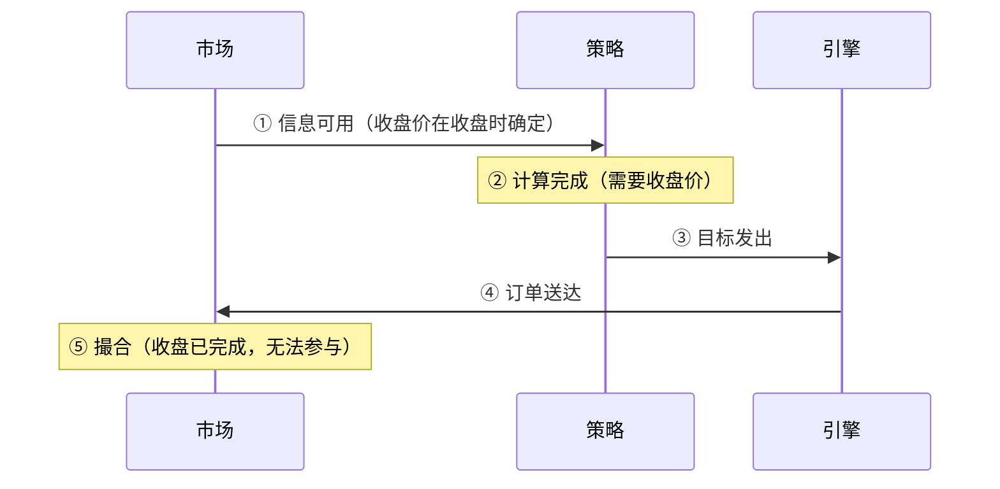
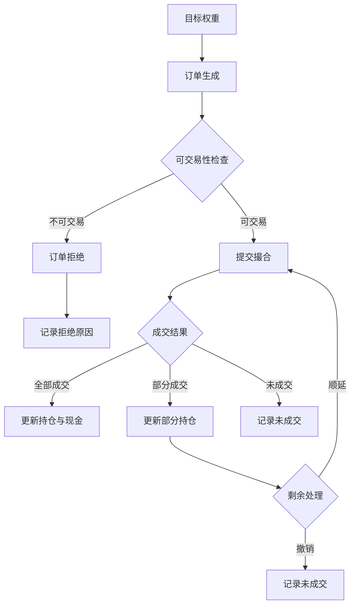

# 第16章　回测引擎、交易约束与成本建模

第14章把产业假说变成了特征、标签与样本，第15章将讨论因子与风险基线。这些研究对象最终都要交给同一件东西去跑：回测引擎。引擎决定了研究结论以什么形式落地——标签收益如何对应到成交、成本如何进入净值、约束如何改变实际持仓。

回测引擎的地位容易被两种态度扭曲。一种是轻视它，把它当作"跑数工具"，认为研究结论的好坏取决于策略想法；另一种是过度信任它，把引擎跑通、净值曲线平滑当作策略可靠的证明。两种态度都忽略了一件事：**引擎的每一处简化都是一个关于市场的假设，而这些假设的系统性偏差会直接进入结果。** 一个把信号与成交安排在同一收盘价的引擎，会让任何策略都获得一个不存在的优势；一个漏算营运资金约束的引擎，会让高换手策略看起来比实际可行。

本章因此按"机制—假设—核验"的顺序组织：先说明引擎如何推进时间与状态（16.1、16.2），再说明它受哪些约束（16.3、16.4、16.6），然后说明成本如何进入（16.5），最后说明如何用明细反过来核对报告（16.7、16.8）。本章与相邻章节的分工是：真实运行账本由第21章负责；统计有效性与样本外验证由第17章负责；本章只处理历史回测的实现与成交假设。

有两条贯穿全章的纪律需要开篇说明。第一，**模型化的成本与成交不是实盘事实**，凡属假设的内容都会标注为假设。第二，**现在重算的历史结果与原始报告分别保留**，重算不覆盖原报告。另外，本章涉及具体交易规则与费率的部分，一律不写数值——这类信息属于易变事实，须按写作与出版时的官方来源核验并记录版本。

## 16.1　策略接口与回测对象

### 16.1.1　核心对象

一个事件驱动的回测引擎，其状态由七类对象构成。它们之间的依赖关系决定了引擎的推进方式。

| 对象 | 内容 | 更新时点 |
|---|---|---|
| 市场数据 | 各标的价格、成交量、状态标志 | 每个时间步 |
| 信息快照 | 当前时点可用的全部输入 | 每个时间步开始 |
| 策略目标 | 目标权重或订单意图 | 策略计算后 |
| 订单 | 标的、方向、数量、类型 | 目标与持仓对账后 |
| 成交 | 成交价、成交量、费用 | 撮合后 |
| 资产状态 | 现金、持仓数量、冻结 | 成交后 |
| 估值 | 市值、净值 | 时间步结束 |

这七类对象的顺序不是实现细节，而是正确性的基础：**信息快照必须在策略计算之前构建，且只能包含该时点可用的信息。** 如果快照在构建时读取了当日收盘价，而该收盘价在时点上尚未产生，那么整条链路从一开始就引入了未来信息——后续环节无论多么严谨都无法挽回。

### 16.1.2　策略接口的输入输出

策略接口的契约可以用一行伪代码表示：

```text
target_weights = strategy.on_bar(snapshot)
```

输入是信息快照，输出是目标权重。这里有一个设计选择值得说明：**策略输出"目标"而不是"订单"。**

输出目标权重的好处是把"想要什么"与"如何实现"分开。策略只表达它希望的组合状态；从目标到订单的换算——考虑最小交易单位、现金约束、可交易性——由引擎统一处理。这样做的代价是策略无法表达执行层面的意图（例如"分三天建仓"），收益是换算逻辑只写一次、对所有策略一致，因而不会出现"某个策略因为换算方式不同而占便宜"的情况。

如果策略直接输出订单，则需要自行处理股数取整、现金检查与可交易性判断。这在小规模研究中可行，但会带来一个隐蔽的问题：**不同策略可能使用了不同的换算逻辑**，从而使策略之间的比较失去可比性。

### 16.1.3　事件推进

```text
for t in timeline:
    snapshot = build_snapshot(t)              # 仅含 t 时刻可用信息
    target   = strategy.on_bar(snapshot)      # 策略输出目标权重
    orders   = reconcile(target, state)       # 目标 → 订单（含取整与约束）
    fills    = match(orders, market[t])       # 撮合（含可交易性检查）
    state    = update(state, fills)           # 更新现金、持仓、费用
    nav[t]   = mark_to_market(state, market[t])
```

这段伪代码的六个步骤构成一个时间步。其中第三步与第四步的边界是本章后续几节的主要内容：`reconcile` 处理"能不能下单"，`match` 处理"能不能成交"。两者的失败原因不同，前者来自规则与资金约束，后者来自市场条件。

### 16.1.4　向量化与事件驱动的取舍

两种实现范式各有适用范围，选择应由研究需求决定。

| 范式 | 优势 | 局限 | 适用 |
|---|---|---|---|
| 向量化 | 计算快，适合大范围参数扫描 | 难以表达路径依赖与逐笔状态 | 无资金约束、无停牌、无部分成交的研究 |
| 事件驱动 | 可表达路径依赖，逐笔可审计 | 计算慢，实现复杂度高 | 含资金约束、可交易性、部分成交的研究 |

选择的关键判据是两个问题：**策略是否存在路径依赖**（例如持仓状态影响下一期决策、资金不足导致无法足额建仓）？**研究是否需要逐笔审计**（例如第16.7节的明细核对）？任一问题为"是"，事件驱动就是必要的。若两者皆否，向量化更合适。

本章不照搬任何未使用框架的接口设计。具体实现选型由真实材料说明；以下占位卡记录了所需的材料。

**本系统的实际引擎形态（真实材料，快照时点 2026-10-09）。**

**本系统没有历史回测引擎。** 它的账本来自**模拟前向**（paper trading），而不是"用历史数据重跑一段过去"。这一区别决定了本节问题的答案：

| 本节的对象 | 本系统的实际对应 |
|---|---|
| 市场数据 | 分钟线（`akshare_minute` 4,027 / `eastmoney_minute` 1,161 / `intraday_minute` 1,464 / `tencent_minute` 4,611）与 EOD |
| 信息快照 | 事件与证据流（`ai_event_research_evidence_events`，13 GB / 约 8,437,504 行） |
| 策略目标 | `signals` **42,920 行**（全部为终态） |
| 订单 | `opportunity_candidates` **68,569 行** |
| 成交 | `paper_trades` **5,599 行**（20 MB）；`execution_outcomes` **31,756 行** |
| 资产状态 | `paper_trades` 的命名空间账本（见下） |
| 估值 | 净值随 `paper_trades` 与定价回退生成 |

**"六个命名空间"就是本系统实际的"模式"维度：**

| 命名空间 | 实测 |
|---|---|
| `paper_live` | 买入 1,002（2026-06-03 → **2026-08-24**）/ 卖出 1,119（→ 2026-10-08） |
| `paper_canary` | 买入 137（2026-08-21 → 2026-10-08） |
| `paper_exploration` | 买入 108 |
| `research` | 卖出 86 |
| `learning_shadow` | 53 |
| `replay` | **411 行**（`hold` 269 / `buy` 125 / `sell` 17） |

**本节"向量化 vs 事件驱动"的取舍在本系统有一个最直接的实例：** `DeterministicTradingKernel.submit()`（`kernel.py:45-70`）**零生产调用点**——一个名为"确定性交易内核"的组件存在但从未被调用。**因此本系统实际采用的范式只能从活着的调用路径反推，而不能从组件名推断**（与第12章 12.1.4 同一条纪律）。

**引擎的正确性边界（本节末尾的"一条边界"）：** 本系统的 `production_candidate_eligible` **全库为 0**、`alpha_proof_state` 中**无 `proven` 行**、`contract_state = frozen` 而 `research_state = collecting`。**"引擎可运行"在本系统是一个已达成的事实，但它与"策略可靠"之间的距离，正由上述读数标出。**

> **本节的口径留白（刻意）**：本节**不给出"本系统的回测引擎选型"**。原因是**没有历史回测引擎**——可核验的是模拟前向账本与六个命名空间；且**核心组件 `DeterministicTradingKernel` 零生产调用**。**给出一个范式结论等于从组件名推断架构。**

**一条边界**：回测引擎可运行，不构成策略可靠的证据。引擎的正确性只说明"计算过程无误"，策略的有效性需要第17章的样本外验证。把两者混同，是"引擎跑通即认为策略成立"这类误判的来源。

## 16.2　信息时钟、决策时钟与成交时钟

### 16.2.1　六个时点

同一个交易日内部存在多个不同的时点，它们的先后顺序决定了回测是否可信。

```text
① 信息可用      市场数据产生（例如某价格被确认）
② 计算完成      策略完成计算，得到目标
③ 目标发出      目标进入引擎
④ 订单送达      订单进入撮合环节
⑤ 撮合成交      成交价与成交量确定
⑥ 估值          以当日价格计算净值
```

**①必须早于②，②必须早于③，③必须早于④，④必须早于⑤。** 这条链上任何一处倒置，都会产生一个在现实中无法实现的优势。

### 16.2.2　同根K线问题

最常见的倒置发生在①与⑤之间。具体形式是：**用当日收盘价计算的信号，假定以同一收盘价成交。**

这个假设的问题在于收盘价的性质。收盘价是在当日交易结束时才确定的——它由最后一笔交易或收盘集合竞价产生。而订单要在收盘前送达才能参与该价格的成交。因此"用收盘价算信号、按收盘价成交"要求一个不可能的顺序：先知道收盘价，再在收盘前下单。



图中最后一步标注的矛盾就是同根K线问题的实质。**不能用收盘后才能知道的信息，假定已在同一收盘价无延迟成交。**

### 16.2.3　三种可接受的顺序安排

| 安排 | 信息时点 | 成交时点 | 适用与代价 |
|---|---|---|---|
| 延迟成交 | t 日收盘后 | t+1 日开盘 | 最保守，损失一日收益 |
| 延迟收盘 | t 日收盘后 | t+1 日收盘 | 保守，持仓一天 |
| 盘中决策 | t 日盘中 | t 日收盘 | 需证明信息在决策时点确实可得 |

第三种安排并非不可用，但它要求证明一件事：**决策所用的信息在决策时点确实已经产生。** 例如使用当日成交量的策略，若成交量在盘中尚未确定，那么"盘中决策"的声明就不成立。判断方法是检查策略输入的每一个字段，看它在决策时点的可得性。

### 16.2.4　一项顺序测试

一个低成本的诊断方法：**把决策时点人为延后一期，重新运行，观察结果变化。**

```text
原设置： 用 t 日信息，t+1 日成交   →  结果 A
测试设置：用 t 日信息，t+2 日成交   →  结果 B
```

若 A 与 B 差异巨大，说明原结果高度依赖于"尽早成交"这一条件。这可能有两个原因：一是策略确实捕捉到了快速衰减的信号（此时延迟成交的成本是真实的，应当计入）；二是原设置实际上使用了不可得的信息，延迟一期后这个优势消失了。区分两者需要检查信号的时间特性，但无论哪种原因，**结果的敏感性都必须被报告**，因为它决定了策略对执行延迟的容忍度。

**本系统的实际时钟安排（真实材料，快照时点 2026-10-09）。**

**本系统没有单一的"时钟表"，但时间顺序在四处被显式约束：**

| 约束 | 实测 |
|---|---|
| 前视隔离（基准侧） | `DailyBasic.trade_date < entry_date`（`src/services/alpha_benchmark_service.py:346,380`）——**严格早于入场日** |
| 信息发布窗口 | `config/collection_rhythm.yaml`：`moneyflow_ths "18:30"` / `daily_basic "19:00"` / 报价 EOD `"15:30"`、best `"17:00"` |
| 定价新鲜度 | `MINUTE_BAR_STALE_SECONDS = 600`（分钟线超过 600 秒即视为过期） |
| 时点有效性标记 | C-01 的 `point_in_time_valid = false`，`invalid_reason_codes = ['RETROSPECTIVE_NOT_FORWARD']` |

**16.2.1 的六时点在本系统的实际落点：** ① 信息可用 → 发布窗口配置；② 计算完成 → 编译器（`compiler_generation = 4`）；③ 目标发出 → outbox 投递（幂等键含 `attempt_seq`）；④ 订单送达 → `signal_execution_outbox`（最后写入 2026-07-16 10:39:01）；⑤ 撮合成交 → `paper_trades.fill_status`；⑥ 估值 → 定价六级回退。

**16.2.2 的"同根K线问题"在本系统有一个**被量化过**的实例。** `_get_eod_ohlc_average` 的文档字符串引用了一项真实分析：

| 入场口径 | 收盘价分位 |
|---|---|
| 收盘价入场 | **0.696** |
| OHLC 均价入场 | **0.496** |

样本为 **1,647 笔买入成交**。**同一批交易，仅把入场价从收盘价改为 OHLC 均价，入场分位就从 0.696 降到 0.496——相差 20 个百分点。** 这正是 16.2.2 所说的"用收盘后才能知道的信息、假定已在同一收盘价无延迟成交"所产生的优势，且它是**可测量的**。

**"决策时点延后一期"的敏感性测试（16.2.4 的诊断方法）在本系统未做过。** 库中无此类测试记录。

**另一处相关但不同的区分：** C-01 的 `temporal_order_verified = true`（顺序已核）与 `point_in_time_valid = false`（时点有效性为假）**并存**——**顺序正确不等于信息在决策时点可得**（第12章 12.7.4）。

> **本节的口径留白（刻意）**：本节**不给出"本系统的六时点完整映射表"**。原因是**没有单一的时钟表**——可核验的只有发布窗口配置、前视隔离条件、新鲜度阈值与时点有效性标记四项；**且 16.2.4 的顺序敏感性测试未做过**。

## 16.3　交易规则与可交易性配置

### 16.3.1　规则的四个维度

交易约束不是一张静态清单，它随市场、板块、证券类型和时间变化。

| 规则类别 | 变化维度 | 需要记录的版本信息 | 引擎中的处理 |
|---|---|---|---|
| 价格限制 | 板块、证券类型、特殊情形 | 生效日期 | 触及时拒绝成交或按限价撮合 |
| 最小交易单位 | 市场 | 生效日期 | 数量向下取整 |
| 交易费用 | 市场、方向 | 费率表版本 | 从现金扣除 |
| 停牌与复牌 | 单只证券 | 停牌公告 | 标记为不可交易 |
| 上市与退市 | 证券类型 | — | 纳入或排除 |
| 特殊处理状态 | 证券 | 状态变更日期 | 适用不同价格限制或排除 |

### 16.3.2　规则的时变性

**回测必须使用当时生效的规则，而不是当前的规则。** 用一个当前版本的规则集跑十年历史回测，会在规则发生变化的时间点前后产生系统性偏差。例如某类证券的价格限制范围在历史上调整过，若全程使用现行范围，那么在调整之前的历史区间内，引擎会允许现实中不可能发生的价格变动。

因此，规则配置需要携带**生效日期**，并在时间推进中按日期切换。这与第5章讨论的数据版本是同一类要求：历史研究必须还原当时的信息环境，而规则属于该环境的一部分。

### 16.3.3　两条红线

**不要凭记忆写最新交易规则。** 本章不给出任何具体的涨跌幅限制、费率或交易单位数值。这类信息属于易变事实，**必须查官方来源，并记录版本与核验日期**。凭记忆书写的结果可能在出版时已经过时，而读者无法察觉。

**不要把简化仿真说成完全复现交易所。** 任何回测引擎对交易规则的实现都是简化的。简化的方式可能包括：忽略特定情形下的差异化规则、忽略申报与撤单的细节、忽略盘中临时停牌。这些简化应当在方法中明确列出，而不是用"已考虑交易规则"这样的笼统表述覆盖。列出简化项的价值在于：读者可以判断哪些结论可能受这些简化影响。

**本系统的实际可交易性配置（真实材料，快照时点 2026-10-09）。**

**本系统没有交易规则配置表。** 可核验的只有一组**可执行性拒绝码**与一个**参与率上限参数**：

| 检查 / 参数 | 实测 |
|---|---|
| `stale_or_proxy_pricing` | **185 行** |
| `current_universe_not_authorized` | **145 行** |
| `entity_authority_contaminated` | **49 行** |
| `ambiguous_or_invalid_entity_anchor` | **26 行** |
| `adj_factor_incomplete` | **18 行** |
| `max_participation_rate` | `Field(default=0.05, gt=0, le=1)`（`src/schemas/phase2.py:1411`） |
| 分钟线新鲜度 | `MINUTE_BAR_STALE_SECONDS = 600` |

**未发现以下配置（本节 16.3.1 六类规则中的多数）：** **未发现价格限制（涨跌幅）配置**、**未发现最小交易单位配置**、**未发现费率表版本字段**（`cost_model_version_id` 在 `alpha_forecasts` 的 45,140 行中 **100% 为 NULL**）、**未发现特殊处理状态的价格限制切换**。

**16.3.3 第二条红线要求列出简化项——本系统的实测简化项清单如下（这是本节最实用的交付）：**

| 简化项 | 实测依据 |
|---|---|
| **参与率上限差 100 倍（B-3）** | 设计 `default=0.05`（即 5% ADV），实现写成 `volume * participation_rate / 100 * 100` → **有效上限 0.05% ADV**。修复方式为删除 `/ Decimal("100")`；当前代码 `src/services/paper_trading_service.py:10638-10646` |
| **无价格限制规则** | 未见涨跌幅配置 |
| **无最小交易单位规则** | 未见取整配置 |
| **无费率表版本** | `cost_model_version_id` 全 NULL |
| **全部账户为模拟账户** | `docs/CURRENT/SYSTEM_GOAL_AND_EVIDENCE.md`；`live_authority_allowed = false` |

**B-3 是"简化项必须列出"这条红线在本系统的最强实例：** 一个写在代码里的 `/ Decimal("100")` 使**容量约束被放松了 100 倍**，而它**不触发任何配置校验**——因为它不在配置里。**若这一项不被列出，任何基于成交量的容量结论都会高估 100 倍。**

**约束的效果是可见的（说明检查确实在运行）：** `fill_status` 中 `blocked` **4,398 行（5.3%）**、`no_fill` **63,234 行（75.6%）**——**约 81% 的订单未完全成交**（见 16.6.3）。

> **本节的口径留白（刻意）**：本节**不给出"本系统的交易规则清单"**。原因是**没有规则配置表**——可核验的只有五个拒绝码与一个参与率参数；且**价格限制与最小交易单位未发现配置**。**给出一个"已考虑交易规则"的笼统表述正是本节第二条红线要禁止的写法。**

## 16.4　价格口径、估值与公司行为

### 16.4.1　五种价格

同一只证券在同一个时点可能存在多个"价格"，它们的用途不同，不能互相替代。

| 价格类型 | 用途 | 关键要求 |
|---|---|---|
| 信号价 | 计算特征与信号 | 必须在决策时点可得（16.2.3） |
| 下单价 | 生成订单 | 与信号价的关系须声明 |
| 成交价 | 撮合结果 | 须体现价差与滑点 |
| 估值价 | 计算持仓市值与净值 | 须与持仓数量的口径一致 |
| 复权价 | 计算跨期收益 | **不可用于现金结算** |

### 16.4.2　复权价的适用边界

第五条需要单独说明，因为它是回测中一类严重错误的来源。

复权价是为了让跨期收益可比而构造的数学价格：它把历史价格按分红、送股等因素调整，使得相邻两期的比值反映真实收益率。它的性质是**一个计算工具，不是一个可交易价格**。

因此：

- 用复权价计算收益率：**正确**。
- 用复权价 × 股数计算市值：**错误**。得到的是"调整后市值"，不等于真实现金价值。
- 用复权价计算成交金额：**错误**。成交发生在真实价格上。
- 用复权价结算分红与送股：**错误**。分红与送股改变的是股数与现金，不是价格。

正确的做法是**把价格口径与公司行为分开处理**：价格序列用于信号与收益计算，股数与现金的变动由公司行为单独驱动。混用两者的结果是净值曲线在除权日附近出现无法解释的跳变——因为价格被调整了，而股数没有同步调整。

### 16.4.3　公司行为的三个通道

| 公司行为 | 对价格 | 对股数 | 对现金 |
|---|---|---|---|
| 现金分红 | 除息 | 不变 | 增加 |
| 送股、转增 | 除权 | 增加 | 不变 |
| 配股 | 除权 | 可增加 | 减少 |
| 拆股、合股 | 除权 | 按比例调整 | 不变 |

四个通道中，**现金分红影响现金，送股影响股数**，两者对净值的影响路径不同。一个只处理价格的引擎（即只使用复权价，不调整股数与现金）在净值上可能得到接近正确的结果，但它无法回答"当前持有多少股""账上有多少现金"这类问题。这类问题在 16.7 的明细核对中必然出现。

### 16.4.4　勾稽方法

核对价格口径与资产变化是否一致，可以用一个已有交易片段做勾稽：

```text
选取一段含公司行为的区间，检查：
  1) 除权日前后，持仓股数是否按公告比例调整
  2) 分红到账日，现金是否增加相应金额
  3) 净值是否连续（不因除权产生虚假跳变）
  4) 若使用复权价估值，是否与真实股数 × 真实价格的口径冲突
```

第 1 项与第 2 项检查的是公司行为是否被正确处理；第 3 项检查的是价格口径是否被误用于估值；第 4 项检查的是两种口径是否在同一处被混用。

**本系统的实际价格口径与公司行为（真实材料，快照时点 2026-10-09）。**

**价格侧：本系统实现了"六级回退"定价，比本节列出的五种价格更细。**

| 级别 | 来源 | 标记 |
|---|---|---|
| 1 | 分钟线 | 受 `MINUTE_BAR_STALE_SECONDS = 600` 约束 |
| 2 | 盘中快照 | — |
| 3 | 实时报价 | — |
| 4 | 当日 EOD | — |
| 5 | L4 ETF-beta 模型 | 估计值 |
| 6 | 前一日 EOD | **标记 `research_only`** |

**第 6 级的 `research_only` 标记正是本节 16.4.2 的核心要求**——**"这不是可交易价格"被显式标注**。且 `paper_trades` 上有**六个价格字段**，即信号价、下单价、成交价、估值价**被分开存储**，未合并为一个"价格"。

**费用侧：显性费用被拆成三个独立字段，不在价格里。** `exchange_fee_amount`（交易所费用）/ `stamp_tax_amount`（印花税）/ `transfer_fee_amount`（过户费）**三者独立**；另有 `liquidity_cost_bps`、`participation_rate`、`capacity_qty`、`fill_ratio`。

**这一点直接决定了 16.5.1 的"重复计费"问题在本系统的形态：** 显性费用**走现金扣除通道**（三个独立字段），不通过调整成交价实现——**因此"费用与滑点双重扣同一成本"在结构上被避免**。这是本系统在成本口径上做得正确的一处。

**复权侧：有完整性检查。** `benchmark_status` 中 `adj_factor_incomplete` **18 行**，且 `invalid_reason = adj_factor_incomplete` **18 行**——**复权因子完整性被实际检查**。

**公司行为侧：本节 16.4.3 的三个通道中，只有价格通道可核验。** `paper_trades` 有费用字段，但**未见分红到账字段、未见送股股数调整字段、未见配股与拆合股字段**。因此：

| 16.4.3 的通道 | 本系统是否可核验 |
|---|---|
| 对价格（除权除息） | **部分**——`adj_factor_incomplete` 检查存在 |
| **对股数**（送股、转增、拆合股） | **未见字段** |
| **对现金**（现金分红） | **未见字段** |

**16.4.4 的四项勾稽在本系统只能做前两项的一半：** 第 1 项（除权日股数调整）与第 2 项（分红到账现金）**因缺少对应字段而无法执行**；第 3、4 项（净值连续性、复权价与真实口径冲突）**可以执行**。

**一个可用的真实片段（供勾稽）：** C-01 的合同总金额 **人民币 157,635.00 万元（含税）= 15.7635 亿元**，来自客户预估采购量，交付期 2 年；但该合同**不是公司行为**，它进入的是**事件与假说**通道，不进入股数或现金通道。**本系统未找到含真实公司行为的交易片段。**

> **本节的口径留白（刻意）**：本节**不给出"本系统的价格口径映射表"**。原因是**没有单一的价格口径表**——可核验的是六级回退与 `paper_trades` 上的六个价格字段；且**公司行为的股数通道与现金通道未见字段**，因此 16.4.3 的三通道在本系统**只部分成立**。

## 16.5　费用、价差、滑点与冲击假设

### 16.5.1　四项成本的区别

附录A.6 给出了成本的结构。这里补上它们在引擎中的落点，因为落点决定了它们是否会被重复计算。

| 成本项 | 性质 | 在引擎中的落点 | 参数来源 |
|---|---|---|---|
| 显性费用 | 按成交额比例 | 从现金扣除 | 费率表（须核验版本） |
| 价差 | 买卖报价之差 | 反映在成交价 | 实测报价或估计 |
| 滑点 | 决策价与成交价之差 | 反映在成交价 | 实测成交记录 |
| 冲击成本 | 自身成交对价格的影响 | 反映在成交价，且随规模变化 | 需建模，非线性 |

**前四项中的后三项都落在同一个地方——成交价。** 这一点是重复计费问题的根源：当多项成本都通过调整成交价来实现时，很容易出现同一项成本被调整两次。

### 16.5.2　成本拆分关系式

```text
若以成交价调整方式实现（后三项）：
  成交价 = 参考价 × (1 + 方向 × 调整率)
  调整率 = 价差率 + 滑点率 + 冲击率

若以现金扣除方式实现（显性费用）：
  费用 = 双边成交额 × 显性费率

两条通道之和即总成本：
  总成本 = 双边成交额 × (显性费率 + 价差率 + 滑点率 + 冲击率)
```

### 16.5.3　重复计费的检查

**不能把费用和滑点双重扣同一成本。** 以下是一个明确标注的教学反例。

```text
错误做法：
  成交价 = 收盘价 × (1 - 0.001)     ← 声称是"交易成本调整"
  现金  -= 双边成交额 × 0.0008      ← 声称是"佣金与税费"

  问题：若 0.001 已经是"综合交易成本率"，它本身
        包含佣金与税费，那么第二行构成重复扣除，
        总成本被高估约一倍。
```

检查方法是列出一张成本输入表，逐项追溯参数来源：

| 检查问题 | 若答案为"是" | 结论 |
|---|---|---|
| 成交价的调整率是否包含显性费用？ | 是 | 不应再单独扣除费用 |
| 显性费率是否已包含在综合成本率中？ | 是 | 不应再作为独立项扣除 |
| 是否同时使用了"成本率"与"固定费用"？ | 是 | 需确认两者是否重叠 |
| 冲击成本是否已在调整率中，又按规模另计？ | 是 | 重复 |

这张表的用途是把"是否重复"从判断问题变成核对问题。成本被高估约一倍与低估约一倍，对策略结论的影响方向相反，而两者在净值曲线上都表现为"更保守"或"更激进"，不会自行暴露。

### 16.5.4　模拟与实测的区分

**不能将模拟冲击写成真实成交损失。** 冲击成本在多数回测中是建模结果，不是观察结果。它由假设的规模—冲击关系生成，而该关系本身可能是从其他市场、其他时期或小样本中估计的。

因此成本假设必须标注性质：

- **实测参数**：来自本系统或可比市场的真实成交记录。
- **估计参数**：由模型或外部数据推算。
- **教学假设**：用于说明方法，不代表实际取值。

结果的呈现应当附带**敏感性范围**：在成本假设的合理区间内变动时，结论是否改变。一个在成本上翻倍后就不再成立的策略，与一个在成本上翻倍后仍然成立的策略，是完全不同的两种结论——而这个区别只有通过敏感性分析才能显现。

## 16.6　停牌、受限、未成交与部分成交

### 16.6.1　从目标到成交的状态推进

目标权重经过换算成为订单之后，订单并不必然全部成交。



这张图中，`D`、`J`、`K` 三个终点代表目标未实现。**它们必须被记录，而不是被静默丢弃。** 原因与第14章 14.2.2 保留排除记录、第19章保留处置总账相同：未实现的目标同样是研究结果，缺少它们会使"策略的可实现性"无法评估。

### 16.6.2　三类受限情形

| 情形 | 表现 | 引擎中的处理 | 常见错误 |
|---|---|---|---|
| 停牌 | 该证券无有效报价 | 标记不可交易，持仓冻结 | 假设按停牌前价格卖出 |
| 价格限制 | 价格触及限制且无对手盘 | 拒绝成交或按限价部分成交 | 假设必然成交 |
| 流动性不足 | 委托量超过可成交量 | 部分成交 | 假设全额成交 |

**信号出现不代表可以买到。** 一条关于某公司的正面信息发布后，该股票可能在当日涨停，此时无法买入；一条负面信息发布后可能跌停，此时无法卖出。若引擎忽略这一约束，那么策略在信息事件上的表现会被系统性高估——因为最需要交易的那些时点，恰恰是最可能无法交易的那些时点。

**不能假设受限期间按理想价退出。** 这一条比上一条更隐蔽。前者的错误是"以为买到了"，后者的错误是"以为卖掉了"。对于需要止损或调仓的策略，无法退出意味着持仓被动延续，而这会同时改变收益与风险特征。

### 16.6.3　排队假设

使用限价单时，是否成交取决于排队位置。真实撮合按价格优先、时间优先，而回测通常无法还原完整的委托队列。

因此排队假设必须被声明，常见有三类：

- **保守假设**：限价单不成交，只有市价单成交。结果偏保守。
- **中性假设**：价格穿越限价时成交。介于两者之间。
- **乐观假设**：价格触及限价即成交。结果偏乐观。

三类假设下同一个策略的结果差异可能很大，尤其对于依赖限价单获取更好价格的策略。**假设的选择应当与策略的执行方式一致**：如果一个策略在实盘中主要依赖限价单成交，那么用乐观假设回测它，等于测了一个不存在的策略。

**本系统的实际未成交与部分成交处理（真实材料，快照时点 2026-10-09）。**

**这是本系统记录得最完整的一处。** `fill_status` 的全量分布：

| 状态 | 行数 | 占比 |
|---|---|---|
| `no_fill` | **63,234** | **75.6%** |
| `cf_measured` | 12,871 | 15.6% |
| `blocked` | 4,398 | 5.3% |
| **`filled`** | **1,855** | **2.2%** |
| `partial_unfilled` | 158 | 0.2% |
| `partial_filled` | 33 | 0.04% |
| `cancelled` | 14 | 0.02% |

**完全成交仅占 2.2%。** 未完全成交（`no_fill` + `blocked` + `partial_unfilled` + `cancelled`）合计 **约 81%**。

**16.6.1 要求"三个终点（拒绝 / 撤销 / 未成交）必须被记录"——本系统满足了这一要求，且记录是分状态的：** `blocked` 对应"可交易性检查拒绝"，`no_fill` 对应"撮合未成交"，`partial_unfilled` 对应"部分成交后剩余未处理"，`cancelled` 对应"撤销"。**这不是一个合并的"失败"计数，而是四个可区分终点。**

**订单状态机的实际载体：** `paper_trades`（5,599 行）的 `fill_status`；`execution_outcomes` **31,756 行**；`signal_execution_outbox` **10,252 行**（最后写入 **2026-07-16 10:39:01**）。

**16.6.2 三类受限情形的实际对应：**

| 情形 | 本系统可核验的痕迹 |
|---|---|
| 停牌 | 未见专用标记；分钟线缺失与 `quote_missing`（**1,652 行**）可能与之相关，但**成因已确认为成本闸门冻结而非停牌** |
| 价格限制 | **未发现涨跌幅配置**——因此该情形**很可能未被建模** |
| 流动性不足 | **部分**——`max_participation_rate` 存在，但**B-3 使其有效值比设计值小 100 倍**（0.05% ADV vs 5% ADV） |

**16.6.3 的排队假设在本系统未声明。** 未见排队模型字段、未见限价单/市价单的类型字段。**因此本节"三类假设下结果差异可能很大"这一风险在本系统**无法被评估**——因为假设本身没有记录。

**一处必须记录的真实目标未实现实例：** `paper_live` 命名空间的**买入序列终止于 2026-08-24**（卖出延续至 2026-10-08）。**即主策略通道自该日起未再开新仓（约 6 周）**——这是"目标未实现"的一种极端形式（连订单都未生成），且**它是可查的**。

**另一处：** `current_universe_not_authorized` **145 行**——授权类拒绝；`entity_authority_contaminated` **49 行** / `ambiguous_or_invalid_entity_anchor` **26 行**——主体类拒绝。

> **本节的口径留白（刻意）**：本节**不给出"本系统的排队假设"**。原因是**没有排队模型字段**——可核验的只有 `fill_status` 的分状态计数。**未成交与部分成交被完整记录，但"排队位置"这一维度不可观测，因此三类假设下的差异无法评估。**

## 16.7　现金、持仓与交易明细核验

### 16.7.1　从明细重建报告

净值报告不应被当作独立数据接受，而应从底层明细重建。重建关系如下：

```text
现金_t   = 现金_{t-1}
           - Σ 买入成交金额
           + Σ 卖出成交金额
           - Σ 费用
           + Σ 分红到账
           + 外部资金流入
           - 外部资金流出

持仓_i,t = 持仓_i,t-1
           + 买入股数
           - 卖出股数
           + 送股股数
           ± 拆合股调整

市值_t   = Σ_i 持仓_i,t × 估值价_i,t

净值_t   = 现金_t + 市值_t
```

### 16.7.2　外部资金流的独立处理

上式中最后两项——外部资金流入与流出——需要单独说明。它们是投资者的资金进出，不是策略的收益。**把它们计入收益会同时扭曲收益水平与风险指标。**

这一要求在附录A.1 已从收益率口径的角度讨论过：时间加权收益率（TWR）在每个外部现金流发生时点切分子区间，从而剔除资金进出时点的影响；资金加权收益率（MWR）则保留该影响，用于回答"实际赚了多少"。在引擎层面，对应要求是**外部现金流必须有独立通道**，不与交易产生的现金流混同。若两者记在同一字段中，事后无法拆分，TWR 也就无法计算。

### 16.7.3　核对表与不平衡检查

| 核对项 | 检查内容 | 允许的残差 |
|---|---|---|
| 现金勾稽 | 期初现金 + 明细变动 = 期末现金 | 舍入量级 |
| 股数勾稽 | 期初股数 + 明细变动 = 期末股数 | 0（整数股） |
| 费用勾稽 | 明细费用之和 = 报告费用 | 舍入量级 |
| 市值勾稽 | Σ 股数 × 估值价 = 报告市值 | 舍入量级 |
| 净值勾稽 | 现金 + 市值 = 报告净值 | 舍入量级 |

**不平衡检查**的做法是把上表每一项的残差计算出来并检查其量级。残差应当处于舍入误差范围；若某项残差出现系统性方向（始终为正或始终为负），则说明该环节存在逻辑错误，而不是精度问题。

一个常见的诊断线索是残差与换手率的相关性。若现金残差随换手率上升而增大，问题通常出在费用计算或成交金额口径；若股数残差在特定日期集中出现，问题通常出在公司行为处理（16.4.3）。

### 16.7.4　核验能证明什么

最后需要明确核验的效力边界。**净值一致不能证明策略样本外有效。**

明细核验证明的是**内部一致性**：报告的每一个数字都能由底层记录推导出来。它不证明策略的收益来自真实的市场机会，也不证明该收益在样本外会重现。前者属于实现正确性，后者属于统计有效性（第17章）。

**不能只验证收益图好看。** 一条平滑的净值曲线可能来自正确的策略，也可能来自同根K线成交（16.2.2）、未实现的成交假设（16.6.2）或低估的成本（16.5.3）。这三种原因在净值图上与真实优势无法区分，只能通过明细核验与方法审查来识别。

## 16.8　冻结回测、参考计算与敏感性

### 16.8.1　冻结四件套

一个可复核的回测，需要冻结四类内容。

| 类别 | 内容 | 冻结的意义 |
|---|---|---|
| 数据 | 数据快照、版本、范围、时点 | 保证输入不变 |
| 配置 | 参数全集 | 保证策略定义不变 |
| 代码 | 版本标识 | 保证计算逻辑不变 |
| 输出 | 原始结果文件 | 保证对照基准不变 |

缺少任何一项，复核都会退化为重新运行——而重新运行得到的是新结果，不是对原结果的检验。

### 16.8.2　回测身份卡

| 字段 | 内容 |
|---|---|
| 回测标识 | 唯一标识 |
| 数据快照 | 版本、覆盖范围、截止时点 |
| 代码版本 | 版本标识 |
| 配置 | 参数全集及其取值 |
| 生成时间 | 原始生成时点 |
| 运行模式 | 历史回测／模拟／前向（七类模式之一） |
| 原始输出位置 | 结果文件定位 |
| 已知限制 | 简化项清单（16.3.3） |

第 6 项值得单独强调。**运行模式必须与生成时点一同记录**，因为它决定了该结果能被用来支持什么结论。一份"历史回测"结果与一份"真实前向"结果，即使数字相同，其证据地位完全不同——前者支持关于机制的结论，后者才支持关于实际表现的结论。

### 16.8.3　原结果与新重算并存

**当前重算不能覆盖原报告。** 重算的合理用途有三类，它们的性质不同：

| 用途 | 做法 | 输出定位 |
|---|---|---|
| 参考计算 | 用简化方法独立算一个数（如手工核算一笔交易的成本） | 核验辅助，不替代原结果 |
| 敏感性分析 | 在成本或参数区间内重新运行 | 新增结果，与原结果并列 |
| 完整重算 | 用相同配置重新运行 | 用于检验可复现性 |

三类都应保留原始结果，新增结果另记生成时间、代码版本与配置差异。这与目录规范的结论边界一致：**现在重算的历史结果与原始报告分别保留。**

**不能把换参数后最优结果伪装成原实验。** 一个具体形式是：原实验的某参数为 A，重算时改为 B，因为 B 的结果更好，然后把 B 的结果作为"该实验的结果"报告。这个做法的问题不在于使用了参数 B，而在于**报告的实验与实际运行的实验不一致**，从而使读者无法判断结果的可复现性。正确做法是把 B 作为一次新的尝试记录，并计入尝试次数（第17章 17.5）。

### 16.8.4　本章定位

本章提供的是回测引擎的机制说明与核验方法，不是任何策略的结果。引擎的每一处假设都会影响结论，因此本章的写法是把假设显式化：时间顺序（16.2）、规则简化（16.3）、价格口径（16.4）、成本性质（16.5）、成交假设（16.6）——每一处都给出了"如何检查"而不仅是"应当如何"。

下一章讨论样本外验证、研究选择与统计不确定性。它与本章的关系可以用一句话概括：**本章处理"算得对不对"，下一章处理"结果可不可信"。** 一个通过全部明细核验的结果，仍然可能因为选择偏差而不可信；两者需要分别检验。
