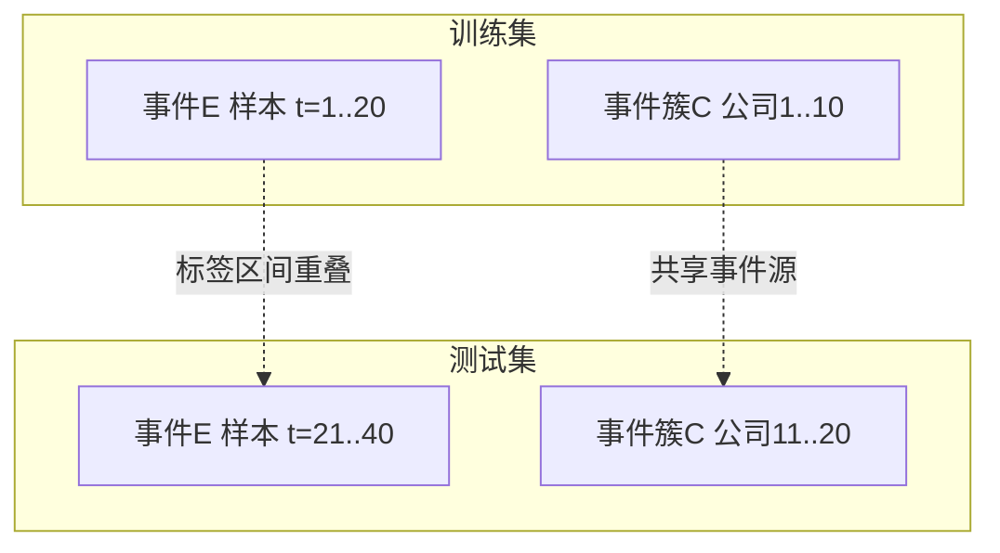
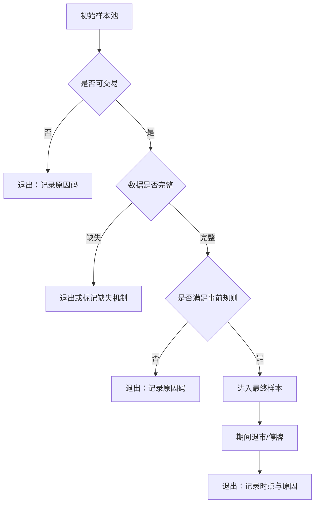

# 第17章　样本外验证、研究选择与统计不确定性

第14章把产业假说变成了可回测对象，并在过程中埋下若干风险点：样本之间可能不独立、排除规则可能事后设定、状态分组可能事后挑选、标签区间可能重叠。第16章介绍了引擎如何把这些对象跑出结果。但一个结果是否可信，并不取决于它跑得对不对，而取决于**它是从多少次尝试中被选出来的**。

这一区分是本章的全部起点。一个年化超额收益 12% 的回测结果，如果来自唯一一次预先指定的检验，它值得认真对待；如果它来自两百次参数搜索中被挑出的最好一次，那么它几乎不携带信息——因为即使真实效应为零，两百次独立检验中的最优值也会呈现出令人信服的表现。两者的数字可能完全相同，可信度却相差极大。

因此本章讨论三件事：如何恢复研究的**尝试范围**（17.1、17.5），如何让**验证过程**真正独立（17.2、17.3、17.4），以及如何诚实地表达**不确定性**（17.6、17.7、17.8）。本章与相邻章节的分工是：回测引擎的实现回引第16章；收益分解与容量回引第18章；特征与标签的定义回引第14章。

有一条结论边界需要开篇说明，因为它决定了本章的写法：**历史实验总账的缺失，会影响结论能够覆盖的范围，但不影响如实解释实现与方法。** 一份不完整的实验记录，不会让已经写清楚的机制说明变得不可信，它只会限制"该策略有效"这类结论的适用强度。本章因此把"承认不可恢复"作为一项正式的写作内容，而不是需要回避的缺陷。

## 17.1　历史实验总账与研究版本

### 17.1.1　为什么需要总账

研究结论的可信度与尝试次数直接相关，而尝试次数只能从实验记录中恢复。总账的作用是把散落在报告、配置、提交记录中的尝试组织成一条可读的路径，使读者能够判断：**最终保留的版本，是从多少候选中被选出的。**

缺少总账时，研究者只能报告最终版本。这种报告在形式上完整，在信息上不完整——它把选择过程隐藏了，而选择过程恰恰是可信度的主要决定因素。第14章讨论的样本选择偏差，在实验层面就是同一个问题的另一种形式。

### 17.1.2　实验谱系的三个维度

恢复尝试范围需要同时记录三个维度，它们回答不同的问题。

| 维度 | 内容 | 回答的问题 |
|---|---|---|
| 版本关系 | 哪个实验基于哪个，改动项是什么 | 结果之间的差异来自哪里 |
| 选择路径 | 为什么从 A 改到 B | 改动是依据先验还是依据结果 |
| 恢复状态 | 每个实验的记录完整程度 | 该实验能支持什么强度的结论 |

第二个维度最容易被忽略，却最关键。**如果从 A 改到 B 的原因是 A 的结果不好，那么 B 就是被选择出来的**，而不是被设计出来的。这类改动的次数构成选择偏差。反之，如果改动原因是发现了一个逻辑错误（例如 A 使用了未来信息），那么这次改动是在修正错误，不构成选择偏差。两者的区别在于**改动依据是结果还是逻辑**，而这个区别只能通过记录判断——事后无法从代码差异中看出。

### 17.1.3　恢复状态与结论强度

| 状态 | 具备的记录 | 能支持的结论 |
|---|---|---|
| 完整恢复 | 配置、输入、结果、代码版本齐备 | 可复现，可作为证据 |
| 部分恢复 | 有结果与配置，缺输入范围或代码版本 | 可描述，不可复现 |
| 仅存结果 | 只有数字，无配置与输入 | 只能作为线索 |
| 不可恢复 | 无有效记录 | 不能作为证据 |

第三行与第四行的区别值得说明。"仅存结果"意味着数字本身是真实的——它确实产生过——但产生它的条件不可知。这类数字可以作为"该方向曾经被尝试过"的线索，不能作为"该配置表现如何"的证据，因为缺少配置就无法判断它与当前版本的差异。

### 17.1.4　两条红线

**不得补写预注册。** 不能在结果已知之后，声称"当时就计划这样做"。这与第14章 14.1.2 对"事前假说"与"事后解释"的区分是同一条约束在不同层面的表现：那里约束的是假说，这里约束的是研究设计。判断依据同样是带时间戳的记录；没有记录，就只能表述为"本次整理时可获得该配置"。

**不得假定所有失败尝试都已记录。** 一个常见但错误的推理是："记录里只有五次尝试，所以大概试过五次。"实际上，未被记录的多半正是失败的尝试——因为它们不值得记录。因此**记录中的尝试次数是下界，不是真实次数**。

这条限制的后果必须被承认，而不能被填补。当总账明显不完整时，正确的表述是：选择偏差无法估计，因此该结果的适用强度受限。用"应该没试过很多次"来补上这个缺口，等于用一个未知量替换另一个未知量。

## 17.2　训练、验证、测试与滚动评价

### 17.2.1　切分服务三个不同目的

时间切分不是为了"留出一部分数据"，而是为了让三个不同的动作发生在不同的数据上。

| 用途 | 数据 | 动作 | 允许的重复次数 |
|---|---|---|---|
| 训练 | 训练段 | 拟合参数 | 多次 |
| 验证 | 验证段 | 选择模型与超参数 | 多次 |
| 测试 | 测试段 | 最终评价 | 一次 |

第三行的"一次"是这张表的重点。**一旦测试段被用于反复选择，它就不再是测试段。** 它的角色已经变成了验证段，只是名字没改。这是研究中最常被违反的一条约束，而且违反者往往并非有意——每次查看测试结果都是一个微小的选择动作，而数十次微小的选择累积起来，效果等同于把测试段当验证段使用。

因此，如果需要多次查看，正确的做法是扩展验证段，而不是复用测试段。

### 17.2.2　滚动评价的执行顺序

滚动评价（walk-forward）的常见形式是：用一段历史训练，在随后的一段验证，再在随后的一段测试，然后整体向前滚动。

```text
段1  [====训练====][=验证=][=测试=]
段2      [====训练====][=验证=][=测试=]
段3          [====训练====][=验证=][=测试=]
                     ↑
              参数必须在此刻之前冻结
```

这张图里最容易被忽略的是箭头位置。**参数冻结时点必须在测试窗开始之前。** 如果参数是在看到全部数据之后确定的，再"事后"把时间轴画成滚动的样子，那么这不是滚动评价——它只是把一次全样本拟合的结果用滚动图的格式呈现出来。两者的结果可能接近，但可信度完全不同。

判断方法很直接：**参数是在什么时候确定的？** 如果这个时间点无法从记录中确认，那么滚动评价的声明就缺少依据。

### 17.2.3　三种切分方式的比较

| 方式 | 结构 | 优点 | 主要问题 |
|---|---|---|---|
| 单次切分 | 训练／验证／测试各一段 | 简单、口径清楚 | 结果对区间选择敏感 |
| 滚动切分 | 固定长度窗口向前滚动 | 覆盖多个市场状态 | 计算量大；各段样本重叠 |
| 扩展窗切分 | 训练窗不断增长 | 后期样本量更大 | 早期与后期参数口径不一致 |

**不能事后挑选区间说事前固定。** 三种切分方式本身都是合法的，问题出在选择过程：如果研究者试了多种切分、发现某一种切分下结果最好、然后报告该切分，那么切分方式本身就成了一个被选择的参数。这与第17.5节讨论的搜索维度是同一件事——切分方式也是搜索维度之一。

**时间划分的登记与自查（方法层）。**

三种切分方式都是合法的，可核查的是**登记是否完整**。下表给出必须记录的项目，以及每一项缺失的后果。

| 登记项 | 内容 | 缺失时的后果 |
|---|---|---|
| 各段起止 | 训练／验证／测试各自的起止时点 | 无法判断结果对应哪一段数据 |
| 划分依据 | 按时间、按事件簇、还是按比例 | 无法判断是否使用了随机拆分（17.3.3） |
| 参数冻结时点 | 参数确定的确切时刻 | 滚动评价的声明失去依据（17.2.2） |
| 曾用于调参的区间 | 哪些区间参与过选择 | 选择偏差无法估计（17.5.3） |
| 切分方式的确定时点 | 在结果之前，还是在比过之后 | 无法区分设计与被选择 |
| 试过的切分方式数 | 切分方式本身也是一个搜索维度 | 切分方式的选择偏差不可估计 |

**前两项决定结果"对应哪段数据"，后四项决定结果"有多可信"。** 一份只写了三段时间范围、却没有记录参数冻结时点与切分方式确定时点的报告，形式上完整，实质上无法通过 17.2.2 的判据。

核对已有研究时，可以直接问五个问题（与 17.3.4 的三问同源）：

1. 参数是在测试窗开始之前确定的吗？该时点有记录吗？
2. 训练／验证／测试三段的起止是否写明？
3. 哪些区间曾用于调参？这些区间是否与测试段重叠？
4. 切分方式是在看到结果之前确定的，还是比过几种之后选的？
5. 如果试过多种切分，报告的是哪一种，为什么是它？

**五个问题中任何一个无法回答，该研究的切分有效性就无法确认。** 此时正确的处理与 17.3.4 一致：把限制写入结论边界，而不是默认切分有效。

> **本节不引用本系统的划分记录。** 本系统实际使用的时间划分（各段起止、划分依据、参数冻结时点、曾用于调参的区间、切分方式的确定时点）**未在本章登记**，属本章待核验项。**读者不得据本节的登记表推断本系统采用了其中任何一种切分方式。**

## 17.3　重叠标签、事件簇与样本隔离

### 17.3.1　依赖的三种来源

训练集与测试集之间的信息泄漏，不只有"用了未来数据"这一种形式。以下三种依赖都会造成泄漏，而它们的机制不同。

**标签跨度重叠。** 第14章 14.4.1 定义了标签期限 `h`。若 `h = 20` 个交易日，那么 `t` 与 `t+1` 两个样本的标签区间共享 19 天。把它们分到训练集与测试集两侧，测试集的标签就包含了训练集样本所依赖的收益区间。

**事件簇。** 第14章 14.7.2 讨论了共同事件源：一项政策影响二十家公司。若其中十家被分到训练集、十家被分到测试集，那么两侧共享同一个事件源的信息，测试集并不独立。

**共享信息。** 同一份材料、同一个分析输出、同一次模型调用，可能同时构成多个样本的输入。这类依赖在事件研究中尤其常见，因为一条产业新闻往往同时进入多只股票的样本记录。

### 17.3.2　泄漏示意



左侧虚线表示的是：训练集与测试集之间存在信息通道，而这个通道不体现在数据划分代码中，只体现在样本的相关结构里。**随机划分无法消除这类通道**——因为随机划分的假设是样本独立，而这里的样本恰恰不独立。

### 17.3.3　隔离方式

| 方式 | 做法 | 适用 | 间隔长度的决定因素 |
|---|---|---|---|
| 按时间隔离 | 在训练段与测试段之间留出间隔 | 标签跨度重叠 | 标签期限 `h` |
| 按簇隔离 | 同一事件簇整体分到一侧 | 共同事件源 | 簇的划分规则 |
| 按信息源隔离 | 同一材料产生的样本整体分到一侧 | 共享输入 | 材料的复用范围 |

**随机拆分不自动适用于时序数据。** 这一点需要明确：随机拆分在独立同分布假设下是合理的，而时序数据与事件数据通常不满足该假设。一个使用随机拆分的流程，其测试结果可能因为泄漏而显著优于真实表现。

**不能机械套用固定隔离天数。** 间隔长度应当由标签跨度与簇结构决定，而不是取一个固定值。如果标签期限是 5 天却留了 20 天间隔，会浪费样本；如果标签期限是 20 天却只留了 5 天，泄漏仍然存在。这一要求与目录规范反复强调的一点是同源的：**隔离期不是可以拍脑袋设定的常数，它必须由具体的研究结构推导出来。** 同样地，20 或 60 个交易日不是通用的隔离门槛。

### 17.3.4　核对已有隔离方式

对于已经完成的研究，核对隔离方式可以从三个问题入手：

1. 训练段与测试段之间是否有间隔？间隔长度与标签期限是什么关系？
2. 同一事件簇的样本是否被分到了同一侧？
3. 是否存在跨集合复用的材料或分析输出？

三个问题中任何一个无法回答，都意味着该研究的分割有效性无法确认。此时正确的处理是把该限制写入结论边界，而不是默认分割有效。

## 17.4　幸存者、样本筛选与结果选择

### 17.4.1　三种选择偏差

| 偏差 | 机制 | 方向 |
|---|---|---|
| 幸存者偏差 | 退市、被并购、长期停牌的公司被剔除出样本池 | 偏乐观 |
| 样本筛选偏差 | 剔除难交易标的（ST、低流动性、上市未满观察期） | 偏乐观 |
| 结果选择偏差 | 只保留成功的结果，或只报告最优配置 | 偏乐观 |

三种偏差的共同点是方向一致：**都会使结果看起来比真实情况更好**。这个共同方向带来一个后果——它们不会相互抵消，只会叠加。因此当三项同时存在时，结果的高估幅度可能相当可观。

### 17.4.2　缺失机制

缺失值的处理方式取决于缺失的机制，这一点在第4章的数据治理层面已有要求，本节把它落到样本层面。

| 机制 | 含义 | 剔除或填补的后果 |
|---|---|---|
| 完全随机缺失 | 缺失与任何变量无关 | 剔除影响小，但损失样本 |
| 随机缺失 | 缺失与其他已观测变量相关 | 可通过建模部分修正 |
| 非随机缺失 | 缺失与未观测值本身相关 | 填补会引入系统性偏差 |

第三类在量化研究中并不罕见。一家公司未披露某项业务数据，往往不是随机事件——不披露通常与该项业务表现不佳相关。此时用中位数填补，会把一批实际处于分布尾部的样本移到中部，削弱信号的区分度（第14章 14.5.3 已从特征角度讨论过同一问题）。

### 17.4.3　样本进入与退出流程



流程中有两处必须记录：**退出原因码**与**退出时点**。退出时点尤其重要——一家公司在样本期第 3 年退市，与在第 1 个月退市，对结果的影响不同。缺少时点信息，无法判断偏差量级。

**不能把剔除难交易和亏损样本后的结果当作全量真实表现。** 这条约束的实质是：剔除规则改变了样本所代表的对象。剔除后的样本代表的是"在样本期内始终可交易且数据完整的标的"，而不是"研究范围内的全部标的"。若报告时只写后者，结论的适用范围就被夸大了。

```text
样本进入与退出记录（真实材料 D-1，主体无关）

对象：结果事实表全体 82,563 行
退出/保留状态（outcome_validity）：
  measured   29,490  35.7%   已测量，进入统计
  censored   51,602  62.5%   **删失**：结果尚不可判定
  invalid     1,368   1.7%   判定为无效
  pending       103   0.1%   待定

invalid 的原因码分布（按类归并）：
  重复/被取代类    superseded_by_full_fill 413
  时点/授权类      requires_point_in_time_revalidation 109
                   current_universe_not_authorized 103
                   source_available_after_decision 33
  定价质量类       stale_or_proxy_pricing 185
                   stale_trade_pricing 11
  口径不适用类     conditional_alpha_reopen_not_applicable 140
  反事实污染类     counterfactual_account_execution_contamination 54
  主体权威类       entity_authority_contaminated 49
                   ambiguous_or_invalid_entity_anchor 26
  学习样本状态类   learning_sample_signal_status_* 共 159
  执行有效性类     position_entry_or_exit_execution_invalid 22
                   same_timestamp_sell_replaced_by_round_trip 32
                   legacy_same_timestamp_sell 10

pending 的原因码：
  awaiting_position_exit 23 ／ current_universe_not_authorized 21
  position_not_fully_closed 4

注：censored 中有 19 行同时带原因码 current_universe_not_authorized，
    说明"删失"与"授权"两个维度并非完全正交。
```

### 17.4.4　删失：一种有方向性的缺失（D-1 案例）

本节 17.4.2 给出的三种缺失机制（完全随机、随机、非随机）都没有显式包含**时间维度的截断**。本节用一个真实案例补上这一类。

**什么是删失。** 一条记录的观察窗口尚未结束，因此其结果"目前无法判定"。它不是"值缺失"，也不是"值错误"——**值在未来会出现，只是现在还不存在**。在事件研究中，这对应的是：信号已发出，但持有的观察期还没有走完。

**为什么它比普通缺失更危险。** 普通缺失至少是可见的（值是空的）。删失的危险在于**它可能带着一个看起来正常的数值出现在数据里**。D-1 案例的实测：

| 过滤方式 | 平均超额收益 | 样本量 |
|---|---|---|
| **不过滤 `outcome_validity`** | **+62.15 bps** | 45,713 |
| 仅 `measured`（已测量） | **−37.62 bps** | 26,428 |
| 仅 `censored`（删失） | **+201.70 bps** | 18,952 |

**符号翻转。** 不过滤时平均超额是正的（+62.15），只看已测量样本时是负的（−37.62）。原因在于删失样本占 62.5%，且其平均超额高达 +201.70 bps——**它把整体均值从负抬到了正**。

**为什么删失样本的超额会偏高。** 这是删失的结构性后果，不是巧合。观察窗口尚未走完的样本，其已实现部分被截断在一个方向上：已经大幅上涨的信号容易被提前判定为"达成"，而已经大幅下跌的信号也容易被提前判定为"止损"；剩下仍在窗口内、尚未判定的，往往处于中间状态。**无论具体机制如何，删失都不是随机的**——它属于 17.4.2 表格里的"非随机缺失"，而且比一般的非随机缺失更强：**它的缺失状态与时间直接绑定**。

**这个案例教的方法论只有一句话：任何收益统计都必须先声明删失的处理方式。** 具体有三种可选做法，各有代价：

| 做法 | 代价 |
|---|---|
| 剔除删失样本，只用已测量样本 | 样本量下降；若删失与信号质量相关，会引入选择偏差 |
| 保留删失样本并赋予其当前已实现收益 | **正是 D-1 展示的错误做法**：把"未完成"当作"已完成" |
| 用生存分析/截断回归对删失建模 | 需要额外假设，且需记录所用模型与版本 |

**三种都可以成立，唯一不成立的是"不声明"。** 不声明的后果已经在表里：同一批数据可以得出符号相反的两个结论，而两个结论都"有数据支持"。

**与 17.4.1 三种偏差的关系。** 删失带来的方向与 17.4.1 的三种偏差一致——**偏乐观**。这意味着它不会与它们相互抵消，只会叠加。因此当 17.4.1 的三项与本节这一项同时存在时，结果的高估幅度是四者之和，而不是平均值。

**这个案例的适用范围必须写清。** 它是一个**口径层案例**，不是一次实验。它证明的是"同一列数据的均值取决于过滤条件"，**不证明该系统的超额收益是正还是负**——要回答后者，需要先确定删失的处理方式，再重算，而这一步在本案例登记时尚**未完成**（附录E §E.5.4，D-1 的修复方式为"未修复"）。

## 17.5　参数、因子、提示词与多次尝试

### 17.5.1　搜索空间远大于参数

"参数搜索"这个说法容易造成一种误解，仿佛只有数值参数构成搜索维度。实际上以下每一项都是研究选择，每一项都会消耗测试集的独立性。

| 搜索维度 | 典型内容 | 容易被误认为 |
|---|---|---|
| 数值参数 | 阈值、窗口长度、持有期 | 参数搜索（被承认） |
| 因子选择 | 纳入哪些特征、如何组合 | 特征工程（常被忽略） |
| 模型选择 | 模型类型、超参数 | 技术选型（常被忽略） |
| 提示词 | 抽取与分析所用提示词的措辞与结构 | 工程优化（最常被忽略） |
| 样本规则 | 纳入排除条件、时点定义 | 数据处理（常被忽略） |
| 标签定义 | 标签期限、收益口径 | 研究设计（部分被承认） |

第二列与第三列的对照是这张表的重点。**只有第一行被普遍承认为"搜索"，其余五行在实践中常常以工程决策的名义出现，因而不被计入尝试次数。** 但从选择偏差的角度看，它们的效果完全相同：每一个被反复调整、并以结果好坏作为调整依据的决策，都是一次尝试。

**调提示词也可能影响结果选择。** 这一点值得单独说明。如果提示词是照着模型输出结果调出来的——看到抽取结果不对就改提示词，再看结果再改——那么提示词的最终版本就是被选择出来的。它在大模型抽取任务中的地位，等同于数值参数在策略中的地位。这不是说提示词不应该迭代，而是说**迭代次数必须被记录**，否则选择偏差无法估计。

### 17.5.2　单次检验与最佳结果选择

两者在形式上都是"跑了一次回测并报告结果"，但含义完全不同。

**单次检验**：事先指定一个配置，跑一次，报告结果。此时检验统计量的分布是标准分布，常规显著性阈值适用。

**最佳结果选择**：跑 `M` 个配置，报告最好的那个。此时报告的是 `M` 个统计量的最大值，其分布与单个统计量完全不同。

后者的偏差量级可以用一个标准的数学结果说明。若 `M` 次检验相互独立、且**真实效应为零**，则最优检验统计量的期望值随 `M` 增长：

| 尝试次数 `M` | 最优 t 统计量的期望值 |
|---|---|
| 10 | ≈ 1.54 |
| 100 | ≈ 2.51 |
| 1000 | ≈ 3.24 |

这些数值的含义是：**即使研究的真实效应完全为零，从 100 次独立尝试中挑出的最优结果，其 t 统计量平均也有约 2.51，已经超过常用的 1.96 阈值。** 若尝试 1000 次，平均最优 t 值约为 3.24，在任何常规标准下都会显得"高度显著"。

这里有一个必须一并说明的限制：上述数值假设各次检验**相互独立**。真实的参数搜索通常存在相关性——相邻参数值的结果相似，不同因子之间有重叠信息。相关性会降低有效尝试次数，因而降低最优统计量的膨胀幅度。因此上表给出的是**上限性质**的说明，不是对某次具体研究的定量校正。它的用途是说明偏差的方向与量级，不是计算一个校正系数。

### 17.5.3　未经记录不得推断试验次数

由 17.1.4 已经得出：记录中的尝试次数是下界。这里补上它的操作后果。

**不能从代码中推断试验次数。** 仓库里可能只保留最终配置，中间尝试过的参数值早已被覆盖。也不能从提交历史推断——大量尝试发生在本地运行中，从未提交。

**不能用"看起来不多"作为估计。** 一个包含六个可调参数的策略，若每个参数试过三到五个取值，组合数已达数百。这个量级并不需要刻意搜索就能达到。

因此，当总账不完整时，唯一诚实的表述是：尝试次数不可恢复，因此选择偏差无法估计，该结果的适用强度需要相应下调。这与本章开篇的结论边界一致——总账缺失影响结论范围，不影响方法解释。

**尝试次数恢复的登记表与可恢复程度分级（方法层）。**

由 17.5.1 已经得出：搜索维度远多于数值参数。因此"恢复尝试次数"不是读一个配置文件的版本号，而是**把五类记录拼起来，看每一类能补上哪一部分**。

| 记录来源 | 能恢复 | 不能恢复 |
|---|---|---|
| 实验总账（若有） | 尝试过的配置与对应结果 | 未登记的尝试 |
| 配置文件版本史 | 数值参数的取值序列 | 未被提交的本地尝试 |
| 提交记录 | 何时改了哪一项 | **改动的依据是结果还是逻辑**（17.1.2） |
| 报告与笔记 | 结论与当时的说明 | 失败的尝试 |
| 代码现状 | 最终配置 | 中间取值（已被覆盖） |

**第二列与第三列的对照是这张表的重点。** 五类记录拼起来，能恢复的是"**改了什么**"，恢复不了的是"**为什么改**"。而 17.1.2 已经说明：改动依据是结果还是逻辑，恰恰是判断一次改动是否构成选择偏差的唯一依据，且**事后无法从代码差异中看出**。

把可恢复程度分级如下（与 17.1.3 的四种恢复状态对应）：

| 可恢复程度 | 具备的记录 | 选择偏差 |
|---|---|---|
| 可估计 | 总账完整，含失败尝试与改动依据 | 可给出上下界 |
| **仅下界可给** | 有成功尝试记录，无失败记录 | **只能给下界；真实次数更高** |
| 不可估计 | 只有最终配置 | 无法估计；适用强度须下调 |
| 不可用 | 无有效记录 | 不能作为证据（17.1.3 第四行） |

**关键在第二行与第三行的区别。** 大多数实际情况落在第二行：记录里的尝试次数是一个**下界**，因为未被登记的正是失败尝试（17.1.4）。**把下界当作真实次数，就是把一个未知量替换成另一个未知量。**

> **本节不引用本系统的搜索记录。** 本系统的实验总账、配置版本史与候选结果表**未在本章登记**，属本章待核验项。**"尝试次数不可恢复"在本章是方法层的结论**（由 17.1.4 与本节的分级表推出），不是对本系统某一具体研究的实测结论。**读者不得据本节的登记表推断本系统实际搜索过哪些维度、或实际尝试过多少次。**

## 17.6　置信区间、相关样本与误差估计

### 17.6.1　四要素

构造一个区间估计，需要明确四件事。缺少任何一件，区间就无法被正确解读。

| 要素 | 内容 | 未声明时的后果 |
|---|---|---|
| 统计对象 | 被估计的量（均值收益、IC、超额收益） | 区间含义不明 |
| 估计量 | 具体公式与样本单位 | 无法复现 |
| 依赖假设 | 观测之间是否独立、以何种方式相关 | 标准误被低估 |
| 区间构造 | 方法（正态近似、t 分布、重采样）与置信水平 | 区间不可比 |

### 17.6.2　三种依赖结构及其处理

附录A.5 给出了有效样本量的基本关系。这里把它落到具体的依赖结构上。

| 依赖来源 | 结构 | 处理思路 |
|---|---|---|
| 时间序列自相关 | 相邻期收益相关（AR(1) 型） | 有效样本量调整；异方差自相关稳健标准误 |
| 事件簇 | 同一事件源下的样本组内相关 | 按簇聚类标准误；按簇整块重采样 |
| 横截面相关 | 同期标的受共同冲击 | 按时间聚类；共同因子调整 |

**不能对相关收益直接套用独立样本的误差公式。** 独立样本的标准误公式 `SE = σ / sqrt(N)` 中，`N` 必须是独立样本数。若用观测数代入，标准误会偏小，置信区间会偏窄，显著性会被高估。量级可以参考附录A.5 的关系式：当组内相关系数为 0.5 时，有效样本量约为观测数的三分之一，标准误相应放大约 1.7 倍。

**不能只报点估计掩盖不确定性。** 一个只写"年化超额收益 12%"而不给区间、不给样本量、不给独立样本数的报告，无法判断该数字的精度。12% ± 3% 与 12% ± 15% 对应完全不同的研究结论，而点估计无法区分两者。

### 17.6.3　重采样思路

当依赖结构复杂、无法用解析公式处理时，重采样是可行的替代方案。关键在于**重采样必须保留依赖结构**。

| 方法 | 做法 | 保留的结构 |
|---|---|---|
| 简单自助法 | 逐条有放回抽样 | 无（破坏时间与簇结构） |
| 块自助法 | 按连续块抽样 | 时间序列自相关 |
| 簇自助法 | 按簇整块抽样 | 组内相关 |
| 时间块自助法 | 按固定长度时间块抽样并拼接 | 自相关与部分横截面相关 |

第一行与后三行的区别是需要强调的：**简单自助法在时序数据上不适用**，因为它假设观测可交换，而这个假设在时序数据上不成立。它产生的区间会偏窄，效果与使用独立样本公式相同。

块长度的选择与 17.3.3 的隔离间隔面临同一个问题：应当由数据的依赖结构决定，而不是取一个固定值。块太短会破坏依赖，太长会使重采样样本量不足。

## 17.7　稳健性、安慰剂与替代解释

### 17.7.1　各项检验分别排查什么

稳健性检验的价值在于它针对的是具体的失效模式，而不是笼统地"增强可信度"。因此每一项检验都需要说明它排查什么、以及它不能证明什么。

| 检验 | 排查什么 | 不能证明什么 |
|---|---|---|
| 成本扰动 | 结果对成本假设的敏感程度 | 策略能承受真实成本 |
| 时间扰动 | 结果对具体区间的依赖程度 | 未来同样有效 |
| 负向控制 | 相同流程在无关特征上是否也产生"结果" | 排除全部过拟合 |
| 安慰剂 | 真实事件时点是否特殊 | 机制成立 |
| 分组检验 | 结果是否由少数样本驱动 | 因果成立 |

**负向控制**值得单独说明。做法是：把同一套流程用在一个与假说无关的特征上——例如用一个随机数或一个明确无关的公司属性作为"事件特征"——看流程是否也能产出看似有效的结果。如果也能，说明产出结果的是流程的自由度，而不是假说本身。这是一项成本很低、信息量很高的检验，因为它直接测试了"流程能否凭空造出结果"。

**分组检验**的作用是排查收益集中度。若全部收益来自少数几个样本，那么该结果对这几个样本是否具有代表性高度敏感。第18章讨论的事件族与单次交易贡献，是这一项检验在归因层面的展开。

### 17.7.2　两条红线

**通过几项检验不等于证明不存在过拟合。** 这里有一个自我指涉的问题：稳健性检验本身也是检验。做了十项稳健性检验、报告通过了八项，这个"通过率"同样受到选择的影响——未通过的两项可能只是没有被写进报告。因此，稳健性检验的正确用法是**事先指定并全部报告**，而不是事后挑选。

**安慰剂设计也需保留相关结构。** 若安慰剂的做法是随机打乱事件时点，而真实数据的标签是重叠的（第14章 14.4.1），那么安慰剂数据的标签结构与真实数据不同。此时两者的分布不可比，检验无法得出有效结论。正确的做法是让安慰剂数据保留与真实数据相同的依赖结构——例如在打乱时点后，仍按相同的标签期限计算收益，并按相同的事件簇结构组织样本。

**稳健性检验的登记表与安慰剂设计的结构对照（方法层）。**

17.7.2 的两条红线（事先指定并全部报告、安慰剂须保留结构）只有在**登记完整**时才能被核查。下表给出必须记录的项目。

| 登记项 | 内容 | 缺失时的后果 |
|---|---|---|
| 检验项目 | 做了哪几项 | 覆盖范围不明 |
| 事先指定 | 是否在结果之前指定 | "通过率"受选择影响（17.7.2 第一条） |
| 检验设计 | 尤其是安慰剂是否保留依赖结构 | 分布不可比，检验无效 |
| 参数与阈值 | 各项检验的设定 | 无法复现 |
| 全部结果 | **含未通过项** | 只报通过项等于事后挑选 |
| 未做哪些检验 | 明确列出 | 覆盖范围被高估 |

**最后一行最容易被省略，也最重要。** "做了八项、通过八项"与"做了十二项、报告了八项"在登记表上的差别，就是第一条红线是否被遵守的全部内容。

安慰剂的设计可以按"保留了多少依赖结构"排成一张对照表：

| 安慰剂做法 | 保留的依赖结构 | 与真实数据可比 | 结论有效性 |
|---|---|---|---|
| 随机数替代事件特征，其余流程不变 | **全部保留** | 可比 | **有效**（即 17.7.1 的负向控制） |
| 打乱事件时点，标签按同一期限重算，簇结构保留 | 标签重叠 + 事件簇 | 可比 | 有效 |
| 打乱事件时点，标签按同一期限重算，簇结构打散 | 仅标签重叠 | 部分可比 | 仅对标签重叠有效 |
| 打乱事件时点，不改标签计算 | **无** | **不可比** | **无效** |

**第一行是最干净的设计**，因为它是**负向控制**（17.7.1）的标准形式：不改变数据的任何结构，只把"事件特征"换成一个与假说无关的变量，因此它与真实数据在结构上完全可比。

**最后一行是最常见的错误做法。** 若真实数据的标签是重叠的（第14章 14.4.1），而安慰剂数据的标签结构不同，两者的检验统计量分布就不可比——此时"安慰剂没有效果"**不能**证明"真实效果不是流程造出来的"。

> **本节不引用本系统的稳健性检验记录。** 本系统实际做过哪些稳健性检验、是否事先指定、是否全部报告（含未通过项），**未在本章登记**，属本章待核验项。**读者不得据本节的结构对照表推断本系统采用过其中任何一种设计。**

## 17.8　探索、确认与可外推结论

### 17.8.1　结论的四个级别

一项研究结论能走多远，取决于它的证据范围。把结论按证据强度分级，可以避免两种相反的失误：夸大适用范围，以及因证据不足而否定全部研究价值。

| 级别 | 证据范围 | 可支持的表述 | 不可支持的表述 |
|---|---|---|---|
| 探索发现 | 单一样本，事后发现 | "在样本 X 中观察到方向一致的迹象，需要独立样本检验" | "该效应存在" |
| 确认性支持 | 独立样本上预先指定的检验 | "在样本 X 上，预先指定的检验得到支持" | "该效应普遍存在" |
| 机制推断 | 确认性支持 + 机制解释 | "可能通过某机制起作用" | "已识别因果" |
| 可外推 | 多期、多市场，机制稳定 | "在该范围内可外推" | 超出已检验范围的外推 |

从第一级到第四级，证据要求依次提高。多数研究结论处于第一级与第二级之间，而写作时把它们表述为第三级或第四级，是研究报告中高估的主要形式。

### 17.8.2　两条表述红线

**不能把多年回测称为多年实盘。** 这是全书七种运行模式必须分开标注的原因之一（第1章 1.5、第22章）。一个跨越八年的历史回测，其运行模式是"历史回测"，不是"实盘"；它的所有成交都是模拟的，所有成本都是假设的，所有流动性都是估计的。这类结果可以支持关于机制与方法的结论，不能支持关于实际可获得收益的结论。

**不能把统计未显著简单写成确定无效。** 第14章 14.8.1 已经区分了"未发现效果""证据不足""证据反对"三种情况。这里补上它的表述后果：一个未达显著水平的结果，若样本量不足，正确的表述是"在当前样本下未能检出效应"，而不是"该机制无效"。两者的区别在于是否承认检验力的限制。

### 17.8.3　修正过强结论的示范

修正的目的不是抹掉研究价值，而是让结论的强度与证据匹配。以下是一个教学示例。

```text
原表述：
  该事件策略具有稳定的超额收益。

修正后：
  该事件策略在样本期内（区间与样本量见附录）显示出方向一致的
  正向超额收益，年化幅度为 X%，其 95% 置信区间为 [X₁, X₂]。
  需要说明的限制包括：
  1) 独立样本数为 N_eff，低于观测数 N_obs，因同一事件源下
     的样本存在相关；
  2) 研究过程中尝试过的配置数为 M（可恢复部分），选择偏差
     的量级无法完全估计；
  3) 全部结果来自历史回测，成交与成本为模型假设，未经过
     真实前向观察；
  4) 效应的持续性未在独立样本上检验。
  因此该结果支持"该机制在样本期内有方向一致的迹象"这一级别
  的结论，不支持"该策略具有稳定超额收益"。
```

这段修正没有删除任何研究产出：机制、方向、幅度、区间都被保留，只是把"稳定"这个未经检验的形容词换成了具体的限制条件。**保留结论的内容，下调结论的强度**，这是把第17章的全部内容落到写作层面的最终形式。

下一章讨论收益归因、稳健性与策略容量。它与本章的关系是：本章处理"结果可信到什么程度"，下一章处理"结果来自哪里、对规模有多敏感"。两者共同构成对历史结果的完整交代——一个说明精度，一个说明来源。
