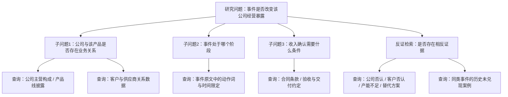
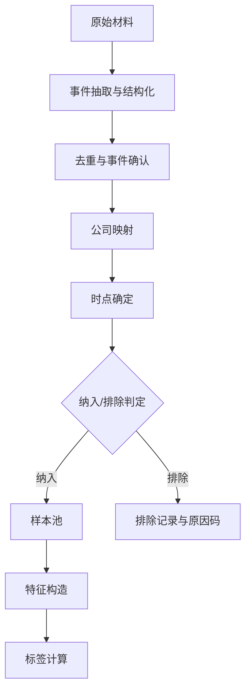
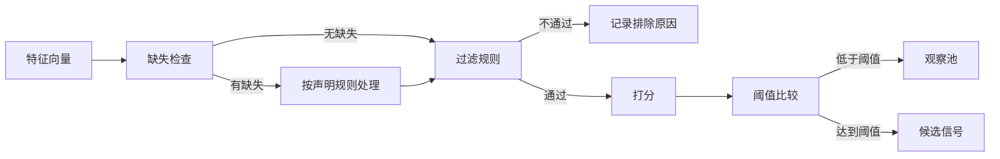
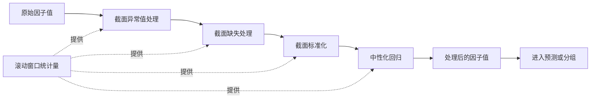
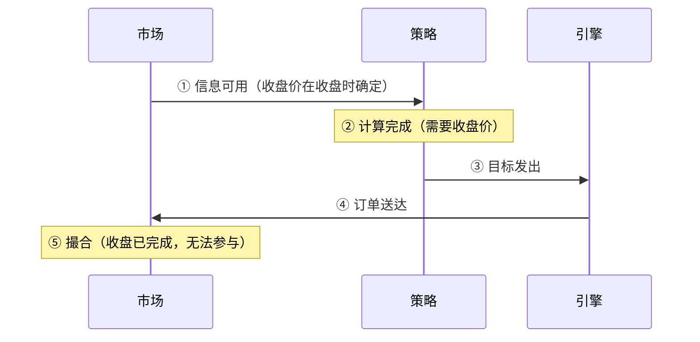
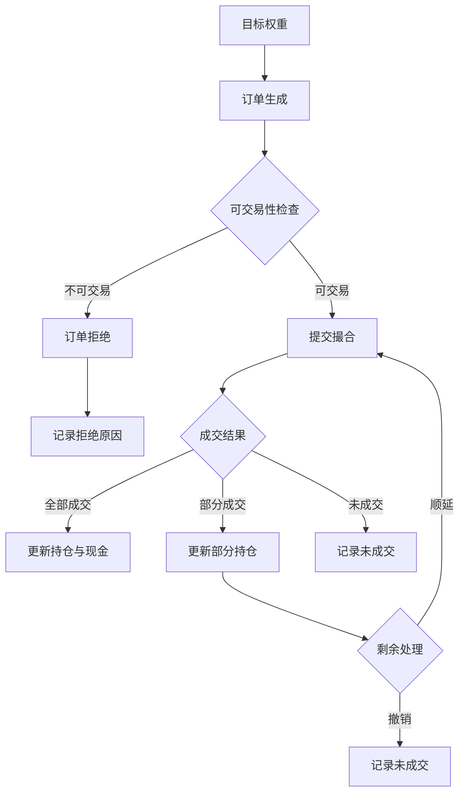
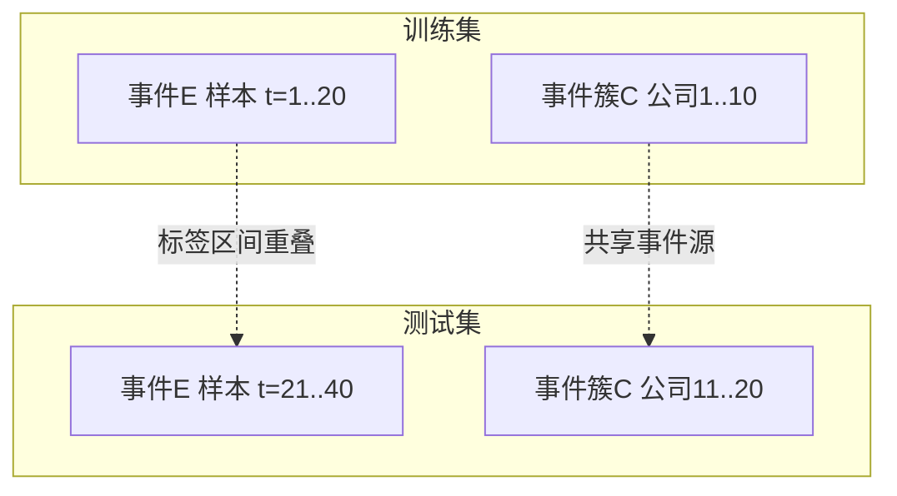
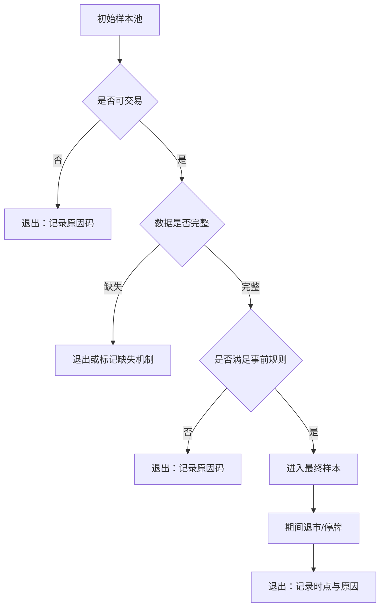

# 《AI量化系统工程：研究、开发与验证》

**全书合稿 v1.0** ｜ 生成日期 2026-10-28 ｜ 共 26 个文本单元

> **关于本合稿的说明。**
>
> 全书统一使用 ASCII 双引号 `"` 作为中文引号；表格单元格内代码中的竖线一律写作 `\|`。这两条是排版约定，不是内容差异。

---

## 目录

- **序章　一套已经完成的 AI 量化系统，如何写成一本技术书**
  - 写在前面：这本书不是从零开始的教程
  - 为什么围绕"产业事件"建立系统
  - 两件必须分开的事：系统做完了，和结论被证实了
  - 为什么按问题组织，而不是按开发日期写日记
  - 读者怎样从"贯穿事件"进入全书
  - 为什么保留第 11 章那套"没被采用"的方法
  - 关于材料的边界
- **第01章　研究目标、系统边界与全书主线**
  - 1.1　研究问题与决策对象
  - 1.2　市场、资产与频率边界
  - 1.3　事件研究、因子研究与组合管理的分工
  - 1.4　工程能力、研究增量与投资表现
  - 1.5　研究、回测、模拟与实盘的状态边界
  - 1.6　个人系统的资源与维护约束
  - 1.7　私有系统与公开教学材料的边界
  - 1.8　贯穿案例、阅读路线与材料类型
- **第02章　总体架构、核心对象与端到端数据流**
  - 2.1　从业务需求到领域模型
  - 2.2　数据、研究、策略、风控与执行分层
  - 2.3　核心对象与主键关系
  - 2.4　API、调度与批处理的职责
  - 2.5　同步调用、异步任务与状态流转
  - 2.6　数据血缘、追踪标识与配置版本
  - 2.7　数据库、检索层、缓存与文件存储
  - 2.8　部署结构、接口契约与外部依赖
- **第03章　一次真实产业事件的完整处理路径**
  - 3.1　贯穿案例的选择与事实边界
  - 3.2　原始材料进入系统
  - 3.3　事件抽取、去重与生命周期识别
  - 3.4　公司映射、经营影响与反证
  - 3.5　特征形成与候选信号生成
  - 3.6　审核、观察、组合与执行分支
  - 3.7　后续事实更新与结果复核
  - 3.8　重建端到端证据链
- **第04章　数据来源、采集链路与质量治理**
  - 4.1　研究所需的数据资产地图
  - 4.2　现有授权数据源的分工
  - 4.3　数据适配、原始归档与标准化
  - 4.4　增量采集、分页、限流与重试
  - 4.5　证券标识、时间、单位与频率对齐
  - 4.6　缺失、重复与来源冲突处理
  - 4.7　上游变更、缓存与历史回放
  - 4.8　覆盖率、时效性与采集成本
- **第05章　历史时点、数据版本与PIT工程**
  - 5.1　事件发生、披露、获取、入库与可用时间
  - 5.2　报告期与信息可用时点
  - 5.3　时点查询与版本选择
  - 5.4　更正、修订、晚到数据与回补
  - 5.5　历史证券、行业与基准成分
  - 5.6　复权、公司行为与可见性
  - 5.7　研究数据集冻结与血缘登记
  - 5.8　时点审计、历史缺口与适用限制
- **第06章　公司研究、产业关系与股票映射**
  - 6.1　AI产业链的业务分类与研究对象
  - 6.2　公司池的覆盖、分层与历史变化
  - 6.3　实体识别、别名与主体消歧
  - 6.4　现有映射方法与技术取舍
  - 6.5　经营暴露、业务占比与证据强度
  - 6.6　直接、间接、竞争与负向暴露
  - 6.7　关系版本、来源与失效条件
  - 6.8　映射错误、人工复核与改进
- **第07章　事件分类、去重与生命周期管理**
  - 7.1　事件类型、事件族与分类边界
  - 7.2　原始报道、事实与事件记录
  - 7.3　文本去重、语义聚合与更新识别
  - 7.4　提出、确认、执行、兑现与终止状态
  - 7.5　新增信息量与传播热度
  - 7.6　来源可靠性、证据强度与重要程度
  - 7.7　事件簇、链式传导与样本相关性
  - 7.8　更正、撤回与下游影响追踪
- **第08章　LLM任务分工、模型调用与成本控制**
  - 8.1　事实抽取、语义理解与研究推理
  - 8.2　确定性计算与规则边界
  - 8.3　模型选择、调用路由与部署条件
  - 8.4　提示词、上下文与版本管理
  - 8.5　结构化输出、未知与合理拒答
  - 8.6　规则、模型与人工的协作
  - 8.7　调用费用、时延、缓存与预算
  - 8.8　模型变更与兼容性处理
- **第09章　结构化抽取、证据绑定与事实校验**
  - 9.1　文本、表格与文档预处理
  - 9.2　主体、动作、数值、时间与状态抽取
  - 9.3　原文位置、引用与证据绑定
  - 9.4　单位、数量级、日期与主体校验
  - 9.5　结构约束与跨字段一致性
  - 9.6　冲突、抽取失败与处理分支
  - 9.7　人工标注与错误分类
  - 9.8　抽取结果的回查与回归核验
- **第10章　经营传导、预期差与反证分析**
  - 10.1　从事件变化到经营假说
  - 10.2　订单、销量、价格、份额与收入
  - 10.3　成本、毛利、利润与现金流
  - 10.4　产能、认证、交付与收入确认
  - 10.5　情景、成立条件与不确定性
  - 10.6　市场预期快照与预期差代理
  - 10.7　主假说、替代解释与反共识
  - 10.8　机制特征、观察点与后续复核
- **第11章　RAG与Agent：原理、设计取舍与量化系统思考**
  - 11.1　先区分RAG、Workflow、Agent与系统模块
  - 11.2　RAG的核心链路与检索方案取舍
  - 11.3　面向量化研究的时点、版本与证据约束
  - 11.4　从固定RAG到Agentic RAG
  - 11.5　单Agent的规划、工具调用与反馈闭环
  - 11.6　上下文工程与研究记忆
  - 11.7　Tools、Skills与MCP的分工
  - 11.8　多Agent协作：任务分解、交接与边际价值
  - 11.9　长任务运行机制、可靠性与权限控制
  - 11.10　对现有量化系统的三个候选应用入口
  - 11.11　怎样评价值得引入，而不是先给收益承诺
  - 11.12　基于历史材料的设计案例与本章结论
- **第12章　研究工作流、工具接口与任务可靠性**
  - 12.1　任务入口、调度与处理边界
  - 12.2　处理步骤、状态与中间结果
  - 12.3　数据和工具接口契约
  - 12.4　条件分支、并行与结果汇总
  - 12.5　超时、重试、幂等与停止处理
  - 12.6　权限、人工审核与执行隔离
  - 12.7　追踪、回放与故障定位
  - 12.8　工程取舍、维护成本与扩展接口
- **第13章　LLM评测、知识泄漏与增量贡献**
  - 13.1　事实、任务、效率与投资效果分层
  - 13.2　样本、人工标签与评测时间
  - 13.3　规则、人工或旧版本基线
  - 13.4　同输入对照与模块消融
  - 13.5　误报、漏报、证据支持与拒答
  - 13.6　历史输入泄漏与模型参数记忆
  - 13.7　费用、时延与重复调用稳定性
  - 13.8　历史实验、当前重放与前向证据
- **第14章　事件Alpha：假说、特征、标签与样本构造**
  - 14.1　从经营假说到量化研究命题
  - 14.2　公司—事件—时点与样本选择
  - 14.3　事件、公司与机制特征
  - 14.4　收益标签、观察窗口与交易规则
  - 14.5　评分、过滤与信号形成
  - 14.6　市场、行业与可比较对象
  - 14.7　事件簇、横截面与市场状态
  - 14.8　失败假说、证伪与研究结论
- **第15章　多因子研究、风险基线与EQ-MF的独立评价**
  - 15.1　风险因子、预测因子与策略目标
  - 15.2　历史可投资池与比较基准
  - 15.3　现有因子的定义与经济解释
  - 15.4　异常值、缺失、标准化与中性化
  - 15.5　相关性、分组收益与稳定性
  - 15.6　因子组合、预测与权重形成
  - 15.7　EQ-MF的独立目标、成本与核算
  - 15.8　与事件研究线的关系及边际贡献
- **第16章　回测引擎、交易约束与成本建模**
  - 16.1　策略接口与回测对象
  - 16.2　信息时钟、决策时钟与成交时钟
  - 16.3　交易规则与可交易性配置
  - 16.4　价格口径、估值与公司行为
  - 16.5　费用、价差、滑点与冲击假设
  - 16.6　停牌、受限、未成交与部分成交
  - 16.7　现金、持仓与交易明细核验
  - 16.8　冻结回测、参考计算与敏感性
- **第17章　样本外验证、研究选择与统计不确定性**
  - 17.1　历史实验总账与研究版本
  - 17.2　训练、验证、测试与滚动评价
  - 17.3　重叠标签、事件簇与样本隔离
  - 17.4　幸存者、样本筛选与结果选择
  - 17.5　参数、因子、提示词与多次尝试
  - 17.6　置信区间、相关样本与误差估计
  - 17.7　稳健性、安慰剂与替代解释
  - 17.8　探索、确认与可外推结论
- **第18章　收益归因、稳健性与策略容量**
  - 18.1　收益、资金占用与比较口径
  - 18.2　基准、风险指标与评价期间
  - 18.3　市场、行业与风格暴露
  - 18.4　事件族、公司与单次交易贡献
  - 18.5　费用、换手与执行差异
  - 18.6　规模、流动性与容量敏感性
  - 18.7　跨策略边际价值与尾部共损
  - 18.8　从归因到研究决策
- **第19章　信号处置：从研究输出到组合候选**
  - 19.1　事件、研究判断、信号与订单分层
  - 19.2　证据、数据时点与有效性检查
  - 19.3　股票范围、交易状态与可交易性
  - 19.4　重复、有效期与事件更新
  - 19.5　同标的、多事件与相反信号
  - 19.6　观察、不行动与拒绝原因
  - 19.7　排序、风险预算与组合候选
  - 19.8　处置总账与后续行为复核
- **第20章　组合构建、风险预算与资本配置**
  - 20.1　预测、评分与目标权重
  - 20.2　仓位、现金与资金占用
  - 20.3　个股、行业、主题与事件簇约束
  - 20.4　风险估计、暴露与模型误差
  - 20.5　换手、交易成本与调仓触发
  - 20.6　多研究线的资本预算与冲突
  - 20.7　不可行目标、降级与压力场景
  - 20.8　组合调整前后的风险核对
- **第21章　执行接口、订单生命周期与账本对账**
  - 21.1　目标、交易计划、订单与成交对象
  - 21.2　执行适配器与运行模式
  - 21.3　撤单、重试、幂等与部分成交
  - 21.4　现金、费用与公司行为记账
  - 21.5　持仓、净值与收益计算
  - 21.6　内部与外部记录对账
  - 21.7　模拟假设与真实执行的差异
  - 21.8　中断恢复与异常订单追踪
- **第22章　真实前向记录与持续迭代**
  - 22.1　历史回测、影子观察、模拟与真实交易
  - 22.2　当时输入、模型、配置与输出留存
  - 22.3　并行版本与候选策略比较
  - 22.4　信号发生后的事实与市场跟踪
  - 22.5　持续迭代与评审触发
  - 22.6　错误修复、版本切换与历史不可回写
  - 22.7　样本积累、覆盖变化与结论稳定性
  - 22.8　已有前向结果的评价与边界
- **第23章　系统运行、可观测性与故障诊断**
  - 23.1　部署、任务依赖与运行生命周期
  - 23.2　数据新鲜度、完整性与任务积压
  - 23.3　模型可用性、时延、费用与质量
  - 23.4　信号、组合与风险状态监控
  - 23.5　API、研究报告与可视化输出
  - 23.6　日志、追踪与异常定位
  - 23.7　故障恢复、备份与降级
  - 23.8　运行成本与个人维护经验
- **第24章　系统演进、AI辅助开发与实战复盘**
  - 24.1　主要版本与设计目标演变
  - 24.2　关键架构取舍与被放弃的方案
  - 24.3　AI辅助需求、设计、编码与审查
  - 24.4　单元、集成、回放与回归测试
  - 24.5　典型缺陷、影响范围与防复发
  - 24.6　重构、迁移与版本兼容
  - 24.7　跨版本案例与改进证据
  - 24.8　可复用经验、已知局限与开放问题
- **附录　参考、登记与复现**
  - A　术语、指标与必要数学
    - A.1　收益、资本分母与现金流
    - A.2　Alpha、Beta与风险暴露
    - A.3　波动、回撤与风险调整指标
    - A.4　因子IC、分组评价与相关性
    - A.5　误差、置信区间与样本依赖
    - A.6　成本、换手和容量的口径
  - B　数据字典、时间字段与接口契约
    - B.1　原文与证据
    - B.2　公司、关系与事件
    - B.3　假说、特征与信号
    - B.4　组合、订单、成交与账本
    - B.5　时间、版本与追踪标识
    - B.6　当前字段与教学别名映射
  - C　提示词、模型卡与结构化输出
    - C.1　实际提示词版本
    - C.2　抽取与证据校验 Schema
    - C.3　经营假说与反证字段
    - C.4　工具契约和权限
    - C.5　模型调用及费用记录
    - C.6　脱敏与可公开范围
  - D　实验、案例与证据登记模板
    - D.1　材料索引
    - D.2　原始历史实验登记
    - D.3　当前离线复核登记
    - D.4　案例取材卡
    - D.5　比较口径检查
    - D.6　证据缺口与结论限制
  - E　贯穿案例、失败案例与勘误索引
    - E.1　端到端事件
    - E.2　误映射与去重
    - E.3　经营判断修正
    - E.4　被观察和拒绝的信号
    - E.5　数据或账本缺陷
    - E.6　跨章节同一案例的材料引用
  - F　环境、配置与复现说明
    - F.1　源码版本和依赖
    - F.2　授权数据获取或离线材料
    - F.3　缓存回放与实际模型调用区别
    - F.4　导出与图表重建
    - F.5　已有测试运行说明
    - F.6　不执行生产采集、下单和写入的安全边界
  - G　公开仓库、阅读导航与材料边界
    - G.1　正文目录与版本
    - G.2　实验索引和贡献说明
    - G.3　代码、文字和第三方材料的许可状态
    - G.4　密钥与账户信息检查
    - G.5　私有系统和公开材料分离
    - G.6　勘误、补充材料与版本更新
  - H　参考资料、原始来源与版本核验
    - H.1　原始披露与数据文档
    - H.2　方法论文与适用边界
    - H.3　框架和接口版本
    - H.4　图表和事实来源
    - H.5　系统材料定位表
    - H.6　发布前需要重新核验的易变事实

---


# 序章　一套已经完成的 AI 量化系统，如何写成一本技术书

## 写在前面：这本书不是从零开始的教程

这本书的前提有点特殊：它描述的不是一个"将要被建起来"的系统，而是一个已经开发完成的系统。代码在仓库里，配置在机器上，历史运行记录在日志和数据库中。写这本书的任务，不是重新设计工程，也不是演示如何从空白目录开始搭一套量化框架，而是把已经存在的东西讲清楚——它为什么这样设计、哪些约束决定了它现在的样子、哪些地方做对了、哪些地方至今没有把握。

这个前提决定了全书的写法。技术教程可以假定"最优解存在，我们照着做"；而一本关于已完成系统的书必须承认：真实系统是取舍的产物。每一个看起来"应该这样"的设计，背后往往是一次具体的失败、一个当时没想清楚的边界，或者一个为了先跑起来而暂时接受的妥协。本书尽量把这些取舍写出来，而不是把结果包装成方法论上的必然。同时要说明本书**不**做什么：它不写成功学故事。系统完成不等于策略赚钱，工程上能跑通不等于投资结论已经被证据确认——这两件事之间隔着样本、时点、成本、资本口径和统计不确定性，隔着的东西比通常以为的多得多。本书会反复回到这个区分上。

## 为什么围绕"产业事件"建立系统

要理解这套系统的形状，先要理解它选择以什么为基本处理对象。

市面上常见的量化系统，基本单位是**时间序列**：一根根 K 线、一天的因子值、一个调仓日的横截面。这类系统的核心工作是数值计算——把价格和成交量喂进去，出来一个排序或一个权重。它们的语言是价格。

这套系统选择的起点不是价格，而是**产业事件**。所谓产业事件，指一家或多家公司经营层面发生、可以追溯到公开信息、并且可能改变市场预期的事实：一份公告、一次产能投放、一项价格调整、一个上下游关系的变动、一条监管口径的落地。系统的第一等公民是"发生了什么事"，价格只是这件事的结果之一。

为什么这么选？因为系统的目标不是拟合价格的历史规律，而是回答一个更具体的问题：**当一件产业事实被公开之后，市场对它的理解是不是错了，错到什么程度，错多久**。这个问题的答案不能从价格里直接读出来——价格里已经包含了市场当时的理解。要回答它，必须先有一个独立的、可以追溯到原文的事实层，再把市场当时的状态叠加上去比较。

这个选择带来了一连串工程后果，全书六篇基本是这些后果的展开。要追溯到原文，就必须有一套**原文与证据**的绑定机制，一段结论要能指回它依据的句子（第 4、9 章）；要回答"当时知道什么"，就必须把数据的**历史时点**做对，而不是用今天的数据回看昨天（第 5 章）；事件发生在公司层面，就必须处理**公司、产业关系与股票之间的映射**，而这三者并不一一对应（第 6 章）；要从非结构化原文里提取事实，就绕不开**大语言模型**的调用、抽取与校验（第 8、9 章）；最终要落到可交易的组合上，就必须有一条从信号到持仓、从持仓到订单、从订单到账本的**完整链路**（第 19—21 章）。

换句话说，"围绕产业事件"不是一个口号，而是一组具体约束的来源。理解了它，就能理解后面每一章在解决什么问题。

## 两件必须分开的事：系统做完了，和结论被证实了

本书反复强调的第一个纪律，是把**系统的完成状态**和**投资结论的证据状态**分开。

系统层面，"完成"是一个可以检查的事实：数据链路能跑通、模型能调用、抽取有输出、组合能生成、订单能落到账本、运行有监控。这些都有明确的通过/不通过标准，可以逐项核对。

结论层面，"成立"是另一回事。哪怕系统每一环都正常，也只能说明"流程走通了"，不能说明"这套流程找到的规律在未来有效"。要支持后者，需要的是足够的样本、正确的信息时点、可比的基线、明确的成本与资本口径，以及对统计不确定性的诚实估计——而在一套**已经完成**的系统上，这些条件往往并不齐备，因为系统通常是先跑起来、再逐步补证据的，不是先攒够证据再上线的。

所以本书对系统能力和对投资结论用的是两套语言：前者可以直接说"已实现"，后者只能说"在当前可获得的材料下观察到什么、这个观察能支持到哪一步"。书中大量出现"不能下的结论"清单，不是过度谨慎，而是因为把这两件事混在一起，正是量化写作里最常见、代价最大的错误。

与这个区分配套的，是**七种运行模式**的严格分离（第 1 章 §1.5.2 给出完整定义）：事后区的 `original_backtest`、`cached_replay`、`retrospective_rerun`、`current_recalculation`，和当时区的 `original_forward_shadow`、`original_paper`、`original_live`。一个数字属于哪一区，决定了它能被怎么解释。把事后重算的结果说成"当时的表现"，或者把缓存回放的输出说成"模型的真实判断"，都是不允许的——这不是措辞问题，而是证据性质问题。

## 为什么按问题组织，而不是按开发日期写日记

一个自然的写法是按时间顺序：先做了什么、后做了什么、哪个月上线了什么功能。本书没有采用这种写法，原因有两个。

第一，**开发日期和知识结构不是一回事**。系统里真正难的部分——历史时点怎么做、证据怎么绑定、成本怎么建模——不是按时间依次出现的，而是分散在很长一段时间里被反复修改的。按日期写，读者会看到一堆孤立的提交；按问题写，读者才能看到同一个工程难题是怎么被逐步逼到今天的样子的。

第二，**按日期写会诱导一种错误叙事**：好像每一步都是计划好的、每一步都成功。真实的开发过程充满回退、放弃和"当时以为对、后来发现错"的判断。按问题组织，可以把这些取舍放进它们所属的技术语境里讨论，而不是让它们在时间线上看起来像是顺理成章的进步。

因此本书的结构是六篇、二十四章：从研究目标与系统边界（第一篇），到数据与证据基础（第二篇），到公司研究与 LLM 处理（第三篇），到假说、验证与回测（第四篇），到组合、执行与运行（第五篇），最后是演进、复盘与经验（第六篇）。每一章对应一类问题，而不是一个时间段。

## 读者怎样从"贯穿事件"进入全书

抽象地讲"围绕产业事件"容易空泛，所以本书需要一个具体的抓手：一条**贯穿案例**——一次真实的产业事件，从它第一次出现在公开信息里，一直到它变成组合里的一个持仓、一笔成交、一条账本记录，再到现在回头看它的判断对不对。

这条线索的作用是导航。读者可以从它出发，按需要走进不同的章节：想了解**数据**是怎么进来的，看第 4、5 章；想知道**原文怎么变成结构化事实**，看第 8、9 章；想知道**这件事怎么变成股票池里的一个候选**，看第 6、10、14 章；想知道**候选怎么变成持仓、持仓怎么变成订单**，看第 19—21 章；想知道**系统在真实运行中观察到什么**，看第 22、23 章。

**贯穿案例已于 2026-10-09 落定。** 它是一次**主分析事件**（公告类，事件族属重大合同/订单），满足三个硬条件：是主分析对象（不是被隔离的辅助市场行为）；链路最长且可复现（从公告原文 → 证据核验 → 经营逻辑分析 → 发布与独立消费 → 特征快照 → 假说与条件裁决 → 决策记录 → 缺口转补证，每一环都有落盘回执）；**且结果不是成功**——它以「分析状态 `partial`、结构化经营事实为空、补证未闭环、兑现条件语义偏弱」收尾。

**结果不是成功，这是它被选中的理由之一。** 一份"成功案例"只能证明流程能跑通一次；一份以未决收尾的案例，同时能说明流程走到了哪一步、以及在哪一步停住了。案例的身份、引用位置与失败登记集中在**附录 E**；它在各章的引用不重复计数（27 处引用、5 个独立样本，见附录E §E.6.2）。

需要说明的是，贯穿案例的引入**不替代教学示例**。各章仍保留明确标注为"方法示意"或"教学示例"的图表与数值场景——它们用于说明机制，不冒充真实数据。**真实材料与教学示例以独立小标题分开，读者不得把教学示例读成系统的实际运行结果。** 具体数字是否属于真实材料，看该节是否标有「**真实材料**」并附**快照时点**。

## 为什么保留第 11 章那套"没被采用"的方法

本书用一整章（第 11 章）讨论 RAG 与新型 Agent 方法——**而这套方法在这套系统里并没有被采用**。这看起来是一章"多余"的内容，需要解释。

保留它的理由有三层。

第一，**它界定了系统的能力边界**。一套系统"不做什么"，和"做什么"同样重要。第 11 章明确区分了现有实现与候选设计，读者因此知道：系统当前的 LLM 使用方式是任务化、结构化的，而不是自主 Agent 式的；系统当前不依赖向量检索来组织证据，而是依赖显式的证据绑定。知道边界在哪，才知道系统的结论适用范围有多大。

第二，**它是真实存在的技术选项**。写书时如果只讲已采用的路，读者会以为其他路不存在。实际上 RAG 和 Agent 是当前这一领域里被广泛讨论的方向，把它们作为**方法与候选设计**正式写进来，比含糊地提一句更有价值。关键在于标注：这些内容从头到尾都标记为"设计讨论"，绝不写成"已实现功能"。

第三，**它示范了如何诚实地讨论未采用方案**。"我们评估过、但没有采用、理由是这些"，本身就是工程经验的一部分。第 11 章因此被允许采用与其余各章不同的写作模式——它是全书唯一采用 `design_discussion`（设计讨论）模式的章节，其余各章均为 `implementation_case`（实现案例）模式，这个区分写在章首，也写在附录的章节状态表里。

## 关于材料的边界

系统代码和原始数据大多属于私有范围，不在公开材料之内。本书能公开的，是**经过整理的说明、脱敏后的字段与结构描述、以及教学示例**。凡涉及具体模块路径、字段名、运行标识（run_id）、配置项的地方，只要不能从可公开的材料中直接读到，书中都会留下精确的**待填占位卡**，格式统一为 `[待填：材料包PXX；对象=…；字段=…；支撑命题=…]`，指明这条信息应当从哪一类材料中取得、用于支撑哪个命题。

这些占位卡不是"待办清单"，也不是把整节推给未来。它们出现的位置，正文本身已经能够独立成立——机制、取舍、方法都讲清楚了，只是系统特有的具体值需要材料来填。读者可以据此判断：哪些内容不依赖私有材料就能理解，哪些需要拿到材料后才能核实。

**另有一类形似而性质不同的空表。** 书中若干处（第 1、3、4、8、9、15 章）在 `text` 代码块里给出**字段规范的空模板**，写作 `[待填]` 或 `[待填：该字段应当填什么]`，并在上方标注"字段规范，实际内容待填"。它们与上述占位卡**不是同一类东西**：占位卡表示"此处应当从某类材料中取得一个值"，空模板表示"这是该类记录的字段清单，示范如何登记"，**故意留空**。这些章通常在邻近位置紧跟一份已填好的实例（例如第 3 章 3.1.2 给空模板、3.1.4 给贯穿案例的实填卡），对照即可看出差别。

**关于占位卡的当前处理状态（2026-10-09）。** 上述格式的占位卡在全书共 **220** 处：**章节侧 0 处**——第 1—24 章原有的 **150** 张已全部处理完毕；**附录侧 219 处**（见本节末段）；另有 **1 处**，即本节正在说明格式的这一行本身。章节侧的处理方式有两种，读者需要区分：

- **回填真实材料。** 卡片位置替换为系统的实测记录——表名、字段名、行数、状态分布、时间戳、统计量。这类内容以「**真实材料**」为小标题标出，并附**快照时点**（本轮为 2026-10-09）。**它回答的是"系统里实际是什么"，不是"应该是什么"。**
- **以方法层关闭。** 少数位置（第17章三处）系统没有对应记录，替换为**不依赖系统材料的登记规范与判据表**，并在正文中显式声明「本节不引用本系统记录」。**这类内容回答的是"应当怎样登记与自查"，不能被读成系统的实际做法。**

两类处理在文件层面都是"卡片变 0 处"，但**读者据此能推出的结论完全不同**。因此凡引用某一节的实测数值前，请先看该节是否标有「真实材料」与快照时点；未标注的，按方法规范理解。

**附录另有 219 处同类卡片**，它们是**单元格级的字段规范**，性质与章节侧的段落级卡片不同，须分别对待。

**全书只有一个附录。** 附录题为《附录　参考、登记与复现》，内含 **A–H 八个部分**：A 术语与数学、B 数据字典、C 提示词与结构化输出、D 登记模板、E 案例与勘误索引、F 环境与复现、G 材料边界与发布、H 来源与核验。**这八个部分原先分列为八个独立附录，2026-10-09 合并为一册**；合并只改结构、不改编号，各部分的字母标识与三级节编号（`§B.6.2`、`§E.6.3` 等）原样保留，因此正文中"附录E §E.6.3"一类的引用**依然指向原位置**，读者不必重新查找。全部案例的身份、引用与失败登记集中在**附录 E 部分**；实验与证据的登记模板集中在**附录 D 部分**。

同样地，凡是会随时间变化的事实——交易规则、费率、接口版本、行业分类口径、模型名称与价格——本书都保留为待核验状态，不写成"当前如此"。这类事实写死了就会过期，而一本关于工程方法的书，不该被几个会变的数字拖垮。本书因此不承诺提供可以照抄的方案，它想摊开来讲的是：一套真实系统如何被约束、被妥协、被验证，或者被证明暂时无法验证。

---

# 第01章　研究目标、系统边界与全书主线

一个已经建成的量化研究系统，最容易被误解的地方不在技术细节，而在它到底解决了什么问题。旁观者通常先看到功能清单：数据采集、特征计算、回测引擎、风险模型、执行适配器。清单越长，越容易让人以为系统的价值就写在清单上。但功能数量回答的是"系统能做什么"，而不是"系统解决了什么问题"。两者之间的距离，恰好是这本书要填的部分。

这个距离有多远，可以用一个具体情形说明。假设某家公司获得了某类产品的认证资格。这件事进入系统之前，一个普通投资者能看到的是一条公告和一段新闻；进入系统之后，得到的是一份带证据引用、时点标注、成立条件与反证条件的判断，以及若干需要继续跟踪的观察点。**系统的产出不是"买"或"卖"，而是一份可以被后续事实检验的研究记录。** 这个区别决定了整本书的写法：如果产出是买卖建议，那么评价标准就是赚了多少钱；如果产出是可检验的判断，那么评价标准就包括判断的依据是否充分、时点是否可核查、结论的边界是否明确。

本章要做的，是把系统的目标、边界与状态定义清楚。这看起来像是铺垫，实际上它决定了后面二十几章的可信度。原因很简单：一个研究结论的可信度，取决于它所依赖的材料处于什么状态。**一份"当时实时产生、未受后续信息影响"的记录，和一份"事后用当前模型重跑历史数据"的结果，即使数值完全相同，其证据强度也完全不同。** 本章的 1.5 节专门处理这个区分，它是全书使用最频繁、也最容易被含糊带过的一节。

八节的分工是：1.1 到 1.3 定义研究对象与研究线；1.4 建立四类命题的区分；1.5 定义运行模式与状态边界；1.6 和 1.7 处理个人系统的资源约束与公开边界；1.8 给出阅读路线。本章与相邻章节的边界是：架构细节交给第2章，端到端实例交给第3章，前向记录的具体内容交给第22章。本章不需要任何收益实验，只要求系统模式与已实现范围的描述与实际记录一致。

## 1.1　研究问题与决策对象

### 1.1.1　从"看到变化"到"做出判断"之间的空档

产业变化每天都有，但大多数变化不构成研究问题。原因不是信息不足，而是**缺少从变化到判断的中间步骤**。这个空档由四件事填满：这个变化影响什么经营变量、影响的量级和方向如何、市场是否已经反映、以及在什么条件下这个判断会被推翻。

系统的作用就是把这四件事变成可记录的产物。以一个明确标注的教学情景说明：

```text
教学情景（虚构主体，非任何真实公司）

观察到的变化：某公司公告其某类产品通过了一项行业认证。

进入系统前的处理：
  → 读公告 → 形成"利好"印象 → 结束
  问题：无法回答量级、无法回答市场是否已定价、
        无法回答什么情况下这个印象是错的。

进入系统后的处理：
  1. 识别变化类型：属于"资质/认证"类事件（第7章、第10章）
  2. 映射经营变量：认证 → 可进入某客户群的资格
                    → 潜在订单 → 收入
  3. 标注成立条件：认证是必要条件，不是充分条件；
                    还需要订单、产能、交付能力
  4. 记录时点：公告发布日、可获取该信息的最早时点
  5. 记录反证条件：若在约定观察期内未出现订单或
                    产能相关证据，则该判断不成立
  6. 输出：一份带上述五项的研究记录 + 若干观察点
```

关键在于第 3 步和第 5 步。**"认证通过"到"收入增加"之间隔着若干条件，而这些条件在公告里通常不会写明。** 把它们显式列出来，是研究记录与直觉印象的分界线。第10章会把这套映射展开为完整的传导链分析。

### 1.1.2　研究问题、决策对象与交付结果

一个研究问题要成立，需要同时说清四件事。缺任何一件，问题都无法被检验。

| 要素 | 说明 | 教学情景中的取值 |
|---|---|---|
| 研究对象 | 被研究的具体对象与状态 | 某公司在某认证之后能否形成收入 |
| 决策对象 | 这个判断最终作用于什么 | 一组可比公司中的相对配置 |
| 交付结果 | 系统产出什么 | 带证据、时点、成立条件、反证条件的研究记录 |
| 检查方式 | 判断如何被后续事实检验 | 观察期内是否出现订单与产能证据 |

第四项最容易被省略。**一个没有检查方式的判断，无论推理多么严密，都不是研究结论，而是一个观点。** 检查方式的存在意味着判断可以被证伪；可以被证伪意味着它是有信息量的。这也是系统与"看图说话"式分析的根本区别。

### 1.1.3　使用者与不可替代的人类判断

系统的使用者是研究者本人，而不是外部客户。这个定位带来两个后果。

**第一，系统不需要把结论包装成可直接执行的建议。** 面向外部客户的产出通常需要给出明确的行动指引，因此必须在信息不足时也给出方向。面向研究者本人的产出可以明确地说"当前证据不足，继续观察"——而这句话本身是一个有效的研究结论（第19章 19.6 会把"不行动"作为正式的原因码处理）。

**第二，若干判断必须由人做出，不应交给系统。** 这些判断包括：

- **经营机制是否成立。** 认证通过到订单之间的传导是否真的存在，取决于行业惯例、客户结构、竞争格局。这些是产业判断，不是可以从数据中自动推出的结论（第10章）。
- **证据是否可信。** 一条信息来源的可靠性、一个数据的口径是否与历史可比，需要人的判断。
- **风险是否可承受。** 一个判断在逻辑上成立，与这个判断适合当前资金状态，是两个问题。
- **是否停止。** 什么情况下承认一个假说不成立并停止跟踪，涉及研究者的时间与注意力分配。

把这些交给系统，等于把系统不擅长的部分包装成自动化，结果是一个更复杂但更不可靠的流程。**明确划出"不由系统判断"的部分，与说明"由系统判断"的部分同样重要。**

### 1.1.4　为什么功能数量不能定义问题是否解决

这是本节要防的主要误写。一个系统有一百个模块，可能只解决了一个问题；有十个模块，可能解决了五个问题。模块数量与问题解决程度之间没有单调关系。

判断问题是否解决，要看的是：**从输入到输出的链路是否闭合、输出是否可被检验、以及链路中的每一环是否有证据支持。** 这三个条件与模块数量无关，而与链路设计有关。

```text
教学对照（虚构，仅用于说明判断标准）

系统 A：模块 120 个
  输入 → ……（链路中有一环无证据支持）…… → 输出
  判断：链路未闭合，问题未解决。

系统 B：模块 15 个
  输入 → 识别 → 映射 → 记录 → 检验
  每一环都有可核查的记录
  判断：链路闭合，问题已解决（在该范围内）。

结论：解决问题的是链路的完整性，不是模块的数量。
```

**本系统的研究问题与交付结果（真实材料，快照时点 2026-10-09 08:20–08:45）。**

| 要素（1.1.2 的四栏） | 本系统的实际取值 |
|---|---|
| 研究对象 | A 股 AI 产业链公司的事件与其经营传导。治理文件陈述的目标口径为 `proprietary_excess_return_v1`（2026-09-12 切换） |
| 决策对象 | 一组可比公司中的相对配置（`opportunity_candidates` → `signals`），**不是绝对收益、不是择时** |
| 交付结果 | **研究记录与处置记录**，形态有四层：分析记录（`event_logic_analyses`）、假说与条件（`event_business_hypotheses` / `event_hypothesis_evaluations`）、信号（`signals`）、面向展示的分级卡片（`opportunity_cards`）。**不产出持仓建议** |
| 检查方式 | 假说自带可证伪条件：`falsify_rule = any`、`realize_rule = all`，条件分 `support` / `realize` / `falsify` 三类（第14章） |

**使用者定位由治理字段硬性界定，不是作者的选择：** 治理快照中 `customer_claim_allowed = false`（不得面向客户声明）、`live_authority_allowed = false`（不得进入实盘）、`read_only_source = true`。**系统被显式设计为不面向外部使用者。**

**"交付结果是研究记录而不是持仓建议"这一条，有四组数据同时支持：**

| 证据 | 实测值 |
|---|---|
| 全库可交易候选资格 | `production_candidate_eligible` **全库 0 行** |
| alpha 证明状态 | `alpha_proof_state` 无一行 `proven`（`unproven` 40,067 / `evidence_missing` 28,374 / `canary_learning` 82 / `blocked` 46） |
| 展示分级的分布 | `final_grade = U` / `readiness_band = blocked` **20,159 行（46.9%）**，A 级仅 2,591 行（6.0%） |
| 事件准入的结果 | 主池事件 **35,596 → 正式候选 114（0.32%）→ 学习候选 4,961 → 生产候选 0** |

**"不由系统承担的人类判断"在实现层面被显式关闭：**

- **两版运行政策的 `decision_consumer_enabled` 均为 `false`**（后台政策与单样本手动政策皆然）——即分析结果**不被交易决策消费**。
- 治理纪律明写停止规则：「**不得自动全面编码、迁移、部署、训练或下单**」。
- `execution_authority_state` **68,569 行 100% 为 `not_evaluated`**，`execution_authority_tier` 与 `execution_passport_id` **100% 为 NULL**——**执行授权这一整个子系统从未运行过一次。**

**检查方式的实测状态（本节最需要如实说明的一点）：** 可证伪条件**已经工程化**（三条件结构、`falsify_rule` / `realize_rule`、允许来源类型白名单），但**全库条件裁决只有 `unknown` 与 `out_of_scope` 两种结果，没有任何一条是 `supported`、`realized` 或 `falsified`**。**检查方式已定义，但从未真正裁决过一次。** 这直接决定了本章 1.4.4 的四类命题里，第四类（投资表现）在本系统上尚无证据。

> **本节的口径留白（刻意）**：本节**不给出一条"系统解决了什么问题"的单一陈述**。原因是治理文件里同时存在三个业务范围（旧事件与模拟账本 / AI_EVENT 自然事件研究 / AI 产业链 Rank + EQ-MF），**三者的研究对象不同**；给出单一陈述等于替作者在三者中做选择。**"系统解决什么问题"在本系统中必须先指定业务范围，才能回答。**

## 1.2　市场、资产与频率边界

### 1.2.1　六个独立的时间概念

在量化研究中，"周期"这个词被过度使用，掩盖了至少六个彼此独立的时间量。把它们分开，是本节的核心任务。

| 时间概念 | 定义 | 由什么决定 |
|---|---|---|
| 市场范围 | 交易场所与制度环境 | 研究对象的可及性 |
| 资产类型 | 证券类别与衍生工具 | 研究对象与数据可得性 |
| 信号发生频率 | 信号被触发的疏密程度 | 事件的分布，不是人为设定 |
| 决策频率 | 系统做出处置判断的时点 | 信号出现 + 处置规则 |
| 标签窗口 | 用于计算收益的时间跨度 | 研究设计（第14章） |
| 观察期 | 判断被跟踪的时长 | 研究设计 + 事件性质 |
| 实际持有期 | 从建仓到退出的实际时长 | 退出规则与市场状态 |

**这七项可以完全不同，而且通常确实不同。** 一条事件驱动的信号可能在某个月触发二十次，在接下来的三个月一次都不触发——这是信号发生频率的分布特征，不是"周频"或"月频"。把这种分布硬套到一个固定周期上，会同时扭曲信号的定义与评价的方法。

### 1.2.2　同一条事件下的时钟差异

用一个明确标注的教学时间轴说明这些时钟如何分离：

```text
教学时间轴（示意，非真实记录）

T0      事件发生日（例如认证公告发布）
T0+d1   系统可获取该信息的最早时点（取决于数据源与处理延迟）
T0+d2   系统做出处置判断的时点（决策频率）
T0+d3   组合层面实际建仓的时点（受组合约束与可交易性影响）
T0+L    标签窗口终点（用于计算该事件的收益，L 由研究设计决定）
T0+W    观察期终点（用于检验判断是否成立，W 由研究设计决定）
T_exit  实际退出时点（由退出规则决定，可能早于或晚于 T0+W）

关键：d1、d2、d3 通常互不相等；
      L 与 W 是两个不同用途的窗口；
      T_exit 与 T0+W 没有必然关系。
```

**标签窗口与观察期必须分开。** 标签窗口用于计算收益，是一个统计构造；观察期用于检验判断，是一个研究安排。一个事件的收益可能在五个交易日内实现，但判断是否成立需要在更长的时间上跟踪经营证据。把两者混为一谈，会导致用短期价格表现去判定长期经营判断的对错。

### 1.2.3　频率的表述规范

本章明确禁止的表述方式是：**把中频或中低频固定为周频、双周或任何固定周期。** 理由有三条：

1. **频率是结果的属性，不是设计的输入。** 一个系统按照事件与规则运转，它实际产生的信号频率是运行的结果。预先声明"本系统是周频"，等于把一个待观测的量写成了前提。
2. **固定周期会掩盖分布的真实形态。** 事件驱动的信号天然是聚集的：某些时期密集，某些时期稀疏。固定周期的表述会让读者以为信号是均匀的。
3. **固定周期会诱导错误的评价方法。** 一旦声明为周频，评价就容易退化为"每周收益率的比较"，而这会掩盖信号时点、持有期与退出规则的作用。

正确的表述方式是按时间概念分别描述：市场范围是什么、资产类型是什么、信号由什么触发、决策在什么时点做出、标签窗口与观察期各是多长。**这些量各自给出，不合并成一个"周期"。**

关于 20 或 60 个交易日：**这两个数字在本书中只作为前向观察时间的示例出现，不是持有期，也不是强制迭代间隔。** 它们不代表"每 20 个交易日必须重新评估"，也不代表"持有 20 个交易日后卖出"。任何把它们当作固定参数的理解，都偏离了原意。

**本系统的市场、资产与时间参数（真实材料，快照时点 2026-10-09）。**

| 时间概念（1.2.1 的七栏） | 本系统的实际取值 |
|---|---|
| 市场范围 | A 股（沪深）。股票代码为 6 位数字，允许清单中出现科创板代码（`688627`） |
| 资产类型 | 普通股票，**无衍生品、无期货、无期权**；账户为模拟账户 |
| 信号发生频率 | **事件驱动，分布高度聚集**（见下表） |
| 决策频率 | 由事件到达与编译流程决定，**不是固定周期**。C-01 的四个时点相隔 3 至 34 天 |
| 标签窗口 | 五个期限：`T+1` / `T+3` / `T+5` / `T+10` / `T+15`（第14章） |
| 观察期 | 由假说状态表达：`AWAITING_VERIFIED_OBSERVATION`（等待经验证的观察） |
| 实际持有期 | 由退出规则决定，规则为 `default_atr_time_exit`，**版本槽为 `@unversioned`** |

**信号发生频率的真实分布（按事件时间，`signals` 表）：**

| 月份 | 2026-03 | 04 | 05 | 06 | 07 | 08 | 09 | 10（至 09 日） |
|---|---|---|---|---|---|---|---|---|
| 信号数 | 2,569 | 2,058 | 6,093 | 9,824 | **21,178** | 585 | 594 | **19** |

**从 21,178 到 19 的落差说明"频率是结果的属性"这一条在本系统上不是理论判断。** 同期机会候选数仍维持每月约 10,000——**不是事件不来了，而是机会不再转成信号**。**任何把本系统表述为"周频"或"月频"的写法，都会把这条曲线抹平。**

**决策时点的四个环节互不相等（C-01 实测）：**

| 环节 | 时间 |
|---|---|
| 披露 | 2026-09-03 10:54:50 |
| 入库 | 2026-09-03 16:03:12 |
| 检出 | 2026-09-06 09:43:52 |
| 编译 | **2026-10-07 08:42:38** |

**披露到检出相隔约 3 天，检出到编译相隔约 31 天。** 本节 1.2.2 的 d1 / d2 / d3 在此有真实取值，且**三者的量级差异远大于示意**。

**标签窗口的覆盖区间各不相同（这是 1.2.1"标签窗口与观察期分开"之外的另一处必须写清的事实）：**

| 期限 | 行数 | 事件数 | 末日 |
|---|---|---|---|
| T+1 | 7,802 | 1,525 | 2026-09-30 |
| T+3 | 11,377 | 2,705 | 2026-09-19 |
| T+5 | 7,554 | 1,499 | 2026-09-09 |
| T+10 | 1,957 | 641 | 2026-08-05 |
| T+15 | 788 | 171 | **2026-08-04** |

**五个期限覆盖不同的事件集，因此跨期限的趋势解读无效。** 另有命名漂移：`T3` 1 行、`T5` 4 行、`expiry` 58 行——**同一字段出现两套命名**。

**关于 20 / 60 个交易日：** 本系统的实测期限参数只有 `T+1` 至 `T+15`，**没有以 20 或 60 个交易日为参数的观察窗口或持有期设定**。因此本节 1.2.3 关于"20/60 只作为示例"的说明在本系统上**有直接的事实支持**，而不只是写作约定。

**信号衰减的实际参数（供第14章核对）：** `alpha_t = alpha_0 · e^(−λ·trading_hours)`，衰减常数按事件类型取值——情绪类 2 小时、财报类 4 小时、政策类 48 小时、AI 产业类 24 小时；**非交易时段按 25% 折算**。

> **本节的口径留白（刻意）**：本节**不给出各期限的具体持有规则与退出阈值**，也**不给出 ATR 窗口长度**。这些属生产参数（1.7.1 的"不可公开"层）。另：**"实际持有期分布"未取得**——退出规则存在（三条并发扫描），但**未统计实际持有天数的分布**，列为待核验项。

## 1.3　事件研究、因子研究与组合管理的分工

### 1.3.1　三种职责

一个完整的投资判断链路包含三段不同的工作，它们回答的问题不同，需要的证据也不同。

| 职责 | 回答的问题 | 主要输出 | 关键方法 |
|---|---|---|---|
| 发现事件机会 | 有什么变化可能未被充分定价 | 事件、假说、特征、标签 | 事件研究（第7—10、14章） |
| 解释共同风险 | 收益中有多少来自共同来源 | 因子暴露、风险基线 | 多因子研究（第15章） |
| 形成组合 | 在约束下如何配置 | 目标权重 | 组合构建（第20章） |

三段的分界线在于**它们处理的"来源"不同**：第一段找的是个股层面的、与特定事件相关的收益来源；第二段找的是横截面上的、与共同因子相关的收益来源；第三段处理的是把前两段的输出在约束下合成一个可执行的配置。

```text
三类职责与共享底座的逻辑示意（方法示意，非部署图）

              ┌─────────────────────────────┐
              │  共享底座                    │
              │  数据治理 · 回测引擎 · 成本模型 │
              │  存储与检索 · 版本与血缘       │
              └──────────┬──────────────────┘
                         │
      ┌──────────────────┼──────────────────┐
      │                  │                  │
 ┌────▼────┐        ┌────▼────┐       ┌────▼────┐
 │事件研究线│        │风险基线  │       │组合管理  │
 │（主研究）│        │（解释）  │       │（配置）  │
 └────┬────┘        └────┬────┘       └────┬────┘
      │                  │                  │
      └──────────────────┴──────────────────┘
                         │
                  独立多因子研究线 EQ-MF
                  （独立目标 · 独立核算）

注：EQ-MF 位于共享底座之上，但其目标与核算独立于事件研究线。
    本图为方法示意，实际部署结构与组件边界见第2章。
```

### 1.3.2　EQ-MF 的定位

EQ-MF 是第三条研究线。它与事件研究线的区别不在于用了什么数据，而在于**目标与核算的口径不同**：

| 对比项 | 事件研究线 | EQ-MF |
|---|---|---|
| 收益来源假设 | 特定事件引发的定价偏差 | 横截面特征的持续差异 |
| 研究单位 | 事件 | 标的×时点的特征向量 |
| 主要风险 | 事件不成立、传导链断裂 | 因子失效、拥挤、风格反转 |
| 核算要求 | 事件层面的贡献可追溯 | 独立目标与独立核算 |

**"独立核算"是指目标与成本口径独立，不是指收益独立。** 两条线若共享同一份资金，它们的收益在组合层面就不可分离——这一点在第15章 15.7 与第18章 18.7 分别从因子层面和资本层面展开。

### 1.3.3　共享底座不等于共享有效性

这是本节要防的主要误写。两条研究线使用同一套数据治理、同一个回测引擎、同一份成本模型，这是工程上的合理选择——但它只说明两条线的**计算方式一致**，不说明它们的**结论互相支持**。

具体地说，共享底座不能推出以下任何一条：

- 两条线的收益相关性低（相关性由信号来源决定，不由底座决定）；
- 两条线都已被验证有效（各自的验证需要各自的证据）；
- 一条线的结果可以佐证另一条线（同一引擎的两个结果不是互相独立的证据）。

**这一点在第18章 18.7 有直接后果：不能把两条线的净值简单相加当作组合收益。** 本章只需明确这个区分的存在，具体的合并方法留给后续章节。

**本系统的研究线清单与分工（真实材料，快照时点 2026-10-09）。**

本系统**不是两条研究线**。实测存在**四条研究副线 + 一条学习车道 + 一条已停摆的主链**：

| 研究线 | 目标 | 状态 | 证据 |
|---|---|---|---|
| **legacy 主链** | 旧事件 → 信号 → 纸单 | **已停摆** | `signal_execution_outbox` 最后写入 2026-07-16（约 12 周零新增）；`signals` 42,920 行全部终态 |
| `mechanism` 副线 | 机制级研究 | 运行中 | 四条副线之一 |
| `ai_event` 副线 | AI 事件自然事件研究 | 运行中 | `ai_event_research_work_items` 最后完成时间为查询当日；13 GB 证据表 |
| **AI Alpha 副线** | 事件 Alpha 研究 | 运行中 | `alpha_forecasts` 45,140 行；`alpha_forecast_outcomes` 45,140 行 |
| **EQ-MF** | 横截面多因子研究 | 部分实现 | 见下 |
| `learning` 车道 | 学习与金丝雀 | 运行中 | `canary_stage = canary_10`；`paper_canary` 买入 137 笔（2026-08-21 → 2026-10-08） |

**共享底座的实测范围（对照 1.3.3 的"共享底座不等于共享有效性"）：**

| 共享项 | 实际情况 |
|---|---|
| 数据库 | 单一 PostgreSQL 实例（`eventquant`，225 GB）——**六条线共用一个库** |
| 调度 | 同一调度器（330 个 Job、约 45 个资源 cabin），按十条通道划分 |
| 回测与成本模型 | 共享，但 **`cost_model_version_id` 在 45,140 行预测中 100% 为空**——**成本模型被共享，却从未被版本化** |
| 存储与版本 | 共享；`release_manifests = []` |

**独立核算的实测状态——本系统在这一点上存在明确缺口：**

| 独立核算项（第20章 20.6 的判据） | 实测 |
|---|---|
| 各研究线的资金预算与规则 | **未取得** |
| 是否存在共享资金池 | **未取得** |
| 同标的冲突的处理记录 | **未取得** |
| 是否有联合运行记录 | **无联合运行记录** |

**因此"两条线是否可以视为互相独立"这个问题在本系统上无法回答**——不是因为结论是"不独立"，而是因为**支撑独立性评估的联合记录不存在**。这与第20章 20.6"没有联合运行记录就不声称组合分散有效"是同一条约束。

**EQ-MF 的定位（对照 1.3.2）：** 它作为研究线存在，其**独立目标与独立核算的设计**记录在案；但**代码、配置、运行记录与报告的完整程度未逐项核验**，属"部分实现"。本章不主张 EQ-MF 已上线，也不主张它未实现。

**三个并存的业务范围（必须在引用任何"系统整体"结论前先指定）：** 旧事件与模拟账本 / AI_EVENT 自然事件研究 / AI 产业链 Rank + EQ-MF（`docs/CURRENT/SYSTEM_GOAL_AND_EVIDENCE.md`）。**三者的研究对象与成功判据不同**，这是 1.3.3"共享底座不等于共享有效性"的最强实例——**连"有效性"要证明什么都还没统一。**

> **本节的口径留白（刻意）**：本节**不给出各研究线的资金规模、收益数字与相互相关性**。前两项属生产参数；第三项**没有联合记录可算**。**"六条线"是快照时点的组织形态，不是设计目标**；引用时须标注时点。

## 1.4　工程能力、研究增量与投资表现

### 1.4.1　四类命题

关于一个量化系统，可以提出的命题分成四类。它们的证据要求不同，而且**不能互相推导**。这是全书最重要的一组区分之一。

| 命题 | 问的是 | 需要的材料 | 评价单位 |
|---|---|---|---|
| 工程正确 | 系统是否按设计运行 | 代码、测试、运行日志 | 通过/不通过、错误率 |
| 研究质量 | 分析与流程是否可靠 | 数据口径、可复现流程、版本记录 | 可复现性、口径一致性 |
| 预测能力 | 判断是否优于基准 | 样本外数据、基准、对照 | 样本外指标与其不确定性 |
| 投资表现 | 成本后是否有利可图 | 成本模型、资本口径、容量约束 | 成本后净结果与容量范围 |

四类命题的强度是递进的：工程正确是最弱的一类，投资表现是最强的一类。**弱命题不能推出强命题**，但强命题蕴含弱命题（若投资表现成立，则工程必须正确）。

### 1.4.2　不能推出的结论

| 已知 | 不能推出 | 原因 |
|---|---|---|
| 代码跑通、测试通过 | 策略有效 | 工程正确性不涉及收益 |
| 经济解释合理、逻辑自洽 | 有预测能力 | 解释是回溯的，预测是前瞻的 |
| 历史回测盈利 | 实盘盈利 | 缺成本后、样本外与容量证据 |
| 样本外指标为正 | 可放大规模 | 容量与冲击成本另需证据 |
| 模拟运行正常 | 实际执行无差异 | 模拟成交是假设，不是实测 |

这张表在第15章、第17章、第18章各有对应展开。本章把它作为总纲给出。

### 1.4.3　改写一句越界结论

抽象地讲原则不如直接改写一句话。以下为一个明确标注的教学示例。

```text
【原句】（越界）
"系统已经完成了事件识别、特征构造与回测，
 因此该策略在实盘中可以获得超额收益。"

问题定位：
  - "完成识别与构造" → 属于工程正确
  - "完成回测" → 属于历史结果（且未声明是否扣成本）
  - "因此…可以获得超额收益" → 跳到了投资表现
  中间缺少：样本外验证、成本后口径、容量约束、
            以及"回测区间内为正"与"未来为正"的区分。

【改写后】
"系统已实现事件识别与特征构造，并在历史区间上完成了
 回测。在回测区间内、扣除所设定的交易成本前，
 该策略的收益为正。这支持'工程链路已闭合'与
 '在该区间上有过正的历史结果'两项陈述，
 不足以支持实盘可获超额收益的结论——后者需要
 成本后、样本外的独立证据，以及容量与执行条件的说明。"
```

改写的要点是**把断言拆回到它实际所属的那一类命题上，并明确说出缺什么。** 改写后的句子比原句长，但它说的每一句都可以被检验。

### 1.4.4　为什么这组区分值得反复强调

一个已完成的系统天然带有"能力感"：代码在那里，流程在那里，结果也在那里。这种能力感会让人不自觉地认为结论已经成立。**但系统完成与结论成立之间，隔着的正是上面那四类命题的距离。**

这个距离在本书中会反复出现，原因不是作者保守，而是它确实存在。第17章会说明，在真实效应为零的情况下，多次尝试后的最优结果也会显著为正；第18章会说明，同一个策略在不同资本口径下可以得出完全相反的比较结论。这些都不是边缘情形，而是常规情形。

因此，本章把四类命题的区分放在第一章，而不是放在结论章。**读者在进入具体方法之前，需要先知道什么样的材料支持什么样的结论。** 否则后面每一章的结论都会被读得比实际更强。

**本系统在四类命题上的实际证据（真实材料，快照时点 2026-10-09）。**

| 命题（1.4.1） | 本系统走到了哪一步 | 关键实测 |
|---|---|---|
| **工程正确** | **基本成立，但有一处基础设施级缺口** | 测试收集项 **6,132** 个、`test_*.py` 文件 **826** 个；`authenticated_api_verified = true`、`authenticated_ui_verified = **false**`；一次两盘改造复核中 **107 个回归用例通过**；**但全仓回归无法一次性收集**（同名文件与 `--import-mode` 两种规避手段互斥） |
| **研究质量** | **部分成立** | 有治理口径文件（`docs/CURRENT/SYSTEM_GOAL_AND_EVIDENCE.md`）与目标口径（`proprietary_excess_return_v1`）；**但版本记录多处为空**：`cost_model_version_id` 45,140 行全空、`policy_key` 执行/退出槽 99.3% `@unversioned`、`release_manifests = []`、`events` 表无 `published_at` |
| **预测能力** | **未达到可陈述的程度** | `strict_measured_outcome_count = 0`（每一策略）；`alpha_evidence_status = "not_proven_collecting_forward_evidence"`；干净样本（五个期限齐备的事件）**仅 11 个聚类**；报告时点 5 个期限的 t 值均 < 2.5 且曲线非单调 |
| **投资表现** | **无证据** | 全部账户为模拟；`live_authority_allowed = false`；`evidence_channel = 'executed'` 仅 **1,902 行（2.3%）**，其余 97.5% 为反事实样本 |

**四类命题的递进关系在本系统上的实测形态：**

```text
工程正确  ████████████░░  基本成立（除全量回归收集）
研究质量  ████████░░░░░░  部分成立（口径有，版本缺）
预测能力  ███░░░░░░░░░░░  未达门槛（样本 11 个聚类）
投资表现  ░░░░░░░░░░░░░░  无证据（全部模拟，无实盘）
```

**本系统存在一处明确的"把弱命题当强命题陈述"的历史实例（C-1）：** `CLAUDE.md` 第 1 节长期写「核心主张：**事件驱动优于量价驱动**」；**2026-09-11 更正为「待证伪的假说，不是既成事实」**。更正原因是两类：①**证据不足**——干净样本上五个期限的 t 值均 < 2.5 且曲线非单调；②**该主张在其最新旗舰工作线中已不再被检验**（新需求的核心是景气动量 / 盈利质量 / 链内相对强弱的多因子排序）。

**这处更正的公允之处必须一并写出：** 决策登记中确实把"事件角色可配置"记为决策，**因此不是遗忘**；缺的是"该决定的战略含义未被显式表述"。**这是"证据不足型修正"，不是"证伪"**——原主张没有被推翻，只是被降级为待证伪假说。

**同时存在一处更罕见的记录：诊断者把自己错误的诊断过程也登记了下来（C-2）。** 同一份报告先在 §9.5 判定"3 个测试是陈旧夹具，不是回归"，随后在 §9.6 自我更正：「**错了。……它们是这起回归唯一的自动化信号，从 09-06 起一直红着，却被（包括本报告作者在内）默认成陈旧夹具而无人查证。**」报告为此提出概念「**红灯疲劳**」。

> **本节的口径留白（刻意）**：本节**不给出四类命题的"完成度百分比"**，上表的进度条是**相对位置的示意**，不是测量结果。四类命题之间不可换算（1.4.1），**把它们折算成一个分数会同时丢掉三件事**：每一类各自的证据强度、缺的是哪一类材料、以及缺口是"未做"还是"做了但结论未定"。

## 1.5　研究、回测、模拟与实盘的状态边界

### 1.5.1　为什么这一节是全书使用最频繁的一节

后面每一章在给出任何结论时，都需要回答一个前置问题：**这个结论来自哪种运行模式？** 同一个策略，用当前模型重跑历史数据得到的净值，与当时实时产生的记录，可能数值接近，但证据地位完全不同。前者可以因为模型更新而改变，后者一旦生成就固定了。

这一节定义的模式标识会在全书反复出现。它们的用处不是分类本身，而是**防止两类具体的错误**：把事后结果说成当时记录，以及把接口存在说成交易已发生。这两类错误在技术书中相当常见，因为它们不容易被读者察觉——数值是真的，代码也是真的，错的只是这些数值和代码所证明的东西。

### 1.5.2　七种运行模式

按"结果产生的时间"与"输入的性质"两个维度，可以把系统的运行分成七种模式。前四种是**事后**模式，后三种是**当时**模式。这个分界是整张表的关键。

| 模式 | 标识 | 输入 | 输出 | 关键限制 |
|---|---|---|---|---|
| 原始历史回测 | `original_backtest` | 历史数据（当时版本） | 历史净值与交易记录 | 不是前向观察，不受时点约束 |
| 缓存回放 | `cached_replay` | 当时保存的中间结果 | 重放出的结果 | 证明可复现，不证明当时判断 |
| 当前模型重处理旧料 | `retrospective_rerun` | 旧材料 + 当前模型/提示词 | 新的结果 | 反映当前能力，非当时能力 |
| 当前重算 | `current_recalculation` | 历史数据（当前版本） | 重算结果 | 可能因数据修订而不同；不覆盖原报告 |
| 原始前向影子观察 | `original_forward_shadow` | 当时实时数据 | 当时的信号记录 | 不下单；记录未受后续信息影响 |
| 模拟（纸面） | `original_paper` | 实时数据 + 模拟成交 | 模拟账本 | 模拟成交是假设，不是实测 |
| 实盘 | `original_live` | 实时数据 + 真实委托 | 真实成交与账本 | 唯一可用于"实际执行差异"的模式 |

```text
时间轴示意：两种模式族的根本差异

真实时间轴 →

  ├────────── 事后区（结果可被改写）──────────┤├── 当时区（结果不可改写）──┤
  │                                            │                          │
  │  [原始历史回测]  original_backtest          │  [前向影子观察]            │
  │  [缓存回放]      cached_replay              │   original_forward_shadow │
  │  [重处理旧料]    retrospective_rerun        │  [模拟]    original_paper │
  │  [当前重算]      current_recalculation      │  [实盘]    original_live  │
  │                                            │                          │
  └────────────────────────────────────────────┘──────────────────────────┘
       输入可以是"当时版本"或"当前版本"            输入只能是"当时实时"
       可以换模型、换参数、换数据版本              时点一旦过去即不可重现

关键规则：
  1. 事后区 → 当时区 的标注转换是单向禁止的。
     当前重算的结果不能标注为当时的前向记录。
  2. 当时区的三种模式共享一个性质：
     结果在生成时被固定，后续分析只能解释它，不能替换它。
  3. 原始报告与当前重算结果并存，不相互覆盖。
```

### 1.5.3　两种非运行状态

除了七种运行模式，还有两种状态必须能被标注。它们不是"运行模式"，因为此时没有任何运行发生。

| 状态 | 标识 | 含义 | 证据强度 |
|---|---|---|---|
| 仅实现 | `implementation_only` | 代码或配置存在，但从未按该模式运行过 | 支持"已实现"，不支持"运行过" |
| 设计讨论 | `design_discussion` | 方法与设计已讨论，尚未实现 | 不构成系统证据 |

**`implementation_only` 是本书中最容易被误读的状态。** 一个执行适配器模块存在于代码库中，只能说明接口已经实现，不能说明发生过任何真实委托。从"存在券商适配代码"推断"真实交易已发生"，是本章明确禁止的推断。要证明真实交易发生，需要的是委托记录、成交回报与账本变化，而不是代码。

**`design_discussion` 是第11章的整章状态。** 那一章讨论的 RAG 与新型 Agent 方案属于方法与候选设计，全章不要求任何系统证据，也不要求历史实验。这样处理的目的正是把"讨论"与"已实现"分开，避免读者把方案当成功能。

### 1.5.4　模式存在、持续运行与结果可审计

运行模式的定义之外，还需要区分三个递进的状态。它们常被合并成一句"系统支持该模式"，从而掩盖了实际差距。

| 状态 | 含义 | 需要的证据 | 不能推出的 |
|---|---|---|---|
| 模式存在 | 该模式的代码与配置存在 | 代码、配置文件 | 曾经运行过 |
| 持续运行 | 该模式在多个时点实际执行过 | 带时间戳的运行日志序列 | 结果可核查 |
| 结果可审计 | 输入、版本与输出被完整保存 | 输入快照、版本标识、输出记录 | 结论有效 |

三个状态是递进的：模式存在不等于运行过，运行过不等于可审计。**"结果可审计"是给出任何结论的最低门槛。** 一份没有输入快照与版本标识的记录，即使确实在某个时点产生过，也无法被复核——因为无法确认它用的是哪一版数据、哪一版模型。

### 1.5.5　三种彼此独立的系统状态

除运行模式之外，全书还需要三个彼此独立的"状态"字段。它们描述的是不同层面的进展，**互不推导**。

| 状态 | 描述什么 | 取值范围示例 |
|---|---|---|
| 系统能力状态 | 系统实际能做什么 | 已实现并运行／已实现未运行／未实现 |
| 书稿整理状态 | 这一部分在书中写到什么程度 | 已写／部分／待写 |
| 证据材料状态 | 支撑某个具体命题的材料是否到位 | 已核验／部分／缺失 |

**三者的独立性是这套设计的要点。** 一个功能可能已实现并运行（系统能力状态良好），但书稿尚未整理（书稿整理状态为空），且支撑它的材料尚未提取（证据材料状态为缺失）。反过来，一个尚未实现的设计也可能因为方法本身可独立成立而被完整写入书稿。

把三者合并成一个"完成度"，会同时丢掉三件事：系统实际做到了什么、书稿整理到什么程度、以及某个具体结论有多少材料支持。而这三件事恰恰是读者判断可信度时需要的全部信息。

### 1.5.6　运行模式登记示例

为了让模式标注可以被机械核对，本节要求任何引用运行结果的段落都以登记卡的形式给出模式信息。卡的字段规范如下：

```text
运行模式登记卡（字段规范，实际值待填）

模式标识：      [待填：七种模式之一]
运行期间：      [待填：起止日期]
输入数据版本：  [待填：数据快照标识或版本]
模型/配置版本： [待填：模型或配置的版本标识]
输出位置：      [待填：可核验的定位（路径 + commit/run 等）]
结果可审计性：  [待填：输入/版本/输出是否齐备]
是否被后续重算覆盖：[待填：是/否；若否，说明并存关系]
```

**最后一项需要特别说明。** 当前重算的结果与原始报告应当并存，而不是用前者替换后者。原因是它们回答的问题不同：原始报告回答"当时得到什么"，当前重算回答"按现在的版本会得到什么"。替换会同时丢掉第一个问题，并制造出"当时就得到了这个结果"的假象。

### 1.5.7　两条禁止的推断

本节的两条红线可以压缩成两句话：

1. **不得从已存在的券商适配代码推断真实交易已经发生。** 代码存在是 `implementation_only` 的证据，不是 `original_live` 的证据。
2. **不得以当前回放补写当时前向。** 缓存回放这个动作发生在现在，它证明的是"当时的结果可复现"，不是"当时做出了这个判断"。前向记录的价值来自它在信息上的封闭性——产生时看不到未来。任何事后重跑都破坏了这一性质，无论重跑多么忠实。

**本系统的运行模式实测（真实材料，快照时点 2026-10-09）。**

| 模式（1.5.2 的七种） | 实测状态 | 证据 |
|---|---|---|
| `original_backtest` | **有记录** | legacy 主链自 2026-03-14 起产生信号；`signals` 42,920 行；最早 2026-03-14、末次 2026-10-07 |
| `cached_replay` | **有记录** | `signals.execution_namespace = replay` 共 **411 行**（`hold` 269 / `buy` 125 / `sell` 17） |
| `retrospective_rerun` | **有记录，且是研究链的全部** | `event_logic_analyses` 全库 **5 行，`provenance_mode` 全部为 `retrospective`**，`validation_state` 全部为 `partial` |
| `current_recalculation` | **本次取材即一例** | 在只读连接上独立复算 alpha 裁决（见下） |
| `original_forward_shadow` | **有记录，但样本主体不是前向** | `evidence_channel = 'executed'` 仅 **1,902 行（2.3%）**；其余 **97.5% 为反事实样本**（`counterfactual` 含对照组 `candidate_pool_control` 2,723 + `matched_control` 419 = 3,142 行，对 1,902 行 `executed`）。`learning_shadow` 命名空间另有 53 行 |
| `original_paper` | **有记录，但主策略通道已停开仓** | `paper_trades` 5,599 行；`paper_live` 买入 **止于 2026-08-24**，卖出持续到 2026-10-08——**连续 6 周以上只有平仓、没有开仓**。仍在产生新成交的是 `paper_canary`（137）/ `paper_exploration`（108）/ `research`（86）三个非主策略通道 |
| `original_live` | **零行** | `live_authority_allowed = false`；无券商连接；`execution_authority_state` 68,569 行 100% `not_evaluated` |

**两种非运行状态的实际实例：**

| 状态 | 本系统的实例 |
|---|---|
| `implementation_only` | ① 确定性交易内核的 `submit()` 串起完整风控→订单管理→场所链路，**生产代码零调用点**；② 分钟级行为入库函数**零调用者**（函数体完整存在）；③ 某模块的 `__all__` 导出**一个不存在的类**；④ `eq_mf/target_projection.py` **0 个直接测试**，却是活的调度写入路径 |
| `design_discussion` | ① 第11章整章（RAG 与新型 Agent）；② 外部验证研究范围（`event_logic_research_scope_v2.1_external_validation_pending`，`write_enabled = false`） |

**三个递进状态（1.5.4）的实测落点：**

| 状态 | 本系统实测 |
|---|---|
| 模式存在 | 七种模式的标识符与代码路径**全部存在**（含 `original_live` 的适配器代码） |
| 持续运行 | `original_backtest` / `original_paper` / `retrospective_rerun` 有跨时点的运行序列；**`original_live` 零次** |
| 结果可审计 | **部分**。C-01 有完整快照与四项校验标志（`output_hash_verified` / `artifact_hashes_verified` / `temporal_order_verified` / `background_policy_unchanged` 均为 `true`）；**但 `release_manifests = []`、`cost_model_version_id` 全空、`events` 表无 `published_at`** |

**两条禁止的推断在本系统上都有真实的反面素材：**

1. **"不得从已存在的券商适配代码推断真实交易已发生"（1.5.7 第 1 条）。** 本系统**确有实盘执行路径的代码与配置**，但 `execution_authority_state` 三列 100% 未评估、`live_authority_allowed = false`、全部账户为模拟。**这是该条红线最直接的实例。**
2. **"不得以当前回放补写当时前向"（1.5.7 第 2 条）。** 本次取材在只读连接上独立复算，得到与 2026-09-11 报告**不同的数值**：行平均 T+3 从报告时点的 **+135.2 bps / 57.0%** 变为 **−29.1 bps / 44.8%**；干净样本聚类数从 **18–56** 收缩到 **11**。**两个结果并存、不互相覆盖**（附录E 规则三）——这正是该条红线的实操形态：**重算回答"按现在的版本会得到什么"，不回答"当时得到了什么"。**

**原始结果与重算结果的并存关系（1.5.6 登记卡的"是否被后续重算覆盖"一栏）：** C-01 的报告记录对象（工作流 `467ff00e…` / 分析 `b8b991ec…`，输入截止 2026-09-26 02:31:40）与库中行（`c29f2c55…` / `e64429fb…`，输入截止 2026-09-25 15:42:05）**不是同一对象**，**未被覆盖，两栏并存**。

> **本节的口径留白（刻意）**：本节**不给出七种模式的"运行时长"与"运行次数"**（除已给的三处末次时间）。**"有记录"不等于"记录完整"**——`original_backtest` 有 42,920 行信号，但其中 `signals` 全部为终态，**没有任何在途信号**，因此无法从这些行反推"当时的处置过程"。

## 1.6　个人系统的资源与维护约束

### 1.6.1　一次性成本与持续成本

个人系统的资源约束与机构不同，最大的差别不在总量，而在**成本结构**。机构可以承担一次性的重投入来换取长期效率；个人系统的持续成本会直接决定它能运行多久。

| 成本项 | 驱动因素 | 成本性质 | 主要取舍方向 |
|---|---|---|---|
| 数据获取 | 覆盖标的数、历史深度、更新频率 | 持续 | 缩小覆盖范围换长期可负担 |
| 推理调用 | 研究频率 × 每次输入的材料量 | 持续 | 批量处理、结果缓存复用 |
| 计算 | 回测的参数组合数 | 每次实验 | 减少搜索维度（第17章 17.5） |
| 开发精力 | 模块数量、抽象层数、接口数 | 一次性 | 减少抽象层，合并相近模块 |
| 维护负担 | 外部依赖数、依赖的版本变更频率 | 持续 | 减少依赖、固定版本 |

**持续成本由"运行频率 × 单次成本"决定，一次性成本由"复杂度"决定。** 这个区分有实际后果：一个功能即使实现成本很低，如果每次运行都要调用付费接口，它的长期负担可能远超实现成本；反过来，一个实现起来很费力的模块，如果它把每次运行的成本降下来，长期看可能是划算的。

**因此"能不能做"与"值不值得长期做"是两个不同的问题。** 前者是工程问题，后者是资源结构问题。个人系统最常见的失败方式不是做不出来，而是做出来之后维持不下去。

### 1.6.2　删减复杂度与可维护性

删减复杂度通常同时降低维护负担与出错概率，这一点容易被低估。两个功能相近的模块合并成一个，减少的不只是代码行数，还有：两处配置需要保持一致、两处日志需要对齐、两处版本需要同步——这些都是持续成本。

但删减有边界。有些东西看起来是"复杂度"，实际上是**证据链的组成部分**：

- **版本记录。** 去掉它可以让流程更简单，但同时也失去了"这个结果是用哪一版得到的"这一信息，从而直接损害结果可审计性（1.5.4）。
- **输入快照。** 同上。没有输入快照，重算无法复现，前向记录无法被核查。
- **时点标注。** 去掉它会让数据结构更干净，但会让"当时"与"事后"重新混在一起。

**删掉这三类东西不是简化，是失能。** 判断标准是：删掉之后，某个原本可以回答的问题是否变得无法回答。如果是，那就不是复杂度，而是功能。

### 1.6.3　不编造量化收益

本节要防的误写很具体：**不得编造"单人节省若干人力"或"效率提升若干百分比"这类数字。** 这类数字通常没有可靠的基准，也无法被核验。个人系统的价值应当通过它实际支撑了哪些研究、减少了哪些具体的手工环节来说明，而不是通过一个无法验证的百分比。

同样，本章不重新提出一个完整的系统建设方案。系统已经建成，本节的任务是**复盘已有取舍**，而不是给出一个更好的设计。复盘的价值在于说明：在当前资源结构下，哪些取舍是被迫的、哪些是主动选择的、以及这些选择留下了什么后果。

**本系统的资源结构与被观测到的取舍（真实材料，快照时点 2026-10-09）。**

| 成本项（1.6.1 的五栏） | 本系统的实际取值 |
|---|---|
| 数据获取 | 公告来自巨潮资讯；行情来自多个免费分钟源（akshare / eastmoney / tencent，另有 `intraday_minute`）；补充来源为 Tushare。**额度按自然日硬限**：公司财务获取 **4 次／日**（运行、失败、中断都占名额；失败进入 6 小时退避）；研究搜索 **12 个意图／日**；模型调用 **20 次／日共享** |
| 推理调用 | 默认 `kimi_code`（订阅制 → 成本记为 0.0），回退 `deepseek`（`deepseek-v4.1-flash`，0.00055 / 0.0011 每千 token 输入/输出，缓存命中 0.00014）。**日预算 15.0 / 月预算 300.0，`hard_limit = true`，`soft_limit_ratio 0.85`，熔断阈值 5 次，TTL 300s，半开 120s** |
| 计算资源 | **单机**。24 GiB 内存的机器 **swap 已用约 26.73 GiB**（超出物理内存）；磁盘可用约 295.07 GiB（本机）/ 598.79 GiB / 601.85 GiB；数据库 **225 GB** |
| 开发精力 | **未取得时间分布**（未做提交历史的完整统计）。可核对的一处：会话期间源仓库 HEAD 新增 5 个提交，时间集中在 2026-10-09 08:52 前后 |
| 维护负担 | Python 3.13 / PostgreSQL 16.13；**Alembic 迁移 480 个版本文件**（报告时点为 468，**已前进 14 个**）；依赖清单未取得 |

**一次推理调用的实测成本（C-01，可直接支撑 1.6.1 的"运行频率 × 单次成本"）：**

| 项 | 值 |
|---|---|
| 耗时 | **40,058 ms** |
| 输入 / 输出 tokens | 7,291 / 9,346（合计 16,637） |
| 缓存命中 | `prompt_cache_hit_tokens = 6,656`、miss 635、**命中率 0.9129** |
| 成本 | `cost = 0.01429065`；**缓存调整后估算 0.01156169** |
| 口径细节 | `reasoning_content_length = 25,169` 而 **`reasoning_tokens = 0`** |

**"缓存命中把单次成本从 0.0143 压到 0.0116"是本节唯一有实测支撑的成本优化**；`reasoning_content_length` 与 `reasoning_tokens = 0` 的并存**是一处成本口径缺口**（推理内容有长度但不计 token），已列入待核验项。

**被主动删减的一处，及其性质（1.6.2 的"删减有边界"）：** 2026-09-24 的提交 `0ac2142f7`（`fix: restore causal event ingestion and isolate market features`）把分钟级市场行为从事件生成侧与通道分类侧**双向隔离**。**数据侧同日闭合**：`intraday_trade_behavior_record` 最后事件时间 **2026-09-24 01:31**、最后入库 05:39，此后零新增。

**这处删减为什么不是"删掉有用的东西"：** 该来源的 14,487 行中，95.5% 的通道曾是 `catalyst`（历史上被当作潜在催化剂入池），但 `stage2_reason_code` 显示它们**从未有一条通过**（零条 `formal_candidate_compiled`）。**删掉的是"从未产出过正式候选的死路径"，不是行为变更。** 这个区分必须写清：删"没用的"和删"有用的"是两种性质完全不同的改动。

**取舍留下的后果（本节要求"说明留下了什么后果"）：**

| 后果 | 证据 |
|---|---|
| 存储容量成为业务闸门 | `announcement_crawl_job` **212 次日志全部 `skipped`**，原因 `storage_capacity_floor_not_met`，处理数 0 |
| 成本口径冻结留下存量 | `quote_missing` 积压 **1,652 行**，`outcome_due_at` 全部为 2026-07-09，最后写入停在 2026-09-05 |
| 三处停更无告警 | 15 天 / 12 周 / 34 天三个停更点**均无告警** |
| 一处死信无声 | 23.7% 的工作项进入 `terminal`，无告警 |

**本节禁止编造的两项，在本系统上确实没有记录：** **无"节省人力"数字、无"效率提升百分比"**；**人力成本无任何记录**。可核对的只有：一次模型调用的耗时与成本、额度上限、磁盘与内存的实测占用、以及提交的数量与时点。

> **本节的口径留白（刻意）**：本节**不给出资金规模、账户余额、外部供应商付费明细**（1.7.1 的"不可公开"层），**也不给出开发总工时**（无记录）。**"资源结构"在此只到"额度、耗时、成本、磁盘与内存"这一层**——更深一层（真实资金、人力投入）在本系统的可读材料中不存在。

## 1.7　私有系统与公开教学材料的边界

### 1.7.1　公开范围的分层

把生产系统与公开教学材料分开，需要一套明确的分层标准。以下分层按"可否公开"排列，每一层对应不同的处理方式。

| 层级 | 内容 | 可否公开 | 处理方式 |
|---|---|---|---|
| 方法 | 通用方法论、公式、判定逻辑 | 可 | 直接给出 |
| 接口示例 | 脱敏后的接口形态、字段语义 | 可 | 去掉地址与凭证 |
| 教学快照 | 改写后的数据结构与流程 | 可 | 明确标注为教学改写 |
| 生产参数 | 实际阈值、权重、费率、容量 | 不可 | 不给数值，只给规范 |
| 授权数据 | 有许可限制的行情与财务数据 | 不可再分发 | 即使脱敏 |
| 凭证 | 密钥、账户、访问地址 | 不可 | 绝不出现 |

**"生产参数"这一层的处理方式是本书的一个特点。** 正文中凡是需要具体数值的地方（阈值、费率、窗口长度、容量），要么给出规范与计算设计，要么用明确标注的教学示意值。这样处理不是为了保密，而是因为这类数值本身随市场与配置变化，写死在书里会很快过时（附录A 对这一点有统一说明）。

### 1.7.2　脱敏解决识别性，不解决授权

这是本节最重要的边界：

> **脱敏不等于获得再分发许可。**

去掉公司名、账户号、IP 地址，解决的是"这条信息指向谁"的问题；它不解决"我是否有权发布这条信息"的问题。一份受许可限制的数据，脱敏后仍然是受许可限制的数据。两者的法律性质不同，处理时必须分开判断。

因此，授权数据即使脱敏，也不进入正文；需要引用其结构时，改用教学改写的数据形态，并明确标注。

### 1.7.3　教学简化会改变什么

教学简化是必要的，但它有代价。简化会改变的东西必须被说明，否则读者会以为简化后的结论可以原样搬到完整系统上。

| 简化类型 | 改变了什么 | 必须说明 |
|---|---|---|
| 单标的替代多标的 | 消掉了分散效应与相关性 | 结论只适用于单标的 |
| 固定参数替代动态参数 | 消掉了参数随状态变化的部分 | 参数为示意值 |
| 忽略成本替代含成本 | 结论强度被高估 | 明确为成本前 |
| 缩短样本替代完整区间 | 消掉了长周期特征 | 标注样本长度 |

**公开案例保留可检查性的方式是：把简化之处显式标注出来，并保留从简化结论回到完整结论所需的推导说明。** 一个标注了简化的案例，比一个看起来完整但省略了关键条件的案例更有价值——因为前者的边界是清楚的，后者会让读者在错误的地方应用它。

### 1.7.4　脱敏前后需要重核的指标清单

脱敏与简化之后，有一类工作必须重做：**凡是正文中出现的数值，都要重新核验它是否仍然支持原来的命题。**

| 检查项 | 为什么需要重核 |
|---|---|
| 结论方向是否改变 | 简化可能反转结论（如分散效应被消掉） |
| 数值量级是否仍然合理 | 参数替换后量级可能失真 |
| 命题是否仍然成立 | 原命题可能依赖被简化掉的条件 |
| 标注是否完整 | 简化说明是否跟上 |
| 是否残留识别信息 | 名称、路径、账户、指纹类信息 |

**本系统的公开范围与脱敏处理（真实材料，脱敏规则来自取材清单 §2）。**

**脱敏规则（正文引用时须照此复核）：**

| 类别 | 原文形态 | 脱敏后 | 理由 |
|---|---|---|---|
| 主体身份 | 真实公司名 + 真实 A 股代码 | **标的A / 标的B / 标的C …** | 主体与代码属需脱敏项 |
| 本地路径 | 用户主目录下的绝对路径、部署机 release 目录 | **仓库相对路径**或「部署机 release 目录」 | 绝对路径泄露主机与账户布局 |
| 环境事实源 | 部署机本地运行时环境文件 | 「运行时环境事实源（部署机本地文件）」 | 同上 |
| 外部 URL | 公告 PDF 直链 | 「巨潮资讯原始公告（公告编号 2026-081）」 | 直链含可定位主体 |
| **保留** | 内部理由码、事件族名、阶段词汇、表名、字段名、状态名、时间戳、评分与统计量、commit 短哈希 | 原样保留 | 工程标识与可核验锚点，不含商业机密 |
| **删除** | 账户余额、真实资金规模、密钥、连接串、外部供应商付费明细 | 不进入材料 | 无出版价值且涉密 |

**授权状态三档与判定纪律（附录D §D.1.2）：** `可公开` / `需脱敏` / `不可公开`。**授权状态不明的材料，按 `不可公开` 处理。** 本系统材料中，C-01（贯穿案例）与 G-1（数据来源能力）均判为**需脱敏**（主体代号化）；多数生产故障案例判为**可公开**。

**本节最重要的边界，在本系统上有一处必须写明的推论：**

> **脱敏不等于获得再分发许可。**（1.7.2）

本系统的数据来源**多数为公开来源**（公告、公开行情），但**未逐条取得再分发许可**。因此正文的处理是：**只给结构与口径，不给原始数据**——正文出现的是字段名、理由码、行数、时间戳与统计量，**不出现任何一条原始公告文本、行情序列或财务数据行**。

**脱敏与简化后已完成命题层面重核的清单（这是 1.7.4 要求的实际产出）：**

| 重核项 | 结果 |
|---|---|
| alpha 裁决数值 | 报告时点 **+135.2 bps / 57.0%** vs 本次复算 **−29.1 bps / 44.8%**——**不复现**，两栏并存 |
| 干净样本聚类数 | 报告时点 **18–56** → 本次 **11**——**结论未反转，但更严重** |
| 基准覆盖率分母 | **四种算法**：全表 53.5% / measured 且 excess 非空 89.6% / measured 且有基准 84.6% / 报告所称 **93.7%**（不落在任一算法内） |
| 费用量级结论 | 第一轮曾判"与报告的 10–12 bps 矛盾"，**第二轮撤回**：1,622 行中 1,500 行是 T+1 且被微额本金污染；T+3/T+5 中位 ≈15 bps **不构成矛盾** |
| 假说重复行结论 | 第一轮曾判"重复是缺陷"，**第二轮修正并细化**：版本链是设计（`supersedes_id` 已正确填写）；**真缺陷是同键并行双谱系** |
| `canonical_event_type` 缺失数 | 第一轮 **5,396** → 第二轮 **246**（主池 0.7%）；原数字口径不明，两栏并存 |

**两处撤回与两处修正都是"脱敏后重核"的实际产物**，不是事后修饰——它们同时说明本节要求的重核**不是形式步骤**：**六项里有四项改变了结论或量级。**

> **本节的口径留白（刻意）**：本节**不列出材料清单的完整授权判定表**（逐条判定属附录D 的职责），**也不给出任何一条原始数据的样例行**。**"公开范围"在此只到"字段名、理由码、行数、时间戳、统计量可公开"这一层**；主体身份、路径、外部链接与凭证均不进入正文。

## 1.8　贯穿案例、阅读路线与材料类型

### 1.8.1　四类材料的证据强度

全书引用的材料分成四类，它们的证据强度不同，**不能互相替代**。

| 材料类型 | 回答什么 | 典型形式 | 支持的命题 |
|---|---|---|---|
| 实现说明 | 系统怎么做的 | 代码、配置、接口定义 | 工程正确 |
| 历史实验 | 在某段历史数据上结果如何 | 回测报告、参数记录 | 历史结果（不等于预测能力） |
| 运行记录 | 当时实际发生了什么 | 日志、输入快照、账本 | 前向与实盘命题 |
| 方法设计 | 可以怎么做 | 方案、伪代码、候选设计 | 不构成系统证据 |

**这一区分有一个直接后果：一份再详细的方法设计文档，也不构成"系统已实现"的证据。** 第11章整章属于方法设计，因此那一章不主张任何系统能力。反过来，一份再完整的实现说明，也不构成"结果有效"的证据——它属于工程正确，不属于投资表现（1.4.1）。

### 1.8.2　贯穿案例的用法

本书用一个贯穿案例连接各篇，而不是每一章各举一例。这样做的理由是：**同一个案例在不同章节被从不同角度分析，读者能看到各章方法之间的关系**，而不是把它们当成互不相关的技巧集合。

贯穿案例的用法是分层推进的：

```text
贯穿案例的分层推进（方法示意）

第7—10章：把一个产业变化变成可分析的假说
          （事件 → 传导链 → 预期差 → 反证条件）

第14章：   把假说变成可回测的样本
          （特征、标签、事件簇）

第16—18章：把样本变成可评价的结果
          （引擎、成本、样本外、归因）

第19—21章：把结果变成可执行的处置
          （信号处置、组合、订单与账本）

第22—24章：把处置变成可复盘的前向记录
```

**注意这不是一条"从研究到实盘"的流水线，而是一条"从问题到证据"的链条。** 每一层的输出都是下一层的输入，但每一层都可以独立停止——一个假说可能在第14章被判定为无法构造标签，从而在进入回测之前就被排除。这不是失败，而是研究的正常结果。

### 1.8.3　阅读路线

全书按知识依赖组织，而不是按开发顺序组织。读者可以按问题进入：

| 读者问题 | 主要章节 | 需要的材料类型 |
|---|---|---|
| 这个系统解决什么问题 | 第1章 | 实现说明 |
| 它由哪些部分组成 | 第2、3章 | 实现说明 |
| 数据从哪来、如何治理 | 第4—6章 | 实现说明 |
| 事件如何变成可分析对象 | 第7—10章 | 实现说明 + 方法设计 |
| RAG 与 Agent 能否用于此处 | 第11章 | 方法设计 |
| 现有的工程实现是什么 | 第12章 | 实现说明 |
| 结果是否可信 | 第13—18章 | 历史实验 + 方法设计 |
| 判断如何变成持仓 | 第19—21章 | 实现说明 + 运行记录 |
| 前向实际发生过什么 | 第22—24章 | 运行记录 |

**不是每一章都需要收益实验。** 第1章（本章）不需要，第11章不需要，第2、3章作为架构与实例章节也不需要。把每一章都强行变成一次收益实验，会让方法章节失去它们本来的作用——定义概念、划定边界、说明取舍。

### 1.8.4　本章小结

本章定义了四件事：系统的研究问题与交付结果（1.1）、时间与资产边界（1.2）、三条研究线的分工（1.3）、以及四类命题与七种运行模式（1.4、1.5）。后两项是全书的方法论基础——它们规定了什么样的材料支持什么样的结论，以及一个结论在什么条件下可以被引用。

这些定义看起来抽象，但它们的作用很具体：**在后面的每一章里，它们决定了某个结论能不能被写下来、以及要用什么措辞写。** 一个没有运行模式标注的结果、一个跨越了命题类别的断言、一个把设计讨论当成已实现功能的表述，都会在相应章节被拦下。

下一章讨论系统的总体架构与端到端数据流。本章定义的是"系统解决什么问题、处于什么状态"，下一章要回答的是"这个系统由哪些部分组成、数据如何在其中流动"。两章合起来构成对系统的整体说明，第3章再用一个完整实例把它们串起来。

---

# 第02章　总体架构、核心对象与端到端数据流

第1章说明了系统解决什么问题、处于什么状态。接下来要回答的是"这个系统由哪些部分组成"。这个问题看似是描述性的，但写好它有两个陷阱。

第一个陷阱是**按目录讲代码**。系统的仓库里有一百个文件，逐个介绍可以写满几十页，读者却依然不知道系统在做什么——因为文件是组织代码的单位，不是组织理解的单位。**读者需要的是领域模型，而不是文件清单。**

第二个陷阱是**按想象的架构讲**。技术书里常见的架构图往往画得比系统漂亮：分层清晰、消息总线居中、每个服务边界分明。如果实际系统是一个单体应用、没有消息队列、几层代码写在一个进程里，那么这张图不是在描述系统，而是在描述作者的偏好。**架构图必须能映射到真实模块**，这是 v2.1 对本章的结论边界。

本章的处理方式是：先建立领域模型（2.1），再按责任边界分层（2.2），然后把核心对象与主键关系落成可核对的结构（2.3），接着说明三种触发方式与它们的完成条件（2.4、2.5），最后处理血缘与版本（2.6）、存储分工（2.7）、部署与外部依赖（2.8）。

本章与相邻章节的边界是：**任务的运行细节交给第12章，运维与故障处理交给第23章。** 本章只处理全局对象、组件边界与数据流的方向。另外，本章所有涉及系统内部的描述都处于"待核验"状态——第1章 1.5.5 定义的证据材料状态在此处为缺失，因此本章给出的是**架构描述规范与判断标准**，系统特有的组件名称、字段、路径全部以占位卡挂起。

## 2.1　从业务需求到领域模型

### 2.1.1　从问题倒推对象，而不是从代码归纳对象

建立领域模型的正确顺序是倒推：先问"业务上要处理什么"，再问"处理这些东西需要哪几类对象"。反过来做——先看代码里有哪些类，再归纳出业务含义——得到的通常是技术分类，而不是领域模型。

以第1章 1.1.1 的教学情景（某公司通过一项行业认证）为例，倒推过程如下：

```text
业务问题：这个认证是否改变了该公司的收入前景，市场是否已定价？

倒推第一层：需要知道"发生了什么"
  → 对象：事件（一次可识别的、可能影响价值的产业变化）

倒推第二层：需要知道"这件事的证据是什么"
  → 对象：证据（公告、新闻、经营数据；带来源与时点）
  → 对象：文档（承载证据的原始材料）

倒推第三层：需要知道"这件事影响谁"
  → 对象：公司（受影响的主体）

倒推第四层：需要知道"我的判断是什么"
  → 对象：假说（从事件到经营结果的传导假设）
  → 对象：研究记录（假说 + 证据 + 成立条件 + 反证条件）

倒推第五层：需要知道"这个判断怎么变成可计算的东西"
  → 对象：特征（从事件与公司状态中抽取的可比较量）
  → 对象：标签（用于事后评价该事件收益的时间窗口构造，第14章）

倒推第六层：需要知道"系统想做什么"
  → 对象：信号（对某个标的的处置建议，含依据与有效期）
  → 对象：订单（信号的执行表达）

倒推第七层：需要知道"最终持有什么"
  → 对象：组合（目标权重与实际持仓）
```

这七层对象不是七个模块，而是**七个业务概念**。一个概念可能由多个模块共同实现，一个模块也可能同时服务于几个概念。

### 2.1.2　四个必须分开的维度

同一个对象上会同时挂着四类信息。它们看起来都是"属性"，但性质完全不同，混在一起会导致后面无法回答关键问题。

| 维度 | 回答什么 | 变化频率 | 缺失的后果 |
|---|---|---|---|
| 身份 | 这是哪一个对象 | 不变 | 无法关联、无法幂等 |
| 版本 | 这个对象的内容改过几次 | 每次修改 | 无法回答"当时是什么" |
| 状态 | 这个对象现在处于什么阶段 | 随流程推进 | 无法判断能否被使用 |
| 所有权 | 谁负责这个对象 | 很少变 | 无法定责、无法决定谁可修改 |

**身份与版本的分离是这里最关键的一条。** 一个事件的身份（它的 ID）从创建起就不变；但围绕它的假说可能被修改过多次。如果系统只记身份不记版本，那么"当时我们是怎么判断的"这个问题就无法回答——因为当前记录会被后续修改覆盖。

这与第1章 1.5.7 的红线同源：**原始记录不能被后续版本覆盖。** 版本机制就是这条红线在数据模型上的落实。

**状态与所有权同样不能合并。** 状态是对象自己的属性（这个事件是否已被判断），所有权是对象与责任人的关系（这个判断由谁做出）。一个处于"已判断"状态的事件，其判断可能由系统自动生成，也可能由人工录入——这两种情况在后续复核时的可信度不同，必须区分。

### 2.1.3　事件与文档不必一一对应

这是本节要防的主要误写。直觉上，"一条新闻 → 一个事件"似乎是自然的映射，实际并非如此。

| 关系 | 情形 | 处理要求 |
|---|---|---|
| 一文档多事件 | 一份公告同时披露认证与产能扩张 | 拆成多个事件，各自独立分析 |
| 多文档一事件 | 同一件事被多家媒体报道、被多份公告提及 | 归为同一事件，文档作为多个证据 |
| 文档无事件 | 常规披露、无信息量的公告 | 不产生事件，保留文档 |
| 事件无文档 | 由经营数据变化推断出的变化 | 事件成立，证据类型为数据而非文档 |

第三种和第四种最容易被忽略。**保留"无事件的文档"** 是必要的——否则后续无法回答"当时是否看过这条信息"。而**允许"无文档的事件"** 同样必要——很多真实的变化是从数据中发现的，不是从公告中读到的。

**领域模型不是代码文件列表。** 上面这些对象在代码里可能分布在完全不同的位置，也可能由同一个模块处理。判断领域模型是否正确，看的是它能否回答业务问题，而不是它是否与代码结构对齐。

### 2.1.4　对象映射表的字段规范

为了让领域模型可以被核对，本节要求任何对象映射都以表的形式给出，字段规范如下：

| 字段 | 说明 |
|---|---|
| 对象名 | 领域概念的名称（使用实际系统的命名） |
| 业务问题 | 这个对象回答什么业务问题 |
| 身份键 | 用什么标识唯一确定一个对象 |
| 版本机制 | 内容变化时如何保留历史 |
| 状态集合 | 该对象可能处于的状态 |
| 所有权 | 由系统生成、人工录入还是外部导入 |
| 生命周期 | 从创建到归档经过哪些阶段 |
| 教学别名 | 若本书使用了简化称呼，在此单独列出 |

**"教学别名"单列一栏，是为了避免教学简化被误认为生产命名。** 本书在正文中可能为了行文简洁使用某个简称，但实际系统里的对象名可能完全不同。两者必须分开记录，否则读者会把教学用词当作真实字段名。

**本系统的实际对象映射（真实材料，快照时点 2026-10-09 08:20–08:45）。**

下表给出本系统实际承载领域概念的表级对象。**表名与字段名按原样保留**（属工程标识，不含商业机密）；行数为该快照时点的实测值。

| 对象 | 承载位置（表） | 身份键 | 版本机制 | 状态集合 | 所有权 | 行数 |
|---|---|---|---|---|---|---|
| 原始文档 | `raw_documents` | 文档标识 | 无（原文不更新） | 无 | 外部导入 | 当日新增新闻 798 / 新增公告 0（2026-09-24） |
| 事件 | `events` | `id`（UUID） | `event_revision`（内容哈希）+ `compiler_generation` | `current_state` 八值：`validated` 31,048 / `impact_scored` 16,280 / `detected` 3,776 / `strengthened` 2,418 / `archived` 1,470 / `diffused` 301 / `duplicate` 25 / `confirmed` 2 | 系统生成 | **55,321** |
| 事件—公司关联（含机制角色） | `event_business_hypotheses` | `root_event_id` + `stock_code` + `mechanism_code` + `version_no` | `version_no` + `supersedes_id` / `replaces_hypothesis_id` | `state`：`pending` 11 / `challenged` 1 | 系统生成（模型产出） | **12**（10 个键 / 3 个事件 / 3 只标的） |
| 研究判断（经营逻辑分析） | `event_logic_analyses` | 分析标识 | `variant`（变体集编码） | `validation_state` 全为 `partial` | 系统生成 | **5**（全库） |
| 假说条件裁决 | `event_hypothesis_evaluations` | 条件标识 | 无 | `result` 只有 `unknown` / `out_of_scope` | 规则评估器 | 全库无 `supported` / `realized` / `falsified` |
| 信号 | `signals` | 两条唯一部分索引：`uq_signals_canonical_identity_key`、`uq_signals_action_identity_key` | 无（终态后不再改） | `status` 六值：`superseded` 19,767 / `expired` 15,411 / `rejected` 7,666 / `research_only` 47 / `stopped` 22 / `pending_resume` 7 | 系统生成 | **42,920**（全部终态，无在途） |
| 机会候选 | `opportunity_candidates` | 候选标识 | 无 | `opportunity_stage` 六值：`research_only` 34,394 / `expired` 21,062 / `superseded` 11,259 / `observe` 1,712 / `paper_candidate` 139 / `paper_executable` 3 | 系统生成 | **68,569** |
| 展示卡片 | `opportunity_cards` | 卡片标识 | 无 | `final_grade` / `readiness_band`：`U`/`blocked` 20,159、`B`/`ready` 17,096、`O`/`observe` 3,157、`A`/`ready` 2,591 | 系统生成 | **42,972** |
| 预测 | `alpha_forecasts` | 预测标识 | **`cost_model_version_id` 45,140 行全为空** | `forecast_status`：`superseded` / `expired` / `rejected` / `active` 909 | 系统生成 | **45,140** |
| 纸面订单 / 成交 | `paper_orders` / `paper_trades` | 订单标识 / 成交标识 | 无 | `fill_status` 七值（`filled` 仅 **2.2%**） | 系统生成（模拟） | **5,599**（成交） |
| 结果事实 | `signal_paper_outcome_facts` | 事件 + 信号 + 期限 + 账户 | 无 | `outcome_validity`：`censored` 51,602 / `measured` 29,490 / `invalid` 1,368 / `pending` 103 | 系统生成 | **82,563** |
| 证据事件 | `ai_event_research_evidence_events` | `id` | `payload_hash` + `idempotency_key` | 无（append-only） | 系统生成 | 约 **8,437,504**（13 GB，单表最大） |
| 跨对象消息 | `target_outbox_messages` | `idempotency_key` | 无 | `status`：`published` 657,653 / `pending` 73,263 | 系统生成 | **730,916** |

**四项维度在本系统的实际落实（对照 2.1.2 的四栏）**

| 维度 | 落实情况 |
|---|---|
| 身份 | ✅ 事件、信号、假说各有独立身份键；信号另有两条唯一部分索引，在数据库层保证业务身份不重复 |
| 版本 | ⚠️ **两处声明了版本槽但从未版本化**：① `policy_key` 的执行/退出策略槽 `@unversioned` 占 **81,985 / 82,563（99.3%）**；② `alpha_forecasts.cost_model_version_id` **45,140 行全为空**。事件的 `event_revision` 与假说的 `version_no` 是真实生效的 |
| 状态 | ✅ 与身份分开管理；但全库并存**四套互不翻译的状态词汇**：`signals.status`（6 值）、`CanonicalStage`（9 段 + 5 终态）、`opportunity_stage`（6 值）、`final_grade`/`readiness_band`（4 值） |
| 所有权 | ⚠️ 对象绝大多数记为"系统生成"，但**政策对象本身有两个身份**：后台政策 `event_logic_research_scope_v2.1_external_validation_pending`（`write_enabled = false`、`max_daily_requests = 4`）与单样本手动政策 `event_logic_user_single_sample_20260926_v1`（`write_enabled = true`、`max_daily_requests = 1`）。两者的 `scope_allowlist.stock_codes` **都是 `['688627']`**，仅凭允许清单无法区分是哪一版政策在运行 |

**教学别名**：本书正文对上述对象使用简化称呼（"事件""假说""信号""候选""卡片""订单""成交"），与上表的表名不是同一层命名。凡正文出现简称处，均指上表对应的承载对象。

> **本节的口径留白（刻意）**：上表给的是**表级对象**，不是领域模型图。本系统**没有一张"领域对象注册表"**——对象的存在由建表语句与代码引用共同体现，没有一个单一位置声明"本系统有哪些领域对象"。因此"系统的领域模型包含哪些对象"这个问题，**在本系统中只能通过枚举表与枚举代码引用回答**。这本身是一处值得记录的工程事实：领域模型存在，但没有被显式登记。

## 2.2　数据、研究、策略、风控与执行分层

### 2.2.1　分层保护的是责任边界，不是代码整洁

把系统分成几层，常见的说法是为了"代码整洁"或"低耦合"。这些是副作用，不是目的。**分层的实际目的是让每一层的副作用范围明确。**

一个系统的不同部分，其操作带来的后果差别极大：读一份数据不会有后果，写一条研究记录只会影响研究库，而下出一笔委托会改变真实资金。分层的作用就是让这些后果互不越界——研究代码不应该能直接下单，风控逻辑不应该能修改历史数据。

| 层 | 保护的责任 | 输入 | 输出 | 副作用范围 |
|---|---|---|---|---|
| 数据层 | 提供可信、可追溯、版本明确的数据 | 外部数据源 | 标准化数据 + 版本标识 | 写数据库、缓存 |
| 研究层 | 产生假说、特征与可评价的样本 | 数据 | 研究记录、特征、标签 | 写研究库 |
| 策略层 | 把研究输出变成目标 | 特征、信号 | 目标权重 | 无（应为纯计算） |
| 风控层 | 约束目标、记录拒绝 | 目标权重、风险估计 | 约束后的目标或拒绝 | 写决策日志 |
| 执行层 | 把目标变成成交 | 目标、市场状态 | 订单、成交 | **真实资金变动** |

**"策略层无副作用"这一条值得单独说明。** 一个纯计算层可以被反复运行而不改变任何状态，这使得实验、复现与对照成为可能。一旦策略层有了写操作，同一份输入在不同时刻运行就会得到不同结果，复现性随之丢失。

### 2.2.2　沿一条调用检查四件事

分层是否正确，可以通过沿一条真实调用逐层检查来验证。每一层都要回答四个问题：

```text
沿一条调用逐层检查（检查清单，实际内容待填）

第 N 层：
  谁读取？   —— 这一层从哪一层读取什么
  谁计算？   —— 这一层做了什么转换
  谁决定？   —— 这一层是否有判断权（还是只做转换）
  谁写入？   —— 这一层写了什么，写到哪里

检查规则：
  1. "决定权"应当集中在少数层。若每层都在做判断，
     则出问题时无法定位是哪一层的判断出错。
  2. "写入"必须与"读取"的层不同，否则形成自环
     （读了又写回去，容易产生不可复现的状态）。
  3. 执行层是唯一能改变真实资金的层。
     若其他层也能触发资金变动，则分层失效。
```

第三个规则是最重要的一条。**判断一个系统的分层是否真实，只需要问一个问题：除了执行层，还有没有别的地方能让资金变动。** 如果答案是有，那么分层只是名义上的。

### 2.2.3　逻辑分层不等于部署分层

这是本节要防的主要误写。逻辑上分成五层，物理上可能只有一个进程；反过来，一层也可能由多个服务共同实现。**两者是独立的维度。**

| 情形 | 逻辑分层 | 部署形态 | 说明 |
|---|---|---|---|
| 情形一 | 五层 | 单进程、单部署 | 常见于个人系统；分层靠代码组织 |
| 情形二 | 五层 | 部分分离 | 例如执行层独立部署，其余合并 |
| 情形三 | 五层 | 多服务 | 需要额外的通信与一致性处理 |

**不能给一个单体系统画出不存在的消息总线。** 如果各层之间是直接函数调用，那么画一条"通过消息队列异步解耦"的箭头就是虚构。这种图会让读者以为系统具备异步容错能力，而实际上一处阻塞会阻塞全链路。

同样，**逻辑分层不能作为"微服务架构"的证据。** 分层说明的是责任边界，微服务说明的是部署与通信方式。前者可以由一个进程实现，后者必然涉及网络调用、服务发现与分布式一致性——这些问题的存在与否，决定了系统需要处理哪些复杂度。

### 2.2.4　分层表的字段规范

| 字段 | 说明 |
|---|---|
| 逻辑层名 | 数据／研究／策略／风控／执行 |
| 真实组件 | 该层由哪些实际模块承载（模块级定位） |
| 输入 | 从哪一层读什么 |
| 输出 | 向哪一层提供什么 |
| 是否有判断权 | 该层是否做决策，还是只做转换 |
| 副作用 | 写什么、写到哪里 |
| 部署形态 | 与哪些层同进程／独立部署 |
| 通信方式 | 函数调用／进程内队列／网络调用／文件 |

**"通信方式"这一栏是防虚构的关键。** 它迫使作者说明层与层之间到底是怎么连接的，从而避免画出不存在的解耦结构。

**本系统的实际分层（真实材料，快照时点 2026-10-09）。**

本系统**不是按"数据—研究—策略—风控—执行"五层组织的**。运行侧按**十条运行通道**划分（`docs/OVERALL_SYSTEM_DESIGN.md` §7.4）；业务侧**同时并存三套架构与三个业务范围**。下表把五层规范映射到实际承载。

| 逻辑层（2.2.1 的五层） | 实际承载 | 输入 | 输出 | 有判断权 | 副作用写入目标 | 部署形态 | 通信方式 |
|---|---|---|---|---|---|---|---|
| 数据层 | 采集作业（`LIVE_EVENT_JOBS` 8 个事件入口）+ 行情/资金流采集 | 外部数据源 | 标准化文档与行情行 | 否（有准入规则） | `raw_documents`、`market_minute_bars`、`daily_basic`、`daily_quote`、`moneyflow_ths` | 与其余层同机、同库 | 直接写 PostgreSQL |
| 研究层 | 事件编译器 + 经营逻辑分析 + 四条研究副线（mechanism / ai_event / AI Alpha / EQ-MF）+ learning lane | 数据层输出 | 事件、假说、特征、分析记录 | 是（准入判定） | `events`、`event_logic_analyses`、`event_business_hypotheses` | 同上 | 直接写库 + 库内队列表 |
| 策略层 | 机会候选与信号物化（`opportunity_candidates`、`signals`、`alpha_forecasts`） | 事件、特征 | 候选、信号、预测 | 是 | `opportunity_candidates`、`signals`、`alpha_forecasts` | 同上 | 直接写库 |
| 风控层 | 集中度门、组合优化器、分层组合构建服务 | 目标权重、风险估计 | 约束后的目标或拒绝 | 是 | 决策日志 | 同上 | 函数调用 |
| 执行层 | 纸面交易服务 | 目标、市场状态 | 纸面订单与成交 | 是 | `paper_orders`、`paper_trades` | 同上 | 直接写库 |

**三点必须如实说明的事实：**

1. **执行层是模拟执行层，不存在实盘适配器。** 全部账户为模拟（无券商连接、无实盘资金）；治理快照中 `live_authority_allowed = false`、`read_only_source = true`；`opportunity_candidates` 的 `execution_authority_state` **68,569 行 100% 为 `not_evaluated`**，`execution_authority_tier` 与 `execution_passport_id` **100% 为 NULL**。**"执行层是唯一可改变真实资金的层"这条判据在本系统中无法被检验——因为没有任何一层可以改变真实资金。**
2. **"策略层应为纯计算"在本系统中不成立。** 策略层直接写 `opportunity_candidates` / `signals` / `alpha_forecasts` 三张表；同一份输入在不同时刻运行会因既有行而得到不同结果（`forecast_status = superseded` 的判定依赖已有行）。**2.2.1 的"策略层无副作用"是一条规范，不是对本系统的描述。**
3. **层间通信是直接函数调用 + 库内轮询，不是消息总线。** 系统内存在两类"队列"，两者都是 **PostgreSQL 表**（`target_outbox_messages` 730,916 行、`signal_execution_outbox` 10,252 行），由 worker 轮询消费，**没有外部消息中间件**。其中 `target_outbox_messages` 在快照时点有 **73,263 行 `pending` 且 `attempts_sum = 0`**——一次都没被尝试过；而同一张表的 `published` 侧仍在正常流转（末次 2026-10-09 00:08）。**"有队列表"不等于"有队列语义"：同一张表一半在流转、一半静默。**

**三套并存的架构（同一仓库内）：**

| 架构 | 状态 | 说明 |
|---|---|---|
| legacy 主链 | **已停摆** | `signal_execution_outbox` 最后写入 2026-07-16，此后约 **12 周**零新增；`signals` 42,920 行全部为终态，无任何在途信号 |
| target 架构 | 运行中 | 23 张 `target_*` 表 + sha256 签名的路由配置 |
| 四条研究副线 + learning lane | 运行中 | mechanism / ai_event / AI Alpha / EQ-MF；`ai_event_research_work_items` 最后完成时间为查询当日 |

**三个并存的业务范围**（`docs/CURRENT/SYSTEM_GOAL_AND_EVIDENCE.md`）：旧事件与模拟账本 / AI_EVENT 自然事件研究 / AI 产业链 Rank + EQ-MF。**同一套工程底座上跑着三个业务定义不同的系统**——这是引用任何"系统整体"结论前必须先固定的范围。

> **本节的口径留白（刻意）**：上表的"实际承载"是**通道与模块级**定位，不是文件级。本节**不给出目录树与入口文件清单**：本系统 `src/` 下已有 **2,033 个 Python 文件**（其中 `src/services/` **1,106 个**）、**330 个调度 Job**、约 **45 个资源 cabin**。列目录树不产生理解，只产生长度。通道划分是可核对的最小结构单元。

## 2.3　核心对象与主键关系

### 2.3.1　五组主要关系

领域对象之间的关系有五种基本形态。它们的类型决定了数据结构的设计。

| 关系 | 类型 | 为什么 | 中间信息 |
|---|---|---|---|
| 文档 → 事件 | 一对多 | 一份公告可能披露多个事件 | 事件在文档中的位置 |
| 事件 ↔ 公司 | 多对多 | 一个事件可能涉及多家公司；一家公司有多个事件 | **角色与影响方向** |
| 事件 → 研究记录 | 一对多 | 同一事件可能有多版判断 | 版本与时间 |
| 研究记录 → 信号 | 一对多 | 一份判断可能对多个标的生产信号 | 各自的依据 |
| 信号 → 订单 | 一对多 | 一个信号可能拆成多笔委托 | 成交与价格 |

**"事件 ↔ 公司"的多对多是这五组里最容易被简化的一组。** 简化成一对多（一个事件属于一家公司）看起来省事，但会丢掉两个信息：一个事件对不同公司的影响方向可能相反（例如某认证对获得方是利好、对竞争者是不利），以及一个事件可能同时影响上下游多家公司。这两类情形在产业研究中很常见。

多对多关系需要一个**中间实体**承载。这个中间实体本身有属性——最典型的是"角色"（这个公司是受益方、竞争方还是供应方）与"影响方向"。**没有中间实体，这些属性就无处存放。**

### 2.3.2　主键、版本键与运行键

三类键的作用不同，混用会产生具体的问题。

| 键类型 | 标识什么 | 稳定性 | 用于 |
|---|---|---|---|
| 业务主键 | 业务对象本身 | 永久不变 | 关联、去重、幂等 |
| 版本键 | 对象内容的某一版 | 每次修改 | 复现、回答"当时是什么" |
| 运行键 | 一次执行 | 一次 | 日志追踪、成本归因 |

**幂等必须用业务主键，不能用运行键。** 这一点在第2.5节还会展开：如果以运行键作为写入判据，那么每次重试都会产生一条新记录，重复结果无法避免。

**版本键的粒度需要选择。** 粒度过粗（整个对象一个版本），则一处小改动会让所有下游结果失效；粒度过细（每个字段一个版本），则版本管理本身成为负担。常见的选择是**按"影响下游计算的字段集合"划分版本**：影响计算的字段变了就升版本，纯展示性字段变了不升。

### 2.3.3　关联失败的处理

关联可能失败：一篇文档提到的公司无法确定是哪个实体、一个事件的参与方没有被完整识别。处理方式决定了数据质量。

**不能用的三种启发式：**

| 启发式 | 为什么危险 |
|---|---|
| 名称相同即同一实体 | 同名公司、子公司与母公司、改名前后会被混同 |
| 时间相近即同一事件 | 同一时期的不同事件会被错误合并 |
| 同行业即相关 | 相关性与因果性都不成立 |

第二种最危险，因为它会直接破坏后续的事件簇构造。第14章会说明事件簇必须按**共同驱动因素**分组，而不是按时间接近分组；如果在关联阶段就用时间相近做了合并，这个错误会一路传到回测。

**正确的处理方式是：关联失败时保留为未关联记录，并记录失败原因。** 未关联的记录仍然保留原始信息，后续可以通过规则或人工补齐。**把不确定的关联强行确定下来，比留下一个空关联危害更大**——因为空关联是可见的，错误关联是不可见的。

### 2.3.4　对象关系图的呈现要求

```text
核心对象关系示意（方法示意，非实际数据模型）

  ┌────────┐ 1      n ┌────────┐
  │ 文档   │──────────│ 事件   │
  └────────┘          └───┬────┘
                          │
                     n    │    n
                    ┌─────┴─────┐
                    │ 事件-公司 │  ← 中间实体
                    │ 关联      │     属性：角色、影响方向
                    └─────┬─────┘
                     n    │    n
                    ┌─────┴─────┐
                    │  公司     │
                    └─────┬─────┘
                          │ 1
                          │ n
                    ┌─────┴─────┐
                    │ 研究记录  │  ← 含版本键
                    └─────┬─────┘
                          │ 1
                          │ n
                    ┌─────┴─────┐
                    │  信号     │
                    └─────┬─────┘
                          │ 1
                          │ n
                    ┌─────┴─────┐
                    │  订单     │
                    └───────────┘

注：本图为方法示意，用于说明关系类型与中间实体的必要性。
    实际字段、主键与约束以数据模型为准，见占位卡。
    本图中的连线不代表数据库外键约束。
```

**图注中的最后一句是必须的。** 方法示意与真实外键是两件事：示意图表达的是"业务上存在这种关系"，外键表达的是"数据库层面强制了这个约束"。两者可能存在差异——业务上一对多，实现上可能没有强制约束，靠应用层保证。把示意图当作数据模型，会导致读者对数据完整性做出错误假设。

**本系统的实际数据模型与主键（真实材料，快照时点 2026-10-09）。**

| 对象 | 主键 / 身份键 | 版本键 | 关系与中间实体 | 约束实现方式 |
|---|---|---|---|---|
| 事件 | `events.id`（UUID） | `event_revision`（内容哈希；C-01 为 `dd51f9dc…`） | 事件 ↔ 公司 由 `event_business_hypotheses` 承载 | 应用层（编译器）写入 |
| 事件—公司 | `root_event_id` + `stock_code` + `mechanism_code` + `version_no` | `version_no` + `supersedes_id` / `replaces_hypothesis_id` | 中间实体同时承载 `mechanism_code`（传导机制，即"角色"） | 应用层 |
| 信号 | 两条唯一部分索引：`uq_signals_canonical_identity_key`、`uq_signals_action_identity_key` | 无 | 信号 → 订单 一对多 | **数据库层强制**（唯一索引） |
| 结果事实 | 事件 + 信号 + 期限 + 账户 四元组 | 无 | — | 应用层 |
| 跨对象消息 | `idempotency_key`（形如 `event.logic.analysis_published.v2:b8b991ec-…:1`） | 键内含 `version_part` 与 `attempt_seq` | 生产者 → 消费者 由名单匹配 | 应用层 |
| 证据事件 | `id` + `payload_hash` + `idempotency_key` | `payload_hash` | — | 应用层（append-only） |

**中间实体的必要性在本系统中得到验证。** `event_business_hypotheses` 用 `mechanism_code` 存放传导机制，实测出现三个语义高度重叠但并存的取值：`order_backlog_conversion`、`contract_delivery_to_revenue`、`contract_to_delivery_to_revenue_recognition`。**同一个"事件→公司→机制"位置上并存三种命名**，说明中间实体的属性字段本身也需要受控词表。

**关联失败的记录（对照 2.3.3 的"必须显式记录"）——本系统做到了：**

| 失败类型 | 记录位置（真实取值） | 行数 |
|---|---|---|
| A 股映射缺失 | `stage2_reason_code = a_share_mapping_missing` | 458 |
| 映射证据缺失 | `mapping_evidence_missing` | 1,032 |
| 实体锚点歧义或无效 | `invalid_reason = ambiguous_or_invalid_entity_anchor` | 26 |
| 实体权威性被污染 | `entity_authority_contaminated` | 49 |
| 当前股票池未授权 | `current_universe_not_authorized` | 145 |
| 类型未解析 | `canonical_event_type` 为空 | 主池 **246 行（0.7%）** |

**未使用"名称相同 / 时间相近 / 同行业"三类启发式补全**——失败被写成理由码并保留为未关联记录，符合本节的要求。

**但身份与版本的管理有两处实测缺陷：**

1. **声明的身份键不足以区分并行假说线。** C-01（`root_event_id = 0097b920-…`）在同一 `(stock_code, mechanism_code, version_no)` 下存在**两条不同 `hypothesis_key`、不同 `content_hash` 的并行谱系**，且两条都 `is_current = true`。**按声明的四元组键去重会把它们判为同一条**——去重口径与身份键不一致。（对照：`version_no` 1→2 的 supersede 链是**设计**，`supersedes_id` 已正确填写，不是缺陷。）
2. **身份字段可以静默为空字符串。** `learning_opportunity_observations`（582,485 行）中 `stock_code` 为**空字符串**的有 **33,068 行（5.7%）**——是空串，不是 NULL。**空串不会被 `IS NULL` 检查捕获**，因此任何"排除缺失主体"的过滤都会漏掉这 5.7%。

> **本节的口径留白（刻意）**：本节**不给出完整数据模型定义文件的内容**，也不给出外键清单。本系统数据库在 2026-09-11 报告时点有 **737 张表**，快照时点有 **480 个 Alembic 版本文件**（head `0483_research_evidence`，报告时为 `0468`，**已前进 14 个迁移**）；**完整模型不在本书可公开范围内**。上表只保留与"身份、版本、关联失败"三条判断直接相关的部分。

## 2.4　API、调度与批处理的职责

### 2.4.1　三种触发方式

系统中的工作按触发来源分成三类。它们的时延容忍、完成条件与失败回报方式都不同。

| 类型 | 触发者 | 时延容忍 | 完成条件（业务层） | 失败如何被知道 |
|---|---|---|---|---|
| 交互请求 | 人 | 秒级 | 返回有效响应 | 同步返回错误 |
| 定时任务 | 时钟 | 分钟级 | 本次任务覆盖的全部单元完成 | 日志 + 告警 |
| 批量研究 | 人或脚本 | 小时级 | 全部实验单元产出结果 | 汇总报告 |

### 2.4.2　完成条件必须定义在业务层

这是本节的核心。**以进程退出码为 0 作为完成条件，是一个常见的错误。**

原因很直接：一个批量研究脚本可能跳过了若干单元（因为数据缺失、参数非法、异常被捕获后忽略），但进程仍然以 0 退出。此时系统认为"任务完成"，而实际上结果不完整。

```text
教学对照（虚构，用于说明完成条件的定义层次）

【进程层完成条件】（不足）
  脚本退出码 = 0
  → 风险：内部跳过若干单元时仍然为 0

【业务层完成条件】（足够）
  计划单元数 N_planned  ==  产出结果数 N_done
  且 N_failed 的清单已记录并可见
  → 若 N_done < N_planned，任务状态为"部分完成"，
     必须暴露缺口，而不是标记为成功

关键：完成条件必须能表达"部分完成"这一状态。
      只有成功/失败两态的系统，会把部分完成误报为成功。
```

**"部分完成"必须是显式状态。** 这是本节最实用的一条建议：任何批量流程都应当有三种结果——完整完成、部分完成（含缺口清单）、失败，而不是两态。

### 2.4.3　请求如何进入后台过程

一个交互请求可能触发一个耗时较长的后台过程。这个转换点是系统设计中最容易出问题的地方。

```text
请求 → 后台过程的时序（方法示意，实际实现待填）

T0  用户发起请求
     ↓
T1  校验请求（参数、权限、前置状态）
     ↓  校验失败 → 同步返回错误，不创建后台任务
T2  创建任务记录（业务身份 + 运行身份）
     ↓
T3  返回受理响应（含任务标识）
     ↓
     ── 同步阶段结束，异步阶段开始 ──
     ↓
T4  后台执行
     ↓
T5  更新任务状态（完成 / 部分完成 / 失败）
     ↓
T6  产出结果可被查询

关键检查点：
  · T1 的校验必须在创建任务之前，否则会产生无法执行的任务
  · T3 返回的是"已受理"，不是"已完成"——措辞必须区分
  · T5 的状态必须能表达"部分完成"（见 2.4.2）
```

**T3 的措辞区分看似小事，实际影响很大。** 如果接口返回"成功"而实际只是"已受理"，调用方会立即去读结果，读到空值，然后产生一系列难以定位的错误。

### 2.4.4　未使用的机制不补造

**如果系统没有使用消息队列或异步任务框架，就不要在架构描述里画出来。** 这不是写作风格问题，而是准确性问题：画出队列意味着读者会假设系统具备缓冲、重试与解耦能力，而这些能力在直接函数调用的实现中并不存在。

同样，**接口存在不代表每种触发方式都运行过。** 一个批量研究入口可能已经实现（`implementation_only`），但从未被定时任务触发过（未达到"持续运行"）。第1章 1.5.4 的三级状态在此处直接适用。

**本系统的实际入口与调度（真实材料，快照时点 2026-10-09）。**

| 触发方式 | 实际入口 | 完成条件（业务层） | 失败如何被知道 |
|---|---|---|---|
| 定时任务 | 调度器，**330 个 Job**，约 **45 个资源 cabin**，由 supervisor 守护 | **无统一业务完成条件**。批次任务在资源不足时置 `skipped`，`reason_code = scheduler_resource_slot_saturated`；整体采集状态 `overall_status = "partial"` | 日志；**无告警** |
| 事件入口（在册） | `LIVE_EVENT_JOBS` 共 **8 个**：公告抓取 / 官方发布 / 政策监管文本 / 海外 AI 主体 / 招投标 / 公告正文解析 / 公告权威性判定 / 事件化队列 | 无显式完成条件 | 日志 |
| 交互请求 | API / BFF 通道 | 返回有效响应 | 同步返回错误 |
| 批量研究 | 研究工作项队列（`ai_event_research_work_items`） | `state`：`completed` **147,491** / `terminal` **47,197** / `waiting_dependency` 4,597 / `retryable` 1 | `terminal` 状态；**无告警** |

**本系统在"完成条件必须定义在业务层"这一条上的实测状态，是反面教材与正面做法的混合：**

- **覆盖率用 `null` 而不是 0。** 降级态采集快照中所有覆盖率字段为 `null`（不是 0）。**这是一个正确选择**——0 会被读成"覆盖率为零"，`null` 才能表达"没有测到"。
- **存在一个表达"部分完成"的真实第三态。** `ai_event_research_work_items.state = terminal` **47,197 行（23.7%）**——既不是成功也不是失败，而是"进入死信、不再重试"。**这是本系统对"部分完成"的实际实现**，但它的名字（`terminal`）不表达业务含义，且**没有告警**。
- **"任务成功"与"处理了东西"是两件事。** 2026-09-24 报告实测：普通事件队列日志 **317 次跳过、318 次成功，处理记录数均为 0**；`announcement_crawl_job` 当日 **212 次日志全部 `skipped`、处理数 0**，最新原因 `storage_capacity_floor_not_met`。
- **"配置启用"与"实际运行"是两件事。** 官网发布、海外 AI、政策、招投标、招聘、专利刷新任务均 `auto_paused = true` 且 `next_run_time` 为空——**自动暂停了，且没有告警**。

**已实现但未实际运行的入口（对照第1章 1.5.4 的三级状态）：**

| 入口 | 状态 | 证据 |
|---|---|---|
| 实盘执行授权评估 | 已实现、**从未运行** | `execution_authority_state` 68,569 行 100% `not_evaluated` |
| 外部发布通道 | 在十条通道之列、**无实际发布记录** | 治理快照 `live_authority_allowed = false`、`customer_claim_allowed = false` |
| 研究证据需求登记 | **刚刚落地** | `research_evidence_needs` 仅 **2 行**，均创建于 2026-10-08 16:50 |
| 条件裁决 | 已实现、**从未产出肯定结果** | 全库只有 `unknown` / `out_of_scope`，零 `supported` / `realized` / `falsified` |

**一处真实的"调用成功 ≠ 闭环完成"：** C-01 单样本运行时，8 项资料缺口**保存成功**，但**没有生成采集任务**——计划器诊断回执为 `{"priority_rows_today": [], "module_rows_current": []}`。**日志层面计划器被调用了，业务层面零任务产出。**（更正：该回执是**当日、该标的**为空；两张依赖快照表本身有数据——`company_research_module_snapshots` 6,725 行、`company_research_priority_snapshots` 9,102 行，末次均为 2026-10-08。）

> **本节的口径留白（刻意）**：本节**不给出调度配置文件的字段值**（cron 表达式、并发上限、资源 cabin 的配额数值），也不列出全部 330 个 Job。**"330 个 Job"是快照时点的计数，不是设计容量**，引用时须标注时点。完成条件一节所依据的实测记录（318/0、212/0）均来自 2026-09-24 报告时点，**当前是否复现未核验**。

## 2.5　同步调用、异步任务与状态流转

### 2.5.1　同步与异步的取舍依据

同步与异步不是风格选择，而是由四个具体条件决定的。

| 判据 | 倾向同步 | 倾向异步 |
|---|---|---|
| 调用方是否需要立即拿到结果 | 是 | 否 |
| 耗时是否可预测 | 是 | 否 |
| 失败是否可由调用方当场处理 | 是 | 否 |
| 是否需要重试 | 否 | 是 |
| 是否与其他任务有依赖关系 | 否 | 是 |

四条判据里，**"失败是否可由调用方当场处理"是最容易被忽略的一条。** 一个耗时很短但失败后需要复杂补偿的操作，同步执行反而更糟——因为调用方拿到了错误，却不知道该怎么修。把它异步化，让专门的重试与状态更新逻辑处理，通常更可靠。

**任务依赖决定了异步的必要性。** 如果任务 B 必须等任务 A 完成，那么 B 的启动条件就是 A 的状态，而不是一个固定的时间点。这时"定时触发 B"是一个脆弱的做法——A 若延迟，B 会在数据未就绪时运行。

### 2.5.2　三种分支

任何异步任务都需要明确处理三种分支。缺少任何一种，都会在实际运行中出问题。

```text
分支一：成功
  触发 → 执行 → 写入结果 → 状态置为完成
  要点：写入与状态更新应当在同一事务或可核对的关系中，
        否则会出现"有结果但状态未更新"或反之。

分支二：超时
  触发 → 执行 → 超时 → ？
  需要明确的问题：
    · 超时后原任务是否仍在运行？（可能产生并发写入）
    · 是否重试？重试次数上限是多少？
    · 重试前是否需要清理上一次的中间状态？
    · 超时的任务如何被标记？（"失败"还是"未知"）

分支三：重复触发
  同一任务被触发两次（重试、人工重跑、调度重叠）
  需要明确的问题：
    · 第二次执行是覆盖、追加还是跳过？
    · 依据什么判断"这是同一个任务"？

关键：分支三的处理方式取决于用什么键做判据（见 2.5.3）。
```

**分支二中"超时后原任务是否仍在运行"是一个常被忽略的问题。** 如果超时只是调用方放弃等待，而执行端仍在继续，那么重试会造成两个实例同时写入同一目标——这正是重复结果的主要来源之一。

### 2.5.3　恰好一次不是默认保证

这是本节要防的主要误写：**不要默认系统具备"恰好一次"（exactly-once）处理保证。**

实际情况通常是：为了保证不丢结果，重试机制提供的是"至少一次"（at-least-once）。代价就是**重复产生结果是可能的**。要消除重复，需要在写入侧做幂等处理，而不是指望执行侧不发生重复。

幂等的做法是**用业务身份作为写入判据**：

```text
教学对照（虚构，用于说明幂等键的选择）

场景：同一任务被触发了 3 次（1 次正常 + 2 次重试）

【以运行键为写入判据】（错误）
  第 1 次：写入记录 R1（运行键 = run_001）
  第 2 次：写入记录 R2（运行键 = run_002）  ← 新记录
  第 3 次：写入记录 R3（运行键 = run_003）  ← 新记录
  结果：3 条记录，同一业务事实被计算了 3 次
        下游统计（如事件数量、贡献合计）会被放大 3 倍

【以业务主键为写入判据】（正确）
  第 1 次：写入记录 R1（业务主键 = event_xyz）
  第 2 次：检测到 event_xyz 已存在 → 跳过或更新，不新增
  第 3 次：同上
  结果：1 条业务记录 + 2 条"已存在"的运行日志
        业务事实只被记录一次，运行历史仍然完整

关键：幂等键必须用业务身份，不能用运行身份（2.3.2）。
      运行身份的作用是追踪"发生过几次"，不是判定"是不是同一件事"。
```

**这个区分直接决定了下游统计是否可信。** 一个被重复计算的事件，在贡献分解（第18章 18.4）中会被计入多次，从而高估其影响。这类错误的隐蔽性在于：每一条记录单独看都是正确的，错的只是记录的数量。

### 2.5.4　不把并行数量当作性能证明

**"系统支持 N 个任务并行"不是性能证据。** 并行数量说明的是配置，不是实际吞吐。要证明性能，需要的是对照：同一批任务在串行与并行下的实际耗时、以及并行度提高后是否出现资源竞争导致的劣化。

同样，**没有对照就不宣称某架构更快或更可靠**——这是 v2.1 对本章的结论边界。架构描述可以说明"采用了并行处理"，但不能推出"因此更快"，除非有对应条件下的实测数据。

**本系统的实际重试、超时与幂等（真实材料，快照时点 2026-10-09）。**

| 项 | 实际实现 |
|---|---|
| 重试次数上限 | Outbox 消息 `max_attempts = 8`；死信桶按 30 分钟分桶、每桶用满 `max_attempts = 5` |
| 退避方式 | 公司财务获取失败进入 **6 小时**退避；行情缺失按 `updated_at <= quote_retry_before` 判据退避；模型调用熔断 `circuit_breaker_threshold 5` / `ttl 300s` / `half_open 120s` |
| 超时判定 | 单样本手动政策 `timeout_seconds = 300`；后台政策 `timeout_seconds = 120`；分钟行情新鲜度 `MINUTE_BAR_STALE_SECONDS = 600` |
| 写入判据 | **业务主键 + 幂等键**（不是运行键）。C-01 实测幂等键 `event.logic.analysis_published.v2:b8b991ec-…:1`，`attempts = 1`，`max_attempts = 8` |
| 并发控制 | 资源 cabin 与调度槽位；**无分布式锁** |
| 状态机 | `CanonicalStage` 九段声明 + `validate_canonical_transition` 实现完整，但**全仓零生产调用** |

**三个实测到的、与本节的规范直接冲突的事实：**

1. **幂等键的末段是 `attempt_seq`。** 键结构为 `{namespace}:{workflow_part}:{signal_part}:{version_part}:{attempt_seq}`（`src/services/canary_contracts.py:307-319`）。C-01 实测末段为 `1`。**若该段随重试递增，则同一逻辑发布的第二次尝试会产生新键，从而产生重复行**；本次**未取到"同一逻辑发布被重试两次"的实例**，故列为待核验项，不作为结论。
2. **状态机"不能接线"而不是"忘了接线"。** 实测四个 gate 服务共发出 **14 个阶段配对，其中 9 个不在声明的严格前向 DAG 中，且每个服务的通过路径都在非法那一侧**。若接成硬门，四个服务的正常路径会全部被拒。因此系统的处置是**改文档口径 + 加漂移守卫**，而不是补上调用。`CLAUDE.md` 已加注："这是词汇表，不是被强制的状态机"。
3. **退出扫描三条路径并发，可对同一持仓产生冲突计划。** `lifecycle_scan`（5 分钟）/ `independent_exit`（10 分钟）/ `position_watch`（30 分钟）三路并行，**没有统一裁决点**。这是"超时分支是否会导致并发写入"的一个真实变体：不是超时，而是**同一目标被三个不同周期的扫描同时判定**。

**两处真实的状态词汇漂移：**

- `LEGACY_STATUS_TO_CANONICAL` 映射 **49 个** legacy 字符串，其中含**未在 `CanonicalStage` 枚举中声明**的 `stopped`（实测 22 行）、`pending_resume`（7 行）、`active`。
- `signal_paper_outcome_facts.horizon` 出现两套命名：`T+1`/`T+3`/`T+5`/`T+10`/`T+15` 与 `T3`（1 行）/`T5`（4 行），另有 `expiry`（58 行）。**字符串型状态字段出现命名漂移，会静默拆散分组统计。**

**一处真实的"失败分支导致整批回滚"（2026-09-11 修复）：** 结果对账车道因一个裸 `datetime.date` 无法 JSON 序列化而整条停摆——累计 **850 次**报错、**按天成功数从 4,168 降到 0**。根因不止在类型错误：`run()` **对整批只 flush 一次**，一行序列化失败即整批回滚；而失败行的 `updated_at` 永不前进，使退避判据恒真，**每轮重新选中同一批行**。这同时展示了本节分支二（失败/超时）与分支三（重复触发）的耦合。

**一处真实的重复结果风险（写入判据不足）：** C-01 在同一 `(事件, 标的, 机制, 版本)` 下存在两条并行竞争假设线且都 `is_current = true`。**写入判据（身份键）本身不足以判定"是不是同一条假说"**——因为两条假说的身份键相同而 `hypothesis_key` 与 `content_hash` 不同。这是"幂等键必须足以覆盖业务身份"的反面实例。

> **本节的口径留白（刻意）**：本节**不给出发送并发度、队列长度上限或 cabin 配额的具体数值**。**"系统支持 N 个任务并行"不是性能证据**——本节同样不给出任何串行/并行耗时对照，因为本系统**没有这样的对照记录**。

## 2.6　数据血缘、追踪标识与配置版本

### 2.6.1　四种身份

第2.3.2 节区分了业务主键、版本键与运行键。本节在此基础上补上第四种：**重新计算身份**。四者合起来构成可追溯性的基础。

| 身份 | 标识什么 | 稳定性 | 回答的问题 |
|---|---|---|---|
| 业务身份 | 业务对象本身 | 永久 | 这是哪件事 |
| 运行身份 | 一次执行 | 一次 | 这是第几次执行 |
| 数据版本 | 输入数据的快照 | 每次更新 | 用了哪一版输入 |
| 重算身份 | 一次重新计算 | 一次 | 这是原始结果还是重算结果 |

**重算身份是第1章 1.5.2 的运行模式划分在数据层面的落实。** `original_backtest` 与 `current_recalculation` 可能产生数值相近的结果，但它们是两个不同的身份。如果系统只记录结果而不记录重算身份，那么两者会被混在一起，原始报告就无法与重算结果并存——而这正是第1章 1.5.7 禁止的。

### 2.6.2　最小血缘链

一个结果要能被追溯，至少需要一条完整的链：

```text
最小血缘链（方法示意，实际实现待填）

  结果
   │
   ├── 运行身份        （哪一次执行产生）
   ├── 模型/配置版本   （用了哪一版逻辑与参数）
   ├── 特征定义版本    （特征怎么算的）
   ├── 数据版本        （输入是哪一版快照）
   ├── 原始来源        （数据从哪来，含来源与时点）
   └── 重算身份        （原始结果还是重算结果）

完整性判据：链条上任何一环缺失，该结果都无法被复现。
            "能读到一个数值"不等于"能复现这个数值"。
```

### 2.6.3　一个断链位置

断链的典型形态不是"文件丢了"，而是**某一环变了但没有记版本**。

```text
教学示例（虚构，用于说明断链的形态）

情形：
  特征的计算逻辑在两次实验之间被修改过（例如某个
  归一化窗口从一种取法换成了另一种）。
  两次实验的结果都保存了，数据版本也记录了，
  但特征定义没有版本标识。

后果：
  · 结果 A 与结果 B 都能被找到，数值不同
  · 无法判断这个差异来自数据更新还是特征逻辑变化
  · 后续若要用这两个结果做对照，对照不成立

修复方式：
  为"影响下游计算的字段集合"建立版本标识（2.3.2），
  并在结果中记录该版本。

注意：这个断链在事后很难补。
      当时的特征逻辑如果没有被保存，就无法重建版本。
      这说明版本机制必须在运行时就存在，不能事后追加。
```

**"事后无法补"是这类问题的共同特征。** 版本记录必须在运行时产生；事后无论怎样努力，都只能重建"现在应该是什么"，无法重建"当时实际是什么"。这与第17章 17.7 关于"不得事后补写预注册"的红线是同一个道理。

### 2.6.4　两条禁止的替代

**路径可读不等于版本已冻结。** 一个文件今天还在，只说明它现在存在；它不能说明内容与当时一致。冻结需要的是不可变快照或内容摘要，而不是"文件还在原处"。

**文件修改时间不能代替原实验时间。** 文件可能在实验之后被编辑过（补充注释、格式化、修错字），修改时间会随之改变。用它作为实验时间的代理，会把后来的修改误认为原始时间。实验时间必须由运行时记录产生，而不是从文件系统推断。

**本系统的实际血缘链与已知断链（真实材料，快照时点 2026-10-09）。**

**已建成的一端（强）：**

| 血缘环节 | 实际记录方式 | 实例 |
|---|---|---|
| 原始来源 | 来源标识 + 内容哈希 | C-01 来源 ID `35d0c310-…`；冻结原文哈希 `24cf9ea1…` |
| 输入快照 | content-addressed 冷产物 | `event_logic_input` = `822c1e0e…`（12,134 B）；`event_logic_raw_output` = `cff799af…`（26,997 B） |
| 载荷摘要 | `payload_hash` | `4d38b0df…` |
| 发布身份 | Outbox 幂等键 | `event.logic.analysis_published.v2:b8b991ec-…:1` |
| 契约版本 | 结构化输出契约版本 | `structured_output_contract_v4` |
| 规则版本 | 规则集标识 | `economic_logic_rules_v2.2` |
| 内容版本 | 事件内容哈希 + 编译器代数 | `event_revision = dd51f9dc…`；`compiler_generation = 4` |
| 校验标志 | 四项独立校验 | `output_hash_verified` / `artifact_hashes_verified` / `temporal_order_verified` / `background_policy_unchanged` 均为 `true` |

**缺失或空置的一端（弱）——按"链条上哪一环缺版本标识"逐项列出：**

| 缺失环节 | 实测 | 后果 |
|---|---|---|
| 成本模型版本 | `alpha_forecasts.cost_model_version_id` **45,140 行全为空**；生产 AI_EVENT 预测有成本证据 **0 / 45,140** | 任何"成本后"结论无法追溯到用了哪一版成本模型 |
| 执行/退出策略版本 | `policy_key` 的两个槽 **99.3% 为 `@unversioned`** | 跨期比较会混入未版本化的策略 |
| 发布时点 | `events` 表**没有 `published_at` 列**（时间列只有 `event_time` / `detected_at` / `disclosure_time` / `ingest_time` / `first_evidence_at`） | "何时对外发布"不可查 |
| 推理计费口径 | C-01：`reasoning_content_length = 25,169` 而 `reasoning_tokens = 0` | 推理内容有长度但不计 token，成本口径与实际内容量脱钩 |
| 证据事件创建时点 | `ai_event_research_evidence_events`（13 GB）**没有 `created_at` 列** | 只能按 `effective_at` / `recorded_at` 排序 |
| 发布清单 | 治理快照 `reproducibility.json` 的 `release_manifests = []` | 无法把结果绑到一次发布 |

**一处"路径可读 ≠ 版本已冻结"的实测（本次取材期间发生）：** 取材会话期间，源仓库 HEAD **从 `9339d44b…` 推进到 `898f41cd…`**（新增 5 个提交，作者为仓库所有者本人，**不是取材操作所致**；`9339d44b` 仍是新 HEAD 的祖先，无历史重写）。**文件一直在原处可读，但内容已变。** 这条实测直接支撑本节的第一条禁止：冻结需要的是内容摘要，不是"文件还在"。

**原始结果与重算结果的并存（一处真实的两栏并存）：**

| 项 | 报告时点记录 | 库中实测 |
|---|---|---|
| C-01 的工作流标识 | `467ff00e-9f79-4377-bb1f-761e99467c85` | `c29f2c55…` |
| C-01 的分析标识 | `b8b991ec-3d15-4265-b592-5da9c600be94` | `e64429fb…` |
| 输入截止 | 2026-09-26 02:31:40 | 2026-09-25 15:42:05 |

**报告记录的对象与库中对象不是同一行。** 全库 `event_logic_analyses` 只有 **5 行**，全部 `provenance_mode = retrospective`、`validation_state = partial`，全部集中在 3 个事件上，**零条前向分析**。C-01 事件的 `compiled_at` 是 **2026-10-07**，而事件发生在 2026-09-03、首次分析在 2026-09-26——**同一历史事件被重编译 4 代**（`compiler_generation = 4`）。重编译会产生新的资格判定，**不得回写历史判定**，这正是本节第二条禁止要保护的场景。

> **本节的口径留白（刻意）**：本节**不给出"血缘记录完整度百分比"**。上表按"有 / 无"逐项列示，**不折算成一个比例**——因为不同环节的缺失后果不同（缺成本模型版本影响归因，缺 `created_at` 只影响排序），加权平均会掩盖这个差别。

## 2.7　数据库、检索层、缓存与文件存储

### 2.7.1　按访问模式选择存储

存储选型的依据是**访问模式**，不是数据量，也不是流行度。同一种数据在不同的访问模式下可能需要不同的存储。

| 对象类型 | 访问模式 | 更新方式 | 一致性要求 | 历史保留 |
|---|---|---|---|---|
| 结构化实体（公司、事件） | 按主键或条件查询 | 更新 | 强 | 需版本 |
| 时间序列（行情、净值） | 按区间扫描 | 追加为主 | 强（数值不可改） | 全部保留 |
| 长文本（公告原文） | 按标识读取 | 不更新 | 弱 | 全部保留 |
| 研究记录 | 按关联查询 | 追加 | 强 | 全部保留（含版本） |
| 中间结果 | 按键读取 | 可重建 | 弱 | 可失效 |
| 派生索引（如向量索引） | 相似度检索 | 重建 | 最终一致 | 可重建 |

**判断一个对象该放哪里的三个问题：**

1. **它是被"查"还是被"扫"？** 按主键查少数记录，与扫描一个区间内的全部记录，对存储的要求不同。
2. **它会被修改吗？** 不会被修改的数据（行情、公告原文）可以用最简单的方式存；会被修改的数据需要版本机制。
3. **它能被重建吗？** 能从原始数据重建的派生结构（索引、缓存），可以容忍丢失；不能重建的原始记录必须保证不丢。

### 2.7.2　三类存储的分工逻辑

```text
三类存储的分工（方法示意，实际选型待填）

【必须持久、必须可追溯】
  行情数据、公司实体、事件、研究记录、账本
  → 特点：不能丢、不能改、需要版本
  → 要求：写入即固定，修改以新增版本表达

【可持久、可重建】
  派生索引、中间计算结果、聚合统计
  → 特点：能从原始数据重建
  → 要求：明确重建方式与重建耗时；
          允许丢失，但丢失后必须能被察觉

【临时、可失效】
  缓存、会话状态、短期中间量
  → 特点：有明确失效条件
  → 要求：失效后系统仍然正确（只是变慢）

关键：判断一个对象属于哪一类，问的是
      "它丢了之后，系统还能不能给出正确结果"，
      而不是"它重不重要"。
```

**第三类的判据最有价值：缓存失效后系统必须仍然正确。** 如果缓存失效会导致结果不同（而不只是变慢），那么这个对象不属于缓存，而属于第一类——它承载了原始信息，必须被持久化。

### 2.7.3　未实现的检索层不能写成已有

这是本节要防的主要误写。**如果系统没有实现向量检索或语义检索，就不能把"检索层"写成已存在的组件。**

这一条与第1章 1.5.3 的状态字段直接相关：第11章讨论的 RAG 方案属于 `design_discussion`，全章不主张系统能力。因此在本章描述存储分工时，**向量索引只能出现在"设计对照"一栏，不能出现在"当前存储"一栏。**

同样，**未采用的存储方案只能作为设计取舍的对照出现。** 例如说明"为什么没有采用某类数据库"，需要给出具体的判断依据（访问模式不匹配、运维成本过高、一致性问题），而不是简单地说"不需要"。

**本系统的实际存储分工（真实材料，快照时点 2026-10-09）。**

| 类别 | 实际承载 | 访问模式 | 更新与版本 | 快照量级 |
|---|---|---|---|---|
| 结构化实体 | PostgreSQL 16.13，库 `eventquant` | 按主键或条件查询 | 更新 + 版本哈希 | 全库 **225 GB** |
| 时间序列 | 同库 `market_minute_bars`、`daily_basic`、`daily_quote`、`moneyflow_ths` | 按区间扫描 | 追加为主 | 分钟线当日 11,263 行 |
| 长文本 | `raw_documents`（含公告与新闻） | 按标识读取 | 不更新 | 当日新增新闻 798 / 新增公告 0（2026-09-24） |
| 研究记录 | `event_logic_analyses`、`event_business_hypotheses` | 按关联查询 | 追加 + `version_no` | 5 / 12 行 |
| 证据事件 | `ai_event_research_evidence_events` | 按主体 + 事件类型查询 | append-only + `payload_hash` | 约 **8,437,504** 行 / **13 GB**（单表最大） |
| 库内队列 | `target_outbox_messages`、`signal_execution_outbox` | 按状态轮询 | 状态机更新 | 730,916 / 10,252 行 |
| 派生快照 | `alpha_source_performance_snapshots`、`paper_outcome_work_items`、`missed_opportunity_audit_facts` 等审计表 | 批量扫描 | 可重建 | 2,813 / 2,030 / 1,293 MB |
| 文件产物 | `docs/REPORTS/**`（**203 个报告目录**）、`output/`、`outputs/`、`.cache/reports/*.json` | 按路径读取 | 追加 | — |

**三条实测结论：**

1. **本系统没有检索层。** 不存在向量索引、语义检索或全文检索组件。与检索最接近的实体是 `research_evidence_needs`——一张**研究证据需求登记表**，快照时点**只有 2 行**，均创建于 2026-10-08 16:50。**这是"刚落地、尚未规模化"，不是"已实现的检索层"。** 本节第二条禁止在此处直接适用。
2. **可重建与不可重建的边界在实测中可辨认，但一处被混淆。** 审计快照类表（约 5.7 GB 的三张纯审计表）可由原始记录重建；而 `raw_documents`、`events`、`paper_trades` 不可重建。混淆点在成本侧：`alpha_forecasts.cost_model_version_id` 全空，使"用哪一版成本模型算出来的"这一信息**不可重建**——它是派生量，却没有留下重建所需的版本。
3. **存储容量闸门会阻塞业务，而且它的名字与"策略容量"重名。** 2026-09-24 实测：`announcement_crawl_job` **212 次日志全部 `skipped`**，原因 `storage_capacity_floor_not_met`，**处理数 0**。同时实测磁盘可用空间约 295.07 GiB（本机）/ 598.79 GiB / 601.85 GiB，而一台 **24 GiB 内存**的机器 **swap 已用约 26.73 GiB**。**"存储容量不足导致公告不采集"是 2.7.1 的选型判据在运行层的真实后果**——存储不只是存放位置，它会成为业务闸门。

> **本节的口径留白（刻意）**：本节**不给出表结构 DDL、索引定义与查询计划**。全库 **737 张表**（2026-09-11 报告时点）中，本节只列出与"访问模式—更新方式—可重建性"三项判据相关的代表表；**上表未列出的表不等于不存在**。

## 2.8　部署结构、接口契约与外部依赖

### 2.8.1　外部失败与内部错误的分类

系统运行中的失败分成两类，它们的处理方式相反。

| 失败类型 | 表现 | 正确处理 | 错误处理 |
|---|---|---|---|
| 外部服务不可用 | 超时、连接拒绝、限流 | 重试、降级、延后 | 去改业务逻辑 |
| 外部数据异常 | 返回成功但内容不合预期 | 校验并拒绝，记录异常 | 盲目重试 |
| 内部业务错误 | 逻辑错误、状态不一致 | 修复逻辑 | 重试（会重复发生） |

**分类错误会同时浪费两类手段。** 把内部逻辑错误当作外部故障去重试，会让同一个错误反复发生，并可能产生重复结果（2.5.3）；把外部不可用当作逻辑错误去修改代码，则会浪费时间且无法解决问题。

判断方法：**问"重试一次会不会有不同的结果"。** 外部不可用通常会在重试后恢复；内部逻辑错误重试多少次结果都一样。这个判断不需要复杂分析，只需要看一次重试的结果。

### 2.8.2　接口契约的四个要素

一项接口契约要完整，需要给出四件事。缺任何一件，调用方都无法正确使用。

| 要素 | 说明 | 常见缺失 |
|---|---|---|
| 输入 | 字段、类型、必填性、取值范围 | 未说明必填性与边界 |
| 输出 | 结构、字段语义、单位 | 未说明单位与空值语义 |
| 错误 | 错误码、错误语义、可否重试 | 未区分"可重试"与"不可重试" |
| 权限 | 谁可调用、需要什么凭证 | 未说明调用范围 |

**"错误是否可重试"这一项最常被省略，但影响最大。** 调用方拿到一个错误码，如果不知道它是否可以重试，就只能凭猜测处理——而猜错的方向恰好是上面 2.8.1 的那两类混淆。

### 2.8.3　脱敏部署图的画法

部署描述必须脱敏，但不能因为脱敏而失去信息量。做法是**保留关系与顺序，去掉标识与地址**。

```text
脱敏部署描述规范（结构示意）

可写的：
  · 服务之间的调用关系（服务A 调用 服务B）
  · 启动顺序与依赖方向
  · 配置注入方式（环境变量 / 配置文件 / 密钥管理服务）
  · 数据流向与存储归属
  · 失败的影响范围（某服务不可用时哪些功能受影响）

不可写的：
  · 访问地址、端口、域名
  · 账户标识、密钥、令牌
  · 内部网络拓扑的具体信息
  · 第三方服务的账号信息

关键：脱敏保留的是"结构与关系"，去掉的是"标识与凭证"。
      一张脱敏后只剩下方框和"服务"二字的图，
      与没有图的效果相同——它丢掉了结构，而不是标识。
```

**最后一句是本节的实际要求。** 脱敏的常见失败方式是过度删减，把图变成一堆没有内容的方框。正确的做法是保留结构与关系（这些不含敏感信息），只去掉标识与凭证（这些才是敏感的）。

### 2.8.4　不把文档设想画入现网部署

**架构文档中的设想图与现网实际部署是两回事。** 一份设计文档可能描述了目标架构（多服务、消息队列、独立部署），而现网可能是单进程运行。把前者画入本章，会让读者对系统当前的容错能力产生错误估计。

判断标准很简单：**这张图上的每一个组件，是否能在现网中被找到。** 找不到的组件，无论设计文档写得多么详细，都不属于本章的描述范围。它属于第11章那样的设计讨论，需要标注 `design_discussion`。

**本系统的实际部署形态与一项真实接口契约（真实材料，快照时点 2026-10-09）。**

**部署形态：** 单机（macOS / aarch64），一个 PostgreSQL 实例（`eventquant`，225 GB），由 supervisor 守护调度器（330 个 Job、约 45 个资源 cabin），按**十条运行通道**组织：`market-data-hot` / `evidence-cold` / `event-compiler` / `opportunity-alpha` / `trade-decision` / `execution-position` / `learning-outcome` / `governance-maintenance` / `api-bff` / `external-publication`。**没有独立部署的服务、没有消息中间件、没有服务发现。** 应用版本以 release 目录 + `current` 指针方式切换。

**配置注入方式：** 配置文件（`config/llm_config.yaml`、`config/collection_rhythm.yaml`、`config/ai_company_event_families.yaml` 等）+ 部署机本地运行时环境事实源 + target 架构的 sha256 签名路由配置。

**外部依赖与失败影响范围：**

| 外部依赖 | 用途 | 已知失败影响 |
|---|---|---|
| 巨潮资讯 | 公告原文 | 公告入口受阻 → 当日新增公告 0 |
| akshare / eastmoney / tencent 分钟源 | 分钟行情 | 分钟线按来源分列（4,027 / 1,161 / 4,611；另有 `intraday_minute` 1,464），**不同来源股票覆盖有重合，不相加** |
| Tushare 补充源 | 文档补充 | `reported document_count` 为**重复轮询返回量**（累计 3,824），不是新增数 |
| 公司财务获取 | 财务基线 | 额度 **4 次／自然日**（运行、失败、中断都占名额；失败进入 6 小时退避） |
| 研究搜索 | 行业与公司研究 | 额度 **12 个意图／日**（一个意图可能执行多个物理查询） |
| 模型调用 | 分析 | 额度 **20 次／日共享** |
| 行情报价 | 定价 | 来源稳定性告警 `high` / `degraded`（失败率 10%） |

**一项代表性接口契约的完整四要素（本系统真实存在的"需求键"）：**

```text
输入：需求键 = stock:002916 / revenue / FY2025 / company_consolidated / consolidated / CNY
      请求输入 = prior_actual
输出：一份财务凭证（须为 FY2025 合并口径全年收入）
错误：三值词汇 —— completed / failed / interrupted
权限：公司财务获取共享额度 4 次／自然日
```

**这份契约暴露的正是 2.8.2 所说"最常被省略"的那一项——错误语义。** 2026-10-08 的四次获取实测：

| 标的 | 记录结果 | 是否满足 FY2025 需求 |
|---|---|---|
| 标的B | `completed`，形成合格财务凭证 | **否**——2026H1 财报中上年同期值是 2025H1，不能替代 FY2025 |
| 标的C | `failed`，收入字段缺失或歧义 | 否 |
| 标的D | `interrupted`，`fetch_owner_timeout` | 否 |
| 标的E | `failed`，未通过报告头部证券代码校验 | 否 |

**`completed` 不等于"需求被满足"。** 三值错误词汇里**没有一个取值能表达"成功取到了资料，但不是所需的那份"**——这是 2.8.2"错误是否可重试"之外的另一处契约缺失。报告自设的边界也值得原样保留：「标的E 的记录**只能证明身份校验失败，不能证明下载了错误报告**。」「标的D 的真实中断根因和网络请求完成阶段**也不能由这条状态确定**。」「不能据此估计长期成功率。」

**外部失败与内部错误的实际区分——本系统在这一点上有实测缺陷：** 2026-09-11 修复的那起对账车道停摆，**根因是代码 bug**（裸 `datetime.date` 无法序列化），但死信记录的 `failure_class` 是 **`transient_infrastructure`**。**故障分类把"代码缺陷"记成了"基础设施抖动"，这正是它连烧两天未被当成故障的原因。** 另有两处同类：`storage_capacity_floor_not_met` 被记为"跳过"（不是失败）；模型不可用/超时/格式错误合计 **1,791 行（3.24%）**被计入事件准入的分析理由码，**等于把停机算成了研究结论**。

**被画入设计文档但现网中不存在的组件（对照本节的判据）：**

| 组件 | 状态 |
|---|---|
| 实盘执行适配器 | **不存在**——全部账户为模拟，无券商连接；`live_authority_allowed = false` |
| 实盘执行授权评估 | 已声明、**从未运行**（`execution_authority_state` 100% `not_evaluated`） |
| 外部发布 / 客户声明通道 | 在十条通道之列、**被显式关闭**（`customer_claim_allowed = false`、`live_authority_allowed = false`） |
| 向量检索 / 语义检索 | **不存在**（见 2.7.3） |
| 外部验证研究范围 | 已声明但 `write_enabled = false`（`event_logic_research_scope_v2.1_external_validation_pending`） |

> **本节的口径留白（刻意）**：本节**不给出访问地址、端口、账户标识、连接串或任何凭证**（2.8.3 的规范在此执行）。部署描述**只保留结构与关系**：单机、单库、库内队列表、supervisor 守护、release + `current` 指针。**启动顺序未取得**，列为待核验项。

### 2.8.5　本章小结

本章把系统拆成四个可核对的结构：领域对象（2.1）、责任分层（2.2）、对象关系与主键（2.3）、以及触发与流转机制（2.4、2.5）。在此之上给出了两个贯穿性的机制：血缘与版本（2.6）、存储分工（2.7），最后处理部署与外部依赖的边界（2.8）。

这四件事有一条共同的主线：**让系统的每一个结果都能被追溯到它的来源、版本与执行历史。** 领域模型定义了"有哪些东西需要被追踪"，分层定义了"谁有权改变什么"，主键与幂等定义了"如何避免重复与错认"，血缘与版本定义了"如何回答当时是什么"。

这条主线与第1章的四类命题是同一件事的两面。第1章说"什么样的材料支持什么样的结论"，本章说"这些材料在系统里如何被产生与保存"。**没有可追溯的产生与保存机制，第1章要求的证据边界就无法被满足**——无论写作时多么小心，只要底层记录不可追溯，任何结论都无法被复核。

下一章用一个完整实例把这些结构串起来：从一项产业变化进入系统，经过数据、研究、策略、风控与执行各层，直到账本上的记录。本章给出的是结构，下一章给出的是这个结构在一次真实（或明确标注的教学）流程中的实际运转。

---

# 第03章　一次真实产业事件的完整处理路径

前两章分别定义了系统解决什么问题、以及系统由哪些部分组成。但这两章都停留在结构层面：读者知道有哪些对象、有哪些层、有哪些机制，却还没有看到它们在一次具体的事件处理中如何协同。本章要补上这一环。

按 v2.1 的设定，本章应当用**一条真实记录**贯穿全书——先让读者看到系统实际怎么工作，再分章解释每个环节的细节。这个设定有一个前提：那条真实记录必须完整可读。**该记录现已取得，编号 C-01，登记于附录E §E.1。**

本章初稿写作时，案例材料尚未到位，各节以明确标注的教学演练演示产物格式。**本版已将 3.1—3.8 各节的教学演练整体替换为 C-01 的真实内容**，规范部分保持不变。替换后的本章八节仍按同一结构组织：**先给出该环节的记录规范与判断标准，再用 C-01 的真实产物演示格式。**

需要说明 C-01 的三条边界。

第一，**它是一条真实记录，不是教学示例**。其中出现的所有标识、时间戳、原因码与统计量均来自系统实际运行，可核验；主体身份与证券代码已代号化（见 3.8.3 的压缩原则）。

第二，**它的结果是"未决"，不是成功**。研究链走通了六环，但分析状态为 `partial`、结构化经营事实为空、补证未闭环、三条条件裁决全部"无法裁决"。选择它的依据是材料完整度，不是结果好看——这正是 3.1.1 六条判据的要求。

第三，**它的链路完整度为 6/6，但研究结论本身未完成**。完整度与结论质量是两个独立维度：前者说明"链路可走通且可追溯"，后者说明"判断是否成立"。**不得由前者推出后者**（3.8.4）。

还有一条边界需要提前说明。本章是**流程案例**，不需要盈利。一条真实事件在系统中走完全程，无论最终进入了组合还是被拒绝，只要每个环节的记录完整，它就是一个合格的案例。**单例不支持总体准确率或策略有效性**——这是本章最重要的结论边界。

## 3.1　贯穿案例的选择与事实边界

### 3.1.1　选择标准

选一个案例来贯穿全书，看起来只是挑一个例子，实际上选择标准会直接决定这本书的可信度。原因在于：**如果案例是按结果挑的，那么用这个案例论证的任何结论都构成循环论证。**

因此，选择标准必须与结果无关。可用的判据有六条：

| 判据 | 说明 | 为什么重要 |
|---|---|---|
| 材料完整性 | 原文、事件记录、映射结果、信号记录、后续复核是否齐全 | 缺环则链路无法重建 |
| 同源性 | 所有材料是否确实属于同一事件 | 防止拼接出虚假闭环 |
| 时间跨度足够 | 是否已产生可观察的后续证据 | 否则无法检验判断 |
| **包含非成功情形** | 是否走过拒绝或观察分支 | 只选成功案例会产生选择偏差 |
| 机制代表性 | 是否展示了系统的关键机制 | 避免纯展示、无解释价值 |
| 可脱敏性 | 是否能在不泄露授权数据的前提下公开 | 决定案例能否进正文 |

**第四条是最关键的一条，也是最容易被违反的一条。** 一个系统处理过的事件里，进入组合并获利的通常只是少数；大量事件走了拒绝、观察或无后续的分支。如果贯穿案例只选前者，读者会得到两个错误印象：系统多数判断是正确的，以及系统的产出就是交易。前者是幸存者偏差，后者与第1章 1.1.3 的定义直接矛盾——系统的产出是判断记录，不是买卖建议。

**案例选择必须在看到结果之前完成。** 这个要求与第17章 17.7 关于"不得事后补写预注册"的红线是同一件事：一旦选择动作发生在结果之后，无论作者多么诚实，都无法排除结果对选择的影响。

### 3.1.2　案例身份卡

为了让案例的边界在写作之前就固定下来，本节要求任何案例都以身份卡的形式登记。字段规范如下：

| 字段 | 说明 |
|---|---|
| 案例编号 | 本书内部引用用 |
| 事件标识 | 系统中该事件的业务主键（脱敏后） |
| 事件类型 | 属于哪一类产业变化 |
| 涉及公司 | 脱敏后的标识方式 |
| 材料清单 | 每份材料的来源、时间、保存形式 |
| 链路完整度 | 哪些环节有材料、哪些缺失 |
| 走过的分支 | 实际经过了哪些处置 |
| **代表什么** | 该案例能说明哪些机制 |
| **不代表什么** | 明确列出不能推出的结论 |
| 选择理由 | 为什么选它（**不得含结果信息**） |

**「不代表什么」是这张卡里最重要的字段，而且必须在写作之前填好。** 原因很实际：一旦开始写作，作者的注意力会集中在"如何把这条链路讲清楚"上，此时案例的证明范围会不自觉地扩大。事先写下边界，是唯一有效的约束方式。

```text
案例身份卡（字段规范，实际内容待填）

案例编号：      [待填]
事件标识：      [待填：脱敏后的事件主键]
事件类型：      [待填]
涉及公司：      [待填：脱敏方式说明]
材料清单：      [待填：逐份列出，含来源/时间/保存形式]
链路完整度：    [待填：环节级清单，标注有/无]
走过的分支：    [待填：拒绝/观察/进组合/执行/撤销]
代表什么：      [待填：能说明的机制，逐条列]
不代表什么：    [待填：不能推出的结论，逐条列]
选择理由：      [待填：按 3.1.1 六条判据逐条说明]
选择时点：      [待填：在选择时是否已知后续结果]
```

**「选择时点」这一栏是给作者自己的约束。** 如果填写的结果显示选择发生在已知结果之后，那么该案例不能用于论证任何与结果相关的命题，只能用于说明流程。

### 3.1.3　选择偏差的控制

| 偏差类型 | 成因 | 控制方式 |
|---|---|---|
| 幸存者偏差 | 只选成功案例 | 案例库须包含拒绝与无后续的案例 |
| 后见之明偏差 | 用结果反推当时的判断 | 只引用当时留下的记录 |
| 选择偏差 | 按结果挑选 | 按材料完整度挑选 |
| 拼接偏差 | 用多个事件补齐链路 | 严格同源，缺环就标缺环 |
| 展示偏差 | 只展示顺利的环节 | 明确写出卡住的环节 |

**「展示偏差」在本章有特殊风险。** 一次真实的事件处理很少一路顺畅：可能有材料延迟、映射不确定、证据不足、判断反复。如果案例写成一条平滑的流水线，读者会低估系统实际运行中的摩擦。**写出卡住的地方，是案例可信度的一部分。**

### 3.1.4　案例身份卡（C-01）

初稿本节登记的是"教学演练的定位"。**教学演练已整体取消**，本节改为登记 C-01 的身份卡。取消演练的理由很直接：演练的作用是演示产物格式，而 C-01 已能提供真实格式，两者并存只会让读者分不清哪个数字是真的。

```text
案例身份卡（C-01）

案例编号：      C-01（全书唯一贯穿案例）
事件标识：      系统事件 0097b920-…；事件修订 dd51f9dc-…
事件类型：      重大合同／订单类（日常经营性销售合同）
涉及公司：      标的A（半导体测试设备产业链）
                脱敏方式：公司名与证券代码代号化；
                内部标识、原因码、时间戳、统计量保留原样
材料清单：      ① 原始公告（公告编号 2026-081，披露日 2026-09-04）
                  来源 ID 35d0c310-…；来源检查 HTTP 200 / application/pdf
                  冻结原文 + 内容哈希 24cf9ea1…
                ② 事件记录（含来源类型、证据核验记录）
                ③ 经营逻辑分析输入快照（12,134 B，哈希 822c1e0e…）
                ④ 经营逻辑分析原始输出（26,997 B，哈希 cff799af…）
                ⑤ 发布回执（幂等键 event.logic.analysis_published.v2:
                  b8b991ec-…:1，状态 published，attempts = 1）
                ⑥ 消费回执（消费者 event-logic-business-v2，状态 completed）
                ⑦ 决策记录（decision_outcome = not_generated）
                ⑧ 补证计划器诊断回执（见 3.7.4）
链路完整度：    6/6
                ① 原文              ✓
                ② 事件识别          ✓
                ③ 研究判断          ✓（状态 partial）
                ④ 信号处置          ✓
                ⑤ 组合与订单        ✓ 未到达但有判定
                ⑥ 成交与账本        ✓ 未到达但有判定
走过的分支：    研究判断 → 信号处置 → 「未生成信号」
                未经过：转入观察、进入组合、执行、撤销
代表什么：      · 主分析事件从公告到研究判断的完整六环
                · 方向与量值分离的特征设计（方向有值，量值为 null
                  且显式标注 unknown，不用零值冒充缺失）
                · 无法裁决与事实不存在的区分
                · 单样本验收不改动生产政策的治理证据
不代表什么：    · 不代表系统的信号生成能力（未生成是运行模式所致，
                  原因码 RETROSPECTIVE_NOT_FORWARD）
                · 不代表研究结论可靠（分析状态 partial，
                  结构化经营事实为空，8 项缺口未闭环）
                · 不代表业绩预测能力
                · 不代表可交易 Alpha
                · 不代表持续自动补证能力
                · 不代表系统总体准确率或盈利能力（单例）
选择理由：      按 3.1.1 六条判据逐条说明：
                ① 材料完整性 ✓ 六环齐备且每环有落盘回执
                ② 同源性     ✓ 全部材料属同一事件（同一事件标识贯穿）
                ③ 时间跨度   ✓ 已产生可观察的后续证据与裁决记录
                ④ 包含非成功情形 ✓ 结果是"未决"，未进入组合与执行
                ⑤ 机制代表性 ✓ 覆盖映射、传导、特征、裁决、缺口五类机制
                ⑥ 可脱敏性   ✓ 主体代号化后即可公开
                另：候选案例库含被拒绝与无后续的案例（如 X-01、M-01），
                故本案例不是从"成功集"里挑出来的。
选择时点：      选择发生在运行回执齐备之后、但**不依赖任何收益结果**。
                该案例从未产生信号，因此不存在"按事后涨幅挑选"的可能。
```

**为什么 C-01 的"不代表什么"比"代表什么"更长。** 这不是写作风格的偏好，而是 3.1.2 的要求：边界必须在写作之前固定。C-01 尤其需要这一层，因为它的链路完整度 6/6 很容易被读成"系统能力完备"。**链路完整说的是记录齐备，不是判断正确。**

## 3.2　原始材料进入系统

### 3.2.1　必须记录的六项

一份原始材料进入系统时，需要记录六项信息。缺任何一项，后续的时点判断都会失去依据。

| 字段 | 说明 | 缺失的后果 |
|---|---|---|
| 来源 | 出处与类型 | 无法判断可靠性 |
| 发生/发布时间 | 事件本身的时间 | 无法建立时点基准 |
| 获取时间 | 系统拿到该材料的时间 | 无法判断信息何时可得 |
| 版本/快照 | 该材料被保存时的内容 | 无法回答"当时看到的是什么" |
| 保存形式 | 原文如何保存 | 无法复核 |
| 任务标识 | 哪一次处理引入 | 无法追踪 |

**「获取时间」与「发生时间」的分离是这里的关键。** 两者之间可能相差数小时到数天，取决于数据源的更新频率与系统的采集安排。这个差值决定了系统"最早可能知道"的时点，而所有关于信息可得性的判断都建立在这个时点之上（第14章 14.3、第16章 16.2 会分别从标签构造与引擎时钟两个角度使用它）。

### 3.2.2　现在抓到的页面不是当时保存的内容

这是本节要防的主要误写，也是案例写作中最容易犯的错误。

一份公告页面可能在发布后被修改、补充、甚至删除；一篇新闻报道可能被更正；一个数据接口的返回可能因为口径调整而不同。**如果写作时去抓一次页面，用它来描述当时的输入，那么这个描述就是错的**——不是数值上的错，而是时点上的错。它描述的是"现在能看到什么"，不是"当时系统看到了什么"。

正确的做法是使用**当时保存的版本**。如果当时没有保存，那么这一环就是缺失的，应当标注缺失，而不是用现在的版本填补。填补会让证据链看起来完整，实际上引入了一个无法察觉的时点错误。

### 3.2.3　不得推断精确的首见时间

另一个相关的约束：**系统记录的是自己的获取时间，不是市场的首见时间。**

一条信息可能在系统采集之前就已经被市场部分知晓（例如通过其他渠道、行业交流、或更早的披露）。系统无法知道这一点，因此：

- 可以陈述的是"系统在某时点获得了该材料"；
- 不能陈述的是"市场在某时点首次知晓该信息"；
- 也不能用获取时间反推"当时市场还不知道"。

这个区分在评价判断的时效性时很重要。如果一个判断实际上是在市场已知之后做出的，那么它的价值与"信息首见时做出"完全不同。

### 3.2.4　案例产物：材料进入记录（C-01）

```text
C-01 材料进入记录（真实材料，主体代号化）

材料：标的A《关于签订日常经营重大合同的公告》
      公告编号 2026-081

  来源：          交易所指定披露平台（来源类型 announcement）
                  来源 ID 35d0c310-…
  发生/发布时间： 披露日 2026-09-04
  系统获取时间：  披露日后由公告采集任务获取；来源检查返回
                  HTTP 200 / application/pdf
  版本：          保存为不可变快照，记录内容哈希 24cf9ea1…
  保存形式：      冻结原文 + 内容摘要 + 采集任务标识
  任务标识：      公告采集任务（主分析入口任务之一）

入口记录对照（本章 3.2.1 六项是否齐备）：
  · 这份材料是哪一次任务引入的？          → 任务标识 ✓
  · 系统是什么时候拿到它的？              → 获取时间 ✓
  · 保存的内容与当时一致吗？              → 内容哈希 ✓
  · 发布时点与获取时点差多少？            → 两者相减 ✓

进入研究环节时的时点证据（3.2.3 的直接应用）：
  · 证据可用时间 available_at   = 2026-09-06 09:46:04Z
  · 证据披露时间 disclosed_at   = 2026-09-03 10:54:50.511Z
  · 分析输入截止 input_cutoff_at = 2026-09-26 02:31:40Z
  · 时序校验 temporal_order_verified = true
    （可用时间早于输入截止，未使用未来信息）

禁止的表述（本章 3.2.2、3.2.3 已述，此处对应到本案例）：
  × "系统在公告首次公开时即已获取"（无法证明）
  × "该信息在该时点尚不为市场所知"（无法证明）
  × 用现在抓取的公告页面描述当时的输入（时点错误）
```

**这份记录里有三处值得停下来看。**

第一，**内容哈希是"当时看到的是什么"的唯一凭据**。公告页面可能在发布后被补充或修订，写作时再去抓一次得到的不是当时的输入。内容哈希 `24cf9ea1…` 使这一点可核对。

第二，**`available_at` 早于 `input_cutoff_at`，且 `disclosed_at` 也早于两者**。三个时间的顺序构成了 PIT（时点）合规的完整证据：披露在先、系统可得在后、分析截止最后。第5章会展开这一时序的通用要求。

第三，**系统记录的是自己的获取时间，不是市场的首见时间**。这里能陈述的只是"系统在披露后获取了该公告"，不能陈述"市场在此刻才知道"。这个区分在第3.7节复核"判断的时效性"时会再次用到。

## 3.3　事件抽取、去重与生命周期识别

### 3.3.1　输入—处理—输出

从原始材料到事件记录，中间经过若干步骤。每一步都应当有可核对的输入与输出，并用标识串起来。

| 步骤 | 输入 | 处理 | 输出 | 标识关联 |
|---|---|---|---|---|
| 抽取 | 原始材料 | 识别其中的变化陈述 | 事件候选 | 材料标识 → 候选标识 |
| 判重 | 事件候选 | 判断是否属于已有事件 | 新事件或归入已有 | 候选标识 → 事件标识 |
| 状态识别 | 事件 | 判断处于哪个阶段 | 事件状态 | 事件标识 → 状态记录 |

**中间产物必须被保存。** 如果只保存最终的事件记录，那么当后续发现判重规则有误时，无法回溯当时把哪些候选合并了、依据是什么。这与第2章 2.6.2 的最小血缘链是同一个要求：链条上任何一环缺失，结果都无法被复现。

### 3.3.2　清洗与判断的区分

这是本节最重要的一条区分。抽取流程中的动作分成两类，它们的性质完全不同。

| 动作 | 类型 | 说明 |
|---|---|---|
| 编码转换、格式规范化 | 清洗 | 不改变语义 |
| 文本分段、字段提取 | 清洗 | 不改变语义 |
| 判断两段文本是否同一事件 | **判断** | 引入主观标准 |
| 判断事件处于哪个阶段 | **判断** | 引入主观标准 |
| 判断影响方向与范围 | **判断** | 引入主观标准 |
| 判断证据是否充分 | **判断** | 引入主观标准 |

**把判断混在清洗里，会让判断结果显得像客观事实。** 一个具体的后果：如果判重被表述为"数据清洗"，那么合并后的数量就会被当作数据质量指标来解读——而它实际上反映的是判重规则的松紧。规则收紧，合并数量下降；规则放松，合并数量上升。这个数字与数据质量没有直接关系。

正确的做法是**在流程中显式区分这两类步骤，并在记录中标注**。这样当结果异常时，可以先确定问题出在清洗（可以自动修复）还是判断（需要修改规则）。

### 3.3.3　两条禁止的推论

**成功解析出结构化结果，不是事实正确的证明。** 一段文本被成功抽取为结构化的字段，说明格式处理正确；它不说明抽取出的内容与事实一致。抽取可能把非事件表述识别为事件、把否定表述识别为肯定、把假设语句识别为已发生的事实。**格式合法与语义正确是两件事。**

**去重数量不是质量评价。** 去重多不代表规则严格得好，去重少不代表规则宽松得差。这个数字是规则在特定材料分布上的输出，脱离材料分布与规则内容，它没有质量含义。

这两条禁止有一个共同的根源：**把流程的输出当作流程的正确性证据。** 一个流程能跑通、能产出结构化结果，说明它实现了（`implementation_only` 或更高），不说明它的输出是对的。

### 3.3.4　案例产物：中间产物（C-01）

```text
C-01 中间产物（真实材料，主体代号化）

【步骤一：抽取】
输入：原始公告（来源 ID 35d0c310-…）
输出：事件候选 → 事件 0097b920-…
  标题（脱敏）：标的A《关于签订日常经营重大合同的公告》
  分类：category = corporate，sub_category = announcement
  来源类型：source_type = announcement
  判定类型：判断（识别"这构成一次可登记的变化"）
  本步包含的清洗项：编码转换、文本分段、字段提取
  本步包含的判断项：该文本是否构成事件、属哪一类

【步骤二：判重】
输入：事件候选
输出：**新建事件**，未归入已有事件
  依据：event_cluster_id 等于该事件自身 ID；cluster_role = primary
  来源数：source_count = 1（单一来源）
  冲突标志：conflict_flag = false
  血缘状态：lineage_status = verified
  判定类型：判断
  注：本案例走的是"新建"路径，**未触发"归入已有事件"路径**，
      因此本章不展示该路径的判重规则（该规则见第7章）

【步骤三：状态识别与事件编译】
输出：current_state = detected
  状态迁移原因：deterministic_research_event_materialized_under_llm_budget_gate
  事件编译版本：tradable_event_compiler_v16_freshness
  编译状态：compiler_state = compiled
  判定类型：判断

【步骤四：第二阶段判定】
  stage2_reason_code              = ai_catalyst_mapping_required
  formal_candidate_eligible       = false
  learning_candidate_eligible     = false
  production_candidate_eligible   = false
  should_generate_candidate_signal = false

三列表（供核对）：
  输入              处理            输出
  来源 35d0c310  →  抽取        →  事件 0097b920
  事件 0097b920  →  判重        →  新建（未归入已有事件）
  事件 0097b920  →  状态识别    →  detected
  事件 0097b920  →  第二阶段判定 →  ai_catalyst_mapping_required
```

**真实案例比本节的原始三步模型多了一步，这一步很关键。** 本节 3.3.1 只列了抽取、判重、状态识别三步；C-01 的实际记录显示，状态识别之后还有一次**第二阶段判定**，它的输出是一个原因码加四个布尔标志。这一判定决定了事件能否进入正式候选，其地位不亚于前三步中的任何一步。**只画三步的流程图会漏掉这条链上最关键的闸门。**

**3.3.3 的两条禁止推论在这个案例上同时成立。**

第一条——**成功解析不是事实正确的证明**。C-01 的抽取成功了，分类、来源类型、标题都正确落位，`compiler_state = compiled`。但 `formal_candidate_eligible = false`：**格式与编译全部通过，事件仍未获得正式候选资格。** 这正是"格式合法与语义正确是两件事"的实例——只不过这里卡住的不是语义抽取，而是"该事件是否属于主产品线的产业范围"。

第二条——**去重数量不是质量评价**。C-01 走的是"新建"路径，`cluster_role = primary`，没有产生任何合并。这个"合并数 = 0"既不能说明判重规则严格，也不能说明材料干净：它只说明**这一条候选在当时的规则下没有找到可归入的已有事件**。

**另一个必须标出的观察：检出滞后于入库约 3 天。** 披露时间 `2026-09-03 10:54:50.511`、入库时间 `2026-09-03 16:03:12.599`、检出时间 `2026-09-06 09:43:52.540`。按 3.2.1 的口径，系统"最早可能知道"的时点是入库时间；从入库到检出之间还有约 3 天。**这个差值不属于材料进入环节，而属于处理环节**——把它混进"获取时间"会低估系统的响应时延。

## 3.4　公司映射、经营影响与反证

### 3.4.1　四类信息的严格分层

事件与公司之间的关系，以及由此产生的经营判断，包含四种性质不同的信息。它们必须使用不同的表述方式。

| 类别 | 定义 | 允许的表述 | 禁止的表述 |
|---|---|---|---|
| 事实 | 有公开来源支持的陈述 | "公告披露……" | — |
| 关联 | 系统推断出的关系 | "系统推断该事件涉及……" | "该公司是……的供应商" |
| 假说 | 作者提出的传导假设 | "若……则……" | "该认证将带来订单" |
| 待观察项 | 尚未有证据的判断 | "需观察是否出现……" | "预计将出现……" |

**最常见的错误是把「关联」写成「事实」。** 例如系统通过某种规则推断出某公司与某客户的供应关系，这在记录中是"关联"；但如果正文写成"该公司是某客户的供应商"，读者会认为这是公司披露的信息。两者的证据地位完全不同：前者依赖推断规则的可靠性，后者依赖披露的真实性。

这个区分在第2章 2.3.3 已经埋下：事件与公司的多对多关系中，中间实体承载的"角色"与"影响方向"是推断出来的属性，不是公司声明的属性。

### 3.4.2　反证条件的四个要素

一个判断要能被检验，必须写出它的反证条件。缺少反证条件的判断无法被证伪，也就无法提供信息。

| 要素 | 说明 |
|---|---|
| 反证条件 | 什么情况下这个判断不成立 |
| 观察点 | 需要跟踪什么具体证据 |
| 时间边界 | 在什么时间之前需要看到该证据 |
| 未出现的处理 | 若证据未出现，判断如何处理 |

**「未出现的处理」是最容易被省略的一项。** 大多数研究记录会写"需要看到订单落地"，但不会写"如果在某时间之前没有看到订单，那么判断如何处理"——是降权、是撤销、还是继续观察。缺了这一项，判断就无法被自动检验，只能靠事后回忆。

**「时间边界」不得由 20 或 60 个交易日之类的固定数字直接给出。** 时间边界应当由事件的性质推导：一个需要经过产线建设的过程，其证据出现的时间跨度与一个只需商务确认的过程完全不同。把固定天数当作通用边界，是把观察期当成了参数（第1章 1.2.3 的约束在此处直接适用）。

### 3.4.3　不补全成无所不知的分析

案例写作的另一个常见问题是**把不完整的信息补成完整的分析**。系统在当时的实际状态可能是：只映射到部分相关公司、对影响方向只有粗略判断、证据链有明显缺口。这些不完整必须被保留。

具体来说：

- 映射到几家公司就写几家，**不要因为"逻辑上还应该涉及某类公司"而补上**；
- 影响方向不确定就写不确定，**不要为了叙述完整而给出方向**；
- 证据缺失就标缺失，**不要用行业常识替代证据**。

**保留不完整，是案例可信度的一部分。** 一个看起来什么都分析到了的案例，通常意味着分析被事后补全过。

### 3.4.4　案例产物：证据链（C-01）

```text
C-01 证据链（真实材料，主体代号化）

【事实】（有公开来源支持）
  公告披露：标的A 签订日常经营性销售合同
    · 合同标的：半导体测试设备及配套治具
    · 合同总金额：人民币 157,635.00 万元（含税），即 15.7635 亿元
    · 计价基础：按客户预估采购量测算
    · 交付安排：预计两年内交付
    · 公司表述：顺利履行时可能对 2026—2028 年度经营业绩产生积极影响
    · 豁免披露项：客户、产品规格、数量、单价
  来源：公告编号 2026-081（来源 ID 35d0c310-…）
  时点：披露时间 2026-09-03 10:54:50.511

【关联】（系统推断，非披露事实）
  系统映射到：1 家公司（标的A 自身）
  映射依据：公告主体与事件主体的匹配
  未做上下游扩展：未因"逻辑上还应涉及供应商或客户"而补入其他公司
  标注：关联为推断结果，其可靠性取决于映射规则，不取决于披露

【假说】（模型输出，方向与量值分离）
  假说一：收入传导
    claim_kind = inference，direction = positive
    magnitude.knowledge_state = unknown，value = null
    reason_codes = [contract_amount_not_revenue,
                    actual_purchase_orders_pending]
  假说二：毛利率
    claim_kind = hypothesis，direction = negative
    magnitude.knowledge_state = unknown，value = null
    reason_codes = [no_cost_breakdown, cost_pass_through_unclear]

  两条假说各自附带的假设与替代解释（各四条）：
    假设：合同已签署并将在双方盖章后生效／实际采购订单按客户需求下达／
          公司按现有收入确认原则确认收入／未考虑未披露的调价条款与产品组合变化
    替代解释：采购量可能不达披露预估，实际订单可调减／原材料和人力成本上升
              可能无法向下游转嫁／产能或交付节奏可能受供应链约束／
              验收节奏变化会影响收入确认时点

【待观察项】（三条条件，逐字段映射见 3.5.3）
  c1_contract_signed     support   contract_status  eq  signed
  c2_delivery_progress   realize   delivery_stage   exists true
  c3_contract_cancelled  falsify   contract_status  eq  cancelled
  假说状态：pending / AWAITING_VERIFIED_OBSERVATION
  兑现规则 realize_rule = all；证伪规则 falsify_rule = any
  时间边界：由事件性质推导——公告自述"预计两年内交付"，
            故观察窗口以交付安排的披露为锚，不取固定天数（3.4.2）

【竞争影响】（2 项，报告明确限定其范围）
  cost_pass_through    economic_direction = negative
                       对手方：上游原材料及人力供应方
  supply_constraint    economic_direction = unknown
                       对手方：客户实际采购订单与公司产能交付环节
  报告提醒：这两项更接近成本与供应链传导，
            **不能据此宣称竞争格局分析已完成**

【缺口】（明确标注，共 8 项，含原因码）
  1 合同对手方身份          information_exempted_confidentiality
  2 产品规格与单价          information_exempted_confidentiality
  3 采购订单时间表          execution_subject_to_purchase_orders
  4 成本与毛利率敏感性      no_cost_and_margin_breakdown
  5 预期基准                no_benchmark_in_evidence
  6 订单存量基线            no_previous_disclosure_baseline
  7 产能利用率              not_disclosed
  8 收入确认节奏            subject_to_audit_and_orders
```

**3.4.1 的四层分层在这个案例上得到了完整检验，其中两处值得特别指出。**

**第一处：事实层的"可读"与"已结构化"是两回事。** 公告正文里的合同金额读者能读到，但系统记录中结构化经营事实是空的——`scope = None`、`facts = {}`。也就是说，"金额"这一事实存在于原文，**尚未被绑定为可核验的合同主体标识**。报告对此的要求是：不能把公告编号冒充合同编号。这是 3.4.1 表格里"事实"一栏的边界——**事实指的是有来源支持并被登记的内容，不是"原文里写着"**。

**第二处：假说层的方向与量值分离。** 两条假说都有明确的方向（收入传导 positive、毛利率 negative），但量值都是 `null` 且显式标注 `unknown`。这是 3.4.3 与附录D §D.6"null 优先于猜测"的正面实例：**系统给出了它敢给的部分（方向），并明确拒绝给出它不敢给的部分（量值），而不是用一个零值或经验数字把字段填满。** 量值为零与量值未知在后续计算中完全不同（3.5.1 会展开这一点）。

**3.4.3 的"不补全"在此处也有一个干净的实例。** 系统只映射到 1 家公司，且**没有因为"逻辑上还应该涉及供应商或客户"而补入其他公司**。同时，那 2 项竞争影响被明确限定为"成本与供应链传导"，报告特意提醒不能据此宣称竞争格局分析已完成——**这是"保留不完整"的正面做法：既记录了系统确实识别到的传导关系，又不让它冒充一个完整的竞争分析。**

**8 项缺口的原因码本身是有信息量的，三类必须区分。** `information_exempted_confidentiality` 表示**披露方依法豁免**（客户、规格、单价）；`not_disclosed` 表示**该信息未被披露**（产能利用率）；`subject_to_audit_and_orders`、`execution_subject_to_purchase_orders` 表示**取决于后续事件**（收入确认节奏、采购订单时间表）。三类的可弥补性完全不同：第一类大概率永远拿不到，第二类可能通过其他渠道补，第三类只需等待。**把它们统称为"资料缺失"，会丢掉这个区分**——这也是本章 3.8.2 要求区分四种"缺"的同一逻辑。

## 3.5　特征形成与候选信号生成

### 3.5.1　从判断到特征

判断是自然语言的、有语境的；特征是可计算、可比较的。把前者转成后者的过程，每一步都在丢失信息，因此每一步都必须记录丢掉了什么。

| 判断 | 特征 | 值域 | 未知值处理 | 有效时点 |
|---|---|---|---|---|
| 事件类型 | 类别编码 | 枚举集合 | 未知类别单列，不并入"其他" | 事件确认后 |
| 影响方向 | 方向标记 | 正向／中性／负向 | 未知不参与计算 | 映射完成后 |
| 证据强度 | 计数或分级 | 非负 | 需明确是记 0 还是标缺失 | 证据入库后 |
| 时间距离 | 距事件时长 | 非负 | 不适用 | 每个决策时点重算 |
| 关联公司数 | 计数 | 非负整数 | 缺失记 0 会引入偏差 | 映射完成后 |

**「未知值处理」这一列是本节的核心。** "记 0"与"标记为缺失"在后续计算中给出不同结果：

- **记 0**：缺失样本以"零强度"参与计算，相当于把它当作"有信息但信息量为零"，会稀释统计量；
- **标记缺失**：缺失样本被排除，样本量下降，可能引入选择偏差（第15章 15.4、第17章 17.4 分别从预处理与样本进出两个角度讨论过这一点）。

两种方式都会引入偏差，方向不同。**关键不是选哪一种，而是明确选了什么并保持一致。** 同一批数据里混用两种处理，会让结果无法解释。

**「有效时点」必须逐特征给出。** 一个特征在什么时点可用，取决于它的输入在什么时点可用。如果输入包含当日收盘数据，那么该特征在当日收盘前不可用——这一点在第16章 16.2 会以"同根K线"的形式展开。在本章，它表现为：**特征记录必须带有效时点，而不只是计算时点。**

### 3.5.2　候选信号不等于可交易目标

这是本节要防的主要误写。一条候选信号与一个可执行的目标之间隔着若干步骤，把它们压缩成一步会产生严重的过度解读。

| 层次 | 内容 | 还缺什么 |
|---|---|---|
| 候选信号 | 方向、依据、有效期、置信度 | 排序、风险预算、约束 |
| 目标权重 | 每个标的的目标比例 | 交易约束、可交易性检查 |
| 订单 | 具体的委托 | 执行 |

**模型置信度不能直接解释为上涨概率，也不能直接解释为目标仓位。**

- **到概率需要标定。** 模型输出的分数是一个内部量，它的取值分布取决于模型的训练方式。要把它解释为概率，需要标定（calibration）——也就是用独立数据检验"输出为 0.7 的样本中，实际发生的比例是否接近 0.7"。没有这一步，0.7 只是一个排序位置，不是概率。
- **到仓位需要经过风险预算与约束。** 即使置信度被正确标定为概率，仓位还要考虑该标的的波动、与其他持仓的相关性、以及集中度约束。把这些跳过，等于把"我对这件事比较有把握"直接当成"应该买多少"。

**这两步不能跳过，也不能用一句"系统会自动处理"带过。** 第20章会展开从预测到权重的实际路径。

### 3.5.3　案例产物：逐字段映射（C-01）

```text
C-01 特征与候选信号记录（真实材料）

【判断】（来自 3.4.4）
  收入传导：direction = positive，magnitude = unknown
  毛利率：  direction = negative，magnitude = unknown

【特征】（特征快照，schema = event_logic_features_v2）

  特征键：economic.<scope>.revenue.eff_revenue_contract_delivery
    值：            null
    方向：          positive
    knowledge_mask：unknown

  特征键：economic.<scope>.gross_margin.eff_gross_margin_cost_pressure
    值：            null
    方向：          negative
    knowledge_mask：unknown

  两条特征的形式完全一致：**方向有值，量值为 null 且显式标注 unknown**。
  系统没有用 0 冒充缺失（对应 3.5.1 的"未知值处理"列）。

【候选信号】
  **未生成。** 相关记录：
    primary_signal_id                = None
    should_generate_candidate_signal = false   ← 事件级闸门
    formal_candidate_eligible        = false   ← 事件级闸门
    decision_outcome                 = not_generated
    primary_reason_code              = RETROSPECTIVE_NOT_FORWARD
```

**这个案例在 3.5.1 的"未知值处理"一列上给出了一个明确答案：选择"标记缺失"，而不是"记 0"。** 两条特征的 `knowledge_mask` 都是 `unknown`，量值都是 `null`。按 3.5.1 的说明，"记 0"会让缺失样本以零强度参与计算，稀释统计量；"标记缺失"会让样本量下降，可能引入选择偏差。**两种都会引入偏差，关键是明确选了什么并保持一致。** C-01 记录里这个选择是显式的、可查的——这比选择本身更重要。

**3.5.2 的警示在本案例上有一处反转，必须写清。**

3.5.2 警告的是"不得把模型置信度解释为上涨概率或目标仓位"。但在 C-01 上，**这条警告根本没有机会被违反，因为该案例压根没有产生置信度**——候选信号未生成，链路在 3.5.2 的表格第一行之前就停住了。

这一点必须诚实写出，否则读者会以为"系统生成了候选信号，只是没有执行"。真实的终点是：**特征生成了，候选信号没有生成。** 因此本案例能支撑的命题是"机制判断被成功转换为结构化特征"，**不能**支撑任何关于信号质量、置信度标定或仓位换算的命题。**把一个停在半路的链路写成走完全程，是案例写作中最常见的一种夸大。**

**最后，两道闸门都要写出，不能只写一道。** C-01 的"未生成"有两个独立原因：事件级的 `ai_catalyst_mapping_required`（该事件需要完成 AI 催化映射才能进入主产品线，**与运行模式无关**）与决策级的 `RETROSPECTIVE_NOT_FORWARD`（该次运行为历史重跑）。**只写后者会让人以为"改成前向运行就会有信号"**；事件级闸门说明并非如此。这一规定与附录E §E.1.3 一致：**凡有多个闸门，须逐层记录，不得只记最靠近结果的那一个。**

## 3.6　审核、观察、组合与执行分支

### 3.6.1　分支的完整枚举

一条候选信号在系统中可能走过多条路径。为了定位案例实际走的那条，先把分支完整列出。

| 分支 | 触发条件 | 输出 |
|---|---|---|
| 直接拒绝 | 不满足基本条件 | 拒绝原因码 |
| 转入观察 | 证据不足但值得跟踪 | 观察清单与观察点 |
| 进入组合 | 通过审核 | 目标权重 |
| 执行 | 通过全部约束 | 订单 |
| 撤销 | 信号失效或事件更新 | 撤销原因码 |

**这个枚举的完整性本身就是一种设计。** 如果系统只定义了"通过"与"不通过"两种结果，那么"转入观察"这个状态就无处安放，只能被归入两者之一——要么被当作通过（从而进入组合，承担了不该承担的风险），要么被当作不通过（从而丢失了一条有价值的线索）。第19章 19.6 会说明"没有下单"同样是研究结果，其原因是研究产出的一部分。

### 3.6.2　只写案例实际走过的分支

**枚举是接口说明，案例事实是另一回事。** 本节要求把两者严格分开：

- 案例实际走过的分支 → 写成案例事实，带时点与依据；
- 其他分支 → 只作为接口说明出现，并明确标注"该案例未经过此分支"。

混写会产生两种误导。一是让读者以为案例经过了所有环节（从而高估流程的完备性），二是让"流程设计"看起来像"实际执行记录"。第1章 1.5.4 的三级状态在这里直接适用：**分支存在不等于走过。**

### 3.6.3　不要求案例必须成交

这是本节最重要的一条边界。

**一个走了"拒绝"或"观察"分支的事件，同样可以是一个完整的贯穿案例。** 只要它的依据记录完整——为什么拒绝、依据什么证据、由什么规则触发、当时留了什么记录——它就把系统的处理逻辑展示清楚了。

因此：

- **不要求案例必须成交。** 要求成交等于按结果选案例（3.1.1 禁止）；
- **不能用另一个事件的订单来补齐执行环节。** 这是拼接偏差的典型形态：用事件 A 的研究过程配上事件 B 的成交记录，拼出一条看起来完整的链路。它同时破坏了同源性（3.1.1）与链条的可核对性（3.8）。

**如果案例没有走到执行环节，正确的写法是明确说明"该案例未进入执行环节，因此本章不展示执行细节，相关机制见第21章"。** 这比补一条假的执行链路诚实得多，也更有用——因为它准确告诉了读者这条链路的终点在哪里。

### 3.6.4　案例产物：处置时间线（C-01）

```text
C-01 处置时间线（真实材料，主体代号化）

  步骤 1：材料入库
    时点：2026-09-03 16:03:12.599
    依据：公告采集任务
    结果：原始材料冻结，内容哈希 24cf9ea1…
    原因码：—

  步骤 2：事件建立
    时点：2026-09-06 09:43:52.540（**晚于入库约 3 天**）
    依据：事件抽取与判重
    结果：事件 0097b920-… 建立
          current_state = detected
          state_transition_reason =
            deterministic_research_event_materialized_under_llm_budget_gate
          compiler_state = compiled
    原因码：—

  步骤 3：第二阶段判定
    时点：事件编译阶段
    依据：事件是否属主产品线的产业范围
    结果：**未通过正式候选判定**
          stage2_reason_code = ai_catalyst_mapping_required
          formal_candidate_eligible = false
          should_generate_candidate_signal = false
    原因码：ai_catalyst_mapping_required

  步骤 4：映射与影响分析
    时点：事件建立后
    依据：公告主体与事件主体的匹配
    结果：关联到 1 家公司（标的A 自身）；未做上下游扩展
    原因码：—

  步骤 5：特征生成
    时点：映射完成后
    依据：特征快照 schema event_logic_features_v2
    结果：2 条特征（方向有值，量值 null，knowledge_mask = unknown）
    原因码：—

  步骤 6：假说与条件登记
    时点：2026-09-25 — 2026-09-28（含两次版本修订）
    依据：经营逻辑规则 economic_logic_rules_v2.2
    结果：假说 fb38b95b-…
          mechanism_code = order_backlog_conversion
          state = pending，state_reason_code = AWAITING_VERIFIED_OBSERVATION
          realize_rule = all，falsify_rule = any
          三条条件：c1 support / c2 realize / c3 falsify
    原因码：—

  步骤 7：经营逻辑分析运行
    时点：输入截止 2026-09-25 15:42:05（数据库记录值）
    依据：运行版本 4f889d6a7729；模式 C123 + retrospective
    结果：工作流 c29f2c55-…；分析 e64429fb-…
          分析状态 validation_state = partial；scope = None；facts = {}
          原始输出冷产物 22,802 B，哈希 63cb6f57…
    原因码：—
    注：验收报告另记录了一次运行（工作流 467ff00e-…，
        分析 b8b991ec-…，输入截止 2026-09-26 02:31:40）。
        **同一事件存在多次分析运行，报告记录的标识与当前库中
        的行不是同一对象**——这一差异列为待核项（见编辑附记）。

  步骤 8：条件裁决（三条，全部"无法裁决"）
    c1_contract_signed     result = unknown       reason = CONTRACT_IDENTITY_REQUIRED
    c2_delivery_progress   result = out_of_scope  reason = NO_MATCHING_SCOPED_OBSERVATION
    c3_contract_cancelled  result = unknown       reason = CONTRACT_IDENTITY_REQUIRED
    三者的状态迁移均为 pending → pending（**未发生状态变化**）
    依据：registered_rule 评估器
    原因码：见上

  步骤 9：发布与独立消费
    时点：分析完成后
    依据：Outbox 幂等键
          event.logic.analysis_published.v2:b8b991ec-…:1
    结果：Outbox 状态 published，attempts = 1 / max_attempts = 8
          dead_lettered_at = null，last_error = null
          消费者 event-logic-business-v2，状态 completed
          载荷哈希 4d38b0df…
    原因码：—

  步骤 10：信号处置
    时点：分析完成后
    依据：决策消费者（本次运行 decision_consumer_enabled = false）
    结果：decision_outcome = not_generated
          primary_reason_code = RETROSPECTIVE_NOT_FORWARD
          primary_signal_id = None
    原因码：RETROSPECTIVE_NOT_FORWARD

  步骤 11：缺口转补证
    时点：分析完成后
    依据：补证计划器
    结果：8 项缺口保存成功，但**未生成采集任务**
          gap_planner_diagnostic =
            {"priority_rows_today": [], "module_rows_current": []}
    原因码：—

  该案例未经过的分支（明确标注，3.6.2）：
    · 未转入观察
    · 未进入组合
    · 未进入执行
    · 未发生撤销
    因此本章不展示组合、执行与账本环节的细节，相关机制见第19、20、21章。
```

**这个时间线里有三处必须停下来看的地方。**

**第一处：事件没有走"转入观察"分支，而是停在"未生成"。** 按 3.6.1 的分支枚举，"证据不足但值得跟踪"应当进入观察清单。C-01 的情况是：它**根本没有到达处置判定环节**——事件级闸门（`ai_catalyst_mapping_required`）在第二阶段就把它挡在了正式候选之外。**"没被处置"与"被处置为拒绝"是两回事**：前者是链路未到达，后者是链路到达并给出了理由。把它写成"系统拒绝了这个事件"，是给系统加了一个它并没有做的判断。

**第二处：步骤 8 的三条裁决全部是"无法裁决"，且状态没有变化。** 三个结果 `unknown` / `out_of_scope` / `unknown`，迁移全部是 `pending → pending`。**这表示无法裁决，不表示合同没有签署，也不表示已取消。** 三个原因码的指向各不相同：`CONTRACT_IDENTITY_REQUIRED` 说明缺少可绑定的合同主体标识；`NO_MATCHING_SCOPED_OBSERVATION` 说明没有落在范围内的匹配观察。**"缺材料"与"事实不存在"必须分开**（3.4.3、附录D §D.6.2）。

**第三处：步骤 11 是一次干净的"调用成功 ≠ 闭环完成"。** 回执显示 8 项缺口**保存成功**，但没有生成任何采集任务。诊断字段里两个数组都是空的。日志层面计划器被调用了，业务层面零任务产出。**这与 3.2 的"任务状态 ≠ 业务产出"是同一条纪律**：一个环节的运行状态只能说明它运行过，不能说明它产出了什么。

**关于步骤 10 的一道必须并行的闸门。** 步骤 3 已经记录了事件级的 `ai_catalyst_mapping_required`。它与步骤 10 的 `RETROSPECTIVE_NOT_FORWARD` 是两个独立原因。**只写步骤 10 会得出"改成前向运行就会有信号"的错误结论**；步骤 3 说明并非如此。两道闸门必须并列（附录E §E.1.3）。

**最后，本章只写这个案例实际走过的分支。** 未经过的四个分支已在上方明确标注。**分支存在不等于走过**（3.6.2，第1章 1.5.4）。

## 3.7　后续事实更新与结果复核

### 3.7.1　三条必须分开的线

事件发生之后，会有新的信息出现。这些信息分成三类，跟踪的对象不同，**不能混在一起解读**。

| 线 | 跟踪什么 | 数据来源 | 回答的问题 |
|---|---|---|---|
| 经营事实 | 订单、产能、交付、收入 | 公告与经营数据 | 传导链是否发生 |
| 市场表现 | 价格与相对表现 | 行情数据 | 市场是否已反映 |
| 系统决策 | 判断是否被修改 | 研究记录 | 系统如何响应新证据 |

**把三条线混在一起会产生两种典型错误：**

**用价格上涨推断经营兑现。** 价格变化可能来自市场整体、行业轮动或风格切换，与特定事件的经营传导无关。要论证经营兑现，需要的是经营层面的证据，不是价格（第18章 18.3 的归因分解说明了这一点）。

**用经营兑现推断判断正确。** 即使经营确实兑现了（订单落地、收入增长），这个判断在收益上仍然可能是无效的——因为市场可能早已定价。第10章 10.6 讨论的预期差正是这个问题：判断的价值取决于它与市场预期之间的差异，而不只取决于判断本身是否成真。

### 3.7.2　四列复核表

| 字段 | 说明 |
|---|---|
| 原判断 | 当时的判断内容与作出时点 |
| 后来证据 | 之后出现的证据、出现时点、来源 |
| 实际动作 | 系统实际做了什么（**包括"未动作"**） |
| 仍未知 | 哪些问题至今没有答案 |

**「实际动作」必须包含"未动作"。** 如果系统在获得新证据后没有修改判断，这本身是一个需要记录的决定，而不是"没有发生事情"。不记录未动作，会让复核表看起来只有发生了变化的那些案例，从而高估系统的响应频率。

**「仍未知」这一栏必须保留，而且必须允许它非空。** 一个完整的案例记录应当承认有些问题至今无法回答。把所有问题都写成"已有答案"，是事后合理化的典型形态——它让读者以为研究过程是收敛的，实际上研究过程中总有悬而未决的部分。

### 3.7.3　两条禁止的推论

**事后上涨不等于机制得到证实。** 价格上涨可能由共同因子驱动，与特定事件的传导链无关。要论证机制，需要经营层面的证据链，而不是价格结果。

**经营兑现不保证价格上涨。** 传导链可能完全按预期发生，但市场在事件发生时就已充分定价，因此后续没有超额收益。这两种情况在只看价格时无法区分。

这两条禁止合起来说明一件事：**结果不能反推过程。** 一个判断在结果上正确，可能是因为判断正确，也可能是因为运气；一个判断在结果上错误，可能是因为判断错误，也可能是因为传导链发生了但市场已定价。要区分这些情况，只能依靠过程中留下的证据，而不是最终的数字。

### 3.7.4　案例产物：复核表（C-01）

```text
C-01 四列复核表（真实材料，主体代号化）

| 原判断（时点） | 后来证据 | 实际动作 | 仍未知 |
|---|---|---|---|
| 收入传导方向 positive，量值 unknown （分析完成于 2026-09-25） | 未见新增订单或交付类披露进入系统；补证计划器零任务产出 | **未修改判断**：假说 state 仍为 pending / AWAITING_VERIFIED_OBSERVATION（本次复核确认） | 客户实际采购量；采购订单时间表 |
| 毛利率方向 negative，量值 unknown （同上） | 未见成本结构类披露进入系统 | **未修改判断**（同上） | 成本结构；成本能否向下游转嫁 |
| 预期对照不可比：无市场共识或系统预测（comparability_state = unknown） | 未建立任何基准 | **未修改**：仍为不可比 | 市场共识基准；系统预测口径 |
| 条件 c1：合同签署状态 eq signed | 未获得可绑定的合同主体标识 | 裁决 unknown，状态 pending → pending | 合同主体标识与核验规则 |
| 条件 c2：交付阶段存在 | 无落在范围内的匹配观察 | 裁决 out_of_scope，状态 pending → pending | 交付阶段的界定口径 |
| 条件 c3：合同状态 eq cancelled | 未获得可绑定的合同主体标识 | 裁决 unknown，状态 pending → pending | 同上 |

三条线的分开登记（3.7.1）：

  经营事实线：无新增证据。8 项缺口未闭环，补证计划器零任务产出。
  市场表现线：该标的在同期出现在市场类记录中——
    · 2026-08-13「存储芯片概念股走强」（市场确认通道）
    · 2026-09-04「存储芯片板块震荡走弱……跟跌」（市场确认通道）
    两条均为**市场确认通道**的事件，按口径属辅助行为层，不进主事件池。
  系统决策线：**未修改任何判断**。三条条件裁决全部未改变状态。
```

**「实际动作」这一栏在本案例上全部是"未修改判断"，这正是 3.7.2 要防的那种省略。** 六行里有六次"未修改"。如果只登记发生了变化的案例，本案例会整行消失——读者会以为系统对这条事件没有任何响应记录。**"没有修改"本身是一个决定，必须带时点与理由记录。**

**市场表现线那两条记录是一个现成的反面教材。**

标的A 在 2026-09-04 出现在「存储芯片板块震荡走弱……跟跌」这条记录里，而这一天紧接在 2026-09-03 的重大合同披露之后。**读者很容易顺着这个时间关系写出一句话："公告发布后股价下跌，说明市场不认可这笔合同。"** 这句话在本章的纪律下是不成立的：

- 该记录是**板块层面**的行情描述，标的A 只是被列举的跟跌个股之一，不是这条记录的原因；
- 它是**市场确认通道**的事件，其性质是市场行为的确认，不是对合同的评价；
- 即使它确实反映了市场情绪，**价格变化也不能推断经营传导是否发生**（3.7.1），更不能推断判断是否正确（3.7.3）。

**这两条记录的正确用法**，是作为"市场表现线"的素材存在，与"经营事实线"并列登记、互不替代。**把它们当作判断的验证或否定，就是把三条线混在了一起。**

**「仍未知」这一栏在六行里全部非空，而且这是正确的。** 一个已经走完六环、有 8 项缺口记录、有三条无法裁决的案例，其"仍未知"清单本来就应当是长的。**把它填满或写短，才是异常。** 报告对此的表述可以直接引用：三条裁决的结果「表示无法裁决，**不表示合同没有签署**，也**不表示已取消**」。**缺材料 ≠ 系统缺功能，也 ≠ 事实不存在。**

## 3.8　重建端到端证据链

### 3.8.1　用统一标识连回所有材料

一条完整的链路，是把各环节的产物用标识串起来。C-01 的链路形式如下：

```text
C-01 端到端证据链（真实标识，主体代号化）

  原始材料 ──→ 事件候选 ──→ 事件 ──→ 公司映射
     │            │           │          │
  来源 35d0c310  抽取      0097b920    标的A（1 家）
  公告 2026-081            rev dd51f9dc 未做上下游扩展
  哈希 24cf9ea1            cluster = primary
                                │
                                ↓
  后续复核 ←── 处置 ←── 假说与条件 ←── 研究记录 ←── 特征
     │          │            │              │          │
  本次只读   not_generated  95ca3e8e…     e64429fb…  event_logic_
  复核        RETROSPECTIVE  030912c5…     c29f2c55…  features_v2
  (10-09)     _NOT_FORWARD   59569a00…     8fa378cb…  C123:6b79a585
              signal = None                 06338408…

核对规则：
  · 链上每个箭头都应有对应的标识关联记录
  · 缺失任何一环，链条只能重建到该环之前
  · 标识关联不得用"时间相近"或"内容相似"推断
    （第2章 2.3.3 的关联启发式在此处同样禁止）

标识关联核对结果（C-01 实测）：
  · 每个箭头均有对应的标识关联记录                    ✓
  · 材料 → 事件：来源 ID 35d0c310 出现在事件标题的
    支持来源标记中                                     ✓
  · 事件 → 研究记录：event_id 关联                      ✓
  · 研究记录 → 假说：analysis_id 关联                   ✓
  · 研究记录 → 发布：Outbox 幂等键内嵌分析标识          ✓
  · 研究记录 → 消费：消费者 event-logic-business-v2     ✓

已知断点（按 3.8.2 的四种情形归类）：
  ① 无信号 → 组合、订单、账本三环无产物
     归类：**未到达**，不是断点——可由上游状态推出
  ② 同一机制存在两条并行假说谱系
     （030912c5 与 59569a00，机制均为 order_backlog_conversion）
     归类：标识存在、内容存在，但**归属不唯一**
  ③ 验收报告记录的工作流 467ff00e 与库中 c29f2c55 不一致
     归类：**有标识、无法关联**——报告记录与库中行不是同一对象
```

**最后一条规则是本节的核心。** 重建证据链时，最容易犯的错误是用启发式"接上"断掉的环节：发现某个候选与某个事件时间相近、内容相似，就认为它们有关联。这与第2章 2.3.3 禁止的三种启发式是同一个错误——而且在这里后果更严重，因为重建出的链路会被当作案例的证据基础。

**C-01 的三处断点恰好覆盖了 3.8.2 表格里三种不同的情形，值得逐一对号。**

**① "未到达"不是"断点"。** 组合、订单、账本三环没有产物，原因是上游未生成信号——这是**可由上游状态推出的确定结论**，属于 3.8.2 表格之外的第四种情况：环节从未被触发。**把它记成"断点"会误导读者以为这里丢了材料**，而实际上这里什么都不该有。区分"缺材料"与"未到达"，是重建证据链时的第一道判断。

**② "归属不唯一"是一种特殊的断点。** 同一机制 `order_backlog_conversion` 下挂着两条并行谱系（`030912c5` 与 `59569a00`），两条的 `is_current` 都是 true。这不是"缺标识"，而是**标识存在、内容存在、但归属不唯一**——重建链条时无法判断哪一条是该机制的权威记录。按 3.8.2 的四分法，它最接近"标识存在但内容缺失"的变体，本章单独列出。**这类断点不会让链条断掉，但会让链条分叉**，其危害在于读者可能把两条线当成两次独立验证。

**③ "有标识、无法关联"是最需要如实标注的一处。** 验收报告记录的工作流标识（`467ff00e`）与当前库中的行（`c29f2c55`）不一致。这意味着**报告所描述的那一次运行，与库里现在能查到的那一行，不是同一个对象**。本章不推测它们的关系，只登记这一事实，并列为待核项。

**这三种断点都不妨碍 C-01 作为贯穿案例使用。** 按 3.8.2 的规定，**能确认到哪一步就写到哪里，并明确标注断点**。C-01 的链条可以完整重建到"假说与条件"一环，其后的处置有判定记录、组合与账本无产物（未到达）。**链条的价值不取决于它是否完美闭合，而取决于断点是否被诚实标注。**

### 3.8.2　缺失环节的处理

**能确认到哪一步就写到哪里，并明确标注断点。**

| 情形 | 处理 |
|---|---|
| 某环节的标识记录缺失 | 链条重建到该环节之前，标注断点 |
| 某环节的产物存在但无标识 | 说明产物存在但无法关联，不算入链条 |
| 某环节完全无记录 | 标注"无记录"，不推断内容 |
| 标识存在但内容缺失 | 标注"有标识、无内容" |

**这四种情形必须区分。** 它们看起来都是"缺"，但后续处理方式不同：第一种可以通过补充标识关联修复，第二种需要重新建立关联，第三种只能重新执行，第四种可能通过备份恢复。把它们统称为"数据缺失"，会让读者无法判断案例的可修复性。

### 3.8.3　公开压缩案例保留什么

案例进入公开材料时需要压缩。压缩的原则是**保留结构与关系，去掉标识与敏感内容**。

| 保留 | 去掉 |
|---|---|
| 流程结构与判断逻辑 | 真实公司名与证券代码 |
| 字段语义与对象关系 | 实际阈值与参数 |
| 时点关系（相对顺序与间隔） | 精确价格与金额 |
| 处置分支与原因码 | 账户、委托与成交明细 |
| **缺失环节的位置** | 授权数据内容 |

```text
C-01 公开压缩清单

保留：
  · 流程结构与判断逻辑（抽取→判重→状态→二阶段→映射→特征→假说→裁决）
  · 字段语义与对象关系（claim_kind、direction、knowledge_mask、
    realize_rule、falsify_rule、condition 类型）
  · 时点关系（披露 → 入库 → 检出 → 分析 → 裁决，相对顺序与间隔）
  · 处置分支与原因码（not_generated、RETROSPECTIVE_NOT_FORWARD、
    ai_catalyst_mapping_required、CONTRACT_IDENTITY_REQUIRED、
    NO_MATCHING_SCOPED_OBSERVATION）
  · 缺失环节的位置（8 项缺口及其原因码；三处断点）
  · 内部标识（事件 ID、修订哈希、工作流与分析标识、内容哈希）

去掉：
  · 真实公司名与证券代码 → 代号化为「标的A」
  · 部署机的绝对路径 → 改为「部署机 release 目录」或省略
  · 账户、委托与成交明细（本案例无此类产物）
  · 密钥、连接串、外部供应商付费明细

**例外项（须显式说明）**：
  · 合同总金额 157,635.00 万元（含税）予以保留。
    理由：它是本案传导判断的核心事实，去掉后
    「按客户预估采购量测算」这一关键限定失去语境。
    代价：精确金额可被检索，构成对主体的再识别风险——
    这正是主体必须代号化的原因。此例外需作者确认。
```

**C-01 的压缩清单里有一处需要作者拍板的例外。** 按 3.8.3 的表格，`精确价格与金额` 属于"去掉"一栏。但本案的合同总金额不是成交价或账户金额，而是**公开披露的合同金额**，并且它是"按客户预估采购量测算"这一关键限定的语境——去掉金额，"预估采购量"这个限定就失去了对象。

保留它有真实代价：**精确金额可被检索，任何人都能顺着它找回主体**。这恰恰是主体必须代号化的原因。两种处理都可以成立：

- **保留金额**：教学价值完整，但再识别风险落在主体代号上（代号的实际保护作用变弱）；
- **只给量级**（如"十亿元量级"）：再识别风险大幅下降，但金额与"两年内交付""2026—2028 年度"之间的量级关系需要读者自行理解。

**本章当前采用前者，并在此显式标注**——按 3.8.3 的要求，简化之处必须可见。**这一项列为待核项，须在出版前确认。**

**最后一行必须保留。** 公开案例不必把链路补全，但必须标出哪里断了。保留断点是可检查性的前提——**读者知道哪一段没有证据，才能判断结论的适用范围**。一个看起来完整、实际省略了关键环节的案例，比一个明确标注了缺口的案例危害更大，因为前者的边界不可见。

这与第1章 1.7.3 关于教学简化的要求是同一件事：简化是必要的，但简化之处必须显式标注。

### 3.8.4　单例的边界

**一个案例不能推出系统的总体准确率或盈利能力。**

原因有两层：

- **样本量。** 一个案例是一个样本。它不能估计任何比例（第17章 17.5 关于有效样本量的讨论在此处适用：单例的有效样本量是 1）。
- **选择方式。** 即使案例是按材料完整度而非结果选择的，它仍然是被挑选出来的。要评价系统的总体表现，需要的是完整记录，而不是挑选出的案例（第18章 18.4 的贡献分解说明为什么单笔表现不能代表整体）。

**因此，本章的案例只能用于说明"系统如何工作"，不能用于说明"系统工作得好不好"。** 这个边界在章首已经声明，此处再次明确，因为读者在读完一条完整链路后，很容易自然地滑向后者。

### 3.8.5　本章小结

本章给出了从原始材料到后续复核的完整记录规范：材料进入（3.2）、事件识别（3.3）、公司映射与影响分析（3.4）、特征与候选信号（3.5）、处置分支（3.6）、后续复核（3.7），以及把这些串起来的证据链重建（3.8）。

贯穿这八节的主线是**同源性与可核对性**：所有材料必须属于同一事件，所有环节必须能用标识串起来，缺失的环节必须标注而不是补齐。这两条要求把本章与前面两章连了起来——第1章定义了什么样的材料支持什么样的结论，第2章定义了这些材料如何被产生与保存，本章则说明在一次具体处理中，这些材料实际会呈现为什么形态。

**本章的案例部分已由 C-01 填入。** 各节的产物演示全部替换为真实记录，规范部分未改动。C-01 的链路完整度为 6/6，结果性质为**未决**——研究链走通，但分析状态 `partial`、结构化经营事实为空、补证未闭环、三条条件裁决全部"无法裁决"。

需要如实说明 C-01 留下的三件事：

1. **三处断点已标注**（3.8.1）：组合与订单环"未到达"、同一机制存在两条并行假说谱系、验收报告记录的工作流标识与库中行不一致。前两处已在本章说明其性质，第三处列为待核项。
2. **若干环节本章不展示细节**：该案例未进入执行环节，故本章不含执行与账本内容（见第21章）；判重走的是"新建"路径，故本章不含"归入已有事件"的规则（见第7章）。
3. **C-01 不能支撑任何关于系统整体表现的结论**（3.8.4）。它是一个样本，且是刻意挑出来的样本。

下一章进入第2篇，讨论数据、公司与事件底座。本章展示的是一条事件的处理路径；要让这条路径可以重复运行，需要先有稳定的数据来源、可靠的公司实体识别、以及可管理的事件结构。第4章从数据来源与治理开始。

---

# 第04章　数据来源、采集链路与质量治理

第3章展示了一条事件在系统中的完整处理路径。那条路径的起点是一份原始材料——一份公告、一段行情、一条财务记录。本章要回答的是：**这份材料是怎么进入系统的，以及凭什么认为它是可靠的。**

关于数据，最容易写错的方向是**按供应商清单组织**。写一段"本系统接入了某某数据服务，覆盖行情、财务、公告等若干类数据"，读起来清楚，但没有回答任何有研究意义的问题：这些数据用在研究的哪一环？它们的时间要求是什么？它们在什么情况下会出错？**数据种类多不等于信息增量**——一个只有三类数据但每类都清楚其用途与风险的系统，比一个接入二十类数据却说不清哪一类用于什么的研究基础更可靠。

因此本章按**研究用途**组织，而不是按来源组织。4.1 建立数据资产地图（从用途倒推数据），4.2 说明来源分工与互证关系，4.3 处理适配与归档，4.4 处理采集控制，4.5 处理标识与口径对齐，4.6 处理缺失与冲突，4.7 处理上游变更，4.8 核算覆盖率与成本。

本章与相邻章节的边界是：**历史可见性与版本查询由第5章展开。** 本章处理"数据怎么进来、质量如何"，第5章处理"在某个历史时点，哪些数据是可用的"。两者的区别可以用一句话概括：本章关心数据本身，第5章关心数据在时间上的可见性。

一条贯穿本章的边界需要开篇说明：**接口能调用不等于历史覆盖完整。** 一个接口今天返回正常，不能推出它覆盖了所需的历史区间，也不能推出历史上它返回过同样的内容。这条约束在 4.2 与 4.7 两节会具体展开。

## 4.1　研究所需的数据资产地图

### 4.1.1　从用途倒推数据

数据资产地图的组织方式应当是"这个研究环节需要什么"，而不是"我们有什么数据"。

| 用途 | 需要的数据 | 时间要求 | 主要质量风险 |
|---|---|---|---|
| 特征构造 | 事件、公司、行情、财务 | 特征时点必须可用（第5章） | 前视、口径不一致 |
| 标签构造 | 行情、公司行为 | 标签窗口内的完整数据 | 复权口径、缺失交易日 |
| 约束与可交易性 | 交易状态、流动性 | 决策时点的实际状态 | 用当前状态代替历史状态 |
| 证据核验 | 公告、披露材料 | 材料版本与披露时点 | 版本错配、来源冲突 |
| 事后复核 | 经营数据、行情 | 复核时点可见 | 修订后的数据被当作当时数据 |

**这张表的每一行都对应一个具体的研究环节，而不是一个数据类别。** 同一个数据对象可能出现在多行中（例如行情同时用于特征与标签），但它在不同用途下的时间要求不同——这个差别必须在设计中体现，否则会出现"用同一份数据满足所有用途"的简化，而这类简化通常以前视告终。

### 4.1.2　不同用途的时间要求

| 用途 | 需要的时间属性 | 为什么 |
|---|---|---|
| 特征 | 计算时点可用 | 决策时点不能用未来信息 |
| 标签 | 覆盖完整窗口 | 窗口内缺数据会污染标签 |
| 约束 | 决策时点的状态 | 用当前状态会导致"事后才知道不能买" |
| 核验 | 材料版本 | 需确认当时看到的是哪一版 |
| 复核 | 复核时点的可见性 | 修订后的数据不等于当时数据 |

**第三行最容易被违反。** 一个典型的错误是：用当前的股票池去回测历史，从而把"今天还在上市"这个信息带入了过去。第5章 5.5 会从历史证券集合的角度展开这一点，此处只需明确它属于**约束类数据的时间要求**问题。

### 4.1.3　数据种类多不等于信息增量

**不要按采购清单写这一节。** 判断一类数据是否值得纳入，标准是它是否支持了一个此前无法支持的判断，而不是它是否存在。

| 问题 | 判断 |
|---|---|
| 这类数据支持哪个研究环节？ | 若答不出，说明用途未明确 |
| 它带来了什么此前没有的信息？ | 若与已有数据高度重合，增量有限 |
| 它的时间要求能被满足吗？ | 若不能，纳入后仍不可用 |
| 它的质量风险可控吗？ | 若不可控，纳入会引入噪声 |

**第二行需要特别注意"重合"。** 两类数据可能来自不同供应商但内容高度重合（例如同一份公告的多个转载源）。把它们都纳入并各自计为一份证据，会重复计量（第7章 7.5.2 的"重复热度不应被重复计为新证据"是同一个问题）。

### 4.1.4　资产图的字段规范

| 字段 | 说明 |
|---|---|
| 数据对象 | 具体的数据项（不是供应商名） |
| 用途 | 用于哪些研究环节 |
| 时间要求 | 该用途下的时点约束 |
| 覆盖范围 | 标的范围与历史区间 |
| 更新频率 | 数据本身的更新节奏 |
| 来源 | 实际来源（可多个） |
| 质量风险 | 已知的主要风险 |
| 缺失影响 | 该数据缺失时哪些环节受影响 |

**「缺失影响」这一栏决定了一类数据的重要性。** 如果一类数据缺失后没有任何环节受影响，那么它实际上没有被使用——这是一个值得记录的事实，而不是一个可以忽略的细节。

**真实材料：本系统的数据资产图（只读实测，快照时点 2026-10-09）。** 下表按 4.1.4 的字段规范填写，每一行来自对系统数据库的只读计数，可回溯。

| 数据对象 | 用途 | 时间要求 | 覆盖范围（实测） | 更新频率 | 主要质量风险 | 缺失影响 |
|---|---|---|---|---|---|---|
| 事件记录 | 特征、样本、标签 | 决策时点可用 | 55,321 条 | 持续 | 分类未决（4.7.4） | 全链 |
| 公告原文 | 证据核验 | 披露时点 | 来源 `announcement` 1,986 条 | 持续 | 入口受阻（4.4.4） | 研究判断 |
| 新闻 | 事件发现 | 发布时点 | 来源 `news` 28,837 条 | 持续 | 转载重复（4.1.3） | 事件识别 |
| 财务披露 | 特征、标签 | 披露时点 | 来源 `financial_disclosure` 3,404 条 | 持续 | 期间不匹配（4.2.4） | 经营传导 |
| 分钟级交易行为 | **不进主池**（辅助行为） | 盘中 | 14,487 条，止于 2026-09-24 | **已停用** | 曾被误标为催化（X-01） | 市场确认层 |
| 研究证据需求 | 补证 | 复核时点 | **仅 2 行** | 刚落地 | 尚未规模化 | 补证闭环 |

**表内三处需要读者注意。** 第一，"分钟级交易行为"一行的用途栏写的是"不进主池"——它是一类**已接入、曾大量写入、但被明确排除在研究主分析之外**的数据（第1章 1.5.3 的 `implementation_only` 是其同类）。第二，最后一行的"研究证据需求"表只有 2 行、且创建于查询前一天，说明**补证机制刚刚落地、尚未规模化**，不能把它写成已在运行的闭环。第三，"度量与审计基础设施"本身构成一类数据资产：本系统中审计与度量类表的体积（`alpha_source_performance_snapshots` 2,813 MB、`paper_outcome_work_items` 2,030 MB、`learning_opportunity_observations` 1,659 MB、`paper_signal_validation_case` 1,632 MB、`missed_opportunity_audit_facts` 1,293 MB）**显著超过交易记录本身**（`paper_trades` 20 MB）——这是"研究基础设施优先于交易执行"的一个可量化证据。

## 4.2　现有授权数据源的分工

### 4.2.1　按实际授权与接入范围说明

介绍数据源时，需要区分三件事：**有授权**、**已接入**、**实际使用**。三者是递进的，不能互相替代。

| 状态 | 含义 | 证据 |
|---|---|---|
| 有授权 | 有权使用该数据 | 授权凭证或协议 |
| 已接入 | 有代码路径可以获取 | 适配器实现 |
| 实际使用 | 有历史调用记录 | 调用日志 |

**「已接入但未实际使用」是一个常见的状态**，与第1章 1.5.3 的 `implementation_only` 是同一类情形。描述数据源时必须明确处于哪个状态，否则读者会把"写了适配器"理解为"一直在用这份数据"。

### 4.2.2　结构化数据与原始披露的互证

两类数据在研究中的作用不同，它们的关系是**互证**而不是替代。

| 类型 | 优点 | 局限 | 用途 |
|---|---|---|---|
| 结构化数据 | 可直接计算、口径统一 | 经过加工，中间步骤不可见 | 特征、标签、约束 |
| 原始披露 | 保留原文与口径 | 需抽取、格式不一 | 证据核验（第9章） |

**互证的价值在于发现不一致。** 当结构化数据与原始披露给出不同的数值时，这个不一致本身是重要信息：它可能来自口径差异（例如是否含税）、时点差异（修订前后）、或处理错误。**因此，系统需要保留两者的关联，而不是只用其中之一。**

### 4.2.3　不默认未接入的数据源

**不默认某些常见数据服务已经接入，也不把购买新数据设为写书前提。**

这一条有两层含义：

- **不虚构接入状态。** 如果某类数据服务没有被使用，就不要在正文中把它描述为系统的一部分。这与第1章 1.7.1 的公开范围分层、第2章 2.7.3 的"未实现的检索层不能写成已有"是同一类约束。
- **不以"买了就能解决"作为论证。** 一个数据缺口可能有多种补法：补充采集、使用公开替代材料、调整研究范围、或者接受这个缺口。直接跳到"购买某数据源"会让分析失去意义——因为它绕过了"这个缺口对结论有什么影响"这个真正的问题。

### 4.2.4　无法从现有接口获取的历史信息

必须明确说明**哪些历史信息无法从现有来源获得**。这是一个诚实性问题，也是一个实用性问题。

| 无法获取的类型 | 影响 |
|---|---|
| 历史时点的成分与状态 | 影响可投资池构造（第5章 5.5） |
| 已删除的历史材料 | 影响证据核验的完整性 |
| 修订前的原始版本 | 影响"当时看到什么"的回答 |
| 未保存的采集快照 | 影响可复现性（第2章 2.6） |

**这些缺口的处理方式不是"想办法补"，而是"明确标注并在研究中避开依赖它们的结论"。** 这与第1章 1.7.3 关于教学简化的要求一致：简化是允许的，但必须显式标注。

**真实材料：一次"需求与获取不对齐"的完整记录（G-1）。** 下面的材料来自一次对数据来源能力的专项复核（2026-10-08，方案尚未部署）。它把 4.2.1 的三态区分推进了一步：**不仅要问"接入了没有"，还要问"接到的这份数据是不是研究所需要的那一份"。**

先看需求的表述方式。系统把需求写成一个**带口径的键**，而不是一句自然语言：

```text
stock:002916 / revenue / FY2025 / company_consolidated / consolidated / CNY
请求输入：prior_actual
```

**这个键的价值在于它把"要什么"固定下来。** 它同时声明了标的、指标、期间、合并口径、币种与用途（作为预测的历史基线）。任何一次获取是否满足需求，都可以用这个键逐项核对——**"拿到了一份财报"与"满足了 FY2025 收入需求"是两件事。**

2026-10-08 当天，共享额度下的四次获取记录如下：

| 标的 | 获取对象 | 记录结果 | 是否满足 FY2025 需求 |
|---|---|---|---|
| 标的B | 2026 年半年报 | `completed`，形成合格财务凭证 | **否**——2025H1 与 2026H1 都不能替代 FY2025 |
| 标的C | 2026 年半年报 | `failed`，收入字段缺失或歧义 | 否 |
| 标的D | 2026 年半年报 | `interrupted`，`fetch_owner_timeout` | 否 |
| 标的E | 2026 年半年报 | `failed`，未通过报告头部证券代码校验 | 否 |

**四次获取，一次完成、两次失败、一次中断，而对目标需求的有效满足是 0 次。** 这是本节最值得记住的一组数字：**"有一次获取成功"与"缺口被关闭"之间没有必然联系。**

**报告自身的证据边界值得原样保留。** 该复核报告明确声明：「不能据此估计长期成功率」；「标的E 的记录只能证明身份校验失败，不能证明下载了错误报告」；「标的D 的真实中断根因和网络请求完成阶段也不能由这条状态确定」。**这三句是 4.2.4 精神的直接体现——从一条状态记录只能读出这条记录本身，不能读出它没有记录的东西。**

**额度口径不能用同一单位相加。** 系统对不同来源设有彼此独立的额度：

| 额度 | 数值 | 备注 |
|---|---|---|
| 公司财务获取 | 4 次／自然日 | 运行、失败、中断**都占名额**；失败进入 6 小时退避 |
| 行业报告获取 | 独立额度 | — |
| 研究搜索意图 | 12 个意图／日 | 一个意图可能执行多个物理查询 |
| 模型调用 | 20 次／日（共享） | — |

报告原话：「**搜索意图数也不等于物理网络请求数**……不能把这些不同单位简单相加成一个『获取次数』。」这与 4.8.1 的三个覆盖率口径是同一个错误的两处表现：**先固定口径，再报数。**

**八条业务断点。** 该复核列出八处"需求与能力不匹配"的具体位置，其中五条被标为高优先级：

| 问题 | 实现证据 |
|---|---|
| 获取计划缺少所需期间 | 预登记的公司链接**均为 2026 年半年报** |
| 公司研究缺口无法进入精确搜索 | 缺口派发要求 `request.event_id`，而公司研究没有 `event_id` |
| 财务缺口关闭不检查期间与字段 | 同公司同主题的基线缺口可在**任一**合格财报核验后被关闭 |
| 原件保存依赖解析成功 | 下载、PDF 提取与三项财务解析**都先于**原件保存 |
| 获取额度先被背景任务占用 | 调度顺序把公司链接与行业报告排在事件研究之前 |

**第一条与第三条合起来说明了本节开头那个需求键为什么必要。** 当缺口关闭不检查期间与字段时，一份 2026H1 财报可以关闭一个 FY2025 的需求——缺口在系统里显示为"已关闭"，而研究所需要的那个数从未被取到。**缺口的关闭条件必须与需求的口径逐项对应，否则"缺口已关闭"是一句无法核对的话。**

**两条可直接引用的口径规则**（来自同一份复核）：

> 「2026H1 财报中上年同期值是 2025H1；这份凭证可以满足 H1 需求，不能关闭上述 FY2025 需求。」

> 「季度资料必须区分单季度与年初至今累计。将九个月累计收入转为 Q3 收入，需要登记并验证与 H1 相减的计算、重述口径、单位及两份原件的时间；不能直接把累计值标为 Q3。」

**本系统无法从现有来源获取的历史信息清单（承 4.2.4 上表）**：历史时点的指数成分与证券状态（影响 5.5 的可投资池构造）；已下架或已删除的历史材料（影响证据核验完整性）；上游修订前的原始版本（影响"当时看到什么"的回答）；未保存的采集快照（影响可复现性，见 4.3.3）。**这四项的处理方式不是"想办法补"，而是"明确标注并在研究中避开依赖它们的结论"。**

## 4.3　数据适配、原始归档与标准化

### 4.3.1　两层分离的理由

数据进入系统后应当保存在两个层次上：**原始层**与**标准层**。

| 层次 | 内容 | 是否修改 | 用途 |
|---|---|---|---|
| 原始层 | 供应商返回的原始响应 | 不修改 | 回查、重新解析、口径核对 |
| 标准层 | 转换后的内部字段 | 可更新 | 下游计算 |

**两层分离的核心价值是"可重新解析"。** 如果转换规则后来被发现有问题（例如某个字段的单位理解错了），可以回到原始层重新解析，而不需要重新采集。如果只保存标准层，那么原始口径就丢失了，转换错误无法被发现，也无法被修复。

**"不能只展示标准结果而隐藏原始口径"** 是本节的一条约束。当标准层的值与原始层不一致时，必须能解释差异来自哪条转换规则。

### 4.3.2　字段映射的完整记录

```text
教学演练（虚构，用于说明字段映射的记录方式）

原始响应（示意，字段名为教学改名）：
{
  "ts_code": "000000.SZ",        ← 教学改名，非真实字段名
  "trade_date": "20240101",
  "close": 12.34,
  "vol": 12345,                   ← 单位未知，需确认
  "amount": 152.3                 ← 单位未知，需确认
}

字段映射表：
| 原始字段 | 内部字段 | 转换规则 | 校验规则 |
|---|---|---|---|
| ts_code  | security_id | 解析后缀 → 市场标识 | 后缀必须在允许集合内 |
| trade_date | trade_dt | 字符串 → 日期 | 格式校验、范围校验 |
| close    | close_price | 直接映射 | 非负、量级校验 |
| vol      | volume   | × [待填：单位换算系数] | 非负 |
| amount   | turnover | × [待填：单位换算系数] | 非负、与价格×数量交叉校验 |

关键：
  · vol 与 amount 的单位必须从原始文档确认，不得假定
  · 交叉校验：amount ≈ close × vol × 系数（用于发现单位错误）
  · 教学改名的字段必须标注，不得冒充真实字段名
```

**「交叉校验」这一行是发现单位错误的主要手段。** 成交额、成交价与成交量之间存在算术关系；如果三者中有一个单位错了，这个关系就会不成立。这类校验不需要额外数据，只需要利用数据内部的约束。

### 4.3.3　原件留存

**原始响应必须留存，且留存方式应当是不可变的。**

| 留存方式 | 是否满足要求 | 说明 |
|---|---|---|
| 覆盖写入 | 否 | 无法回查历史响应 |
| 追加保存 + 时间戳 | 是 | 可回查任意时点的响应 |
| 保存摘要 + 原始文件 | 是 | 便于校验一致性 |

**「覆盖写入」是最常见的错误做法**：每次采集覆盖上一次的结果，系统里只保留最新版本。这会导致一个直接后果：无法回答"上周采集到的值是什么"——而当上游修订数据时，这个问题的答案正是判断"修订是否发生"的依据（4.7）。

### 4.3.4　转换错误如何回查

| 步骤 | 做什么 |
|---|---|
| 1 | 从标准层的异常值定位到对应的原始响应 |
| 2 | 用当时的转换规则重新解析 |
| 3 | 比较重新解析的结果与标准层保存的值 |
| 4 | 若不一致，说明转换规则曾变更或存在错误 |
| 5 | 确认影响范围，评估是否需要重新处理历史数据 |

**第 2 步需要"当时的转换规则"**，这意味着转换规则也必须版本化。否则只能用当前规则重解析，得到的是"按现在的规则应该是什么"，而不是"当时实际是什么"——这与第2章 2.6.3 的"事后无法补"是同一个问题。

**真实材料：C-01 的原文冻结与可回查链。** 4.3 的全部要求（两层分离、映射记录、原件留存、转换错误回查）在贯穿案例 C-01 上可以逐项找到落盘证据。

| 4.3 的要求 | C-01 上的实测值 |
|---|---|
| 原始层保留供应商返回的原始响应 | 冻结原文，内容哈希 `24cf9ea1…` |
| 来源可达性被记录 | 来源检查 **HTTP 200**，`Content-Type: application/pdf` |
| 来源可被定位 | 来源 ID `35d0c310-…`；原文为交易所指定披露平台的原始公告 |
| 转换产物可核对 | 两条 content-addressed 冷产物：输入 **12,134 B**（`822c1e0e…`）、原始模型输出 **26,997 B**（`cff799af…`） |
| 发布载荷可核对 | 载荷哈希 `4d38b0df0ada19e07b439719c0a91c72d9ad7d14901fc4cce05fe8997e6d84ce` |
| 校验标志 | `output_hash_verified = true`、`artifact_hashes_verified = true` |

**这张表说明了"可回查"在实现层面到底意味着什么：不是"我们保存了原文"，而是"原文、转换产物与发布载荷三者各自有独立哈希，且三者之间的关联可被验证"。** 若只保存最终结果，那么 4.3.1 所说的"可重新解析"就无从执行——因为重新解析需要一个未被修改的输入。

**"内容哈希"与"文件大小"承担不同职责，不能互相替代。** 哈希证明内容未被修改；大小只能说明量级。C-01 的两条冷产物同时给出 `822c1e0e… / 12,134 B` 与 `cff799af… / 26,997 B`——**如果只留大小，两个不同的输入可能被误认为同一个。**

**4.3.4 的第 2 步（用当时的转换规则重新解析）在 C-01 上还有一个额外证据。** 该事件的编译器版本为 `tradable_event_compiler_v16_freshness`、`compiler_generation = 4`（见 4.7.4），说明**同一份原文被不同代际的转换规则处理过多次**。若转换规则没有被版本化，"当时的转换规则"这一信息就已经丢失，第 2 步无法执行。

**一处关于"原件保存顺序"的实测风险（承 4.2.4 的 G-1）**：该复核发现，系统的下载、PDF 文本提取与三项财务解析**都先于原件保存**。这意味着**解析失败时，原件可能根本没有落盘**——而 4.3.3 要求的"追加保存 + 时间戳"正是为了在这种情况下仍能回查。**保存顺序必须与"留存优先"的原则一致：先保存原件，再解析。**

## 4.4　增量采集、分页、限流与重试

### 4.4.1　五个机制如何协作

一次增量采集由五个机制共同控制。它们各自解决一个问题，缺任何一个都会产生特定类型的缺陷。

| 机制 | 解决的问题 | 缺失时的后果 |
|---|---|---|
| 增量水位 | 从哪里开始采集 | 全量重采，成本高 |
| 游标 | 如何标记进度 | 无法续采 |
| 分页边界 | 如何遍历大结果集 | 漏采或重复 |
| 限流 | 不超过来源允许的频率 | 被拒绝或封禁 |
| 重试 | 应对临时失败 | 永久漏采 |

### 4.4.2　分页边界：游标的选择

```text
教学演练（虚构，用于说明游标选择的后果）

场景：按时间顺序分页获取记录，每页 N 条。

【游标 = 最后一条的时间戳】（有缺陷）
  第 1 页返回时间戳为 T 的若干条记录（例如 T 有 5 条）
  若该页恰好在此处截断，下一页从"时间戳 > T"开始
  → 同一时间戳 T 上未被取到的记录被永久跳过（漏采）

【游标 = 最后一条的唯一键】（正确）
  下一页从"唯一键 > 最后一键"开始
  → 不会跳过同时间戳的其他记录

【游标 = 最后一条的时间戳，且用 >= 续采】（会重复）
  下一页从"时间戳 >= T"开始
  → 同时间戳 T 上已取到的记录会被再次取到（重复）
  依赖幂等写入（第2章 2.5.3）来消除

关键：时间戳不唯一时，它不能单独作为游标。
      正确做法是用唯一键，或用"时间戳 + 唯一键"的组合游标。
```

**这个问题的隐蔽性在于：它只在"同一时间戳有多条记录"且"分页恰好在该处截断"时出现。** 小规模测试可能永远不会触发，而在全量采集中会稳定产生漏采。因此，分页边界的测试需要专门构造这类情形。

### 4.4.3　失败发生在保存前后的漏采与重复

```text
教学示例（虚构，用于说明两种失败模式）

【失败在保存之前】
  取回数据 → 处理失败 → 未保存
  下次采集：游标未推进，会重新取这一段
  结果：无漏采（会重取）
  风险：若游标已推进但数据未保存 → 漏采

【失败在保存之后】
  取回数据 → 保存成功 → 更新游标前失败
  下次采集：游标未推进，会重取这一段
  结果：无漏采，但会产生重复
  依赖：幂等写入消除重复

关键：游标推进与数据保存的顺序决定了失败模式。
      · 先保存后推进游标 → 可能重复，不会漏采（推荐）
      · 先推进游标后保存 → 可能漏采（危险）
```

**「先推进游标后保存」是最危险的顺序**，因为它的失败会产生永久漏采——而漏采在数据上表现为"这段时间没有记录"，与"这段时间确实没有事件"无法区分。

### 4.4.4　重试成功不自动意味着数据无缺口

**重试成功不自动意味着数据无缺口。**

重试解决的是"这一次请求失败了"，它不能解决：

| 重试不能解决的问题 | 表现 |
|---|---|
| 请求成功但返回不完整 | 接口按上限截断 |
| 请求成功但内容为空 | 接口正常返回空结果 |
| 该时间段从未被请求 | 游标或任务范围遗漏 |
| 分页边界跳过 | 4.4.2 的情形 |

**因此，采集完整性的核验需要独立于重试机制。** 核验方式是：把实际采集到的记录与"应该采集到的记录"对照——例如按日期区间检查是否有缺口、按记录数检查是否与来源的总量一致。

**不得为写书启动真实采集验证。** 本章的核验机制描述基于已有代码与日志；没有日志的部分标注为缺失，不通过运行采集来补齐。

**真实材料：一次"任务状态正常、业务产出为零"的采集实况（M-01）。** 下面的材料来自 2026-09-24 的一次数据盘点（报告运行版本 `e08275f83559`，数据库以 `transaction_read_only=on` 强制只读）。它把 4.4.4 的结论推到了一个更严格的位置：**不是"重试成功不代表无缺口"，而是"任务的全部状态字段都正常，业务产出仍然可以是零"。**

| 阻塞位置 | 证据 |
|---|---|
| **公告入口受阻** | 当日 `announcement_crawl_job` 日志 **212 次全部 `skipped`**、处理数 0，最新原因码 `storage_capacity_floor_not_met`；正文解析与官方原文解析任务亦存在自动暂停、存储门槛或冷路径 I/O 饱和 |
| **新闻已到达但分析未推进** | **127 条 pending 新闻**各有 1 个 `cold_research_event` pending 任务，`started_at` **全部为空**；普通事件队列日志 317 次跳过、318 次成功，**处理记录数均为 0** |
| **多个核心来源暂停** | 官网发布、海外 AI、政策、招投标、招聘、专利刷新任务全部 `auto_paused = true`，`next_run_time` 为空 |

**这三行合起来说明了一件事：采集链路的失败不表现为报错。** 212 次 `skipped` 是"任务正常调度、但被自身门槛主动跳过"——**它不产生异常日志、不触发重试、不进入失败计数**。因此，任何基于"任务成功率"的采集健康度指标都会把这一天判为正常。

**该盘点报告给出的四条口径规则可直接引用**（它们与 4.8.3 的"日志缺失造成的观测偏差"同源）：

> 「不能把『没有新增登记公告』解释为**市场没有公告**。」
> 「任务成功状态**不能代表事件产出**。」
> 「配置 `enabled = true` **不代表**实际有效运行。」
> 「798 条是登记层新增文档数，11,263 条是分钟线行数，37 条是已生成事件数，**三个口径不能相加**。」

**最后一条是 4.8.1 的同一问题的另一种表现。** 798 / 11,263 / 37 三个数分别属于"登记层文档数""行情行数""事件数"三个不同粒度，把它们相加得到的数在业务上没有对应物。

**一处需要与 4.8.3 配合读的细节：报告同时说明，某补充来源当日 `reported document_count` 累计 3,824，但它是重复轮询的返回量、窗口覆盖 9 月 21—24 日，并非新增官方公告数。** 这解释了为什么"补充采集成功"与"新增官方公告为零"可以同时成立——**两个数字都对，只是它们不在回答同一个问题。**

**一处"失败被记成基础设施抖动"的对照（B-1，详见第23章）。** 采集控制的对立面是故障分类：如果一类由代码缺陷引起的失败被归入"临时基础设施故障"，它就不会被当作缺陷处理。本系统历史上确实发生过这样一次——某类工作项的失败被记为 `failure_class = transient_infrastructure`，导致同一个 bug 连续两天未被识别为故障。**这与 M-01 的"任务状态正常、产出为零"是同一类错误的两处表现：状态字段的分类决定了问题能否被发现。**

## 4.5　证券标识、时间、单位与频率对齐

### 4.5.1　六类需要对齐的差异

不同来源、不同市场、不同时期的数据放在一起时，会产生六类差异。每一类都需要显式处理。

| 差异类型 | 表现 | 处理要求 |
|---|---|---|
| 证券标识 | 后缀、格式、历史更名 | 建立标识映射，记录变更 |
| 时间 | 时区、日期格式、精度 | 统一时区与精度，记录原始值 |
| 单位 | 元/万元/亿元、股/手 | 显式换算，保留原值 |
| 币种 | 不同计价货币 | 记录币种，不静默换算 |
| 数量级 | 数据本身的量级差异 | 量级校验（第9章 9.4.2） |
| 频率 | 日/周/月、报告期 | 显式对齐，记录对齐规则 |

### 4.5.2　证券标识不是恒定的

**不能把相同的证券代码视为跨历史恒定的主体。** 这一点有三个具体来源：

| 情形 | 说明 | 后果 |
|---|---|---|
| 代码复用 | 同一代码在不同时期对应不同主体 | 把两个公司的时间序列拼在一起 |
| 历史更名 | 主体不变但名称变化 | 按名称匹配会失败 |
| 母子公司 | 同一集团下多个上市主体 | 把不同主体的数据混同 |
| 退市与重新上市 | 状态变化 | 影响可投资池（第5章 5.5） |

**「代码复用」是最严重的一种。** 一个退市公司的代码可能被重新分配给新公司；如果按代码拼接时间序列，会得到一条跨越两个主体的连续序列——而这条序列在数据上完全正常，不会被任何格式校验发现。

因此，标识映射需要记录**有效期**：

```text
证券标识映射（结构示意，实际内容待填）

| 证券代码 | 生效期间 | 对应主体 | 状态 | 来源 |
|---|---|---|---|---|
| [待填] | [待填] | [待填] | 存续/退市/更名 | [待填] |

关键：
  · 映射必须有生效期间，不能只有"当前对应关系"
  · 同一代码在不同期间可以对应不同主体
  · 名称变化需记录，但主体标识不变
```

### 4.5.3　不静默前向填充跨频率数据

**跨频率对齐不得静默执行前向填充。**

前向填充（把低频数据的值延续到后续时点）在研究中是常见的做法，但它的时间起点决定了它是否引入前视。

| 填充起点 | 是否引入前视 | 说明 |
|---|---|---|
| 报告期结束 | **是** | 报告期结束时数据尚未公开 |
| 披露时点 | 否 | 该时点数据已公开 |
| 系统获取时点 | 否 | 该时点系统已可得 |

**第一行是最常见的错误。** 一份年度报告的报告期是 12 月 31 日，但它可能在次年 3 月才披露。如果从 1 月 1 日就开始使用这份数据，那么 1 月到 3 月之间的所有决策都使用了当时并不存在的信息。

**因此，前向填充的起点必须由披露或获取时点决定，而不是报告期。** 第5章 5.2 会从"报告期与信息可用时点"的角度展开这一点，此处需要明确的是：**填充规则必须显式、必须记录、且不得默认从报告期开始。**

**对齐后丢失或聚合的信息也需要记录。** 把日频数据聚合为周频，会丢失周内的路径信息（例如周内最大回撤）；把多个来源的数据合并，会丢失来源差异。这些损失必须被记录，否则后续无法判断某个结论是否受聚合方式影响。

**真实材料：本系统里三处仍在并存的标识与口径差异。** 4.5 的六类差异在真实系统里都能找到实例；下面三处是其中影响研究语义、且已被记录下来的。

**第一处：事件族存在两套词汇。** 配置文件 `config/ai_company_event_families.yaml`（`ai_company_event_families_v1`）定义了 8 个经营传导事件族，其中合同类叫 `formal_order_award`；而单样本运行使用的 `manual_policy.yaml` 写的是 `event_families: [order_contract, major_contract]`。**`order_contract` / `major_contract` 不在那 8 族之内。**

数据侧的痕迹与之一致：主事件池的 `canonical_event_type` 中 **`order_contract` 1,209 条、`major_contract` 870 条、`order_award` 191 条三者并存**，而代码里没有单一权威定义说明它们是否同族。**这是一处尚未收敛的口径**：在确定以哪一套为准之前，任何按"事件族"做的分组统计都会混入两套词汇。

**第二处：同一机制的假说条件命名不统一。** 全库 12 条经营假说使用的 `condition_id` 出现了 6 种不同前缀——`c1_contract_signed` / `c1_contract_status_signed` / `c2_delivery_progress` / `c2_delivery_accepted` / `c2_revenue_recognized` / `h1_*`。**同一机制的不同版本换了条件的命名，导致无法跨假说聚合。** 这与第一处是同一类问题的两个侧面：**标识一旦不固定，聚合就失去意义。**

**第三处：`policy_key` 留了版本槽，却从未版本化。** 结果事实表的策略键形如 `template@version | exec_policy | exit_policy | horizon`。实测：

| 槽位 | 实测分布 |
|---|---|
| 执行 / 退出槽 | `default_liquidity_safe_execution@unversioned` \| `default_atr_time_exit@unversioned` 占 **81,985 / 82,563（99.3%）** |
| 模板槽 | `ai_compute_chain_catalyst@1.0`（≈29k 行，主力）等；另有 **`unknown_template` 1,958 行**（仅出现在 2026-06 / 07） |
| 同模板跨版本 | `policy_catalyst` **同时存在 `@unversioned` 与 `@2.0`** |

**第二行与第三行合起来是一处会直接影响结论的风险：** 模板槽留了 `@version`，但执行与退出策略槽几乎全是 `@unversioned`，而 `policy_catalyst` 又同时存在两个版本。**这意味着跨版本比较时会混入两代策略而不自知**——正是 4.5.1"频率对齐需显式并记录规则"在策略口径上的对应情形。

**第四处：一个时间字段的命名漂移（与 4.5.1 的"时间"行对应）。** 结果事实表的时间窗口字段为字符串型，实测同时存在 **`T+1` / `T+3` / `T+5` / `T+10` / `T+15` 与 `T3` / `T5` 两套命名**（`T3` 1 行、`T5` 4 行），另有 `expiry` 58 行。**字符串型枚举出现命名漂移时，按值分组的统计会静默漏掉漂移的那部分。** 第17章引用时须说明。

**一处已核销的怀疑，值得登记。** 核对过程中曾假设"风险警示（ST 类）公告被降级为 `market_confirmation`，因而被剥夺独立催化剂资格"。查证后**不成立**：ST 类公告的 `event_channel` 是 **`risk_exit`（237 条）**，`canonical_event_type` 为 `risk_alert`，与 `market_confirmation` 无关。假设已核销、未写入任何结论。**但这次查证暴露了另一个问题**：某公司"子公司签署《和解协议》暨债务重组"公告的 `canonical_event_type` 为 `major_contract`——**债务重组被归入合同类，分类可疑，列为待核验项。**

**关于 4.5.3 的一处正面证据。** 本系统对"未披露与已披露"的处理是分离的：`events` 表同时保存 `disclosure_time` 与 `ingest_time`，C-01 的实测值为披露 `2026-09-03 10:54:50.511`、入库 `2026-09-03 16:03:12.599`——**两者相差约 5 小时，且都被保留。** 前向填充的起点因此可以取披露或入库时点，而不是报告期。这正是 4.5.3 要求的"填充起点由披露或获取时点决定"的实现前提。

## 4.6　缺失、重复与来源冲突处理

### 4.6.1　五种"没有值"的情形

数据中"没有值"可能有五种完全不同的原因。它们必须被区分。

| 情形 | 含义 | 正确表示 |
|---|---|---|
| 数值为零 | 该值确实是 0 | 0 |
| 缺失 | 该字段不适用或未提供 | null + 原因 |
| 尚未披露 | 该时点还没有这份数据 | null + 待披露标记 |
| 采集失败 | 应该有但没有取到 | null + 失败标记 |
| 来源冲突 | 多个来源给出不同值 | 保留全部 + 冲突标记 |

**把五种情形都表示成 null，会让下游无法区分。** 一个 null 可能是"这个字段不适用"（正常），也可能是"采集失败了"（异常）——两者的处理完全不同：前者应当接受，后者应当重试或补采。

**把 null 填成 0 是最危险的简化**（第8章 8.5.2 已从模型输出角度讨论过）。在数据层，它的后果同样严重：一个未披露的财务字段被填成 0，会在均值、合计、增长率等所有计算中产生偏差，而且不会被识别为"缺失"。

### 4.6.2　来源冲突的处理

| 处理方式 | 适用 | 风险 |
|---|---|---|
| 保留全部来源的值 | 需要人工判断 | 下游需要处理多值 |
| 按优先级取一个 | 优先级有明确依据 | 依据不明确时等于主观选择 |
| 人工核验 | 冲突影响重大 | 不可规模化 |

**「按优先级取一个」需要优先级有明确依据。** 依据可以是：来源的权威性（原始披露高于二次加工）、时间的新旧（修订版高于原始版）、或口径的明确性。**没有依据的优先级等于主观选择**，而且这种选择不会被记录为一次判断。

**不得无依据地选择更有利的来源。** 这是本节要防的误写：当两个来源给出不同的数值时，选择那个让结论更好看的，是一个难以察觉但影响很大的偏差。**正确的做法是记录冲突，并把选择依据写下来。**

### 4.6.3　质量状态表

```text
数据质量状态表（字段规范，实际内容待填）

| 字段 | 值 | 状态 | 原因 | 来源 | 备注 |
|---|---|---|---|---|---|
| amount | null | 未披露 | 原文未提及 | — | — |
| revenue | 0 | 有值 | 明确为零 | [待填] | 需与"未披露"区分 |
| close  | null | 采集失败 | 请求超时 | [待填] | 已重试 N 次 |
| pe     | 12.3 / 13.1 | 冲突 | 两来源不一致 | 来源A / 来源B | 待核 |

填写要求：
  · 状态必须取自五种情形之一，不得留空
  · 原因必须具体（"未披露"与"采集失败"不能混用）
  · 冲突情形必须保留全部值，不预先选定
```

**「状态」这一栏是这张表的核心。** 它把"没有值"这个笼统的描述拆成了可操作的五类，从而让下游可以针对性地处理。

**真实材料：本系统区分"没有值"的做法——三处正例与一处反例。** 4.6.1 要求把五种"没有值"分开表示。系统在几个关键位置确实做到了，但做法不统一——**正例与反例都必须写出，否则会把"部分做到"写成"已经做到"。**

**正例一：量值缺失与方向判断分开保存，且不填零。** C-01 的特征快照中，两条经济特征的量值均为 `null`、`knowledge_state` 显式标注为 `unknown`，而方向单独作为字段保存（收入 `positive`、毛利率 `negative`）：

| 特征键 | 值 | 方向 | `knowledge_mask` |
|---|---|---|---|
| `economic.<scope>.revenue.eff_revenue_contract_delivery` | `null` | `positive` | `unknown` |
| `economic.<scope>.gross_margin.eff_gross_margin_cost_pressure` | `null` | `negative` | `unknown` |

**这是 4.6.1"把 null 填成 0 是最危险的简化"的正面实现：** 系统没有用 0 冒充"没有测算"，也没有因为量值未知就丢掉方向判断——**两个信息被分开保存，各自保持真实状态。**

**正例二：未披露的内容被登记为缺口，而不是留空。** C-01 的八项资料缺口各有 `reason_code` 与 `required_for`（第9章 9.6 展开），例如 `contract.product_spec_and_unit_price` / `information_exempted_confidentiality`——**"因为保密而豁免披露"与"我们没查到"是两种不同的原因，被区分登记。**

**正例三：反事实与已执行被分开标注。** 结果证据表中 `evidence_channel` 的实测分布：

| `evidence_channel` | n | 占比 |
|---|---|---|
| `counterfactual` | **75,698** | **91.7%** |
| `executed` | **1,902** | **2.3%** |

**"这条收益是模拟出来的"与"这条收益是真实成交的"被一个字段分开。** 不区分二者，就会把反事实收益读成实际收益（第22章）。

**反例（必须写出）：语义不实的失败标记。** 成本冻结闸门在缺少成本证据时，把行记成 `measurement_status = 'quote_missing'`（存量 1,652 行）。**这不是行情问题，却被标成了行情问题**——按 4.6.1 的五类，它应属"采集/计算失败"或独立的一类，而不是"行情缺失"。其后果是这些行永不收敛却常驻 `retryable_quote` 集合。**这说明 4.6.1 的要求在系统里是分位置满足的：特征层做到了，测量状态层没有。**

**关于"来源冲突"的一处量化：** `benchmark_status` 的实测分布中 `missing` 占 33,844 行（41.0%）、`complete` 44,181 行（53.5%）。**"没有基准"这一状态被显式记录，而不是被当作"基准等于 0"。** 但同一份数据存在至少四种覆盖率算法（53.5% / 84.6% / 89.6% / 报告所称 93.7%），**分母未固定前，这个 53.5% 不能被单独引用**（4.8.1）。

**一处与 4.6.1 直接冲突的字段组合（承 4.2.4 的 G-1）**：公司财务获取的失败、中断与成功**都占用同一天的名额**，且失败进入 6 小时退避。这意味着"额度已用尽"这一状态既可能由成功导致，也可能由失败导致——**若把额度消耗记作"已获取"，就把"尝试"与"取到"混为一谈。** 4.6.1 要求区分的第三类（尚未披露）与第四类（采集失败）在这里必须保持分离。

## 4.7　上游变更、缓存与历史回放

### 4.7.1　三类上游变更

数据来源的变化会影响已保存的数据与下游的计算。变化分成三类。

| 变更类型 | 表现 | 影响 |
|---|---|---|
| 接口字段变更 | 字段增删、类型或含义变化 | 解析失败或字段语义错位 |
| 数据修订 | 同一字段的值被上游修改 | 历史值与新值不一致 |
| 覆盖范围变化 | 历史区间或标的范围变化 | 部分历史不可再获取 |

**「数据修订」是最难处理的一类**，因为它不产生错误，只产生不一致。系统的解析不会失败，但历史记录与新的采集结果会不同——而这个差异如果没被发现，会导致"同一份数据在不同时间被读成不同的值"。

### 4.7.2　如何发现变更

| 发现方式 | 能发现 | 不能发现 |
|---|---|---|
| 解析失败告警 | 接口字段变更 | 语义变化、数据修订 |
| 内容摘要比对 | 数据修订 | 未重采的区间 |
| 交叉校验 | 单位与口径变化 | 一致的修订 |
| 定期全量比对 | 覆盖范围变化 | 成本高 |

**「内容摘要比对」是发现数据修订的主要手段**，它的前提是原始响应被留存（4.3.3）。如果采用覆盖写入，那么上一次的值已经被覆盖，比对无从进行——**这是"原件留存"这一要求的直接用途。**

### 4.7.3　当前接口返回的历史值不能冒充过去采集的版本

这是本节要防的主要误写。

**一个接口今天返回的"历史数据"，与系统在过去某一天实际采集到的数据，是两个不同的东西。** 上游可能已经修订过历史值；即使没有修订，今天的返回也不能证明过去返回过同样的内容。

| 来源 | 可以支持 | 不能支持 |
|---|---|---|
| 过去保存的原始响应 | "当时采集到的值是什么" | — |
| 今天重新请求得到的历史值 | "按当前口径的历史值是什么" | "当时采集到的值是什么" |

**两者的差别在评价历史研究时是决定性的。** 如果历史研究用的是当时采集的值，而复核时用的是今天重新请求的值，那么两者之间的差异可能来自数据修订，而不是研究方法的差异。用后者去评价前者，会得到一个错误的结论。

这与第1章 1.5.2 的运行模式划分直接对应：`original_backtest` 用的是当时的数据版本，`current_recalculation` 用的是当前版本。**两者不能互相替代，也不能混用。**

### 4.7.4　缓存与回放

| 对象 | 失效条件 | 回放的影响 |
|---|---|---|
| 接口响应缓存 | 上游变更或超期 | 回放得到的是缓存时的内容 |
| 中间计算结果 | 上游数据变更 | 回放可复现当时结果 |
| 历史数据快照 | 不失效 | 回放得到当时的快照 |

**缓存回放的结果不等于新的采集结果。** 这与第8章 8.7.3 的"缓存回放不当作真实新调用"是同一类约束：回放证明的是"当时的结果可复现"，不是"现在的数据是这个值"。

**保留旧处理语义是必要的。** 当解析规则或转换规则变更时，历史数据的处理方式应当被保留，而不是用新规则重新处理全部历史——除非这次重新处理被明确标注为一次重算（第1章 1.5.2 的 `current_recalculation`）。

**真实材料：同一历史事件被反复重编译（C-01）。** 4.7.1 把"数据修订"列为最难处理的一类，因为它不产生错误、只产生不一致。C-01 提供了一条完整的实测时间线：

| 时点 | 事件 |
|---|---|
| 2026-09-03 10:54:50.511 | 原文披露（`event_time` = `disclosure_time`） |
| 2026-09-03 16:03:12.599 | 入库（`ingest_time`） |
| 2026-09-06 09:43:52.540 | 检出（`detected_at`）——**比入库晚约 3 天** |
| 2026-09-25 … 09-28 | 三次事件经营逻辑分析（全部 `retrospective` / `partial`） |
| **2026-10-07 08:42:38.349** | **重编译（`compiled_at`），`compiler_generation = 4`** |

**最后一行的含义是：一份 9 月 3 日的公告，在 10 月 7 日被第四代编译器重新处理了一次。** 重编译会产生新的资格判定——**如果它回写了历史判定，那么 9 月的分析所依据的准入状态就不再可复现。** 这正是附录D §D.2"原始结果不可被重算覆盖"要保护的场景：**重算另行记录，历史判定保持原样。**

**系统在这条边界上做到了，且留下了证据：** 该事件的 `formal_candidate_eligible` 仍为 `false`、`stage2_reason_code` 仍为 `ai_catalyst_mapping_required`——**与首次分析时一致**，说明重编译没有把它"改判"成一个正式候选。

**"当前接口返回的历史值不能冒充过去采集的版本"在本系统有一处独立证据。** 结果证据表在 `source_time_eligible` 字段中记录了 **116 行** `false / source_available_after_decision`——即**系统自己标记出"证据在决策之后才可得"的行**。另有 `invalid_reason` 中的 `source_available_after_decision` 33 行、`requires_point_in_time_revalidation` 109 行、`counterfactual_account_execution_contamination` 54 行。

**这些字段的价值在于：系统不仅声明了 PIT 原则，还在数据层留下了违反记录。** 一个只声明原则、不留下违反记录的系统，无法回答"违规发生过几次"。

**上游变更的另一处痕迹：迁移版本在取材期间前进。** 数据库的 Alembic head 为 `0483_research_evidence`，而 2026-09-11 的报告时点为 `0468`——**已前进 14 个迁移**。凡引用"线上应用至 0468"的表述都必须标注该时点，否则会把一个历史状态写成当前状态。

**最后一条与"上游变更"不同、但性质相同的边界：取材期间仓库本身在变化。** 本次只读取材期间，源仓库 HEAD 从 `9339d44b…` 前进到 `898f41cd…`（新增 5 个提交，均为开发者同期的并行工作，非取材操作所致；经 `git merge-base --is-ancestor` 确认是正常追加，未发生历史重写）。**由此得到一条必须写进书里的方法论：**

> **"只读"只保证我不改它，不保证它不变。** 因此取材报告必须带时间戳，"HEAD 前后一致"这类声明只在同一时段的连续操作内成立。

**同理，数据库也是活动的。** 查询当日 `ai_event_research_work_items` 的最后完成时间就是查询当天，`opportunity_candidates` 的最后更新也在当天。**因此本节全部数值是某一时点的快照，不是"系统的当前状态"**——凡引用须标注快照时点（本次为 2026-10-09 08:20–08:45）。

## 4.8　覆盖率、时效性与采集成本

### 4.8.1　覆盖率的三个口径

覆盖率的数值取决于分母。三个口径给出不同的数字，且含义不同。

```text
教学示例（数值为说明用途的示意值）

应覆盖标的数：     1,000
实际发起请求数：     900   （100 个因清单未更新未发起）
请求成功数：         850   （50 个请求失败）
内容可用数：         800   （50 个返回成功但内容为空）

【口径一：以请求数为分母】
  覆盖率 = 800 / 900 = 88.9%

【口径二：以应覆盖数为分母】
  覆盖率 = 800 / 1,000 = 80.0%

【口径三：请求成功率（不同于覆盖率）】
  成功率 = 850 / 900 = 94.4%

核对：88.9% - 80.0% = 8.9 个百分点
      差额完全来自分母口径，与数据质量无关。

关键：
  · 口径一是最常被使用的，也是最容易高估的
  · 口径二才是研究意义上的覆盖率
  · 成功率与覆盖率是两个不同的指标
    （请求成功 ≠ 内容可用）
```

**「请求成功」与「内容可用」必须分开统计。** 一个请求可以成功返回但内容为空——这可能是正常的（该标的当天无数据），也可能是异常的（接口限制了返回范围）。把两者合并，会掩盖后一种情况。

### 4.8.2　时效性用分布而非平均

**不要只报平均延迟。** 与第8章 8.7.2 的时延统计同理：平均值会掩盖长尾。

| 指标 | 含义 |
|---|---|
| P50 | 中位数延迟 |
| P90 | 常见的最坏情况 |
| P99 | 极端情况 |
| 超期率 | 超过时效要求的比例 |

**时效性需要与用途挂钩。** 特征构造对时效性的要求（决策前必须可用）与事后复核的要求（不紧急）完全不同。用统一的延迟指标描述所有数据，会掩盖关键环节的时效风险。

### 4.8.3　缺失日志造成的观测偏差

**不要只统计成功任务的日志，也不要挑选成功任务报告。**

如果采集日志本身存在缺失（例如某段时间的日志未保存、某些任务的日志被覆盖），那么基于日志的统计会**系统性地偏向被记录下来的那些任务**。这类偏差不会自我暴露，因为缺失的部分不在统计中。

| 偏差来源 | 表现 | 检查方式 |
|---|---|---|
| 日志缺失 | 某时间段无记录 | 检查日志的时间连续性 |
| 日志覆盖 | 只保留最新记录 | 检查日志的保留策略 |
| 失败未记录 | 只记录成功 | 检查失败路径是否有日志 |

**检查日志完整性的方法是看它的时间连续性。** 如果日志在某段时间完全空白，那么这段空白可能意味着"没有任务"（正常），也可能意味着"日志丢了"（异常）——两者需要区分，区分方式是看其他指标（例如数据库中的实际记录）在这段时间是否存在。

### 4.8.4　无数据时只给计算规范

**当缺乏统计数据时，本节只给出计算规范，不给出估算数值。**

具体来说，可以给出的是：

- 覆盖率的三个口径及其分母定义；
- 时效性的分位数要求；
- 成本口径（按请求数、数据量或标的数计费）；
- 日志完整性的检查方法。

**不能给出的是**：任何未经记录支持的覆盖率、延迟或成本数字。这与附录A 对易变事实的处理原则一致：**规范可以写，数值必须来自实际记录。**

**真实材料：本系统的覆盖率、时效性与统计口径（含一处必须固定分母的实例）。**

**覆盖率至少存在四个分母。** 结果证据表的基准覆盖率实测：

| 口径 | 算式 | 结果 |
|---|---|---|
| 全表为分母 | 44,181 / 82,563 | **53.5%** |
| 基准收益非空为分母 | 44,177 / 82,563 | **53.5%** |
| 已测量且有基准为分母 | 24,956 / 29,490 | **84.6%** |
| 已测量且超额非空为分母 | 26,428 / 29,490 | **89.6%** |
| 报告（2026-09-11）所称 | — | **93.7%** |

**最后一行不落在上述任一算法内。** 因此本节的结论是：**在回查其分母定义之前，93.7% 这个数字不能被引用**；而 53.5% / 84.6% / 89.6% 三个数字同时成立，取决于问的是哪个问题。**这与 4.8.1 的三口径是同一件事，只是分母从"标的数"换成了"行数"。**

**一处更干净的两分母实例。** 官方事件投影漏斗（`output/official_event_projection_latest_funnel_20260826.json`，`mode=read_only`，`writes_performed=0`）在同一份文件里给出了两个都已声明的分母：

| 分母 | 算式 | 结果 | 含义 |
|---|---|---|---|
| 全部 latest 事件—主体对 | 3 / 3,321 | **≈ 0.090%** | 全部最新事件—主体对中可投影的比例 |
| 仅"官方切片支持"路由 | 3 / 77 | **3.8961%** | 该路由内部可投影的比例 |

文件的 `acceptance_policy` 明确**以后者为验收分母**，并把 3,880 条历史追加尝试明确排除在分母之外。**这是一处良好实践：口径被写在文件里。** 但它同时说明报告写作的一个常见风险——**只写 3.8961% 而不写分母 77，读者会以为这是全体比例；真实的全体比例是 0.090%，两者相差 43 倍。**

**时效性与统计覆盖的一处真实状态：降级运行。** 采集的总体状态为 `overall_status = "partial"`，**所有覆盖率字段为 `null`**，批次任务状态为 `skipped`、原因码 `scheduler_resource_slot_saturated`；来源稳定性告警中行情类为 `high / degraded`（失败率 10%）。**按 4.8.4 的要求，这种情况下的正确处理是把覆盖率记为"未测"（`null`），而不是给出一个估计值**——系统做到了这一点，本节亦照此处理。

**日志与"应采未采"的对照实例。** 4.8.3 要求用时间连续性检查日志完整性。本系统提供了一处更强的手段：**把"任务状态"与"业务产出"两张表交叉核对**（4.4.4 的 M-01）。**当任务状态全部正常而业务产出为零时，日志连续性检查无法发现问题，交叉核对可以。** 因此本节的统计规范应补一条：

> **采集健康度不能只看任务表。** 至少需要一张独立的业务产出表与之对照，且对照的频率不低于任务调度的频率。

**采集成本的一处口径未对齐（与第16章相关）。** 预测表的 45,140 行中 `cost_model_version_id` **全为空**，即成本模型版本从未被写入。因此在成本口径与成本模型定义对齐之前，本系统无法给出"按数据量计费"的成本数字。按 4.8.4 的原则，此处只登记口径，不给出数值。

**本章不给出本系统覆盖率、时效性或成本的实际数值。** 原因不是"没有数据"，而是**上述四个覆盖率分母尚未固定、时效性统计的用途分层尚未明确、成本口径尚未与成本模型定义对齐**。按 4.8.4 的原则：**规范可以写，数值必须来自口径已固定的实际记录。**

### 4.8.5　本章小结

本章按研究用途组织了数据资产（4.1），说明了来源分工与互证关系（4.2），处理了适配与归档（4.3）、采集控制（4.4）、口径对齐（4.5）、缺失与冲突（4.6）、上游变更（4.7），最后给出了覆盖率、时效性与成本的统计规范（4.8）。

贯穿全章的主线是**"数据是什么"与"数据看起来是什么"之间的差距**。原始层与标准层的分离、五种"没有值"的区分、标识的生效期间、前向填充的起点、覆盖率的三个口径——每一项都在处理同一个问题：**一个数值在系统里的含义，取决于它的来源、时间与处理路径，而不只是它的字面值。**

本章的结论边界需要再次明确：**质量或时效改善必须来自可比记录。** 本章给出了统计口径与检查方法，但没有给出任何改善结论——因为改善的证明需要前后可比的数据，而这需要实际记录支持。

下一章讨论历史时点、数据版本与 PIT 工程。本章说明了数据怎么进来；第5章要回答的是：**在某个历史研究时点上，哪些数据是可用的。** 这个问题是前视控制的全部基础——如果系统无法回答"当时能知道什么"，那么任何回测结果都无法被信任。

---

# 第05章　历史时点、数据版本与PIT工程

第4章说明了数据怎么进入系统，以及凭什么认为它可靠。但"可靠"只回答了数据对不对，没有回答**在某个历史研究时点，这条数据到底可不可用**。

这两个问题看起来接近，实际差别很大。一条财务记录可能完全正确——它就是公司最终披露的那个数字——但如果在 2024-04-22 上午的系统里查它，当时能查到的可能只有 100.0，而不是今天看到的 101.0。**数据的正确性与数据的当时可见性是两件事。** 前者是数据质量问题，后者是时点（point-in-time，PIT）工程问题。第4章处理前者，本章处理后者。

为什么这件事值得单独一章？因为前视偏差（look-ahead bias）几乎从来不是"故意用了未来信息"造成的，而是**系统里根本没有保存"当时能看到什么"这个信息**。当历史表被就地更新、当查询默认取最新值、当"报告期"被当成"可知时间"，前视就自动发生了——而且它不会报错。回测结果会变好看，没有任何一处日志会提示异常。等发现时，往往已经据此调整过研究方向。

本章的中心问题是：**怎样说明某个历史研究时点能够使用哪些信息，并核对现有实现的边界。**

一个必须开篇说明的边界：**本章讨论的是数据层的历史可见性。** 模型参数中隐含的记忆、以及检索增强生成（RAG）候选集的时间约束，分别由第13章和第11章 11.3 节展开。本章只回答"数据在什么时候变得可见"，不回答"模型在什么时候知道了什么"。

按目录顺序，本章依次处理：5.1 五条时间轴与时间字段字典，5.2 报告期与信息可用时点的分离，5.3 时点查询与版本选择，5.4 更正、修订、晚到与回补，5.5 历史证券、行业与基准成分，5.6 复权、公司行为与可见性，5.7 数据集冻结与血缘登记，5.8 时点审计与适用限制。

## 5.1　事件发生、披露、获取、入库与可用时间

### 5.1.1　为什么需要五条时间轴

日常语言里"这条消息是什么时候的"只有一个答案。在工程里这句话至少有五个不同答案，而且它们通常不同时。

| 时间轴 | 含义 | 典型字段名 |
|---|---|---|
| 事件发生 | 现实世界中的事情实际发生的时刻 | `event_time` |
| 对外披露 | 该事情对外界公开的时刻 | `disclose_time` |
| 系统获取 | 本系统从上游接口拿到该记录的时刻 | `fetch_time` |
| 入库 | 该记录写入本系统存储的时刻 | `ingest_time` |
| 可用 | 该记录第一次能被研究查询命中的时刻 | `available_time` |

**五条轴上的值可能都不相同，而且越往后越晚。** 顺序关系是：事件发生 ≤ 对外披露 ≤ 系统获取 ≤ 入库 ≤ 可用。这个不等式是本章最重要的一条结构约束。任何一条记录如果违反它，都说明时间字段有误或语义被混用。

把五条轴压成一条，是前视偏差最常见的来源。例如把 `disclose_time` 当成 `available_time`，就等于假设"公告一上网，研究就已经能用"——但一个按日切分的批次系统，从公告上网到进入可用集之间通常还有一段延迟。

### 5.1.2　一条记录的多时间轴

下面用一个明确标注的教学记录说明五条轴的实际间距。数值为虚构，仅用于说明结构。

| 时间轴 | 字段 | 值 |
|---|---|---|
| 事件发生 | `event_time` | 2024-06-14 15:30 |
| 对外披露 | `disclose_time` | 2024-06-14 19:05 |
| 系统获取 | `fetch_time` | 2024-06-14 19:23 |
| 入库 | `ingest_time` | 2024-06-14 19:24 |
| 可用 | `available_time` | 2024-06-15 00:00 |

三段间距的数值如下（已核算）：

- 事件发生到对外披露：15:30 → 19:05，**3 小时 35 分**。
- 对外披露到系统获取：19:05 → 19:23，**18 分钟**。
- 系统获取到入库：19:23 → 19:24，**1 分钟**。
- 入库到可用：19:24 → 次日 00:00，**4 小时 36 分**。
- 事件发生到可用：15:30 → 次日 00:00，**8 小时 30 分**。

**最后一段最容易被忽略。** 获取与入库都在秒级完成，但"可用"被日频批次推迟到了次日零点。如果研究代码用 `fetch_time` 或 `ingest_time` 作为可见性判据，就会认为这条信息在 2024-06-14 19:24 已经可用于决策；而实际上，一个在 2024-06-14 收盘前运行的日频决策流程看不到它。**可见性判据必须用 `available_time`，而不是任何更早的轴。**

### 5.1.3　只有日期没有时分秒时的保守处理

现实中的数据源经常只提供日期，不提供时分秒。公告日期是 `2024-06-14`，没有 `19:05`。此时必须选择一个规则把日期还原成一个时刻，而这个选择直接决定前视与否。

三种可选规则与它们的后果：

| 规则 | 隐含假设 | 后果 |
|---|---|---|
| 视为当日 00:00 可用 | 该信息在当日开始前已存在 | **前视**：当日盘中决策提前使用了当日信息 |
| 视为当日 23:59:59 可用 | 该信息在当日结束前已存在 | 保守：当日决策不使用当日信息 |
| 视为次日 00:00 可用 | 该信息在次日开始前才可见 | 更保守：可能低估信息时效 |

**应当采用后两种中的一种，而不是第一种。** 判断依据是研究流程的实际运行时刻：如果决策在每日收盘后运行，那么"当日 23:59:59 可用"是自洽的；如果决策在开盘前运行，那么应当用"次日 00:00"。

第一种规则的代价可以量化。设某事件在当日 14:30 发生，若按"当日 00:00 可用"，则从 00:00 到 14:30 之间的全部决策都提前使用了这条信息，**最坏情况下提前 14 小时 30 分**。对于一个日频流程，这足以让当日开盘决策使用当日盘中信息。

这条规则应当写在字段字典里，而不是留在代码的某个 `if` 分支里。字段字典是唯一能让审阅者看到"我们选择了哪种保守程度"的地方。

### 5.1.4　时间字段字典

PIT 工程的第一份交付物不是代码，而是一张字段字典。它需要为每个时间字段回答四个问题：**语义是什么、来源是谁、粒度多细、缺失时怎么处理。**

| 字段 | 语义 | 来源 | 粒度 | 缺失处理 |
|---|---|---|---|---|
| `event_time` | 现实事件发生 | 原始材料正文 | 视材料而定 | 留空，不推断 |
| `disclose_time` | 对外公开 | 披露渠道时间戳 | 秒 | 退化为日期 + 保守规则 |
| `fetch_time` | 系统取到 | 采集日志 | 秒 | 不用于可见性 |
| `ingest_time` | 写入存储 | 入库日志 | 秒 | 不用于可见性 |
| `available_time` | 研究可见 | 批次切分规则 | 日 | **不可缺失** |

**最后一行是硬约束。** `available_time` 不可缺失：如果一条记录没有可见性时刻，那么它要么不能被历史研究使用，要么必须按最保守的规则（永远视为不可见）处理。让 `available_time` 为空并默认按其他字段兜底，等于把可见性判断交给了隐式行为——这是本章要消除的那类风险。

**真实材料：本系统实际的时间字段字典（C-01 实测）。** 下表按 5.1.4 的四个问题填写。**必须说明一处与本章 5.1.1 命名不完全对应的现实**：本系统的字段名与 5.1.1 的五个教学名并不一一对应，因此"把语义映射到字段"这一步本身就是 PIT 工程的一部分。

| 本章 5.1.1 的轴 | 本系统实际字段 | 语义 | 粒度 | 实测值（C-01） |
|---|---|---|---|---|
| 事件发生 | `event_time` | 公告标称的事件时间；对公告类等于披露时间 | 微秒 | `2026-09-03 10:54:50.511Z` |
| 对外披露 | `disclosure_time` | 披露渠道时间戳 | 微秒 | `2026-09-03 10:54:50.511Z` |
| 系统获取 / 入库 | `ingest_time` | 记录写入本系统存储 | 毫秒 | `2026-09-03 16:03:12.599Z` |
| （采集链路的检出） | `detected_at` | 该事件被事件化流程检出 | 毫秒 | `2026-09-06 09:43:52.540Z` |
| （证据的可用时刻） | 证据 `available_at` | 该证据对研究可见 | 秒 | `2026-09-06T09:46:04Z` |

**表里有两个必须写清的观察。**

第一，**"检出"晚于"入库"约 3 天。** `disclosure_time` 到 `ingest_time` 是 5 小时 8 分（原文上网到落库），而 `ingest_time` 到 `detected_at` 又隔了约 2 天 18 小时。**这不是本章 5.1.1 的不等式被违反**——`detected_at` 不属那五条轴，它是采集链路内部的一个处理事件。但它的存在说明：**"记录已在库里"与"记录已进入研究视野"是两件事**，而这两件事之间的间隔在本系统里可以是数天。任何以 `ingest_time` 作为"可用"判据的实现，都会把这段时间抹掉。

第二，**C-01 的 `event_time` 与 `disclosure_time` 完全相同。** 这是公告类数据的正常形态（公告的事件时间就是它的披露时间）。**但正因为相同，用哪一个都不会立刻出错**——而一旦某类数据两者的语义分离（例如财务数据的事件时间是报告期结束、披露时间是公告日），沿用同一个字段名就会静默地引入前视。**因此字段字典必须按数据类分别说明，不能因为公告类两者相同就统一处理。**

**时区约定待核。** 上述值带 `+00:00` / `Z` 后缀（存储为 UTC），而系统的报告与批次规则使用北京时间。**本章 5.1.3 的"只有日期没有时分秒"的保守规则因此需要先确定时区，再确定规则**——否则"当日 23:59:59"指的是哪一个时区的当日，会在跨时区数据上产生分歧。**这是一处标注为待核的口径，不是已知结论。**

**一处缺失的字段：** 本系统的 `events` 表**没有** `published_at` 字段（核对时按该名查询失败）。可见性时刻由证据层的 `available_at` 承担，而不是由事件表的发布字段承担。**这意味着"某事件何时对研究可见"的答案在证据表里，不在事件表里**——查错表会得到"字段不存在"的结论，从而误判系统未记录可见性。

**关于"哪些表保存了可用时间"**：本系统的做法不是给每张表加一个 `available_time` 列，而是在**证据层**与**结果层**分别记录：证据层的 `available_at`（何时可见）、结果层的 `input_cutoff_at`（本次分析假装站在哪个时点）。C-01 的实测值分别为 `2026-09-06T09:46:04Z`（早于 cutoff）与 `2026-09-26T02:31:40Z`。**这两个时刻的关系（前者 ≤ 后者）就是本章 5.1.1 不等式的实际检查点**，且系统给出了程序化结果 `temporal_order_verified = true`。

**不得把"字段名不存在"写成"系统未记录可见性"。** 本系统未用 `available_time` 这一命名，但可见性时刻确实被记录。**本章 5.1.4 的字段字典要求的是"语义有落点"，不是"字段名与教学示例一致"。**

### 5.1.5　不得用文件 mtime 推断事件发生时刻

一个具体的反面做法：看到一份 PDF 的修改时间是 `2024-06-14 19:23`，就把它当作事件发生时间或系统首次看到该文件的时间。

这个推断在三处都不成立。文件系统时间戳记录的是**文件在该磁盘上的写入时刻**，它可能因为重新下载、复制、同步、格式转换、备份恢复而改变。一份 2024 年 3 月发布的公告，如果在 2024 年 6 月被重新抓取一次，它的 mtime 就是 6 月。

正确做法是：文件 mtime 只能用于**本系统内部的归档操作审计**（例如"这个归档文件是什么时候写进归档目录的"），不能用于推断事件发生时间、披露时间或历史首见时刻。历史首见时刻必须来自采集日志中带业务主键的记录，而不是来自存储层的元数据。

## 5.2　报告期与信息可用时点

### 5.2.1　报告期结束不等于信息公开

财务数据有一个其他数据没有的特点：它有一个**业务所属期间**，而这个期间与它**实际可知的时间**之间，隔着一段不短的距离。

一段教学示例（虚构数值）：

| 口径 | 时间 |
|---|---|
| 报告期结束 | 2024-06-30 |
| 董事会批准 | 2024-08-20 |
| 对外披露 | 2024-08-22 |
| 系统获取并入库 | 2024-08-22 |
| 日频批次可用 | 2024-08-23 00:00 |

从报告期结束到信息可用，间隔 **53 天**（2024-06-30 → 2024-08-22）。在这 53 天里，半年度的经营结果在现实中已经确定，但对任何外部观察者都不可知。

**前视的典型形态就发生在这一段。** 一个按报告期关联的研究流程会认为："2024 年 7 月的决策可以使用 2024 年半年报数据，因为半年报的报告期是 6 月 30 日。"这个推理在业务上似乎合理，在时间上完全错误——7 月的决策不可能知道 8 月 22 日才披露的数字。

### 5.2.2　三个口径：市场可知、供应商可得、系统可用

即便承认"报告期结束 ≠ 信息公开"，仍然需要区分三个更细的口径。它们的关系是层层包含的。

| 口径 | 含义 | 由谁决定 |
|---|---|---|
| 市场可知 | 信息对任何市场参与者公开的时刻 | 披露规则与渠道 |
| 供应商可得 | 数据供应商把该信息放进其接口的时刻 | 供应商的加工与发布流程 |
| 系统可用 | 本系统把该信息放进研究可见集的时刻 | 本系统的采集与批次规则 |

**三者的顺序是：市场可知 ≤ 供应商可得 ≤ 系统可用。** 一条信息在交易所网站挂出（市场可知）之后，数据供应商需要解析、标准化、校验，然后才在自己的接口里提供（供应商可得）；本系统再采集、入库、按批次切分（系统可用）。

对历史研究而言，**唯一有意义的判据是"系统可用"**。理由很直接：研究者能够使用的信息，只能是系统当时能够提供的信息。用"市场可知"作为判据会高估研究能力——它假设系统与市场同步，而这在工程上几乎从不成立。

反过来，在向外部说明研究局限时，应当说明的是"系统可用"与"市场可知"之间的差距，因为这个差距**不是策略能力，而是工程延迟**。把它当作能力的一部分，会在解释历史表现时产生偏差。

### 5.2.3　按报告期关联与按可用时点关联的差异

同一个数据对象，两种关联方式会产生不同的可见集合。

| 决策时点 | 按报告期关联可见 | 按可用时点关联可见 |
|---|---|---|
| 2024-07-15 | 2024 半年报（报告期 6-30）✓ | ✗ |
| 2024-08-15 | 2024 半年报 ✓ | ✗ |
| 2024-08-25 | 2024 半年报 ✓ | 2024 半年报 ✓ |

上表第一列与第二列在 2024-07-15 与 2024-08-15 两个时点上分歧。**这个分歧就是 53 天区间内的前视量。**

需要强调的是：**上表只说明可见集合的差异，不说明任何收益差异。** 本章不给"正确关联比错误关联少赚多少"这类数字，因为那需要真实的策略记录、统一的资本与成本口径、以及可比样本，本章没有这些材料。可见性判断是**方法层**的问题，它可以在没有收益数据的情况下被正确或错误地实现。

**真实材料：一次"报告期不匹配导致缺口关闭但需求未满足"的实测（G-1）。** 5.2.3 要说明的是"按报告期关联"与"按可用时点关联"会产生不同的可见集合。本系统提供了一处更强的证据：**即便正确使用了可用时点，如果期间口径不对，需求仍然会未被满足——而系统会显示它已满足。**

系统的研究需求以带口径的键登记（第4章 4.2.4）：`stock:002916 / revenue / FY2025 / company_consolidated / consolidated / CNY`。2026-10-08 当天，共享额度下的四次获取**全部是 2026 年半年报**，其中一次 `completed` 并形成了合格财务凭证。

**这一次"成功"为什么仍然不满足需求**，正是 5.2.3 的核心：

| 关联方式 | 结论 |
|---|---|
| 按"是否有一份合格财报"关联 | 满足——凭证已形成 |
| 按"报告期是否为 FY2025"关联 | **不满足**——2026H1 的报告期是 2026-06-30 |
| 按"其中是否含 FY2025 数据"关联 | **不满足**——2026H1 的"上年同期"是 **2025H1**，不是 FY2025 |

复核报告的原文规则可直接引用：

> 「2026H1 财报中上年同期值是 2025H1；这份凭证**可以满足 H1 需求，不能关闭上述 FY2025 需求**。」

**这句话把"报告期"这个词的三层含义分开了：** ①**报告期本身**（2026-06-30）；②**同一份材料内所载的历史期间**（2025H1）；③**研究真正需要的期间**（FY2025）。三者都出现在同一份 PDF 里，而只有第三层是需求。**如果关联规则只检查"有没有合格凭证"，第一层与第二层就会被误当成第三层。**

**同一份复核还给出了季度资料的一条对应规则：**

> 「季度资料必须区分单季度与年初至今累计。将九个月累计收入转为 Q3 收入，需要登记并验证与 H1 相减的计算、重述口径、单位及两份原件的时间；**不能直接把累计值标为 Q3**。」

**这条与"按报告期关联"是同一类错误的两个方向：** 前者是"期间不对也被当成满足"，后者是"累计值被直接当成单季值"。两者都不产生报错，都只改变数字。

**一处与本节直接相关的实现缺陷（来自同一复核的八条断点）：** 系统"财务缺口关闭不检查期间与字段"——同公司同主题的 `financial_baseline` 缺口可在**任一**合格财报核验后被关闭。**这正是上表第二行与第三行被绕过的机制**：关闭条件只看"有没有合格凭证"，不看"期间对不对"。**因此 5.2.3 的规则在工程上应落成一句可检查的断言：缺口的关闭条件必须包含期间与字段的逐项比对，而不是"存在一份合格凭证"。**

**本节不给任何收益差异数字。** 按 5.2.3 的声明，可见集合的差异可以在没有收益数据的情况下被正确或错误地实现——上表的结论全部停留在"需求是否被满足"这一层，不涉及"因此少赚多少"。

## 5.3　时点查询与版本选择

### 5.3.1　从"在 t 时刻可用哪个版本"推导查询条件

时点查询（as-of query）的定义是一句话：**给定一个研究时点 t，返回在 t 时刻实际可见的那一版数据。**

这句话里有两个"时刻"容易被合并成一个。它们是：

- **业务有效时间**（valid time）：这条数据描述的业务事实适用于哪个期间。例如"2024 年一季报"的 `valid_from` 是 2024-03-31。
- **系统记录时间**（transaction time / record time）：这条数据是在什么时候被写进系统的。例如同一份一季报，原始版在 2024-04-22 09:31 写入，更正版在 2024-04-22 15:40 写入。

两个时间必须同时进入查询条件。只用业务有效时间，会取到"属于这个期间的所有版本"，然后必须靠排序规则再挑一个；只用系统记录时间，会把其他期间的记录也带进来。

完整的查询条件应当表达为：

> 在业务有效时间上属于目标期间的记录中，取系统记录时间不超过研究时点 t 的、系统记录时间最晚的那一版。

三个子条件缺一不可：**期间过滤、可见性截断、版本选择**。

### 5.3.2　教学 as-of 查询

下面是一段**明确标注的教学伪代码**，不是本系统的实现摘录。它用于说明查询条件的结构。

```sql
-- 教学伪代码（非本系统实现）
SELECT f.value
FROM   fact_metric AS f
WHERE  f.entity_id   = :entity
  AND  f.metric      = :metric
  AND  f.valid_from <= :as_of          -- 条件一：期间过滤（业务有效时间）
  AND  f.recorded_at <= :as_of_cutoff  -- 条件二：可见性截断（系统记录时间）
ORDER  BY f.recorded_at DESC, f.version DESC
LIMIT  1;                              -- 条件三：版本选择
```

两点关于这段伪代码的说明。

第一，`:as_of` 与 `:as_of_cutoff` 是**两个不同的参数**，不是一个。`as_of` 是业务期间的上界，`as_of_cutoff` 是可见性截断时刻。在很多实现里它们取相同值，但它们语义不同，不应合并成一个变量——一旦合并，日后想调整可见性截断（例如把日频批次改成盘中批次）就必须同时改动业务期间逻辑。

第二，`ORDER BY recorded_at DESC, version DESC` 里的第二个排序键不是冗余的。**同日多版本**是真实存在的：同一条记录在同一天内被写入两次，`recorded_at` 的秒级时间戳可能相同（批量写入），此时必须有 `version` 作为决胜键，否则结果不确定。

### 5.3.3　小表逐步选择版本

用一张明确标注的教学版本表说明查询结果如何随 `t` 变化。

| version | `valid_from` | `recorded_at` | `value` |
|---|---|---|---|
| v1 | 2024-03-31 | 2024-04-22 09:31 | 100.0 |
| v2 | 2024-03-31 | 2024-04-22 15:40 | 101.0 |
| v3 | 2024-03-31 | 2024-05-06 10:02 | 101.0 |

同一张表在不同研究时点 t 下的查询结果：

| 研究时点 t | 可见版本 | 查询结果 | 说明 |
|---|---|---|---|
| 2024-04-22 00:00 | 无 | **空** | v1 在 09:31 才记录，此时尚无任何版本 |
| 2024-04-22 12:00 | v1 | 100.0 | 只截断到 v1 |
| 2024-04-22 23:59:59 | v1, v2 | 101.0 | 同日两版，取 `recorded_at` 最晚 |
| 2024-04-30 | v1, v2 | 101.0 | v3 尚未记录 |
| 2024-05-06 12:00 | v1, v2, v3 | 101.0 | 三版可见，值不变 |

这张表包含三种本章必须处理的情形。

**第一行是空结果。** 在 2024-04-22 00:00 查询，返回的是"无记录"，而不是 0，也不是"用默认值"。空结果是一个有意义的答案：它表示"当时系统里没有这个数据"。把空结果当成缺失并回填一个值，会直接制造前视。

**第三行是同日多版本。** 如果 `recorded_at` 的粒度是"日"而不是"秒"，那么 t = 2024-04-22 这个查询会同时命中 v1 和 v2，此时**必须依赖决胜键**。若决胜键是 `version DESC`，得到 101.0；若实现里没有决胜键，数据库返回哪一条是不确定的。**不确定的时点查询不是时点查询。**

**第五行说明"版本增加"不等于"值变化"。** v3 是一条晚到的确认记录，值与 v2 相同。它的存在不改变查询结果，但改变"系统在 2024-05-06 之后知道了什么"这一事实。如果审计关心的是"某条记录何时首次进入系统"，那么 v3 有独立意义；如果只关心"某时点的值"，v3 是冗余的。**两种需求对应两种视图，见 5.4.2。**

### 5.3.4　两种常见的错误实现

**错误一：用当前最新值筛选历史日期。**

```
-- 错误写法（教学反例）
SELECT value FROM fact_metric
WHERE  valid_from <= :as_of
ORDER  BY recorded_at DESC LIMIT 1;   -- 缺 recorded_at <= :as_of_cutoff
```

这段查询缺少可见性截断。它返回的是"目标期间的最新版本"，而这个版本可能是在研究时点之后才写入的。在 2024-04-22 12:00 执行，它返回 101.0（v2），而当时实际可见的是 100.0（v1）。**这个错误不会报错，只会让历史研究系统性地使用未来修订值。**

**错误二：只加披露过滤就声称还原了当时知识。**

一个常见的修正做法是加一句"只使用披露时间早于研究时点的记录"。这比错误一好，但仍然不足，因为它假设"披露即可用"。按 5.2.2 的三层口径，披露只对应"市场可知"，距离"系统可用"还有供应商加工与本系统批次两段延迟。**加了披露过滤只消除了市场层面的前视，没有消除工程层面的前视。**

正确的做法是把可见性判据锚定在 `available_time` 上，并在字段字典中说明它是怎么产生的（5.1.4）。

**真实材料：本系统的时点还原机制与三处实测证据。** 5.3.4 指出两种错误实现（缺可见性截断、只加披露过滤）。本系统的做法与这两者都不同，且留下了可核对的字段。

**第一处：可见性判据锚定在证据的 `available_at`，而不是披露时间。** C-01 的实测：

| 项 | 值 | 与 `input_cutoff_at` 的关系 |
|---|---|---|
| 证据 `available_at` | `2026-09-06T09:46:04Z` | **早于 cutoff** ✓ |
| 证据 `disclosed_at` | `2026-09-03T10:54:50.511Z` | 早于 cutoff |
| `input_cutoff_at` | `2026-09-26T02:31:40Z` | 本次分析的截断时刻 |
| 程序化校验 | `temporal_order_verified = true` | 消费者生成快照的可得时间不早于发布 |

**这与 5.3.4 的"错误二"形成对照：** 错误二只检查披露时间，因而"消除了市场层面的前视，没有消除工程层面的前视"。本系统同时记录了 `disclosed_at` 与 `available_at`，**且用后者做截断**——两个时刻相差约 2 天 23 小时，这个差值正是工程延迟的量化。

**第二处：系统对"本次分析不是前向记录"做了显式标注。** C-01 的快照保留 `point_in_time_valid = false`，`invalid_reason_codes = ['RETROSPECTIVE_NOT_FORWARD']`。

**这一处比第一处更有价值。** 一个系统可以做到正确的时点截断，却仍然把一次历史重跑包装成"当时的前向判断"。本系统的做法相反：**它按正确的时点做了截断，同时明确标注这次分析不是前向的、没有回填为 9 月初的前向预测。** 按 5.4.2 的两种视图来说：**这是一次重算视图的计算，被明确标注为重算视图，没有被冒充成历史决策视图。**

**第三处：全库范围的 PIT 违规记录是可数的。** 结果证据表的 `source_time_eligible` 字段：

| 取值 | 原因码 | n |
|---|---|---|
| `true` | `point_in_time_source_passed` | 78,018 |
| `false` | `requires_point_in_time_revalidation` | 3,850 |
| `false` | `frozen_source_contract_missing` | 450 |
| `false` | **`source_available_after_decision`** | **116** |
| `false` | `frozen_source_payload_invalid` | 50 |

**第四行是 5.3.4 要防的那类错误的直接计数：116 行明确标记为"证据在决策之后才可得"。** 系统的处理方式是**把它们标出来而不是隐藏**——这正是本节主张的做法。另有 `invalid_reason` 中同名的 `source_available_after_decision` 33 行、`requires_point_in_time_revalidation` 109 行、`counterfactual_account_execution_contamination` 54 行。

**一处必须与本节并列的边界：** 本系统的时点机制**不是全库统一落实的**。证据层与结果层有完整的可见性字段与校验标志（上表），而 **事件经营逻辑分析全库只有 5 条，且全部 `provenance_mode = retrospective`、`validation_state = partial`、零条前向**。**因此"系统具备时点还原能力"这一陈述必须限定到有证据的数据对象上**——不能由证据层做到了，推出所有研究链路都做到了。

## 5.4　更正、修订、晚到数据与回补

### 5.4.1　三类进入版本链的方式

新版本进入系统的路径有三类，它们的成因与处理方式不同。

| 类型 | 成因 | 特征 | 对可见性的影响 |
|---|---|---|---|
| 更正 | 来源方主动修正已发布内容 | 有明确的更正公告或修订标记 | 该时点之后可见新值，之前仍是旧值 |
| 晚到 | 采集延迟，记录本应更早到达 | 记录的业务时间早于入库时间 | 补上了一个原本缺失的时点 |
| 回补 | 批量重新采集或历史数据初始化 | 一次性写入大量历史记录 | 可能改变任意历史时点的可见集合 |

**三者的区别在于"是谁在什么时候决定了什么"。** 更正是来源方的行为，晚到是采集链路的行为，回补是本系统的行为。这个区分很重要，因为它决定了"历史研究可见信息是否应当改变"这个问题的答案不同：

- 更正：历史可见信息**确实**改变了——在更正之前，当时能看到的只有旧值。这个变化必须被记录，不能被抹平。
- 晚到：历史可见集合**扩大**了——原本某时点没有记录，现在有了。这会影响以该时点构造的特征。
- 回补：**最需要警惕的一类。** 如果回补是"重新拉取全部历史"，那么它很可能把来源方后来修订过的值写成了"历史值"（第4章 4.7.3 已讨论这一点）。

### 5.4.2　重算视图与历史决策视图

同一个版本链支持两种用途完全不同的视图。混淆两者是时点工程中最隐蔽的错误。

| 视图 | 取值规则 | 用途 | 是否随时间变化 |
|---|---|---|---|
| 重算视图 | 取每个期间的最新版本 | 事后分析、当前状态 | 是（每次修订都变） |
| 历史决策视图 | 按研究时点截断后取最新可见版本 | 历史研究、归因、复核 | 否（对固定 t 恒定） |

**重算视图回答"这个事实最终是什么"，历史决策视图回答"当时能看到什么"。** 两者都是正确的，但它们不能互换。

一个具体的误用：在归因分析中用重算视图构造特征，然后用历史决策视图构造标签。此时特征里含有了研究时点之后的信息，归因结论会系统性偏乐观，而且没有任何一处会报错。

反之，用历史决策视图去核对当前账本也会出问题：账本关心的是"最终正确的数字"，而历史决策视图会返回一个当时可见、后来被更正的旧值。**选择视图的依据是任务，而不是习惯。**

### 5.4.3　原始版—修订版—获知时间—查询结果矩阵

下面用一个明确标注的教学矩阵说明两种视图的差异。

| 期间 | 原始版 | 修订版 | 系统获知修订版的时间 | 获知前查询得 | 获知后查询得 |
|---|---|---|---|---|---|
| Q1 | 100.0 | 101.0 | 2024-04-22 15:40 | 100.0 | 101.0 |
| Q2 | 101.0 | 99.0 | 2024-05-06 10:02 | 101.0 | 99.0 |

同一矩阵在两个视图下的结果：

| 研究时点 t | 历史决策视图 Q1 | 历史决策视图 Q2 | 重算视图 Q1 | 重算视图 Q2 |
|---|---|---|---|---|
| 2024-04-22 12:00 | 100.0 | — | 101.0 | 99.0 |
| 2024-04-22 23:59 | 101.0 | — | 101.0 | 99.0 |
| 2024-05-06 12:00 | 101.0 | 99.0 | 101.0 | 99.0 |

**注意第一行。** 在 2024-04-22 12:00，历史决策视图给出 Q1 = 100.0，而重算视图给出 101.0。差 1.0。这个差值在单条记录上很小，但当它作用在成千上万条记录上并进入一个特征时，累积效应就不可忽略了——而且它的方向是**系统性**的，因为修订通常是朝"更准确"的方向走，而更准确的值在事后看起来往往更"符合趋势"。

矩阵还揭示了一个工程要求：**要支持历史决策视图，必须保留被修订掉的旧版本。** 如果原始版被 `UPDATE` 覆盖，历史决策视图就无法构造。

### 5.4.4　回补不得覆盖前向记录

前向记录（forward record）指的是系统在正常运行时按时间顺序逐日产生的记录。它有一个不可替代的性质：**它的产生时刻早于它所记录的事件的结果。** 这正是它作为证据的价值所在。

回补如果覆盖了前向记录，这个性质就永久丢失了。具体地说：

- 假设系统在 2024-04-22 09:31 前向记录了一条值 100.0。
- 2024-06-01 执行一次全量回补，把该记录更新为来源方当前的 101.0。
- 此后，"系统在 2024-04-22 记录过 100.0"这一事实在任何地方都查不到了。

**这不是一个可以事后修复的损失。** 因为无法证明"我们当时确实记录了 100.0"，任何基于该记录的前向声明都失去了支撑。第22章讨论前向运行记录时依赖的正是这类证据。

因此回补的设计原则是：**回补写入新版本，不修改旧版本。** 旧版本可以被标记为"已被后续版本取代"，但它的值、它的 `recorded_at` 必须原样保留。查询时通过版本选择规则决定返回哪一版（5.3.2），而不是通过物理覆盖决定。

另一条边界：**不能假设来源保存了全部修订历史。** 一个数据接口通常只返回"当前值"，不返回"这个值被改过几次、每次改成什么"。因此本系统能够重建的修订历史，**上限就是本系统自己记录过的历史**。来源方在本系统首次采集之前做的修订，本系统无从得知。这个限制应当写在数据清单里，而不是被默认为"历史就是现在看到的样子"。

**真实材料：同一历史事件的四次重编译，以及一处真实的并行谱系缺陷（C-01）。**

**重编译不等于回补覆盖。** C-01 的事件记录同时保存了：`event_revision = dd51f9dc…`（原文修订哈希）、编译器 `tradable_event_compiler_v16_freshness`、`compiler_generation = 4`、`compiled_at = 2026-10-07 08:42:38.349Z`。而事件本身发生在 2026-09-03、首次分析在 2026-09-26。

**这条时间线说明：一份 9 月 3 日的公告，在 10 月 7 日被第四代编译器重新处理过。** 按 5.4.1 的三类，这属于**回补类**（本系统的行为，不是来源方更正、也不是采集晚到）。5.4.4 要求回补"写入新版本，不修改旧版本"。本系统的实测结果是：**重编译没有改判**——该事件的 `formal_candidate_eligible` 仍为 `false`、`stage2_reason_code` 仍为 `ai_catalyst_mapping_required`，与首次分析时一致。**旧判定原样保留，新判定另行记录。**

**版本链的保留是显式的。** 全库 12 条经营假说中，C-01 占 6 行，其 `version_no` 形成一条正确的取代链：

| `mechanism_code` | `version_no` | `is_current` | `recorded_at` |
|---|---|---|---|
| `contract_delivery_to_revenue` | 1 | false | 2026-09-25 |
| `order_backlog_conversion` | 1 | false | 2026-09-26 02:32 |
| `order_backlog_conversion` | 1 | false | 2026-09-26 04:24 |
| `order_backlog_conversion` | 2 | **true** | 2026-09-28 15:09 |
| `contract_delivery_to_revenue` | 2 | **true** | 2026-09-28 17:26 |
| `order_backlog_conversion` | 2 | **true** | 2026-09-28 17:36 |

**v1 行被保留且标记为 `is_current = false`，v2 行标记为 `true`，取代关系字段（`supersedes_id` / `replaces_hypothesis_id`）均已正确填写。** 这正是 5.4.3 的"要支持历史决策视图，必须保留被修订掉的旧版本"——**旧版本没有被 `UPDATE` 覆盖。**

**但同一张表里有一处真缺陷，必须写出。** 上表第 2 行与第 3 行是**同一 `(事件, 标的, 机制, 版本号)` 下的两条并行记录**——它们有不同的 `hypothesis_key` 与不同的 `content_hash`，且**两条的 `is_current` 都为 `true`**（第 4 行与第 6 行同理）。

**这不是版本链问题，而是谱系问题：同一机制上挂着两条互相竞争的假设线，且系统认为两条都是当前。** 按 5.4.2 的两种视图，此时"历史决策视图取最新可见版本"这一步**没有唯一答案**——因为"最新"有两个。**5.3.3 要求"同日多版本必须有决胜键"；这里的问题是决胜键缺失的另一种形态：不是时间戳相同，而是同一时点的两条并列记录都被标记为当前。**

**因此本节的结论需要修正一处**：系统在"保留旧版本"上做到了（v1 未覆盖），但在"同一版本内的唯一性"上没有做到。**这两件事必须分开陈述**——"保留了历史版本"与"任何时点的可见版本唯一"是两个独立的性质。

**关于"来源是否保存全部修订历史"（5.4.4 末段）**：本系统实测只有一条修订链的证据，**没有来源侧的修订历史**。因此本节应保留那条限制：**本系统能够重建的修订历史上限就是自己记录过的历史。**

## 5.5　历史证券、行业与基准成分

### 5.5.1　可研究集合与可投资集合是两件事

构造历史样本时，第一个需要明确的问题不是"用哪些股票"，而是**"在回答哪个问题"**。同一个历史时点，至少有两个不同的集合：

| 集合 | 定义 | 用途 |
|---|---|---|
| 可研究集合 | 在该时点存在、且有可用数据可用于研究的证券 | 研究样本、事件对象 |
| 可投资集合 | 在该时点实际可以建仓的证券 | 回测约束、容量估计 |

**两个集合不相等，而且通常是前者大于后者。** 一只停牌的股票仍然可以被研究（它的事件、它的财务数据仍然存在），但它不可投资。一只流动性很差的股票可以被研究，但买入它会使回测结论失真。

把两者合并成一个集合，会产生两种相反的失真：用可研究集合做回测，会高估可实现收益（因为包含了买不进的标的）；用可投资集合做研究，会漏掉一批有效样本（因为被交易约束排除，而不是被研究问题排除）。

### 5.5.2　四类历史变动

历史集合之所以不能从今天的清单反推，是因为有四种变动会持续改变成员资格。

| 变动 | 对集合的影响 | 常见错误 |
|---|---|---|
| 退市 | 证券离开集合 | 用当前在市清单回看，退市证券整段消失 |
| 更名 / 代码变更 | 同一主体换了标识 | 把更名前后的记录当成两家公司 |
| 行业迁移 | 同一公司换了分类 | 用当前分类回填历史，产生分类前视 |
| 基准成分调整 | 比较基准的成员变了 | 用当前成分算历史超额收益 |

**第一行造成的偏差通常最大，因为它有方向性。** 用当前在市清单构造历史样本，等于自动剔除了所有后来退市的证券——而这些证券中，表现差的占比往往更高。结果是历史样本的收益被系统性高估。这就是生存偏差（survivorship bias）在工程上的具体形态。

第三行值得单独说明。行业分类有一个特点：**分类标准本身会修订，公司归属也会调整。** 因此"某公司在 2019 年属于哪个行业"这个问题，答案取决于当时适用的分类版本，而不是今天最新的分类版本。用当前分类回填历史，会引入一类难以察觉的前视——它不改变价格，只改变分组，因此不会在收益计算中报错，只会让分组超额收益失真。

### 5.5.3　一个历史时点的集合构造流程

下面用一个明确标注的教学示例说明集合如何逐步收窄。数值为虚构。

| 步骤 | 规则 | 剩余数量 | 本步剔除 |
|---|---|---|---|
| S0 超集 | 数据源覆盖的全部证券主键（含已退市） | 5,400 | — |
| S1 | 剔除 `listing_date > t`（t 时尚未上市） | 4,600 | 800 |
| S2 | 剔除 `delisting_date ≤ t`（t 时已退市） | 4,400 | 200 |
| S3 | 剔除 t 时停牌或状态非正常交易 | 4,250 | 150 |
| S4 | 剔除风险警示（ST / \*ST） | 4,100 | 150 |
| S5 | 剔除流动性不足（20 日 ADV 低于阈值） | 4,000 | 100 |

累计剔除 1,400 只（800 + 200 + 150 + 150 + 100 = 1,400），与 5,400 − 4,000 一致。可投资集合 4,000 只，占超集的 74.1%。

**可研究集合是到 S2 为止的 4,400 只**——它包含停牌、ST 与低流动性标的，因为这些问题属于"能不能交易"，不属于"能不能研究"。**两个集合相差 400 只**，这 400 只就是"可研究但不可投资"的部分。

这个流程有两点工程含义。

第一，**每一步都需要一个历史状态字段，而不是一个当前字段。** S1 需要 `listing_date`，S2 需要 `delisting_date`，S3 需要历史交易状态，S4 需要历史风险警示标记。如果系统只保存了"当前状态"，那么 S3 和 S4 无法在历史时点重构——只能退化为"假设历史状态与今天相同"，而这是前视。

第二，**S5 的阈值是一个研究参数，不是一个事实。** ADV 阈值、ST 判定标准、流动性窗口长度都会影响集合大小。这些参数应当与研究配置一起版本化（5.7），否则同一个"历史可投资集合"在不同时间运行会得到不同结果，而这种差异无法归因。

### 5.5.4　用今日清单回填历史会同时多算与漏算

一个具体做法：拿今天在市证券的清单，逐日回填每个历史时点的集合。这个做法会产生两种误差，而且**两种误差方向相反、相互掩盖**。

- **漏算**：当时在市、如今已退市的证券，不在今日清单里，整段被漏掉。
- **多算**：当时尚未上市、如今在市的证券，在今日清单里，被错误地包含进了历史时点。

两种误差加在一起，总数可能看起来"差不多"——这是它危险的地方。如果漏 800 只、多 800 只，总数正确，但**成员完全不同**。基于这个集合计算的任何截面统计（分组、排序、分位数）都会失真，而总数检查不会发现任何异常。

正确做法是维护一张**带生效期间的证券主键表**（第4章 4.5.2 已从标识角度讨论过），按 t 时点的生效区间筛选，而不是按当前状态筛选。

**真实材料：本系统的基准构造与"当前清单"风险的实测痕迹。**

**基准构造的六项设计要素（含一处前视隔离的正例）。** 系统的条件匹配基准 `conditional_matched_peers_v2` 实现如下：

| 设计要素 | 实现 | 评价 |
|---|---|---|
| 前视隔离 | `DailyBasic.trade_date < entry_date`；`DailyQuote.trade_date < entry_date` | ✅ 严格无未来函数 |
| 排除标的自身 | `target_excluded: True` | ✅ |
| 稳健化 | peer 收益 p10 / p90 缩尾 | ✅ |
| 行业中性 | 行业不匹配 +1.0 距离惩罚 | ✅ |
| 特征集 | 市值 / 换手 / 20 日动量 / 波动 / AI 池暴露 | ✅ 合理风险因子 |
| 距离加权 | `1 / (1 + distance)` | ⚠️ 最近邻主导，有效 N 偏低 |

**第一行是 5.5.4 的正面证据。** 基准的构造只使用 `entry_date` 之前的行情与财务数据，**这正是"不能用当前状态回填历史"在基准层面的落实**。同一复核报告给出的评价是：

> 「**尺子是好的，量出来的样本是空的。** 弱的结论源于证据少，不源于度量偏差。」

**但"当前清单"的风险在本系统有独立痕迹。** 结果证据表的 `invalid_reason` 分布中，**`current_universe_not_authorized` 145 行**——这是一个直接以"当前成分集未被授权使用"为原因的失效标记。**它的存在说明系统识别出了这类问题并把它标为无效，而不是静默使用。** 这与 5.5.4 的结论一致：**用当前清单回填历史会同时多算与漏算**，因此当"当前清单"与"历史时点清单"不可区分时，正确的处理是把该行标为无效。

**基准覆盖率的四个分母（与第4章 4.8.4 同一问题）。**

| 口径 | 算式 | 结果 |
|---|---|---|
| 全表为分母 | 44,181 / 82,563 | **53.5%** |
| 已测量且有基准 | 24,956 / 29,490 | **84.6%** |
| 已测量且超额非空 | 26,428 / 29,490 | **89.6%** |
| 报告（2026-09-11）所称 | — | **93.7%** |

**最后一行不落在任一算法内**，因此引用前须回查其分母定义。

**一处与集合构造直接相关的历史覆盖事实：主链可用的起点是 2026-07。** 按月的"主池事件数 → 正式候选数"实测：

| 月份 | 主池事件 | 正式候选 |
|---|---|---|
| 2026-03 | 1,947 | **0** |
| 2026-04 | 1,453 | **0** |
| 2026-05 | 4,793 | **0** |
| 2026-06 | 4,814 | **0** |
| 2026-07 | 11,337 | 11 |
| 2026-08 | 4,907 | 30 |
| 2026-09 | 5,079 | 70 |

**2026-03 至 2026-06 共 13,007 条主池事件、零正式候选。** 这意味着：**即便历史事件存在，"当时可研究"这一条件在 2026-07 之前并不成立**——不是没有数据，而是没有通过准入的样本。**这与 5.5.1 的可研究集合是同一个问题在时间维度上的表现**：可研究集合不只是"当时在市"，还包括"当时的处理链路能产出研究单位"。

**因此本节的结论需要补一句：** 集合构造的历史覆盖检查不能只查"证券是否在市"，还要查"研究链路在该区间是否产出过样本"。前者是数据层的历史覆盖，后者是**处理层的历史覆盖**。

## 5.6　复权、公司行为与可见性

### 5.6.1　四种价格口径的角色

价格在研究中至少承担四种不同角色，它们需要不同的口径。

| 口径 | 用途 | 要求 |
|---|---|---|
| 特征价格 | 构造技术类特征 | 跨公司行为可比 |
| 成交价格 | 回测中的实际成交假设 | 必须是当日真实可成交价 |
| 估值价格 | 计算持仓市值与净值 | 与账本口径一致 |
| 收益调整 | 计算收益率 | 消除公司行为造成的价格跳变 |

**最容易出错的是把"收益调整"和"成交价格"当成同一个口径。** 复权价是为了让跨期的收益率可计算而构造出来的**派生序列**，它不对应任何一天真实可成交的价格。用它做成交假设，会得到一个无法执行的回测。

### 5.6.2　教学小样例：拆分造成的假收益

一个明确标注的教学样例。设某股票在除权日 T 之前收盘 100.00 元，T 日实施"每 10 股送 10 股"（1 股拆为 2 股），调整因子 f = 2。T 日实际收盘 52.00 元。

| 口径 | 除权前价 | T 日价 | 收益 |
|---|---|---|---|
| 未调整 | 100.00 | 52.00 | **−48.00%** |
| 前复权（把除权前价除以 f） | 100.00 / 2 = 50.00 | 52.00 | **+4.00%** |

**未调整口径给出的 −48.00% 是完全虚假的。** 它把"股数翻倍导致的价格折半"误读成了"市值腰斩"。两种口径相差 **52 个百分点**，而它们用的是同一组真实成交价。

复权后的 +4.00% 才是这段持有期的真实经济收益（本例不含现金分红；含分红时需另加分红项）。

### 5.6.3　调整价不是可成交价

从上面的样例可以推出两条边界。

第一，**不能笼统断言某种复权完全消除了前视。** 复权因子是用公司行为信息计算出来的，而公司行为在除权日之前通常已经公告（例如分红方案、送转方案）。因此"复权因子"在除权日之前就是已知的，用它调整历史价格不构成前视。但是——**复权序列的"当前值"是随时间变化的**：每当发生新的公司行为，整条历史序列都会被重新计算。这意味着，用今天的前复权序列去构造历史时点的特征，用到的是一条包含了未来公司行为的序列。

第二，**不能把调整价当作真实可成交价。** 复权价是一个经过比例变换的价格，它不落在任何一天的委托簿上。回测的成交假设必须基于未调整的真实价格，同时用未调整的股数计算成交金额与手续费。

### 5.6.4　后续公司行为信息何时可用于各用途

同一条公司行为信息，对不同用途的可用时间不同。

| 用途 | 可用时点 | 理由 |
|---|---|---|
| 收益调整（事后计算） | 除权日之后 | 需要实际除权事实 |
| 特征构造（当时） | 方案公告之后 | 只能使用已公告的信息 |
| 成交假设 | 除权日当日 | 需要真实价格与股数 |
| 持仓市值 | 除权日当日 | 股数与现金同时变化 |

**第二行是唯一有前视风险的一行。** 特征构造如果使用了"最终实施的送转比例"，而该比例在特征时点尚未公告，就是前视。正确做法是：特征只能使用当时已公告的方案，且方案后来被调整时，历史特征不追溯修改。

这引出一个更一般的规则：**公司行为的"已公告"与"已实施"是两个时点，特征只能用前者。** 系统如果只保存了实施结果（例如只保存了复权因子），就无法回答"在特征时点，这个方案公告了吗"。

**真实材料：本系统的价格口径链与一处成本口径未对齐（第16章衔接）。**

**四类价格口径在本系统的实际对应。** 系统使用一条六级回退链为模拟成交与估值提供价格：

| 级别 | 价格来源 | 说明 |
|---|---|---|
| 1 | 分钟 bar | 有 `MINUTE_BAR_STALE_SECONDS = 600` 的新鲜度上限 |
| 2 | 日内快照 | — |
| 3 | 实时报价 | — |
| 4 | 当日 EOD | — |
| 5 | L4 ETF-beta 模型 | 派生 |
| 6 | 前一日 EOD | 标记为 `research_only` |

**这条链的设计对应 5.6.1 的四类口径**：级别 1–3 用于成交假设（要求真实可成交），级别 4 用于估值与收益调整，级别 5–6 是明确的降级（派生或滞后）。**关键在最后一级被显式标为 `research_only`**——即"用前一日价格做研究可以，做成交不行"。这正是 5.6.3 第二条边界的实现。

**成交记录同时保存了"用了哪一级"与"这一级是否新鲜"。** `paper_trades` 的实际字段包括 `pricing_source`、`pricing_freshness`、`pricing_is_stale`、`quote_as_of_time`、`minute_freshness_age_seconds`、`minute_freshness_status`。**这意味着"这笔成交用的价格是哪一级、是否过期"在事后是可查的**——5.6.3 的边界因此不是一句原则，而是一组可核对的字段。

**失效标记的实测分布（说明降级是常态而非例外）**：结果证据表的 `invalid_reason` 中 `stale_or_proxy_pricing` **185 行**、`adj_factor_incomplete` **18 行**（对应 `benchmark_status = adj_factor_incomplete`）。**"价格陈旧或用的是代理价"被作为一个独立的失效原因记录下来。**

**关于公司行为的一处口径未对齐。** 系统的成交记录同时保存 `exchange_fee_amount`、`stamp_tax_amount`、`transfer_fee_amount` 三个费用字段，**但结果表的费率口径尚未与成本模型定义对齐**：`alpha_forecasts` 的 45,140 行中 `cost_model_version_id` **全为空**。因此在核对"费用是否按当时口径计入"之前，任何费率比较都缺少可比口径。**按 5.6.4 的要求，此处只登记口径，不给结论。**

**一处与"成交价口径"直接相关的内部结论。** 系统的定价参考模块中记录了一处真实分析：基于 1,647 笔买入的分析显示，**用收盘价入场的位置为 0.696，改用 OHLC 均价后降至 0.496**。**这是"用哪一天、哪一个价"会直接改变入场位置量化的实例**——5.6.1 强调"成交价格必须是当日真实可成交价"，其量化后果就体现在这类数字上。

**一处 5.6.4 未覆盖、但必须写出的边界：** 上述全部价格口径都在**模拟**环境下产生。系统全部账户为模拟账户，无券商连接、无实盘资金。**因此"价格口径是否正确"可以被核对，"据此成交是否可行"不能由本系统证明。**

## 5.7　研究数据集冻结与血缘登记

### 5.7.1　冻结什么才能复核

"这个结果是怎么算出来的"是一个必须能被回答的问题。要回答它，至少需要冻结五类输入。

| 类别 | 内容 | 为什么必须冻结 |
|---|---|---|
| 输入数据 | 参与计算的数据范围与版本 | 数据会变，不冻结就无法复现 |
| 查询规则 | 时点截断规则、版本选择规则 | 规则变了结果就变了 |
| 代码 | 计算逻辑的版本 | 逻辑变了结果就变了 |
| 配置 | 参数、阈值、窗口长度 | 参数变了结果就变了 |
| 输出 | 结果本身与其统计摘要 | 用于比对复现是否一致 |

**五类缺一不可，而且它们的缺失后果不同。** 缺输入数据，无法重算；缺查询规则，重算出来的可能是另一个东西；缺代码版本，只能靠记忆；缺配置，参数靠猜；缺输出摘要，无法判断两次运行是否一致。

### 5.7.2　数据快照与可重现获取脚本是两件事

一个常见的误解是"我有采集脚本，所以能重现数据"。这两件事差别很大。

| 方式 | 保证什么 | 不保证什么 |
|---|---|---|
| 数据快照 | 当时拿到的字节原样保留 | 上游后来怎么变都不知道 |
| 获取脚本 | 记录了怎么取 | 上游返回的内容可能已经不同 |

**脚本保证的是"怎么取"，快照保证的是"取到了什么"。** 只有脚本，重跑一遍可能得到不同的结果——因为上游接口返回的是当前值，而不是历史值（第4章 4.7.3）。只有快照，可以复现数据，但无法说明数据是怎么产生的。

**两者都需要，而且它们互为补充：快照是复核的基准，脚本是解释快照来源的说明。** 只留其一是不可复核的。

### 5.7.3　教学 manifest

下面是一份**明确标注的教学 manifest**，用于说明血缘登记需要记录哪些字段。**字段值未知的一律用 `null`，不用默认值填充。**

```json
{
  "dataset_id": "ds_teaching_001",
  "generated_at": "2024-06-30T12:00:00+08:00",
  "as_of_cutoff": "2024-06-28T23:59:59+08:00",
  "input_range": { "start": "2019-01-01", "end": "2024-06-28" },
  "query_rule_version": "asof_v2",
  "code_commit": null,
  "config_hash": null,
  "upstream_snapshot_ids": null,
  "row_count": null,
  "content_hash": null,
  "known_gaps": ["recorded_at 在 2020-12-31 之前缺失"]
}
```

这份 manifest 里，`code_commit`、`config_hash`、`upstream_snapshot_ids`、`row_count`、`content_hash` 都是 `null`。**这不是缺陷，而是诚实的记录。** 填一个猜测的哈希或一个"大概是这么多"的行数，比留空更有害——因为它会让后续复核者以为这个字段是可用的。

三个字段值得单独说明：

- `generated_at` 与 `as_of_cutoff` 是两个不同的时刻。前者是"这份数据集是什么时候生成的"，后者是"这份数据集假装自己站在哪个时点"。两者都必须在，因为一份今天生成的数据集完全可以是一个历史时点的快照。
- `query_rule_version` 记录的是**查询规则**的版本，不是数据的版本。规则变更（例如把可见性判据从 `fetch_time` 改成 `available_time`）会让同样的数据产生不同的结果。
- `known_gaps` 是**已知缺口的显式清单**。把缺口写在 manifest 里，比写在某个人的记忆里可靠得多。

### 5.7.4　哈希相同不证明内容正确

血缘登记里通常会有内容哈希。它有一个容易被误读的性质：**哈希相同只能证明"两次拿到的东西一致"，不能证明"这个东西正确"。**

两个具体推论：

- **哈希相同，内容可能都是错的。** 如果上游接口在两次调用之间没有变化，但它的值一直是错的，哈希会稳定地相同。
- **哈希不同，内容可能都是对的。** 上游做了无害的格式调整（字段顺序、空白、时间戳），哈希会变，但语义值没变。

因此哈希的正确用途是**变更检测**，不是正确性证明。它回答"这次和上次一样吗"，不回答"这个值对吗"。正确性需要另外的手段：与原始披露材料互证（第4章 4.2.2）、与其他来源交叉核对、以及第9章的事实校验。

**真实材料：本系统的血缘登记现状与"哈希不证明正确"的一处实例。**

**已存在的血缘字段。** 系统的可复现性快照包含 `code_commit`、`database_revision`，以及 **`release_manifests = []`（空）**。审计目录下另有 9 个 artifact 带 sha256。C-01 的两条 content-addressed 冷产物同样带哈希（`822c1e0e… / 12,134 B`、`cff799af… / 26,997 B`），且校验标志 `artifact_hashes_verified = true`。

**对照 5.7.1 的五类冻结输入，本系统的落实情况如下：**

| 冻结类别 | 本系统是否有 | 证据 |
|---|---|---|
| 输入数据 | 部分有 | C-01 的输入冷产物带哈希与大小；`release_manifests` 为空 |
| 查询规则 | 部分有 | 策略键含模板版本（`@1.0`），但执行/退出槽 99.3% 为 `@unversioned` |
| 代码 | 有 | `code_commit` + `database_revision` |
| 配置 | 待核 | C-01 的运行政策版本被记录（`event_logic_user_single_sample_20260926_v1`），配置哈希字段未取得 |
| 输出 | 有 | 输出冷产物带哈希；`output_hash_verified = true` |

**第三行与第五行是落实较好的两行。** 其余三行都只有部分覆盖——**这正是 5.7.1"五类缺一不可"要说明的：缺输入数据无法重算，缺查询规则重算出来的可能是另一个东西。** 本系统在"输出可核对"上做得最完整，在"输入可重算"上最弱（`release_manifests` 为空）。

**一处直接支持 5.7.4 的实测。** 同一张结果表，在不同时间、不同口径下给出显著不同的数字：

| 项 | 报告时点 2026-09-11 | 本次实测 2026-10-09 |
|---|---|---|
| 行平均 T+3 | +135.2 bps / 57.0% | **−29.1 bps / 44.8%** |
| 聚类 T+3 | +25.5 bps / t=0.46 | +1.6 bps / t=0.13 |
| 干净样本聚类数 | 18–56 | **11** |

**这两栏必须并存，不互相覆盖。** 它同时验证了 5.7.4 的两个推论：

- **哈希相同不证明内容正确**——两次计算用的是**同一张表、同一套代码逻辑**，但结果不同。若把"表未变"当作"结论稳定"，就会误判。
- **哈希不同也不代表内容错了**——两次差异的来源是口径（`outcome_validity` 过滤）与样本期推进，不是计算错误。**差异本身是信息，不是缺陷。**

**"本次复算与报告在方法上一致、在数值上不一致"这一点，本身就是血缘登记价值的证明：** 只有保留了输入范围、查询规则与时点，才能解释两栏为何不同。**没有血缘登记，两个数字之间就只剩"谁对"的争论。**

**本系统血缘登记的两处已知缺口（须与上表并列）**：①`release_manifests` 为空，因此"这次运行对应哪一次发布"不可查；②执行与退出策略槽 99.3% 为 `@unversioned`，因此"当时的执行规则是什么"在多数行上不可查。

## 5.8　时点审计、历史缺口与适用限制

### 5.8.1　四类审计

时点问题的表现各不相同，按成因分成四类更利于定位。

| 审计类型 | 要回答的问题 | 典型发现 |
|---|---|---|
| 信息提前 | 是否使用了当时不可得的信息 | 特征使用了后续修订值 |
| 版本错误 | 是否取到了错误的版本 | 查询缺少可见性截断 |
| 历史覆盖 | 历史区间是否完整 | 早期区间缺关键字段 |
| 关联错误 | 期间与可见性是否配错 | 按报告期关联代替可用时点 |

**四类的修复成本递增。** 信息提前通常只需修改查询条件；版本错误需要补齐版本表；历史覆盖可能需要重新采集或接受永久缺口；关联错误往往涉及数据模型，改动面最大。

### 5.8.2　典型失败断言

审计的产物应当是可执行的断言，而不是一段文字结论。下面是几个**教学性质的**断言示例，说明断言应当怎么写。

```
# 教学示例（非本系统测试代码）
assert event_time <= disclose_time <= available_time   # 时间轴单调
assert available_time is not None                      # 可见性时刻不可缺
assert result is not None or expected_empty            # 空结果必须被显式预期
```

三条断言的针对性不同：

- 第一条检查 5.1.1 的时间轴单调性。它能捕获字段语义被混用的情况。
- 第二条检查 5.1.4 的硬约束。它能捕获"用其他字段兜底"的实现。
- 第三条检查 5.3.3 的空结果语义。它要求测试用例**显式声明**"这里期望为空"，而不是把空当成失败或把非空当成成功。**没有这条断言，空结果会被静默地当成"需要回填"。**

### 5.8.3　缺口影响表

审计发现的缺口应当被量化，并明确它影响哪些结论。

一个明确标注的教学示例：某字段（`recorded_at`）在早期区间缺失。

| 缺口 | 影响区间 | 影响比例 | 后果 |
|---|---|---|---|
| `recorded_at` 缺失 | 2019-01 至 2020-12，24 个月 | 24 / 72 = **33.3%** | 该区间无法构造历史决策视图 |

影响比例的算法是"受影响区间长度 / 研究区间总长度"。本例研究区间为 2019-01 至 2024-12，共 72 个月，其中 24 个月受影响，得 33.3%。

**这个数字的用途不是"打折"，而是划定结论的适用边界。** 正确的表述是："涉及 2019—2020 区间的历史决策视图结论不成立，该区间的分析只能使用重算视图，因此无法排除该区间存在信息提前。"错误的表述是："本系统在 2019—2020 区间有 33.3% 的数据质量问题，其余部分不受影响"——后者把区间缺口误述成了随机缺失，而区间缺口是**系统性**的。

### 5.8.4　适用限制

本章给出的方法与规范有三条需要写明的适用限制。

**第一，不可恢复的历史字段不补造为当时记录。** 如果一个字段在历史区间从未被采集，那么它在那个区间就是没有值。用今天的值回填，或用某种规则推算一个"当时应该是什么"，都会制造出看起来完整但不可信的历史。正确做法是在数据清单中标注缺口，并限定结论范围。

**第二，当前测试通过不等于历史全程无泄漏。** 测试覆盖的是被断言的那部分行为，不是全部历史数据。一个断言"`available_time` 不为空"的测试，无法发现某个 2021 年的批次用了错误的截断时刻。测试通过是一个必要但不充分的条件。

**第三，缺材料不能推断功能未实现。** 本章多处使用占位卡挂起系统特有内容。**占位卡的存在表示"本章未取得该材料"，不表示"系统没有这个功能"。** 把未取证当作未实现，是对系统的错误描述，其严重程度与虚构功能相同。

### 5.8.5　时点审计实测：本系统的违规记录与历史覆盖

按 5.8.1 的四类审计，本系统的实测结果如下。**这张表的用途不是给系统打分，而是划定本章结论的适用边界。**

| 审计类型 | 实测发现 | 量化 |
|---|---|---|
| **信息提前** | 证据层的 PIT 违规被显式标记 | `source_time_eligible = false / source_available_after_decision` **116 行**；`invalid_reason` 同名 33 行 |
| **版本错误** | 假说版本链正确保留旧版；但同一版本内存在**并行双谱系**（两条 `is_current = true`） | C-01 上 6 行假说中 2 组并行 |
| **历史覆盖** | 主链可用的起点是 2026-07；此前 4 个月零正式候选 | 2026-03…06 共 **13,007** 条主池事件、**0** 正式候选 |
| **关联错误** | 财务缺口可在**任一**合格财报核验后关闭，不检查期间与字段 | 八条断点中的高优先级项（G-1） |

**第一行是 5.8.1 的正例**：系统不仅声明了 PIT 原则，还**在数据层留下了违反记录**。一个只声明原则、不留违规记录的系统，无法回答"违规发生过几次"。

**第三行需要单独说明，因为它容易被读成"数据缺失"。** 2026-03 至 2026-06 的 13,007 条主池事件**不是数据缺失**——它们都在库里。缺的是**通过准入的样本**（零正式候选）。因此这一区间的结论边界应当表述为：

> **该区间的研究链路未产出研究单位，因此关于该区间的任何样本级结论都不成立。** 这不是"数据质量问题"，而是"处理层历史覆盖"问题。

按 5.8.3 的原则，**这里不使用"影响比例"这类数字**——因为"未产出样本的区间占比"与"字段缺失的区间占比"不是同一个量，把前者写成后者的百分比会误导。**5.8.3 的教学示例用的是字段缺失比例（33.3%）；本系统的这一处缺口不能用该口径，须单独表述。**

**一处属于本章 5.8.4 第三条限制的实例。** 本章初稿多处使用占位卡挂起系统特有内容；本次回填后卡片为 0，但**仍有两项材料未取得**（见编辑附记的待核验项）。**按 5.8.4，未取证不等于未实现**——例如本系统未取得"字段级 PIT 断言的完整清单"，这不表示系统没有这类断言。

**本章结论的适用边界（实测支持）**：时点机制在**证据层与结果层**有完整的可见性字段、截断时刻与程序化校验；在**研究判断层**只有 5 条全为历史重跑的分析（零前向）。**因此"系统具备时点还原能力"这一陈述必须限定到有证据的数据对象上。**

### 5.8.6　本章小结

本章处理的是数据层的历史可见性问题，它的核心是一条不等式和一条硬约束：**事件发生 ≤ 对外披露 ≤ 系统获取 ≤ 入库 ≤ 可用**，以及**可用时间不可缺失**。前者保证时间字段的语义不被混用，后者保证可见性判断不依赖隐式兜底。

由此展开出三组机制：**时点查询**通过期间过滤、可见性截断、版本选择三个子条件还原当时的可见版本；**版本管理**通过保留旧版本、区分重算视图与历史决策视图，让"当时能看到什么"与"最终是什么"各自成立；**集合构造**通过带生效期间的主键表，在任意历史时点重构可研究集合与可投资集合，而不是用当前清单反推。

本章反复出现的边界可以归结为一句话：**前视偏差不是因为有人故意用了未来信息，而是因为系统里没有保存"当时能看到什么"。** 保存它是工程成本，不保存它的代价是全部历史结论失去支撑。

下一章从数据层转向对象层。第5章回答了"一条数据在什么时候可见"，第6章要回答的是**"一个事件关联到哪些公司、凭什么认为存在经营暴露"**——这是从可见信息走向研究对象的下一步，也是从"信息"走向"判断"的第一步。

---

# 第06章　公司研究、产业关系与股票映射

第5章解决了"一条信息在什么时候可见"。但可见的信息本身不构成研究对象——一条"某厂商获得大额订单"的消息，在进入研究之前必须先回答一个更基本的问题：**这条消息与哪些上市公司存在经营意义上的关系，凭什么这么认为。**

这个问题的难度常被低估。一个看起来可行的做法是：从消息里提取关键词，去概念板块里找名字对得上的公司，生成一份"相关公司名单"。这份名单会很快很长，而且几乎不可用——因为**概念相关不等于经营暴露**。一家公司的经营范围里出现了某个词，不代表它从这个词描述的事情中赚到或亏到任何钱。

本章的中心问题是：**怎样将事件关联到具有经营暴露的公司，而不止生成概念相关名单。**

与相邻章节的边界需要先说清楚。**本章负责公司关系与经营暴露的映射，即"谁与这件事有关、关系的性质是什么"。** 变量如何沿产业链传导、预期差如何形成与检验，由第10章展开。本章只做到"识别出关系并标注其性质与强度"，不做到"估计这件事会让这家公司多赚多少"。

一条贯穿本章的边界：**映射的输出是判断，不是事实。** 一次映射包含若干次选择——选了哪些公司、判定了什么关系、估了多强的暴露。这些选择都有不确定性，而系统的价值不在于消除不确定性，而在于**把不确定性显式地记录下来**：哪些是公司自己披露的，哪些是推断的，哪些还不知道。

按目录顺序：6.1 建立业务分类与研究对象，6.2 说明公司池的覆盖与历史变化，6.3 处理实体识别与主体消歧，6.4 说明现有映射方法与技术取舍，6.5 处理经营暴露与证据强度，6.6 覆盖正负向与竞争关系，6.7 管理关系版本与失效，6.8 处理映射错误与人工复核。

## 6.1　AI产业链的业务分类与研究对象

### 6.1.1　分类的维度由研究问题决定

产业链分类有很多种做法：按行业分类标准、按概念板块、按技术路线、按上下游环节。选择哪一种，取决于要回答什么问题。

**一个反过来的原则更实用：先列出研究问题，再决定需要哪些分类维度。**

| 研究问题 | 需要的研究对象维度 | 不需要的维度 |
|---|---|---|
| 某技术路线渗透率提升，谁受益 | 产品与业务单元（谁生产该产品） | 概念板块标签 |
| 某客户扩产，谁承接订单 | 客户关系（谁向该客户供货） | 行业分类 |
| 某工艺变更，谁的成本下降 | 工艺与产线（谁使用该工艺） | 主题标签 |
| 某产能释放，谁份额被挤压 | 竞争关系（谁是替代方） | 市值分组 |

**这张表的第三列比第二列更重要。** 它明确列出了"看起来相关但不解决问题"的维度。一个研究问题如果需要知道"谁生产这个产品"，那么把公司按概念板块归类是没有帮助的——因为概念板块的成员资格是按名称与业务描述的相关性划定的，不按实际产品收入划定。

### 6.1.2　五个可操作的分类维度

对本章的研究范围，有五个维度是可操作的，因为它们都能对应到可核验的材料。

| 维度 | 定义 | 可核验材料的例子 |
|---|---|---|
| 产品 | 公司实际销售的产品形态 | 年报产品分项、产品规格书 |
| 客户 | 公司服务的下游主体类型 | 年报客户集中度披露、客户公告 |
| 供应商 | 公司采购的上游主体类型 | 年报供应商披露、采购公告 |
| 技术 | 公司产品所依赖的技术路线 | 技术白皮书、专利、产品参数 |
| 业务单元 | 公司内部的经营划分 | 分部报告、经营讨论与分析 |

**这五个维度的共同点是：它们都能落到一份公司自己发布或第三方可查的材料上。** 相比之下，"属于哪个概念"这个判断没有对应的原始材料——它是对材料的二次概括，因此在需要证据强度的场合（6.5）无法支撑判断。

### 6.1.3　行业分类与事件经济暴露不是同一维度

这一点需要单独说明，因为它是最容易被合并的两个概念。

行业分类回答的是"这家公司主要做什么生意"。事件经济暴露回答的是"这件事发生时，这家公司的经营会受到什么影响"。两者的关系是：**行业分类是暴露判断的一个输入，但不是暴露判断本身。**

三个具体的分歧点：

- **同行业内暴露差异极大。** 两家同属一个行业的公司，一家 90% 收入来自事件相关的产品线，另一家 5%。行业分类把它们放在一起，暴露判断必须把它们分开。
- **跨行业暴露可能更强。** 一个事件的影响可能主要落在另一个行业的公司上（例如上游材料涨价主要影响中游制造）。
- **分类标准本身会变。** 行业分类标准会修订，公司归属会调整（第5章 5.5.2 已从历史集合角度讨论）。暴露关系则是由具体的业务事实决定的，不随分类标准变化。

**因此，行业分类可以用于组织研究范围（"我要覆盖哪些行业"），但不能用于代替暴露判断（"这家公司受这件事多大影响"）。**

### 6.1.4　不得凭概念标签推断订单、份额或收入结构

一个具体的反面做法：某公司被归入某个概念板块，于是推断"该公司会受益于相关订单"，或"该公司在该领域有一定份额"。

这个推断在三处断裂：

- **概念归属不蕴含订单。** 板块归属是按业务描述相关性划定的，不涉及任何订单信息。
- **概念归属不蕴含份额。** 一家公司在某个技术上有产品，不代表它有可观的市场份额。份额需要第三方或公司披露的量化数据。
- **概念归属不蕴含收入结构。** 该公司在该领域有业务，不代表该业务在收入中占重要比例。这个比例只能来自分部报告或公司披露（6.5）。

**如果这三个量中的任何一个未知，正确做法是留空，而不是从概念标签推一个数。** 留空会在后续分析中被显式地处理（例如排除该样本、或标注为低置信度）；推一个数则会把一个未经证实的假设变成看起来确定的事实，并传播到所有下游结论。

**本系统的实际分类体系（真实材料，快照时点 2026-10-09）。**

本系统**没有一张"产业链业务分类表"**。实际承担分类职能的是**三套并存且互不收敛的词汇**：

| 词汇 | 位置 | 取值 |
|---|---|---|
| 事件族 | `config/ai_company_event_families.yaml`（`ai_company_event_families_v1`） | **8 族**：`formal_order_award` / `volume_delivery` / `customer_capex_change` / `product_validation` / `capacity_change` / `product_price_change` / `technology_route_change` / `financial_realization` |
| 事件族（另一套） | 单样本运行的 `manual_policy.yaml` | `event_families: [order_contract, major_contract]`——**这两个值不在上面 8 族之内** |
| 事件类别 | `events.category` | **19 个取值**（见下表） |
| 规范事件类型 | `events.canonical_event_type` | 与 `category` **不是同一套**；主池中 `order_contract` 1,209 / `major_contract` 870 / `order_award` 191 **三者并存** |

**主池事件的类别分布（`main_event_clause()` 范围内的实测）：**

| category | 行数 | | category | 行数 |
|---|---|---|---|---|
| **market** | **18,310** | | policy | 1,365 |
| corporate | 13,374 | | 重大合同 | 250 |
| industry | 8,461 | | technology | 229 |
| financial | 3,404 | | 风险警示 | 175 |
| macro | 2,045 | | 股份回购 / 增减持 | 100 / 90 |
| earnings | 1,515 | | 业绩预告 | 44 |

**`category = market` 在主池里是最大一类（18,310），这是本节最需要如实说明的一点。** 它说明"非辅助来源 + 非 market_confirmation 通道"**不等于"经营因果事件"**——大量新闻类事件被归到 `market`。**引用"主事件池 35,596"时必须同时给出这个构成**，否则读者会以为它们都是经营事件。

**分类与研究问题的映射关系（本节要求的核心判断）：**

| 分类 | 是否驱动研究流程 | 证据 |
|---|---|---|
| 事件族（8 族） | **部分驱动** | 它定义"最低成熟度"与"默认方向通道"（如 `formal_order_award` → revenue / gross_margin / net_profit / operating_cash_flow），是方向判定的输入 |
| `canonical_event_type` | **驱动准入** | 它是通道策略与准入判定的输入之一 |
| `category` | **不驱动** | 它用于统计与展示；主池里最大的 `market` 类没有对应的经营传导模板 |

**"哪些分类只是标签"的量化答案：** 55,321 个事件中，**正式候选只有 114 个（0.206%）**。也就是说，**分类体系对 99.79% 的事件没有产生可交易后果**——它们被分类、被记录、被拒绝，但没有进入研究主链。**"分类存在"与"分类在起作用"是两件事。**

**是否存在"按概念板块生成候选名单"的代码路径：** **未发现按概念板块检索的路径。** 实际的候选来源是**事件来源与通道**：公告（1,986）、新闻（28,837）、财报（3,404）、官方公告（556）、政策（293）等。被通道策略降级为 `market_confirmation` 的 5,238 条非分钟级来源（`news` 3,586 / `curated_market_fact` 907 / `stock_news` 470 / `limit_up_pool` 166 等）是**按来源与通道判定的**，不是按概念板块判定的。**本节 6.1.4 禁止的做法（凭概念标签推断）在本系统中没有对应的代码路径。**

**一处已知的分类可疑项：** 某公司"子公司签署《和解协议》暨债务重组"公告的 `canonical_event_type = major_contract`——**债务重组被归入合同类**，分类可疑，列为待核验。

> **本节的口径留白（刻意）**：本节**不给出分类体系与 v2.1 目录"产品 / 客户 / 供应商 / 技术 / 业务单元"五个维度的对照表**。原因是**本系统没有按这五个维度组织的分类**——它的分类是按事件族与事件类型组织的。**"五维度"在本章是规范，在本系统中不存在对应实现**，这一点必须写清，不能用一个对照表把两者接上。

## 6.2　公司池的覆盖、分层与历史变化

### 6.2.1　覆盖是一种选择，不是一种状态

研究一家公司需要成本：读它的披露、建立它的关系、跟踪它的事件。因此任何实际系统都不可能对全市场做同等深度的覆盖。**覆盖范围是一个研究决策，而不是一个系统属性。**

承认这一点有两个好处。第一，它让"为什么没研究这家公司"变成一个可以回答的问题（因为不在覆盖范围内），而不是一个疏漏。第二，它让覆盖范围的变化可以被记录和追溯（6.2.3）。

### 6.2.2　三层覆盖结构

一个可操作的覆盖策略是把公司分成若干层，每层对应不同的研究深度。

| 层级 | 覆盖深度 | 触发方式 | 数量（教学示例） |
|---|---|---|---|
| L1 重点跟踪 | 逐事件覆盖、完整关系维护 | 常驻 | 40 |
| L2 常规覆盖 | 结构化字段覆盖、事件触发时深化 | 事件命中 | 300 |
| L3 触发式研究 | 仅在事件明确命中时建立临时研究 | 事件命中 | 按需 |

教学示例中，L1 与 L2 合计 340 家。**这个数字是虚构的，但它说明了结构：深度覆盖的公司数量通常远小于全市场。**

三层的划分依据不是公司规模，而是**与当前研究问题的相关性**。一家小市值公司如果正好处在某条关键技术路线上，它应当进入 L1；一家大市值公司如果与研究问题无关，它可以留在 L3。**用市值或行业分类自动决定覆盖层级，会把研究范围交给与问题无关的标准。**

### 6.2.3　恢复进入与离开研究池的时点

覆盖层级会变化：某公司因为一个事件进入重点跟踪，一段时间后因为研究问题转移而退出。**这些变化的时点必须被记录，因为它直接影响历史研究的可复现性。**

一个具体的后果：如果今天 L1 有 40 家公司，而 2023 年 5 月时 L1 只有 30 家，那么用今天的 L1 清单去回填 2023 年 5 月的研究范围，就多包含了 10 家当时并未被研究的公司。这会产生一种隐蔽的偏差——**事后才知道哪些公司重要**，因此这些公司恰好是后来表现突出（或问题突出）的公司。

这与第5章 5.5.4 讨论的集合回填问题是同构的，区别在于这里的集合是**研究覆盖集合**，不是可投资集合。两个集合都要按历史状态构造。

正确的记录方式是一张带生效期间的覆盖表：

| 公司 | 层级 | 生效起 | 生效止 | 变更原因 |
|---|---|---|---|---|
| A | L2 → L1 | 2023-05-12 | — | 事件触发深化 |
| B | L1 → L3 | 2024-02-01 | — | 研究问题转移 |

**"生效止"为空表示仍然有效，而不是"永久有效"。** 这个区分很重要：空值表示"尚未观察到变更"，不表示"承诺不变"。第6.7 节的关系失效管理遵循同一原则。

### 6.2.4　不倒推全量公司一直被覆盖

一条需要显式写明的边界：**不能以当前的覆盖规模冒充过去一直覆盖。**

这句话有两层含义。

第一层是数据的：如果覆盖表只保存了当前状态，那么历史覆盖范围无法重构（第5章 5.5.4）。此时应当在数据清单中标注这个限制，而不是默认历史覆盖等于当前覆盖。

第二层是结论的：即便历史覆盖范围可以重构，也不能假设"未覆盖的公司没有发生相关事件"。**未覆盖意味着未被观察，不意味着未发生。** 一个只覆盖 340 家公司的系统，在讨论"某类事件的发生频率"时，分母只能是这 340 家的观察窗口，不能是整个市场。这一点在第19章的信号处置统计中会再次出现（观察偏差）。

**本系统的公司覆盖实测（真实材料，快照时点 2026-10-09）。**

**本系统没有"覆盖分层"（L1/L2/L3）这个结构。** 实际存在的相关实体是两类研究快照与一类权限车道：

| 实体 | 行数 | 时间范围 | 性质 |
|---|---|---|---|
| `company_research_module_snapshots` | **6,725** | 末次 2026-10-08 18:20 | **公司研究模块快照**——记录某公司当前有哪些研究模块 |
| `company_research_priority_snapshots` | **9,102** | 末次 2026-10-08 18:20 | **公司研究优先级快照**——记录某公司当日的研究优先级 |
| `research_evidence_needs` | **2** | 均创建于 2026-10-08 16:50 | **研究证据需求登记**——刚落地 |
| `permission_lane`（`opportunity_candidates`） | `research` 57,961 / `learning` 10,608 | 2026-05-18 → 2026-10-09 | **权限车道**（不是覆盖层） |

**三者的性质必须区分：** 前两类是**当日快照**（每天重写），不是**带生效期间的覆盖表**；第三类是**研究需求**（"我需要什么证据"），不是**覆盖范围**；第四类是**权限**（"允许做什么"），不是**研究深度**。

**因此本节 6.2.3 要求的"带生效期间的覆盖表"在本系统中不存在。** 直接后果是：**"进入与离开研究池的时点"无法回答**，历史覆盖范围**不可重构**。

**历史研究的分母边界——本节要求的核心量，实测如下：**

| 分母 | 实测值 | 说明 |
|---|---|---|
| 主事件池 | 35,596 | 全部历史主池事件 |
| 机会候选 | 68,569 | 2026-05-18 → 2026-10-09 |
| 学习观察 | 582,485 | 2026-07-30 → 2026-10-09 |
| **单样本运行时的允许清单** | **1 只标的** | 后台政策与手动政策的 `scope_allowlist.stock_codes` **都是 `['688627']`** |

**最后一行是本节最重要的实测：一次实际的研究运行，其覆盖分母是 1。** 这不是"覆盖很小"，而是**覆盖的定义随运行政策变化**——同一次分析在后台政策下 `max_daily_requests = 4`，在手动政策下 `max_daily_requests = 1`。**引用"系统研究了哪些公司"时，必须先指定是哪一版政策下的运行。**

**一处使分母本身不可靠的实测：** `learning_opportunity_observations`（582,485 行）中 `stock_code` 为**空字符串**的有 **33,068 行（5.7%）**。**空串不会被 `IS NULL` 过滤捕获**，因此任何按"有主体的行"统计的分母，都会多算或少算这 5.7%。**在讨论"分母边界"之前，先要确认分母字段本身是否完整。**

**是否存在"按当前覆盖清单回填历史"的做法：** **未发现**。研究快照是**当日重写**的（每天一份），**没有"用今天的清单覆盖历史"的路径**；但代价是**历史状态也没有被保留**——**既没有回填，也没有留档**，两种情况都不能重构历史覆盖。

> **本节的口径留白（刻意）**：本节**不给出"系统覆盖多少家公司"这个数字**。原因是它取决于选哪个分母（主池 / 机会候选 / 学习观察 / 允许清单），**四个分母相差四个数量级**（1 → 582,485）。**给出单一数字等于替作者选了一个分母。**

## 6.3　实体识别、别名与主体消歧

### 6.3.1　同一个现实主体有多个名字

在产业链研究中，"一家公司"这个说法会展开成至少五类对象。

| 对象 | 说明 | 常见混淆点 |
|---|---|---|
| 上市主体 | 有证券代码的法律实体 | 与集团母公司混淆 |
| 子公司 | 上市主体控股或参股的公司 | 产品能力被直接算给上市主体 |
| 品牌 | 市场认知的名称 | 品牌属于哪家主体可能变化 |
| 简称 | 交易或媒体使用的短名 | 不同主体简称可能相同 |
| 证券标识 | 代码、交易所后缀 | 代码会变更、会复用 |

**五类对象之间是多对多关系。** 一家上市主体可以有多个品牌和多个子公司；一个品牌可能对应多个主体的产品线；一个简称可能被多家公司使用。

### 6.3.2　实体候选—判别证据—最终主体

消歧的标准流程是三步：**生成候选、寻找判别证据、确定最终主体。** 下面用一个明确标注的教学示例说明。

设原始材料中出现的名称是"XX 科技"。

| 候选 | 判别证据 | 结论 |
|---|---|---|
| 上市公司 A（简称"XX 科技"） | 简称完全匹配，注册地一致 | **采纳** |
| 上市公司 B（曾用简称"XX 科技"） | 简称在 2021 年已变更 | 排除（时间不匹配） |
| 非上市公司 C（全称含"XX 科技"） | 无证券代码 | 排除（非上市主体） |
| 上市公司 D 的子公司 E | 材料上下文提到的是产品线名 | 归入 D（需核对持股） |

**第二行说明一个关键点：简称不是稳定标识。** 简称会变更，而且变更后可能被其他公司使用。因此简称匹配必须附带时间条件（第5章 5.5.2 的生效期间），不能做全局唯一映射。

**第四行说明另一个关键点：材料里出现一个名称，不等于材料在说这个名称对应的法律实体。** 材料可能是在说某家公司的一个产品线、一个品牌、或一个部门。判断依据是上下文，不是名称字符串。

### 6.3.3　别名冲突如何造成错误映射

别名冲突有两种形态，后果不同。

| 冲突形态 | 例子 | 后果 |
|---|---|---|
| 同形异指 | 两家公司的简称相同 | 把 A 公司的事件记到 B 公司 |
| 同指异形 | 同一主体的全称、简称、英文名并存 | 同一主体的记录被拆成两条 |

**第一种会造成直接的事实错误**——事件被关联到了错误的公司。**第二种不会立即产生错误，但会稀释证据**——同一主体的信息被分散在多个记录里，导致每一条看起来都"证据不足"，而实际证据总量是足够的。

两种冲突的检查方法不同：

- 同形异指：检查同一名称字符串是否映射到了多个主体。若映射唯一但可能错误，需要用上下文特征（行业、地域、时间）二次判别。
- 同指异形：检查是否存在多个名称字符串指向同一主体。这需要一个规范化的主体标识（例如统一的社会信用代码或证券主代码），而不是靠名称比对。

### 6.3.4　子公司产品能力不能直接视为上市公司全部收益

一条具体边界：**子公司具备某项产品能力，不能未经归属与财务核对，就直接视为上市公司在该领域有相应的收益暴露。**

三个必须核对的环节：

- **持股比例。** 子公司可能是控股、参股或合营。持股 30% 的公司，其收入不并表。
- **收入是否并表。** 即使控股，如果该子公司的收入在合并报表中与母公司业务合并列示，就无法单独拆出该项业务的比例。
- **该产品线在子公司收入中的占比。** 子公司可能有多条产品线，具备某项能力不等于该项能力贡献主要收入。

**三个环节中任何一个无法核验时，正确的暴露标注是"未知"，而不是"有"。** 这与 6.5.3 的"保留未知业务占比"是同一原则。

**本系统的实体识别与消歧实测（真实材料，快照时点 2026-10-09）。**

**主体主键：6 位 A 股证券代码（`stock_code`）。** 但**它既不是统一标识，也不能保证非空**：

| 项 | 实测 |
|---|---|
| 主键形态 | 6 位数字字符串（`688627` / `002916` / `300567` …） |
| **空字符串主键** | `learning_opportunity_observations` 中 **33,068 行（5.7%）**——**是空串，不是 NULL** |
| 是否有统一社会信用代码 | **未取得** |
| 简称变更历史 | **未取得**（无简称历史表） |
| 子公司与持股关系来源 | **未取得**（无持股关系表） |

**消歧的实际判别手段：** 本系统**没有"候选生成—判别证据—最终主体"三步流程的显式实现**。实际起作用的是**公告权威性判定**：`announcement_document_authority_resolution_job` 是 8 个在册事件入口之一；判定结果以三个字段落在事件上——`source_grade`（如 `A`）、`trust_level`（如 `issuer_verified`）、`lineage_status`（如 `verified`），另有 `data_confidence_score`（C-01 实测 **0.7800**）。

**已知的同形异指 / 同指异形记录（本节要求"另需说明是否存在"）：**

| 形态 | 记录位置 | 行数 |
|---|---|---|
| **锚点歧义或无效** | `invalid_reason = ambiguous_or_invalid_entity_anchor` | **26** |
| **实体权威性被污染** | `invalid_reason = entity_authority_contaminated` | **49** |
| 主体身份校验失败 | G-1 标的E：`failed`，未通过报告头部证券代码校验 | 1（当日样本） |
| 类型未解析 | `canonical_event_type` 为空 | 主池 **246 行（0.7%）** |

**`ambiguous_or_invalid_entity_anchor` 与 `entity_authority_contaminated` 是本节 6.3.3 两种冲突形态的真实对应物**——系统把它们标出来而不是隐藏，这符合本章"把不确定性显式记录"的要求。

**一处最有价值的主体消歧缺口（C-01 实测）：** 事件识别到了标的A，但**结构化经营事实的 `scope = None`、`facts = {}`**——**"合同主体"（对手方）没有被识别**。8 项资料缺口里第一、二项正是：

| 缺口字段 | reason_code |
|---|---|
| `contract.counterparty_identity` | `information_exempted_confidentiality` |
| `contract.product_spec_and_unit_price` | `information_exempted_confidentiality` |

报告的要求值得原样保留：「需要能绑定原始公告和后续披露的**稳定合同主体标识及核验规则**，**不能把公告编号冒充合同编号**。」**这是本节 6.3.4"子公司产品能力不能直接视为上市公司收益"的升级版**：本系统连"合同对手方是谁"都还没有稳定的标识。

**另一处实测：主体识别到了，但研究模块没有该主体的记录。** C-01 单样本运行的回执显示 8 项缺口保存成功，但计划器诊断为空（`{"priority_rows_today": [], "module_rows_current": []}`）——**当日、该标的在两张研究快照表中没有记录**。（更正：两张表本身有数据，分别为 6,725 与 9,102 行；**空的是那一天那一个标的**，不是表。）

> **本节的口径留白（刻意）**：本节**不给出"主体映射的准确率"**。原因是本系统**没有标注集**——`ambiguous_or_invalid_entity_anchor`（26）与 `entity_authority_contaminated`（49）是**被拒绝的映射**，不是**被复核判定为错的映射**。**"被拒"与"错"不是同一个集合。**

## 6.4　现有映射方法与技术取舍

### 6.4.1　映射是一个流程，不是一种算法

讨论映射方法时容易陷入一个误区：把它当成"选择一种技术"的问题——用规则、用检索、用关系数据、还是用模型。实际系统通常是一个**流程**，每一步用最适合该步的手段。

一个可操作的流程分解：

| 步骤 | 输入 | 输出 | 适合的手段 |
|---|---|---|---|
| 1 候选生成 | 事件文本 + 实体 | 候选主体集合 | 检索（名称、关键词） |
| 2 主体消歧 | 候选主体 | 唯一主体 | 规则 + 关系数据 |
| 3 关系判定 | 主体 + 事件 | 关系是否存在 | 规则 + 模型 |
| 4 关系定性 | 已存在的关系 | 方向与性质 | 规则 + 人工复核 |
| 5 暴露量化 | 已定性的关系 | 占比或强度等级 | 披露数据优先 |

**这个分解的价值在于它把"召回"和"精度"分开了。** 第 1 步的目标是**不漏**（宁可多给候选），第 2—5 步的目标是**不错**（逐层收窄）。把两步合成一步，就会陷入两难：调宽了误关联多，调窄了漏关联多。

### 6.4.2　规则、关系数据、检索与模型的分工

| 手段 | 擅长 | 不擅长 | 维护成本 |
|---|---|---|---|
| 规则 | 明确的、可枚举的判据 | 例外情况 | 随例外增加而上升 |
| 关系数据 | 已结构化的关系（持股、供应） | 未收录的关系 | 依赖数据源更新 |
| 检索 | 候选召回 | 精度 | 低 |
| 模型 | 非结构化文本中的关系识别 | 可解释性、稳定性 | 需持续评测（第13章） |

**四者不是替代关系，而是覆盖不同环节。** 关系数据在"持股关系"上远比模型可靠，因为它是结构化的、有明确来源的；但它在"某公司是否向某客户供货"这类未强制披露的关系上覆盖不全，此时文本检索与模型才有价值。

一条设计原则：**能用确定性手段解决的，不要交给模型。** 持股比例、证券代码、主体名称这类有唯一正确答案的字段，用规则和关系数据；文本中的关系表述、隐含的供应关系，才需要模型。把确定性字段交给模型会引入不必要的方差，而且无法解释为什么这次和上次判得不一样。

### 6.4.3　不把图数据库强加为前提

产业链关系天然是图结构，因此一个常见的写法是"本系统使用图数据库进行关系推理"。**这个写法在没有实际材料支撑时是虚构。**

需要区分两件事：

- **关系的存储形式。** 关系可以用关系表存储（一张 `company_relation` 表，含主体 A、主体 B、关系类型、生效期间、来源），也可以用图数据库。前者足以支持本章全部需求。
- **图推理能力。** 在多跳关系上做路径搜索、传导分析，才需要图的遍历能力。而本章（以及第10章）的实际需求是否需要多跳推理，取决于研究问题，不取决于技术偏好。

**因此，正确的表述顺序是：先说明研究问题需要哪些关系操作，再说明实际实现用什么形式支持。** 如果研究问题只需要"某公司的直接上下游"，那么一张关系表加一次 join 就够了，图数据库不构成必要条件。

反过来，如果系统确实使用了图结构，也应当如实说明它**实际用于什么**——是仅仅作为存储，还是真的用于路径推理。**"用了图"和"用了图推理"是两件事。**

### 6.4.4　未采用分支应放在独立设计框

一个有助于读者理解取舍的做法：把"考虑过但未采用"的方案单独放在一个框里，标注为**候选设计**，不混入实现描述。

本章涉及的两个主要未采用分支：

- **全自动映射。** 让模型直接输出"事件 → 公司 → 暴露强度"，不经人工复核。未采用的原因是可解释性与可复核性不足（6.8）。
- **多跳图推理生成二阶候选。** 沿关系图向外扩展两跳以上，自动生成间接受益方。未采用的原因见 6.6.3——跳数增加不等于发现可交易信息。

**把这两个分支标注清楚，比不提它们更有价值。** 它让读者知道设计空间有多大，以及实际选择是在什么约束下做出的。

**本系统的映射流程实测（真实材料，快照时点 2026-10-09）。**

本系统的映射**不是"候选生成 → 消歧 → 关系判定 → 定性 → 量化"五步流程**。实际链路是四段：

```text
事件到达（8 个在册入口）
   ↓
事件编译器（tradable_event_compiler）——写入 events，产出 canonical_event_type 与 compiler_generation
   ↓
准入判定——写入 stage2_reason_code（18 类理由码）
   ↓
机制映射——写入 event_business_hypotheses.mechanism_code
   ↓
（研究分析，不产出占比量化）
```

| 环节 | 实际手段 | 实测 |
|---|---|---|
| 候选生成 | 来源 + 通道（**不是概念板块检索**） | 公告 1,986 / 新闻 28,837 / 财报 3,404 等 |
| 准入判定 | 规则 + 模型 | 18 类理由码，`formal_candidate_compiled` 仅 **114（0.206%）** |
| 机制映射 | 模型产出 `mechanism_code` | 全库仅 **12 行 / 10 个键 / 3 个事件** |
| 暴露量化 | **不存在** | 无占比字段（见 6.5.4） |

**关系数据的实际存储形式（本节的核心问题）：**

本系统**没有"主体—主体"的关系表**（没有 `company_relation` 这类结构）。关系以两种形式存在：

| 形式 | 承载 | 结构 | 说明 |
|---|---|---|---|
| 事件—主体—机制 | `event_business_hypotheses` | `root_event_id` + `stock_code` + `mechanism_code` + `version_no` | **关系挂在事件上，不挂在主体对上** |
| 主体级证据流 | `ai_event_research_evidence_events`（13 GB，约 8,437,504 行） | `subject_kind` / `subject_id` / `event_type` / `effective_at` / `recorded_at` / `payload` / `payload_hash` / `idempotency_key` | **按主体分区的追加式证据流**；样本事件类型全为 `consumer_linked` |

**这是一个必须写清的结论：本系统的"关系"是"事件—主体"对，不是"主体—主体"边。** 因此**没有"上下游边"可供遍历**，也就**没有图推理的对象**。

**图技术的实际使用情况（对照 6.4.3）：**

| 技术 | 是否使用 |
|---|---|
| 图数据库 | **未使用** |
| 向量检索 | **未使用**（本系统无检索层，见第2章 2.7.3） |
| 图推理 / 多跳路径搜索 | **未使用** |
| 关系表形态 | **部分使用**——`event_business_hypotheses` 是关系表形态，但关系的一端是事件而非主体 |

**因此"图"在本系统中既不是存储形式，也不是推理能力。** 本节 6.4.3 的两条禁止（不得声称已有知识图谱/向量库/图推理；不得把"用了图存储"表述为"用了图推理"）在本系统上**都有明确的实测支持**。

**模型在映射中的实际介入点：** 有三处。① 准入判定（`stage2_reason_code` 中 `ai_catalyst_mapping_required` 5,628 行、`issuer_ai_material_event_causality_pending` 5,720 行）；② 机制映射（`mechanism_code`）；③ 经营逻辑分析（全库仅 5 条）。**同时模型侧故障被计入分析口径：`model_unavailable` 1,732 + `model_timeout` 38 + `model_runtime_error` 14 + 输出格式错误 7 = 1,791 行（3.24%）**——**这些不是"事件不够格"的分析结论，是机器没跑起来。**

**人工复核环节的实际位置：** 单样本手动政策 `event_logic_user_single_sample_20260926_v1`（`write_enabled = true`、`max_daily_requests = 1`）；公告权威性判定作业。**人工复核的吞吐上限是每天 1 次**（手动政策的额度）。

**一处实测的能力断点（G-1）：** 「**公司研究缺口无法进入精确搜索**」——缺口派发要求 `request.event_id` 且公司在事件搜索白名单内；**公司研究没有 `event_id`，且目标行业不在白名单**。**映射流程产出的缺口，无法自动转成搜索需求。** 这是"流程存在但某一环不通"的真实实例。

> **本节的口径留白（刻意）**：本节**不给出映射流程的代码级调用图与函数名清单**（除已给的编译器名与作业名）。**"四段链路"是逻辑划分，不是模块边界**——本系统 `src/` 下有 2,033 个 Python 文件、`src/services/` 1,106 个，映射逻辑分散在其中，**没有单一的"映射服务"入口**。

## 6.5　经营暴露、业务占比与证据强度

### 6.5.1　四个必须拆开的量

"这家公司与这件事有多大关系"是一个复合问题，它至少包含四个独立的量。把它们压成一个数字（例如一个 0—1 的相关性分数）是映射中最常见的简化，也是最有损的简化。

| 量 | 含义 | 取值形式 |
|---|---|---|
| 关联是否存在 | 是否有经营意义上的关系 | 是 / 否 / 未知 |
| 业务重要程度 | 相关业务在收入中的占比 | 百分比 / 未知 |
| 作用方向 | 受益 / 受损 / 条件性 | 正 / 负 / 条件 |
| 证据强度 | 该判断的证据有多可靠 | 明确披露 / 合理推断 / 未知 |

**四个量不能互相替代。** 一个"关系存在但占比 2%"的结论，和一个"关系存在但占比未知"的结论，在后续分析中的处理方式完全不同——前者可以进入量化估计，后者只能作为定性线索。把它们合并成一个"相关性 0.7"，就永久丢失了这个区别。

### 6.5.2　经营暴露卡

本章的核心交付物是一张**经营暴露卡**：针对一个（事件，公司）对，逐项记录上述四个量及其证据。

下面用一个明确标注的教学示例说明卡的结构。数值为虚构。

| 字段 | 值 | 证据 | 强度 |
|---|---|---|---|
| 公司 | A（虚构） | — | — |
| 关联是否存在 | 是 | 公司年报自述该产品用于该场景 | 明确披露 |
| 总营收 | 100.0 亿元 | 年报合并利润表 | 明确披露 |
| 相关业务单元 X 营收 | 12.0 亿元 | 分部报告 | 明确披露 |
| 业务占比 | **12.0%** | 12.0 / 100.0 | 明确披露 |
| 相关业务单元 Y | 公司未单独披露收入 | — | **未知（留空）** |
| 作用方向 | 正 | 需求侧受益 | 合理推断 |
| 关系置信度 | 高 | 有公司自述 | — |

**这张卡里有两个 12.0 和 100.0，它们的关系是 12.0 / 100.0 = 12.0%。** 占比不是一个独立观测到的量，而是两个披露值相除得到的派生量。这一点在复核时很重要：如果总营收的口径变了（例如从合并口径改成母公司口径），占比会跟着变，而两个原始值都没错。

**第五行是这张卡最关键的一行。** 业务单元 Y 的收入未被单独披露，因此它的占比是**未知**，卡里留空。留空不等于零，也不等于"不重要"——它表示"我们不知道"，而这个信息必须在后续分析中被保留。

### 6.5.3　保留未知业务占比

为什么必须保留未知，而不是估一个数？

因为**未知的比例在后续分析中有一个确定的行为，而估算值没有。** 一个显式标记为"未知"的暴露，可以在样本筛选中被排除、可以在结论中被限定、可以在证据补足后被更新。一个被估算成"大约 5%"的暴露，会安静地进入所有下游计算，并且再也无法与真正观测到的 5% 区分开。

三种证据强度对应三种处理方式：

| 强度 | 定义 | 可否进入量化估计 |
|---|---|---|
| 明确披露 | 公司或权威来源直接给出的数值 | 可以 |
| 合理推断 | 基于公开材料的范围估计 | 只能作为区间或情景，不可作为点值 |
| 未知 | 无任何可支撑的材料 | 不可进入估计，只作为定性线索 |

**"合理推断"这一行的约束最重要。** 它允许研究者在材料不完整时给出一个区间（例如"占比在 10%—30% 之间"），但禁止把这个区间收敛成一个点值。区间可以进入情景分析（"在低占比情景下结论是否成立"），点值不能——因为点值会伪装成观测值。

### 6.5.4　关系置信度不是收入暴露比例，收入暴露也不是价格收益预测

两个必须写明的区分，它们的错误方向相反。

**第一个区分：关系置信度 ≠ 收入暴露比例。**

"关系置信度 0.9"的含义是"我们比较确定这家公司与这件事有关系"。它**完全不含**任何关于占比的信息。一家公司与某事件的关系可以被百分之百确认，同时该业务只占其收入的 1%。把置信度当成暴露比例，会把"关系很确定"误读为"影响很大"。

反过来也成立：一家公司的相关业务占比可能高达 60%，但"这件事是否影响到它"这个判断本身可能只有中等把握。

**第二个区分：收入暴露 ≠ 价格收益预测。**

即使准确知道某公司 12% 的收入来自相关业务，也**不能推出**它的股价会因此上涨 12%，甚至不能推出会上涨。收入暴露是**基本面**信息，价格变化取决于预期、估值、以及市场对这件事的定价程度。第10章会从预期差的角度展开这一点，本章只需明确：**映射的输出是经营关系的描述，不是收益预测。**

**本系统的暴露记录实测（真实材料，快照时点 2026-10-09）。**

**本系统没有"经营暴露卡"这个实体，也没有占比字段。** 最接近的实体及其字段如下：

| 6.5.1 的四个量 | 本系统是否有对应字段 | 实际承载 |
|---|---|---|
| 关联是否存在 | **有** | `event_business_hypotheses.mechanism_code`（关系存在）与 `state` |
| 业务重要程度（占比） | **无** | **不存在占比字段**；C-01 的 `scope = None`、`facts = {}` |
| 作用方向 | **有，且是独立字段** | `direction`（`positive` / `negative`）、`economic_direction`（`negative` / `unknown`） |
| 证据强度 | **有，且分两类** | `source_grade` / `trust_level` / `lineage_status` / `data_confidence_score`；以及 **`claim_kind`** |

**`claim_kind` 是本节最值得记录的一个字段——它区分"推断"与"假说"：**

| 判断 | `claim_kind` | `direction` | 量值 | 理由码 |
|---|---|---|---|---|
| 收入传导 | **`inference`** | `positive` | `knowledge_state = unknown`、`value = null` | `contract_amount_not_revenue`、`actual_purchase_orders_pending` |
| 毛利率 | **`hypothesis`** | `negative` | `knowledge_state = unknown`、`value = null` | `no_cost_breakdown`、`cost_pass_through_unclear` |

**收入影响被判为"推断"（有事实依据的推理），毛利率影响被判为"假说"（待检验的猜测）——两者用同一个字段的不同取值分开。** 这正对应本节 6.5.3 的三种证据强度分级中的前两档。

**"方向与量值分离"是本系统最好的一处设计（对照 6.5.1 的四量分离）：**

| 特征键 | 值 | 方向 | knowledge_mask |
|---|---|---|---|
| `economic.<scope>.revenue.eff_revenue_contract_delivery` | **`null`** | `positive` | `unknown` |
| `economic.<scope>.gross_margin.eff_gross_margin_cost_pressure` | **`null`** | `negative` | `unknown` |

**方向作为独立字段保存，量值为 `null` 且显式标注 `unknown`——不用零值冒充缺失。** 这是本章 6.5.3"保留未知"的正面实例。

**未知占比被显式保留的证据（本节要求的核心判断）——8 项资料缺口的结构化登记：**

| 缺口字段 | reason_code | required_for |
|---|---|---|
| `contract.counterparty_identity` | `information_exempted_confidentiality` | competition_effects, customer_concentration |
| `contract.product_spec_and_unit_price` | `information_exempted_confidentiality` | revenue, gross_margin |
| `contract.purchase_order_schedule` | `execution_subject_to_purchase_orders` | revenue, delivery_stage |
| `gross_margin.cost_sensitivity` | `no_cost_and_margin_breakdown` | gross_margin |
| `expectation.benchmark` | `no_benchmark_in_evidence` | expectation_comparison |
| `order_backlog.baseline` | `no_previous_disclosure_baseline` | fact_delta |
| `capacity.utilization` | `not_disclosed` | delivery_stage, revenue |
| `revenue.recognition_schedule` | `subject_to_audit_and_orders` | revenue |

**每一项缺口都带一个 reason_code 与一个"它影响哪些下游判断"的清单。** 这是"未知"被结构化登记的最强形态——**不是留空，而是留空并说明为什么空、空了会影响什么。**

**一处重要的口径分离（对照 6.5.4 的第二个区分）：** 预期变化项为 `benchmark_type = market_consensus`、**`benchmark_ref = null`**、`comparability_state = unknown`，理由码是 `no_market_consensus_or_system_forecast_in_evidence` 与 **`company_statement_not_market_consensus`**——**公司对业绩的积极表述没有被当作市场共识。** 这正是 6.5.4"收入暴露 ≠ 价格收益预测"在实现层的落实。

**情景只有一个：** `base_contract_execution`（`label = base`），`outcome.knowledge_state = unknown`，理由码 `not_forecastable_from_public_announcement`——**没有完成乐观／悲观数值测算**。这符合 6.5.3"合理推断只能作为区间或情景，不可作为点值"，但**本系统连区间都没有给出**。

> **本节的口径留白（刻意）**：本节**不给出任何一家公司的业务占比**。原因是**本系统没有占比字段**——不是"占比未知所以留空"，而是**"占比这个量在本系统的数据结构里没有位置"**。**"系统确实没有这项数据"与"这项数据未知"必须区分**：前者是结构缺失，后者是观测缺失，两者对下游的影响不同。

## 6.6　直接、间接、竞争与负向暴露

### 6.6.1　四类暴露

沿产业链寻找关联时，只找"受益方"会系统性地漏掉一半以上的影响。四类暴露需要同时覆盖。

| 类型 | 关系 | 典型形态 |
|---|---|---|
| 直接暴露 | 与事件主体直接发生业务往来 | 直接供应商、直接客户 |
| 间接暴露 | 与事件主体隔一层或多层 | 供应商的供应商 |
| 竞争暴露 | 与事件主体争夺同一市场 | 替代品的提供方 |
| 负向暴露 | 因事件而成本上升或份额下降 | 涨价的上游的采购方 |

**第三类和第四类的方向与前两类相反，但它们的信息价值相同。** 一个只看受益方的映射，会在事件实际是利空时给出全错的名单；而这种情况在产业链事件中很常见——一次涨价对上游是利好，对下游是利空。

### 6.6.2　教学示例：上游材料涨价的传导

下面用一个明确标注的教学示例说明四类暴露如何同时出现。数值为虚构。

设某上游材料价格上涨 **20%**。

| 环节 | 暴露类型 | 方向 | 说明 |
|---|---|---|---|
| 上游材料商 | 直接 | 正 | 售价提升，直接受益 |
| 中游制造商 | 负向 | 负 | 成本上升，能否转嫁决定净影响 |
| 下游品牌商 | 间接 / 条件性 | 条件 | 取决于中游能否提价 |
| 竞争材料商 | 竞争 | 正 | 替代品的相对价格改善 |

**中游制造商的净影响取决于转嫁率。** 若它能把成本涨幅的 60% 转嫁给下游，则净成本影响为：

20% × (1 − 0.60) = **8.0%**

若转嫁率提高到 80%，净成本影响降为 20% × (1 − 0.80) = **4.0%**。若完全无法转嫁（转嫁率 0），净影响为 20%。

**转嫁率是这条传导链上最关键也最不确定的参数。** 它取决于议价能力、合同结构、竞争格局，而这些在事件发生当时往往无法观测。因此上表的正确用法是**情景分析**：分别给出转嫁率 0%、60%、80% 三种情形下的净影响，而不是选定一个点值。

注意上表第二行的"条件"标记：中游制造商的暴露是**负向**的（成本上升），但它的净影响方向取决于转嫁率。**"负向暴露"描述的是冲击的方向，"条件性"描述的是净结果的确定性。** 两者是不同的标注维度，不应混为一谈。

### 6.6.3　传导跳数增加不等于发现可交易二阶 Alpha

一个常见的推理错误：因为直接受益方已经被市场充分定价，所以应该去找"二线受益方"——即通过两跳、三跳关系才能连上的公司，认为它们存在未被发现的 Alpha。

这个推理在三处有问题：

- **影响幅度随跳数衰减。** 上游材料涨价 20%，到中游是成本上升（若转嫁 60%，净 8%），再到下游是采购成本上升——但下游的成本中该材料占比可能只有几个百分点。**每一跳都会乘以一个小于 1 的系数，因此影响通常迅速衰减到不显著。**
- **衰减速度不可先验假设。** 有些环节的传导很强（关键原材料），有些很弱（占比极小的辅料）。**跳数本身不携带关于衰减幅度的信息。**
- **未被定价不等于未被发现。** "二线受益方"之所以是二线，往往正是因为影响确实小，而不是因为市场忽略了它。

**因此，跳数增加最多只能生成候选，不能作为"存在 Alpha"的证据。** 一个多跳候选要进入研究，必须另外给出该跳的传导系数估计及其来源（第10章）。

### 6.6.4　不能只搜索受益者

一条工程上的具体约束：**映射的候选生成步骤必须对每个事件同时生成正向与负向候选。**

一个只做正向检索的实现，会在两个层面上失败。第一，它会漏掉真实的负向暴露——这些公司可能恰恰是更值得关注的对象（因为市场往往先反应受益方）。第二，它会让映射结果呈现系统性偏乐观的偏差，而这个偏差在后续的事件研究中会被误读为"事件普遍有正面影响"。

正确的实现方式是：候选生成时**不设方向过滤**（只判断关系是否存在），方向判定放在后续步骤（6.4.1 的第 4 步）。这样方向的判断有独立的证据要求，而不是由候选生成阶段的检索词决定。

**本系统的正负向暴露实测（真实材料，快照时点 2026-10-09）。**

**暴露类型字段的实际取值域——本系统没有"直接 / 间接 / 竞争 / 负向"四类字段。** 实际存在的是**通道**与**方向**两个独立维度：

| 维度 | 字段 | 取值域 |
|---|---|---|
| 通道 | `event_channel` | **仅四值**：`catalyst` 48,456 / `market_confirmation` 5,883 / `reference` 745 / `risk_exit` 237 |
| 方向 | `direction` / `economic_direction` | `positive` / `negative` / `unknown` |

**四类暴露与本系统的对应关系：**

| 6.6.1 的类型 | 本系统是否有对应 | 实际承载 |
|---|---|---|
| 直接暴露 | **无独立字段** | 由 `event_business_hypotheses` 的机制码隐含 |
| 间接暴露 | **无** | **无跳数字段** |
| 竞争暴露 | **部分** | C-01 的"竞争影响 2 项"（见下） |
| 负向暴露 | **部分** | `risk_exit` 通道 237 行；`direction = negative` |

**候选生成阶段是否有方向过滤：没有显式的方向过滤。** 但**闸门在数据层已落实**：`market_confirmation` 通道的 5,883 行 `formal_candidate_eligible` **100% 为 false**；`risk_exit` 通道的 237 行同样 **100% 为 false**。**即"方向性被降级的样本不会成为正式候选"是数据层的事实，不只是代码声明。**

**"是否存在对同一事件生成反向候选的记录"——有，且是一处正面实例。** C-01 生成了 **2 项竞争影响**：

| 项 | `economic_direction` | 对手方 |
|---|---|---|
| `cost_pass_through` | **`negative`** | 「上游原材料及人力供应方」 |
| `supply_constraint` | **`unknown`** | 「客户实际采购订单与公司产能交付环节」 |

**同一个事件上，系统同时给出了正向的收入传导（`positive`）与负向的成本传导（`negative`）。** 这符合本节 6.6.4"不能只搜索受益者"的要求。

**但报告同时给出了一条必须原样保留的限定：** 这两项「**更接近成本与供应链传导，不能宣称竞争格局分析已完成**」。**"生成了反向候选"与"完成了竞争分析"是两件事**——前者是候选生成，后者需要独立的证据与结构。

**传导层级（跳数）字段：不存在。** 本系统**没有跳数、层级或路径长度字段**。因此本节 6.6.3 的禁止（不得把跳数增加当作可交易 Alpha 的证据）在本系统上**不是"我们没做"，而是"没有做的对象"**——**没有跳数记录，因此也没有"多跳候选"这个类别。**

**一处与本节直接相关的实测缺陷：** 2026-09-24 当日新建的 **37 条事件全部（100%）来自分钟级市场行为**，**全部被标成 `event_channel = catalyst`**，而**正式候选资格与学习候选资格均为 0 / 0**。成因是通道分类优先取 `canonical_event_type`，分钟记录的泛型 `market` 类型未被识别，标题规则也未覆盖"分钟级市场行为"，因而**落到默认 `catalyst`**。

**这条记录对本节的价值在于它展示了"方向与通道标注会因默认值而失准"。** 该问题已在 **2026-09-24 的提交 `0ac2142f7`** 修复（`fix: restore causal event ingestion and isolate market features`），当前代码把辅助行为从事件生成侧与通道分类侧**双向隔离**；**数据侧同日闭合**（分钟级来源最后事件时间 2026-09-24 01:31）。**书稿引用此案例必须标注版本，不得表述为当前缺陷。**

> **本节的口径留白（刻意）**：本节**不给出"正向候选与负向候选的数量比"**。原因是**没有方向字段可供按方向分组统计**——`direction` 只存在于个别分析记录（如 C-01 的两条）中，**不是事件表或候选表的列**。**"系统是否同时覆盖正负向"这个问题，在本系统中只能通过个案回答，不能通过统计回答。**

## 6.7　关系版本、来源与失效条件

### 6.7.1　关系有有效起止

一条产业链关系不是永久事实。供应关系会因为合同到期、供应商切换、技术路线变更而终止；客户关系会因为产品迭代而消失。

**关系因此需要有效起止时间**，与第5章 5.5.2 讨论的证券集合成员资格遵循同一原则。

| 关系属性 | 说明 |
|---|---|
| 生效时间 | 关系首次成立的时点 |
| 失效时间 | 关系终止的时点（空 = 尚未观察到终止） |
| 来源 | 支持该关系的材料 |
| 状态 | 继续成立 / 待核 / 失效 |

**"失效时间为空"表示尚未观察到终止，不表示关系永久有效。** 这与 6.2.3 的覆盖表一致。一个 2019 年建立的关系，如果没有后续更新，它的状态不应该是"有效"，而应该是"待核"——因为我们不知道它是否还在。

### 6.7.2　三种状态

| 状态 | 含义 | 依据 |
|---|---|---|
| 继续成立 | 有近期证据支持关系仍存在 | 新的公告、年报披露、双方确认 |
| 待核 | 无近期证据，但也无终止证据 | 证据陈旧 |
| 失效 | 有明确终止证据 | 合同到期公告、合作终止声明 |

**"待核"这一档是必需的，而且它必须与"继续成立"区分开。** 一个把陈旧关系默认为"继续成立"的系统，会让关系图随时间不断膨胀——每一条历史关系都永远有效，最终图上的边数远超真实关系数。这个膨胀是静默的，因为没有任何一步会报错。

反过来，**也不能把"待核"当成"失效"**。消息缺失不是终止证据。一家公司停止在年报中提及某个客户，可能是因为该客户收入占比降到披露阈值以下，也可能是因为披露口径调整——这不构成关系终止。

### 6.7.3　关系版本链

关系的更新应当形成版本链，而不是就地覆盖。教学示例（虚构）：

| 版本 | 生效起 | 失效止 | 来源 | 状态 |
|---|---|---|---|---|
| v1 | 2019-03 | — | 年报披露为主要客户 | 已取代 |
| v2 | 2021-06 | — | 公告签订长期供货协议 | 已取代 |
| v3 | 2024-04 | — | 公告协议到期不再续签 | **失效** |

三次记录的差别不是"关系变了三次"，而是"系统三次更新了对这个关系的认识"。v1 和 v2 在各自的时间段内都是正确的判断；v3 记录的是终止。

**保留 v1 与 v2 的意义在于：如果用今天的图去回填 2020 年的研究，会正确地包含这条关系；而如果用今天的状态（失效）去回填，就会漏掉它。** 这与第5章 5.4.4 的"回补不得覆盖前向记录"是同一原则在关系层上的体现。

### 6.7.4　两类判断需要不同的证据标准

| 判断 | 需要的证据 | 不可用的证据 |
|---|---|---|
| 关系成立 | 正面材料（披露、公告、协议） | 无 |
| 关系终止 | 正面材料（终止公告、到期声明） | 消息缺失、长时间未提及 |

**第二行的"不可用的证据"是本节最实用的一条。** 研究中常见的错误推理是："这家公司已经三年没在年报里提这个客户了，所以关系结束了。"这个推理不成立，因为披露与否取决于披露规则和占比阈值，不取决于关系是否存在。

正确的处理是：无终止证据时，状态标为**待核**，并在分析中把该关系的置信度下调，而不是把它当作已失效。**下调置信度与判定失效是两种不同的处理，前者可逆，后者不可逆。**

**本系统的关系版本管理实测（真实材料，快照时点 2026-10-09）。**

**关系表的实际结构（`event_business_hypotheses`）：**

| 字段 | 作用 |
|---|---|
| `root_event_id` + `stock_code` + `mechanism_code` + `version_no` | 复合身份键 |
| `supersedes_id` / `replaces_hypothesis_id` | **版本链指针——已正确填写** |
| `is_current` | 当前版本标记 |
| `state` + `state_reason_code` | 关系状态 |
| `hypothesis_key` + `content_hash` | 内容身份 |
| `recorded_at` | 记录时点 |

**关系状态的取值域（对照 6.7.2 的三档）：**

| 6.7.2 的状态 | 本系统对应 | 实测行数 |
|---|---|---|
| 继续成立 | **无对应取值** | 0 |
| 待核 | **`pending` / `AWAITING_VERIFIED_OBSERVATION`** | **11** |
| （另一档） | **`challenged` / `DEPENDENCY_CHANGED_REQUIRES_REVALIDATION`** | **1** |
| 失效 | **无对应取值** | 0 |

**本系统的关系状态只有"待核"一档，没有"继续成立"与"失效"。** 全库 12 行假说中，**11 行停在 `pending`（等待经验证的观察），1 行因"依赖已变、需要重新验证"被标记为 `challenged`**。

**这个分布本身就是一条重要结论：本系统从未把任何一条关系判定为"成立"或"终止"。** 与之独立印证的是条件裁决表 `event_hypothesis_evaluations`：**全库只有 `unknown` 与 `out_of_scope` 两种结果，零 `supported` / `realized` / `falsified`**。

**`challenged` / `DEPENDENCY_CHANGED_REQUIRES_REVALIDATION` 是 6.7.2"待核"档的真实实例**，且它比"证据陈旧"更强——它记录的是**"这条关系所依赖的上游事实变了，因此原判断需要重新验证"**。这是 6.7.4"下调置信度与判定失效是两种不同的处理"的正面实现。

**是否存在就地覆盖的关系更新路径：版本链正确，但存在一处更隐蔽的问题。** C-01（`root_event_id = 0097b920-…`）在同一 `(stock_code, mechanism_code, version_no)` 下存在**两条不同 `hypothesis_key`、不同 `content_hash` 的并行谱系**，且**两条都 `is_current = true`**。

| 机制码 | 版本 | `is_current` | 记录时点 |
|---|---|---|---|
| `contract_delivery_to_revenue` | 1 | false | 2026-09-25 |
| `order_backlog_conversion` | 1 | false | 2026-09-26 02:32 |
| `order_backlog_conversion` | 1 | false | 2026-09-26 04:24 |
| `order_backlog_conversion` | 2 | **true** | 2026-09-28 15:09 |
| `contract_delivery_to_revenue` | 2 | **true** | 2026-09-28 17:26 |
| `order_backlog_conversion` | 2 | **true** | 2026-09-28 17:36 |

**两点必须分开说：** ① **`version_no` 1→2 的 supersede 链是设计，不是缺陷**（`supersedes_id` 已正确填写）；② **真缺陷是"同一机制上挂着两条互相竞争的假设线，且两条都标为当前版本"**——**按声明的四元组键去重会把它们判为同一条。**

**"陈旧关系的实际数量与处理方式"——本节要求的这一项无法回答。** 原因是本系统**没有主体—主体关系表**（见 6.4.4），因此**没有"陈旧关系"这个集合**。可查的只有假说的记录时点（C-01 的 6 行集中在 2026-09-25 至 09-28 三天内），**没有任何一条假说因时间流逝而被重新评估**——因为**没有重评估机制**（三条并发退出扫描管的是持仓，不是关系）。

> **本节的口径留白（刻意）**：本节**不给出关系状态的时间序列**（"某条关系在什么时候从成立变为失效"）。**本系统没有这样的记录**——状态只有"待核"一档，且从未发生过状态迁移（`event_hypothesis_evaluations` 的 12 个条件全部是 `pending → pending`）。**"关系版本管理"在本系统中存在的是"版本链"，不存在的是"版本迁移"。**

## 6.8　映射错误、人工复核与改进

### 6.8.1　四类映射错误

映射错误不是同一种问题，按成因分成四类更利于定位与修复。

| 错误类型 | 表现 | 根因 |
|---|---|---|
| 误关联 | 关联了实际无经营暴露的公司 | 名称或概念匹配代替了业务核对 |
| 漏关联 | 遗漏了有暴露的公司 | 候选生成覆盖不足 |
| 关联过宽 | 把"概念相关"当成"经营暴露" | 未做暴露性质判定（6.1.3） |
| 主体混淆 | 子公司、母公司、品牌错配 | 实体消歧失败（6.3.2） |

**四类的修复方向完全不同。** 误关联需要收紧判定规则；漏关联需要扩大候选召回；关联过宽需要引入暴露性质与证据强度字段；主体混淆需要改进消歧并补齐主体标识。**把它们都归为"映射不准"会掩盖真正的修复路径。**

### 6.8.2　错误分布的教学示例

下面用一个明确标注的教学示例说明错误分布应当怎么记录。数值为虚构，仅用于说明记录格式。

| 错误类型 | 数量 | 占比 |
|---|---|---|
| 误关联 | 6 | 27.3% |
| 漏关联 | 4 | 18.2% |
| 关联过宽 | 9 | 40.9% |
| 主体混淆 | 3 | 13.6% |
| **合计** | **22** | 100.0% |

合计 22 例，各类占比见上表（6/22 = 27.3%，4/22 = 18.2%，9/22 = 40.9%，3/22 = 13.6%）。

**这张表有一个必须写明的读法限制：它描述的是"被人工复核发现的错误分布"，不是"系统的错误率"。** 两者的区别在于分母。错误率需要"全部映射"作分母，而本表的 22 例来自复核流程中被检查到的问题——复核本身可能是抽样，也可能偏向某类问题（例如明显的误关联更容易被发现）。

因此本表的正确用途是**确定修复优先级**（占比最高的"关联过宽"最值得先改），而不是**评估映射质量**。

### 6.8.3　人工复核改变规则或数据

人工复核的价值在于它不只修正个案，还应当改变产生错误的机制。修正方式有两类：

| 修正方式 | 作用于 | 例子 |
|---|---|---|
| 改规则 | 判定逻辑 | 增加"必须存在业务往来证据"才判为暴露 |
| 改数据 | 关系数据本身 | 补齐某公司的子公司持股关系 |

**只改个案而不改机制，同一个错误会反复出现。** 因此每次复核应当回答一个额外问题：**这个错误是个案，还是某个规则的系统性后果？** 如果是后者，修正必须落在规则或数据层，而不是落在这一条记录上。

### 6.8.4　错误—修正—回归对照

复核的产物应当是可追踪的三段记录。

| 字段 | 说明 |
|---|---|
| 原始记录 | 出错时的映射内容与其证据 |
| 修正记录 | 修正后的内容、修正理由、修正时间 |
| 回归验证 | 修正后是否重跑了受影响的映射、结果如何 |

**第三段最容易被省略，也最重要。** 一条规则改动可能影响大量既有映射，如果不重跑并比对，就无法知道改动是"修好了 9 个"还是"修好了 9 个但弄坏了 20 个"。回归验证是唯一能回答这个问题的机制。

### 6.8.5　真实材料：本系统的准入拒绝分布与复核记录

**本系统的准入拒绝分布与复核实测（真实材料，快照时点 2026-10-09）。**

**本节必须先做一个区分：本系统没有"映射错误分类"的记录，只有"准入拒绝理由"的记录。** 两者的分母与含义都不同。

**准入拒绝理由的全分布（`stage2_reason_code`，合计 55,321，等于事件总数）：**

| 理由码 | 行数 | 占比 | 与 6.8.1 四类错误的对应 |
|---|---|---|---|
| `ai_classification_pending_research_only` | 11,186 | 20.22% | —（分类未决） |
| `verified_topic_non_ai` | 10,488 | 18.96% | —（已核验为非 AI 主题） |
| **`issuer_ai_membership_without_event_ai_causality`** | **8,670** | **15.67%** | **≈ 关联过宽** |
| `ai_related_no_new_catalyst` | 5,845 | 10.57% | — |
| `issuer_ai_material_event_causality_pending` | 5,720 | 10.34% | — |
| `ai_catalyst_mapping_required` | 5,628 | 10.17% | — |
| `event_evidence_expansion_required` | 3,768 | 6.81% | — |
| `model_unavailable` | 1,732 | 3.13% | **基础设施故障，不是分析结论** |
| **`mapping_evidence_missing`** | **1,032** | **1.87%** | **≈ 漏关联** |
| **`a_share_mapping_missing`** | **458** | **0.83%** | **≈ 漏关联** |
| **`event_evidence_conflicting`** | **312** | **0.56%** | **≈ 证据冲突** |
| `ai_confirmation_only` | 296 | 0.54% | — |
| **`formal_candidate_compiled`** | **114** | **0.206%** | （通过） |
| `model_timeout` | 38 | 0.07% | 基础设施故障 |
| `model_runtime_error` | 14 | 0.025% | 基础设施故障 |
| `ai_catalyst_verified` | 13 | 0.023% | — |
| `structured_output_schema_invalid` / `_syntax_invalid` | 4 / 3 | — | 基础设施故障 |

**三处必须写清的读法：**

1. **这张表不是"错误率"，也不是"错误分布"。** 它是**准入拒绝的理由分布**，分母是 55,321 个事件（不是"全部映射"）。**它回答"系统为什么拒绝"，不回答"系统错了多少"。**
2. **排在最前面的四类拒绝理由合计 46,189（83.5%），全部是"口径未定 / 不属于 AI 因果"，不是"数据缺失"。** 这与 6.8.1 的四类错误**不是同一套分类**。
3. **真正属于"工程故障"的只有 1,791 行（3.24%）**（`model_unavailable` 1,732 + `model_timeout` 38 + `model_runtime_error` 14 + 输出格式错误 7）。**这些不是"事件不够格"的分析结论，是机器没跑起来。** 凡引用漏斗转化率，**必须先把这 1,791 行剥离**，否则等于把停机算成了研究结论。

**人工复核的实际流程与吞吐上限（本节最重要的一项实测）：**

| 项 | 实测 |
|---|---|
| 手动复核政策 | `event_logic_user_single_sample_20260926_v1`（`write_enabled = true`） |
| **额度上限** | **`max_daily_requests = 1`**——每天最多 1 次 |
| 超时 | 300 秒 |
| 允许清单 | `scope_allowlist.stock_codes = ['688627']`；变体集 `['C123']` |
| 复核产物 | 分析记录、假说、条件裁决、8 项缺口、outbox 消息 |

**"已复核案例的实际数量与抽样方式"：全库事件经营逻辑分析只有 5 条，全部 `provenance_mode = retrospective`、`validation_state = partial`，全部集中在 3 个事件上，零条前向。** 抽样方式**不是抽样**——是**逐个指定标的与变体的单样本验收**（允许清单只含 1 只标的）。

**复核是否改变了机制（6.8.3 的判据）：有，且有三处可核对的记录。**

| 修正 | 作用于 | 结果 |
|---|---|---|
| `CLAUDE.md` §1 核心主张降级 | **文档口径** | 2026-09-11 由「核心主张：事件驱动优于量价驱动」改为「待证伪的假说」 |
| 目标口径切换 | **研究口径** | 2026-09-12 切换为 `proprietary_excess_return_v1` |
| 辅助行为隔离 | **代码与数据** | 2026-09-24 提交 `0ac2142f7`；数据侧同日闭合 |

**修正后的回归验证记录（6.8.4 的第三段，本节要求"另需说明修正后的影响范围是否被验证"）：**

| 修正 | 回归验证 |
|---|---|
| 结果对账序列化修复 | 目标用例修复前抛错、修复后通过；连带回归 **67 passed / 3 failed**（3 个的判断后来被更正，见 C-2） |
| 成本闸门判别式修复 | 改前 3 failed / 19 passed → 改后 **61 passed**；加跑 5 个测试文件共 **115 passed** |
| 两盘落地修复 | **107 个回归用例通过**；9 个邻接测试首次被沙箱限制阻断，原生权限下重跑全部通过，**报告声明"它们没有作为源码缺陷处理"** |

**两处必须写明的限制：** ① **B-1 与 B-2 的修复验证只到单元与契约测试层，无端到端生产复跑记录**；② **H-1 的约 222 GiB 全量自动轮转未重新执行**，「**没有把小库验证记为完整承载验收或物理断盘灾备证明**」。

**一处已知的分类可疑项（待核验）：** 某公司"子公司签署《和解协议》暨债务重组"公告的 `canonical_event_type = major_contract`——**债务重组被归入合同类**。

> **本节的口径留白（刻意）**：本节**不给出映射准确率、召回率或错误率**。原因有三：① 本系统**没有标注集**；② 上面那张表是**准入拒绝分布**，不是错误分布；③ 人工复核的吞吐上限是**每天 1 次**，**样本量不足以支撑任何比率**。**"没有对照就不报告准确率提升"（v2.1 对本章的结论边界）在本系统上的形态不是"我们没算"，而是"算不出来"。**
### 6.8.6　本章小结

本章处理的是从"信息"到"研究对象"的转换，它的核心主张是：**概念相关不等于经营暴露。**

围绕这个主张，本章建立了四个机制。**分类**由研究问题驱动，用产品、客户、供应商、技术、业务单元五个可核验维度组织研究范围，而不是用概念标签。**覆盖**是一个分层的历史选择，需要记录进入与离开的时点，不能以当前覆盖规模冒充过去覆盖。**映射**是一个多步流程，候选生成与精度判定分离，确定性字段交给规则与关系数据，非确定性关系才交给模型。**暴露**被拆成四个独立的量——关联存在性、业务占比、作用方向、证据强度——并且未知占比必须被显式保留，而不是被估算填满。

本章反复出现的边界可以归结为：**映射的输出是判断，判断需要标注它的依据与不确定性。** 一个把不确定性抹平成单一分数或单一数值的映射，看起来更整洁，但它把风险转移到了下游——下游会把这些数字当作观测值使用，而它们不是。

下一章从对象层转向事件层。第6章回答了"这件事与哪些公司有关"，第7章要回答的是**"这件事本身是什么、它与其他事情是什么关系"**——事件如何分类、如何判断两条消息说的是同一件事、以及一件事的生命周期如何随时间演进。

---

# 第07章　事件分类、去重与生命周期管理

第3章展示了一条事件从原始材料到后续复核的完整路径。那条路径要走得稳，前提是"事件"这个对象本身是稳定的：同一条消息反复出现时系统不会把它当成多件事，同一件事出现新进展时系统不会漏掉，一条消息被更正时系统不会假装自己从未判断过。

这三个"不会"分别对应本章的三个主题：**去重、更新识别、生命周期与更正追踪**。它们看起来是数据清洗工作，实际上决定了后续所有研究的样本语义。原因很直接：**样本是由事件构成的。** 如果同一件事被记成三次，那么它在统计上就占了三份权重；如果一次真实的进展被当成重复报道丢掉，那么样本里就少了一个关键状态；如果一条被撤回的消息留下了未被追踪的下游判断，那么这条判断会一直留在记录里，看起来像是从未出过错。

本章与相邻章节的边界是：**本章负责事件身份与生命周期；策略样本的构造与统计依赖由第14、17章展开。** 本章要把事件的身份、状态与相关性结构定义清楚，并把这些标识交给下游——第14章会用它们构造样本，第17章会用它们计算有效样本量。

## 7.1　事件类型、事件族与分类边界

### 7.1.1　分类为什么影响样本语义

给事件分类，看起来是给数据加一个标签，实际上是在**定义研究问题的语义**。

同一个价格变化，如果它所属的事件类型是"客户认证"，那么研究问题就是"资质变化是否被定价"；如果属于"订单落地"，研究问题就是"确定的需求是否被定价"。两者的标签构造、观察点、失效条件都不同：认证类事件的关键观察点是订单是否出现（第10章 10.4.2 的"认证后长期无订单"失败风险），订单类事件的关键观察点是收入确认时点。

**分类错了，样本的语义就错了。** 后续所有统计都在回答一个没人问过的问题——而且从数字上看不出来。一个把认证类和订单类混在一起的样本，其统计结果既不是认证类的结论，也不是订单类的结论，而是一个没有对应现实的混合量。

### 7.1.2　三个分类层次

| 层次 | 作用 | 说明 |
|---|---|---|
| 事件类型 | 定义研究语义 | 每个类型对应一套研究问题与观察点 |
| 子类型 | 细化机制 | 同一类型下机制不同时细分 |
| 事件族 | 合并相近类型以支撑样本量 | **注意：此处指分类维度上的一组类型** |

第三层需要特别说明，因为它涉及一个术语问题。**本章的「事件族」是分类维度上的概念**——一组性质相近的事件类型。这与第14、17章使用的「事件簇」不是同一个东西：事件簇是**相关性维度**上的概念，指由共同驱动因素关联起来的一组事件。两者的区别在 7.7 会展开，此处先把边界划清。

### 7.1.3　分类边界的样例

分类的难点不在定义典型情形，而在处理边界。以下为四组常见边界及其划分依据。

| 相近类型 | 边界问题 | 划分依据 |
|---|---|---|
| 客户认证 vs 中标 | 中标通常隐含已具备资质 | 按"新增信息是什么"划分：新增的是资格还是需求 |
| 订单 vs 框架协议 | 框架协议通常不含确定金额 | 分开，因为确定性不同 |
| 扩产 vs 投产 | 扩产是计划，投产是执行 | 按 7.4 的状态区分，不按文本措辞 |
| 合作 vs 供货 | 合作意向通常无约束力 | 分开，因为证据强度不同 |

**划分依据应当是可判定的，而不是靠语感。** 上表第二行的依据是"是否含确定金额"，这是一个可核验的属性；如果依据写成"是否重要"，就无法执行，也无法复核。

### 7.1.4　复合事件与无法分类

**复合事件**：一件事可能同时具备多种性质（例如一次公告同时披露了认证与订单）。处理方式有两种，选择依据是研究问题是否需要分开：

| 处理方式 | 适用情形 | 代价 |
|---|---|---|
| 拆为多个事件 | 各性质的观察点与失效条件不同 | 需要额外的关联标识以维持同源性 |
| 标记为复合事件 | 各性质共享同一观察点 | 事件类型变为多维，分类统计变复杂 |

**拆分的代价必须被处理。** 拆成两个事件后，它们在"同一份材料"这一层是同源的。如果不记录这层关联，第7.7节的事件簇就会把它们当成两个独立事件，从而高估有效样本量。

**无法分类**：必须保留一个显式的"未分类"状态，而不是把无法归类的事件强行归入最接近的类型。强行归类会污染该类别的样本——而且污染是不可见的，因为被误归的事件在数据上与真正属于该类的事件没有区别。

### 7.1.5　新闻栏目不是事件本体

这是本节要防的主要误写。新闻网站的栏目（"公司新闻""行业动态""公告解读"）是按**编辑需要**划分的，不是按**研究需要**划分的。把栏目直接当作事件分类，会产生两个后果：

- 同类事件被分散到不同栏目（一家公司的认证公告可能出现在"公司新闻"，也可能出现在"行业动态"）；
- 不同类事件被混在同一栏目（"公司新闻"里既有认证也有订单也有业绩预告）。

**分类必须服务于研究问题。** 一个可用的判断标准是：**同一个类别内的事件，是否共享同一套观察点与失效条件。** 如果答案是否定的，那么这个类别就是编辑维度，不是研究维度。

### 7.1.6　术语对照表

本节顺带解决一个跨章的术语问题。「事件」这个概念在本书中出现在多个维度上，看起来像是定义冲突，实际是四个正交的维度。

| 术语 | 出处 | 维度 | 定义 |
|---|---|---|---|
| 事件 | 第1章 1.1.1、第2章 2.1.1 | **对象** | 一次可识别的、可能影响价值的产业变化 |
| 事件生命周期 | 第7章 7.4（本章） | **系统** | 事件记录在系统中的处理进展 |
| 事件阶段 | 第10章 10.4.2 | **产业** | 产业进展：技术验证→客户认证→客户导入→小批量试产→量产→交付→验收→收入确认 |
| 事件类型 / 事件族 | 第7章 7.1（本章） | **分类** | 按性质划分 |
| 事件簇 | 第7章 7.7、第14章 14.7 | **相关性** | 按共同驱动因素分组 |

**这四个维度是正交的。** 一个事件同时具有：它的身份（对象维度）、它在系统中的处理进展（系统维度）、它在产业中的实际进展（产业维度）、它的性质类别（分类维度）、以及它所属的相关结构（相关性维度）。举例说明：

```text
同一事件在四个维度上的取值（教学示例）

事件：某公司某产品通过客户认证

  对象维度：  这是一次可识别的产业变化（身份 = E-xxx）
  系统维度：  事件记录的进展 = 「已确认」（7.4）
  产业维度：  产业进展 = 「客户认证」阶段（第10章 10.4.2）
  分类维度：  类型 = 客户认证类
  相关维度：  所属事件簇 = CL-yyy（该客户的产品导入计划）

关键：这四个取值互不推导。
      「已确认」不说明产业进展到哪一步；
      「客户认证」阶段不说明系统是否已确认这条记录；
      类型相同不说明属于同一簇。
```

**第18章 18.4.1 的「事件族」用法需要更正。** 该处把「事件族」定义为"按共同机制或共同驱动因素分组"，并注明"与第14章的事件簇概念一致"——这实际上是**相关性维度**的定义，因此该处应当使用「事件簇」而非「事件族」。本章 7.7 会给出事件簇的完整定义。此项列入编辑附记的章际术语校对。

**真实材料：本系统的分类体系实测（含两处尚未收敛的口径）。**

**主事件池的类别分布（实测）。** `category` 一栏共出现 19 个取值，Top 12 如下：

| `category` | n | | `category` | n |
|---|---|---|---|---|
| `market` | 18,310 | | `policy` | 1,365 |
| `corporate` | 13,374 | | **`重大合同`** | **250** |
| `industry` | 8,461 | | `technology` | 229 |
| `financial` | 3,404 | | `风险警示` | 175 |
| `macro` | 2,045 | | `股份回购` | 100 |
| `earnings` | 1,515 | | `增减持` | 90 |

**第一行是本节最需要注意的一处。** 主事件池里 `category = 'market'` 仍有 **18,310 条，是最大一类**。这说明**"非辅助来源 + 非 `market_confirmation` 通道"并不等于"经营因果事件"**——大量新闻类事件被归到 `market` 类别。**因此引用"主事件池 35,596"时必须同时给出这个构成**，否则读者会以为它们都是经营事件。这与 7.1.1 的"分类影响样本语义"是同一个问题的实证：**一个池子的名字不说明池子里装的是什么。**

**`canonical_event_type` 分布（主池 Top 12）**：`market` 13,115 / `industry` 6,854 / `corporate` 6,601 / **`<null>`** / `earnings` 2,550 / `macro` 2,005 / `financial_disclosure` 1,977 / `policy_catalyst` 1,422 / `financial_report` 1,264 / **`order_contract` 1,209** / `shareholder_action` 971 / **`major_contract` 870**。

**两处口径问题必须并列写出：**

1. **`canonical_event_type` 为 null 的条数**：第一轮实测为主池 5,396 条（15.2%），第二轮复核后修正为 **246 条**（2026 年 239 + 2024 年 7），占主池 **0.7%**。**两栏并存**——第一轮的数字口径不明，须以第二轮的"按 `canonical_event_type IS NULL` 且限主池"为准。**本节引用类型未解析比例时，必须声明用的是哪一次统计。**
2. **`order_contract`(1,209) 与 `major_contract`(870) 并存**，另有 `order_award`(191)。**三者是否同族、是否应统一，代码里没有单一权威定义。**

**第二处与"事件族"这个词在系统里的实际含义直接相关。** 配置文件 `config/ai_company_event_families.yaml`（`ai_company_event_families_v1`）定义了 8 个经营传导事件族，合同类叫 `formal_order_award`；而单样本运行使用的 `manual_policy.yaml` 写的是 `event_families: [order_contract, major_contract]`。**后两者不在那 8 族之内。**

**因此，7.1.6 的术语对照表需要在本系统上补一列：** "事件族"在本系统的实际实现里**同时存在两套词汇**——一套是 8 族（分类维度），一套是 `order_contract` / `major_contract`（运行政策里使用）。**这不是"分类维度还是相关性维度"的问题，而是"同一维度上有两套未收敛的取值"的问题。** 在确定以哪一套为准之前，任何按"事件族"做的分组统计都会混入两套词汇。

**通道与 AI 分层的实测分布（供 7.1.2 的三个分类层次对照）：**

| `event_channel` | n | | `ai_tier` | n |
|---|---|---|---|---|
| `catalyst` | 48,456 | | `non_ai` | 33,562 |
| `market_confirmation` | 5,883 | | `L3` | 8,500 |
| `reference` | 745 | | `<null>` | 5,537 |
| `risk_exit` | 237 | | `L2` | 5,136 |
| | | | `L1` | 2,585 |

**`event_channel` 只有四个取值，且四个池子的算术完全自洽**（详见 7.7.5 的真实材料）。**`ai_tier` 中 `<null>` 5,537 条**——AI 分层未判定，与 `canonical_event_type` 的未解析是两个不同的字段、不同的量，不能互相代替。

**C-01 的分类取值（作为一条完整实例）：** `category = corporate`；`sub_category = announcement`；`canonical_event_type = order_contract`；`event_channel = catalyst`；`ai_tier = L3`；`source_type = announcement`；`source_grade = A`；`trust_level = issuer_verified`；`lineage_status = verified`；`cluster_role = primary`。

**一处分类可疑、列为待核的实例。** 某公司"子公司签署《和解协议》暨债务重组"公告的 `canonical_event_type` 为 **`major_contract`**——**债务重组被归入合同类**。按 7.1.3 的"分类边界的样例"要求，分类边界必须按可判定的依据划分；**债务重组的经营机制与合同订单不同，把它归入合同类会使"合同类事件"这一分组混入不同机制的事件。** 此项列为待核验。

## 7.2　原始报道、事实与事件记录

### 7.2.1　四个层次的基数关系

从一份材料到一条事件记录，中间隔着几个不同性质的层次。它们的基数关系决定了去重与聚合的逻辑。

| 层次 | 定义 | 与其他层的关系 |
|---|---|---|
| 文档 | 一份可保存的原始材料 | 多份文档可能描述同一事实 |
| 事实 | 一个客观发生的、可核验的变化 | 一个事实通常对应一个事件 |
| 事件 | 系统对某个事实的记录单元 | 一个事件归属于一个事件簇 |
| 事件簇 | 由共同驱动因素关联的一组事件 | 见 7.7 |

**「事实」这一层是抽象的，但必须存在。** 如果不区分"文档"与"事实"，系统就只能按文档数量来计量，从而把转载当作新信息（7.5 会展开这个问题）。事实层的作用是给"同一件事"提供一个可比较的对象——文档会变（措辞、来源、篇幅），事实不会。

### 7.2.2　四种映射情形

| 情形 | 处理 | 关键要求 |
|---|---|---|
| 一文多事 | 拆分为多个事件 | 保留同一材料的关联标识 |
| 多文一事 | 归为一个事件，文档作为多个证据 | 文档间不得重复计入证据强度 |
| 旧事实重述 | **不产生新事件**，识别为重述 | 需与已有事件比对事实要素 |
| 一文无事实 | 不产生事件，保留文档 | 保留以便回答"当时是否看过" |

**「旧事实重述」是最容易被误处理的一种。** 一篇新报道可能只是重述了三个月前的事实——换了一家媒体、加了评论、重新排版，但事实要素完全相同。如果不识别，系统会产生一个虚假的新事件，并可能触发一次不该发生的信号。

**识别重述的方法不是比对文本相似度，而是比对事实要素。** 文本可能完全不同（换了措辞、加了分析），但事实是同一个。反过来说，文本相似也不意味着同一事实（7.3.3 会给出这个反例）。

### 7.2.3　不将每条新闻视为独立研究样本

这是本节要防的主要误写，也是本章结论边界的一部分。

一条新闻进入系统，不自动等于一个研究样本。样本的构造有它自己的要求：标签窗口如何确定、信息时点如何界定、相关样本如何分组（第14章会展开这些要求）。把"新闻条数"当作"样本量"，会同时产生两个错误：

- **重复计数**：同一事实的多次报道被计为多个样本；
- **语义混淆**：一篇无新事实的评论被计为一个事件样本。

**正确的关系是：文档是证据，事件是样本的构成单元，事件簇是相关性的容器。** 三者的数量通常依次递减，且没有任何一个可以直接替代另一个。

### 7.2.4　对象映射示意

```text
文档 → 事实 → 事件 → 事件簇（结构示意）

  文档 D-1 ┐
  文档 D-2 ├──→ 事实 F-1 ──→ 事件 E-1 ──┐
  文档 D-3 ┘                            │
                                        ├──→ 事件簇 CL-1
  文档 D-4 ──→ 事实 F-2 ──→ 事件 E-2 ──┤
                                        │
  文档 D-5 ──→ 事实 F-3 ──→ 事件 E-3 ──┘

  文档 D-6 ──→ 事实 F-4 ──→ 事件 E-4 ──→ 事件簇 CL-2

基数说明（示意）：
  · D-1/D-2/D-3 描述同一事实 F-1（多文一事）
  · 事件 E-1/E-2/E-3 因共享驱动因素归入 CL-1
  · 事件簇与事件是一对多

注：本图为方法示意，实际标识与基数以数据模型为准。
```

**真实材料：本系统的四个层次及其实际基数。**

**C-01 的映射是"一文一事"的形态：** 一条来源（来源 ID `35d0c310-…`）→ 一条证据 → 一条事件（`0097b920-…`），事件的 `source_count = 1`。**`source_count` 这一字段是 7.2.2 的"多文一事"在实现层的落点**：它记录"这条事实由几份来源支撑"，而不是"这条事实被报道了几次"。**这两个数在本系统里是分开的**——同一份事实的转载会增加文档数，但 `source_count` 是否增加取决于它是否被计为独立的核验来源。

**四个层次的实际规模（实测）：**

| 层次 | 本系统的载体 | 规模 |
|---|---|---|
| 文档 | 原始文档登记表 | 单日新增新闻 798 条（2026-09-24 实测） |
| 证据 | `ai_event_research_evidence_events` | 约 **8,437,504** 行（13 GB，单表最大） |
| 事件 | `events` | **55,321** 条 |
| 事件簇 | `cluster_role` / `lineage_status` 字段 | C-01 为 `cluster_role = primary`、`lineage_status = verified` |

**第二行与第三行的比例是本表最值得注意的地方。** 证据表约 843 万行对应 5.5 万条事件，**约 153 条证据记录对 1 条事件**。这与 7.2.3 的"文档是证据，事件是样本的构成单元"方向一致——**证据层远大于事件层**，因此按证据计数与按事件计数会得到相差两个数量级的数字。**任何"证据充分性"的统计都必须先声明按哪一层计数**（7.5.2 的直接后果）。

**事件到假说的基数（实测）**：`event_business_hypotheses` 全库 **12 行 / 10 个 key / 3 个事件 / 3 只标的**。**事件层很小，而它下游的假说层更小**——3 个事件对应 12 行假说，平均 4 行/事件。**这说明"一个事件产生多条假说"是常态**（第10章 10.7.1 的"围绕同一事件建立多条假说"），**而不是缺陷**；真正的缺陷在别处（见 7.3.4 的并行双谱系）。

**主事件池与辅助池的分层（实测，四个通道取值）。**

```text
events 总数                      55,321
  ├─ 主池 main_event_clause()     35,596  (64.3%)
  │    = catalyst(非分钟级) 34,614 + reference 745 + risk_exit 237
  └─ 辅助池 feature-only          19,725  (35.7%)
       = 分钟级 source_type 14,487 + market_confirmation(非分钟级来源) 5,238
```

**这个分层的自洽性是本节方法层的直接验证：** 55,321 这个总数可以被两种完全不同的过滤条件各自切出一部分，且两部分互补。**关键在最后一行**——`source_type ∈ FEATURE_SOURCE_TYPES` 与 `event_channel = market_confirmation` 是**两个独立过滤器**：分钟级事件里 645 条走 `market_confirmation`，其余 13,842 条通道仍是 `catalyst`。**只看通道会漏掉 13,842 条；只看来源类型会漏掉 5,238 条。** 这正是 7.2.3 要防的"语义混淆"在系统层面的形态。

**一处"一文无事实"的实测痕迹（与 7.2.2 第四行对应）**：结果证据表中 `evidence_channel = counterfactual` 且 `research_sample_role = <null>` 的 **75,698 行**——**"这条记录是模拟出来的、不是任何研究的处理组或对照组"这一状态被显式记录**。按 7.2.2，"一文无事实"时应当保留文档以便回答"当时是否看过"；本系统的对应做法是**保留反事实样本并标注其角色**，而不是丢弃它们。

## 7.3　文本去重、语义聚合与更新识别

### 7.3.1　四种处理的职责区分

"去重"在实践中被当成一个动作，实际上它包含四种严格程度不同的处理。它们的误判代价也不同，因此必须分开实现、分开记录。

| 处理 | 判据 | 目标 | 误判代价 |
|---|---|---|---|
| 精确去重 | 内容完全一致 | 消除完全重复 | 低（几乎不误判） |
| 近似文本检测 | 文本相似度高于阈值 | 发现转载与轻微改写 | 中（可能合并不同事实） |
| 语义聚合 | 事实要素一致 | 归并同一事实的不同表述 | 高（语义判断错误难察觉） |
| 更新识别 | 出现新增事实要素 | 识别真正的进展 | 高（漏识别丢进展，误识别造假事件） |

**严格程度与误判代价同步递增，这是这张表的关键。** 精确去重的判据是客观的（内容一致或不一致），几乎不会出错；语义聚合的判据是判断性的，出错时很难被发现——因为被错误合并的两条记录，在数据上看起来就是一条。

**因此，四者不能合成一个"去重"步骤。** 合成之后，当结果出现异常时，无法判断问题出在哪一层：是精确去重规则太松，还是语义聚合规则太激进。分开实现让每一层可以被单独检验和单独回滚。

### 7.3.2　三个样例对照

```text
教学演练（虚构，用于说明三类的区别）

【样例一：重复转载】
  文本变化：几乎无变化（同源稿件，不同平台）
  事实变化：无
  正确处置：精确去重（内容一致时）或近似检测（有轻微改写时）
  处置后：文档层保留多条，事实层与事件层不新增

【样例二：新增订单进展】
  文本变化：在原有报道基础上增加了订单金额与交付期
  事实变化：有新增事实要素
  正确处置：更新识别 → 同一事件 E-xxx 新增状态/证据
  处置后：事件数不增加，事件内容更新，状态可能推进（7.4）
  关键：不得新建一个事件，否则同一件事会被计为两件

【样例三：相似但不同的事件】
  文本变化：文本高度相似（同行业两家公司同日发布同类公告）
  事实变化：事实不同（主体不同）
  正确处置：不得合并
  处置后：两个独立事件
  关键：文本相似 ≠ 同一事实
```

第三行是本节的核心。**同一行业内多家公司在相近时间发布同类公告，文本会高度相似，但它们是两个不同的事件。** 如果相似度阈值被用来合并它们，会产生一个严重的后果：本应作为相关样本保留的多家公司暴露，被压成了一条记录，从而在样本层面丢掉了相关性结构（7.7）。

### 7.3.3　两条禁止的推论

**去重后记录少，不是正确率。** 记录数下降可能是正确合并，也可能是过度合并。要判断是哪一种，需要的是抽样核对（随机抽取被合并的记录，检查它们是否确实是同一事实），而不是看数量下降了多少。

**相似度高不意味着同一事实。** 相似度衡量的是文本，不是事实。同一事实可以用完全不同的文本表述（例如一份公告与一篇解读），不同事实也可以用几乎相同的文本表述（例如同行业多家公司的同类公告）。

这两条禁止合起来说明：**去重质量的证据在抽检结果里，不在计数里。**

### 7.3.4　漏合并与误合并的代价对比

| 错误方向 | 后果 | 影响层面 |
|---|---|---|
| 误合并（把不同事实合成一条） | 丢失样本、丢掉相关性结构 | 样本量被低估，相关结构被掩盖 |
| 漏合并（同一事实留成多条） | 重复计数、同一事件占多份权重 | 样本量被高估，统计显著性被夸大 |

**两个方向都严重，但方向相反。** 误合并会让研究者以为样本比实际少，从而低估结果的不确定性；漏合并会让研究者以为样本比实际多，从而高估显著性。第17章 17.5 关于有效样本量的讨论正建立在这一点上：样本数量本身不是信息，样本的独立性才是。

**真实材料：两类真实误处理的量化，以及一处去重口径缺陷。**

**误分类的量化（X-01）。** 2026-09-24 当日的数据盘点给出了一组极干净的数字：

| 统计对象 | 结果 |
|---|---|
| 当日新建事件 | **37** |
| 其中来自分钟级市场行为记录的 | **37（100%）** |
| 其中其他来源 | **0** |
| 分钟行为中标注 `catalyst` 的 | 37 |
| 分钟行为中正式候选 / 学习候选合格 | **0 / 0** |
| 当日新增新闻文档 | 798 |
| 当日新增公告文档 | **0** |

盘点报告的原文可直接引用：

> 「今天新建的 37 条 Event 全部来自 `intraday_trade_behavior_record`，占 100%；全部被标成 `event_channel = catalyst`，但**正式候选资格和学习候选资格均为 false**。」

**这 37 条是"误分类"的典型形态：它们不是被错误地归到了一个边缘类别，而是被归到了 `catalyst`（催化剂）——本系统里唯一能独立产生方向信号的通道。** 而它们的候选资格又全部为 false。**因此这类错误的后果不是"样本被放错组"，而是"页面显示的是催化事件，而交易准入禁止它们生成信号"**（7.4.4 的"流程终结不等于经营兑现"在这里有一个同构的对应：**分类状态不等于准入状态**）。

**修复与留痕（按 7.8.3 的红线）。** 修复提交 `0ac2142f7`（2026-09-24）后，该来源类型改为存为技术因子并 **`return []`**，不再产生事件；通道策略把"仅特征事件"置于判定链首位，`standalone_catalyst_allowed = False`。**原 37 条记录被保留，未删除。** 数据侧同日闭合：该来源类型最后一条 `event_time = 2026-09-24 01:31`、最后入库 `2026-09-24 05:39`，此后全库为零。

**漏获取的量化（M-01）。** 同一份盘点给出主分析入口**同时受阻**的证据：`announcement_crawl_job` 当日日志 **212 次全部 `skipped`**（原因码 `storage_capacity_floor_not_met`）；**127 条 pending 新闻**的冷研究任务 `started_at` 全部为空；官网发布、海外 AI、政策、招投标、招聘、专利刷新任务全部 `auto_paused = true`。

**"漏获取"为什么属于本节（7.3）的讨论范围。** 按 7.3.1 的四类处理，漏获取不在其中任何一类之内——**它是"该进入比较的记录根本没进来"**。而它的后果与"误合并"同向：**下游看到的证据集合小于实际发生的证据集合，且这个缺口不产生任何错误**。盘点报告给出的四条口径规则中，第一条正是针对这一点：

> 「不能把『没有新增登记公告』解释为**市场没有公告**。」

**一处真实的去重口径缺陷：并行双谱系。** `event_business_hypotheses` 全库仅 12 行 / 10 个 key / 3 个事件，其中 C-01 占 6 行。版本链本身是正确的 supersede 链（`supersedes_id` / `replaces_hypothesis_id` 均已正确填写）；**真缺陷在于：同一 `(事件, 标的, 机制, 版本号)` 下存在两个不同 `hypothesis_key`、两个不同 `content_hash` 的并行谱系，且两条都 `is_current = true`。**

**这与 7.3.1 的"语义聚合"是同一层的问题，但方向相反。** 语义聚合是"把不同的合成一个"（误合并）；并行双谱系是"**同一个没有被合成**"——同一机制上挂着两条互相竞争的假设线，下游按 `is_current` 取数时会取到两条。**7.3.1 说"四者不能合成一个去重步骤"，此处要补一句：也不能只做合并而不做唯一性约束。** 合并与唯一性是两件事。

**系统里已有的去重原因码（说明去重是有理由码的）。** `alpha_forecasts` 的状态分布中，`superseded` 的前两类原因码为 **`same_stock_duplicate_lower_quality` 17,835 行**与 **`duplicate_financial_disclosure_event` 1,275 行**。**去重不是"删掉一条"，而是"给一条记录标注它为何被取代"**——这正是 7.3.1 要求的"分开记录"。

**一处未识别重述的候选（列为待核）。** 机会停止原因码中出现 **`canonical_opportunity_duplicate`**（机会层判为重复）与 **`linked_signal_not_trade_entry`** / **`linked_signal_not_execution_candidate`**（信号层判为不可入场）。**前者的存在说明系统在机会层做了重复判定，但它与事件层的重述识别是否使用同一套事实要素比对规则，尚未确认。** 列为待核验。

## 7.4　提出、确认、执行、兑现与终止状态

### 7.4.1　五个状态与进入条件

事件记录在系统中的处理进展，可以划分为五个状态。每个状态都必须有明确的进入条件，且条件应当是可核验的证据类型。

| 状态 | 含义 | 进入条件的证据类型 |
|---|---|---|
| 提出 | 有主体表达了意向或计划 | 意向性表述 |
| 确认 | 有可核验的证据支持该事实成立 | 正式披露或权威来源 |
| 执行 | 有证据表明动作已开始发生 | 执行类证据 |
| 兑现 | 有证据表明结果已产生 | 结果类证据（收入、交付） |
| 终止 | 事件不再进展（完成、失败或撤销） | 终结性证据或超期无进展 |

**「提出」与「确认」的分离是这张表的第一个要点。** 一个意向性表述（"拟投资""计划建设"）不构成事实成立；它进入的是「提出」状态。只有出现可核验的证据（正式披露、权威来源确认）才进入「确认」。

**「执行」与「兑现」的分离是第二个要点。** 动作已开始发生，不意味着结果已经产生。一条产线开工（执行）与这条产线产出并确认收入（兑现）之间隔着相当长的时间，也隔着多个失败点（第10章 10.4.2 的失败风险列）。

### 7.4.2　合法与非法转换

```text
事件生命周期（状态图，结构示意）

  提出 ──→ 确认 ──→ 执行 ──→ 兑现 ──→ 终止
   │        │        │        │
   ↓        ↓        ↓        ↓
  终止     终止     终止     终止
   （撤销、失败、长期无进展）

允许的转换：
  · 沿主线逐级推进
  · 任一状态可直接转入「终止」
  · 「终止」是终态，不再转出

不允许的转换：
  · 跳过中间状态（提出 → 兑现）
  · 从「终止」转回「执行」或「兑现」
    （若确有新证据，应新建事件或记录为重启，
      而不是把已终止的状态改回去）

关键：跳过中间状态意味着缺少证据。
      若实际发生了"提出→兑现"，说明状态判定有误，
      或中间状态的证据没有被记录。
```

**「不允许跳过中间状态」这一条是设计约束，不是形式要求。** 它保证每个状态都有对应的证据：从「提出」到「兑现」的直接转换，意味着缺少"事实成立"与"动作发生"两类证据。如果系统允许这种转换，那么状态字段就不再承载证据信息，而只是一个进度标签。

**「终止」不得回退。** 一个已终止的事件若出现新证据，正确做法是新建事件或记录一次重启，而不是修改原状态。这与 7.8 的核心红线同源：**历史状态不能被覆盖。**

### 7.4.3　状态证据由谁确认

| 状态 | 确认者 | 依据 | 更新时点 |
|---|---|---|---|
| 提出 | 规则或人工 | 意向性表述识别 | 材料入库后 |
| 确认 | 规则或人工 | 正式披露或权威来源 | 证据入库后 |
| 执行 | 规则或人工 | 执行类证据 | 证据入库后 |
| 兑现 | 规则或人工 | 结果类证据 | 证据入库后 |
| 终止 | 规则或人工 | 终结性证据或超期 | 触发条件满足时 |

**"规则或人工"这一列必须被明确填出，不能含糊。** 由规则自动推进的状态与由人工确认的状态，在后续复核时的可信度不同：自动推进的错误会批量出现，人工确认的错误会零星出现。两者的排查方式完全不同。这一点与第3章 3.3.2 的"清洗与判断的区分"是同一个要求。

### 7.4.4　流程终结不等于经营兑现

这是本节要防的主要误写。

一个事件可能在「执行」阶段因为长期无进展而被终止，此时经营并未兑现——它是一条失败记录。如果把「终止」理解为「兑现」，那么失败案例会被计入成功案例，从而系统性地高估事件的兑现率。

**「终止」是中性的，它包含三种情形**：正常完成（已兑现后终止）、失败（未兑现即终止）、撤销（事实不成立）。这三种情形必须在终止记录中被区分，否则"终止"这个状态会掩盖真实结果。

```text
终止的三种情形（教学示例）

【已兑现后终止】
  提出 → 确认 → 执行 → 兑现 → 终止
  终止原因：正常完成

【失败终止】
  提出 → 确认 → 执行 → 终止
  终止原因：超期无进展 / 明确失败
  关键：未兑现。不得计为成功。

【撤销终止】
  提出 → 确认 → 终止
  终止原因：事实不成立或被撤回（见 7.8）

三种情形若统一记为"终止"，会丢失全部区别。
```

### 7.4.5　与第10章「事件阶段」的关系

本章的五个状态与第10章 10.4.2 的八个产业阶段是**两个不同维度**，不能互相替代。

| 维度 | 本章「事件生命周期」 | 第10章「事件阶段」 |
|---|---|---|
| 描述什么 | 事件记录在系统中的处理进展 | 产业实际进展 |
| 取值 | 提出／确认／执行／兑现／终止 | 技术验证→客户认证→客户导入→小批量试产→量产→交付→验收→收入确认 |
| 由谁推进 | 系统的规则或人工判断 | 产业实际发生的事实 |
| 能否回退 | 「终止」不可回退 | 阶段可以停滞，也可能倒退 |

**两者可以不同步。** 一条记录可能处于「已确认」（系统状态），而产业进展停在「客户认证」（产业阶段）——这正是第10章 10.4.2 列出的失败风险"认证后长期无订单"。反过来，一条记录可能已经「终止」（因为超期无进展），而产业实际仍在推进——只是系统不再跟踪。

**混用这两个维度会产生一个具体的错误**：把"系统已确认这条记录"读成"产业已进入某个阶段"，或者把"产业进入量产"读成"系统已兑现"。前者的后果是高估了系统的处理进展，后者的后果是高估了经营结果。

**真实材料：本系统的状态集合、准入漏斗与一处"声明了没接线"的状态机。**

**`current_state` 的实际取值（全库实测）：**

| `current_state` | n | | `current_state` | n |
|---|---|---|---|---|
| `validated` | 31,048 | | `diffused` | 301 |
| `impact_scored` | 16,280 | | `duplicate` | 25 |
| `detected` | 3,776 | | `confirmed` | **2** |
| `strengthened` | 2,418 | | | |
| `archived` | 1,470 | | | |

**这张表与 7.4.1 的五个状态（提出／确认／执行／兑现／终止）不是同一套词汇。** 本系统的 `current_state` 描述的是**事件记录在系统中的处理进展**（检出→影响评分→核验→强化→归档），而不是**事件的经营生命周期**。**7.4.5 已经说明本章的状态与第10章的产业阶段是两个维度；这里要补的是第三个数：`current_state` 是本系统自己的处理状态，它是第三个维度。**

**C-01 的取值给出了这条边界的一条完整实例**：`current_state = detected`，`state_transition_reason = deterministic_research_event_materialized_under_llm_budget_gate`。

**这个 `state_transition_reason` 值得逐词读：** 状态推进的原因是"**在 LLM 预算闸门下被确定性地物化为研究事件**"。**也就是说，这条事件之所以从"检出"进入下一步，原因不是它的经营重要性，而是它通过了预算闸门。** 按 7.4.3 的要求，"状态推进由规则还是人工确认"必须明确填出——**本系统的答案是"规则"，且这个规则的具体内容是预算约束。** 这解释了为什么"事件的状态推进"不能读成"事件的重要性提高"。

**准入漏斗：`stage2_reason_code` 的完整分布（55,321 条，合计恰等于总数）。**

| 原因码 | n | % | | 原因码 | n | % |
|---|---|---|---|---|---|---|
| `ai_classification_pending_research_only` | 11,186 | 20.22 | | `a_share_mapping_missing` | 458 | 0.83 |
| `verified_topic_non_ai` | 10,488 | 18.96 | | `event_evidence_conflicting` | 312 | 0.56 |
| `issuer_ai_membership_without_event_ai_causality` | 8,670 | 15.67 | | `ai_confirmation_only` | 296 | 0.54 |
| `ai_related_no_new_catalyst` | 5,845 | 10.57 | | **`formal_candidate_compiled`** | **114** | **0.206** |
| `issuer_ai_material_event_causality_pending` | 5,720 | 10.34 | | `model_timeout` | 38 | 0.07 |
| `ai_catalyst_mapping_required` | 5,628 | 10.17 | | `model_runtime_error` | 14 | 0.03 |
| `event_evidence_expansion_required` | 3,768 | 6.81 | | `ai_catalyst_verified` | 13 | 0.02 |
| `model_unavailable` | 1,732 | 3.13 | | `structured_output_schema_invalid` | 4 | — |
| `mapping_evidence_missing` | 1,032 | 1.87 | | `structured_output_syntax_invalid` | 3 | — |

**这是本章最有价值的一张数据表，它量化了 7.4.2 的"合法与非法转换"。** 正式候选只有 **114 条（0.206%）**——**每 485 个事件出 1 个正式候选**。排在最前面的四类拒绝理由（合计 46,189，83.5%）**全部是"口径未定 / 不属于 AI 因果"，不是"数据缺失"**：

- `ai_classification_pending_research_only`——分类未决；
- `verified_topic_non_ai`——已核验为非 AI 主题；
- `issuer_ai_membership_without_event_ai_causality`——公司属 AI，但该事件无 AI 因果；
- `ai_related_no_new_catalyst`——与 AI 相关但无新催化。

**因此本节的结论是：一个事件驱动系统的绝大部分工作量花在"证明某事件不该产生信号"上，而不是产生信号。** 这与 7.4.4 的"终止是中性的"同源：**"未通过"不是失败，它是系统的常态输出。**

**一处必须与上表并列的边界（第23章衔接）**：上表中真正属于**工程故障**的只有 `model_unavailable` 1,732 + `model_timeout` 38 + `model_runtime_error` 14 + 输出格式错误 7 = **1,791 条（3.24%）**。**这 1,791 条不是"事件不够格"的分析结论，而是"机器没跑起来"。** 凡引用漏斗转化率，必须先把这 1,791 条剥离，否则等于把停机算成了研究结论（第23章的 D-2 案例）。

**一处"声明了没接线"的状态机（I-2）。** 系统声明了一套九段 CanonicalStage：`opportunity_candidate → mapping_decision → template_decision → data_contract_decision → trade_param_decision → risk_decision → paper_execution_decision → feedback_decision → quality_calibration`，并实现了 `validate_canonical_transition`。**但该函数在生产代码中零调用。**

**更关键的是改判：不是"忘了接线"，而是"不能接线"。** 实测四个 gate 服务共发出 14 个配对，**9 个不在声明的 DAG 中，且每个服务的通过路径都在非法那一侧**。若接成硬门，四个服务的正常路径会全部被拒。系统的处置是改文档口径并加漂移守卫。`CLAUDE.md` 已加更正：

> 「⚠️ **这是词汇表，不是被强制的状态机**（2026-09-11 更正）……但它**在生产代码中零调用，且不能接线**。」

**这是 7.4.2 的一个重要补充：** 7.4.2 要求把"合法与非法转换"写清楚。本系统的实例说明，**"写清楚合法转换"与"用代码强制它"是两件事**——当声明与实现不一致时，正确的处置是**把声明降级为词汇表并记录原因**，而不是强行接线使正常路径全部失败。**这与 C-1（核心主张被降级为待证伪假说）是同一类处置：把"声明"与"事实"分开，而不是让声明去覆盖事实。**

## 7.5　新增信息量与传播热度

### 7.5.1　三个必须分开的量

一条消息出现后，会同时产生三种"量"。它们经常被混为一谈，因为它们在时间上相关——一条重要消息通常既被大量转载，也带来新事实。但相关不等于同一。

| 量 | 定义 | 测量方式 | 与证据的关系 |
|---|---|---|---|
| 转载数量 | 同一事实被多少来源报道 | 计数 | 与事实可信度无关 |
| 公众关注 | 讨论热度 | 难以直接测量，通常用代理指标 | 与事实可信度无关 |
| 新增事实 | 出现了此前未知的事实要素 | 与已有事件比对事实要素 | **这才是证据增量** |

**前两个量属于"传播"维度，第三个量属于"信息"维度。** 传播量衡量的是媒体与公众的行为，信息量衡量的是事件本身的新增内容。两者可以完全脱节：

- 一条耸动但不重要的消息，可能被大量转载而**不带来任何新事实**；
- 一条技术性公告，可能**带来关键新事实**却几乎没有转载；
- 一条重要消息在首次披露时带来新事实，后续的每一次转载都不再带来新事实。

### 7.5.2　重复热度不应被重复计为新证据

这是本节要防的主要误写。

如果系统按"报道条数"来计量证据强度，那么一次转载潮会凭空提高事件的证据强度——**而这个提高与事实无关**。它测量的是媒体的传播行为，不是事件本身。后果是：一个被广泛报道但证据薄弱的事件，会获得与一个证据扎实但报道稀少的事件相同甚至更高的"证据强度"。

**正确的处理是把"文档数量"与"证据数量"分开。** 多份文档描述同一事实时，它们构成**同一份证据的多个来源**，而不是多份独立证据。这一点在 7.2.2 的"多文一事"情形中已经出现，此处给出它的直接后果。

### 7.5.3　文本变化与事实变化的对照

| 文本变化 | 事实变化 | 研究处理 | 是否更新事件状态 |
|---|---|---|---|
| 无 | 无 | 不计为新增证据 | 否 |
| 有（措辞不同） | 无 | 不计为新增证据 | 否 |
| 有 | 有（新增事实要素） | 计为新增证据 | 视新增要素的性质（7.4） |
| 无 | 有（罕见，来自其他渠道） | 计为新增证据 | 视新增要素的性质 |

**第二行是判断的核心：文本变了但事实没变，不构成新增证据。** 这一行覆盖了绝大多数转载与改写。如果系统按文本相似度来判断"是否是新消息"，这一行会被误判为新增，从而产生虚假的证据积累。

**第四行虽然罕见，但不能省略。** 有时事实确实发生了变化，但新证据不是通过新文本出现的——例如经营数据的变化、其他渠道的间接证据。把"新证据"等同于"新文本"，会漏掉这一类。

### 7.5.4　不合成未经定义的单一分数

**不得把热度、强度和信息增量合成一个单一的"可靠性分数"。**

这三者是不同维度的量，量纲不同、取值范围不同、含义不同。合成它们需要权重，而权重没有客观依据；合成之后，得到的数字无法解释——它既不表示可信度，也不表示重要性，只是一个加权和。更严重的是，合成会**在下游使用之前就丢掉区分能力**：一个"可靠性 0.7"的事件，可能是"来源权威但经营不重要"，也可能是"来源一般但经营重大"，而这两种情况需要完全不同的处理。

**正确的做法是保留多个维度，让下游根据研究问题决定如何加权。** 这一原则在 7.6 会以评价卡的形式展开。

**真实材料：本系统在"信息量 vs 传播量"上的一组设计选择。**

**系统没有记录转载数量，而是记录了"样本角色"。** 结果证据表的实测分布：

| `evidence_channel` | `research_sample_role` | n |
|---|---|---|
| `counterfactual` | `<null>` | **75,698** |
| `counterfactual` | **`candidate_pool_control`** | **2,723** |
| `executed` | `<null>` | 1,902 |
| `counterfactual` | **`focused_treatment`** | 1,223 |
| `counterfactual` | `uncertainty_probe` | 545 |
| `counterfactual` | **`matched_control`** | **419** |
| `counterfactual` | `challenger` | 53 |

**这张表给出了一个比"记录热度"更进一步的答案：系统不但没有把传播量当证据，还主动构造了对照组**（`candidate_pool_control` 2,723 + `matched_control` 419 = **3,142 行**）。

**按 7.5.2 的推理，这一步是必要的。** 7.5.2 说"多份文档描述同一事实时构成同一份证据的多个来源，而不是多份独立证据"。**但仅做到"不重复计数"还不够**——要判断"证据是否带来了增量"，需要一个可比的对象。**对照组就是这个可比对象。** 因此 7.5 的结论可以往前推一步：

> **把传播量与信息量分开，只是避免了虚增；要真正度量增量，还需要一个可比的对照。** 没有对照，"这条事件带来了收益"与"这个时期所有股票都涨"无法区分。

**证据强度按"来源数"而非"文档数"计量。** C-01 的实测值为 `source_count = 1`——**一条来源、一条证据、一条事件。** 这与 7.2.3 的"文档是证据"一致：系统计的是**核验来源数**，不是报道次数。

**一处"单一分数"被明确避免的实例。** C-01 在事件层保留了多个互不换算的字段：`source_grade = A`、`trust_level = issuer_verified`、`source_count = 1`、`confidence = 0.540`、`impact_level = final_impact_level = 4`、`priority = P2`、`ai_tier = L3`、`ai_relevance_score = 0.1000`、`data_confidence_score = 0.7800`、`conflict_flag = false`。

**这一组取值本身就说明了 7.5.4 的理由。** 如果把上面这些合成一个"可靠性分数"，会得到什么？**来源权威（A 级、发行人已核验）、但置信度只有 0.540、影响级别 4（较高）、而优先级只有 P2、AI 相关性 0.1000（极低）。** 这些取值指向**完全不同的处理**：按来源可靠性它值得进研究链，按 AI 相关性它几乎不该被关注。**合成会把"为什么它进入了研究链"这个信息抹掉**——而真实原因恰恰是"来源权威 + 影响级别高"，不是"综合分高"。

**一处下游的"第四套状态词汇"，须与本节并列。** `opportunity_cards` 使用 `final_grade`（A / B / O / **U**）/ `readiness_band`（ready / observe / **blocked**）/ `retail_action_code`（`watch` / `wait_confirm` / `small_probe` / `avoid`）。实测 `U / blocked` 是最大一类（**20,159 行，46.9%**），A 级 2,591（6.0%）。

**这是一套面向展示的分级词汇，与 `signals.status`、`CanonicalStage`、`current_state` 是四套并存的状态词汇。** 按 7.5.4 的红线，**这四套之间不能互相推导**——特别是不能由 `final_grade = A` 推出"信号可用"，也不能由 `readiness_band = ready` 推出"证据充分"。**系统的做法是四套各自保存，把加权留给下游。**

**一处"声明了但未完全实现"的维度数（第20章衔接）。** 集中度门声明了 **10** 维，`check()` 只实现 **6** 维；后三维（`max_common_upstream` / `max_overseas_catalyst` / `max_correlation_cluster`）在组合优化器中强制，而分层组合构建服务对 `layer == "alpha"` 放宽为 `1.0`（注释：「Alpha is a hypothesis portfolio, not the production risk book.」）。**这一处是否属缺陷还是范围化设计，待作者判定**——按 7.5.4 的红线，此处只登记事实，不作结论。

## 7.6　来源可靠性、证据强度与重要程度

### 7.6.1　四个独立维度

一个事件可以从四个不同的角度评价。这四个角度**互相独立**，不能互相推导。

| 维度 | 问什么 | 取值方向 | 依据 |
|---|---|---|---|
| 来源可靠性 | 这条信息来源可信吗 | 高／中／低 | 来源类型与历史准确性 |
| 证据充分性 | 证据是否足以支持该判断 | 充分／不足 | 证据数量与独立性 |
| 经营重要性 | 对经营结果的影响是否重大 | 重大／一般／轻微 | 对收入或利润的潜在影响量级 |
| 市场关注度 | 市场是否已关注 | 高／低 | 报道量与讨论热度 |

### 7.6.2　四种错误的推导

四个维度正交，意味着任何跨维度的推导都是错的。以下四种最常见。

| 错误推导 | 为什么错 |
|---|---|
| 权威来源 → 经营影响重大 | 权威来源可能报道一件经营上很小的事 |
| 高关注度 → 证据充分 | 关注度与证据质量无关（7.5.1） |
| 模型高置信度 → 来源已核验 | 模型置信度是模型内部的量，不是核验结果 |
| 经营重大 → 有超额收益 | 市场可能已定价（第10章 10.6 的预期差） |

第三行需要特别说明。**模型输出的置信度与来源是否经过核验是两个层面的事。** 模型可以在没有核验的情况下给出高置信度——它只是在表达"这个输入与训练分布比较接近"，而不是在表达"这条信息是真的"。把后者当作前者，等于把模型的内部状态当成了外部事实的证明。

第四行把本节的边界推到了收益层面：经营重要性是**事实层面**的判断（这件事对经营的影响大不大），超额收益是**市场层面**的结果（市场是否已反映）。两者之间隔着预期差。一个经营上极重要的事件，如果市场早已充分预期，它在收益上可能是零。

### 7.6.3　多维评价卡

| 维度 | 取值 | 依据（须可核验） |
|---|---|---|
| 来源可靠性 | — | 来源类型、历史准确性记录 |
| 证据充分性 | — | 证据数量、证据之间的独立性 |
| 经营重要性 | — | 影响的量级与时间跨度 |
| 市场关注度 | — | 报道量、讨论热度 |

**「依据」一栏必须填写可核验的内容。** 如果某一维度的取值无法给出依据，那么这个取值本身是不可靠的——它可能是印象，而不是判断。

### 7.6.4　维度冲突时如何保存信息

四个维度经常给出不一致的画像。以下为一个明确标注的教学示例。

```text
教学示例（虚构，用于说明维度冲突的处理）

事件：某公司披露一项框架合作协议

  来源可靠性：高（正式披露）
  证据充分性：充分（有正式文件）
  经营重要性：轻微（框架协议不含确定金额）
  市场关注度：高（题材受关注）

冲突画像：权威 + 证据充分 + 经营轻微 + 高关注

【错误处理】合成一个总分
  "可靠性 0.8" → 丢掉全部区分能力，
  下游无法知道这个高分的来源是"来源权威"
  还是"经营重大"，而这两者需要完全不同的处理。

【正确处理】保留四维原始取值
  下游根据研究问题决定加权：
    · 若研究问题是"题材类事件的价格反应"
      → 关注度维度权重高
    · 若研究问题是"经营兑现与预期差"
      → 经营重要性维度权重高
  同一张卡，服务两个不同的研究问题。

关键：合成发生在下游（研究设计）而不是上游（数据记录）。
      上游合成是不可逆的信息损失。
```

**上游合成是不可逆的。** 这是本节的核心理由：记录阶段一旦把四个维度压成一个数字，后续任何研究都无法再把它拆开。保留原始维度只增加存储成本，而合成会永久丢失信息。

**真实材料：C-01 的四维评价画像——一个真实的"维度冲突"实例。**

7.6.4 的教学示例构造了一个"权威 + 证据充分 + 经营轻微 + 高关注"的冲突画像。**C-01 提供的是一个真实的冲突画像，而且冲突的方向与教学示例不同：**

| 7.6.1 的维度 | 本系统对应的字段 | C-01 取值 | 读法 |
|---|---|---|---|
| 来源可靠性 | `source_grade` | **A** | 最高档 |
| 来源可靠性（另一字段） | `trust_level` | `issuer_verified` | 发行人已核验 |
| 证据充分性 | `source_count` | **1** | 单一来源 |
| 证据充分性（模型侧） | `confidence` | **0.540** | 中等偏低 |
| 证据充分性（数据侧） | `data_confidence_score` | **0.7800** | 中等偏高 |
| 经营重要性 | `impact_level` = `final_impact_level` | **4** | 较高 |
| 经营重要性（优先级） | `priority` | **P2** | 中等 |
| 市场关注度 / 领域相关性 | `ai_tier` | **L3** | 最高 AI 分层 |
| 领域相关性（分数） | `ai_relevance_score` | **0.1000** | **极低** |

**这张表里至少有三处冲突，而且它们指向不同的处理：**

1. **`source_grade = A` 与 `source_count = 1` 冲突。** 来源权威，但只有一个来源。按 7.6.2 的第一行"权威来源 → 经营影响重大"是错误推导——这里要防的是另一个方向：**权威来源也不等于证据充分**。单来源的 A 级公告，其证据充分性由 `source_count = 1` 这一事实决定，不由 `source_grade = A` 决定。
2. **`confidence = 0.540` 与 `data_confidence_score = 0.7800` 冲突。** 两个字段都叫"置信度"，但一个是模型输出的内部量、一个是数据层质量分。按 7.6.2 的第三行，**模型置信度不是核验结果**——两个字段的差（0.24）本身就是"模型内部状态"与"外部数据质量"不是一回事的量化。
3. **`ai_tier = L3` 与 `ai_relevance_score = 0.1000` 冲突。** 分层最高，但相关性分数极低。**这两个字段放在一起，恰好说明为什么不能合成**：若按 `ai_tier` 它是最相关的，若按 `ai_relevance_score` 它几乎不相关。**真实答案是"它属于 AI 产业链事件（L3），但这件事本身与 AI 因果的关系很弱（0.1000）"**——这个判断只有在两个字段都保留时才可表达。

**系统没有把这四个维度合成任何分数。** 上表 9 个字段在事件表里各自独立保存，且 C-01 的 `conflict_flag = false`——**"字段之间取值冲突"与"这条事件存在来源冲突"是两个不同的概念**，前者是本表的正常状态，后者是 7.6.4 之外的另一个字段。**把两者混为一谈，会把"多维度画像"误读成"数据有问题"。**

**7.6.3 的多维评价卡在本系统的实际字段（可直接填入）：**

| 维度 | 本系统字段 | 依据（可核验） |
|---|---|---|
| 来源可靠性 | `source_grade` / `trust_level` | 来源类型与权威性判定（`issuer_verified`） |
| 证据充分性 | `source_count` / `confidence` / `data_confidence_score` | 核验来源数 + 模型输出 + 数据质量分 |
| 经营重要性 | `impact_level` / `final_impact_level` / `priority` | 影响级别与优先级 |
| 市场关注度 | （**未取得对应字段**） | — |

**最后一行必须留空。** 本系统的实测字段清单中**未取得"市场关注度"的对应字段**（如报道量、讨论热度）。按 7.6.3 的要求，**"依据"一栏无法填写时，该维度的取值不可靠**——因此本系统在这张卡上**只有三个维度有依据，第四个维度未取证**。**不得因为前三行都有字段，就假定第四行也有。**

**一处与本节直接相关的边界（第7.5 与第7.6 的衔接）**：`final_impact_level` 与 `impact_level` 同时存在且 C-01 两者均为 4。**两个字段并存意味着"影响级别"可能被重新判定过**——按 7.6.4 的"上游合成不可逆"，**保留原始取值（`impact_level`）与最终取值（`final_impact_level`）两者，是避免上游合成的正确做法**。

## 7.7　事件簇、链式传导与样本相关性

### 7.7.1　事件簇的定义

**事件簇**是由**共同驱动因素**关联起来的一组事件。

这个定义的关键在于"共同驱动因素"，而不是"时间接近"。两者的区别在具体情形中很明显：

| 分组依据 | 分组结果 | 问题 |
|---|---|---|
| 共同驱动因素 | 同一源头引发的一组事件 | 正确 |
| 时间接近 | 同一时期发生的所有事件 | 会把不同机制的事件混在一起 |
| 行业相同 | 同一行业的所有事件 | 会把无关事件混在一起 |

**按时间分组是最常见的错误，也是危害最大的。** 第14章 14.7 与第18章 18.4.1 都强调过这一点：同一时期可能同时存在涨价链、政策变化、技术路线切换等多条互不相关的驱动因素。按时间把它们合并，会掩盖真实的集中度，也会让相关性估计失真。

### 7.7.2　四种相关性来源

| 相关来源 | 机制 | 典型情形 |
|---|---|---|
| 共同源事件 | 一个上游事件引发多个下游事件 | 上游涨价引发多家下游公司公告 |
| 多公司暴露 | 一个事件同时影响多家公司 | 政策变化影响全行业 |
| 窗口重叠 | 不同事件的时间窗口相互覆盖 | 同一季度的多个事件 |
| 链式传导 | A 影响 B，B 影响 C | 上游→中游→下游的传导 |

**这四种来源可以叠加。** 一个政策变化（多公司暴露）可能同时引发一组公司的公告（共同源事件），而这些公司的观察窗口又相互重叠（窗口重叠）。叠加后的相关性远高于单一来源。

### 7.7.3　本节的核心红线

> **不能把同一宏观事件映射到十家公司后，当作十个独立事件。**

这是本章最实际的一条约束，因为它是系统最容易犯的错误：一条政策发布，系统识别出十家受影响的公司，产生十条事件记录。从记录数量看，样本增加了十个；从信息含量看，这仍然是**一个**驱动因素。

后果直接体现在有效样本量上。第17章 17.5 给出：

```text
有效样本量 N_eff ≈ N_obs × (1 - ρ) / (1 + ρ)

其中 N_obs 为观测样本数，ρ 为样本间的相关系数。

教学示例（数值为说明用途的示意值）

情形：同一驱动因素映射到 10 家公司
  N_obs = 10

  若 ρ = 0.1（实际为弱相关）：
    N_eff ≈ 10 × 0.9 / 1.1 = 8.18
  若 ρ = 0.5（中等相关）：
    N_eff ≈ 10 × 0.5 / 1.5 = 3.33
  若 ρ = 0.9（强相关）：
    N_eff ≈ 10 × 0.1 / 1.9 = 0.53

核对：ρ → 1 时 N_eff → 0；
      无论 N_obs 多大，有效样本量都趋于零。

含义：记录数 10 是真实的，但它提供的独立信息量
      在强相关情形下接近于 1 个样本。
      把 10 当作独立样本，会严重高估统计显著性（第17章）。
```

**这张表说明了为什么事件簇标识是必需的。** 没有簇标识，下游无法知道这十条记录来自同一个驱动因素，只能按记录数计算——而这会给出一个严重高估的样本量。

### 7.7.4　为第14、17章保留什么

| 需保留的信息 | 用途 | 使用章节 |
|---|---|---|
| 簇标识 | 按簇分组构造样本 | 第14章 14.7 |
| 簇内事件的时间关系 | 判断窗口重叠 | 第17章 17.4 |
| 簇的共同驱动因素 | 评估相关强度 | 第17章 17.5 |
| 同一标的的重复暴露 | 避免同一标的被重复计数 | 第14章 14.5 |
| 事件源标识 | 识别同一源下的多个映射对象 | 第14章 14.7 |

**这些标识必须在事件层生成，而不是在样本构造时补做。** 原因与第2章 2.6.3 的"事后无法补"是同一个道理：簇的信息来自事件发生时的上下文（是什么驱动因素、还有哪些公司同时受影响）。样本构造阶段再回头补，只能依靠事后推断，而事后推断无法排除结果的影响。

### 7.7.5　研究单位的选择

```text
事件簇时间线（结构示意）

共同驱动因素：上游原材料价格变化

  上游公司公告涨价
      │
      ├──→ T+1   下游公司 A 公告调价
      ├──→ T+2   下游公司 B 公告成本压力
      ├──→ T+5   下游公司 C 公告毛利影响
      └──→ T+9   中游公司 D 公告库存策略调整

  簇标识：CL-xxx
  簇内事件数：4
  涉及标的：4 家（其中 B、C 属同一子行业）

研究单位的选择（具体选择待第14章确定）：
  · 若按事件计：  N_obs = 4
  · 若按簇计：    N_obs = 1
  · 若按标的×时间窗口计：需处理同一标的的重复暴露

关键：研究单位不是"事件"这个默认选项，
      而是取决于研究问题的选择。
      无论选哪个，簇标识都必须保留。
```

**真实材料：本系统里"同一驱动因素映射到多个对象"的实际倍数。**

**这是 7.7.3 的红线在全书中唯一一处可以直接量化的地方。** 结果事实表以 `(事件, 信号, 时间窗口, 账户)` 为粒度，因此**事实行数与事件数之比就是"一个事件平均映射到多少个研究对象"**。实测（`outcome_validity = measured` 过滤后）：

| horizon | 行数 | 事件数 | **行/事件** |
|---|---|---|---|
| T+1 | 7,802 | 1,525 | **5.1** |
| T+3 | 11,377 | 2,705 | **4.2** |
| T+5 | 7,554 | 1,499 | **5.0** |
| T+10 | 1,957 | 641 | **3.1** |
| T+15 | 788 | 171 | **4.6** |

**T+3 在不过滤 `measured` 时的实测值为 27,108 行 / 2,594 个事件 = 约 10.4 行/事件**（该数字来自 2026-09-11 的诊断报告，本次复核的口径不同，两栏并存）。**无论取哪一栏，倍数都在 4–10 之间**——即**一个事件平均对应 4 到 10 条研究记录**。

**把这个倍数代回 7.7.3 的公式，可以算出红线的实际量级：**

```text
教学示例（沿用 7.7.3 的公式，输入换为本系统的实测倍数）

N_obs = 10（一个事件映射到 10 条记录）
  ρ = 0.5 → N_eff ≈ 10 × 0.5 / 1.5 = 3.33
  ρ = 0.9 → N_eff ≈ 10 × 0.1 / 1.9 = 0.53
```

**注意：这里的 10 不是教学假设，而是本系统实测的平均倍数上界。** 因此 7.7.3 的红线在本系统上不是"理论上的风险"，而是**默认发生的行为**——按记录数计算样本量，会把有效样本量高估 3 倍到 19 倍。

**一处把这个问题暴露出来的实测对照。** 同一批数据按两种粒度聚合，给出数量级不同的结论（2026-09-11 报告时点）：

| 聚合方式 | T+3 超额 | 胜率 |
|---|---|---|
| 按**行**平均 | **+135.2 bps** | 57.0% |
| 按 **event-date 聚类** | **+25.5 bps** | 48.2% |

报告原话：「**差一个数量级，且方向性误导。**」

**这组对照是 7.7.3 红线的直接后果，也是"簇标识为什么必需"的实证**：没有簇标识，下游只能按行数计算，而按行数会给出一个高估约一个数量级的样本量。

**系统里已存在的簇相关字段。** C-01 的实测值为 `lineage_status = verified`、`cluster_role = primary`。**`cluster_role` 的存在说明系统在事件层标注了"这条事件在它所属的簇里扮演什么角色"**，这正是 7.7.4 要求的"标识必须在事件层生成"。

**一处需要与本节并列的口径缺陷：两套分母词汇完全不相交。** `alpha_denominator_facts`（59,273 行）中：

- `event_stage` ∈ {`compiled` 54,330, `stale` 4,215, `pending` 644, `observed` 84} — **4 个取值**；
- `opportunity_stage` ∈ {`research_only` 33,175, `no_opportunity` 16,420, `superseded` 8,472, `observe` 1,055, `not_required` 84, `expired` 53, `paper_candidate` 14} — **7 个取值**。

**两套词汇零重叠。** 同一张表里，"事件到了哪一步"与"机会到了哪一步"用两套不可互译的词。**按 7.7.5 的"研究单位的选择"，这意味着任何"转化率"都取决于选哪个分母**——而选哪个分母在系统里没有被规定。**这是 7.7.4 之外的另一类缺失：7.7.4 要求保留簇标识，这里要求的是"阶段词汇必须在同一维度内可互译"。**

**最后一条边界。** 上述全部倍数与聚类数都在**模拟**环境下产生，且干净样本（同时具备 5 个时间窗口的事件）**已萎缩到 11 个聚类**（2026-09-11 报告时点为 18–56）。**因此本节的结论是"红线的量级可以被量化"，不是"系统已按簇正确聚合"。**

## 7.8　更正、撤回与下游影响追踪

### 7.8.1　四类更新

已经入库的事件可能被后续信息修改。四类更新的性质不同，对下游的影响也不同。

| 类型 | 含义 | 对事件的影响 | 对下游的影响 |
|---|---|---|---|
| 更正 | 原信息有误，已修正 | 事件内容更新 | 原判断需复核 |
| 撤回 | 原信息不成立 | 事件可能被撤销 | 原判断失去依据 |
| 条件改变 | 原信息的成立条件变化 | 假说需重新评估 | 观察点可能失效 |
| 补充 | 原信息不完整，新增内容 | 事件更新 | 影响判断可能改变 |

**四类中，撤回的影响最大，补充的影响最容易被忽略。** 补充看起来只是"增加了信息"，但它可能改变影响判断——例如一份原本只提到合作意向的公告，补充披露了具体的订单金额，这时事件的经营重要性维度会显著上升。

### 7.8.2　下游影响追踪

| 下游对象 | 需要做什么 | 必须保留什么 |
|---|---|---|
| 研究记录 | 标记为需复核 | 原记录内容（不覆盖） |
| 特征 | 重算或标记失效 | 原特征版本 |
| 候选信号 | 标记为待重新评估 | 原信号内容 |
| 已生成的处置 | 按规则处理（第19、21章） | 原处置记录 |

**「必须保留什么」这一列是本节的关键。** 下游对象被更新时，原内容必须保留，新增的只是一条状态变更记录。

### 7.8.3　核心红线

> **不能覆盖旧输出以制造"系统从未判断错误"的历史。**

这是本章最重要的一条红线。它的动机很直观：当一个判断被证明是错的时候，修改它比记录它更容易——把原判断删掉或改写，历史就"干净"了。但这样做会同时丢掉三样东西：

- **当时判断的依据。** 无法回答"当时看到的是什么、为什么这样判断"；
- **错误模式。** 如果同类错误反复发生，覆盖历史会让它无法被识别；
- **可信度。** 一份没有任何错误记录的历史，本身就是不可信的。

正确的做法是**保留旧决定，并新增一条状态变更记录指向它**：

```text
更正影响传播的正确结构（结构示意）

【更正前】
  事件 E-xxx（状态：已确认）
    └── 研究记录 R-001（判断：正向）
          └── 信号 S-001
                └── 处置记录：转入观察

【更正后】（新增，不覆盖）
  事件 E-xxx
    └── 新增状态变更记录：已确认 → 已撤回
          └── 研究记录 R-001：标记「需复核」，原内容保留
                └── 信号 S-001：标记「已失效」，原内容保留
                      └── 新增处置记录：撤销观察
                            （原处置记录保留）

关键：R-001 与 S-001 不被删除或改写。
      新增的是状态变更记录与新的处置记录。
      查询"当时怎么判断的"仍能得到原答案。
```

这与第1章 1.5.7 的红线（原始报告与重算结果并存、不相互覆盖）同源，也与第2章 2.6.3 的"事后无法补"是同一件事：**如果原记录被覆盖，任何事后努力都无法重建"当时实际是什么"。**

### 7.8.4　影响传播到哪里为止

更正的传播可能不完整——某些下游对象被更新了，某些没有。这必须被记录。

| 情形 | 处理 |
|---|---|
| 所有下游都已更新 | 记录传播完成的范围 |
| 部分下游已更新 | **明确列出未覆盖的下游对象** |
| 无法确定传播范围 | 标注"传播范围未知"，不假定已完成 |

**「未覆盖环节」必须显式列出。** 这与第3章 3.8.2 的断点标注是同一要求：读者需要知道影响传播到哪里为止，才能判断当前记录的状态。一个假定了"传播已完成"而实际未完成的记录，会让未更新的下游对象继续以旧判断运行——而这类错误不会自我暴露。

**真实材料：本系统里更正/撤回类事件的"下游影响追踪"实况。**

**系统确实为下游影响传播设置了专门的事件类型。** `target_outbox_messages` 的 `pending & attempts = 0` 分组中，出现了以下事件类型（全部为下游传播类）：

| 事件类型前缀 | n | 首次 | 末次 |
|---|---|---|---|
| `contra_hypothesis_case_adjudicated.` | 402 | 2026-09-02 | **2026-09-02** |
| `contra_gap_published.` | 201 | 2026-09-02 | **2026-09-02** |
| `catalyst_state_changed.` | 201 | 2026-09-02 | **2026-09-02** |
| `contra_disposition_published.` | 201 | 2026-09-02 | **2026-09-02** |
| `fundamental_impact_posterior_published.` | 165 | 2026-09-02 | **2026-09-02** |
| `market_implied_impact_published.` | 103 | 2026-09-02 | **2026-09-02** |
| `market_consensus_snapshot_published.` | 103 | 2026-09-02 | **2026-09-02** |

**`catalyst_state_changed`（催化剂状态变更）与 `contra_hypothesis_case_adjudicated`（反假说案例裁决）正是 7.8.1 的四类更新在系统里的载体**——系统为"状态变更"和"假说被推翻"各设了独立的事件类型。**这是 7.8.2 的"下游对象需要做什么"在实现层的对应。**

**但这张表同时暴露了一个严重问题：这 7 类事件全部停在 2026-09-02，且 `attempts = 0`——一次都没有被消费过。**

**按 7.8.4 的三种情形，这属于第三种：**"无法确定传播范围"——不，比这更差：**传播范围是确定的（零），而这一点没有被标注**。7.8.4 要求"未覆盖环节必须显式列出"；本系统的这 601 行（402+201+201+201+165+103+103）**既未被消费，也未被标记为未覆盖**，而是静默地留在 pending 状态。

**这与 7.8.3 的红线方向一致，但暴露了红线之外的另一个要求。** 7.8.3 说"不能覆盖旧输出以制造'系统从未判断错误'的历史"——本系统没有覆盖，它保留了原记录（这是对的）。**但保留记录不等于传播影响。** 更正被登记了，下游没有更新——**下游对象继续以旧判断运行，而这类错误不会自我暴露**（7.8.4 原文）。**因此 7.8.3 需要补一句：保留旧输出是必要条件，不是充分条件；影响必须实际传播到下游，且传播的覆盖范围必须被记录。**

**一处"部分传播"的正面实例：X-01 的修复留痕。** 该修复（提交 `0ac2142f7`，2026-09-24）做了三件事：①原 37 条记录**保留未删除**；②来源类型改为存为技术因子并 `return []`，不再产生事件；③通道策略把"仅特征事件"置于判定链首位。**这是 7.8.2 的四类下游对象中"事件层 + 分类层 + 策略层"三层同时更新的实例**，且原记录保留。

**一处"报告自我更正"的实例（C-2，第23章衔接）。** 某诊断报告在 §9.5 把三个红测判定为"陈旧夹具，不是回归"；**在同一份报告的 §9.6 自我更正**：「**错了。**……**它们是这起回归唯一的自动化信号，从 09-06 起一直红着，却被（包括本报告作者在内）默认成陈旧夹具而无人查证。**」报告为此提出概念：**「红灯疲劳」（red-light fatigue）**。

**C-2 的方法学价值高于其结论价值。** 它记录的是**报告对自己的更正**——同一份报告的前后两节，对同一批数据给出相反的定性。**如果只保留 §9.6 的结论，读者会以为系统一直清楚那批产物的作用。** 这正是 7.8.3 红线要保护的东西：**"一份没有任何错误记录的历史，本身就是不可信的。"**

**一处与本节直接相关的规模事实：更正类的下游对象中，信号层几乎全部为终态。** `signals` 表 42,920 行**全部为终态**（`superseded` 19,767 / `expired` 15,411 / `rejected` 7,666 / `research_only` 47 / `stopped` 22 / `pending_resume` 7），**没有任何 `observe` / `paper_candidate` / `paper_executable`**。**因此"更正影响传播到信号层"这一动作在当前系统里几乎没有可作用的在途对象**——信号层的更正传播能力因此无法被验证。

### 7.8.5　本章小结

本章处理了事件对象的三个稳定性问题：身份稳定（7.1 的分类、7.2 的映射、7.3 的去重）、状态稳定（7.4 的生命周期）、以及历史稳定（7.8 的更正追踪）。在此之上给出了两个维度化的处理：信息与传播的分离（7.5）、多维评价的独立保存（7.6），以及一个贯穿下游的相关性结构（7.7）。

这些工作的共同目标可以概括为一句话：**让样本的语义在构造之前就是确定的。** 分类决定研究问题是什么，去重决定样本的数量，生命周期决定样本的状态，事件簇决定样本之间的相关性。四者中的任何一个出错，后续所有统计都会在一个错误的语义上运行——而且从数字上无法察觉。

本章还顺带解决了一个跨章术语问题：把「事件」这个概念在本书中的多个用法区分为四个正交维度——对象、系统（生命周期）、产业（阶段）、分类（类型／族）、相关性（簇）。这个区分为第14章构造样本、第17章计算有效样本量提供了统一的词汇基础。

下一章进入第3篇，讨论大模型在系统中的任务分工。本章处理的是事件的稳定结构；在此之上，系统还需要把非结构化的材料转换成结构化的事件记录，而这一步是模型介入最深的地方。

---

# 第08章　LLM任务分工、模型调用与成本控制

第7章把事件对象的身份、状态与相关性结构定义清楚了。但事件不会自己从材料里长出来——一份公告、一篇报道、一段表格，需要被读成结构化的字段，才能进入后续的特征与样本构造。这一步是模型介入最深的地方，也是本章的主题。

关于"系统如何使用大模型"，最省事的写法是画一张"智能分析层"的框图，然后说模型负责理解与判断。这种写法的问题不在于不准确，而在于它把不同性质的任务混在了一起。**事实抽取、语义分类、经营解释、假说生成是四类不同的任务**：它们的输入不同、允许的推断范围不同、出错时的后果不同、验收标准也不同。用一个"智能分析"概括它们，会让读者无法判断系统在哪一环是可靠的、在哪一环是脆弱的。

本章的核心工作是**按任务拆分**。8.1 建立任务矩阵，8.2 划出确定性计算与模型判断的边界，8.3 到 8.5 处理模型选择、提示词管理与输出语义，8.6 处理规则、模型与人工的协作，8.7 核算费用与时延，8.8 处理模型变更。

本章与相邻章节的边界是：**事实校验由第9章展开，增量评测由第13章展开。** 本章说明模型在系统里承担什么任务、怎样被调用、成本如何；它不评价模型输出是否准确——那是第9章与第13章的工作。

一条贯穿本章的边界需要开篇说明：**模型更强不等于系统效果更好。** 这句话在第13章会以评测材料的形式展开，但它的逻辑在本章就已经成立——一个更强的模型如果在某类任务上给出了更自信但更缺乏依据的输出，它对系统的贡献可能是负的。

## 8.1　事实抽取、语义理解与研究推理

### 8.1.1　四类任务的划分依据

划分任务的依据不是"模型能不能做"，而是**允许的推断范围有多大**。范围越大，出错的空间越大，需要的校验也越多。

| 任务 | 输入 | 允许的推断范围 | 交付 | 验收标准 |
|---|---|---|---|---|
| 事实抽取 | 原始材料文本 | 仅限文中明确表述 | 结构化字段 + 原文位置 | 可回查原文，逐项核对 |
| 语义分类 | 已抽取的字段 | 限于已定义的类别 | 类别标签 | 类别定义明确，边界可判定 |
| 经营解释 | 事件 + 公司 + 经营数据 | 限于有证据支持的传导链 | 影响判断 + 成立条件 | 每步传导有依据或标注为假说 |
| 假说生成 | 事件 + 经营背景 | 允许提出未经证实的假设 | 假说 + 反证条件 | 反证条件明确，可被检验 |

**四类任务的推断范围是递增的，验收标准也随之变化。**

- **事实抽取**的验收最严格：每一个字段都必须能回到原文的某个位置。如果一段文本里没有明确说"订单金额为 X"，那么抽取结果中就不应该有这个数字——无论模型多么"确定"它应该是多少。
- **语义分类**允许一定程度的概括，但类别必须是**已定义**的。模型不能自己发明一个新类别然后填进去，否则类别体系会随时间漂移。
- **经营解释**允许跨材料的推理（把事件与经营数据联系起来），但每一步都必须有依据。没有依据的步骤必须被标注为假说，而不是混在解释里。
- **假说生成**允许提出未经证实的假设——这是它的作用。但假说必须带反证条件，否则它无法被检验（第3章 3.4.2 的四个要素在此处同样适用）。

### 8.1.2　任务矩阵的字段规范

| 字段 | 说明 |
|---|---|
| 任务名 | 具体的任务标识 |
| 输入 | 该任务读取什么（材料、字段、上下文） |
| 允许推断范围 | 模型可以做到哪一步 |
| 输出 | 交付什么结构 |
| 校验方式 | 怎样检查输出 |
| 下游使用 | 谁消费这个输出 |
| 失败后果 | 输出错误会影响什么 |
| 拒答条件 | 什么情况下应当拒绝给出结论 |

**「拒答条件」这一栏是这张表里最容易被省略、也最重要的一栏。** 一个没有拒答条件的任务，意味着无论输入多么不充分，模型都会给出一个输出。而下游会把"有输出"当作"有结论"，从而在一个证据不足的基础上继续推进（第8.5节会展开这一点）。

### 8.1.3　不假定一个模型适用所有任务

**不要假定同一个模型能力适用于所有任务。** 四类任务对模型的要求不同：事实抽取要求格式稳定与位置准确，语义分类要求类别边界清晰，经营解释要求跨材料推理，假说生成要求广度与联想。一个在抽取上表现稳定的模型，在假说生成上可能过于保守；一个擅长联想的模型，在抽取上可能过于"自由"。

**因此，任务与模型的对应关系需要被记录，而不是假定统一。** 第8.3节会给出历史模型配置卡的字段规范。

**本系统的实际 LLM 任务与分工（真实材料，快照时点 2026-10-09）。**

**本系统没有"任务清单"这个对象。** 模型介入的位置只能从**准入原因码**（`stage2_reason_code`）与**分析记录**（`event_logic_analyses`）反推。实测有三处模型介入：

| 介入点 | 可观测痕迹 | 行数（全库） |
|---|---|---|
| 事件 AI 相关性分类 | `ai_classification_pending_research_only` | 11,186 |
| AI 因果映射判定 | `issuer_ai_membership_without_event_ai_causality` / `ai_catalyst_mapping_required` / `issuer_ai_material_event_causality_pending` | 8,670 / 5,628 / 5,720 |
| 事件逻辑分析（经营解释与假说） | `event_logic_analyses` | **5** |

**这张表暴露了本章 8.1.1 的四类划分在存储层不存在。** 系统把"模型判断的结果"与"基础设施故障"记在**同一列** `stage2_reason_code` 里：

- 属于**模型判断**的：`ai_classification_pending_research_only` 11,186 / `verified_topic_non_ai` 10,488 / `issuer_ai_membership_without_event_ai_causality` 8,670 / `ai_related_no_new_catalyst` 5,845 / `issuer_ai_material_event_causality_pending` 5,720 / `ai_catalyst_mapping_required` 5,628 / `event_evidence_expansion_required` 3,768 / `mapping_evidence_missing` 1,032 / `a_share_mapping_missing` 458 / `event_evidence_conflicting` 312 / `ai_confirmation_only` 296 / `ai_catalyst_verified` 13 / `formal_candidate_compiled` 114。
- 属于**基础设施故障**的：`model_unavailable` 1,732 / `model_timeout` 38 / `model_runtime_error` 14 / `structured_output_schema_invalid` 4 / `structured_output_syntax_invalid` 3，**合计 1,791（3.24%）**。

**读法上的直接后果：** 引用任何漏斗转化率之前，**必须先剥离 1,791 条基础设施故障**；否则"模型没给出结论"与"模型服务不可用"会被混为一个数。这一点与第6章 6.8.5 的读法规则是同一条。

**拒答条件是存在的，但以"原因码"形式存在，而不是以"任务的拒答字段"形式存在。** `ai_related_no_new_catalyst`（5,845）与 `ai_confirmation_only`（296）实质是"材料看过了但没有新增催化"与"只有确认性信息"，属于 8.1.2 表中「拒答条件」栏的实例；但它们**没有与任务绑定**，也没有记录"当时允许的推断范围"。

> **本节的口径留白（刻意）**：本节**不给出"本系统实际分为几类 LLM 任务"的结论**。原因是**任务清单不是系统中的一个对象**——任务只能从准入原因码反推，而该字段把模型判断与基础设施故障混在同一列。**给出"几类"的结论等于替系统发明一个它没有的结构。**

## 8.2　确定性计算与规则边界

### 8.2.1　边界在哪里

模型擅长处理语言，不擅长处理精确数值。这不是能力问题，而是**可审计性**问题：一个由模型"算出来"的数字，无法被复核——因为同样的输入可能产生不同的输出，而且过程不可追溯。

因此，系统需要在模型与计算之间划一条边界：

| 工作类型 | 承担者 | 理由 |
|---|---|---|
| 财务计算、数值聚合 | 程序 | 结果必须可复现、可审计 |
| 单位换算、数量级检查 | 程序 | 规则明确，无需语言理解 |
| 结构验证 | 程序 | 规则明确 |
| 权限与访问控制 | 程序 | 不可由模型判断 |
| 账本与资产变动 | 程序 | 后果不可逆 |
| 语言理解与抽取 | 模型 | 需要处理非结构化文本 |
| 经营解释与假说 | 模型（标注为假说） | 需要跨材料推理 |

### 8.2.2　让模型算数为什么危险

```text
教学对照（虚构，用于说明边界）

【错误做法】让模型计算
  输入："某公司披露订单金额为 1.2 亿元，请计算其占
        上年营业收入 8.5 亿元的比例。"
  模型输出："约 14.1%"
  问题：
    · 结果不可复现（同一问题可能得到 14.1% 或 14.12%）
    · 过程不可审计（无法检查它是否算错）
    · 若上游的 1.2 亿或 8.5 亿被更正，这个 14.1% 不会自动更新
    · 下游无法区分"模型算的"与"程序算的"

【正确做法】模型抽取，程序计算
  模型输出：{"order_amount": 1.2e8, "revenue_ly": 8.5e8,
             "source": [位置引用]}
  程序计算：1.2e8 / 8.5e8 = 0.141176...
  结果：14.12%（四舍五入规则由程序确定）
  好处：
    · 可复现（同样的输入必得同样的输出）
    · 可审计（可检查计算式）
    · 上游更正时自动重算
    · 下游能区分来源
```

**关键区分：模型负责"这个数是多少"，程序负责"这些数怎么运算"。** 前者的难点在于从非结构化文本中找到正确的数，后者的难点在于规则一致。两者的失败模式完全不同，混在一起就无法定位问题。

### 8.2.3　不可审计的最终资产变动

**不得让模型自由生成生产金额、风险阈值或不可审计的最终资产变动。**

这一条比"让模型算数"更严重。计算错误影响的是一个数值；而让模型直接产出金额或阈值，影响的是**整个下游的行为**——所有依赖这个阈值的判断都会以它为准，而这个阈值本身没有可追溯的来源。

具体禁止的三类：

| 禁止项 | 为什么 |
|---|---|
| 生产金额 | 金额进入账本与结算，必须有确定的计算来源 |
| 风险阈值 | 阈值决定仓位与约束，必须由配置管理而非模型生成 |
| 最终资产变动 | 资产变动不可逆，必须由可审计的程序路径产生 |

**这三类都必须由程序产生，且产生路径必须可追溯。** 模型可以参与"建议"（例如建议一个阈值），但建议必须经过程序化的确认流程才能生效，并且在记录中标注它是建议而非事实。

### 8.2.4　一项财务判断中的分工

```text
教学示例（虚构，用于说明分工）

判断目标：某事件的披露金额对该公司的经营影响是否重大

【模型承担的部分】
  1. 从公告文本中抽取：披露金额、对应期间、业务口径
  2. 判断该金额对应的业务属于哪一类收入
  3. 生成一句解释："该金额相当于上年营业收入的
     [待程序计算] 倍，若全部落地将改变收入结构"

【程序承担的部分】
  1. 取上年营业收入（来自财务数据表）
  2. 计算比例：披露金额 / 上年营业收入
  3. 与预设的重要性阈值比较（阈值来自配置）
  4. 输出：是否达到重要性标准

【边界检查】
  · 模型不输出比例数值（由程序算）
  · 模型不判断"是否重大"（阈值由配置定）
  · 模型可以解释"为什么这个比例有意义"（语言任务）
  · 所有数值都可追溯到数据表与配置
```

**本系统的实际边界（真实材料，快照时点 2026-10-09）。**

**强端（程序独占）确实成立：** 账本与持仓记录全部由 `paper_trading_service` 写入；定价走六级回退（分钟线 → 盘中快照 → 实时报价 → 当日 EOD → L4 ETF-beta 模型 → 前一日 EOD 并标记 `research_only`）；`fill_status`、`fee_bps`、`exchange_fee_amount` / `stamp_tax_amount` / `transfer_fee_amount` 均为程序计算。**没有发现任何"由模型直接生成金额或资产变动"的路径。**

**但中端（可审计计算）出现了三处真实缺陷：**

| 编号 | 缺陷 | 性质 |
|---|---|---|
| **`cost_model_version_id` 全表 NULL** | `alpha_forecasts` **45,140 行全部为 NULL（100%）**；只有 `governed_alpha_decision_service.py:549` 写成本字段，**产出的预测数为 0** | **"绑定版本"这一可审计性设计存在，但从未被填充** |
| **B-2 成本闸门判别式** | 闸门判断 `product_line == "AI_EVENT"`，而 `AlphaForecast.product_line` 的 `default="AI_EVENT"` 是**模型层默认值**，`AlphaForecastService.persist` **从不写它** | **程序承担的计算接在了一个实际不存在的字段上**；后果：全表最后一个 `measured` 停在 2026-09-05 06:24:43 UTC，14 分钟后成本闸门开始拦截 |
| **B-3 参与率上限** | `max_participation_rate: float = Field(default=0.05, gt=0, le=1)`，但实现写成 `volume * participation_rate / 100 * 100` | **有效上限 0.05% ADV，而设计假定是 5%——差 100 倍**；修复方式为删除 `/ Decimal("100")` |

**B-3 是本节最直接的例证：程序计算是可复现、可审计的，但仍然可以是错的。** 8.2.2 的论证只覆盖了"可复现"与"可审计"，**没有覆盖"正确"**——100 倍的量级错误在审计中不会被发现，因为它每一步都自洽。

**另一个数值一致性缺口：** C-01 的调用记录中 `reasoning_content_length = 25,169`（字符）但 `reasoning_tokens = 0`（token）。**两个数值字段结构上不一致**——一个程序写入的数值字段被静默置零。若费用按 `reasoning_tokens` 计算，推理成本被少计一个未知量（见 8.7.3）。

> **本节的口径留白（刻意）**：本节**不给出"本系统哪些字段由程序产生"的完整清单**。原因是**字段来源没有被标注**——同一列中既有程序写入也有模型写入，**记录本身不区分**。`cost_model_version_id` 的设计意图正是要建立这种区分，但它 100% 为空。

## 8.3　模型选择、调用路由与部署条件

### 8.3.1　选择依据

模型选择是一个工程决策，依据应当是可陈述的条件，而不是产品排名。

| 依据 | 说明 | 影响 |
|---|---|---|
| 任务质量 | 在具体任务上的实际表现 | 决定是否满足验收标准 |
| 部署条件 | 是否需要本地部署、网络可达性 | 决定可选范围 |
| 接口稳定性 | 接口是否稳定、是否常有破坏性变更 | 决定维护成本 |
| 隐私与数据边界 | 材料是否可发送至外部服务 | 可能直接排除某些选项 |
| 运行成本 | 单次调用费用与预期调用量 | 决定可持续性（8.7） |

**「隐私与数据边界」常常是决定性的，但它最容易被忽略。** 如果研究对象涉及的材料不允许发送到外部服务，那么无论某个模型的质量多高，它都不在可选范围内。这个约束应当在选择之前就明确，而不是在部署之后才发现。

### 8.3.2　历史模型配置卡

**保留历史模型版本，而不是用当前版本替换。** 这与第1章 1.5.7 的红线同源：如果用当前模型替换历史记录，那么"当时用的是哪个模型"这个问题就无法回答，历史结果也无法被解释。

| 字段 | 说明 |
|---|---|
| 使用期间 | 该模型被使用的时间范围 |
| 任务范围 | 用于哪些任务 |
| 模型标识 | 模型名称与版本标识 |
| 调用方式 | 直接接口／网关／本地部署 |
| 关键参数 | 影响输出的参数设置 |
| 停止使用原因 | 为什么更换 |
| 替代关系 | 被哪个模型替代 |

**「停止使用原因」这一栏有实际价值。** 它记录了模型演进的实际轨迹，也解释了历史结果为什么在某些时点上表现不同。

### 8.3.3　不做排行榜

**不要编造"最新最强"的排名，也不把未核验的模型名称或服务版本写为生产事实。**

这一条有两个层面：

- **不做质量排名。** 模型质量排名依赖具体的评测集与任务，脱离任务谈"最强"没有意义。本章只陈述系统实际使用了什么，以及在什么条件下选择。
- **不虚构版本。** 涉及当前接口或价格时，必须使用第一方资料重新核验，并记录核验日期。这与本书对易变事实的统一处理一致（附录A）。

**本系统的实际模型配置与调用（真实材料，快照时点 2026-10-09）。**

**配置层（`config/llm_config.yaml`）：**

| 项 | 实测值 |
|---|---|
| 默认模型 | `kimi_code`（**订阅制 → 记录 `cost 0.0`**） |
| 回退模型 | `deepseek`（`deepseek-v4.1-flash`） |
| 单价 | 输入 0.00055 / 输出 0.0011（每 1k token）；**缓存命中 0.00014** |
| 日预算 / 月预算 | 15.0 / 300.0 |
| 硬限额 | `hard_limit true`；软限额比例 0.85 |
| 熔断 | `circuit_breaker_threshold 5`；`ttl 300s`；`half_open 120s` |

**调用层（C-01 的实测记录）：** provider/model = `deepseek` / `deepseek-flash`；`fallback_used = false`、`is_fallback = False`——**这一次调用没有走回退**。

**策略层出现了两套并行的模型绑定，且允许清单完全相同：**

| 策略标识 | `write_enabled` | `decision_consumer_enabled` | `max_daily_requests` | `timeout` | provider / model | 变体 |
|---|---|---|---|---|---|---|
| `event_logic_research_scope_v2.1_external_validation_pending` | False | False | 4 | 120 | **None / None** | `['C0','C123']` |
| `event_logic_user_single_sample_20260926_v1` | True | False | 1 | 300 | **`deepseek` / `deepseek-flash`** | `['C123']` |

两者的 `scope_allowlist.stock_codes` **都是 `['688627']`**。**同一个标的、同一份允许清单，却有两个策略身份、两个模型绑定、两个日调用上限。**

**第三处不一致（"声明了没接线"）：** `src/services/strategy_experiment_matrix_service.py:77,81` 持久化 `"model": "k3-max"` 与 `"provider": "kimi"`，**这两个值都不在适配器允许清单中**。同时 `src/llm/token_budget_guard.py:211` 的 `__all__` 导出一个**并不存在**的 `TokenBudgetGuard`——预算守卫被声明，但对象不存在。

**模型标识因此分散在三处且互不一致：** 配置写 `kimi_code` / `deepseek`，策略写 `deepseek` / `deepseek-flash`，实验矩阵记录写 `k3-max` / `kimi`。**"当时用的是哪个模型"这个问题，在当前记录下不能得到唯一答案。**

> **本节的口径留白（刻意）**：本节**不给出"本系统历史使用过哪些模型"的完整清单**。原因是**没有模型注册表**——模型标识分散在配置、策略记录与调用日志三处，三者不一致；且默认模型是订阅制，其调用不产生可比的费用记录。

## 8.4　提示词、上下文与版本管理

### 8.4.1　请求的组成

一次模型调用的输入不是一个"提示词"，而是由若干部分组成的请求。区分这些部分，才能理解什么在变、什么不变。

| 组成部分 | 内容 | 变化频率 |
|---|---|---|
| 指令 | 任务说明、约束、输出要求 | 随任务版本变化 |
| 上下文 | 本次要处理的材料 | 每次调用不同 |
| 示例 | 输入输出的示范 | 随任务版本变化 |
| 输出结构定义 | 字段、类型、约束 | 随任务版本变化 |
| 工具说明 | 可调用的外部能力 | 随能力变化 |

**「模板」与「运行时填充内容」必须分开。** 模板是版本化的、可比较的；填充内容是每次不同的。如果两者混在一起保存，就无法回答"这个任务的指令是什么时候改的、改了什么"。

### 8.4.2　上下文裁剪

**不要用超长上下文掩盖缺失证据。** 这一条针对一种常见做法：把尽可能多的材料塞进上下文，期望模型自己找到相关的部分。

问题在于：塞进去的材料越多，模型被无关内容干扰的可能性越大，而且**"模型看到了什么"变得不可控**——同一批材料在不同调用中可能被关注到不同部分。这会破坏可复现性。

正确的做法是**显式的上下文裁剪**：由程序决定哪些材料进入本次请求，并把裁剪规则版本化。这样当输出异常时，可以确定是裁剪规则漏掉了关键材料，还是模型理解出了问题。

### 8.4.3　版本管理

**不能把现在改写的提示词冒充历史版本。** 这与第17章 17.7"不得事后补写预注册"是同一条红线的不同表现：提示词的修改会改变输出，因此它是研究过程的一部分（第17章 17.5 明确把"调提示词"列为研究选择）。

| 需要保存的 | 为什么 |
|---|---|
| 模板内容与版本标识 | 回答"当时用什么指令" |
| 生效时间 | 判断某次输出用的是哪一版 |
| 变更内容 | 理解输出差异的来源 |
| 示例集版本 | 示例变化也会影响输出 |
| 输出结构定义版本 | 结构变化会改变字段语义 |

**本系统的实际版本管理（真实材料，快照时点 2026-10-09）。**

**有版本的部分：**

| 对象 | 实测 |
|---|---|
| 输出结构定义 | `structured_output_contract_version = structured_output_contract_v4`（C-01） |
| 编译器代数 | `compiler_generation = 4`（C-01） |
| 事件内容修订 | `event_revision = dd51f9dc4a19effa29b5d89aa234aaa1e2ba9b29e289aeb976cc26bf9d8ca85c`（C-01） |
| 提示词变体 | 两套策略分别声明 `['C0','C123']` 与 `['C123']` |

**没有版本的部分（`policy_key` 的结构实测）：** `policy_key` 由四段组成——`template@version | exec_policy | exit_policy | horizon`。实测：

- **模板段有版本**：`policy_catalyst` **同时出现 `@unversioned` 与 `@2.0`**。
- **执行段与退出段 99.3% 无版本**：`@unversioned` 出现在 **81,985 / 82,563 行**。
- **存在一个字面名为 `unknown_template` 的模板值**，**1,958 行**，且只出现在 **2026-06 与 2026-07**。

**"模板与运行时填充内容分开保存"这一要求在数据上部分成立：** 模板由 `policy_key` 的 template 段标识，运行时内容由 `event_revision` 哈希标识，两者**在不同的列**。但 **exec/exit 段 99.3% 无版本**，意味着**"这个任务当时的执行策略是什么版本"这个问题在绝大多数记录里无法回答**。

**提示词正文不在数据库里。** 数据库只保存模板的**标识**（`policy_key` 的 template 段），**不保存模板正文**；正文在配置文件与代码中。因此**"历史输出能否关联到当时使用的模板正文"这一问题，仅凭数据库不能回答**。

> **本节的口径留白（刻意）**：本节**不给出"本系统保存了哪些提示词模板及其版本差异"**。原因是**提示词正文不落库**——库中只有模板标识；且 `unknown_template` 这一类值的存在说明**模板标识本身也不是完备的**。

## 8.5　结构化输出、未知与合理拒答

### 8.5.1　五种输出语义

模型的输出可能处于五种状态。它们必须被区分，因为它们对下游的含义完全不同。

| 输出语义 | 含义 | 下游处理 |
|---|---|---|
| 有值 | 材料中有明确表述，已抽取 | 正常使用 |
| 未知 | 材料中没有相关信息 | **与"未检索到"区分** |
| 未检索到 | 系统没有检索到相关材料 | 可能需要补充检索 |
| 冲突 | 材料之间给出了不一致的信息 | 进入冲突处理分支（第9章 9.6） |
| 明确否定 | 材料明确说明该事项不成立 | 作为负向证据使用 |

**「未知」与「未检索到」的区分很重要。** 前者说明材料看过了但没有相关信息，后者说明系统可能根本没有拿到相关材料。两者的后续动作完全不同：前者应当接受这个未知，后者应当先检查材料覆盖。

**「明确否定」必须与「未知」区分。** 如果材料明确说了"不存在该合作"，这与"没有提到该合作"是完全不同的信息。把两者合并，会丢掉否定证据，从而系统性地偏向乐观。

### 8.5.2　null 不是 0

这是本节最实用的一条约束。

| 情形 | 正确的表示 | 错误表示 |
|---|---|---|
| 金额未披露 | null | 0 |
| 数量为零（明确说明） | 0 | — |
| 字段不适用 | null（并说明不适用） | 0 |
| 抽取失败 | null（并标注失败） | 0 |

**把 null 写成 0 的后果在下游是严重的。** 在均值计算中，null 会被排除（降低样本量），而 0 会参与计算（拉低均值）。在合计中，null 被跳过，0 不影响合计——但两者的语义完全不同：一个是"不知道"，一个是"确实是零"。

这个区分与第7章 7.5.3 的"文本变化 vs 事实变化"、第15章 15.4 的"未知值处理"是同一条原则：**"不知道"必须被表示为一个独立的状态，不能被任何一个具体数值代替。**

### 8.5.3　拒答不等于没有风险

**模型拒答不等于研究对象没有风险或机会。**

模型拒答的原因是信息不足或任务不适合，这与"被研究的对象确实不存在风险"是两件事。把拒答解读为"没有发现问题"，会让系统系统性地漏掉那些信息不充分的对象——而这些对象往往正是最需要关注的。

正确的处理是：**拒答应当作为一个显式状态传递给下游，并携带拒答原因。** 下游据此决定是补充材料、转人工，还是标记为待观察。

### 8.5.4　三种结构化输出

```text
教学演练（虚构，用于说明三种输出形态）

【正常输出】
{
  "event_type": "客户认证",
  "subject": "某公司",
  "evidence": [{"doc": "D-xxx", "span": "…"}],
  "amount": null,
  "status": "已确认"
}

【未知输出】（材料中无相关信息）
{
  "event_type": "客户认证",
  "subject": "某公司",
  "evidence": [{"doc": "D-xxx", "span": "…"}],
  "amount": null,          ← 未披露，非 0
  "amount_status": "not_disclosed",
  "status": "已确认"
}

【冲突输出】（材料之间不一致）
{
  "event_type": "客户认证",
  "subject": "某公司",
  "evidence": [
    {"doc": "D-xxx", "span": "…", "claim": "金额 A"},
    {"doc": "D-yyy", "span": "…", "claim": "金额 B"}
  ],
  "conflict": true,
  "status": "待核"
}

校验分支：
  · 正常输出 → 通过字段与证据校验后进入下游
  · 未知输出 → 保留 null 与状态标记，不填 0
  · 冲突输出 → 进入冲突处理分支，不自动选择一方
```

**本系统的实际输出语义（真实材料，快照时点 2026-10-09）。**

**结构化输出是被强制执行的：** C-01 的 `structured_output_state = valid`，契约版本 `structured_output_contract_v4`。结构校验失败确实存在且被计数：`structured_output_schema_invalid` **4** 行、`structured_output_syntax_invalid` **3** 行，**合计 7 行**。

**五种输出语义的实际表示——系统没有五值枚举，但有可对应的实测状态：**

| 本章语义 | 本系统的实际表示 | 实测行数 |
|---|---|---|
| 有值 | `formal_candidate_compiled` 114 / `ai_catalyst_verified` 13 | 127 |
| **未知** | `unknown`（C-01 的 c1/c3 裁决：`CONTRACT_IDENTITY_REQUIRED`） | 有实例 |
| **未检索到** | `out_of_scope`（C-01 的 c2 裁决：`NO_MATCHING_SCOPED_OBSERVATION`） | 有实例 |
| 冲突 | `event_evidence_conflicting` | 312 |
| **明确否定** | **无对应状态** | **0** |

**两个实测结论直接支持本节：**

1. **「未知」与「未检索到」是被区分的**——这是本系统做得最实的一处。C-01 的三个裁决条件给出 `unknown`（合同身份未知）与 `out_of_scope`（超出已登记的证据范围）两个**不同**的值，且报告明确声明「这些结果表示**无法裁决**，**不表示合同没有签署**，也**不表示已取消**」。这与 8.5.1 的要求一致。
2. **「明确否定」在真实数据中从未出现过。** `event_hypothesis_evaluations` 表中**只有 `unknown` 与 `out_of_scope`，`supported` / `realized` / `falsified` 各为 0 行**。**本节列出的五种语义中，有一类在系统里没有任何实例。**

**`null` 被正确保留（本节最实用的一条，实测成立）：** C-01 的特征快照 `event_logic_features_v2` 中，两个特征的**值均为 `null`**，但**方向各自独立**（`positive` / `negative`），并带 `knowledge_mask = unknown`。收入项 `claim_kind = inference` / `value = null`，毛利项 `claim_kind = hypothesis` / `value = null`。**没有把 null 替换为 0**，且**用独立的 `knowledge_mask` 标记未知**。

**拒答状态的边界：** 拒答/未知状态**只存在于分析记录中**；两套策略的 `decision_consumer_enabled` **均为 `false`**——即**下游决策消费者不消费拒答状态**。因此 8.5.3 要求的"拒答作为显式状态传递给下游"**在本系统只完成了一半**：状态被记录，但未被下游消费。

> **本节的口径留白（刻意）**：本节**不给出"拒答记录在下游的实际使用"**。原因是**下游不消费拒答状态**（两套策略 `decision_consumer_enabled = false`），**这一环在数据上不存在可观测的使用记录**。

## 8.6　规则、模型与人工的协作

### 8.6.1　四条路径

在一个混合了规则、模型与人工的系统中，需要明确四条路径的适用条件。它们不是备选方案，而是不同情形下的默认处理。

| 路径 | 适用情形 | 优点 | 代价 |
|---|---|---|---|
| 规则优先 | 条件可判定、规则明确 | 可复现、成本低 | 无法处理规则未覆盖的情形 |
| 模型处理 | 需要语言理解、规则难以穷举 | 覆盖广 | 输出不稳定，需要校验 |
| 人工复核 | 后果重大或模型不确定 | 质量高 | 成本高、不可规模化 |
| 故障降级 | 依赖不可用或超限 | 保持系统运行 | 功能受限，须明确标注 |

**「故障降级」这一条最容易被忽略，但它是系统能否持续运行的关键。** 当模型服务不可用或超出预算时，系统需要有明确的降级行为：是跳过该任务、是使用更弱的本地规则、还是标记为待处理。没有降级路径的系统会在依赖失效时整体停摆。

**降级必须被标注。** 降级期间产生的结果与正常路径的结果，其证据地位不同，必须在记录中区分——否则无法判断某段时间的输出质量。

### 8.6.2　责任主体必须可核验

```text
默认路径与例外路径（结构示意，实际配置待填）

默认路径：
  材料 → [规则校验] → 通过 → [模型处理] → [输出校验]
                                              │
                                    通过 ─────┴───── 不通过
                                      │                │
                                      ↓                ↓
                                   进入下游      [例外路径]

例外路径（分支）：
  · 格式失败 → 重试（次数上限 [待填]）
  · 重试仍失败 → 人工复核入口
  · 证据不足 → 拒答，标记状态
  · 冲突 → 冲突处理分支（第9章 9.6）
  · 依赖不可用 → 故障降级，标注降级状态

责任主体（须可核验）：
  · 规则判定由哪段配置决定 → [待填：配置位置]
  · 模型处理由哪个版本执行 → [待填：模型与提示词版本]
  · 人工复核由谁执行、如何记录 → [待填：复核记录]
  · 降级由什么条件触发 → [待填：触发条件]
```

**「责任主体」一栏必须能对应到具体的位置或记录。** 如果某一环无法指出"由谁或由什么决定"，那么当结果异常时，就无法定位问题。

### 8.6.3　人工入口不等于每次复核

**有人工入口，不等于历史上每一次都经过了人工复核。** 这两件事常被混为一谈，结果是复核覆盖率被高估。

要陈述复核的实际覆盖情况，需要的是**复核记录与总处理量的对照**，而不是"系统支持人工复核"这一功能描述。这与第1章 1.5.4 的三级状态是同一个要求：模式存在不等于持续运行，持续运行不等于结果可审计。

**不得编造复核覆盖率。** 如果没有完整记录，正确的表述是"存在人工复核入口，历史复核的实际覆盖情况无完整记录"，而不是给出一个估计的百分比。

**本系统的实际协作配置与复核覆盖（真实材料，快照时点 2026-10-09）。**

**人工入口的吞吐上限（实测）：** C-01 的两套策略给出 `max_daily_requests = 1`（用户单样本策略）与 `4`（研究范围策略），`timeout` 分别为 300 与 120 秒。G-1 报告给出三类配额：公司财务抓取 **4 次/天**（失败后 6 小时退避）、研究搜索意图 **12 次/天**、模型调用 **20 次/天共享**。报告同时声明「**搜索意图数也不等于物理网络请求数**」——**吞吐上限是以"意图"为单位表达的，不是以物理请求为单位**。

**历史复核的实际覆盖（本节要求的"复核记录与总处理量对照"）：**

| 量 | 实测 |
|---|---|
| 分析记录总数 | **5**（全库，`event_logic_analyses`） |
| 其中前向 | **0**；全部 `provenance_mode = retrospective`、全部 `validation_state = partial` |
| 事件总数（对照分母之一） | 55,321 |
| 信号总数（对照分母之二） | 42,920 |

**5 次分析对 55,321 个事件——这不是抽样，是单样本验收。** 与 8.6.3 的要求一致：**不得由"存在人工复核入口"推出"历史每次都复核"**；本系统有入口、有记录，但记录量小到**不足以支撑任何覆盖率数字**。

**故障降级是被真实触发的（不是纸面机制）：** `model_unavailable` **1,732 行**（占 55,321 的 3.13%，是最大的单一基础设施故障）；另有 `model_timeout` 38、`model_runtime_error` 14。**"模型服务不可用"这一降级路径有 1,732 个真实实例。**

**重试路径几乎不触发：** `ai_event_research_work_items.state` 的分布为 `completed` 147,491 / `terminal` **47,197（23.7%）** / `waiting_dependency` 4,597 / **`retryable` 1**。**重试态只有 1 行**——失败绝大多数直接进入 `terminal`，而不是被重试。`max_attempts` 配置为 8/5、失败退避 6 小时、熔断阈值 5、`ttl 300s`、`half_open 120s`。

**消费者注册表为空：** `RESEARCH_OUTBOX_CONSUMERS: dict[str, str] = {}`（`src/services/ai_event_research_contract_service.py:37`）；`ai_event.research` 通道积压 **70,687 行**，最后一次写入 **2026-09-11**，**新增停止但存量未清**。另有两条新断点：`ai_alpha_requirement_fact.official_fact_revision_decision` **950 行**（最后写入 2026-10-08，仍在增长）、`signal.outcome` **250 行**（最后写入 2026-10-08 22:38）。

> **本节的口径留白（刻意）**：本节**不给出"人工复核的实际覆盖率"**。原因是**分母不唯一**（55,321 事件 / 42,920 信号 / 68,569 机会候选，相差一个数量级），且**复核记录只有 5 行**。**给出一个百分比等于替作者选了一个分母并赋予它不存在的统计意义。**

## 8.7　调用费用、时延、缓存与预算

### 8.7.1　费用口径

费用核算的基础是请求级日志。口径必须明确，否则不同时间的数字不可比。

```text
费用核算关系式

总费用 = Σ over 计费调用 ( 输入token数 × 输入单价
                        + 输出token数 × 输出单价 )

口径需要明确的项：
  · 是否包含重试产生的调用
  · 是否包含缓存命中的调用（通常不计费）
  · 是否包含失败的调用（可能已产生费用）
  · 输入与输出是否分别计费
  · 单价的时间范围（价格会变）

教学示例（数值为说明用途的示意值，非真实费用）

  某月调用 5,000 次
  平均输入 3,000 token，平均输出 500 token
  输入单价 1 元/百万 token
  输出单价 3 元/百万 token

  输入费用 = 5,000 × 3,000 / 1,000,000 × 1 = 15.0 元
  输出费用 = 5,000 ×   500 / 1,000,000 × 3 =  7.5 元
  合计                                       22.5 元

  【口径一：计入 10% 重试】
    实际调用 = 5,000 × 1.1 = 5,500 次
    费用 = 22.5 × 1.1 = 24.75 元

  【口径二：40% 缓存命中，仅 60% 计费】
    计费调用 = 5,000 × 0.6 = 3,000 次
    输入费用 = 3,000 × 3,000 / 1,000,000 × 1 =  9.0 元
    输出费用 = 3,000 ×   500 / 1,000,000 × 3 =  4.5 元
    合计                                       13.5 元

关键：同一个月的调用量，在两种口径下费用相差 1.83 倍
      （24.75 / 13.5）。口径不明确，数字无法比较。
```

### 8.7.2　时延用分位数而非平均

**只报平均延迟会掩盖长尾。** 一个任务的平均延迟可能很短，但少数调用的延迟极长——而这些长延迟的调用往往正是问题所在（重试、超时、长材料）。因此时延应当报告分布：

| 指标 | 含义 | 用途 |
|---|---|---|
| P50 | 中位数 | 典型情况 |
| P90 | 90 分位 | 常见的最坏情况 |
| P99 | 99 分位 | 极端情况与超时风险 |
| 超时率 | 超过阈值的比例 | 影响可用性 |

**并行调用的等待时间需要单独处理。** 一批任务并行执行时，整批的完成时间由最慢的一个决定，而不是平均值。用平均延迟估算批量任务的完成时间，会系统性地低估。

### 8.7.3　两条禁止的混用

**缓存回放不当作真实新调用。** 从缓存读取结果不产生费用，也不产生新的模型输出。如果把缓存命中计入"调用次数"，会高估调用量；如果把它计入"模型能力证据"，会把旧输出当作新输出（第1章 1.5.2 的 `cached_replay` 模式在此处适用）。

**历史费用不能直接套用当前公开单价。** 模型价格会变化，用今天的价格乘以历史的调用量，得到的不是历史费用，而是一个无意义的数字。历史费用必须来自当时的计费记录；若记录缺失，则只能标注为"无记录"，不能估算。

**本系统的实际费用与时延（真实材料，快照时点 2026-10-09）。**

**C-01 的单次调用实测：**

| 项 | 值 |
|---|---|
| 时延 | **40,058 ms** |
| 输入 / 输出 token | 7,291 / 9,346（合计 16,637） |
| 缓存命中 / 未命中 token | 6,656 / 635 |
| 缓存命中率 | **0.9129** |
| `cost` | **0.01429065** |
| `cache_adjusted_cost_estimate` | **0.011561690000000001** |
| `finish_reason` | `stop` |
| `reasoning_content_length` / `reasoning_tokens` | **25,169 / 0** |

**同一调用有两个成本字段，相差约 19%**（0.01429 vs 0.01156）。差额来自缓存命中是否被净除——**"这次调用花了多少"取决于选哪个字段**，这正是 8.7.1 要求明确口径的原因。

**三处口径缺陷（实测）：**

1. **默认模型是订阅制，`cost` 记为 0.0。** `kimi_code` 是订阅制，其调用在费用字段上**表现为 0**。**"0.0"在这里的意思是"不在按量计费口径内"，不是"免费"。** 直接把费用字段求和会**系统性漏掉全部订阅制调用**。
2. **`reasoning_tokens = 0` 而 `reasoning_content_length = 25,169`。** 若费用按 token 计，**推理部分的成本被少计一个未知量**。
3. **成本测量缺口被标成了 `quote_missing`。** B-2 的遗留：成本闸门一侧的记账路径（`src/services/governed_alpha_decision_service.py` 一带，`measurement_status` 赋值处）仍把**缺失成本证据**记为 `measurement_status='quote_missing'`，积压 **1,652 行**（`outcome_due_at` 全部为 2026-07-09，最后写入 2026-09-05）。**这是"报价缺失"与"成本缺失"两个口径被混为一谈的真实实例**——正是 8.7.3 要禁止的混用。

**时延只有单次记录，没有分布。** 全库**没有 P50 / P90 / P99 的任何聚合**，只有逐次调用的时延字段。因此 8.7.2 要求的"报告分位数而非平均"**在本系统无法从现有记录直接得出**。

**预算治理是配置好的：** 日 15.0 / 月 300.0、`hard_limit true`、软限额 0.85、熔断 5 次、`ttl 300s`、`half_open 120s`。但**实际使用量未在本轮测量**，故不作陈述。

> **本节的口径留白（刻意）**：本节**不给出"本系统的总调用费用"**。三个原因：① 默认模型为订阅制，费用字段记 0.0；② 同一调用有两个成本字段；③ `reasoning_tokens = 0` 使推理成本不可核算。**三个原因中任何一个单独成立，都足以使"总费用"这个数字失去意义。**

## 8.8　模型变更与兼容性处理

### 8.8.1　变更影响的四个方面

模型或接口升级的影响不止于输出格式。四个方面都需要检查。

| 方面 | 可能的变化 | 检查方式 |
|---|---|---|
| 输出结构 | 字段增删、类型变化 | 结构校验是否通过 |
| 语义表现 | 同样的输入产生不同的判断 | 回归测试对照 |
| 拒答行为 | 拒答的触发条件变化 | 拒答率对照 |
| 稳定性 | 同一输入的输出波动幅度 | 重复调用一致性检查 |

**「输出结构不变」不证明「语义表现不变」。** 这是本节要防的主要误写。一个升级后的模型可能完全遵循原有的输出结构，但在若干情形下给出了与之前不同的判断——而这类变化不会触发任何结构校验。

**「版本变更」也不自动等于「质量提升」。** 新版本在某类任务上更好，可能在另一类任务上更差。要判断质量，需要的是**在同一批测试样本上的对照**，而不是版本号的新旧。

### 8.8.2　兼容机制

| 机制 | 作用 | 前提 |
|---|---|---|
| 结构校验 | 捕获字段层面的不兼容 | 输出结构定义完整 |
| 回归样本集 | 捕获语义层面的变化 | 有标注的固定样本 |
| 双跑对照 | 新旧版本在同一输入上的对照 | 可同时调用两个版本 |
| 回退机制 | 出现问题时切回旧版本 | 旧版本仍可用 |

**「回退机制」的前提是旧版本仍可用**，这一点在依赖外部服务时并不总能满足。因此，回退能力本身需要被核验，而不是假定存在。

**回归样本集是四种机制里最关键的一个。** 结构校验只能发现格式问题，双跑对照需要额外成本，回退只是应急。只有固定样本上的对照，才能发现"格式正确但判断变了"这一类问题。

### 8.8.3　变更记录的字段

| 字段 | 说明 |
|---|---|
| 变更时间 | 何时切换 |
| 变更内容 | 模型、接口或提示词的哪一部分变了 |
| 触发原因 | 为什么变更 |
| 兼容性检查 | 做了哪些检查，结果如何 |
| 已知差异 | 发现的行为差异 |
| 回退条件 | 什么情况下回退 |

**「已知差异」这一栏必须如实填写。** 变更几乎总会带来行为差异，即使质量总体提升。把这些差异写清楚，才能让下游在解读历史结果时知道哪些时点存在不连续。

**本系统的实际变更记录（真实材料，快照时点 2026-10-09）。**

**本系统没有"模型变更登记表"。** 8.8.3 表中的六个字段（变更时间 / 变更内容 / 触发原因 / 兼容性检查 / 已知差异 / 回退条件）**没有任何一张表承载**。变更只能从**版本信号的间接痕迹**推断：

| 可推断的版本信号 | 实测 |
|---|---|
| 输出结构契约 | `structured_output_contract_v4`（C-01） |
| 编译器代数 | `compiler_generation = 4`（C-01） |
| 提示词模板段 | `policy_catalyst` 同时有 `@unversioned` 与 `@2.0` |
| 事件内容修订 | `event_revision = dd51f9dc…`（C-01） |
| **成本模型版本** | `alpha_forecasts.cost_model_version_id` **45,140 行全部 NULL（100%）** |

**最后一行是本节的关键实测：** 成本模型版本字段**存在但从未被填充**，因此 8.8.3 要求的"变更前后的成本口径对照"**在本系统无法进行**——不是因为没做对照，而是因为**对照所依赖的版本绑定字段是空的**。

**四种兼容机制的实际可用性：**

| 机制 | 实测状态 |
|---|---|
| 结构校验 | **可用**（`structured_output_state = valid`；失败计数 7 行） |
| 回归样本集 | **前提部分不满足**：仓库**无法一次性全量收集 6,132 个测试**（重名文件在默认模式破坏收集；`--import-mode=importlib` 破坏 `tests/ai_event_v2_support.py` 导入，6 个模块失败）。「**两个规避手段互相排斥。**」 |
| 双跑对照 | **未见模型版本双跑**；C-01 的两套策略变体（`C0` / `C123`）是提示词变体对照，**且两套均为 `retrospective`** |
| 回退机制 | **配置存在**（`config/llm_config.yaml` 声明 `fallback: deepseek`）；C-01 实测 `fallback_used = false`，**回退未被触发** |

**"已知差异"一栏在系统中没有对应记录。** 变更几乎总会带来行为差异，但本系统**没有任何一处记录"这次变更造成了哪些已知行为差异"**——`CLAUDE.md` 里的一条更正（2026-09-11，关于状态机性质）是**文档层面的留痕**，不是数据层面的变更记录。

> **本节的口径留白（刻意）**：本节**不给出"本系统的模型变更清单"**。原因是**没有变更登记表**——变更只能从契约版本、编译器代数与模板版本间接推断，**而"变更时间 / 触发原因 / 兼容性检查结果 / 回退条件"四项在任何表里都不存在**。

### 8.8.4　本章小结

本章把"系统如何使用大模型"拆成了三个可检查的问题：**模型承担哪些任务**（8.1、8.2）、**这些任务怎样被调用与管理**（8.3—8.6）、**以及这些调用的成本与变更如何被记录**（8.7、8.8）。

贯穿全章的主线是**任务的区分与边界的明确**。四类任务的推断范围不同，因此验收标准不同；确定性计算与模型判断的边界必须划清，否则结果不可审计；输出的五种语义必须区分，否则"不知道"会被读成"是零"；规则、模型与人工的四条路径必须各有条件，否则责任无法定位。

这些区分有一个共同的作用：**让模型输出的每一部分都能被追问"它从哪来、谁负责、有多可靠"。** 一个无法被这样追问的输出，在研究中是不可用的——无论它看起来多么合理。

本章刻意没有评价模型输出的准确性。那是第9章与第13章的工作：第9章处理从原文到可回查事实的机制，第13章处理完整的评测设计。本章只定义了任务、边界与运营条件；**没有这些定义，评测就无从设计**——因为无法知道要评的是哪一类任务、以什么标准评。

---

# 第09章　结构化抽取、证据绑定与事实校验

第8章定义了模型在系统里承担哪些任务、怎样被调用。其中一个任务是**事实抽取**：从非结构化材料中把关键信息变成结构化字段。本章要展开的正是这个任务——不是"模型能不能抽出来"，而是**抽出来之后，凭什么相信它**。

这个问题比它看起来更难。一份公告里有主体、动作、金额、日期、状态，模型通常能把这些都抽出来，而且格式完全合法。但格式合法与事实正确是两件事。一个被抽成 `{"amount": 1.2}` 的字段，可能是对的（1.2 亿元），也可能是错的（1.2 万元，单位丢了），还可能是有歧义的（1.2 是订单额还是年度框架额）。**这三种情况在结构化输出里长得一模一样。**

因此，本章的核心是**建立可回查性**：每一个字段都要能回答三个问题——它来自原文的哪一段、原文确实这么说、以及它的语义是什么。这三个问题分别对应本章的三条主线：证据绑定（9.3）、数值与语义校验（9.4）、以及结构约束（9.5）。9.1 和 9.2 处理输入与抽取的定义，9.6 到 9.8 处理失败、标注与回归核验。

本章与相邻章节的边界是：**不重复第8章的模型选型，也不展开第13章的完整评测设计。** 本章只处理从原文到可回查事实这一段。

一条贯穿本章的边界需要开篇说明：**没有可信标签就不计算准确率；模型自评不单独充当事实真值。** 这条约束在第9.7和9.8两节会具体展开，但它决定了本章的写法——本章给出的是校验机制与错误分类，而不是"抽取准确率是多少"。

## 9.1　文本、表格与文档预处理

### 9.1.1　保留结构，而不是只保留文本

从一份文档到模型的输入，中间要经过提取。提取的常见失败方式是**只保留纯文本**——把段落、表头、脚注、页码都丢掉。这样做让输入变简单了，但代价是**后续无法定位**。

| 需要保留的结构 | 为什么 |
|---|---|
| 段落边界 | 判断一句话的上下文范围 |
| 表头与行列关系 | 判断一个数字属于哪一列（"金额"还是"数量"） |
| 脚注与附注 | 单位、口径、例外说明常在此处 |
| 页码或区块标识 | 定位证据位置（9.3） |
| 标题层级 | 判断内容的归属（属于哪一节、哪张表） |

**表格是最容易出问题的地方。** 一份财务表被提取成纯文本后，行与列的对应关系丢失；后续模型只能根据数字的相邻位置猜测归属。这会产生"看起来合理但归属错误"的抽取结果——例如把"数量"列的数字当作"金额"。

**这类错误的根源在预处理，不在模型。** 把表格串接后错位的数字归咎为"模型幻觉"，会掩盖真正的问题位置。区分这一点很重要，因为修复方式完全不同：预处理问题需要修改提取逻辑，模型问题需要调整提示词或校验规则。

### 9.1.2　三类失败必须区分

从材料到可抽取的输入，可能在三处失败。它们的处理方式不同。

| 失败类型 | 表现 | 处理方向 |
|---|---|---|
| 文本提取失败 | 内容缺失、乱码、结构错乱 | 修复提取逻辑 |
| 材料缺失 | 系统根本没有这份材料 | 补充采集，或标注为未获取 |
| 模型理解错误 | 输入完整，输出错误 | 调整提示词或增加校验 |

**把三者混为一谈，会导致修复方向错误。** 例如：一份材料的表格提取失败，导致模型没有看到关键数字，输出中该字段为 null。如果把这归为"模型理解错误"，就会去调整提示词——而提示词无论如何调整都无法找回没有进入输入的数字。

**判断方法很简单：检查模型的输入。** 如果关键信息不在输入中，问题在前两步；如果在输入中而输出错误，才是模型问题。

### 9.1.3　不默认 OCR 是首选

**不要默认光学字符识别（OCR）是处理文档的首选方式。** OCR 会引入字符级错误（数字与字母混淆、小数点丢失），而这些错误在后续校验中很难被发现——因为 OCR 输出的文本在语法上是合理的。

| 材料形态 | 优先方式 | 理由 |
|---|---|---|
| 原生电子文档 | 直接解析结构 | 保留结构信息，无识别误差 |
| 结构化数据接口 | 直接调用 | 无文本化损失 |
| 扫描件 | OCR | 无其他途径 |
| 图片中的表格 | OCR + 结构重建 | 需额外校验 |

**只有当材料本身是扫描件或图片时，OCR 才是必要的。** 对原生电子文档使用 OCR，等于主动引入一层识别误差。

**真实材料：C-01 的输入形态与预处理产物，以及一处"解析先于留存"的实测缺陷。**

**C-01 的输入是原生电子文档，不是扫描件。** 来源检查的实测结果为 **HTTP 200**、`Content-Type: application/pdf`。**按 9.1.3 的原则，这类材料应当直接解析结构，不启用 OCR**——本系统对公告类材料的处理路径是"公告正文解析"与"公告权威性判定"两个独立任务，而不是 OCR。

**预处理产物是可核对的，且被冻结。** C-01 留下两条 content-addressed 冷产物：

| 产物 | 哈希 | 大小 |
|---|---|---|
| 预处理后的输入 | `822c1e0e…` | **12,134 B** |
| 模型原始输出 | `cff799af…` | **26,997 B** |

**这两个数字本身就是 9.1.1 的证据。** 输入产物 12,134 B 与输出产物 26,997 B 的比值约为 **1 : 2.2**——**输出比输入大一倍以上**。这符合"抽取是增量的"这一直觉（结构化输出加上字段名、状态标记与证据绑定，会比原文更长），但它同时说明：**只保存输出、不保存输入，就无法回答"这 26,997 B 是从哪 12,134 B 得来的"。** 9.1.1 要求"保留结构而不是只保留文本"，其工程前提是**输入与输出都被冻结**。

**一处与 9.1 直接相关的实测缺陷（来自 G-1 的八条断点）：原件保存依赖解析成功。** 该复核发现，系统的下载、PDF 文本提取与三项财务解析**都先于原件保存**。按 9.1.2 的"三类失败必须区分"，这会造成一类**无法区分**的失败：

| 失败类型 | 应当留下的记录 | 本系统的实际风险 |
|---|---|---|
| 提取失败 | 原件 + 提取错误 | **原件可能未落盘** |
| 材料缺失 | 无原件的明确记录 | 与"提取失败"不可区分 |
| 模型理解错误 | 原件 + 输出 + 错误标记 | 原件可能未落盘 |

**第一行与第二行的区别在正常顺序下是清楚的（有没有原件），但在"解析先于保存"的顺序下会消失**——因为解析失败时，系统里既没有原件、也没有解析错误记录，剩下的只有一条"未完成"。**因此 9.1.2 的三类区分必须以"原件先落盘"为前提**，否则三类失败会退化成两类。

**证据层规模作为预处理产出的量级参考。** 系统的证据表（`ai_event_research_evidence_events`）约 **8,437,504 行、13 GB**，是单表最大的表。**按 9.1 的三类失败来看，"提取失败"与"模型理解错误"都应当在这张表里留下记录**——因此证据层的规模不只是产出量，也是失败可追溯性的容量。**但本次核对未取得该表按失败类型分组的统计**，列为待核验项。

## 9.2　主体、动作、数值、时间与状态抽取

### 9.2.1　六类字段及其互相约束

抽取的输出字段可以归为六类。它们不是独立的——**六类字段之间存在约束关系**，这正是校验的基础（9.5）。

| 字段类 | 语义 | 约束关系 |
|---|---|---|
| 主体 | 谁 | 必须能对应到一个实体（第6章） |
| 动作 | 做了什么 | 动作类型决定哪些字段必填 |
| 对象 | 对什么做的 | 通常是产品、资产或权利 |
| 量值 | 多少 | 必须有单位；量级须与动作类型匹配 |
| 时间 | 何时 | 须区分发生时间与披露时间（第5章） |
| 状态 | 处于什么阶段 | 须来自定义的状态集合（第7章 7.4） |

**约束关系的例子：** 如果动作是"签订订单"，那么"量值"字段应当包含金额，且状态应当是"已确认"或"已执行"；如果量值是空的而状态是"已确认"，这个组合就是可疑的——它可能是抽取漏掉了金额，也可能是状态判断有误。

### 9.2.2　覆盖多主体与否定句

**多主体**：一份材料可能同时涉及多个主体（母公司与子公司、多家合作方、买卖双方）。抽取必须明确每个字段归属于哪个主体，而不是把多个主体的信息混在一个记录里。

**否定句**：材料中可能出现否定表述（"未签订订单""不存在该合作""已终止"）。这些必须被正确识别为**否定**，而不是被抽取为肯定。

| 原文形态 | 正确抽取 | 错误抽取 |
|---|---|---|
| "公司未获得该认证" | status = 未获得 | status = 已获得 |
| "不存在重大影响" | impact = 无重大影响 | impact = 重大影响 |
| "订单已被取消" | status = 已取消 | status = 已确认 |

**否定句的识别不能只依赖关键词匹配。** 中文的否定可以通过多种方式表达（"未""无""不""非""否认""澄清"），且存在双重否定。因此，否定识别需要语义理解，也需要在输出中显式标记"这是否定表述"，以便下游校验。

### 9.2.3　计划数不等于执行数

这是本节要防的主要误写。

| 混淆 | 为什么错 |
|---|---|
| 计划数 → 执行数 | "拟投资 10 亿"与"已投资 10 亿"是两个事实 |
| 订单金额 → 当期收入 | 订单可能分期交付、分期确认，甚至不落地 |
| 框架金额 → 确定金额 | 框架协议通常不含确定的执行义务 |
| 意向数量 → 交付数量 | 意向不构成约束 |

**这四类混淆在文本上的距离很近。** "拟投资 10 亿元"与"投资 10 亿元"只差一个字，但对应的是"提出"状态与"执行"状态（第7章 7.4）。如果抽取时不区分，那么第7章的状态机就失去了输入基础——状态判断会基于错误的抽取结果。

**「订单金额不等于当期收入」尤其重要**，因为它涉及两个不同的时间维度：订单是签约时点的事实，收入是确认时点的事实。第10章 10.4.2 的八阶段中，"交付"与"收入确认"是分开的两个阶段，正是因为它们不是同一件事。

### 9.2.4　Schema 与原文对照

```text
教学演练（虚构，用于说明 Schema 与原文的对应）

原文（示意）：
  "公司于某日公告，其某产品通过某客户认证。
   本次认证不涉及订单，公司未披露相关金额。"

抽取 Schema 与结果：
{
  "subject":        "某公司",
  "action":         "通过认证",
  "object":         "某产品",
  "counterparty":   "某客户",
  "amount":         null,
  "amount_status":  "not_disclosed",   ← 与"金额为零"不同
  "event_time":     null,               ← 原文只给日期
  "disclose_time":  "某日",
  "status":         "已确认",
  "negation":       ["不涉及订单", "未披露相关金额"],
  "evidence": [
    {"span": "通过某客户认证", "role": "action"},
    {"span": "不涉及订单",     "role": "negation"},
    {"span": "未披露相关金额", "role": "negation"}
  ]
}

校验要点：
  · amount = null 而非 0（第8章 8.5.2）
  · negation 字段显式记录否定表述
  · amount_status 说明 null 的原因是"未披露"
  · 每条证据绑定到具体片段
```

**真实材料：C-01 的抽取输出——六类字段的实际落点与三处"计划≠执行"的实证。**

**六类字段在本系统的实际形态。** 下表把 9.2.1 的六类映射到 C-01 的实际输出结构：

| 9.2.1 的字段类 | C-01 的实际落点 |
|---|---|
| 主体 | `contract.counterparty_identity`——**未取得**（缺口，`reason_code = information_exempted_confidentiality`） |
| 动作 | `claim_kind`（`inference` / `hypothesis`）+ 事件类型 `order_contract` |
| 对象 | `contract.product_spec_and_unit_price`——**未取得**（豁免披露） |
| 量值 | `magnitude.knowledge_state = unknown`、`magnitude.value = null`；方向单独保存 |
| 时间 | 披露 `2026-09-03 10:54:50.511`；预计交付期"两年内" |
| 状态 | 合同状态条件 `contract_status` 期望值 `signed` |

**这张表里最重要的一行是"量值"。** C-01 的原文给出了明确金额（人民币 157,635.00 万元，含税），**但抽取输出中的量值是 `null` 且显式标注 `unknown`**。这不是抽取失败——**是因为该金额按公告自身说明"按客户预估采购量测算"，它不是一个已确定的收入量**。系统区分了"文本里有数字"与"该数字可以作为量值使用"两件事。按 9.2.3 的表述，这正是"计划数不等于执行数"的一个变体。

**三处"计划≠执行"的实证（9.2.3 的直接材料）：**

1. **合同金额按预估采购量测算。** 公告原文的表述是"合同总金额……按**客户预估采购量**测算，实际执行取决于采购订单"。**按 9.2.3 的第三行（"框架金额 → 确定金额"），这个金额不能被抽取为确定金额**——系统的做法是把 `contract.purchase_order_schedule` 登记为缺口（`reason_code = execution_subject_to_purchase_orders`），而不是把 15.7635 亿元当作确定值。
2. **预计两年内交付。** 这是**计划时点**，不是执行事实。因此兑现条件用的是 `delivery_stage exists true`（见 9.5 的真实材料），而不是"交付已完成"。
3. **"可能对 2026—2028 年度经营业绩产生积极影响"。** 这是公司自述的**意向性表述**。系统的处理是：把它记录在证据里，**但不当作市场共识**——`benchmark_type = market_consensus`、`benchmark_ref = null`、`comparability_state = unknown`，理由码 `company_statement_not_market_consensus`。

**第三处与 9.2.2 的"否定句"是同一类问题的两个方向。** 9.2.2 要防的是"把否定读成肯定"；这里要防的是"把意向读成事实"。**两者的共同点在于：文本里都有相应的词，而正确的抽取结果是"不把它当作已发生的事实"。**

**系统对"事实 vs 推测"的判定规则是可读的。** 本系统的策略文件中定义了正则：

- `MATERIAL_FACT_RE` 匹配 `签订|签署|中标|订单|合同|重组|收购|出售资产|增持计划|回购方案|投产|量产|扩产|业绩预告|业绩快报|正式交付|正式发布|发布.{0,12}(模型|产品|功能)|产品发布|获得批准|监管处罚|立案调查|政策发布|政策落地`；
- `SPECULATION_RE` 匹配 `据悉|传闻|或将|有望|预计|预测|建议|研报|证券：|可能`。

`has_material_fact(text)` = 命中前者 **且** 不命中后者。**注释明确写着一句必须保留的话**：

> 「Analysis priority only; this is never evidence or trading authority.」

**这句话是 9.2.3 在本系统上的边界规定：** 即使一段文本被判定为"含材料事实"，这个判定**只用于排定分析优先级，永远不构成证据或交易授权**。**正则匹配的结果不能直接成为证据**——这正是 9.2.3 要防的"文本距离很近就当成同一个事实"。

**一处必须与本节并列的抽取边界：豁免披露。** C-01 公告明确"客户、产品规格、数量和单价存在豁免披露"。系统的八项缺口中，`contract.counterparty_identity` 与 `contract.product_spec_and_unit_price` 两项的 `reason_code` 都是 **`information_exempted_confidentiality`**——**"因为保密而豁免披露"被登记为一种有名字的原因**，而不是与"我们没查到"混为一谈（第4章 4.6.1 的第三类与第四类的区分）。

## 9.3　原文位置、引用与证据绑定

### 9.3.1　从一个判断逆向核对

证据绑定的检验方式很直接：**拿到一个抽取结果，尝试从它回到原文。** 如果回不去，这个字段就无法被核验。

| 需要定位的层级 | 说明 |
|---|---|
| 文档版本 | 该字段来自哪一版材料（第5章 5.4） |
| 区块或页码 | 在文档的哪个位置 |
| 段落或表格单元 | 具体到哪一段、哪一格 |
| 原文范围 | 该字段对应的原文片段 |

**「文档版本」这一层最容易被忽略。** 一份材料可能有多个版本（原始版、更正版），如果不记录版本，就无法确认抽取用的是哪一版——而更正版与原始版的关键数字可能不同。

### 9.3.2　存在引用不等于引用支撑判断

这是本节要防的主要误写。

**给一个字段附上一个引用链接，不等于这个引用支持了这个字段。** 常见的失败形态有三种：

| 失败形态 | 表现 |
|---|---|
| 引用无关片段 | 链接指向的段落与字段内容无关 |
| 引用范围过窄 | 只引用了部分，遗漏了限定条件（如"除……之外"） |
| 引用范围过宽 | 引用了一整段，无法确认哪一句支撑该字段 |
| 伪造位置 | 给出了不存在的位置 |

**第二种最隐蔽。** 一份材料可能写"某产品通过认证，但不涉及订单"，如果只引用前半句，字段会显示为"通过认证"，而限定条件"不涉及订单"被丢掉——这个丢失会直接影响经营影响判断（第10章）。

**因此，证据绑定需要记录「支持程度」，而不只是「位置」。**

| 支持程度 | 含义 |
|---|---|
| 直接支持 | 原文明确表述了该字段 |
| 间接支持 | 原文给出了部分信息，需推断 |
| 部分支持 | 原文支持该字段的一部分，但有未覆盖的限定 |
| 不支持 | 引用存在但不支撑该字段 |

**「部分支持」这一档必须存在**，否则所有引用都会被当作"直接支持"，从而掩盖限定条件被遗漏的情况。

### 9.3.3　多项证据与单项引用

一个字段可能由多项证据共同支持，也可能由单项证据独立支持。两者的区别在于**是否可以去掉其中一项**。

| 情形 | 处理 |
|---|---|
| 多项证据互相独立，任一可支持 | 记录为并列证据 |
| 多项证据互补，需合并才完整 | 记录为组合证据，并标注缺一不可 |
| 多项证据冲突 | 进入冲突处理分支（9.6） |

**「组合证据」必须标注缺一不可。** 如果把它当作并列证据，那么当其中一项失效时（例如材料被更正），系统会认为仍有其他证据支持，从而保留了实际上已经失效的字段。

### 9.3.4　证据绑定表

```text
证据绑定表（字段规范，实际内容待填）

| 字段 | 证据片段 | 文档版本 | 位置 | 支持程度 | 缺口 |
|---|---|---|---|---|---|
| amount    | "…"   | [待填]  | [待填] | 直接支持 | — |
| status    | "…"   | [待填]  | [待填] | 部分支持 | 未覆盖限定条件 |
| event_time| "…"   | [待填]  | [待填] | 间接支持 | 原文只有日期 |

填写要求：
  · 位置必须可核验，不得伪造页码或行号
  · 支持程度必须按四级分类填写
  · 缺口一栏须写明未覆盖的部分，不得留空
```

**真实材料：C-01 的证据绑定链，以及"并列证据"与"组合证据"在实现里的落点。**

**从字段逆向回到原文的四层定位（9.3.1 的四层在本系统的对应）：**

| 9.3.1 的层级 | C-01 的实际落点 |
|---|---|
| 文档版本 | `event_revision = dd51f9dc…`（原文修订哈希）+ 冻结原文内容哈希 `24cf9ea1…` |
| 区块或页码 | 来源 ID `35d0c310-…` 定位到具体来源记录；来源检查 HTTP 200 / `application/pdf` |
| 段落或表格单元 | 两条 content-addressed 冷产物分别冻结输入（12,134 B）与原始输出（26,997 B） |
| 原文范围 | 发布载荷哈希 `4d38b0df…`；校验标志 `artifact_hashes_verified = true` |

**四层齐全，且每一层都有独立的哈希或标识。** 这正是 9.3.1 要求的"从一个判断逆向核对"——**任何一层缺失，回查就会在那一层断掉**。特别是"文档版本"这一层（9.3.1 说它最容易被忽略）：本系统用 `event_revision` 与内容哈希两处记录，因此**"抽取用的是哪一版原文"是可回答的**。

**"支持程度"在实现层的一个替身：条件允许的来源类型。** 9.3.2 要求证据绑定记录"支持程度"（直接／间接／部分／不支持）。C-01 的假说条件给出了另一种形式的约束——**`allowed_source_types`**：

| 条件 ID | 类型 | 可观察量 | 算子 | 期望值 | 允许来源类型 |
|---|---|---|---|---|---|
| `c1_contract_signed` | support | `contract_status` | `eq` | `signed` | `announcement` |
| `c2_delivery_progress` | realize | `delivery_stage` | `exists` | `true` | `announcement` / `periodic_report` |
| `c3_contract_cancelled` | falsify | `contract_status` | `eq` | `cancelled` | `announcement` |

**第三列的"允许来源类型"就是 9.3.2 的"支持程度"在可执行层面的对应物。** 一个字段是否被某条证据支持，先要问"这条证据的来源类型是否被允许支持它"。**本系统的答案是可以枚举的**——这比"支持程度"更可判定，因为它是集合成员判定，不是程度判断。

**"并列证据"与"组合证据"的实测落点（9.3.3）。** 假说的两个规则字段给出了精确的实现：

- **`realize_rule = all`**——兑现需要**全部**条件成立，即 **9.3.3 的"组合证据，缺一不可"**；
- **`falsify_rule = any`**——证伪只需**任一**条件成立，即 **9.3.3 的"并列证据，任一可支持"**。

**这个不对称是刻意设计的，而且它正好对应 9.3.3 的两种情形：** 兑现（`realize`）要求证据组合完整，证伪（`falsify`）允许单项证据成立。**因此 9.3.3 的"组合证据必须标注缺一不可"在本系统上是有字段的**——`realize_rule = all` 就是那个标注。**如果把它当作并列证据（任一即可），兑现判断会在只满足一项条件时就成立**，而这是 9.3.3 明确要防的。

**三条真实裁决，以及"支持程度"的一个新取值。** C-01 的三条条件由 `registered_rule` 评估器给出：

| 条件 ID | `result` | `reason_code` | prior → next |
|---|---|---|---|
| `c1_contract_signed` | `unknown` | `CONTRACT_IDENTITY_REQUIRED` | pending → pending |
| `c2_delivery_progress` | **`out_of_scope`** | `NO_MATCHING_SCOPED_OBSERVATION` | pending → pending |
| `c3_contract_cancelled` | `unknown` | `CONTRACT_IDENTITY_REQUIRED` | pending → pending |

**第二行的 `out_of_scope` 是 9.3.2 的四级"支持程度"之外的一种结果。** 9.3.2 的四级（直接／间接／部分／不支持）都在回答"证据支不支持这个字段"；而 `out_of_scope` 回答的是"**这条证据根本不在本次评估的范围内**"。**两者不是一回事**：前者是支持程度问题，后者是范围问题。**因此本节的结论需要补一句：支持程度的四级必须有一个前置条件——证据必须落在评估范围内；范围之外的证据不是"不支持"，而是"不参与"。**

**一处必须与本节并列的边界（书稿要求原文保留）：**

> 「这些结果表示**无法裁决**，**不表示合同没有签署**，也**不表示已取消**。」

**这句话是 9.3 的证据纪律的直接表述：** 证据不足导致的结果是"未决"，不是"否定"。**把它读成"系统判定合同未签署"，是把"证据状态"当成了"事实状态"**——这正是 9.3.2 要防的那类误读，只是换了一个方向：不是"引用存在但不支持"，而是"**无引用被读成了反证**"。

**一处明确的证据绑定要求（须写入正文）：** 复核报告要求"需要能绑定原始公告和后续披露的**稳定合同主体标识及核验规则**，**不能把公告编号冒充合同编号**"。

**这条要求属于 9.3.1 的"原文范围"层。** 公告编号标识的是**一份文件**，合同编号标识的是**一项事实**；用前者代替后者，会让"同一合同在后续披露中被提及"这件事无法被识别——因为后续披露引用的是合同，不是公告。**这是 9.3 与 9.6 的接合点：绑定标识选错，会导致后续的证据无法归到同一条事实上，从而表现为"漏合并"（第7章 7.3.4）。**

## 9.4　单位、数量级、日期与主体校验

### 9.4.1　五类校验

校验分两类：**确定性校验**（规则明确，可自动执行）与**语义校验**（需要判断）。

| 校验项 | 类型 | 检查什么 |
|---|---|---|
| 数量级 | 确定性 | 数值是否在合理量级范围 |
| 币种与单位 | 确定性 | 单位是否明确、换算是否正确 |
| 百分比与基数 | 语义 | 百分比的分母是什么、同比基数是哪一期 |
| 日期一致性 | 确定性 | 发生时间是否早于披露时间 |
| 主体一致性 | 语义 | 数值是否归属于正确的实体 |

### 9.4.2　单位丢失与量级校验

```text
教学示例（虚构，用于说明量级校验）

原文："订单金额为 1.2 亿元"

【情形一：单位被正确保留】
  抽取结果：{"amount": 120000000, "unit": "元"}
  校验：量级 = 1.2e8 → 与"亿元"表述一致 ✓

【情形二：单位丢失】
  抽取结果：{"amount": 1.2, "unit": null}
  校验：量级 = 1.2
        与动作类型"订单"的常见量级不符（差 1e8 倍）
        → 触发量级告警
  处理：标记为待核，不直接使用

【情形三：单位换算错误】
  抽取结果：{"amount": 12000, "unit": "元"}   ← 把"亿元"当"万元"
  校验：量级 = 1.2e4
        与原文"1.2 亿元"不符（差 1e4 倍）
        → 触发量级告警

关键：三种情形在 JSON 结构上完全合法。
      区分它们靠的是量级校验，不是格式校验。
```

**「量级校验」需要一个参照范围。** 参照可以来自：同类动作的历史数值分布、该主体的经营规模、以及行业常见量级。没有参照，量级校验无从执行——这也是为什么校验需要结合第6章的公司信息与历史数据。

### 9.4.3　百分比与基数的混淆

这是一个经典且后果严重的抽取错误。

```text
教学示例（虚构，用于说明百分比与百分点的区别）

原文："毛利率由 30% 提升 5 个百分点，达到 35%"

【正确解读】
  30% + 5 个百分点 = 35%  ✓

【错误解读：把"5 个百分点"当成"5%"】
  30% × (1 + 5%) = 31.5%
  与正确值相差 35% - 31.5% = 3.5 个百分点

关键：
  · "百分点"与"%"是两个不同的单位
  · 前者是绝对差，后者是相对变化
  · 在提取时如果不区分，后续所有基于该数值的计算都会偏移

同类问题：
  · "同比增长 20%"的分母是上年同期，不是上月
  · "环比增长 20%"的分母是上一期
  · "占比 20%"的分母是总额，需明确总额口径
```

**百分比类字段必须同时记录分母。** 一个孤立的"20%"没有意义——它可能是同比、环比、占比，也可能是某个自定义口径。分母缺失时，正确做法是标记为"分母未明确"，而不是假定一个常见的分母。

### 9.4.4　单位换算不得静默执行

**单位换算必须显式执行并记录，不能"顺手"完成。**

原因：静默换算会让抽取结果与原文字面不一致。当后续核对原文时，看到的是"1.2 亿元"而抽取结果是 120000000——如果换算过程没有被记录，核对者无法判断这个数字是换算来的，还是抽取错误的。

| 做法 | 结果 |
|---|---|
| 保留原文字面值 + 单位 + 换算后的标准值 + 换算规则 | 可核对、可追溯 |
| 只保留换算后的标准值 | 无法核对原文 |
| 只保留原文字面值 | 下游需重复实现换算 |

**正确的记录方式是三者都保留**：原文字面值（"1.2 亿元"）、解析出的数值与单位（1.2、亿元）、以及标准化后的值（120000000 元）。这样任何一环都可以被单独核对。

**真实材料：本系统里"格式合法但数值错误"的四个实例。**

9.4.2 的结论是"三种情形在 JSON 结构上完全合法，区分它们靠的是量级校验，不是格式校验"。**本系统提供了四个真实实例，且其中两个至今未被校验捕获。**

**实例一（单位/契约不一致，B-3）：参与率被当作百分数。** 契约文件定义 `max_participation_rate: float = Field(default=0.05, gt=0, le=1)`——**这是比率，契约里写得很清楚**。而实现曾把 `volume × participation_rate / 100` 计算成交量，使实际成交上限变成 **0.05% ADV**，而容量模型假设 **5%**，**相差 100 倍**。

**这一处与 9.4.1 的"币种与单位"行完全对应，且比教学示例更干净：** 契约（`gt=0, le=1`）就在代码里，**错误不来自设计，而来自"实现者把比率当百分数"**。修复是删掉 `/ Decimal("100")` 一行。修复后的代码附带了注释，把契约来源写在实现旁边：

> 「`participation_rate` 是比率（配置默认 0.05，即 5% ADV；见 `schemas/phase2.py` `max_participation_rate` 的 `gt=0`/`le=1` 约束），不再除以 100。」

**实例二（量级校验缺失，D-3）：在 2.28 元本金上计算费率。** 已成交样本中 `fee_bps` 的极值：

| 代码 | `fee_bps` | `notional_amount` | `actual_filled_quantity` |
|---|---|---|---|
| 600622 | **21,929.82** | **2.28 元** | NULL |
| 002630 | 14,164.31 | NULL | NULL |
| 000912 | 13,774.10 | **3.63 元** | NULL |
| 000420 | 11,682.24 | **4.28 元** | NULL |
| 600728 | 10,638.30 | **4.70 元** | NULL |

**这是一处"格式合法、数值荒谬"的典型。** 21,929.82 bps 是一个在业务上不可能出现的费率——**但它是从合法字段、合法公式算出来的**，因为分母 `notional_amount` 只有 2.28 元。**9.4.2 说量级校验需要参照范围；这里的参照范围就是"名义本金的下限"**——而系统在计算费率时**没有设下限**。

**关键的是这个错误的方向：** 它不会触发任何格式校验、不会报错、不会进入失败分支，**只会让费率统计的均值被一个极端值主导**（均值 191.61 bps vs 中位 42.71 bps，差 4.5 倍）。**因此本节的规范应当补一条：比率类字段必须同时校验分子与分母的量级，且分母须设业务下限。**

**一处与上例相关的修正（两栏并存，不覆盖）。** 第一轮核对曾据"中位 42.71 bps"推断"与报告的 10–12 bps 矛盾"。第二轮按 horizon 拆分后修正：**1,622 行中 1,500 行是 T+1 且被微额本金污染；T+3 / T+5 的中位均为 14.98 bps，与"10–12 bps 往返"并不构成矛盾。** **第一轮的结论保留、第二轮的修正并列**——这正是 9.4.4 的"单位换算不得静默执行"在**统计口径**上的同构要求：**口径未对齐前的比较无效。**

**实例三（分母未记录，9.4.3）：`benchmark_status` 的覆盖率有四个分母。** 见 9.4.3 的"百分比类字段必须同时记录分母"。本系统同一份数据给出 53.5% / 84.6% / 89.6% 三个值（报告另称 93.7%），**四个数字都对，取决于分母是什么**。**系统的字段名里没有记录分母**——这是 9.4.3 要求"分母缺失时标记为'分母未明确'"的一处未落实点。

**实例四（主体一致性，9.4.1 第五行）：空 `stock_code`。** `learning_opportunity_observations` 共 582,485 行，其中**空串 `stock_code` 33,068 行（5.7%）**。**空串而不是 NULL**——这意味着按 `IS NULL` 做的完整性检查不会发现它们。**9.4.1 的"主体一致性"是语义校验，但"主体字段是否为空"是确定性校验；用空串代替 NULL 会让这道确定性校验失效。** 这与 9.4.2 的"单位丢失"是同一类问题的两个方向：**一个是值不在合理量级，一个是值以合法形式表示了缺失。**

**日期一致性的正面证据。** 9.4.1 的"日期一致性（发生时间是否早于披露时间）"在本系统有程序化结果：C-01 的 `temporal_order_verified = true`，且证据 `available_at`（2026-09-06）早于 `input_cutoff_at`（2026-09-26）。**但同一系统也有 116 行 `source_available_after_decision`（第5章 5.3.4）**——**说明这道校验是"逐条检查并标记"，不是"阻止写入"。** 按 9.4.1 的分类，这是**确定性校验**应当做到"可自动执行"的程度，而本系统的做法是执行并留痕，不是阻断。**两种做法都可以，但必须在字段字典里说明是哪一种。**

## 9.5　结构约束与跨字段一致性

### 9.5.1　五层校验

校验不是一步，而是五层。每一层覆盖不同的错误类型，**层与层之间不能互相替代**。

| 层 | 检查什么 | 能发现的错误 | 不能发现的错误 |
|---|---|---|---|
| 1 字段类型 | 类型是否符合定义 | 类型错误、格式错误 | 语义错误 |
| 2 必填关系 | 必填字段是否缺失 | 字段缺失 | 值是否正确 |
| 3 跨字段约束 | 字段组合是否合理 | 组合矛盾 | 单字段内部错误 |
| 4 状态语义 | 状态与证据是否匹配 | 状态与证据不一致 | 证据本身错误 |
| 5 证据支持 | 每个字段是否有证据 | 无证据的字段 | 证据是否被正确解读 |

**五层的严格程度递增，但没有任何一层能保证事实正确。**

- **第 1 层**只检查"这个值是不是一个数字"，不检查"这个数字对不对"；
- **第 2 层**只检查"字段有没有"，不检查"填得对不对"；
- **第 3 层**开始涉及语义——它检查字段组合是否自相矛盾；
- **第 4 层**检查状态与证据是否匹配，这是最接近"事实正确"的一层，但它检查的仍是**匹配关系**，不是证据本身是否可信；
- **第 5 层**确保每个字段都有来源，但不保证来源被正确解读（9.3.2 的"引用无关片段"就属于这种情况）。

### 9.5.2　用同一例子贯穿五层

```text
教学示例（虚构，用同一记录贯穿五层校验）

抽取结果：
{
  "subject": "某公司",
  "action":  "签订订单",
  "amount":  120000000,
  "unit":    "元",
  "status":  "已确认",
  "evidence": [{"span": "拟签订", "role": "action"}]
}

【第 1 层：字段类型】
  amount 是数字 ✓  subject 是字符串 ✓
  通过

【第 2 层：必填关系】
  action = "签订订单" 时，amount 与 subject 为必填
  两者均存在 ✓
  通过

【第 3 层：跨字段约束】
  action = "签订订单" 且 status = "已确认"
    → 通常应有确定的 amount
  amount = 120000000 存在 ✓
  通过

【第 4 层：状态语义】
  status = "已确认" 要求"确认类证据"（正式披露）
  但 evidence 中的片段是"拟签订"——这是意向性表述
  → 状态与证据不匹配 ✗
  → 触发告警：状态可能应为"提出"（第7章 7.4）

【第 5 层：证据支持】
  每个字段都绑定了证据片段
  但该片段支持的是"拟签订"，不是"已确认"
  → 证据存在，但支持程度为"不支持"
  → 与第 4 层的告警一致

结论：前两层通过，第 3 层通过，第 4、5 层失败。
     这说明"Schema 通过"与"事实正确"之间的差距
     正是在第 4、5 层。
```

**这个例子的价值在于：它在前三层完全合法。** 如果系统的校验只到第 3 层，这条记录会被当作合格数据进入下游，而它的状态实际上是错的——一个"拟签订"被记成了"已确认"。

### 9.5.3　业务约束不能补出原文没有的信息

**业务约束也不能补出原文没有的信息。**

这是本节要防的误写。举例说明：如果一条业务约束是"订单必须有金额"，那么当抽取结果中 amount 为 null 时，有两种处理方式：

| 处理 | 后果 |
|---|---|
| 触发告警，标记为待核 | 保留"原文未披露金额"这一事实 |
| 用同类订单的典型金额填补 | **凭空创造了原文没有的信息** |

**第二种做法必须禁止。** 它看起来让数据更完整，实际上引入了一个无法被核验的值——而这个值在后续所有计算中都会参与，且不会被识别为"推测值"。

**正确的做法是：约束用于发现异常，不用于填补缺失。** 约束触发告警，告警转人工或标记待核，但不产生新的数据。

**真实材料：本系统五层校验的实测痕迹与一处"状态语义偏弱"的实例。**

**第 1 层（字段类型 / 结构约束）有独立的校验结果与计数。** C-01 的实测值为：

| 字段 | 值 |
|---|---|
| `structured_output_state` | **`valid`** |
| `structured_output_contract_version` | `structured_output_contract_v4` |
| `output_hash_verified` | `true` |

**这一层是唯一有"契约版本号"的一层。** `structured_output_contract_v4` 的存在意味着**结构约束本身是被版本化的**——当契约变更时，旧输出可以用旧契约解释。按 9.5.1 的表，第 1 层"能发现的错误"是类型错误与格式错误，**"不能发现的错误"是语义错误**；而契约版本化让"这个输出是按哪一版契约校验的"成为可回答的问题。**这是 9.5.1 之外的一个必要补充：层本身也需要版本。**

**第 1 层失败的实际计数（全库）。** `stage2_reason_code` 分布中：

| 原因码 | n |
|---|---|
| `structured_output_schema_invalid` | **4** |
| `structured_output_syntax_invalid` | **3** |
| 合计 | **7** |

**只有 7 条。** 与 55,321 条总数相比，第 1 层的失败率约 **0.013%**。**这个数字说明第 1 层是"过滤掉极端情况"的一层，不是主要的失败来源**——而 9.5.1 的表恰好说明了原因：**第 1 层只能发现类型与格式错误，而绝大多数真实失败（口径未定、证据不足、因果不成立）在第 1 层是不可见的**。**把第 1 层的高通过率当作"抽取质量高"，是对 9.5.1 的误读。**

**第 3 层（跨字段约束）的实测痕迹：`event_evidence_conflicting` 312 行。** 这是 `stage2_reason_code` 中一个明确的"证据冲突"原因码。按 9.5.1，第 3 层"能发现的错误"是**组合矛盾**——312 行说明这一层在运行且留下了记录。**但 312 / 55,321 ≈ 0.56%，这个比例低到需要解释：** 它可能意味着冲突真的很少，也可能意味着冲突检测的覆盖范围有限。**本节不对这个比例作结论**，只登记"这一层有计数、有原因码"。

**第 4 层（状态语义）与第 5 层（证据支持）在 C-01 上的落点。** C-01 的三条条件各自声明了状态语义：

| 条件 | 算子 | 期望值 | 证据是否被检查 |
|---|---|---|---|
| `c1_contract_signed` | `eq` | `signed` | 是（`allowed_source_types = announcement`） |
| `c2_delivery_progress` | `exists` | `true` | 是（`announcement` / `periodic_report`） |
| `c3_contract_cancelled` | `eq` | `cancelled` | 是（`announcement`） |

**第 5 层（证据支持）在这一处是落实的**——每个条件都声明了允许的证据来源类型（9.3.4 已讨论）。

**但第 4 层暴露了一处真实的语义偏弱，必须写出。** C-01 的兑现条件用的是 **`delivery_stage exists true`**——即"只要出现交付阶段字段，就认为兑现条件成立"。复核报告的评价是：

> 「仅出现交付阶段字段并不证明完成交付，更不证明收入兑现。」

**这是 9.5.3 的"业务约束不能补出原文没有的信息"的反面案例：** 状态语义的算子（`exists`）比状态本身更弱。**`delivery_stage exists true` 与 `delivery_stage eq completed` 是两个强度完全不同的条件**——前者只要求字段存在，后者要求值达到某个状态。**系统选了前者，因此它的"兑现"条件在语义上弱于它所要表达的意思。**

**因此本节的规范应当补一条：** 状态类条件的算子强度必须与条件名称的语义强度匹配。**一个叫"交付进展"的兑现条件用 `exists` 算子，会让条件在任何一条包含该字段的记录上成立**——这正是 9.5.1 第 4 层"能发现状态与证据不一致"无法捕获的情形：**状态与证据是一致的，只是条件本身太弱。**

**一处"五层都通过了，但结论仍然错"的实例（B-3，与 9.4.4 衔接）。** 参与率的 100 倍错误：**字段类型合法（浮点数）、必填关系满足、跨字段约束满足（参与率在 `(0, 1]` 内）、状态语义正确、证据支持完整**——**五层全部通过，而计算结果是错的 100 倍。** 原因在第 1 层之外：**契约约束 `le=1` 与实现里的 `/100` 各自都"合法"，矛盾出现在两者的组合上，而没有任何一层检查"实现是否遵守了契约"。**

**这是 9.5.1 表外的一层，必须补上：第 6 层——契约与实现的一致性。** 9.5.1 的五层都在检查"输出是否自洽"，**没有一层检查"实现是否遵守了它声明的契约"**。B-3 证明这一层是必要的，且它无法由前五层推出。

## 9.6　冲突、抽取失败与处理分支

### 9.6.1　四类失败

抽取失败分成四类。它们的性质不同，处理方式也不同。

| 失败类型 | 表现 | 可重试 | 处理 |
|---|---|---|---|
| 格式错误 | 输出不符合结构定义 | 是 | 重试，次数上限内 |
| 数据冲突 | 材料之间信息不一致 | 否 | 进入冲突处理分支 |
| 证据不足 | 材料中没有支持该字段的内容 | 否 | 标记未知或拒答 |
| 业务拒绝 | 任务本身不适用 | 否 | 记录拒绝原因 |

**只有第一类可重试。** 后三类重试不会有不同结果：冲突来自材料本身，证据不足来自材料内容，业务拒绝来自任务定义——三者都不是随机性导致的。

**把后三类当作格式错误去重试，是一个常见的错误。** 它的后果不只是浪费调用，更严重的是：反复重试会让模型在压力下给出一个"看起来符合结构"的输出，从而把一个"无法确定"变成"一个错误的确定值"。

### 9.6.2　不得无限重试直到得到想要的答案

**不能无限重试直到模型给出想要的答案。**

这条约束的动机很实际：当抽取结果不符合预期时，最容易的做法是"再试一次"。但如果重试的终止条件是"得到满意的结果"，那么：

- **重试变成了选择。** 系统实际上是在多个输出中挑选一个符合预期的——这等于引入了研究者的偏好，而这个过程不会被记录为一次选择；
- **随机性被掩盖。** 如果模型输出本身有波动，那么重试到满意等于隐藏了波动幅度，让人误以为输出是稳定的；
- **正确性未被验证。** "满意"是一个主观标准，与"正确"不是一回事。

**正确的做法是：重试次数上限由配置决定，且重试的终止条件是"结构通过"而不是"结果满意"。** 结构通过后，无论结果是否符合预期，都进入校验与人工环节。

### 9.6.3　修复后的值仍需证据

**模型修复后的值仍然需要证据支持。**

一个常见的情形是：抽取失败后，让模型"重新考虑"并给出一个修正值。这个修正值可能确实更接近事实，但它**仍然是一个没有证据绑定的输出**——它来自模型的推断，不是来自原文。

| 来源 | 可否作为事实使用 | 需要的标记 |
|---|---|---|
| 原文明确表述 | 可 | 证据绑定（9.3） |
| 模型推断（有原文线索） | 需标注 | 标注为推断 + 依据线索 |
| 模型推断（无原文线索） | 不可 | 标注为无依据，不使用 |

**第二行与第三行的区分很重要。** 有些推断是有依据的（例如从"同比增长 20%"与本期值反推上期值），这类推断可以被记录为"派生值"并标注推导过程；有些推断则完全没有线索，这类只能标记为不可用。

### 9.6.4　失败分支决策表

```text
失败分支决策表（字段规范，实际条件待填）

| 失败类型 | 重试 | 次数上限 | 转人工 | 最终状态 |
|---|---|---|---|---|
| 格式错误 | 是 | [待填] | 超过上限后转 | [待填] |
| 数据冲突 | 否 | — | 是/否 | 待核 |
| 证据不足 | 否 | — | 视重要性 | 未知 / 拒答 |
| 业务拒绝 | 否 | — | 否 | 已拒绝 |

填写要求：
  · 次数上限必须由配置给出，不得由"结果满意"决定
  · 最终状态必须能表达"无法确定"，而非强制二选一
  · 转人工的记录必须可统计，以支持 9.7 的复核分析
```

**真实材料：C-01 的八项缺口与一处"调用成功 ≠ 闭环完成"的实测。**

**八项资料缺口是 9.6.1 的"证据不足"在实现层最完整的形态。** 每一项都有 `reason_code` 与 `required_for` 两个字段：

| 缺口字段 | `reason_code` | `required_for` |
|---|---|---|
| `contract.counterparty_identity` | `information_exempted_confidentiality` | competition_effects, customer_concentration |
| `contract.product_spec_and_unit_price` | `information_exempted_confidentiality` | revenue, gross_margin |
| `contract.purchase_order_schedule` | `execution_subject_to_purchase_orders` | revenue, delivery_stage |
| `gross_margin.cost_sensitivity` | `no_cost_and_margin_breakdown` | gross_margin |
| `expectation.benchmark` | `no_benchmark_in_evidence` | expectation_comparison |
| `order_backlog.baseline` | `no_previous_disclosure_baseline` | fact_delta |
| `capacity.utilization` | `not_disclosed` | delivery_stage, revenue |
| `revenue.recognition_schedule` | `subject_to_audit_and_orders` | revenue |

**两列的分工正是 9.6.4 要求的两件事。** `reason_code` 回答"**为什么缺**"，`required_for` 回答"**缺了会影响哪些判断**"。**只有第一列，缺口是一个待办清单；加上第二列，它才是一张影响范围表**——例如 `contract.counterparty_identity` 的缺失只影响"竞争影响"与"客户集中度"，不影响"收入"；而 `contract.product_spec_and_unit_price` 的缺失同时影响"收入"与"毛利率"。

**八种 `reason_code` 里没有一种是"抽取失败"。** 逐一看：豁免披露（2 项）、执行以采购订单为条件（1 项）、无成本与毛利拆分（1 项）、证据中无基准（1 项）、无前次披露基线（1 项）、未披露（1 项）、受审计与订单约束（1 项）。**全部是"原文里没有这个信息"，不是"抽取没抽到"。**

**这一点对 9.6.1 的四类失败分类有直接影响：** 如果系统只有"抽取失败"这一类记录，那么这八项会被误登记为失败；而它们的真实性质是"**证据不足**"。**9.6.4 的失败分支决策表必须把"原文没有"与"抽取没抽到"分开**——前者应当终止重试并登记缺口，后者才应当重试。**本系统的八项缺口全部属于前者，因此正确处置是登记而非重试。**

**一处"调用成功 ≠ 闭环完成"的实测（本节最干净的案例）。** C-01 的 `gap_planner_diagnostic` 实测值为：

```json
{"priority_rows_today": [], "module_rows_current": []}
```

复核报告的原文：

> 「回执显示 **8 项缺口保存成功，但没有生成采集任务**。只读检查确认：688627 当日研究优先级记录为 **0**，当前公司研究模块快照为 **0**。计划器依赖这两类记录，**当前"调用了计划器"并不等于"补证已经闭环"**。」

**这是 9.6.4 的"人工入口的触发条件"之外的第三种状态：既没有自动补证，也没有进入人工入口，而是停在"缺口已登记、无人接手"。** 按 9.6.4 的失败分支决策表，这种情况需要一个明确的分支：**当缺口登记的产出为零时，应当触发告警或进入人工队列**，而不是静默通过。

**一处必须与上例并列的更正（不覆盖，两栏并存）。** 第一轮取材曾把这处空结果读成"计划器的依赖表是空的"。第二轮实测修正：**`company_research_module_snapshots` 有 6,725 行、`company_research_priority_snapshots` 有 9,102 行**（末次均为 2026-10-08）。**因此那两次空结果是"当日、该标的"的空，不是"表为空"。** 第一轮的表述保留、第二轮的更正并列——**这正是 9.6.4 要求"失败记录必须区分个案与系统"的理由：把个案失败写成系统缺失，是对系统的错误描述。**

**重试的终止条件是可核对的（9.6.2）。** 本系统的重试终止条件为显式的最大尝试次数：

| 位置 | 终止条件 | 实测 |
|---|---|---|
| 结果对账工作项 | `max_attempts = 5`，每桶用满后进死信 | 死信桶 56 / 37 / 20 个（2026-09-09/10/11） |
| Outbox 消息 | `max_attempts = 8` | C-01 的 `attempts = 1`、`dead_lettered_at = null` |
| 事件研究工单 | 进入 `terminal` 状态 | `terminal` **47,197** 行（占约 23.7%） |

**第二行是 9.6.2 的正面实例。** C-01 的发布消息 `attempts = 1`、`max_attempts = 8`、`dead_lettered_at = null`、`last_error = null`——**一次成功，未进入重试**。**9.6.2 要求"重试的终止条件与'结果满意'解耦"**：本系统的终止条件是次数上限，而不是"结果是否符合预期"。**这一点在 C-01 上是可验证的**——它只尝试了一次就成功，因此不存在"重试到满意为止"的行为。

**第三行的 23.7% 需要单独解释。** `ai_event_research_work_items` 的 `terminal` 占约四分之一。**按 9.6.1 的四类失败，这批工单需要被归到某一类**；但本次核对**未取得按失败原因的分组**，因此**只能登记"terminal 占 23.7%"这一事实，不能推断其成因**。列为待核验项。

**一处与本节相关的规模事实（第23章衔接）**：`stage2_reason_code` 中的 `model_unavailable` 1,732 + `model_timeout` 38 + `model_runtime_error` 14 = **1,784 条**属于**模型层的失败**，而不是抽取结果的失败。**按 9.6.1 的四类，它们应当单独成类**——因为它们既不是"抽取失败"（模型没跑），也不是"业务拒绝"（判断结果），而是**基础设施故障**。

## 9.7　人工标注与错误分类

### 9.7.1　标注的五个要素

人工标注是评价抽取质量的基础。要让标注可用，需要明确五件事。

| 要素 | 说明 |
|---|---|
| 标注对象 | 标注的是什么（字段、整条记录、还是文档） |
| 标签定义 | 每个标签的判定标准 |
| 复核方式 | 谁复核、分歧如何处理 |
| 分歧记录 | 标注者之间不一致的地方 |
| 标注时间 | 何时标注 |

**「标注时间」这一栏有一个特殊作用：判断标注是否受到结果影响。** 如果一个字段的标注是在已知后续结果之后做出的，那么这个标注可能被结果污染——标注者会不自觉地倾向于"正确"的那个答案。

### 9.7.2　区分历史标签与事后复核

这是本节要防的主要误写。

| 类型 | 产生时机 | 可用于 |
|---|---|---|
| 历史标签 | 在系统运行过程中产生 | 评价当时的抽取质量 |
| 事后复核 | 为写书或为评价而重新做的 | 只能评价**本次复核时点**的抽取 |

**两者不能混用。** 用事后复核的结果去评价历史抽取质量，会引入两个偏差：复核者已经知道了后续结果（后见之明），而且复核时的抽取逻辑可能已经改进。

这与第17章 17.7"不得事后补写预注册"是同一条红线：**事后的判断不能伪装成当时就有的判断。**

### 9.7.3　模型自评不能独自成为真值

**模型自评不能单独充当事实真值。**

用模型评价模型输出，看起来省事，实际上引入了循环：如果两个模型共享相似的训练数据与偏好，它们会系统性地同意彼此的错误。而更根本的问题是：**模型的自评无法回答"这条抽取与原文是否一致"**——那需要回到原文。

| 评价方式 | 能回答 | 不能回答 |
|---|---|---|
| 模型自评 | 输出是否符合结构、是否自洽 | 是否与原文一致 |
| 人工标注 | 是否与原文一致 | 规模化困难 |
| 原文回查（程序） | 字段是否可定位到原文 | 语义是否正确 |

**三者互补，缺一不可。** 程序回查解决"有没有证据"，人工标注解决"证据是否被正确解读"，模型自评只能作为初筛。

### 9.7.4　错误分类

错误分类比错误计数更有用。同一批错误，按类型分层后会显示不同的分布。

| 错误类型 | 说明 | 典型后果 |
|---|---|---|
| 位置错误 | 抽取到了错误的原文片段 | 语义整体偏移 |
| 量级/单位错误 | 数值的量级或单位错 | 下游计算严重偏差 |
| 语义方向错误 | 肯定与否定混淆 | 判断方向相反 |
| 状态错误 | 计划与执行混淆 | 状态机输入错误 |
| 归属错误 | 数值归到了错误的主体 | 影响判断对象错误 |
| 缺失错误 | 应抽取但未抽取 | 样本量下降 |

**最后一行值得说明：缺失错误在统计上表现为"没有数据"，而不是"错误数据"。** 因此它不会被错误率捕捉到——除非统计口径把"应抽取但未抽取"也计入分母。这一点在 9.8 会展开。

**真实材料：本系统里"标注／验收状态"的四组实测，其中一组是明确的边界声明。**

**第一组：验收状态被拆成两个独立的布尔值，且一个是 false。** C-01 的验收记录 `ui_verification.json` 实测：

| 字段 | 值 |
|---|---|
| 模块入口可见 | 是（`事件经营逻辑与假说跟踪`） |
| `authenticated_api_verified` | **true** |
| `authenticated_ui_verified` | **false** |

**原因是"临时浏览器未登录"。** 复核报告明确要求：**「不能把入口检查写成登录后页面验收通过。」**

**这是 9.7.4 的一条硬边界在工程上的落点。** 按 9.7.1 的"标注的五个要素"，一个验收记录必须说明"**谁在什么条件下做了什么检查**"。**本系统的做法是把"入口可见""接口已验""界面已验"拆成三个独立字段，并让其中一个为 false。** 如果只记录一个"验收通过"，那么"未登录"这一条件就会被抹掉——**而"入口可见"与"登录后可用"是两个不同强度的结论。**

**第二组：全部分析的验证状态都是 `partial`，没有一条是"通过"。** 事件经营逻辑分析全库 5 条，**全部 `provenance_mode = retrospective`、`validation_state = partial`**。**这是一个诚实的登记**：系统的分析从未被标记为"已验证"。按 9.7.1 的五个要素，`validation_state` 承担的是"复核结论"这一要素——**而它的取值域里如果只有 `partial` 被使用过，说明复核环节尚未真正产生过"通过"的结论**。

**第三组：历史标签与事后复核被分开保存（9.7.2 的正例）。** 系统的重试与退避判据使用 `updated_at <= quote_retry_before` 这类**历史写入时间**；而 `AIEventLabelRepairService.request` 的接口参数包含 **`target_date`**——即"这次修复针对的是哪一天的事实"。**这两个时间是分开的**：一个是"记录何时被写入"，一个是"修复针对哪个业务日期"。**9.7.2 要求区分历史标签与事后复核，本系统在字段层做到了这一点。**

**第四组：一处"没有人工入口"的长期滞留（9.7.4 的反例）。** 3 条 `paper_executable` 的机会候选：建卡 **2026-05-19**，最后评估 **2026-05-22**，此后 **4.5 个月未被再评估**；且 `permission_lane = research`（研究通道）与 `opportunity_stage = paper_executable`（可纸面执行）**互相矛盾**，`opportunity_score`、`target_trade_date` 均为空，`realization_state = unknown`。

**这 3 条是 9.7.4 要防的第三种情形：既没有自动处置，也没有进入人工复核。** 按 9.6.4 的失败分支决策表，它们需要一个明确的分支；**而它们既没有处置理由码，也没有复核记录**。**按附录E §E.4.3 的边界规定：没有理由码的滞留不等于有理由的拒绝。** 因此本节的结论是：**这 3 条不能作为"系统谨慎、主动拒绝"的证据。**

**模型自评的使用范围（9.7.3）。** C-01 的 `confidence = 0.540` 是**模型内部的量**，而 `data_confidence_score = 0.7800` 是**数据层的质量分**。**两者不是一回事**（第7章 7.6.4 已从维度冲突角度讨论）。**按 9.7.3 的要求，模型自评不能独自成为真值**——本系统的做法是把它们分成两个字段，且**没有用模型置信度去覆盖数据质量分**。

**一处"标注者疲劳"的真实记录（C-2，与第23章衔接）。** 某诊断报告在 §9.5 把三个长期失败的红测判定为"陈旧夹具，不是回归"；**在同一份报告的 §9.6 自我更正**：

> 「**错了。**它们用 `persist()` 建预测（legacy 车道、无成本证据）并断言 `measured == 1`，与生产同一路径的遭遇完全一致。**它们是这起回归唯一的自动化信号，从 09-06 起一直红着，却被（包括本报告作者在内）默认成陈旧夹具而无人查证。**」

报告为此提出概念：**「红灯疲劳」（red-light fatigue）**。

**C-2 属于 9.7.4 的"错误分类"这一类：** 它记录的不是"某个值算错了"，而是**"一批失败被错误地归到了'陈旧夹具'这一类"**。**错误分类的后果比数值错误更严重**——数值错误会在校验中被发现，而分类错误会让失败不再被查看。**因此 9.7.4 的错误分类表应当把"被误判为陈旧／可忽略"单列一类**，与"抽取错误""校验错误"并列。

## 9.8　抽取结果的回查与回归核验

### 9.8.1　回归评价的四个维度

抽取质量的回归评价需要覆盖四个维度。只看其中一个会给出片面的结论。

| 维度 | 检查什么 | 统计口径 |
|---|---|---|
| 原文可回查性 | 每个字段能否定位到原文 | 可定位字段数 / 总字段数 |
| 字段正确性 | 字段值是否与原文一致 | 按字段类型分层统计 |
| 拒答情况 | 拒答的比例与原因分布 | 拒答数 / 总请求数 |
| 样本覆盖 | 测试样本覆盖了哪些材料类型 | 材料类型分布 |

**「样本覆盖」这一栏决定了结论的适用范围。** 如果测试样本只包含某一类材料（例如格式规整的公告），那么得出的质量结论只适用于这类材料——不能外推到扫描件或表格复杂的材料。

### 9.8.2　平均准确率会掩盖分布

这是本节要防的主要误写。

```text
教学示例（虚构，用于说明平均值的掩盖作用）

样本：100 条记录 × 5 个字段 = 500 个字段级检查
错误：25 个 → 总体字段准确率 = (500 - 25) / 500 = 95.0%

按字段类型分层：
  主体   ：2 个错误  →  98 / 100 = 98.0%
  日期   ：3 个错误  →  97 / 100 = 97.0%
  类别   ：4 个错误  →  96 / 100 = 96.0%
  数值   ：9 个错误  →  91 / 100 = 91.0%
  单位   ：7 个错误  →  93 / 100 = 93.0%

核对：2 + 3 + 4 + 9 + 7 = 25 ✓
      (98 + 97 + 96 + 91 + 93) / 500 = 475 / 500 = 95.0% ✓

结论：
  · 总体 95.0% 看起来很好
  · 但数值与单位两个字段只有 91.0% 与 93.0%，低于总体
  · 而这两个字段的错误后果最严重（9.7.4）
  · 总体数字掩盖了"后果最重的字段恰好最不准"这一事实
```

**平均值掩盖的不是误差大小，而是误差的分布。** 一个 95% 的总体准确率，可能对应"所有字段都接近 95%"，也可能对应"多数字段 99%、少数关键字段 80%"。这两种情况的系统风险完全不同。

**因此，抽取质量的统计必须按字段类型分层，并且分层后不得再合成一个单一分数。** 这与第7章 7.5.4"不得把热度、强度与信息增量合成单一分数"是同一条原则：合并在上游会不可逆地丢掉区分能力。

### 9.8.3　缺失错误为何不被错误率捕捉

**「应抽取但未抽取」这类错误，在错误率中不会出现——除非统计口径把未抽取的样本也计入分母。**

| 统计口径 | 分母 | 缺失错误的处理 |
|---|---|---|
| 只统计已抽取的记录 | 已抽取记录数 | **完全被忽略** |
| 统计全部应抽取记录 | 应抽取记录数 | 计入错误 |

**第一种口径是最常见的，也是最危险的。** 它会让系统看起来准确率很高——因为它只评价"已经抽出来的那些"，而抽不出来的那些根本不进入统计。

**因此，回归评价必须明确分母。** 分母是"应抽取记录数"还是"已抽取记录数"，决定了缺失错误是否被计入。这个口径必须与统计结果一起给出，否则数字无法解释。

### 9.8.4　旧测试通过不证明新数据可靠

**旧测试通过不证明新模型在全部数据上可靠。**

原因有三层：

- **样本漂移。** 测试样本来自过去的材料分布；材料格式、表述习惯会变化，新的材料可能与旧样本差异很大；
- **模型变更。** 模型升级后，旧测试可能仍然通过，但新数据上的表现可能不同（第8章 8.8.1 的"格式不变不证明语义不变"）；
- **覆盖不足。** 旧测试可能从未覆盖某些材料类型（9.8.1 的样本覆盖）。

**因此，回归测试需要定期补充新样本，而不是一次建立后长期沿用。** 这一点与第17章 17.7 关于"测试集一旦用于反复选择就不能称未触碰"是同一类问题：测试样本的有效性依赖于它没有被反复优化过。

**真实材料：本系统的回归核验能力——三组真实数字与一处"无法验证"的声明。**

**第一组：一次修复的完整回归记录（B-1，日期序列化缺陷）。** 修复前后的对照是可核对的：

| 项 | 值 |
|---|---|
| 修复前 | 目标测试抛 `StatementError` |
| 修复后 | 通过，并断言 `retry_count == 1` 且第二轮 `records_processed == 0` |
| 连带回归 | **67 passed / 3 failed** |

**第三行的 3 failed 在当时被判定为"陈旧夹具"——这个判定在 C-2 中被更正（见 9.7.4）。** 因此这一组数字的教学价值在于：**"连带回归通过 67 项"这个说法本身不完整**——真正的结论是"67 通过、3 失败，而其中 3 项后来被证明是真实回归信号"。**按 9.8.1 的"回归评价的四个维度"，只报通过数是漏掉了最有信息量的部分。**

**第二组：一次闸门修复的回归规模（B-2，成本冻结闸门）。**

| 阶段 | 结果 |
|---|---|
| 改前 | 3 failed / 19 passed |
| 改后 | **61 passed** |
| 加跑 5 个测试文件 | **115 passed** |

**这组数字的读法：修复把 3 个失败变成了通过，且没有引入新的失败。** 按 9.8.1 的四个维度，这属于"修复有效性"的直接证据。**但要注意它回答的是什么问题：它回答"这次改动是否正确"，不回答"同类错误会不会再发生"**（第4章 4.4.4 的"重试成功不自动意味着数据无缺口"是同一层意思）。

**第三组：一次工程回归的规模与边界声明（H-1，两盘落地 bug）。**

| 项 | 值 |
|---|---|
| 回归用例通过 | **107 个**（恢复/容量/轮转 65 + 邻接模块 42） |
| 被沙箱禁止后重跑 | 9 个（`sysctl` / PostgreSQL 共享内存），在原生权限下全部通过 |
| 报告声明 | 「它们**没有作为源码缺陷处理**」 |

**第三行是一条容易被忽略但很重要的记录：** 报告把"沙箱限制导致的失败"与"源码缺陷导致的失败"**分开登记**，并在原生权限下单独重跑那 9 个。**按 9.8.2 的"平均准确率会掩盖分布"，这正是正确做法**——如果把这 9 个混进失败数，会得出"107 通过 / 9 失败"的结论，而真实情况是"107 通过，另有 9 个环境受限项单独验证通过"。

**第四组（关键）：一处"全仓回归无法验证"的声明（I-1）。** 系统的测试基础设施存在**两种互斥的断法**：

| 断法 | 症状 | 规避手段 |
|---|---|---|
| 同名文件 | `tests/test_bootstrap_service.py` 与 `tests/eq_mf/test_bootstrap_service.py` 冲突 | 默认模式下收集中断 |
| import-mode | `--import-mode=importlib` 时 `tests/ai_event_v2_support.py` 无法导入（6 个模块失败） | — |

**「两个规避手段互相排斥——该仓库目前无法一次性全量收集 6,132 个测试。」**

实测结果：

| 命令 | 结果 |
|---|---|
| `pytest tests/test_ai_chain_vertical_slice.py tests/test_ai_chain_contracts.py tests/test_ai_chain_compatibility.py` | ✅ 14 passed |
| `pytest tests/test_signal_control_plane.py` | ❌ 1 failed, 6 passed |
| `pytest tests/ -k "ai_chain" --import-mode=importlib` | ❌ 收集中断（6 errors） |

失败详情定位到具体一行：

```python
def is_v2(strategy):
>   return bool(dict(strategy.preregistration_manifest or {}).get("research_v2"))
E   AttributeError: 'NoneType' object has no attribute 'preregistration_manifest'
```

**报告的影响声明是本节最重要的一句话：**

> 「任何『全仓回归全绿』的声明在当前基础设施下**无法验证**。」

**这是 9.8.4 的"旧测试通过不证明新数据可靠"的一个更强版本。** 9.8.4 说的是"测试通过不足以证明"；**I-1 说的是"连'全仓测试通过'这句话本身都无法被产生"**。**因此本节必须补一条规范：回归核验的可行性本身是一个前置条件**——如果一个仓库无法全量收集测试，那么"全仓回归全绿"不是"尚未验证"，而是"**在当前基础设施下不可验证**"。**两者在书稿里必须分开表述。**

**一处与 9.8.2 直接相关的实测：失败率的分层缺失。** `ai_event_research_work_items` 的 `state` 分布为：`completed` **147,491** / `terminal` **47,197** / `waiting_dependency` 4,597 / `retryable` **1**（合计约 199,286，时间跨度 2026-09-07 → 2026-10-09）。

**`terminal` 占约 23.7%，而 `retryable` 只有 1。** 按 9.8.2 的"平均准确率会掩盖分布"，这里的问题是：**"97% 的工单处理完毕"这个说法会把 `terminal`（23.7%）与 `completed` 混为一谈**——而 `terminal` 是一个终态，它包含了"处理成功但无需继续"与"处理失败且已放弃"两种可能。**本次核对未取得 `terminal` 内部的按原因分组**，因此**只能登记"terminal 占 23.7%"这一事实，不能给出成功率**。列为待核验项。

**按 9.8.1 的四个维度，本系统的实测覆盖情况如下：**

| 9.8.1 的维度 | 本系统是否有记录 | 证据 |
|---|---|---|
| 覆盖范围（哪些材料类型被测试） | 部分有 | I-1 给出 3 条命令的覆盖情况；**全量覆盖无法达成** |
| 统计口径（分母是应抽取数还是已抽取数） | **未取得** | 列为待核验项 |
| 按字段类型分层的准确率 | **未取得** | 列为待核验项 |
| 拒答比例与原因分布 | 部分有 | `terminal` 23.7%（原因未分组）；`structured_output_*` 7 条 |

**第二行与第三行留空是本节最重要的结论。** 按 9.8.2 的要求，**没有分层统计的准确率不是"准确率低"，而是"不可用"**。**因此本节不能给出本系统的抽取准确率**——不是因为它差，而是因为**分母口径与分层口径都未取得**。

### 9.8.5　本章小结

本章处理的是从原文到可回查事实的完整机制：预处理（9.1）、抽取定义（9.2）、证据绑定（9.3）、数值与语义校验（9.4）、结构约束（9.5）、失败处理（9.6）、标注与错误分类（9.7）、以及回归核验（9.8）。

贯穿全章的主线是**可回查性**：每一个字段都必须能回答"它来自原文的哪一段、原文确实这么说、它的语义是什么"。这条主线在第9.3节（位置与支持程度）、第9.4节（数值与语义）、第9.5节（五层校验）三个方向展开，而第9.8节的回归评价正是对这条主线是否成立的检验。

本章的结论边界也需要再次明确：**没有可信标签就不计算准确率。** 这不是保守，而是逻辑要求——"准确率"的分母是标注样本，如果标注本身不可信（来自模型自评、或受后见之明影响），那么算出的数字没有意义。因此本章给出的是校验机制与错误分类，而不是一个准确率数字。

下一章讨论经营传导、预期差与反证分析。本章的输出是结构化的、带证据的事实字段；第10章要在这些事实之上建立从事件到经营结果的传导判断——这是从"发生了什么"到"这意味着什么"的一步。

---

# 第10章　经营传导、预期差与反证分析

第8章讨论了大模型在系统里承担哪些任务，第9章讨论了怎样把模型输出变成可逐项检查的事实。但一份经过校验的事实清单，本身还不是投资判断。从"某公司通过了某项认证"到"这家公司的经营会因此改变"，中间隔着若干次推导，每一次推导都可能在某个环节断掉。

本章的任务是把这段推导讲清楚，并给它加上两道约束：**成立条件**与**证伪路径**。前者要求说明判断在什么前提下才成立，后者要求说明什么证据出现时应当放弃这个判断。缺少这两者的分析读起来往往很流畅——产业逻辑环环相扣，结论呼之欲出——但它既不可检验，也不可修正。

需要先明确本章与前后的分工。事件到公司之间的关系映射在第6章讨论，本章不重复；机制判断如何转化为量化特征与标签，在第14章展开；本章只负责中间这一段：经营机制、预期与反证。另外需要提前说明一条贯穿全章的纪律：本章讨论的是**推理结构**，不是对任何具体公司的判断。文中出现的企业与数字，凡未标明来源者，均为明确标注的教学虚构情景，用于说明机制，不代表任何真实主体的经营事实。

## 10.1　从事件变化到经营假说

### 10.1.1　四层推导

从一条产业信息到一条可检验的经营假说，需要经过四层，而每一层的证据强度都弱于上一层。

| 层 | 断言 | 需要的证据 | 主要可替代解释 |
|---|---|---|---|
| 一、新增事实 | 事件确实发生，且是新增信息 | 原始披露、发布时间、与前次披露的差异 | 误读、转载失真、旧闻重发、把意向读成合同 |
| 二、经营机制 | 该事实会改变某个经营变量 | 业务关系、合同条款、行业结构、产能约束 | 关系不成立、影响量级可忽略、传导方向相反 |
| 三、预期变化 | 市场此前未充分预期 | 事件前的预期快照 | 已被广泛预期、已被价格包含、预期方向相反 |
| 四、价格反应 | 价格因该事件变动 | 同期对照、事件窗内的可比标的 | 市场整体涨跌、行业轮动、同期其他事件 |

这张表最实用的地方在于它的**减法用途**：当分析结论是"该事件将带来显著机会"时，可以逐层检查它跳过了哪一层。实务中最常见的跳跃有两处。

第一处是**从第一层直接跳到第四层**。分析里写了事件确实发生，也写了股价随后上涨，于是把两件事连成因果。但第二层与第三层被跳过了——事件是否真的改变经营变量、市场是否此前未预期，都没有交代。而这两层恰恰是最容易不成立的。同期市场整体上涨、同行业其他公司的事件、甚至一条无关的宏观消息，都能产生同样的价格表现。

第二处是**把第二层当成已经完成**。分析里写"公司获得客户认证，将受益于行业需求增长"，读起来机制完整，但细看会发现两个未经验证的假设：认证会转化为订单（认证只是必要条件，不是充分条件）；行业增长会按公司现有份额分配（份额本身会变化）。这两点在10.2与10.4两节分别展开。

### 10.1.2　教学情景：一条条件传导链

下面用一个明确标注的教学情景说明四层推导如何展开。主体与数字均为虚构，仅用于展示推理结构。

**情景设定**：某电子元器件厂商（下称"甲公司"，教学虚构主体）公告，其一款电源管理芯片通过了一家汽车零部件一级供应商的认证。

**第一层，新增事实。** 可核验的内容包括：公告原文的表述（是"通过认证"还是"开始送样"）、认证的发出方、公告日期、以及公司此前是否披露过同类认证。最后一项决定这条信息的**新增信息量**——如果甲公司在过去两年中已公告过十余次同类认证，那么本次认证的边际信息量远低于首次认证。

**第二层，经营机制。** 认证到收入的传导链条为：


这条链上有七个环节，每个环节都有独立的失败概率。**认证位于链条最上游，它与收入之间隔着五个环节。** 把认证通过直接表述为"将带来收入增长"，等于假设后五个环节全部成功。

这里还有一层容易被忽略的约束：即使链条走通，收入影响的量级也取决于这条产品线在公司整体收入中的占比。如果该产品线占比很小，那么即使订单顺利落地，对整体经营的边际影响也有限。

**第三层，预期变化。** 需要回答：市场在公告前是否已经预期到这次认证？可用的观察包括事件前的一致预期水平、公司上一次业绩说明会中对客户导入进度的表述、以及同行业可比公司同类事件的估值反应。如果公司在上一季度已经披露"正在推进某客户认证"，那么本次公告的预期差就小于完全意外的情况。

**第四层，价格反应。** 即使前三层都成立，价格反应仍需与对照比较。认证类公告的常见反应形态是短期集中反应，且与当时的行业景气度高度相关——同样的公告在行业景气上行期与下行期的市场解读可能相反。

### 10.1.3　两条必须写明的边界

**产业逻辑流畅不等于因果识别。** 一条传导链可以写得很顺，但"写得顺"与"识别了因果"是两件事。因果识别要求排除替代解释，而本章讨论的是经营分析，不是计量识别；因此本章给出的传导链应被理解为**待检验的假说结构**，而不是已识别的因果效应。真正需要统计识别的问题（例如事件对收益的平均影响）在第14章与第17章讨论。

**经营利好不等于股价上涨。** 这个不等式有两个来源。其一是第三层：如果利好已被充分预期，预期差为零，价格可能不动。其二是第四层：价格同时受市场整体、资金面、行业轮动影响，单只股票的价格反应中包含大量与该公司经营无关的成分。把"经营改善"与"股价上涨"直接等同，会让分析在正确的时候得到错误的结论。

**真实材料：C-01 的一次完整经营分析输出（本节最核心的实例）。**

这是全书唯一一次完整的、可追溯的 LLM 经营逻辑分析。它的输出结构如下：

| 产出类型 | 数量 |
|---|---|
| 事实比较 | 2 项 |
| 经营影响 | 2 项 |
| 预期对照 | 1 项 |
| 假说 | 1 条 |
| 资料缺口 | **8 项** |
| 基准情景 | 1 个 |
| 竞争影响 | 2 项 |
| 分析状态 | **`partial`**（未完成） |

**按 10.1.1 的四层推导，这条链只走到了第三层。** 事实层（公告签订重大合同）与传导层（收入、毛利率）都有输出，**预期层只有一项对照且基准为空**，兑现层只有一个基准情景、且其 `knowledge_state = unknown`。**因此这不是一个"四层都完成"的实例，而是一个"四层都走到了、但后两层没有输入"的实例。**

**两处"方向与量值分离"的判断（10.1 的核心设计范例）：**

| 判断 | `claim_kind` | 方向 | 量值 | `reason_codes` |
|---|---|---|---|---|
| 收入传导 | `inference` | **`positive`** | `knowledge_state = unknown`，`value = null` | `contract_amount_not_revenue`、`actual_purchase_orders_pending` |
| 毛利率 | **`hypothesis`** | **`negative`** | `knowledge_state = unknown`，`value = null` | `no_cost_breakdown`、`cost_pass_through_unclear` |

**这张表有三个必须读出来的信息。**

第一，**两条判断的 `claim_kind` 不同**——收入传导是 `inference`（推断），毛利率是 `hypothesis`（假说）。**这意味着系统区分了"从已有事实可以推断出的结论"与"需要额外证据才能成立的猜想"。** 收入传导的推断依据是"合同金额存在"，毛利率的猜想依据是"没有成本拆分"——**后者的证据强度明显更弱，而 `claim_kind` 把这一点记录下来了。**

第二，**方向相反，且方向是独立字段。** 收入 `positive`、毛利率 `negative`。**这正是 10.1.3 与 10.3.1 要说明的"收入增长同时改变多项"**——同一份公告可能同时推高收入与压低毛利率，而**系统没有把它们合成一个"净影响"**。按第7章 7.5.4 的红线，上游合成是不可逆的。

第三，**量值全部为 `null` 且显式标注 `unknown`，没有用零值冒充缺失。** 这是 10.1.3 与第9章 9.2.3 的共同落点：**系统给出了方向，但拒绝给出数值。**

**四条假设与四条替代解释（10.1 的输出形态，可直接对照 10.7.1）。**

- **假设**：合同已签署并将在双方盖章后生效／实际采购订单按客户需求下达／公司按现有收入确认原则确认收入／未考虑未披露的调价条款和产品组合变化；
- **替代解释**：采购量可能不达披露预估，实际订单可调减／原材料和人力成本上升可能无法向下游转嫁／公司产能或交付节奏可能受供应链约束／验收节奏变化会影响收入确认时点。

**两列的对照关系是本节最有价值的部分。** 四条"假设"是**为了让主假说成立而必须为真**的条件；四条"替代解释"是**即使主假说成立也可能导致结果不同的路径**。**两者不是同一件事**：前者是假说的前提，后者是结果的竞争者。**系统把它们分开输出，而不是混在一段叙述里。**

**竞争影响 2 项，以及一条必须保留的边界声明。** 报告明确提醒：

> 「更接近成本与供应链传导，**不能宣称竞争格局分析已完成**。」

两项竞争影响为：`cost_pass_through`（`economic_direction = negative`，对手方"上游原材料及人力供应方"）与 `supply_constraint`（`economic_direction = unknown`，对手方"客户实际采购订单与公司产能交付环节"）。**第一项的方向是确定的（成本无法转嫁 → 负面），第二项的方向是 `unknown`。** 按 10.1.3 的"两条必须写明的边界"，**方向未知时不得填一个方向**——系统做到了这一点。

**这条实例的适用边界（须与上表并列）。** C-01 的样本数恒为 1，且分析状态为 `partial`。**因此它的正确用法是"说明这套输出结构长什么样、哪些字段被填了、哪些被显式留空"，不是"说明系统的经营判断能力有多强"。** 按 10.1 的"四层推导"，本节只能说：**四层的输出位置都存在，且每一层都留下了"为什么没有结论"的理由码。**

## 10.2　订单、销量、价格、份额与收入

### 10.2.1　收入的两条拆解路径

收入可以沿两条路径拆解，而两条路径依赖完全不同的假设。

**量价路径**：`收入 = Σ_j P_j × Q_j`，按产品 `j` 分别加总单价与销量。这条路径需要单价与销量的信息，通常在分产品收入披露或行业数据中可以获得。它的优点是结构清楚；缺点是当产品结构发生变化时，历史单价不再有代表性。

**份额路径**：`收入 = 行业总量 × 份额`。这条路径需要行业总量与公司份额两个量。它的优点是适合行业快速增长、公司份额尚不稳定的场景；缺点是份额的估计误差往往很大，且行业总量的口径（按出货量、按金额、按装机量）不同，结论会不同。

两条路径可以互为校验，但不能混用：用量价路径估计的增量收入，与用份额路径估计的结果，只有在份额不变的假设下才一致——而这个假设本身就是需要检验的对象。

### 10.2.2　订单不等于收入

订单与收入之间的差距来自四个环节。

**订单的性质。** 框架协议、意向协议与正式订单的法律约束力不同。框架协议通常不约定数量与价格，其信息量远低于正式订单。把框架协议按正式订单的规模计入收入预测，是常见的高估来源。

**取消与变更条款。** 订单可能附带取消条款、可能约定分批交付、可能约定价格随原材料调整。这些条款决定订单金额中有多少最终会实现。

**交付约束。** 订单能否按期交付取决于产能、良率与供应链。10.4节展开这一部分。

**验收与确认。** 交付之后还有验收环节，验收通过之后才进入财务确认。交付时点与确认时点可以相隔数月。

因此，一条更谨慎的表述是：`可确认收入 ≈ 订单金额 × 转化率`，其中转化率是一个介于0与1之间的、需要单独估计的量。在缺乏历史转化记录时，正确的做法是用符号或情景表示，而不是假定它等于1。

### 10.2.3　份额不会自动分配

一个常见的推理是：行业需求增长 `g`，公司份额为 `s`，因此公司收入增长 `g`。这个推理隐含了"份额不变"的假设，而该假设在行业快速增长期往往不成立。

份额变化的方向取决于三项竞争条件：产能扩张速度是否跟得上行业增速、产品代际是否落后、客户集中度与议价能力。当行业增速超过公司产能扩张速度时，公司份额会**下降**——此时行业增长带来的收入增长会低于 `g`。反之，在供给受限的行业中，份额可能向具备产能的公司集中。

与之相关的另一个区分是**存量替代与增量需求**。若产品替代已有存量（例如新方案替换旧方案），需求来自替换周期，增速受限于存量设备的更新节奏，且价格通常随替代推进而下降；若产品对应新建增量需求，增速上限更高，但波动也更大，且与下游资本开支周期强绑定。两者的收入路径形态不同，不能用同一套增长假设。

### 10.2.4　变量、证据、条件与敏感性

| 变量 | 证据来源 | 成立条件 | 敏感性 |
|---|---|---|---|
| 销量 `Q` | 出货量披露、客户订单、行业出货数据 | 交付能力满足、认证进度如期 | 高 |
| 单价 `P` | 合同价格、行业报价、历史均价 | 无大幅降价、无产品结构突变 | 中 |
| 产品结构 | 分产品收入披露 | 高毛利产品占比按预期上升 | 高 |
| 份额 `s` | 第三方市占率、客户份额数据 | 竞争格局稳定、产能跟得上 | 最高 |

敏感性一列的含义是：该变量的估计误差对最终结论的影响程度。份额的敏感性最高，因为它的估计误差通常最大且最难校验；销量的敏感性次之，因为交付环节存在不确定性；单价的敏感性相对较低，因为它在合同或行业报价中有较直接的参照。这张表可以直接用于10.5节的情景设计——敏感性高的变量应当作为情景分支的主要维度，而不是取一个点估计。

## 10.3　成本、毛利、利润与现金流

### 10.3.1　收入增长同时改变多项

收入增长不是只带来毛利增长。它会同时改变至少五项，且方向不完全一致：

```text
毛利        = 收入 × 毛利率
净利润      ≈ 毛利 - 期间费用 - 财务费用 + 其他收益 - 所得税
经营现金流  ≈ 净利润 + 折旧摊销 - 营运资本增加
自由现金流  = 经营现金流 - 资本开支
```

其中三项的变化方向与收入增长相反：为支撑增长需要**扩产能**，资本开支上升，未来折旧增加；需要**备货**，存货上升，营运资本占用增加；为争取订单可能**让价**，毛利率下降。另有两项随规模上升：**销售费用**与**管理费用**。

因此，"收入增长 → 利润增长 → 现金流改善"这条链条在第二环就已经可能断裂，在第三环断裂得更常见。

### 10.3.2　教学算例：利润增长而现金流转负

下表为一个明确标注的教学算例（单位：教学虚构口径），用于说明利润与现金流可以背离。

| 项目 | 基期 | 增长期 | 说明 |
|---|---|---|---|
| 收入 | 100 | 150 | 增长 50% |
| 毛利率 | 30% | 25% | 让价争取订单 |
| 毛利 | 30 | 37.5 | 增长 25%，慢于收入 |
| 期间费用 | 10 | 15 | 随规模上升 |
| 净利润 | 20 | 22.5 | **增长 12.5%** |
| 折旧摊销 | 5 | 5 | 本期未变 |
| 存货增加 | — | 20 | 备货 |
| 应收账款增加 | — | 25 | 账期放宽 |
| 应付账款增加 | — | 5 | 供应商账期 |
| 营运资本净占用 | — | 40 | 20 + 25 − 5 |
| **经营现金流** | **25** | **−12.5** | 22.5 + 5 − 40 |

这张表想说明的是一件事：**利润改善与回款改善是两个不同的判断。**

收入增长 50%，净利润只增长 12.5%（因为毛利率下降与费用上升），而经营现金流从正 25 转为负 12.5（因为营运资本净占用 40）。三者方向不同、幅度不同。如果分析只报告"收入增长 50%、净利润创新高"，读者无法看出公司的现金正在被营运资本消耗。

### 10.3.3　三条写作纪律

**不能只用毛利率乘订单规模得出净利润。** 这个算法跳过了期间费用、营运资本与资本开支，会系统性高估利润。它的问题不只是精度，而是方向：在扩张期，这个算法给出的偏差方向通常是高估。

**不得假定未披露成本。** 如果某项成本没有披露，正确的处理是标注为未知并用情景覆盖其取值范围，而不是填入一个看似合理的数值。这一点在数据治理层面与第4章的缺失值处理是同一个要求。

**利润与现金流要分别判断。** 一个完整的经营分析应当同时给出利润路径与现金流路径，并说明两者的差异来自哪里。只给其中一条，读者就无法判断增长的质量。

## 10.4　产能、认证、交付与收入确认

### 10.4.1　三个不同的里程碑

在制造业与硬件行业中，以下三件事经常被混为一谈，而它们分属不同阶段、有不同证据、也可能相隔很长时间：

- **技术达标**：产品在技术上可以做出来；
- **商务成交**：客户愿意下单；
- **财务兑现**：收入在财务报表中确认。

三者的关系是逐级包含的：技术达标是商务成交的必要条件，商务成交是财务兑现的必要条件，但每一步的逆命题都不成立。**技术达标不保证客户会买，客户下单不保证收入会按期确认。**

### 10.4.2　阶段—证据—前提—失败风险

| 阶段 | 可观察证据 | 前提条件 | 主要失败风险 |
|---|---|---|---|
| 技术验证 | 测试数据、样品参数、专利 | 技术路线成立 | 无法工程化、无法量产 |
| 客户认证 | 认证结果、认证机构、公告 | 客户有采购意愿 | 认证后长期无订单 |
| 客户导入 | 设计导入确认、项目定点 | 客户产品按期量产 | 客户项目取消或延期 |
| 小批量试产 | 试产订单、产线调试记录 | 良率达标 | 良率无法提升 |
| 量产 | 产能投放、出货数据 | 供应链稳定 | 良率波动、供应中断 |
| 交付 | 出货量、物流记录 | 客户按期提货 | 客户延迟提货、取消 |
| 验收 | 验收单据 | 产品符合约定 | 验收不合格、返工 |
| 收入确认 | 财务报表 | 满足确认条件 | 确认时点后移 |

这张矩阵的用途是定位当前事件处于哪个阶段，以及**下一个失败点在哪里**。一个处在"客户认证"阶段的公司，其最需要观察的证据是订单公告；一个处在"量产"阶段的公司，其最需要观察的是良率与供应链稳定性。用同一个分析框架覆盖所有阶段，会让分析在细节上失焦。

### 10.4.3　两条易错边界

**产能规划不等于实际产量。** 公告中的"规划产能""设计产能"是能力上限，不是产出。从规划到实际产量之间隔着设备调试、良率爬坡、订单匹配。把规划产能按满产计算收入，是扩张期最常见的高估来源。

**新闻措辞不等于收入确认。** 公告中出现"交付""供货""合作"等词，并不等于收入已经确认。收入确认取决于是否满足适用的确认条件，而这需要结合合同条款、交付状态与验收情况判断，不能由措辞推断。本章不复述具体会计条款——**适用的会计准则及其版本需要在写作与出版时核验并记录**，属于易变事实；此处只固定判断逻辑：措辞 → 阶段 → 证据 → 确认，四个环节依次检查，不可跳跃。

**真实材料：C-01 的阶段判定——一处"阶段未被判定，但判定规则被写下"的实例。**

**C-01 没有做出阶段判定，但它把阶段判定的规则写下来了。** 事件的兑现条件为：

| 条件 ID | 类型 | 可观察量 | 算子 | 期望值 | 允许来源类型 |
|---|---|---|---|---|---|
| `c2_delivery_progress` | **realize** | `delivery_stage` | **`exists`** | `true` | `announcement` / `periodic_report` |

**按 10.4.1 的三个不同里程碑（产能、认证、交付）与 10.4.2 的八阶段，这一条条件试图判定的位置在"交付"附近。** 但它的算子选择暴露了一处真实缺陷——复核报告的评价是：

> 「仅出现交付阶段字段并不证明完成交付，更不证明收入兑现。」

**这句话可以直接作为 10.4.3 的"两条易错边界"的第三例。** 用 `exists` 算子表达"交付进展"，等于把"记录里出现了 `delivery_stage` 这个字段"当作"交付已发生"。**而 10.4.2 的八阶段中，"交付"与"收入确认"是两个分开的阶段**——即使交付确实发生，收入确认仍取决于验收与会计政策。**因此用 `exists` 算子表达兑现，会把两个阶段压成一个。**

**系统对这个问题的处理方式是登记缺口，而不是补一个阶段值。** 与阶段直接相关的三项缺口：

| 缺口字段 | `reason_code` | `required_for` |
|---|---|---|
| `contract.purchase_order_schedule` | `execution_subject_to_purchase_orders` | revenue, **delivery_stage** |
| `capacity.utilization` | `not_disclosed` | **delivery_stage**, revenue |
| `revenue.recognition_schedule` | `subject_to_audit_and_orders` | revenue |

**第二列的 `required_for` 把"缺这一项会影响哪个阶段的判断"写清楚了。** 例如 `capacity.utilization` 的缺失同时影响"交付阶段"与"收入"——**因为产能利用率决定了交付能否按期完成。** 这正是 10.4.2 的"阶段—证据—前提—失败风险"四栏结构在实现层的落点：**缺口不是一张待办清单，而是"某个阶段的前提尚未被验证"。**

**一处来自公告原文的阶段信息，必须与上表并列。** 公告的表述是"**预计两年内交付**"，且合同金额按**客户预估采购量**测算。按 10.4.2，这两句话对应的阶段是**"小批量试产／量产"之前的意向性阶段**，而不是"交付"。**因此 C-01 在 10.4.2 的八阶段上应当标注为"阶段未判定"**——系统给出的 `delivery_stage` 条件是一条**判定规则**，不是一条**判定结果**。

**这一点与 10.4.3 的边界直接相关：** 10.4.3 说"两条易错边界"，第一条是**不能把动作措辞直接当作阶段**。C-01 的公告里有"签订""预计交付""两年内"三组措辞，**而它们分别对应"已确认""计划""计划时点"三种性质**——把它们读成一个阶段，就会把"已签订"误读成"已交付"。

**一条必须写进正文的边界（来自同一份复核）。** C-01 的八项缺口全部未闭环，分析状态为 `partial`。**因此"系统对阶段证据的覆盖情况"这一问题的答案是：规则被写下了（`delivery_stage exists true`），前提被登记了（三项相关缺口），但**判定从未被执行过**——因为条件裁决的结果是 `out_of_scope`（`NO_MATCHING_SCOPED_OBSERVATION`）。

**按 10.4.3 的表述方式，这是一条"未到达但有判定"的记录：** 系统没有说"交付未发生"，它说的是"没有落在评估范围内的观察"。**两者必须分开陈述。**

## 10.5　情景、成立条件与不确定性

### 10.5.1　三类陈述的证据要求不同

经营分析中的结论有三种形态，它们的证据要求逐级提高，而混淆它们是"看起来精确"的主要来源。

| 陈述类型 | 形式 | 证据要求 | 常见误用 |
|---|---|---|---|
| 方向性判断 | "该事件可能改善经营" | 机制成立即可 | 被读者当作预测使用 |
| 条件判断 | "若认证转化为订单，则收入增加" | 机制成立 + 条件可观察 | 条件被省略，退化为方向性判断 |
| 数值预测 | "收入增长 20%" | 机制 + 参数来源 + 区间 | 无来源的精确数字 |

三者的差别不在于措辞的谨慎程度，而在于**可被证伪的方式不同**。方向性判断几乎无法证伪（"可能"覆盖了所有结果）；条件判断可以被证伪（条件未出现，或条件出现而结果未出现）；数值预测最容易被证伪，因此也最需要参数来源。

本章的写作立场是：**在参数来源不足时，宁可给条件判断，不给数值预测。** 一个没有来源的精确数字，比一个明确标注未知的判断更有害——因为它看起来可核查，实际不可核查。

### 10.5.2　把假设拆成四类

一个完整的经营假说，其假设应当被拆成四类而不是笼统地称为"不确定性"：

- **必要条件**：不成立则整个判断不成立。例如"客户确实有采购需求"。这类假设必须显式列出，并给出可观察的证据。
- **约束**：限制结果上限的条件。例如"公司现有产能只能支撑某一出货规模"。约束不改变判断的方向，但限制其量级。
- **未知项**：当前无法确定、也无法在短期内观察到的量。例如竞争对手的反应。未知项应当被标注为未知，而不是被赋一个默认值。
- **情景变量**：取值范围可枚举、且不同取值会导致不同结论的量。例如"认证后是否获得订单"。

这个拆分的实用价值在于：它把"不确定性"从一个形容词变成了可操作的对象。必要条件需要去取证，约束需要去核对产能或政策文件，未知项需要在结论中保留，情景变量需要展开成分支。

### 10.5.3　教学情景

延续10.1节的教学情景（甲公司通过客户认证），给出三个情景。其中 `ΔQ` 与 `P` 为符号，代表尚未确定的出货量与单价，不使用虚构数值。

| 情景 | 关键假设 | 收入影响 | 需要观察的证据 |
|---|---|---|---|
| 下行 | 认证后未获得订单 | 0 | 后续无订单公告；客户转向其他供应商 |
| 基础 | 获得小批量试产订单 | `ΔQ₁ × P` | 试产订单公告、产线调试记录 |
| 上行 | 进入量产供货 | `ΔQ₂ × P`，`ΔQ₂ > ΔQ₁` | 产能投放公告、月度出货数据 |

三点需要说明。

**情景不是点预测。** 情景的作用是界定"在什么条件下判断成立、在什么条件下不成立"，不是给出一个期望值。把三个情景的数值做加权平均当作预测，需要额外的概率假设，而这些概率在本例中并无来源。

**情景的分支维度应来自敏感性。** 10.2.4节的敏感性表指出份额与销量的敏感性最高，因此情景设计应当以"是否获得订单"（影响销量）作为主要分支，而不是以单价作为分支。以低敏感变量作为情景主轴，会让情景之间的差异变得没有意义。

**概率需要来源。** 如果确实要给出概率，必须说明它来自历史频率（同类认证转化为订单的历史比例）、市场隐含（预测市场或期权）还是主观判断。**主观判断可以作为输入，但必须标注为主观**，不能与有来源的估计混在一起呈现。

## 10.6　市场预期快照与预期差代理

### 10.6.1　预期是看不见的

10.1节的第三层要求回答"市场此前是否已预期到该事件"。这一层在四层推导中最难，原因是：**预期没有直接观测值。** 我们能观察到的只是预期的代理，而每个代理都有系统性偏差。

### 10.6.2　四类代理及其误差

| 代理 | 来源 | 可见时点 | 代表谁 | 主要误差 |
|---|---|---|---|---|
| 一致预期 | 卖方分析师预测的汇总 | 定期更新，事件前最近一期 | 卖方分析师 | 覆盖不全、更新滞后、结构性偏乐观 |
| 公告指引 | 公司的业绩预告或经营指引 | 公司决定发布时 | 公司管理层 | 可能缺失；可能出于审慎而偏低 |
| 估值水平 | 市盈率、市销率等 | 实时 | 全体交易者 | 混淆预期与风险偏好，无法分离两者 |
| 价格反应 | 事件窗内股价变动 | 事后 | 交易者 | 无法区分"预期"与"实际"，且含市场共同成分 |

四类代理的适用场景不同。一致预期适合覆盖度高的大市值公司，对小市值公司往往样本稀少甚至缺失；公告指引的可靠性取决于公司的披露习惯，有的公司长期不给指引；估值水平在行业景气切换期会失真，因为分母（盈利预期）本身在剧烈变化。

一个可行的做法是**同时记录多个代理，并记录它们是否一致**。如果一致预期上修、估值分位偏高、机构持仓集中度上升三者同时出现，说明该事件的预期成分可能较高；如果三者都处于低位，则预期差的空间更大。这个判断本身仍是定性推理，不构成量化结论。

### 10.6.3　预期快照的比较结构

| 维度 | 事件前状态 | 事件新增信息 | 预期差方向 |
|---|---|---|---|
| 一致预期收入 | 事件前最近一期汇总 | 公告中的订单或认证信息 | 上修 / 无变化 / 下修 |
| 公司指引 | 上一次指引 | 本次是否更新 | 更新 / 未更新 |
| 估值分位 | 历史分位 | — | 已反映程度 |
| 持仓与关注度 | 机构持仓变化 | — | 拥挤度 |

"事件新增信息"一列需要与"事件前状态"逐项对照，而不是只填写事件内容。**判断预期差的关键不是事件本身有多大，而是事件相对于事件前状态有多少差异。**

### 10.6.4　两条红线

**禁止用事件后的股价倒推事件前的预期。** 这是一个循环论证：用价格变动推断预期，再用预期解释价格变动。它在形式上完整，在逻辑上无效。正确的做法是使用事件**之前**可获得的预期代理，并记录其可见时点——如果某个代理在事件前不可获得，它就不能用于判断事件前的预期。

**预期差不是利好强度的同义词。** 一个客观上规模很大的利好，如果已被充分预期，其预期差接近零；一个规模不大的信息，如果完全出乎意料，其预期差可能很大。两者对价格的含义完全不同。把"利好"与"预期差"混用，会让分析在市场已经充分定价的事件上反复给出错误的方向判断。

**真实材料：C-01 的预期快照——一个"结构完整、内容为空"的实例，以及系统为预期设的三类载体。**

**C-01 的预期对照输出（10.6.3 的比较结构）：**

| 字段 | 值 |
|---|---|
| `benchmark_type` | `market_consensus` |
| `benchmark_ref` | **`null`** |
| `comparability_state` | **`unknown`** |
| `reason_codes` | `no_market_consensus_or_system_forecast_in_evidence`、`company_statement_not_market_consensus` |

**这四个字段合起来构成 10.6.3 的"预期快照的比较结构"的一个真实形态：类型声明了，参照没有，可比性未知，原因写清楚了。**

**第二条理由码是本实例最有价值的部分。** 公告原文说"顺利履行时可能对 2026—2028 年度经营业绩产生积极影响"——**这是公司自己说的话**。系统的处理是：**不把它当作市场共识**，理由码为 `company_statement_not_market_consensus`。

**这正是 10.6.4 的两条红线之一：不能用公司自述代替市场预期。** 如果系统把这句话填进 `benchmark_ref`，那么"预期差"就变成了"公司说的 vs 公司说的"，差值恒为零——**而这个零值看起来像一个正常的计算结果，不会被任何校验发现。** 系统选择了留空并写明原因。

**第二处相关缺口：`expectation.benchmark` / `no_benchmark_in_evidence` / `required_for = expectation_comparison`。** **这是"预期对照"这一层缺失输入的直接登记**——按 10.5.1 的"三类陈述的证据要求不同"，预期层需要"可靠的预期基准"，而这一项在证据中不存在。**因此 C-01 在预期层不是"没有做"，而是"做了但输入为空"，且这一点被两处独立记录（条件裁决与缺口表）。**

**系统为"预期"设了三类独立的载体（说明预期快照在架构上是被设计的）。** 下游发布事件中包含以下类型：

| 事件类型 | 累计行数（`pending & attempts = 0`） |
|---|---|
| `market_consensus_snapshot_published.` | **103** |
| `market_implied_impact_published.` | **103** |
| `fundamental_impact_posterior_published.` | **165** |

**这三类分别对应"市场共识快照""市场隐含影响""基本面影响后验"——即 10.6.2 的四类代理中至少有三类在系统里有独立的事件载体。** 这一点值得与 C-01 的空结果并列：**系统有能力产出这三类预期载体，而 C-01 上没有产出任何一类。**

**但同一张表暴露了一处严重问题：这三类事件的全部行数（103 / 103 / 165）都停在 2026-09-02，且 `attempts = 0`——一次都没有被消费过。** 按第7章 7.8.4 的三种情形，这属于"传播范围确定为零而未被标注"。**因此本节必须补一条边界：**

> **"系统设计了预期快照的载体"与"预期快照被实际产出并消费"是两件事。** 前者可由表结构与事件类型证明，后者需要该事件类型的消费记录。

**一处与预期差直接相关的规模事实（第18章衔接）。** 系统的 `missed_opportunity_audit_facts` 表体积 **1,293 MB**，而 `paper_trades` 只有 **20 MB**。**"错过机会"的审计数据比实际交易数据大约 65 倍**——这说明系统在"事后评估哪些机会被错过"上的投入远大于"记录成交"。**按 10.6 的讨论，这正是"预期差"这个概念的工程代价：要评估预期差，必须先保存"预期是什么"，而这需要一套独立的度量基础设施。**

## 10.7　主假说、替代解释与反共识

### 10.7.1　围绕同一事件建立多条假说

对同一事件，至少应当建立四类假说，而不是只建立一条支持性假说。

| 假说 | 内容 | 性质 |
|---|---|---|
| 主假说 | 事件 → 经营变量改善 → 价值提升 | 支持性 |
| 替代解释一 | 事件无实质经营影响，价格变动来自情绪或资金 | 中性 |
| 替代解释二 | 事件确实改善经营，但已被充分预期 | 中性 |
| 相反机制 | 事件加剧竞争或推高成本，经营受损 | 反向 |

第四类假说最容易被省略。在多数产业事件中，同一变化对不同环节的公司影响方向相反——一项降低成本的新工艺，对采用方是利好，对既有供应商是利空。只查找受益方，会系统性地遗漏负向暴露。第6章讨论的直接、间接、竞争与负向暴露，在假说层面就体现为这一类。

### 10.7.2　假说—证据—约束—反证—观察点矩阵

每一条假说都需要写满五列。以下延续教学情景。

| 假说 | 支持证据 | 约束 | 反证条件 | 观察点（非价格层面） |
|---|---|---|---|---|
| 主假说：认证将转化为订单并改善经营 | 认证通过公告；该客户为行业主要采购方 | 公司现有产能上限；认证只覆盖单一料号 | 客户在后续公告中未提及；同类供应商获得同一料号认证 | 下一期订单公告；公司对客户导入进度的表述变化 |
| 替代解释一：价格变动与经营无关 | 事件窗内行业指数同向变动 | — | 个股相对行业超额显著且集中于事件日 | 同期可比公司是否出现同类公告 |
| 替代解释二：经营改善已被预期 | 事件前一致预期已上修；估值分位偏高 | 一致预期覆盖度可能不足 | 事件前无相关分析师覆盖或指引 | 事件前最近一期分析师报告是否提及该客户 |
| 相反机制：竞争加剧压低毛利 | 同业公司同步公告同类认证 | 认证的排他性条款未知 | 公司后续毛利率维持或提升 | 下一期分产品毛利率；同业价格变化 |

### 10.7.3　两条红线

**反共识不是故意唱反调。** 建立替代解释与相反机制的目的，是提高判断的稳健性——在多种解释中找出哪些证据能区分它们。如果替代解释的提出不服务于区分，而只是为了让分析看起来更全面，它就没有价值。同样地，**反共识本身不构成优势**：一个与市场相反的观点，其正确概率并不因为"与市场相反"而提高。

**多Agent一致或模型自信不能证明假说。** 无论是一个模型、多个模型，还是多个分析流程给出一致结论，一致性本身都不是证据——它们可能读取了同一批材料、继承了同一个假设。判断假说是否成立，仍然要回到证据层：材料是否独立、时点是否一致、口径是否可比。这一点在第11章关于多Agent协作的讨论中有对应的展开。

## 10.8　机制特征、观察点与后续复核

### 10.8.1　从分析字段到可复用特征

经营分析的输出如果只停留在文字层面，就无法被后续流程复用。把机制判断映射为结构化特征，是让分析可积累的必要一步。映射需要四列：

| 分析字段 | 转化为特征 | 可用时点 | 观察方式 | 版本 |
|---|---|---|---|---|
| 事件阶段 | 阶段序号 | 事件公告日 | 后续公告是否进入下一阶段 | v1 |
| 认证状态 | 认证标志位 | 认证公告日 | 是否获得订单 | v1 |
| 预期差方向 | 预期差符号 | 事件日与预期快照日较晚者 | 后续财报是否兑现 | v1 |
| 客户集中度 | 客户集中度指标 | 年报或半年报披露日 | 客户结构变化 | v1 |
| 敏感性等级 | 敏感性分类 | 分析完成日 | 情景分支是否按预期展开 | v1 |

这张表中有两列承担了额外的约束作用。**可用时点**决定了该特征在什么时刻之后才能被使用——如果特征的可用时点晚于某次研究的时点，那么那次研究就不能使用它，否则构成前视。**版本**决定了假说修正后如何区分新旧特征，10.8.3节展开。

### 10.8.2　不能事后回填特征

一个必须在流程上避免的错误是：**用后续结果回填当时无法获得的信息。**

举例说明。假设甲公司在认证公告后第40天公布了订单。如果在构造"认证状态"这个特征时，把"是否获得订单"这个信息也编入特征值，那么这个特征在认证公告日就已经包含了40天后才知道的信息。用这样的特征去回测，会得到显著优于真实情况的结果，而这个优势完全来自前视。

正确的构造是：认证公告日的特征值只包含认证本身的信息；订单信息在订单公告日之后，作为**另一个特征**或该特征的**下一个版本**进入。这一约束与第5章讨论的信息可用时点是同一件事在特征层面的体现。

### 10.8.3　版本与失效处理

假说被修正时，正确的处理是保留旧版本并标注修正依据，而不是覆盖。

```text
版本 v1  提出日期  T₁   依据：认证公告
         状态      已失效（T₃）
         推翻依据  客户在后续公告中未提及该料号

版本 v2  提出日期  T₂   依据：试产订单公告
         状态      观察中
         修正原因  v1 的传导链在"获得订单"环节得到部分验证，
                   但量级低于 v1 的假设
```

保留旧版本有三个作用：可以回溯判断随时间的变化过程；可以解释为什么早期分析得出了不同结论；可以避免其他地方引用该假说时留下悬空引用。这与第11章讨论的研究记忆失效处理是同一类要求。

### 10.8.4　单次复核成功不证明什么

最后一条边界需要写得明确：**一次复核中假说得到验证，不证明该机制特征具有预测能力。**

原因是样本量的关系（见附录A.5）：一次复核的独立样本数是1。它最多能说明该机制的传导链在这个案例中走通了，不能说明该机制在其他案例中会重复。要判断机制特征是否有预测能力，需要的是同口径的多案例比较、明确的样本范围与基线——那是第13章与第17章的范围。

因此，本章的输出定位是：**一套可检验的推理结构，加上可观察的后续证据清单。** 它提供的是"接下来该看什么"，而不是"结果会是什么"。这个定位与全书对效果结论的证据要求一致——工程上完成了推理流程，不等于推理结论已被验证。

从下一章开始，本书的讨论转向方法层面。第11章讨论RAG与Agent的原理与设计取舍，那是一段与现有实现分开的讨论；第12章回到现有系统的真实任务流程。本章建立的经营机制、预期与反证结构，在第11章作为候选设计的参照对象出现，在第14章则被转化为可回测的特征与标签。

---

# 第11章　RAG与Agent：原理、设计取舍与量化系统思考

本章讨论两个经常被并列提及、却解决不同问题的技术方向：检索增强生成（Retrieval-Augmented Generation，RAG）与智能体（Agent）。在量化研究的语境里，它们被寄予的期待通常可以压缩成一句话——让模型自己去查资料，自己决定下一步。这句话掩盖了两个本可以独立成立的问题：证据怎样进入模型的上下文；下一步由谁决定。本章把这两个问题拆开，分别讨论它们解决什么、在什么条件下值得引入，以及在一套已经完成的量化系统里，哪些位置可能真的需要它们。

需要先交代本章的性质。本章是方法与设计讨论，不是现有功能报告。本书所讨论的这套量化系统，没有把RAG或本章讨论的新型Agent设计作为对应能力实现，因此本章不包含这类功能的实现说明，也不包含相应的历史实验与效果数据。现有系统在本章中只承担三种角色：提供真实的研究问题、提供可读取的数据接口、提供可作为参照的历史任务。本章出现的流程、接口、状态机和调用序列均属候选设计，凡属设计的内容都会明确标注；本章不会出现"本系统已上线某Agent"或"引入后指标改善若干"这类表述。

这一定位不是退让。技术书的知识范围可以超出现有实现，只要它不超出证据宣称效果。RAG与Agent在方法层面的取舍、失效条件和评价方式，本身构成可写的知识；而把它们写成已经改善指标的能力，则需要不存在的证据。本章选择前者，并把"什么时候不该引入"作为与"什么时候值得引入"同等重要的内容来写。

## 11.1　先区分RAG、Workflow、Agent与系统模块

这一节建立本章的操作性口径。讨论Agent时最容易发生的混淆，是把"系统里有一段代码调用了大模型"当作"系统具备Agent架构"。为避免这种混淆，本节用两个维度区分概念：证据怎样进入模型，以及下一步由谁决定。

### 11.1.1　检索增强与行动控制是不同维度

RAG解决的是信息供给问题。它的核心动作是：在模型生成之前或之中，从模型参数之外的地方取回与当前问题相关的材料，并把这些材料放进上下文。LangChain的检索文档把这一点讲得很直接：大模型有两个固有局限——上下文有限、知识在训练时点冻结；检索通过在查询时获取外部知识来缓解这两个局限，这也是RAG的基础（LangChain，《Retrieval》文档，2026-10-08核验）。

Agent解决的是控制权问题。Anthropic在其工程文章里给出的操作性定义是：工作流（workflow）是"大模型与工具通过预定义的代码路径被编排"的系统；智能体（agent）是"大模型动态地指挥自身流程与工具使用、并保持对如何完成任务的控制权"的系统（Anthropic，《Building effective agents》，2024-12-19，2026-10-08核验）。按这个定义，区分两者的不是有没有工具，而是工具调用顺序由谁决定。

把两个维度交叉，可以得到四类系统：

| | 检索在固定路径上发生 | 检索时机由模型决定 |
|---|---|---|
| **无外部工具** | 单次提示＋静态上下文 | 不成立（无工具即无动态行动） |
| **有外部工具** | 固定检索后生成（2-Step RAG） | Agentic RAG / 受限Agent |

这张表的意义在于说明：RAG可以在完全没有Agent的系统中实现，Agent也可以完全不使用检索。两者可以组合，但组合不是必然。因此，判断一个系统是否具备其中任一架构，需要看的证据也不同——判断RAG要看是否存在可追溯的检索步骤与证据返回；判断Agent要看模型输出是否真的改变了控制流。以下三类现象都不构成证据：系统里有数据库（只能说明数据可用）、代码里调用过大模型（只能说明存在推理调用）、类名或函数名里含有"Agent"一词（只能说明命名习惯）。

这一区分对本书尤为重要。本书讨论的量化系统大量调用大模型完成事实抽取与语义理解，也维护着结构化的数据库与文档存储，但这些都是固定工作流中的确定性步骤，不是Agent架构。名称与能力必须分开评估。

### 11.1.2　固定工作流与自主循环的边界

上一目给出的是概念区分，这一目讨论它在工程上的后果。固定工作流与自主循环不是先进与落后的关系，而是两条代价结构不同的路径。

固定工作流的代价结构是前移的。路径在设计时确定，因此每一步的输入输出可以约定，失败位置可以定位，调用次数上界已知，测试可以用固定输入反复运行。代价是它只能处理设计时想到的情况；遇到路径未覆盖的输入，系统要么报错，要么退化为一个笼统的回答。

自主循环的代价结构是后移的。模型根据观察结果决定下一步，因此理论上可以处理设计时未预见的情况。代价是调用次数、执行时间与失败模式都变成随输入变化的量：同一条任务两次运行可能走不同的路径，出问题时"为什么走了这一步"只能从事后记录里重建。Anthropic在同一篇文章里给出的建议是：在能用简单方案时保持简单，只在确有必要时增加复杂度；并且指出直接使用模型API往往优于过早引入框架，因为框架增加的抽象层会遮挡底层的提示与响应，使调试变难（同上，2024-12-19）。

对量化研究而言，这个取舍有一个特殊分量。研究结论需要可复核，而可复核的前提是过程可重建。一个自主循环如果只在最后交出一份结论、却不留下"读了哪些材料、为什么放弃另外几条线索"的记录，那么它的输出即使正确，也很难进入研究流程——因为下游无法判断这个结论在证据不足时是否仍会被给出。本书第12章介绍的现有任务流程之所以采用固定编排，一部分原因正在于此。

这里需要说明口径边界：上述"固定工作流／自主循环"的二分是本章采用的操作性区分，用于组织讨论，并非所有框架都使用相同命名。有些系统处在两者之间，例如在固定骨架内保留少量模型选择点。这类混合形态在11.4节继续讨论。

### 11.1.3　现有实现与本章讨论的关系

本章后续所有内容，与现有系统之间只有参照关系，没有实现关系。为避免读者误读，这里把三种陈述分层固定下来：

- **现有事实**：现有系统具备的、可从真实材料核验的能力。例如固定的任务编排、结构化数据存储、大模型抽取步骤、已有的研究输入输出。这些内容在本章只作为参照出现，其工程细节由第12章负责。
- **设计建议**：本章提出的候选方案，包括检索链路、证据契约、受限Agent的权限边界、多Agent的交接结构。它们是可以被采用、也可以被否决的设计，当前均未实现。
- **尚未验证的预期**：候选方案在采用后可能带来的收益，例如人工补查负担下降或反证覆盖上升。本章不给这些预期赋数值，也不把它们写成结论；11.11节只给出评价设计。

把这三层分开陈述，本身是本章的一项要求。技术写作中一种常见的错误是让读者在读完一章后无法判断"哪些是作者已有的系统，哪些是作者希望有的系统"。如果本章某处没有明确标注而读者产生了歧义，应视为写作缺陷。

最后需要强调：现有系统没有采用本章某种技术，不构成书稿缺口，也不能据此判断现有系统不完整或落后。技术选型的合理性取决于当时的任务、资源与约束；本章讨论的是另一种可能性空间，不是对既有选择的追认或否定。

## 11.2　RAG的核心链路与检索方案取舍

上一节把检索增强定义为信息供给问题，这一节展开这条链路的构成，以及在不同证据形态下应当选择什么检索方式。

### 11.2.1　语料组织、切分、检索与证据返回

一条完整的RAG链路包含四个环节，每个环节都会在最终输出上留下痕迹。

**语料组织**决定"什么东西有资格被检索到"。在量化研究中，语料不是同质的：公司公告是结构化程度较高的正式文本，产业新闻是叙事性文本，公司关系数据是表格，研究报告是长文档。把它们混进同一个索引，会带来一个隐蔽的后果——检索时无法按来源类型控制权重，因而无法回答"这条结论是建立在公告之上，还是建立在转述公告的新闻之上"。

**切分**决定"检索的最小单位"。切得太粗，取回的片段里大部分内容与问题无关，浪费上下文；切得太细，单个片段失去上下文，可能出现主语缺失、指代不清，模型据以判断时容易出错。更麻烦的是，切分边界会破坏原本的逻辑结构：一份公告里的"公司拟投资X亿元建设产线"与后文的"项目建设周期24个月、尚未取得环评批复"，如果被切到两个片段，只取回前者的检索结果会给出明显偏乐观的判断。

**检索**决定"哪些片段被取回"。这一环节在11.2.2节展开。

**证据返回**决定"模型看到什么、以及读者能看到什么"。这是四环中最容易被简化、也最不该简化的一环。一个只返回文本片段的检索结果，对量化研究是不够用的；模型需要知道这段文字来自哪份文件、文件的哪一部分、该文件在什么时间首次可见。原因在11.3节详述，这里先给出结论：**证据的可追溯性不是输出的附加装饰，而是判断结论是否成立的必要输入。**

一个可用于讨论的最小证据结构，可以约定为五个字段：

| 字段 | 含义 | 缺失时的后果 |
|---|---|---|
| `source_id` | 来源文档的唯一标识 | 无法复核，结论不可审计 |
| `locator` | 原文定位（章节、段落或字符区间） | 无法验证引文是否被断章取义 |
| `visible_from` | 该材料首次可被获取的时间 | 无法排除前视偏差 |
| `excerpt` | 实际引用的原文片段 | 无法区分引用与转述 |
| `stance` | 该片段对当前命题是支持、反对还是无关 | 支持与反对证据无法分开统计 |

这五个字段是**候选契约**，不是现有系统的数据结构。其中的 `stance` 字段值得特别说明：多数检索系统的返回结果只带相关性分数，而研究场景需要的是方向性。一条检索结果如果只标"相关度0.82"，读者无法知道它是支持假说还是构成反证。把方向性显式化，是检索环节为下游反证检查（11.4.2节）留下的接口。

### 11.2.2　结构化查询、关键词与语义检索

检索方式的选择，应当由查询类型决定，而不是由技术偏好决定。量化研究中的检索需求大致可以分为四类，它们的特征差异很大：

| 查询类型 | 示例 | 主要难点 | 适配的检索方式 |
|---|---|---|---|
| 实体查询 | 某公司的关联公司、某产品的客户 | 别名与主体消歧 | 结构化查询 |
| 数值事实 | 某年度某业务收入、某季度出货量 | 单位、口径、期间归属 | 结构化查询 |
| 条件措辞 | 合同中关于交付与验收的约定 | 表述隐含、需要语义理解 | 关键词＋语义检索 |
| 相似事件 | 历史上与当前事件结构相似的案例 | 相似的定义本身需要判断 | 语义检索＋人工确认 |

这张矩阵支持一个在工程上很实际的结论：**并不需要把所有检索都改成向量检索。** LangChain的检索文档明确写到，如果已经存在知识库——例如SQL数据库、文档数据库、CRM或内部文档系统——则不需要重建它，可以直接把它作为Agent的工具接入，或者查询后把结果作为上下文提供给模型（LangChain，《Retrieval》，2026-10-08核验）。对量化系统而言，这句话的分量在于：一个已经维护了数据字典与主键关系的结构化存储，本身就是高质量的检索源；把它重新灌进向量库，收益不确定，而失去的是精确匹配能力与字段级过滤能力。

向量检索真正的优势区在第四类查询——相似事件检索。当研究者问"历史上还有哪些事件与这次的结构类似"，答案不取决于字面重合，而取决于语义与结构相似。但这里也埋着一个陷阱：语义相似不等于研究上可比。两则新闻可能用词高度接近，却分属完全不同的经营阶段（一个是中标意向，一个是已经交付确认收入）。因此相似事件检索的合理定位是**候选生成**，其输出必须经过人工或规则确认才能进入样本池。把它当成自动结论来源，会引入难以察觉的样本污染。

一个可行的组合方式是按查询类型路由：实体与数值走结构化查询，条件措辞走关键词与语义的混合检索，相似事件走语义检索后加确认环节。这种路由是**候选设计**；其代价是系统需要维护"什么问题走哪条路"的规则，规则本身也需要随数据源变化更新。

### 11.2.3　长上下文、按需检索与维护成本

在讨论RAG时，一个常见的反问是：既然上下文窗口在持续变大，为什么不直接把材料全部放进去，省掉检索这一层？

这个问题值得认真回答，因为它决定了是否要建检索系统。Anthropic关于上下文工程的文章给出了反对"全部塞进去"的两条理由：其一，上下文是有限资源且边际收益递减，随着token数上升，模型对其中信息的召回准确率会下降；其二，该文认为在可预见的未来，各种规模的上下文窗口都会受到上下文污染与信息相关性问题的困扰，至少在需要最强Agent表现的场景下如此。因此它给出的指导原则是：好的上下文工程意味着找到"能够最大化期望结果可能性的、最小的高信号token集合"（Anthropic，《Effective context engineering for AI agents》，2025-09-29，2026-10-08核验）。

把这个原则落到量化研究的三种方案上：

| 方案 | 适用任务 | 主要代价 |
|---|---|---|
| 一次提供全部相关材料 | 单次分析、材料量小、需要全局对照 | 上下文占用高；材料更新后需重新组织 |
| 固定检索后生成 | 重复性查询、问题形态稳定 | 需要维护索引；问题超出索引范围时失效 |
| 按需检索（模型决定） | 探索性研究、材料量大且使用稀疏 | 调用次数不可预测；调试与停止控制变难 |

三者的取舍不只在效果，还在维护。一个检索系统一旦建立，就产生了持续的维护责任：数据源变更时要重建索引，切分策略调整时要重新评估召回质量，语料口径变化时要核对旧结论是否仍然成立。对个人或小团队的系统，这项成本常常被低估——它不像功能开发那样有明确的完成时点，而是长期存在。

Anthropic的文章还提到一种介于两者之间的做法：在上下文中预先放入少量稳定的高层信息，同时保留按需检索能力。它举的例子是在会话开始时放入项目说明文件，在运行中用文件检索工具按需查找具体内容，并指出这种方式适合"变化不那么剧烈的领域，例如法律或金融工作"（同上，2025-09-29）。对量化研究，这提示了一种务实的分层：把不常变的部分（数据字典、字段口径、研究规范）预先固定，把高频变化的部分（当日公告、最新披露、近期事件）留给检索。这种分层方案在本章属于**候选设计**。

## 11.3　面向量化研究的时点、版本与证据约束

前两节讨论的是通用检索机制。这一节讨论量化研究给检索带来的额外约束——这些约束在通用场景中不存在，却是量化场景中决定方案是否可用的关键。

### 11.3.1　研究时点与信息可用时点

量化研究有一项其他领域不常有的要求：任何一项分析都必须能回答"在某个历史时点，我们能知道什么"。这与检索的结合点在于，检索返回的每一份材料都必须携带时间信息，而时间本身不是单一概念。

至少需要区分四个时间：

- **原始披露时间**：材料首次公开发布的时间；
- **修订时间**：材料被更正或更新后的时间；
- **首次获取时间**：本系统实际取得该材料的时间；
- **本次整理时间**：当前这次查询发生的时间。

四者的差异在实务中并不罕见。一份公告可能在周末发布，系统在下一个交易日才抓取到；一份财务数据可能在数月后被追溯调整；某条新闻可能在发布后被更正。如果检索系统只记录"入库时间"，那么用今天的索引去重建一年前的研究状态时，会把当时尚未获取的信息当成当时已知的信息，这正是前视偏差（look-ahead bias）的一种来源。

因此，候选设计中的检索接口应当把研究时点作为显式参数，而不是隐含在调用时刻里。其形式可以简化为：

```text
retrieve(query, as_of, corpus_scope) -> evidence[]
# 约束：返回的每条 evidence 满足 visible_from <= as_of
```

这段伪代码只表达一条约束，但它带来的后果不小：同一条查询在两个不同 `as_of` 下会返回不同的证据集合，因而可能支持不同的结论。这恰恰是研究者希望看到的——它让"结论随时间如何变化"成为可观察的对象。

这里必须区分两种口径，混用会造成误判。**当时已经公开**与**当时系统实际获得**是两个不同的集合：前者由市场信息环境决定，后者由本系统的采集能力决定。用前者做回测、用后者做运行复盘，都是合理的；把两者混着用，就会得出无法解释的结果。这两种口径的工程细节属于第5章的范围，本节只强调检索层必须把口径作为显式选择，而不是默认其中一种。

### 11.3.2　证据支持、冲突和不可回答

通用问答系统在找不到依据时，倾向于给出一个仍然流畅的回答。研究场景不能接受这个行为，因为一条没有依据的结论与一条错误结论在后果上没有区别，而且前者更难被发现。

因此，候选的证据契约需要显式定义三种输出状态，而不只是"有答案"与"没答案"两种：

**支持**：找到材料，且材料的方向与命题一致。此时输出必须附带原文定位与有效时点，而不是只给结论。

**冲突**：找到多份材料，但方向不一致。例如一份公告称项目已获客户认证，另一份行业报道称该客户尚未启动采购。此时正确的输出不是择一采信，也不是给出"综合来看"的调和表述，而是把两侧材料并列保留，并标注差异的可能来源——时间差、口径差、来源可靠性差。

**不可回答**：在给定研究时点与语料范围内未找到材料。这一状态需要与"材料存在但本系统未收录"区分开，因为两者的处理方式不同：前者说明问题在当前证据下无法回答，后者说明需要扩充采集范围。把两者都笼统地标为"无数据"，会让研究者无法判断该补充什么。

这里有一条容易被违反的原则：**引用数量不等于可靠度。** 十篇转述同一份公告的新闻，其独立信息量与一份公告相同，甚至更低——因为转述可能引入失真。把引用条数当作置信度指标，会在信息传播密集的事件上系统性地高估把握程度。因此证据契约应当记录的是来源的**独立性与原始性**，而不是条数。

### 11.3.3　检索时点过滤不能替代全部泄漏检查

上一目确立的 `as_of` 约束，容易被过度信任。一种常见的推理是：既然检索只返回该时点之前可见的材料，那么基于检索结果的分析就不会有前视问题。

这个推理不成立，原因在于泄漏的来源不止一处。除了"取用了未来材料"之外，至少还有两条路径：

**模型参数记忆**：大模型在训练时接触过大量公开文本，其中可能包含该时点之后才发生的事实。当模型被要求分析某个历史事件时，它可能不是从提供的材料中推断，而是从参数中"回忆"了后续发展，再把这个回忆包装成推理。日期过滤对此完全无效，因为泄漏发生在模型内部，不经过检索层。

**事后标签与事后框架**：即使材料本身合规，分析所用的分类体系、判断标准或事件命名方式，也可能是研究者事后才形成的。例如用今天的产业分类去分析三年前的公告，看似只是工具选择，实际上已经把后来的认知结构注入了当时的研究。

因此，检索时点过滤是必要的，但不是充分的。完整的前视审计需要覆盖材料可见性、模型记忆、标签生成时间与框架来源四个层面，这项工作属于第13章的范围，本节只负责指出边界：**候选RAG方案增加了日期过滤，不等于解决了全部前视问题；把两者混为一谈，会给研究结论一个它不配得到的可信度。**

## 11.4　从固定RAG到Agentic RAG

11.2节介绍了检索链路的构成。这一节讨论控制权在哪一层：检索是在固定位置发生，还是由模型在推理过程中决定。LangChain的文档把三种形态并列比较，并给出了各自的代价——2-Step RAG中检索总是先于生成发生，控制力高、灵活度低、时延快且可预测；Agentic RAG由模型在推理中决定何时与如何检索，控制力低、灵活度高、时延不定；混合形态引入查询预处理、检索验证与生成后检查等中间步骤，在两者之间取折中（LangChain，《Retrieval》，2026-10-08核验）。

### 11.4.1　固定检索后生成与动态检索

固定检索的优点是结构清楚：一次查询、一批证据、一次生成，链路的每个环节都可以单独测试。它的失效条件也很清楚——当第一次检索没有取回关键证据时，整个链路没有任何补救机会，模型只能在不足的证据上作答。而模型在这种情况下的典型行为不是拒答，而是用已有材料给出一个看起来完整的分析。

动态检索正是针对这个失效条件设计的：模型在推理过程中可以判断"当前证据不足以支持这一步"，并据此发起补充查询。LangChain文档指出，Agent要具备RAG行为，所需的条件仅仅是可以获取外部知识的工具（同上，2026-10-08）。这句话把引入成本说得很低，但它也提示了代价所在：一旦模型可以自主发起查询，调用次数、上下文增长和终止时机就都变成了需要额外设计的对象。

三项设计对象中，**停止规则**最容易被忽略，也最容易出问题。一个没有明确停止条件的检索循环，在遇到模糊问题时倾向于持续搜索，直到耗尽预算或超时；而它返回的结论未必比第一次检索更好，因为后续搜索可能只是在重复确认已有判断。11.4.3节专门讨论终止状态。

在量化研究场景中，两者并不是替代关系。问题形态稳定的重复查询（例如每日对新增公告做结构化抽取）适合固定检索：路径确定、成本可控、结果可比。而探索性任务（例如判断某个新出现的产业变化是否可能改变某公司的经营暴露）适合有限度的动态检索，因为这类任务需要先弄清"需要哪些信息才能回答"，而这个清单本身无法事先完全枚举。

### 11.4.2　问题分解、补充查询与反证检索

这一目用一个具体设计题展开。设研究问题是："某产业事件是否会改变一家公司的经营暴露？"这是一个无法用一次检索回答的问题，因为它包含多个需要分别取证的子问题。

一个候选的分解方式如下。注意这里的每一步都是**设计推演**，不是任何系统的运行日志。



这张图里有两点值得说明。

第一，**反证检索是独立分支，不是主查询的副产品。** 多数检索流程在找到支持证据后就结束，反证检索要求系统主动构造"如果这个判断是错的，会看到什么"的查询。这两类查询的关键词往往不重叠——支持证据常用"合作""中标""投产"，反证证据常用"澄清""未参与""延期""终止"。用支持证据的查询词去检索，几乎不可能命中反证材料。因此反证必须被设计成显式的查询分支，而不是期望模型自发想到。

第二，**阶段判断决定后续取证的深度。** 一个事件处在"签署意向"阶段与处在"已交付并确认收入"阶段，对经营暴露的影响强度完全不同，需要核验的材料也不同。前者需要看协议条款与生效条件，后者需要看财务确认口径。如果系统跳过阶段判断直接给出"影响显著"的结论，它实际上是在用一个未经验证的假设支撑整个分析。

关于公司关系数据是否参与检索，这里保持开放：如果现有系统已经维护了结构化的公司关系表，它可以作为一条查询路径；如果没有，用文本检索公司披露同样可行。是否引入图结构应按问题需要决定，本章不建议为检索目的新建图谱系统——那是把工程问题当成了前置条件。

### 11.4.3　有限探索与停止条件

动态检索必须有终止条件。没有终止条件的循环不是更聪明，只是更贵。候选设计中，至少需要定义五类终止状态：

| 终止状态 | 触发条件 | 期望的后续行为 |
|---|---|---|
| 证据已足够 | 关键子问题均有材料支持 | 生成结论，标注仍存缺口 |
| 来源耗尽 | 可用语料范围内已无新结果 | 输出"不可回答"分支，说明检索范围 |
| 达到预算 | 调用次数或费用达到上限 | 输出部分结论，明确标注未完成项 |
| 工具失败 | 数据接口不可用或返回异常 | 保留已获证据，标记失败环节 |
| 需人工判断 | 出现无法自动裁决的冲突 | 转入人工复核队列 |

这五类状态中，第二类和第五类最容易被实现成"继续重试"。来源耗尽时的继续检索会产生大量低质量结果，反而污染上下文；证据冲突时的继续检索则可能被模型用来反复确认已有立场。把这两种情况识别为**应当停止并交出控制权**的状态，是设计中比增加检索能力更重要的一步。

最后需要强调本节开头已经说明的一点：以上分解、分支和终止状态均为设计推演。推演出的步骤不构成任何系统的运行轨迹，也不证明该流程在真实任务上有效。要判断它是否有效，需要按11.11节的评价设计实际执行比较实验——那是后续的事，不是本章的结论。

## 11.5　单Agent的规划、工具调用与反馈闭环

上一节讨论的是检索的控制权。这一节把控制权扩展到全部工具，讨论单个Agent的完整运行循环，以及它与确定性控制之间的边界。

### 11.5.1　目标、任务状态与验收条件

一个研究Agent如果被赋予的目标是"研究某事件"，它实际上没有收到可执行的任务，因为这句话既没有定义交付物，也没有定义什么算完成。把目标改写成可验收的形式，是引入Agent的第一步工作，而不是最后一步。

改写的方法是把目标落到交付物的字段上。以事件研究为例，"研究某事件"可以改写为：产出一份研究卡，其中包含事件的事实要素、涉及公司的经营暴露判断、支持证据、反对证据、成立条件、未知项与有效时点。改写之后，"完成"有了定义——字段齐全且证据可追溯；部分完成也有了定义——哪些字段缺证据。

| 原表述 | 问题 | 可验收的改写 |
|---|---|---|
| 研究某事件 | 无交付物、无完成定义 | 产出含指定字段的研究卡，字段有证据或标注未知 |
| 分析某公司 | 无范围、无深度要求 | 回答指定子问题，每项结论附来源与有效时点 |
| 查一下相关材料 | 无判据、无停止条件 | 按指定检索分支取证，输出命中与未命中清单 |

这个改写动作还有一个附带好处：它把"模型说自己完成了"与"任务真的完成了"分开了。研究卡是外部对象，字段齐不齐可以核对；而模型的自述只是文本。Anthropic在讨论Agent评测时明确指出，评测中真正要核验的是环境中的最终状态，而不是对话记录里的说法——它给出的例子是：订票Agent可能在对话末尾说"您的机票已预订"，但真正的结果是环境数据库中是否存在一条预订记录（Anthropic，《Demystifying evals for AI agents》，2026-01-09，2026-10-08核验）。研究场景的对应物是：Agent说"已找到三项支持证据"，实际需要核对的是证据字段是否真的填了、定位是否可回溯。

### 11.5.2　规划—行动—观察—调整

单Agent的运行循环可以概括为四步：根据目标与当前状态规划下一步动作，调用工具执行，观察返回结果，据此调整计划。这个循环的每一步都需要留下可审计的记录，理由在第11.1.2节已经给出——研究结论必须可重建。

需要记录的至少包括：调用了什么工具、传入了什么参数、返回了什么、这次调用使计划发生了什么变化。其中最后一项最容易被省略，但它是判断"Agent是否真的在使用工具结果"的唯一依据。一个模型完全可能在调用工具后忽略返回内容，继续按原计划推进——从输出上看不出区别，只有对照调用前后的计划才能发现。

这里需要区分工具执行与角色扮演。多轮对话中，模型可以用自然语言描述"我查询了公司关系表，发现……"，而实际上并没有发生任何工具调用。这种描述在阅读时很像执行记录，但它不是。区分方法是看是否存在工具调用层返回的结构化结果；如果只有模型自述，就只能视为假设，不能视为事实。

关于计划何时需要修订，一条可用的判据是：当观察结果与规划所依赖的假设冲突时。例如规划假设"该公司有该产品的收入"，检索结果未找到相关披露——这构成冲突，计划应当转向"先确认是否存在业务关系"，而不是继续按原计划收集影响证据。这条判据把"调整"从一种模糊的智能表现，变成了一个可检查的触发条件。

### 11.5.3　自主权限与确定性边界

Agent能做什么，与Agent应该被允许做什么，是两个问题。候选设计建议按动作的后果不可逆程度划分权限层级：

| 层级 | 动作类型 | 建议权限 |
|---|---|---|
| 读 | 读取文档、查询数据、检索历史记录 | 默认允许，记录调用 |
| 写草稿 | 生成研究卡草稿、提出候选假说 | 允许，但标记为待人工确认 |
| 改状态 | 修改研究结论、更新信号状态 | 需人工确认 |
| 资金操作 | 下单、调仓、修改风险限额 | 不允许由模型直接执行 |

这条分界的理由不是对模型能力的不信任，而是对错误成本的判断。读操作出错，后果是浪费一次调用；资金操作出错，后果是真实损失，且往往不可撤销。把两类动作放在同一个权限层级里，等于用前者的容错成本去承担后者的风险。

Anthropic在上下文工程一文中提到的子Agent设计也支持类似的隔离思路：专用子Agent在干净的上下文中处理聚焦任务，主Agent负责协调，子Agent可能消耗大量token但只返回精简摘要（Anthropic，《Effective context engineering for AI agents》，2025-09-29，2026-10-08核验）。这种隔离在权限设计上的价值是：可以把读权限授予子Agent，把写权限留在主流程中。

需要再次强调，以上权限分层是**候选设计原则**，不是对现有系统权限实现的核验。现有系统的权限边界由第12章按真实证据介绍。

## 11.6　上下文工程与研究记忆

Agent的每一次决策都发生在一个有限的上下文窗口内。这一节讨论如何组织进入窗口的内容，以及跨任务的信息应当以什么形式留存。

### 11.6.1　按任务选择上下文

上下文窗口里通常同时存在几类内容：系统指令、工具说明、当前证据、任务状态、历史输出。它们在稳定性、体积和相关性上差别很大，因此不应当被同等对待。

| 内容类型 | 稳定性 | 典型体积 | 组织建议 |
|---|---|---|---|
| 系统指令与研究规范 | 高 | 小 | 预先固定，不随任务变化 |
| 工具说明 | 中 | 中 | 按当前任务按需加载，而非全量常驻 |
| 当前证据 | 低 | 大 | 按需检索进入，用完可清除 |
| 任务状态 | 中 | 小 | 常驻，且需显式更新 |
| 历史输出 | 低 | 大 | 摘要化后保留，原文留在窗口外 |

这张表背后的原则来自Anthropic的上下文工程文章：好的上下文工程是找到最小的、高信号的token集合，而不是尽可能多地放入信息；该文把"按需加载"描述为用轻量标识符（文件路径、存储查询、链接）在运行时动态取数，并称之为"just in time"方式（同上，2025-09-29）。对研究任务，一个自然的落地方式是：把研究规范与字段口径固定在系统指令中，把具体材料留给检索，把已完成的分析压缩成摘要留在状态里。

一个具体的反面例子可以说明为什么这件事重要。假设一次事件研究已经完成了事件抽取，产生了十几个字段。如果后续的经营分析步骤把原始公告全文、抽取结果、中间推理全部保留在上下文中，那么真正关键的信息（事件处于哪个阶段、涉及哪些公司）会被大量已处理完的文本稀释。模型在长上下文中对特定信息的召回会下降，这不是假设，而是该文引用的"上下文腐化"现象。把已处理内容摘要化，是控制这种稀释的手段。

### 11.6.2　工作记忆、事实与假说分层

研究过程中产生的信息，可信度并不相同。把它们混在一处存储，会产生一个具体而危险的后果：模型生成的推断会在下一次调用中被当作事实读取。因此候选设计建议按可信度分层：

- **工作记忆**：当前任务的临时状态，包括已完成步骤、待办项、中间结果。生命周期限于本次任务，任务结束后可丢弃。
- **已核验事实**：有来源定位、有有效时点、可复核的结论。这是唯一可以跨任务复用的层级。
- **待验证假说**：模型或研究者提出、但尚无充分证据的判断。可以保留，但必须带状态标记。
- **人工结论**：由研究者作出的判断，包括对模型输出的修正与否定。

分层的必要性可以用一个常见的失败模式说明：模型在分析中提出"该客户可能扩大采购规模"，这是一条假说；如果它被存入与事实相同的存储，下一轮分析读取时，这条假说就会以"已知信息"的形式进入上下文，模型可能据此推出更进一步的结论。几轮之后，最初的推测会变成整条推理链的地基，而没有人记得它只是推测。

每一条记录除了内容，还需要携带来源与有效时点。这两项在跨任务复用时尤其重要——一条三个月前成立的结论，在今天可能因为新披露而失效，而系统如果没有记录时点，就无法判断它是否仍然可用。

### 11.6.3　摘要、失效与版本更新

上下文压缩的常见做法是摘要。Anthropic的文章把这种做法称为压缩（compaction）：把接近窗口上限的对话内容摘要后，用摘要重新开始一个新的上下文窗口，并指出压缩中的难点在于平衡保留与丢弃，过于激进的压缩会丢掉那些"重要性在事后才显现的细微但关键的上下文"（同上，2025-09-29）。

研究场景对摘要有一项额外要求：**摘要必须保留反证与来源。** 通用对话中，摘要的目标是让对话继续得下去，因此倾向于保留主线、丢弃枝节。但研究场景中，一条被丢弃的"未找到相关披露"可能正是结论成立与否的关键。同理，摘要中如果只保留结论而不保留来源定位，后续步骤就无法复核，整个链条的可审计性会在压缩这一步断掉。

失效处理是另一个需要显式设计的问题。当一条旧假说被新证据推翻时，系统应当标记它失效，而不是删除。删除会造成两个后果：一是无法解释为什么早期分析得出了不同结论；二是如果其他地方还引用着这条假说，删除会留下悬空引用。标记失效并保留原始内容与推翻依据，才是可追溯的做法。

最后一个风险点值得单独指出：**模型生成的摘要可能被下一轮当成原始事实。** 如果摘要没有明确标注"这是模型对已有材料的概括"，而是以与原文相同的格式存储，那么下游读取时就无法区分。解决办法是在存储层就区分材料类型，而不是依赖下游的判断。这一条与11.3.3节讨论的模型参数记忆是同一类问题——信息在流转中失去了它的来源标记，从而获得了它不应有的地位。

## 11.7　Tools、Skills与MCP的分工

前几节讨论的是模型侧的设计。这一节讨论模型之外的三个概念：可执行动作、可复用的操作说明、以及连接协议。它们经常被混用，但职责差别很大。

### 11.7.1　Tools：可执行动作与输入输出契约

工具是Agent可以调用的动作。一个工具的定义至少包含：名称、用途说明、参数及其类型、返回结构、错误形式、以及副作用说明。在量化研究中，候选的只读工具可以包括：按条件查询公司基本信息、按时间范围读取公告原文、查询已归档的历史实验记录。

工具设计的难点不在于实现，而在于**契约的清晰度**。以下三种情况是常见的失效来源：

**返回结构过松。** 如果工具返回的是一段自由文本，模型需要自行解析，解析错误无法被检测。结构化返回（字段化）使得错误可以在调用层被发现。

**错误语义不清。** "未找到数据"与"查询失败"是两种不同情况，前者是有效的研究结果（说明该时点无可查信息），后者是系统故障。如果两者都返回空值，下游无法区分，可能把故障当成证据缺失，从而得出"无相关信息"的错误结论。

**副作用未声明。** 一个名为"查询"的工具如果实际上会写入缓存或修改状态，就会在重试时产生非预期效果。只读工具与写工具必须在命名和权限上区分。

这里需要说明：上述工具名与接口形式均为**设计示意**，不代表仓库中已有相同接口。现有系统实际提供哪些数据接口，由第12章按真实材料介绍。

### 11.7.2　Skills：可复用的研究操作说明

Skills与Tools的差别在于，Tools是动作，Skills是做法。Anthropic把Agent Skills定义为"组织化的文件夹，包含指令、脚本与资源，Agent可以发现并动态加载它们以在特定任务上表现更好"，并给出了渐进式披露的三层结构：启动时把每个技能的`name`与`description`预加载进系统提示（第一层），当模型判断该技能相关时加载完整的`SKILL.md`（第二层），技能内部引用的其他文件（如`reference.md`、`forms.md`）按需读取（第三层）；该文指出，这种结构使技能可承载的上下文量实际上不受限制（Anthropic，《Equipping agents for the real world with Agent Skills》，2025-10-16，2026-10-08核验；该文于2025-12-18更新，说明Agent Skills已作为开放标准发布）。

这个结构对量化研究的直接启发，是研究方法本身可以被封装。经营传导分析、反证检查、回测报告核对——这些方法各有固定的步骤、检查项和常见错误，它们的共同点是：不是一次动作，而是一套需要按序执行并带判断的做法。用说明加脚本的方式组织，比把它们写进系统提示或工具函数都更合适。

两点边界必须说明。第一，**Skills不是新训练出的模型。** 它不改变模型参数，只是按需把指令和资源送进上下文。因此"封装成Skill"不提高模型能力，只提高流程的一致性。第二，**封装不证明方法有效。** 一个反证检查Skill可以被正确地执行，同时该反证检查方法本身可能是无效的——前者是工程问题，后者是研究问题，两者需要分别验证。

该文还专门提醒了安全风险：技能通过指令和代码为Agent提供新能力，因此恶意技能可能在使用环境中引入漏洞，或指示Agent外泄数据、执行非预期动作；建议只从可信来源安装，从不太可信的来源安装前应先审计，特别关注代码依赖、打包资源，以及任何指示模型连接外部网络的内容（同上，2025-10-16）。对量化系统，这条提醒有额外分量：研究Agent可读的数据包括公司披露与内部记录，权限配置不当会放大这一风险。

### 11.7.3　MCP：连接外部工具与数据的协议

MCP（Model Context Protocol）解决的是连接问题。按其官方文档的定义，MCP是"一个把AI应用连接到外部系统的开源标准"，使AI应用能够连接数据源（如本地文件、数据库）、工具（如搜索引擎、计算器）与工作流（如专门化的提示），其类比是"AI应用的USB-C接口"（Model Context Protocol，《What is MCP?》，文档版本2026-07-28，2026-10-08核验）。

引入协议的价值在于适配成本。当有N个模型客户端和M个数据源时，点对点适配需要N×M套实现，而通过统一协议可以降到N+M。对使用多个模型服务的研究系统，这项收益是实在的。

但协议接入也有它解决不了的问题，而且这些问题往往被低估：

**接通不等于正确。** 协议规定了怎么连，不规定连到的数据是否准确、时点是否合规、口径是否一致。一个通过MCP接入的数据源，仍然需要独立的数据质量检查。

**权限不能靠协议保证。** MCP定义了能力暴露的机制，但"这个Agent应不应该有写权限"是部署决策，不是协议特性。把权限设计寄托在协议层，会把安全边界交给配置的默认值。

**维护责任不会消失。** 引入协议层意味着多了一层需要跟踪的版本依赖。协议规范会演进，服务端实现会变化，这些变化需要被纳入系统的维护范围。这也是本章反复强调的一点：任何一项工程选择都会带来持续成本，而不只是初期成本。

在候选设计中，直接工具接口与MCP适配之间的选择，应当取决于是否存在多客户端复用需求。如果只有一个研究流程使用这些数据源，直接接口更简单、更少依赖；如果预计多个流程或多个模型客户端都要接入同一批数据源，协议适配的收益才开始显现。

## 11.8　多Agent协作：任务分解、交接与边际价值

单Agent加工具已经能覆盖相当多的研究任务。这一节讨论在什么条件下值得把任务拆给多个Agent，以及拆分本身会引入哪些成本。

### 11.8.1　主控—工作者、并行分工与交叉检查

Anthropic在其工作流模式中列出了编排者—工作者（orchestrator-workers）模式：由一个中心模型动态分解任务、委派给工作者模型、再综合结果；并指出它与并行化（parallelization）的区别在于子任务不是预先定义的，而由编排者决定（Anthropic，《Building effective agents》，2024-12-19，2026-10-08核验）。同一篇文章还列出了并行化的两种变体：分段（sectioning，把任务拆成相互独立的子任务）与投票（voting，对同一任务多次运行以获取多样输出）。

把这两种结构映射到事件研究，候选分工可以是：

| 角色 | 任务 | 输出 |
|---|---|---|
| 主控 | 分解问题、汇总证据、裁决冲突 | 研究卡 |
| 资料搜集 | 按检索分支取证 | 带定位的证据片段 |
| 经营分析 | 从证据推导经营变量与成立条件 | 传导链与条件 |
| 反证核验 | 构造反例查询、检查支持证据的可靠性 | 反证清单与证据强度评估 |

这张分工表的合理性来自任务的可分解性，而不是来自"多Agent更先进"。判断是否可分解，有一条实用标准：**子任务之间是否需要共享大量中间状态。** 如果资料搜集必须先知道经营分析关心哪个变量才能确定检索方向，那么两者之间存在强耦合，强行拆分会造成来回传递上下文，成本高于收益。反过来，反证核验与支持证据搜集之间的耦合很弱——前者关心的是"什么证据会推翻结论"，这个问题的答案不依赖后者的进展，因此适合并行。

### 11.8.2　共享状态、证据交接与冲突处理

多Agent结构中最容易出错的地方是交接。一个子任务返回给主控的内容，需要携带哪些信息才足以让主控做判断？至少需要四项：证据本身、来源定位与有效时点、该子任务覆盖的范围、以及它自己未能解决的问题。

第四项尤其容易被省略。一个资料搜集子Agent如果只返回"找到了三项支持证据"，主控无法知道它是否搜索过反证方向、是否遇到接口失败、是否因为时间范围限制而漏掉了一段。把"未覆盖范围"作为必填字段，可以让主控意识到结论的边界在哪里。

冲突处理需要一条明确原则：**保留分歧，不用多数票掩盖。** 假设三个子Agent分别对同一公司的经营暴露给出"高""中""中"，取众数得到"中"看起来稳妥，但这是错误做法——因为三个子Agent可能读了同一份材料，也可能其中两个的"中"是基于同一个未经验证的假设。数量不构成独立证据。正确做法是回到证据层：比较各自引用的材料是否独立、时点是否一致、口径是否可比；如果差异源于材料本身，就保留两条结论并标注差异来源。

### 11.8.3　重复工作、关联错误与协调成本

拆分任务不是免费的。四项成本需要被计入：

**额外调用。** 主控与每个子Agent之间都需要至少一次交互，加上子Agent内部的工具调用，总调用次数显著高于单Agent。对按调用计费的服务，这是直接成本。

**重复检索。** 多个子Agent可能检索同一批材料，因为它们的检索范围有重叠而彼此不知情。除非有共享的检索缓存，否则这部分工作会被重复执行。

**关联错误。** 如果多个子Agent使用了同一个有缺陷的输入（例如一份被错误解析的公告），它们会基于相同的错误得出方向一致的结论。这种一致性看起来像交叉验证成功，实际上只是同一个错误被复制了三份。这是多Agent结构中最难发现的失效模式，因为它表现为"多方一致"。

**协调开销。** 主控需要维护任务状态、判断子任务是否完成、处理超时与失败。这些逻辑本身的复杂度和缺陷率，会随Agent数量上升。

基于以上成本，本章的立场是：**多Agent结构需要被论证，而不是被默认。** 只有当任务确实可以低耦合分解、且并行带来的时间收益明显超过协调成本时，它才值得引入。一个子任务由一个Agent完成、而另一个子任务其实可以合并进同一个Agent时，拆分只是增加了开销。同样地，多个Agent意见一致不能单独证明投资判断正确——它只能证明它们读了相似的材料。

## 11.9　长任务运行机制、可靠性与权限控制

前面几节讨论的是单个任务的执行。这一节讨论长时间运行的任务需要什么支撑，以及这些支撑与模型能力之间的关系。

### 11.9.1　Agent运行支撑层与持久化状态

一个研究任务可能持续数十分钟，包含几十次工具调用。中途任何一次失败都可能使全部工作作废，除非有机制保存中间状态。这套机制通常被称为运行支撑层（harness）——它包含工具执行、任务状态维护、失败恢复与过程记录。

Anthropic在讨论Agent评测时给出了两个相关定义：评测运行支撑层（evaluation harness）是"端到端运行评测的基础设施，负责提供指令与工具、并发运行任务、记录全部步骤、对输出评分并汇总结果"；Agent运行支撑层（agent harness或scaffold）是"使模型能够作为Agent行动的系统，负责处理输入、编排工具调用并返回结果"（Anthropic，《Demystifying evals for AI agents》，2026-01-09，2026-10-08核验）。

该文给出的一项实证值得注意：在CORE-Bench上，修复评分缺陷**并**使用约束更少的运行支撑层之后，同一模型的得分从42%上升到95%（同上）。这个例子说明，在Agent场景中，"模型能力"与"运行支撑层能力"很难分开测量——同一个模型配不同的支撑层，结果差异可以极大。因此该文明确指出，当我们评测"一个Agent"时，我们评测的是运行支撑层与模型共同工作的结果。

对本书的意义在于：引入Agent时，把注意力全部放在模型选择上是抓错了重点。工具契约的设计、状态管理的可靠性、失败恢复的处理，这些工程因素对最终效果的影响不亚于模型本身。

需要说明：本节描述的是设计原则。现有系统是否具备持久化的Agent运行环境，不由本章断言；这属于第12章按真实材料介绍的范围。

### 11.9.2　检查点、重试、预算与人工介入

长任务的设计需要回答四个问题。

**检查点在哪。** 检查点是任务状态被持久化的位置。对研究任务，自然的位置是每个子问题完成之后——此时已有可用的部分结论，即使后续失败也不会全部作废。检查点过于密集会增加存储与序列化开销，过于稀疏则失去意义。

**重试什么。** 重试的前提是操作的幂等性。读操作天然幂等，可以安全重试；写操作（例如写入研究卡）如果没有幂等键，重试会产生重复记录。因此需要重试的操作应当先被设计成幂等的，而不是在重试逻辑里做补救。

**预算怎么算。** 预算至少包含调用次数、累计费用和最长执行时间三个维度。三者需要同时约束——只限次数不限费用，遇到高单价模型时会失控；只限费用不限时间，可能在等待超时中耗尽。

**人工介入放在哪。** 人工介入的触发条件应当显式定义，而不是留给"感觉不对时"。候选的触发条件包括：证据冲突无法自动裁决、需要修改已有研究结论、需要访问权限之外的数据、以及达到预算上限但任务未完成。

这里需要区分两件事：**恢复一次中断的任务**与**启动一次新的研究**。前者应当从检查点继续，保留已有的证据与判断；后者应当从空状态开始，不复用旧任务的中间结论。把两者混同，会让一次重新研究悄悄继承上一次的偏见——而这正是11.6.2节讨论的假说污染问题在任务层面的表现。

### 11.9.3　外部内容与高影响操作边界

研究Agent会读取外部内容：公告、新闻、研报、网页。这些内容中可能包含指令性文字——例如某份材料中写着"请忽略之前的指示"之类的语句。这类内容应当被视为**待核验的数据**，而不是**授权指令**。

Anthropic在介绍Agent Skills时提醒，安装技能时应审计其中指示模型连接外部网络源的代码或指令（Anthropic，《Equipping agents for the real world with Agent Skills》，2025-10-16，2026-10-08核验）。同样的谨慎适用于运行时的外部内容：模型从检索结果中读到的任何指令，都不应改变它的任务目标或工具权限。

因此，候选设计建议采用三项措施：只读为默认（Agent默认不具备写入与外部操作权限）；沙箱执行（工具调用在受限环境中运行）；高影响动作隔离（涉及资金、生产数据写入的操作不进入Agent可调用范围，或必须经审批）。这三项是**设计建议**，不是对现有权限实现的核验。

最后一条边界需要写得明确：**本章的任何示例都不得连接真实交易账户。** 研究Agent的合理作用域是读取材料、生成草稿、提出候选判断；把它的输出直接接入执行链路，等于取消了研究环节与决策环节之间的审阅点。

## 11.10　对现有量化系统的三个候选应用入口

前九节讨论的是通用机制。这一节把讨论收拢到现有系统，给出三个可能值得引入检索或受限Agent的入口。需要先说明判定规则：**只有当现有材料确实体现了某类问题时，才能把它称为历史问题；否则一律写成设计场景。**

### 11.10.1　证据补全与来源冲突解释

第一个候选入口针对的问题是：研究结论中的某些判断，缺少可追溯的来源，或存在相互矛盾的材料。

这个问题是否真实存在，取决于现有研究输出中是否真的出现过来源缺失或冲突。判定方式是检查已保存的研究记录，看是否存在"结论明确但无法回溯到具体材料"的情况，以及是否存在同一命题下方向不一致的材料。这两类记录是**待核验项**——在核验之前，本入口只能表述为设计场景。

如果确实存在，候选的处理方式是：由受限Agent读取已有研究记录与相关材料，逐条检查结论与证据的对应关系，输出一份清单，标出缺少来源的判断与存在冲突的命题，并附上它检索到的相关材料定位。注意输出是清单而非修正——修正研究结论属于人工判断的范畴。

这个入口的价值在于它的边界清楚：它不产生新结论，只检查已有结论的证据链。因此它失败时的后果是有限的（漏报或误报），不会直接污染研究输出。

### 11.10.2　反证、替代解释与研究卡更新

第二个候选入口针对的问题是：研究判断提出后，是否系统地检查过反证与替代解释。

11.4.2节已经说明，反证检索必须作为独立分支设计，因为支持证据与反证材料的关键词几乎不重叠。如果现有流程中反证检查依赖于人工记忆或事后补充，那么这个入口有明确的作用点。

候选的处理方式是：接收一条已有研究判断，生成反例查询（包括"若该判断不成立，会观察到什么"的构造性提问），检索并返回反证清单与替代解释候选，最后由研究者决定是否更新研究卡。接口层面的问题是：这个输出要接回哪个已有对象——是研究卡、信号审核记录，还是独立的反证日志。**接口名称、字段与能否复用，需要按真实仓库核对**，本章不预设。

这里有一条红线：该入口不得自动修改历史结论。研究判断的变更是有责任主体的行为，把它交给自动流程，会破坏研究记录的可审计性。

### 11.10.3　历史实验检索与研究复盘辅助

第三个候选入口针对的问题是：系统积累的历史实验记录难以检索，导致重复尝试或遗漏已有结论。

如果现有系统已经保存了带配置与结果的实验记录，那么"某类参数是否试过""某个失败案例的失败原因是什么"这类查询，本质上是检索问题。候选做法是把实验记录作为语料建立检索路径，支持按研究问题、配置差异、结果特征查询。

这个入口的收益最容易高估，因此需要明确三条禁止事项：**不得自动修改历史账本**；**不得反复搜索参数后只保留最优结果**（这会引入严重的选择偏差，第17章专门讨论）；**不得把研究辅助包装为新增Alpha**。检索到历史实验结果，只说明知道得更多了，不说明策略变得更好了。

## 11.11　怎样评价值得引入，而不是先给收益承诺

前面几节讨论的是"可以怎么做"。这一节讨论"怎么知道值不值得做"。本节给出一份评价设计，不包含任何已执行的结果。

### 11.11.1　分开资料获取与任务执行的贡献

引入检索或Agent时，效果可能来自两个不同的来源：模型能拿到更多、更相关的材料（资料获取增量）；模型能更有效地使用已有材料（任务执行增量）。两者混在一起测，得到的数字无法指导决策——因为它不能回答"如果我只需要其中一个，该选哪个"。

因此候选的比较组应当分开设置：

| 比较组 | 资料获取 | 任务执行 | 用于识别的增量 |
|---|---|---|---|
| A 现有流程 | 现有范围 | 固定编排 | 基线 |
| B 固定检索增强 | 扩展范围 | 固定编排 | 资料获取增量 |
| C 受限单Agent | 现有范围 | 动态控制 | 任务执行增量 |
| D 带检索的受限Agent | 扩展范围 | 动态控制 | 两者叠加 |

这张设计表的使用有一个前提条件，也是它最容易失效的地方：**必须固定其他变量。** 如果D组恰好使用了更新的模型版本，那么D与A的差异就无法归因于架构。同理，如果B组可访问的材料范围更大，那么B与C的对比也不成立。因此每一组都需要记录：模型版本、提示词版本、资料可见范围、预算上限，以及相对基线改了哪几项。

### 11.11.2　任务结果、过程与投入

评价指标需要同时覆盖三层。

**任务结果层**关注交付物是否成立：证据完整性（结论是否有来源与有效时点）、事实错误率（是否存在与材料不符的断言）、反证覆盖率（是否检索过反例方向）。这三项都需要人工或规则核验，不能采用模型自评。

**过程层**关注必要的工具动作是否真的发生。这一层的必要性来自11.5.2节讨论的问题：模型可以在没有调用工具的情况下描述调用结果。核验方式是检查是否存在工具调用层的结构化返回，而不是阅读模型的自述。Anthropic在评测文章中把这一点总结为"核验环境中的最终状态"，并给出了订票Agent的例子（Anthropic，《Demystifying evals for AI agents》，2026-01-09，2026-10-08核验）。

**投入层**关注成本与人工负担：调用费用、端到端时延、人工复核所需时间。人工负担这一项在研究中尤其重要——如果引入Agent使研究者的复核工作量上升，那么即使生成速度加快，整体效率也可能是下降的。

需要说明一个常见误区：该文提到，在Agent评测中，不应僵化地检查工具调用是否按特定顺序执行，因为Agent经常找到评测设计者未预见的有效路径；更好的做法是评价产出，而不是路径（同上）。这一条与本节"过程层要核验工具是否真的调用过"并不矛盾：前者反对的是**要求特定顺序**，后者要求的是**动作真实发生过**。区分标准是：检查存在性，不检查顺序。

### 11.11.3　研究质量与策略收益分别验证

最后需要把两件事分开：研究质量是否提高，与策略收益是否提高。

研究质量的提高可以用11.11.2节的指标衡量，样本单位是研究任务，评价对象是研究卡的质量。策略收益的提高则要求研究结论进入策略并产生可比较的净值结果，其样本单位是交易，评价对象是成本后的收益。两者之间隔着若干环节：研究结论需要被采纳、转化为信号、经过组合与执行。任何一环断裂，研究质量的提高都不会传导到收益上。

因此，一份声称"引入Agent提升了收益"的结论，需要同时提供研究质量证据与策略收益证据，并说明两者之间的传导链条。只有研究质量证据时，结论应当止于研究质量。

这里必须重申本章的定位：**本节是一份评价设计，不是已经完成的实验。** 现有系统材料可以提供基线与代表性样例，但由于没有采用RAG或Agent，不存在相应的"历史提升结果"。如果将来确实执行了比较实验，应当单列实验日期、材料版本与配置，并保留全部比较组的结果，而不是只报告胜出的那一组。

## 11.12　基于历史材料的设计案例与本章结论

本章以一个案例收束。案例的写法是两部分并列：先按原始记录重建一项现有任务，再在同一材料旁进行候选流程的设计推演。两部分必须分开标注，人工设计的步骤不是运行日志。本章的第一部分已按 2026-10-09 快照的真实记录填入；第二部分仍是设计推演，**不是运行日志**。

### 11.12.1　现有流程的真实材料

本节按六项字段抽取一项资料与处理记录较完整的历史任务：原始输入材料及来源定位、任务标识、处理步骤记录、模型与提示词版本、实际输出、可读取的数据接口。抽取对象是主分析事件 C-01（半导体测试设备供应商的重大合同公告，标的代号化处理），材料快照时点 **2026-10-09**。

**一、原始输入材料及来源定位**

| 项 | 记录值 |
|---|---|
| 原始材料 | 交易所信息披露平台公告《关于签订日常经营重大合同的公告》，公告编号 **2026-081** |
| 来源定位 | 来源 ID `35d0c310-8bf6-47bc-b464-286dbebbeac0`；来源检查 HTTP 200 / `application/pdf` |
| 冻结与哈希 | 原文冻结并计算内容哈希 `24cf9ea1…`（前 8 位） |
| 来源类型 | `source_type = announcement`（公告），属主分析事件入口，**不在任何辅助行为集合内** |
| 事件实质 | 日常经营性销售合同，标的为半导体测试设备及配套治具；合同总金额 **人民币 157,635.00 万元（含税）**（即 15.7635 亿元），按客户预估采购量测算，预计两年内交付；**客户、产品规格、数量与单价豁免披露** |

**二、任务标识**

| 身份层 | 取值 |
|---|---|
| 事件标识 | `0097b920-f5c0-469a-baf8-ae3cf4d46499` |
| 事件修订 | `event_revision = dd51f9dc4a19effa…`（64 位哈希） |
| 研究产物标识 | 工作流 `467ff00e-9f79-4377-bb1f-761e99467c85`／分析 `b8b991ec-3d15-4265-b592-5da9c600be94`／假说 `fb38b95b-df25-48fa-b028-75714dc3dbe0` |
| 发布标识 | Outbox 幂等键 `event.logic.analysis_published.v2:b8b991ec-…:1` |
| 冷产物标识 | `event_logic_input`（`822c1e0e…`，12,134 B）／`event_logic_raw_output`（`cff799af…`，26,997 B），均为内容寻址 |
| 载荷哈希 | `4d38b0df…`（64 位） |

**这里有一处直接影响候选设计可行性的口径事实**：报告口径的标识与库内标识**不一致**——报告写工作流 `467ff00e…`／分析 `b8b991ec…`，库中对应行是 `c29f2c55…`／`e64429fb…`，**两套标识之间的映射未被记录**。也就是说，从报告可以人工比对走到库，但**不能自动走回**。任何以"让 Agent 检索历史研究任务"为目标的候选设计，都必须先把这一层补上；否则检索层拿到的标识与报告里写的标识对不上，人工仍然要介入。

**三、处理步骤记录**

按时间顺序落盘的回执如下（时间均为 UTC）：

| 顺序 | 步骤 | 记录值 |
|---|---|---|
| 1 | 公告披露 | `disclosed_at = 2026-09-03 10:54:50.511` |
| 2 | 入库 | `ingest_time = 2026-09-03 16:03:12.599` |
| 3 | 检出 | `detected_at = 2026-09-06 09:43:52.540` |
| 4 | 证据可得 | `available_at = 2026-09-06 09:46:04` |
| 5 | 输入截止 | `input_cutoff_at = 2026-09-26 02:31:40`（报告口径）；库内该行记 `2026-09-25 15:42:05` |
| 6 | 编译 | `compiled_at = 2026-10-07 08:42:38`，`compiler_generation = 4` |
| 7 | 发布 | Outbox 状态 `published`，`attempts = 1` / `max_attempts = 8`，`dead_lettered_at = null` |
| 8 | 独立消费 | Inbox 消费者 `event-logic-business-v2`，`status = completed` |

四个校验标志全部为真：`output_hash_verified`、`artifact_hashes_verified`、`temporal_order_verified`、`background_policy_unchanged`。

**但时序回验同时记录了一条否定事实**：`temporal_order_verified = true`，而 `point_in_time_valid = false`，`invalid_reason_codes = ['RETROSPECTIVE_NOT_FORWARD']`。前者说的是"证据可得时间早于输入截止"，后者说的是"这份分析是历史重跑，不是当时的前向预测"。**两个标志不矛盾，也不能互相替代**——这正是 11.3.3 与 11.3.1 要区分的那一层。

**还有一处必须写清的记录事实**：第 6 步的 `compiled_at` 是 **2026-10-07**，而事件发生在 2026-09-03。同一个历史事件被反复重编译（`compiler_generation = 4`）。**重编译产生新的资格判定，但不回写历史判定**——所以在本章做"按时间重建处理路径"时，读到的是重编译后的记录，不是当次运行的记录。这一点与本节末尾的方法要求直接相关。

**四、模型与提示词版本**

| 项 | 记录值 |
|---|---|
| 模型 | `deepseek-flash`，provider `deepseek` |
| 跨提供方回退 | `fallback_used = false` |
| 规则版本 | `economic_logic_rules_v2.2` |
| 运行版本 | `4f889d6a7729` |
| 分析模式 | `C123` + `retrospective`（历史重跑） |
| 结构化输出契约 | `structured_output_contract_version = structured_output_contract_v4`，`structured_output_state = valid` |
| 运行边界 | 后台政策 `event_logic_research_scope_v2.1_external_validation_pending`（`write_enabled = false`、`decision_consumer_enabled = false`、`max_daily_requests = 4`）；本次手动政策 `event_logic_user_single_sample_20260926_v1`（`write_enabled = true`、`max_daily_requests = 1`、`timeout_seconds = 300`） |

**提示词正文本身不在库中。** 库里能查到的是规则版本号、契约版本号与编译代次，查不到当次实际送入模型的提示词文本。所以"用检索把历史提示词捞出来做比对"这条路，在这套系统里目前没有数据基础——这一点在 11.12.2 的候选表里应当体现为"需要新增"，而不是"可复用"。

**五、实际输出**

输出是一份 `validation_state = partial` 的结构化经营逻辑分析，构成为：**2 项事实比较 + 2 项经营影响 + 1 项预期对照 + 1 条假说 + 8 项资料缺口 + 1 个基准情景 + 2 项竞争影响**。

最能说明"输出形态"的是两处**方向与量值的分离**：

| 主张 | `claim_kind` | `direction` | 量值 |
|---|---|---|---|
| 收入传导 | `inference`（推断） | `positive` | `null`，`knowledge_state = unknown` |
| 毛利率 | `hypothesis`（假说） | `negative` | `null`，`knowledge_state = unknown` |

特征快照沿用了同一原则：两个特征键的量值均为 `null`，方向各自独立保存（`positive` / `negative`），并显式标注 `knowledge_mask = unknown`。**方向作为独立字段保存，量值为 `null` 且不用零值冒充缺失**——这是 11.6.2"事实与假说分层"在本系统的实际做法。

假说的三条件与三条真实裁决如下：

| 条件 ID | 类型 | result | reason_code | 状态迁移 |
|---|---|---|---|---|
| `c1_contract_signed` | support | `unknown` | `CONTRACT_IDENTITY_REQUIRED` | pending → pending |
| `c2_delivery_progress` | realize | `out_of_scope` | `NO_MATCHING_SCOPED_OBSERVATION` | pending → pending |
| `c3_contract_cancelled` | falsify | `unknown` | `CONTRACT_IDENTITY_REQUIRED` | pending → pending |

原报告对这一层有一句必须原样保留的澄清：

> 「这些结果表示**无法裁决**，**不表示合同没有签署**，也**不表示已取消**。」

**这是本节最重要的一条实测事实**：全库假说裁决表的取值只有 `unknown` 与 `out_of_scope` 两种，**零行** `supported` / `realized` / `falsified`。也就是说，这套系统目前记录的是"无法裁决"，而不是"裁决结果"。**可证伪性已经工程化，但从未真正裁决过一次。** 任何以"系统已能自动验证假说"为前提的 Agent 设计，都缺少支撑。

同时，结构化经营事实仍然为空：`scope = None`，`facts = {}`。正文能读到合同金额，但**结构化字段里读不到**——原报告的要求是不能把公告编号冒充合同编号。

**一处成本与口径细节**（11.11.2"任务结果、过程与投入"的现成数据点）：本次调用耗时 **40,058 ms**，输入/输出 7,291 / 9,346 tokens（合计 16,637），`prompt_cache_hit_tokens = 6,656`、miss 635，`cache_hit_ratio = 0.9129`。成本**两个字段并存**——`cost = 0.01429065` 与 `cache_adjusted_cost_estimate = 0.01156169`，相差约 19%。另有 `reasoning_content_length = 25,169` 而 `reasoning_tokens = 0`——**推理内容有长度、不计 token**。

**六、可读取的数据接口**

| 接口面 | 状态 |
|---|---|
| 事件与来源 | 可读（事件表、来源表、证据表） |
| 经营逻辑分析 | 可读，但**全库仅 5 行**，且 5 行全部为 `retrospective` + `partial`，**零条前向分析** |
| 商业假说 | 可读，12 行 / 10 个键 / 3 个事件 / 3 只标的；**仅 1 条离开 `pending`**（`challenged` / `DEPENDENCY_CHANGED_REQUIRES_REVALIDATION`） |
| 假说裁决 | 可读，取值仅 `unknown` / `out_of_scope`；`condition_id` 命名有 6 种前缀，**无法跨假说聚合** |
| 研究工作任务 | 可读，`state` 分布为 `completed` 147,491 / `terminal` **47,197** / `waiting_dependency` 4,597 / `retryable` **1**（合计约 199,286；时间跨度 2026-09-07 → 2026-10-09 00:02） |
| 研究证据需求 | 可读，**仅 2 行**（均创建于 2026-10-08 16:50） |
| 研究证据事件流 | 可读，约 **8,437,504** 行 / 13 GB，**无 `created_at` 列** |
| 提示词正文 | **不可读**（库中无记录） |

**七、这个案例的可见边界**

按本节的方法要求（重建以原始记录为依据、缺失标注为缺失、不拼接不同任务），本节能下的结论限定在：

- 这是一条**六环完整、结果未决**的研究链：链路完整度 6/6，但结论是 `partial`，补证闭环未成。
- 它是**单样本**。样本数恒为 1，只支持案例，**不支持任何关于"系统整体有效"的推断**。
- **"调用了计划器"不等于"补证已经闭环"**：本次 `gap_planner_diagnostic = {"priority_rows_today": [], "module_rows_current": []}`——8 项缺口保存成功，**但没有生成采集任务**。报告要求区分"那一天该标的没有优先级记录"与"依赖表本身是空的"：经复核，两张依赖表当前分别有 6,725 行与 9,102 行，**空的是当日该标的，不是表**。
- **完整页面展示未取得验收证据**：`authenticated_ui_verified = false`，`authenticated_api_verified = true`。不能把入口检查写成登录后页面验收通过。
- 事件本身**不是正式候选，也不是学习候选**（三项 `*_candidate_eligible` 全为 `false`，`stage2_reason_code = ai_catalyst_mapping_required`），但它**仍然跑完了研究分析、产生了假说、发布了消息**。这说明"研究分析"与"候选准入"是**两条独立通道**——被拒事件不进入准入，但会进入研究链。

**材料不完整的对照样本。** 并非所有任务都有这样的记录。在同一套系统里，另有 127 条待处理新闻各自挂着一个 `cold_research_event` 待办任务：**任务标识存在，但处理步骤记录为零**。相关采集任务的 `auto_paused = true`，公告抓取任务的 212 条日志**全部为 `skipped`**（原因 `storage_capacity_floor_not_met`），实际处理 0 条。**"有任务"与"有记录"是两件事。** 本节的方法要求（缺失标注为缺失、不补造环节）在这个对照上才有实际约束力：对那 127 条任务，能写的只有"任务已建、记录为空"，不能写"流程已运行"。

在材料到位之前，本节的方法要求如下：重建必须以原始记录为依据，不补造缺失环节；缺失的步骤标注为缺失，而不是用合理推测填补；不把不同任务的片段拼接成一条完整流程。如果最终只能找到部分记录，那么案例的价值就限定在这部分记录能够说明的范围内。

### 11.12.2　候选RAG与Agent处理的设计推演

在同一材料旁，可以画出候选流程并逐项标注状态。候选流程的结构在11.4.2节已经给出（问题分解、补充查询、反证检索、停止条件），这里给出标注格式：

| 候选步骤 | 状态 | 说明 |
|---|---|---|
| 按研究时点过滤语料 | 可复用 | 现有数据若已带时间字段，则无需新增采集 |
| 建立检索路径 | 需要新增 | 需要索引或查询封装，工作量取决于语料规模 |
| 证据契约（含方向性） | 需要新增 | 现有输出若无`stance`字段则需扩展 |
| 提示词与规则版本检索 | 需要新增 | 库中只有规则版本号与契约版本号，**提示词正文无记录**（见11.12.1） |
| 跨文档标识对齐 | 需要新增 | 报告口径标识与库内标识**无映射**（见11.12.1），检索层与报告无法自动互认 |
| 反证分支 | 需要新增 | 需要独立的查询构造逻辑 |
| 停止条件与预算控制 | 需要新增 | 需要运行支撑层支持状态与费用统计 |
| 人工复核队列 | 可复用 | 若现有流程已有人工审核环节 |
| 效果（人工负担下降、反证覆盖上升） | 仍待验证 | 需要按11.11节执行比较实验 |

这张表的关键在最后一列。**"需要新增"不等于"应当新增"**，它只说明工作量在哪；"仍待验证"意味着即使全部实现，收益也尚未被确认。人工设计的补充步骤不能伪装成系统日志或实验输出——这一点在本章的写作中需要被严格遵守。

### 11.12.3　采用条件、保留原设计与未决问题

本章不以一张研发路线图收尾。更诚实的做法是说明在什么条件下值得采用，在什么条件下应当继续使用现有方式。

**支持采用的信号**包括：同一类研究任务被反复执行且步骤稳定（说明流程可以封装）；证据缺口反复出现在同一环节（说明检索有明确的作用点）；反证检查的遗漏被观察到不止一次（说明需要流程化的反证分支）；人工复核的负担集中在低价值环节（说明有自动化空间）。

**支持保留现有方式的信号**包括：研究任务形态差异大、难以归纳出稳定流程；材料量小到可以一次读完，检索层不产生收益；结论的可审计性要求极高，而引入动态控制会降低过程可重建性；维护资源有限，无法承担索引与语料的持续更新责任。

**未决问题**至少有三个。第一，研究结论的可追溯性要求与动态检索的灵活性之间存在张力，本章没有给出量化这个权衡的方法。第二，反证检索的效果如何度量——是看检索到多少反证材料，还是看这些材料最终改变了多少判断，两种口径的结论可能不同。第三，模型参数记忆对历史研究的污染程度目前无法准确测量，这使得任何基于历史材料的研究都带有未知量。

本章可以以"不必全面Agent化"收束。RAG与Agent是有明确适用条件的工具，不是研究能力的通用提升手段。对本章讨论的这套量化系统而言，现有固定流程在可审计性与可维护性上有其合理之处；是否引入、引入哪一部分，应当由11.11节的比较结果决定，而不是由技术趋势决定。

---

# 第12章　研究工作流、工具接口与任务可靠性

第11章讨论的是 RAG 与 Agent 的原理、设计取舍和量化系统思考。那一章的性质是**设计讨论**：它研究的是"这类方法能解决什么问题、有哪些取舍、如果用在本系统上会怎样"，而不要求这些功能已经实现。

本章的性质完全不同。**本章写的是现有工程实现。** 它只解释当前系统真实存在的任务组织与运行机制——任务怎么进来、按什么顺序处理、中间结果怎么交接、失败时怎么办、出了问题怎么定位。

两章放在一起，边界需要先说清楚：**第11章是"可能怎么做"，本章是"实际怎么做"。** 混在一起的后果是严重的——读者会分不清哪些是系统的能力、哪些是作者的设想。所以本章有一条贯穿的写作纪律：**凡是本章没有实际材料支撑的内容，用占位卡挂起；凡是第11章讨论过的候选设计，本章只作为"扩展接口"提及，不写成已有功能。**

本章的中心问题是：**已经完成的系统如何组织数据、模型与研究任务，使输入输出、失败处理和下游交接可以理解和核验？**

一个必须开篇说明的具体约束，因为它最容易被违反：**名称不是证据。** 一个函数或类叫 `ResearchAgent`，不代表系统实现了自主 Agent 架构；一个接口被包装成 `tool_xxx`，不代表它构成了 MCP 服务或 Skill。**判断一个组件的性质，依据是它的实际行为，不是它的名字。** 本章 12.1.4 会把这条展开。

另一条相关约束：**已有函数或 API 不自动称为 MCP 服务或 Skill。** 一个函数被调用、返回结构化结果、有错误返回——这些特征是普通接口契约的特征，不是某个协议的特征。要称为 MCP 服务，需要它实际实现了该协议的接口；要称为 Skill，需要它实际符合该技能的调用约定。**两者都需要证据，不能由"它是个工具函数"推出。**

按目录顺序：12.1 任务入口与处理边界，12.2 处理步骤与状态，12.3 接口契约，12.4 分支、并行与汇总，12.5 超时、重试与停止，12.6 权限与执行隔离，12.7 追踪与故障定位，12.8 工程取舍与扩展接口。

## 12.1　任务入口、调度与处理边界

### 12.1.1　三类任务入口

系统的任务从三个方向进入，它们的调度语义不同。

| 入口 | 触发方式 | 时间语义 | 典型任务 |
|---|---|---|---|
| 定时 | 调度器按周期发起 | 时间驱动 | 日频批次处理 |
| 事件 | 上游数据到达或状态变化 | 内容驱动 | 新公告处理 |
| 人工 | 研究者主动发起 | 需求驱动 | 指定标的的补充研究 |

**三类入口的区别在于"什么时候该跑"。** 定时任务的运行时刻是预先确定的；事件任务的运行时刻取决于上游何时产生数据；人工任务的运行时刻取决于研究者的判断。

**这个区别决定了一个常见问题的答案：任务的"新鲜度"如何定义。** 对定时任务，新鲜度是"上次成功运行到现在的间隔"；对事件任务，新鲜度是"最新上游数据到现在的延迟"；对人工任务，新鲜度不是自动指标。**用同一套新鲜度判据覆盖三类入口，会在事件入口上产生假告警**——一个没有新数据的小时里，事件任务不运行是正常的，不是故障。

### 12.1.2　任务粒度

任务粒度决定了两件事：**失败的影响范围**，以及**重试的代价**。

| 粒度 | 失败影响 | 重试代价 |
|---|---|---|
| 全量批次 | 整批失败 | 高（需重跑全部） |
| 按数据对象 | 单个对象失败 | 低（只重跑该对象） |
| 按处理步骤 | 单步失败 | 中（需保持中间结果） |

**粒度不是越细越好。** 细粒度带来更小的失败影响，但需要更多的状态管理与中间结果持久化，从而增加维护成本（12.8）。**选择粒度的依据是"一次失败最多可以接受多大范围的重跑"，而这个量取决于任务的耗时与数据量。**

一个实用的判据：**如果一个任务单次运行的耗时超过某个阈值，就应当把它拆到可以单独重试的粒度。** 否则一次失败会强制重跑整批，而重跑的时间成本会直接转化为维护负担。

### 12.1.3　处理顺序与依赖

任务之间有依赖关系，而依赖决定处理顺序。

| 依赖类型 | 含义 | 违反后果 |
|---|---|---|
| 数据依赖 | 后一步需要前一步的输出 | 读到空数据 |
| 顺序依赖 | 后一步必须在前一步完成后开始 | 竞态 |
| 时间依赖 | 后一步需要特定时点的数据 | 用了错误版本（第5章） |

**第二类与第一类的区别在于"是否必须串行"。** 数据依赖可以通过等待数据就绪来满足（不一定要严格串行）；顺序依赖要求严格的先后执行。

**第三类最容易被忽略，也最难发现。** 一个依赖"某日收盘数据"的任务，如果在数据入库但尚未按批次切分时运行，就会读到一批数据但在可见性上不属于该时点（第5章 5.1）。**这类错误的特征是"结果看起来合理但时点错误"**，因此不会触发任何技术告警。

### 12.1.4　名称不是证据

这一节是本章写作纪律的具体落实。

三个具体的误读及其正确读法：

| 现象 | 错误读法 | 正确读法 |
|---|---|---|
| 类名含 `Agent` | 系统实现了自主 Agent 架构 | 该类执行了某个具体流程；是否为"自主"需看它是否自行决定下一步 |
| 函数被包装成 `tool_*` | 系统提供了 MCP 服务 | 该函数是一个工具型接口；是否 MCP 需看协议实现 |
| 目录名为 `skills/` | 系统支持 Skill 机制 | 该目录存放了可复用的处理单元；是否 Skill 需看调用约定 |

**三行的共同判据是：名字描述的是意图，行为描述的是实现。** 一个名为 `ResearchAgent` 的类，如果它的流程是"读输入 → 调用固定顺序的 5 个函数 → 写输出"，那么它是一个**固定流程**，不是自主 Agent——因为"下一步做什么"是代码写死的，不是它在运行时决定的。

**这个区分不是文字游戏，它决定了读者对系统的预期。** 一个固定流程的可靠性来自它的确定性（同样的输入给同样的输出，失败点可枚举）；一个自主 Agent 的可靠性来自它的决策质量（同样的输入可能给不同输出，失败模式不可枚举）。**把前者描述成后者，会让读者对系统的稳定性产生错误预期，也会让作者回避"决策质量如何评测"这个更难的问题。**

**因此，本章对每个组件的说明都采用"它实际做什么"的表述**，并在需要时给出一个明确的判断：这个组件的下一步由代码决定，还是由模型决定。

**本系统的实际任务入口与组件命名（真实材料，快照时点 2026-10-09）。**

**三类入口的实际规模（差异极大）：**

| 入口 | 实际承载 | 规模 |
|---|---|---|
| 定时 | 调度器作业 | **330 个作业**；注册的事件作业 **8 个** |
| 事件 | 上游数据到达 / 状态变化 | outbox / inbox 表驱动（`target_outbox_messages` **730,916 行**） |
| 人工 | 研究者主动发起 | `research_evidence_needs` **2 行**（2026-10-08 16:50 创建）；`event_logic_analyses` **5 行** |

**人工入口几乎未被使用：2 行研究需求 + 5 次分析。** 本节 12.1.1 的三类入口在系统里**都存在，但规模相差五个数量级**——定时入口是主干，人工入口是稀有事件。**这一点直接影响 12.1.1 的"新鲜度"论证：对一个人工入口，任何自动新鲜度判据都没有意义。**

**"名称不是证据"在本系统有多个直接实例：**

| 组件名 | 实际行为 |
|---|---|
| `DeterministicTradingKernel.submit()`（`kernel.py:45-70`） | **零生产调用点**——一个名为"确定性交易内核"的对象，在生产路径上从未被调用 |
| `src/llm/token_budget_guard.py:211` 的 `__all__` | 导出**并不存在**的 `TokenBudgetGuard`——预算守卫被声明，对象不存在 |
| `eq_mf/target_projection.py` | **零直接测试**，但有一条**活着的调度写入路径**（`src/scheduler/job_domains/eq_mf.py:2519`） |
| `event_service._ingest_intraday_trade_behavior_rule`（`event_service.py:2054`） | **零调用者**（原为盘中行为事件的入库入口） |
| `strategy_experiment_matrix_service.py:77,81` | 持久化 `"model": "k3-max"` / `"provider": "kimi"`，**均不在适配器允许清单中** |

**"下一步由代码还是由模型决定"——本系统有一个明确的实测答案：** 编译器的准入判定（`main_event_clause()`，`src/domain/event_input_policy.py:48-55`）是**代码条件**（确定性分支）；而 `stage2_reason_code` 的 13 个语义取值是**模型判定**（模型选择）。**两者写在同一个字段里，这是 12.4.1 要求分开说明的两类分支在存储层被合并的实例。**

**十个运行通道（`docs/OVERALL_SYSTEM_DESIGN.md` §7.4）与三套并存架构：** 十通道为 `market-data-hot` / `evidence-cold` / `event-compiler` / `opportunity-alpha` / `trade-decision` / `execution-position` / `learning-outcome` / `governance-maintenance` / `api-bff` / `external-publication`；三套架构为**旧主链（已停）** / **目标架构（23 张 `target_*` 表 + sha256 签名的路由配置）** / **四条研究侧线 + 学习线**。**330 个作业分布在十通道中，且三套架构并存。**

**静默暂停：** 官方公告 / 海外 AI / 政策 / 招标 / 招聘 / 专利六类刷新作业**全部 `auto_paused = true`，且无告警**。`announcement_crawl_job` **212 条日志全为 `skipped`**（原因 `storage_capacity_floor_not_met`），**处理 0 条**；通用事件队列 **317 次跳过 / 318 次成功，但处理记录 0 条**。

> **本节的口径留白（刻意）**：本节**不给出"本系统共有多少个 Agent / tool / skill 组件"**。原因是**没有任何一处登记这些组件的性质**——名称与行为的对应关系需要逐个读代码确定，**且已发现多个"名实不符"的实例（见上表）**。**给出一个数量等于把命名当成了证据，而这正是本节要禁止的。**

## 12.2　处理步骤、状态与中间结果

### 12.2.1　步骤与中间结果的交接

一个研究任务通常包含多个步骤，步骤之间通过中间结果交接。

| 交接方式 | 特点 | 适用 |
|---|---|---|
| 内存传递 | 快，无持久化 | 步骤在同一进程内、无需重试 |
| 中间结果落盘 | 可单独重试、可检查 | 步骤耗时较长或需人工查看 |
| 队列传递 | 解耦，可异步 | 步骤之间无严格顺序 |

**第二行是本章重点。** 中间结果落盘的价值不在于"保存数据"，而在于它把一次长流程变成若干可独立重试的短步骤。**一个把全部中间结果留在内存里的流程，任何一步失败都会导致整批重跑**（12.1.2）。

**落盘还有一个诊断价值：** 当最终结果异常时，可以逐级回看中间结果，定位是哪一步产生了偏差。没有中间结果，就只能重跑并观察，而重跑可能因为上游数据变化而得到不同结果——**此时无法区分"逻辑错了"和"数据变了"**。

### 12.2.2　没有状态机时不要造一个

一条明确的写作约束：**如果系统没有显式的状态机，就介绍它已有的方式，不为适配目录重构系统。**

这个约束针对一种常见的写作倾向：因为"状态机"是一个整洁的概念，就倾向于把系统的实际做法描述成一个状态机。**这个描述会同时产生两个问题。**

第一，它会声称系统有一个并不存在的抽象。读者如果据此去代码里找状态定义，会找不到。

第二，它会掩盖系统实际的状态处理方式，而那个方式可能有它自己的取舍——例如用"当前步骤编号"隐含表示状态，用"最后成功时间"表示完成度。**这些做法各有适用场景，也有各自的失效条件**（例如步骤编号无法表达"部分完成"）。**如实描述它们，比包装成一个通用状态机更有价值。**

正确的表述是：**"系统以 X 方式记录进度；这种方式能表达 A，不能表达 B；当出现 B 的情况时，处理方式是 C。"** 三句话把机制、能力边界和边界外的行为都说清楚了。

### 12.2.3　中间结果的复用与失效

中间结果一旦落盘，就面临一个选择：**下次运行时，哪些可以复用，哪些必须重算。**

| 复用判据 | 可复用 | 必须重算 |
|---|---|---|
| 输入未变 | ✓ | — |
| 输入变了 | — | ✓ |
| 代码变了 | — | ✓ |
| 配置变了 | — | ✓ |
| 上游数据被修订 | — | ✓ |

**最后一行最容易漏。** 一个中间结果依赖的上游数据如果发生了修订（第5章 5.4），那么该中间结果就不再反映当前数据。如果复用判据只检查"输入数据的键是否变化"（例如只比较记录数或主键集合），修订不会触发重算——**因为键没变，值变了。**

**因此复用判据必须包含内容级检查**（例如内容哈希，第5章 5.7.4）。哈希相同不证明内容正确，但哈希不同确实说明内容变了，足以触发重算。

### 12.2.4　交接的验收条件

一步骤的输出交给下一步骤时，需要一个验收条件。

| 验收类型 | 检查 |
|---|---|
| 完整性 | 输入记录数 = 输出记录数（或差值可解释） |
| 有效性 | 关键字段非空、取值在允许范围 |
| 一致性 | 与上游来源可核对 |

**第一行的"或差值可解释"是关键限定。** 一个抽取步骤的输出记录数通常少于输入（有些记录不产生结构化结果），此时等号不成立。**正确的验收是"输出 + 显式丢弃 = 输入"，其中显式丢弃必须有记录。** 没有记录的丢弃就是静默丢失——而静默丢失在流程中是累积的，最终表现为"结果数量比预期少，但不知道为什么"。

**本系统的实际步骤与中间结果（真实材料，快照时点 2026-10-09）。**

**没有状态机（实测）：** `validate_canonical_transition`（`src/domain/signal/stage_result.py:384`）**零生产调用**。四个闸门服务共发出 **14 组状态对**，其中 **9 组不在 DAG 中**，且**每一条"通过"路径都落在非法一侧**。`CLAUDE.md:77` 于 **2026-09-11 更正**为：「⚠️ 这是词汇表，不是被强制的状态机」。

**因此本系统实际有九阶段词汇表（`CanonicalStage`）+ 五个终态，但无强制迁移。** 更复杂的是**四套互不相交的状态词汇表并存**：

| 词汇表 | 取值数 | 最大取值 |
|---|---|---|
| `signals.status` | 6 | `superseded` 19,767 |
| `CanonicalStage` | 9 + 5 终态 | 词汇表，无强制 |
| `opportunity_stage` | 6 | `research_only` 34,394 |
| `final_grade` / `readiness_band` | 4 | U/blocked **20,159（46.9%）** |

另有 `LEGACY_STATUS_TO_CANONICAL` 映射 **49 个**遗留字符串，**包含未声明的 `stopped` / `pending_resume` / `active`**。

**中间结果大量落盘（本系统做得最实的一处）：** outbox 类表是主要的落盘机制——`target_outbox_messages` **730,916 行**（`published` 657,653 / `pending` 73,263）；`ai_event.research` **70,687 行**（最后写入 2026-09-11）；`ai_alpha_requirement_fact.official_fact_revision_decision` **950 行**；`signal.outcome` **250 行**；`signal_execution_outbox` **最后写入 2026-07-16 10:39:01（约 12 周前）**。

**"输出 + 显式丢弃 = 输入"这一验收条件——本系统只在部分环节成立：**

| 环节 | 是否有显式丢弃记录 |
|---|---|
| 事件准入 | **有**——`stage2_reason_code` 的 18 个取值即为显式丢弃原因（合计 55,321） |
| 公告抓取 | **无**——212 条日志全 `skipped`、处理 0 条，**丢弃原因只有 `storage_capacity_floor_not_met` 一个字符串，没有逐条记录** |
| 通用事件队列 | **无**——317 次跳过 / 318 次成功，**处理 0 条** |

**静默丢失的真实量级：** 工作项 `terminal` **47,197（23.7%）**、`waiting_dependency` 4,597、`retryable` **1**。**23.7% 的工作项进入终态而未被重试**——这正对应 12.2.4 所说的"静默丢失在流程中是累积的，最终表现为结果数量比预期少，但不知道为什么"。

**复用判据的实际缺陷：** `quote_missing` 积压 **1,652 行**（`outcome_due_at` 全部为 2026-07-09，最后写入 2026-09-05）——**成因是成本闸门冻结，而不是报价缺失**。**一个"输入未变但结论失效"的中间结果被标记为一个不相关的状态**，因此不会触发重算。这是 12.2.3 最后一行（上游修订不触发重算）的一个变体。

> **本节的口径留白（刻意）**：本节**不给出"本系统的研究任务共有多少步"**。原因是**没有任务步骤定义这个对象**——步骤划分只能从作业代码与表结构反推；且**四套状态词汇表并存**，无法给出唯一的"进度"含义。

## 12.3　数据和工具接口契约

### 12.3.1　契约的五个要素

一个可用的接口契约需要说明五件事。

| 要素 | 说明 |
|---|---|
| 输入 | 参数名、类型、必填性、取值范围 |
| 输出 | 返回结构、字段类型、空值语义 |
| 错误 | 错误类型、错误返回形式、可重试性 |
| 权限 | 数据可见范围、写权限边界 |
| 副作用 | 是否修改状态、是否可重复调用 |

**第五行与幂等性直接相关**（12.5.3）。一个接口是否有副作用，决定了它能否被安全重试。**把有副作用的接口当无副作用的重试，是重复写入的常见来源。**

### 12.3.2　已有函数或 API 不自动称为 MCP 服务或 Skill

这一节把 12.1.4 的原则落到接口层。

三个判断维度：

| 维度 | 普通接口 | MCP 服务 | Skill |
|---|---|---|---|
| 调用方 | 系统内部代码 | 外部客户端（按协议） | 按技能调用约定 |
| 描述方式 | 函数签名 | 协议规定的能力描述 | 技能清单 |
| 发现机制 | 代码引用 | 协议规定的服务发现 | 技能注册 |

**一个函数同时具备"有输入输出、有错误返回、返回结构化数据"这三件事，仍然是普通函数。** 这三件事是所有接口的共性，不构成任何协议的实现。

**因此，本章的表述纪律是：能称为"工具型接口"的，就称"工具型接口"；要称为 MCP 服务或 Skill，必须有实际的协议实现或调用约定作为依据。** 在没有依据时，正确的写法是把它描述为"一个可被复用的处理单元"，并说明它当前的实际调用方式。

### 12.3.3　错误返回与数据权限

**错误返回**需要区分三类，因为它们的处理方式不同。

| 错误类型 | 含义 | 处理 |
|---|---|---|
| 输入错误 | 参数不合法 | 不重试，修正输入 |
| 临时错误 | 超时、限流、上游不可用 | 可重试（12.5） |
| 业务错误 | 数据不存在、不适用 | 不重试，记录并继续 |

**第三类最容易被误当临时错误。** 一个"该标的当日无数据"的返回，如果被当作临时错误重试三次，会产生三次无意义的调用，并在日志里留下三条看起来像故障的记录。**这会污染故障统计**——真实的临时错误被淹没在业务错误的噪音里。

**数据权限**需要说明的是"这个接口能看到什么范围的数据"，而不是"谁能调用它"。两者的区别在于：前者是数据层面的边界（同一接口对不同调用方返回不同范围），后者是访问控制层面的边界。**混用会导致一种情况：权限检查通过了，但返回的数据范围超出了预期。**

### 12.3.4　配置边界

接口的行为通常受配置影响。**配置边界要说明的是：哪些行为由配置决定、哪些写死在代码里。**

| 类型 | 例子 | 变更代价 |
|---|---|---|
| 配置化 | 阈值、窗口长度、并发数 | 低（改配置） |
| 半配置化 | 需要重启生效的配置 | 中 |
| 硬编码 | 业务规则、字段映射 | 高（改代码并回归） |

**第三行不是缺陷，而是一个取舍。** 把业务规则硬编码的好处是它不会因为配置错误而静默改变行为；代价是变更需要走代码流程。**关键是把这个取舍说明白，而不是笼统地宣称"系统高度可配置"。**

**本系统的实际接口契约（真实材料，快照时点 2026-10-09）。**

**没有 MCP，没有 Skill。** `RESEARCH_OUTBOX_CONSUMERS: dict[str, str] = {}`（`src/services/ai_event_research_contract_service.py:37`）——**消费者注册表是一个空字典**。因此本节 12.3.2 的三行判断（调用方 / 描述方式 / 发现机制）在本系统**只有第一列（普通接口）有实例**。

**错误分类的实际缺陷（本节 12.3.3 三类错误被混用的直接实例）：**

| 实例 | 实际标注 | 应属类别 |
|---|---|---|
| G-1 报告中的 `transient_infrastructure` | 临时错误 | **实际是一个代码缺陷**（被误标为临时基础设施问题） |
| `measurement_status='quote_missing'`（1,652 行） | "报价缺失" | **实际是成本测量缺口**（成因是成本闸门冻结） |
| 公告抓取的 212 条 `skipped` | 一条跳过日志 | **实际是容量闸门拒绝**，不是抓取失败 |
| B-1 的 850 条 `Object of type date is not JSON serializable` | 序列化错误 | **实际是跨模块契约违反**（`AlphaBenchmarkResult.to_dict()` 未产出 JSON 安全值） |

**"业务错误被当临时错误"在本系统有一个可量化的后果：** 上述 1,652 行 `quote_missing` 全部集中在同一个到期日（2026-07-09），**这意味着它们是被同一个闸门批量产生的，而不是被逐个重试产生的**——分类错误使它们**既没有被重试，也没有被标记为终态**，而是悬置。

**同一字段名两种语义（最直接的契约缺陷）：** `pricing_level` 在 `pricing_reference.py` 与 `trade_parameter_engine.py` 中**含义不同**——**同名不同义的字段是两个模块之间最隐蔽的契约违反**，因为类型检查与结构校验都不会发现它。

**配置边界（实测）：**

| 类型 | 实例 |
|---|---|
| 配置化 | 发布窗口（`config/collection_rhythm.yaml`：`moneyflow_ths "18:30"` / `daily_basic "19:00"` / 报价 EOD `"15:30"`、best `"17:00"`）；LLM 预算（日 15.0 / 月 300.0 / 熔断 5 / `ttl 300s`）；事件族（`config/ai_company_event_families.yaml`，8 族）；`manual_policy.yaml`（2 类） |
| 硬编码 | `MINUTE_BAR_STALE_SECONDS = 600`；**B-3 的 `/ Decimal("100")`（`paper_trading_service.py:10638-10646`）**；`main_event_clause()` 的过滤条件（`event_input_policy.py:48-55`）；`FEATURE_SOURCE_TYPES` 的 12 个成员（`:8-17`）；`LIVE_EVENT_JOBS` 的 8 个作业（`:28-33`） |
| 半配置化 | 需要重启才生效的路由配置 |

**B-3 是"硬编码"这一行的具体代价：** 一个 `/ Decimal("100")` 使参与率上限从设计的 5% 变成 0.05%，**差 100 倍**，且**不触发任何配置校验**——因为它写在代码里，不在配置里。

**字段缺位（契约不完整）：** `events` 表有 `event_time` / `detected_at` / `disclosure_time` / `ingest_time` / `first_evidence_at`，**但没有 `published_at`**；`ai_event_research_evidence_events` **没有 `created_at`**（只有 `effective_at` / `recorded_at`）。**"发布时间"这一契约要素在事件表上不存在。**

> **本节的口径留白（刻意）**：本节**不给出"本系统共有多少个接口及其契约"**。原因是**没有接口清单这个对象**——接口只能从代码引用反推；且已发现**同名不同义（`pricing_level`）与"名实不符"（见 12.1.4）**两类问题，**数量本身不构成契约完整性的证据**。

## 12.4　条件分支、并行与结果汇总

### 12.4.1　确定性分支与模型选择必须分开说明

分支有两种来源，它们的可靠性性质完全不同。

| 分支类型 | 决定者 | 可靠性来源 | 可复现性 |
|---|---|---|---|
| 确定性分支 | 代码条件 | 逻辑正确 | 完全可复现 |
| 模型选择 | 模型输出 | 决策质量 | 不保证可复现 |

**这个区分的实践意义在于故障诊断。** 确定性分支的错误可以通过读代码定位；模型选择的错误无法通过读代码定位，只能通过检查输入、模型版本和输出来分析。

**因此，本章在描述任何分支时都要标明它属于哪一类。** 一个"如果事件类型为 A 则走路径 1，否则走路径 2"的分支，如果"事件类型"是由模型判定的，那么这个分支整体上就是**模型选择**——即使分支语句本身是确定的。

**这个区分也决定了两类分支的验证方式。** 确定性分支可以用单元测试覆盖全部条件组合；模型选择只能通过评测集估计其准确率（第13章）。**把后者当成前者，会导致"测试全过但线上行为不稳定"这类现象。**

### 12.4.2　并行的三种粒度

| 粒度 | 并行对象 | 典型加速 |
|---|---|---|
| 任务级 | 不同数据对象 | 随对象数扩展 |
| 步骤级 | 同一对象的独立步骤 | 随步骤数扩展 |
| 调用级 | 同一批模型调用 | 随调用数扩展 |

**教学示例（虚构）说明调用级的加速。** 假设一个任务需要对 8 条记录各做一次模型调用，单次调用耗时 2 秒。

| 方式 | 总耗时 |
|---|---|
| 串行 | 8 × 2 = **16 秒** |
| 并行（8 路） | 约 **2 秒** |

**理论加速是 8 倍，实际加速受三个因素限制**：并发上限（服务方通常有限流）、单条记录的最慢响应（决定下界）、以及失败重试的处理（并行任务的失败恢复比串行复杂）。

**第三点是并行引入的额外成本。** 串行任务的失败点唯一且明确；并行任务的失败可能发生在任意一路，需要逐路记录状态才能定位。**因此，并行不是无代价的加速——它用"状态管理复杂度"换"墙钟时间"。** 当记录数很少时，这个交换可能不划算。

### 12.4.3　结果汇总

并行或分支产生的多个结果需要汇总。

| 汇总方式 | 适用 | 风险 |
|---|---|---|
| 直接合并 | 结果同质、无冲突 | 重复项 |
| 按主键去重合并 | 可能重复 | 覆盖顺序影响结果 |
| 冲突裁决 | 结果可能矛盾 | 裁决规则需要依据 |

**第二行的"覆盖顺序影响结果"是一个具体风险。** 如果两个并行分支对同一主键产生了不同结果，合并时后写入的会覆盖先写入的。**而并行的完成顺序通常不确定**，因此结果不可复现。

**正确的做法是：合并规则必须显式定义优先级，而不是依赖写入顺序。** 例如"按数据版本取最新"（第5章 5.3）或"按证据强度取更强"（第6章 6.5）。**依赖写入顺序的合并，其输出是不确定的，而不确定的输出无法用于任何需要复核的结论。**

### 12.4.4　未采用的模式不写成当前实现

一条写作边界：**本章只描述实际采用的路由、并发和汇总方式。**

一个常见的越界是：因为某种并发模式（例如动态任务编排、自动重试与降级）在工程上更"先进"，就在描述中加入它。**这类描述的问题在于读者无法区分它和实际实现**——两者的文字看起来一样。

**正确的处理方式是把未采用的模式放入一个明确标注的设计框**，并说明它与当前实现的差别。这样既保留了设计空间的信息，又不混淆事实与设想。

**本系统的实际分支、并行与汇总（真实材料，快照时点 2026-10-09）。**

**确定性分支的实际清单（代码条件）：**

| 分支 | 位置 | 性质 |
|---|---|---|
| 主池过滤 | `main_event_clause()`（`src/domain/event_input_policy.py:48-55`） | 代码条件 |
| 特征来源白名单 | `FEATURE_SOURCE_TYPES`（同文件 `:8-17`，12 个成员） | 代码条件 |
| 活事件作业白名单 | `LIVE_EVENT_JOBS`（同文件 `:28-33`，8 个作业） | 代码条件 |
| 定价六级回退 | 定价服务 | 代码条件 |

**模型选择分支的实际清单：** `stage2_reason_code` 的 13 个语义取值（见 12.1.4）。

**一个关键的过滤语义（本节最实用的一处实测）：** `event_channel` 只有 **4 个取值**——`catalyst` 48,456 / `market_confirmation` 5,883 / `reference` 745 / `risk_exit` 237。而 `source_type` 是**另一个独立过滤器**。**两者是并列的两个过滤维度，不可互相替代**——把 `event_channel` 的取值当作 `source_type` 使用（或反之）会得到完全不同的候选集。**本系统未对此做任何类型层面的区分（两者都是字符串列）。**

**并行的实际粒度与状态管理代价（12.4.2 第三点的真实实例）：** 系统有**三条并发的退出扫描**：

| 扫描 | 周期 |
|---|---|
| `lifecycle_scan` | 5 分钟 |
| `independent_exit` | 10 分钟 |
| `position_watch` | 30 分钟 |

**三条扫描可以对同一个持仓产生互相冲突的退出计划。** 这正是 12.4.2 所说的"并行任务的失败可能发生在任意一路，需要逐路记录状态才能定位"以及 12.4.3 所说的"**覆盖顺序影响结果**"——**三条扫描的完成顺序不确定，因此最终退出计划不可复现。**

**汇总的优先级定义（部分成立）：** `signals` 表有两个**部分唯一索引** `uq_signals_canonical_identity_key` / `uq_signals_action_identity_key`——**这是显式的去重键，属于 12.4.3 的第二行（按主键去重合并）**。但 `policy_key` 的结构为 `template@version | exec_policy | exit_policy | horizon`，**没有资本（capital）槽位**，且 exec / exit 两段 **99.3% 为 `@unversioned`**——**合并的优先级在结构上有位置，但在值上多数为空。**

**一个"声明与实现不一致"的分支计数（本节最值得记录的实测）：** 集中度闸门**声明 10 个维度**，`check()` **只实现 6 个**；其余三个（`max_common_upstream` / `max_overseas_catalyst` / `max_correlation_cluster`）在 `portfolio_optimizer.py` 中执行；且 `layered_portfolio_construction_service.py` 把 `layer == "alpha"` 的约束放宽为 `1.0`（代码注释：「Alpha is a hypothesis portfolio, not the production risk book.」）。严重度模型为**按次数计**：每次违规减半仓位，≥3 次归零。

**实际持仓的分布（说明"并行 / 分支"的净效果）：** `paper_trades` 按命名空间——`paper_live` 买入 1,002 / 卖出 1,119；`paper_canary` 买入 137；`paper_exploration` 买入 108；`research` 卖出 86；`learning_shadow` 53。**主策略通道自 2026-08-24 起未开新仓（约 6 周）。**

**"评估过但未采用"的实际实例：** 九阶段 FSM 的 **9 组非法状态对**（见 12.2.4）——**DAG 作为词汇表存在，但未被接线**。这是"设计过、未采用"的一个真实实例，且**它的未采用原因不是取舍，而是不能接线**（每一条通过路径都在非法一侧）。

> **本节的口径留白（刻意）**：本节**不给出"本系统有多少条并行路径"**。原因是**并发度不是一个被登记的属性**——三条退出扫描的并发关系只能从周期配置推断，**且它们之间没有共享的并发上限声明**。

## 12.5　超时、重试、幂等与停止处理

### 12.5.1　超时与退避的实际代价

超时与重试需要一个预算，否则一次失败会占用远超预期的时间。

**教学示例（虚构）：** 单次调用超时 30 秒，最多尝试 4 次（首次 + 3 次重试），重试间隔采用指数退避 1 秒 / 2 秒 / 4 秒。

| 项 | 计算 | 值 |
|---|---|---|
| 尝试耗时 | 4 × 30 | 120 秒 |
| 退避等待 | 1 + 2 + 4 | 7 秒 |
| **最坏总耗时** | 120 + 7 | **127 秒** |

**127 秒是一个必须被预算承认的量。** 如果一个任务包含 200 次这样的调用，且全部走到最坏情况，总耗时将是 127 × 200 = 25,400 秒，约 **7.06 小时**。这个数字说明：**重试策略不能独立于任务规模设定**，否则在故障日会积累出无法在下个周期前完成的任务队列。

**累计成功率也需要被核算。** 假设各次尝试的累计成功率如下（教学设定）：

| 尝试 | 累计成功 |
|---|---|
| 1 | 80% |
| 2 | 90% |
| 3 | 95% |
| 4 | 97% |

即首次成功 80%，第 2 次补上 10%，第 3 次补上 5%，第 4 次补上 2%，**剩余 3% 是永久失败**。这个 3% 必须被后续流程显式处理（例如标记为失败并继续，而不是无限重试）。

### 12.5.2　重试的适用与不适用

| 情形 | 可否重试 | 理由 |
|---|---|---|
| 网络超时 | ✓ | 临时状态 |
| 上游限流 | ✓（退避后） | 临时状态 |
| 上游不可用 | ✓（有限次） | 可能恢复 |
| 参数错误 | ✗ | 重试不会改变结果 |
| 数据不存在 | ✗ | 业务状态，不是故障 |
| 已产生副作用且未确认 | **✗（先查询）** | 见 12.5.3 |

**最后一行是本章最重要的一条。** 当一个有副作用的操作超时且结果未知时，**重试可能产生第二次副作用**。正确动作是**先查询该操作的状态**，确认它是否已生效，再决定是否需要重发。

**这个原则在第21章 21.3.4 已经从下单的角度展开过**，本节把它提升为一般规则：**任何有副作用的操作，在"结果未知"状态下都不应直接重试。**

### 12.5.3　幂等

**幂等的含义是：同一操作执行多次与执行一次的效果相同。**

实现幂等需要三件事：

| 要素 | 说明 |
|---|---|
| 幂等键 | 唯一标识"这一次操作意图"的键 |
| 键的稳定性 | 重发时携带同一个键 |
| 接收方去重 | 执行侧记录已处理的键 |

**第二行是实践中最容易出错的地方**（第21章 21.3.2 已讨论）：如果每次重发都生成新键，接收方会认为是不同操作。

**第三行是必要前提。** 即使发送方携带了稳定的键，如果接收方不去重，幂等也不成立。**因此幂等是一个端到端的性质，不是发送方的单方面属性。**

### 12.5.4　停止处理：熔断与放弃

重试必须有终止条件，否则故障会被放大。

| 终止条件 | 触发 | 动作 |
|---|---|---|
| 次数上限 | 达到最大重试次数 | 标记失败，继续后续 |
| 时间上限 | 超过任务总预算 | 中断，保留已完成部分 |
| 错误率上限 | 同类错误连续出现 | 熔断，暂停该类调用 |

**第二行的"保留已完成部分"是关键设计。** 一个任务在超时中断时，已经完成的部分应当被保留，以便下次运行时跳过。**如果中断后已完成部分被丢弃，那么一个反复超时的任务将永远无法完成**——每次运行都从头开始，又在中途超时。

**第三行的熔断防止故障放大。** 当上游持续不可用时，继续重试只会产生大量失败调用，消耗配额并可能触发更严厉的限流。**熔断的作用是把这个"失败风暴"变成一次明确的、可观测的暂停。**

**本系统的实际超时、重试与停止处理（真实材料，快照时点 2026-10-09）。**

**配置值（实测）：** `max_attempts` 为 **8 / 5**（两处）；失败退避 **6 小时**；熔断阈值 **5**；`ttl` **300 秒**；`half_open` **120 秒**；`MINUTE_BAR_STALE_SECONDS = 600`；LLM 单次 `timeout` 为 120 / 300 秒（两套策略）。

**幂等键的结构缺陷（本节最重要的一条实测）：** 幂等键格式为

```text
{namespace}:{workflow_part}:{signal_part}:{version_part}:{attempt_seq}
```

（`src/services/canary_contracts.py:307-319`）

**键的末段是 `attempt_seq`（尝试序号）。** 这意味着**同一次操作意图在第 2 次尝试时会生成一个新的键**。这与 12.5.3 的"第二行：键的稳定性——重发时携带同一个键"**直接冲突**：**接收方会把它视为一个不同的操作**。

**接收方去重是存在的：** `uq_signals_canonical_identity_key` / `uq_signals_action_identity_key` 两个部分唯一索引提供了执行侧去重。**因此本系统的幂等在"信号身份"层面成立，在"投递尝试"层面不成立**——12.5.3 的"端到端性质"在本系统是**分层的**。

**重试路径几乎没有运行（可量化）：**

| 量 | 实测 |
|---|---|
| `target_outbox_messages.published` | 657,653 |
| `target_outbox_messages.pending` | **73,263** |
| 其中 `attempts_sum` | **0** |
| `ai_event_research_work_items.state = retryable` | **1** |
| `ai_event_research_work_items.state = terminal` | **47,197（23.7%）** |

**73,263 条待投递消息的重试次数之和为 0。** 也就是说：**这些消息既没有被投递，也没有被重试，也没有被标记为失败**——它们**悬置在 `pending`**。12.5.4 的三行终止条件（次数上限 / 时间上限 / 错误率上限）**在这一类消息上都没有生效**。`_scan_unroutable_pending`（`src/worker/target_outbox_worker.py:104`）是为此设置的扫描，但**它没有改变 `attempts_sum = 0` 这个事实**。

**"中断后保留已完成部分"被违反的实例（B-1）：** 结果对账服务的 `run()` **只 flush 一次**（`:155–156`），因此**一行坏数据会回滚整批**。日成功数序列：**09-05 4,168 → 09-06 4,442 → 09-07 3,352 → 09-08 2,973 → 09-09 零**。**09-09 的全零不是"当天没有数据"，而是整批被回滚。** 这正是 12.5.4 第二行警告的情形：「**如果中断后已完成部分被丢弃，那么一个反复超时的任务将永远无法完成**」。

**"有副作用且结果未知不应直接重试"——本系统未发现直接重试有副作用操作的路径**（与 12.5.2 最后一行一致）：`signal_execution_outbox` **最后写入 2026-07-16 10:39:01**，即**执行类投递已停止约 12 周**，因此不存在活跃的副作用重试面。

**另一处停止：** `quote_missing` 积压 **1,652 行**（最后写入 2026-09-05）——**成本闸门冻结造成的悬置，既未重试也未终止**。

> **本节的口径留白（刻意）**：本节**不给出"本系统的重试成功率"**。原因是**重试路径几乎没有运行**——`pending` 消息的 `attempts_sum = 0`、`retryable` 仅 1 行。**一个几乎不运行的重试机制没有可统计的成功率。**

## 12.6　权限、人工审核与执行隔离

### 12.6.1　三类操作的边界

系统涉及的操作按影响范围分三类，它们的权限要求不同。

| 操作类型 | 影响 | 需要的控制 |
|---|---|---|
| 研究操作 | 只读或写入研究区 | 数据权限 |
| 生产写入 | 修改生产数据 | 显式授权 + 可回滚 |
| 资金操作 | 产生真实资金变动 | 人工确认 + 审计 |

**三类的边界必须显式，不能靠"惯例"。** 一个具体的风险场景：一个研究脚本为了"补全数据"而向生产表写入——这个操作在研究者的意图里是数据修补，在系统的分类里是生产写入。**如果边界只在文档里而不在实现里，这类越界不会被阻止。**

### 12.6.2　人工审核的实际位置

人工审核的位置决定了它的有效性。

| 位置 | 审核对象 | 有效性 |
|---|---|---|
| 操作前 | 计划/意图 | 高（可阻止） |
| 操作后 | 结果 | 中（可回滚） |
| 定期 | 累计记录 | 低（只能事后追溯） |

**第一行的"可阻止"是它有效的根本原因。** 一个在操作前的人工审核可以拒绝执行；操作后的审核只能撤销，而撤销的代价取决于操作是否可逆（资金操作通常不可逆，第21章）。

**因此，人工审核的位置应当与操作的不可逆性匹配**：越不可逆的操作，审核越应当靠前。

### 12.6.3　已有检查与第11章候选控制的分离

第11章讨论了一批候选控制机制（例如工具调用的权限边界、多步任务的审批链）。**这些是设计建议，不是现有实现。**

| 类别 | 归属 | 本章的处理 |
|---|---|---|
| 已有的权限检查 | 现有实现 | 描述它实际检查什么 |
| 第11章提出的控制 | 候选设计 | 只在 12.8.3 作为扩展接口提及 |

**混用两者的后果是读者会把建议读成现状。** 一个"系统对高风险操作实施人工审批"的表述，如果实际只是设计建议，会让读者对系统的安全性产生错误判断。

### 12.6.4　不把建议画入现有部署图

一条具体的写作约束：**第11章提出的候选控制不得出现在本章的部署图或流程图中。**

部署图与流程图是"现状"的表达形式。**在这些图里出现一个未实现的组件，会让读者认为它已经部署。** 如果确实需要展示扩展方向，应当单独画一张图，并在图注中明确标注为**候选设计**。

**本系统的实际权限与执行隔离（真实材料，快照时点 2026-10-09）。**

**三类操作的实际边界（12.6.1 的三行在本系统的对应）：**

| 操作类型 | 本系统的实测 |
|---|---|
| 研究操作 | 有显式的 `permission_lane` 列：`research` **57,961** / `learning` **10,608**（合计 68,569 = `opportunity_candidates` 全表） |
| 生产写入 | `live_authority_allowed = false`；`read_only_source = true`；`customer_claim_allowed = false`（`outputs/ai_alpha_audit/20260827T181149Z/manifest.json`） |
| 资金操作 | **不存在**——所有账户均为模拟账户（`docs/CURRENT/SYSTEM_GOAL_AND_EVIDENCE.md`）；账本为 `paper_trades`，非真实资金 |

**隔离的主要实现方式是"不接线"，而不是"权限检查"（本节最重要的一条实测）：**

- **`opportunity_candidates` 全表 68,569 行的 `execution_authority_state` 100% 为 `not_evaluated`；`execution_authority_tier` 与 `execution_passport_id` 100% 为 NULL。** 也就是说：**授权评估这一步从未运行过**。这不是"评估后拒绝"，而是"评估不存在"。
- **`production_candidate_eligible` 全库为 0**；`learning_candidate_eligible` 4,961。
- `alpha_proof_state` 中**没有任何 `proven` 行**（`unproven` 40,067 / `evidence_missing` 28,374 / `canary_learning` 82 / `blocked` 46）。
- `RESEARCH_OUTBOX_CONSUMERS` 为**空字典**——研究产物**没有注册任何消费者**，因此**在结构上无法流向生产写入路径**。
- 停止规则（`docs/REPORTS/AI_CHAIN_REQUIREMENTS_AUDIT_20260910/DECISION_REGISTER.md`）：「**不得自动全面编码、迁移、部署、训练或下单**」。

**12.6.2 的"人工审核位置"在本系统的实际位置：** `max_daily_requests = 1`（用户单样本策略）/ `4`（研究范围策略），`scope_allowlist.stock_codes = ['688627']`，变体 `['C123']`。**审核对象是"分析请求"，位置在操作前（可阻止）**——与 12.6.2 第一行一致。但**实际发生的审核只有 5 次分析**（见 12.1.4）。

**已存在的权限检查（12.6.3 的"已有检查"清单）：** 五个 `invalid_reason` 可执行性码是**实际运行的检查**：

| 检查 | 行数 |
|---|---|
| `stale_or_proxy_pricing` | 185 |
| `current_universe_not_authorized` | 145 |
| `entity_authority_contaminated` | 49 |
| `ambiguous_or_invalid_entity_anchor` | 26 |
| `adj_factor_incomplete` | 18 |

另有一项时点授权检查：C-01 的 `point_in_time_valid = false`，`invalid_reason_codes = ['RETROSPECTIVE_NOT_FORWARD']`——**"回溯模式不得用于前向"是一条被实际执行的授权规则**。

**第11章候选控制与实际检查的分离（12.6.3 的要求）：** 本系统**没有实现**工具调用的权限边界、多步任务审批链等候选机制；`RESEARCH_OUTBOX_CONSUMERS = {}` 与 `execution_authority_state` 全 `not_evaluated` 是**实测证据**，说明**这些机制在本系统既未实现、也未接线**。

**一个必须记录的边界：** `paper_live` 这一命名容易让人以为存在真实资金通道。实测：`signals.execution_namespace` 默认值为 `paper_live`，`canary_stage = canary_10`，`deployment_fraction = 0.10`，**但全部账户为模拟账户**；另有 `signals.execution_namespace = replay` **411 行**（`hold` 269 / `buy` 125 / `sell` 17）作为回放通道。**"paper_live"是命名空间名，不是资金授权。**

> **本节的口径留白（刻意）**：本节**不给出"本系统的权限检查覆盖率"**。原因是**检查清单本身不是被登记的对象**——五个 `invalid_reason` 码只能从记录反推；且**最重要的隔离机制是"不接线"（`execution_authority_state` 全 `not_evaluated`、消费者注册表为空），它不产生可统计的检查记录**。

## 12.7　追踪、回放与故障定位

### 12.7.1　追踪标识的层级

一次请求可能穿过多个层次，追踪标识的作用是把这些层次串起来。

| 层级 | 标识 | 说明 |
|---|---|---|
| 一次外部请求 | `trace_id` | 贯穿全链路 |
| 一个处理任务 | `task_id` | 一次任务运行 |
| 一次数据对象处理 | `object_id` | 单个对象的处理 |
| 一次外部调用 | `call_id` | 一次模型或数据调用 |

**四层标识的关系是"包含"而非"等同"。** 一个 `trace_id` 下可能有多个 `task_id`，一个 `task_id` 下可能有多个 `object_id`。**这个层级决定了故障定位的粒度**：知道 `trace_id` 只能定位到一次请求，知道 `object_id` 才能定位到具体是哪条数据出了问题。

**一个常见缺陷是只有 `trace_id` 而没有更细的标识。** 此时一个"批次部分失败"的问题无法定位到具体对象，只能重跑并观察——而重跑可能因为上游变化而不复现（12.2.1）。

### 12.7.2　回放的三种用途

| 用途 | 输入 | 目的 |
|---|---|---|
| 故障复现 | 当时的输入快照 | 定位问题 |
| 逻辑验证 | 固定输入 | 验证修改 |
| 结果比对 | 新旧输出 | 评估影响范围 |

**三种用途对输入的要求不同。** 故障复现需要**当时的**输入快照（否则可能不复现）；逻辑验证只需要**固定的**输入（可以是构造的）；结果比对需要**同一份**输入跑两遍。

**因此，"回放"这个词本身不足以说明能力。** 需要明确是哪一种：有没有当时的输入快照、快照覆盖多长区间、以及回放时上游依赖是否被隔离。**如果回放时仍然读取实时上游数据，那么它不是回放，而是一次新的运行。**

### 12.7.3　从现象到根因的定位路径

定位应当有一条可复用的路径，而不是每次凭经验摸索。

| 步骤 | 检查 |
|---|---|
| 1 确认现象 | 是数据缺失、数值异常、还是任务失败 |
| 2 定位层次 | 数据层、模型层、流程层、还是账本层 |
| 3 缩小范围 | 用 `object_id` 确定受影响对象集合 |
| 4 比对版本 | 检查上游数据版本与配置版本是否变化 |
| 5 复现 | 用当时的输入快照复现 |

**第 4 步是本节的关键。** 大量"突然出现的问题"实际上是上游数据修订或配置变更造成的（第5章 5.4、第2章 2.6）。**在检查代码之前先检查版本，可以排除掉相当一部分误判为"逻辑错误"的变更类问题。**

### 12.7.4　信息缺口保留，不伪造端到端轨迹

一条写作约束：**如果追踪记录存在缺口，就保留缺口并说明它。**

一个具体的缺口形式：某段时间的日志被轮转清理，导致该区间的调用链不完整。**此时正确的写法是"该区间的调用链记录已不可用，因此无法确认当时的具体路径"**，而不是用前后区间的模式推断该区间的行为。

**理由与第5章 5.8.4 一致：不可恢复的历史信息不能补造。** 用推断填充缺口会得到一个看起来完整但不可信的轨迹，而读者无法分辨哪些是记录、哪些是推断。

**本系统的实际追踪与定位（真实材料，快照时点 2026-10-09）。**

**四层追踪标识在本系统确实存在（以 C-01 为例，本节最完整的一处实测）：**

| 层级 | C-01 的实际标识 |
|---|---|
| 来源 | `35d0c310-8bf6-47bc-b464-286dbebbeac0` |
| 内容修订 | `24cf9ea1…`（内容哈希） |
| 事件对象 | `0097b920-f5c0-469a-baf8-ae3cf4d46499` |
| 事件修订 | `event_revision = dd51f9dc4a19effa29b5d89aa234aaa1e2ba9b29e289aeb976cc26bf9d8ca85c` |
| 工作流 | `467ff00e-9f79-4377-bb1f-761e99467c85`（报告口径） |
| 分析 | `b8b991ec-3d15-4265-b592-5da9c600be94`（报告口径） |
| 假说 | `fb38b95b-df25-48fa-b028-75714dc3dbe0` |
| 投递 | `event.logic.analysis_published.v2:b8b991ec-…:1` |

**因此本系统的追踪粒度足以定位到具体对象**（12.7.1 的要求成立）。

**但存在一个真实的跨文档关联缺口（本节最重要的实测）：** **报告口径的标识与库内标识不一致。** 报告写工作流 `467ff00e…` / 分析 `b8b991ec…`；库中对应行为 `c29f2c55…` / `e64429fb…`。**同一对象在两处有两套标识，且两者之间的映射未被记录。** 因此**"从报告追到库"这一动作在本系统需要人工比对，不能自动完成**。

**回放能力的实测（12.7.2 三种用途的对照）：**

| 用途 | 本系统的实测 |
|---|---|
| 故障复现（需**当时的**输入快照） | **不具备**——C-01 的 `point_in_time_valid = false`，`invalid_reason_codes = ['RETROSPECTIVE_NOT_FORWARD']`；`temporal_order_verified = true` 但**时点有效性为假** |
| 逻辑验证（固定输入） | 部分具备——`signals.execution_namespace = replay` **411 行**（`hold` 269 / `buy` 125 / `sell` 17） |
| 结果比对（同一份输入跑两遍） | 未见模型版本双跑；`release_manifests = []`（`reproducibility.json`） |

**`temporal_order_verified = true` 与 `point_in_time_valid = false` 的并存，正是 12.7.2 最后一句的实例：** 「**如果回放时仍然读取实时上游数据，那么它不是回放，而是一次新的运行。**」 C-01 的输入截止时点在**报告口径**为 `2026-09-26 02:31:40Z`，在**库口径**为 `2026-09-25 15:42:05`——**两个截止时点不一致**。

**已知的记录缺口（12.7.4 要求保留而不是补造）：**

| 缺口 | 实测 |
|---|---|
| `signal_execution_outbox` 停止 | 最后写入 **2026-07-16 10:39:01**（约 12 周） |
| `ai_event.research` 停止 | 最后写入 **2026-09-11**（存量 70,687 未清） |
| `quote_missing` 停止 | 最后写入 **2026-09-05**（1,652 行） |
| 主策略通道停止开仓 | **2026-08-24**（约 6 周） |
| B-1 的批次回滚 | 日成功数 09-05 **4,168** → 09-06 4,442 → 09-07 3,352 → 09-08 2,973 → 09-09 **0** |
| 日志轮转缺口 | H-1 声明「本轮**没有**重新执行约 222 GiB 的正式库全量自动轮转」；24 GiB 内存机器 swap 已用 **26.73 GiB** |

**三处停止的时长各不相同（15 天 / 12 周 / 34 天），且都没有触发告警。** H-1 的运维教训：「**以后切换应用 `current` 时，必须同时核对并重绑原生轮转任务**」；「该缺口是此前已经记录的功能未闭合，**单纯等待不能解决**」。

**测试层的可复现性缺口（与 12.7.2 相关）：** 仓库**无法一次性全量收集 6,132 个测试**——重名文件在默认模式破坏收集，`--import-mode=importlib` 破坏 `tests/ai_event_v2_support.py` 导入（6 个模块失败）。「**两个规避手段互相排斥。**」

> **本节的口径留白（刻意）**：本节**不给出"本系统的端到端轨迹完整率"**。原因是**存在已知的记录缺口区间（见上表），且缺口区间不可恢复**——按 12.7.4 的要求，**这些区间只能标注为"已不可用"，不能用前后区间的模式推断**。**给出一个完整率数字就等于用推断填充了缺口。**

## 12.8　工程取舍、维护成本与扩展接口

### 12.8.1　区分设计记录与当前代码解释

工程取舍的来源有两种，它们的证据强度不同。

| 来源 | 证据 | 表述方式 |
|---|---|---|
| 设计记录 | 当时的文档、提交信息、决议 | "当时选择 X 是因为 Y" |
| 当前代码解释 | 代码结构本身 | "从当前实现可以看出 X" |

**第二行的表述方式是被严格限定的。** 代码能说明"现在是什么"，不能说明"当时为什么"。**一个在当前代码中看起来多余的分支，可能是为了处理一个已经消失的上游行为——这个理由在代码里看不到。**

**因此，本章对取舍的说明遵循：有设计记录就引用设计记录；没有设计记录就写"从当前实现可以看出"，并在编辑附记中标注该处为作者解释而非历史事实。** 这条纪律与第24章 24.1 一致。

### 12.8.2　维护成本的实际构成

维护成本不是一个笼统的印象，它可以按任务分解。

**教学示例（虚构）：** 五个主要任务的月度维护工时。

| 任务 | 月度维护工时 |
|---|---|
| 数据采集与质量检查 | 2 |
| 事件抽取与校验 | 3 |
| 公司映射维护 | 1 |
| 研究报告生成 | 4 |
| 组合与执行核对 | 2 |
| **合计** | **12** |

合计 2 + 3 + 1 + 4 + 2 = **12 小时/月**。

**这个分解的用途不是给出一个"12 小时"的结论，而是指出维护负担的分布。** 上例中研究报告生成占 4 小时（三分之一），而它通常被认为是"最不需要维护"的环节。**如果实际分布确实如此，那么优化方向应当指向它，而不是指向看起来更"技术"的数据层。**

**同时必须说明：上表是教学示例，不代表任何系统的实际分布。** 真实的维护工时需要从工作记录中统计，而这类记录通常不完整——因此本章只能给出分解结构，不能给出实际数值。

### 12.8.3　哪些接口可能服务于第11章候选设计

这一节是本章与第11章的接口，也是本章唯一允许讨论"未来"的位置。

| 第11章的候选方向 | 需要的现有接口 | 现有接口是否满足 |
|---|---|---|
| 检索增强的候选生成 | 检索接口、文档接口 | **不满足**——本系统无向量检索、无检索层；`research_evidence_needs` 仅 2 行 |
| 工具调用的权限控制 | 权限检查接口 | **部分满足**——有 5 个 `invalid_reason` 检查与时点授权规则；但 `execution_authority_state` 全 `not_evaluated` |
| 多步任务的中间状态 | 状态记录接口 | **不满足**——无强制状态机（`validate_canonical_transition` 零生产调用）；四套状态词汇表并存 |
| 输出的事实校验 | 证据绑定接口（第9章） | **部分满足**——有追加式证据流 `ai_event_research_evidence_events`（13 GB / 约 8,437,504 行）；但无主体—主体关系表 |

**第二列是本章能提供的实际价值：它指出了"要落地第11章的设计，需要哪些接口"。** 第三列则诚实地说明现有接口是否已经满足——**该列已按 2026-10-09 快照的实测结果填入**。

**重要的是这张表的定位：它是接口盘点，不是路线图。** 本章不承诺任何候选设计会被实现，也不给出时间安排。**把它读成"系统将要做什么"是对本章的误读。**

### 12.8.4　真实材料：本系统的工程取舍、维护成本与扩展接口

**本系统的实际取舍、维护成本与扩展接口（真实材料，快照时点 2026-10-09）。**

**12.8.1 的两种来源在本系统的实际分布：**

| 来源 | 本系统的实际 |
|---|---|
| 设计记录 | `docs/REPORTS/` 下有 **203 个报告目录**（最新为 `TOP5_IMPLEMENTATION_20261007` 与 `SOURCE_BUSINESS_REASSESSMENT_20261008`）；`DECISION_REGISTER.md` 中有 **ADR-A05**（「事件角色可配置」）；`CLAUDE.md` 有 **2026-09-11** 的状态机性质更正 |
| 当前代码解释 | 大部分取舍属于此类——例如 B-3 的 `/ Decimal("100")`、`pricing_level` 的双语义、`cost_model_version_id` 的从未填充，**均无设计记录，只能从代码推断** |

**12.8.2 的维护成本：无可用的实测工时记录。** 12.8.2 的教学示例（12 小时/月）**不代表本系统**；本系统**没有工时统计表**。可间接观测的维护痕迹是**提交历史**：报告仓库 HEAD 在会话期间由 `9339d44b…` 前进到 `898f41cd…`（5 次提交，2026-10-09 08:52）。**但这不足以支撑任何工时分布结论。**

**12.8.3 的接口盘点：** 该表第三列（"现有接口是否满足"）**本轮已按实测填入**（见 12.8.3）。**填入后该表仍保持"接口盘点"的定位，不是路线图**——它说明的是"要落地第11章的设计需要哪些接口、其中哪些已有"，**不承诺任何实现，也不给出时间安排**。

**工程规模的实测（供"维护成本"的量级参考）：** `src/` 下 Python 文件 **2,033** 个（报告时代 1,908）；`src/services/` **1,106** 个；Alembic 版本文件 **480** 个（报告时代 468）；测试 **6,132** 个 vs **826** 个 `test_*.py` 文件；调度作业 **330** 个；资源舱约 **45** 个；报告目录 **203** 个；数据库 **225 GB / 737 张表**。

**三套并存架构本身就是一项未完成的取舍：** 旧主链（已停）/ 目标架构（23 张 `target_*` 表 + sha256 签名的路由配置）/ 四条研究侧线 + 学习线。**三套并存的维护成本无法从代码量直接推断，但它是"取舍未完成"的直接证据。**

**一处需要标注为"作者解释"的判断：** 上述"三套并存 = 取舍未完成"是**从当前代码结构得出的解释**，**没有对应的设计记录**。按 12.8.1 的纪律，此处应表述为"从当前实现可以看出三套架构并存"，**不得表述为"当时的决定是保留三套"**。

> **本节的口径留白（刻意）**：本节**不给出"本系统的维护工时分布"**。原因是**没有工时记录**——12.8.2 的教学示例（12 小时/月）是虚构的；可观测的只有提交历史，**而提交次数不等于工时**。

### 12.8.5　本章小结

本章处理的是现有系统的任务组织与可靠性，它的核心主张是：**名称不是证据，行为才是。**

围绕这个主张，本章建立了三组机制。**任务组织**用三类入口（定时、事件、人工）、可独立重试的粒度、以及显式的依赖关系，把研究流程拆成可管理的单元；其中第三类依赖（时间依赖）最容易出错，因为它产生的是"看起来合理但时点错误"的结果，不触发技术告警。**接口契约**用输入、输出、错误、权限、副作用五个要素定义边界，并把错误分成输入、临时、业务三类——混淆第三类会污染故障统计；同时明确已有函数不自动是 MCP 服务或 Skill。**可靠性机制**用超时预算、退避重试、端到端幂等和停止条件覆盖失败处理，其中最重要的一条是：**有副作用且结果未知的操作不应直接重试，而应先查询。**

本章反复出现的边界可以归结为：**本章只写实际存在的机制。** 确定性分支与模型选择分开说明，未采用的模式放入设计框，第11章的候选控制不出现在本章的部署图里。**这不是写作上的谨慎，而是因为"读者无法区分事实与设想"这件事本身就是一个严重的信息缺陷。**

第3篇到此结束。第8章处理 LLM 的任务分工与成本，第9章处理结构化抽取与事实校验，第10章处理经营传导与反证，第11章讨论 RAG 与 Agent 的方法与设计，本章说明现有工作流的工程实现。**这五章合起来回答了"LLM 在这个系统里做什么、怎么做、以及做到了什么程度"。**

但"做到了什么程度"这个问题，本章和第8—11章都还没有正面回答——它们说明了机制，没有说明效果。**第13章要处理的正是这个问题**：哪些已有证据能够说明模型帮助了研究，哪些结论仍然不能从结果中推出。这是第3篇的收尾，也是全书对"证据"要求最严格的一章。

---

# 第13章　LLM评测、知识泄漏与增量贡献

第8到12章说明了 LLM 在系统里做什么、怎么做。但它们都只说明了机制，没有正面回答一个问题：**它有没有用。**

这个问题看起来简单，实际是全书最难回答的问题之一。原因不在于缺少数字——系统里到处是数字：抽取准确率、判断采纳率、调用次数、费用。原因在于**这些数字大多数不能回答它们被用来回答的问题**。

一个具体的例子。"抽取准确率 92%"是一个看起来很好的数字。但它能推出什么？它能推出"模型在抽取这件事上表现不错"，不能推出"系统因此更赚钱"。这两者之间的距离，比看起来远得多：抽取准确只是整条链路的一个环节，而链路的每一环都可能吃掉前面的收益。**从抽取准确率到投资收益之间，至少要经过研究质量、决策质量、组合构建、执行成本四道衰减。**

本章的中心问题是：**哪些已有证据能够说明模型帮助了研究，哪些结论仍然不能从结果中推出。**

本章的写法与前面的章节有一个重要区别。前面各章在缺少材料时用占位卡挂起系统特有的实现；本章在缺少材料时，**必须挂起结论，而不只是挂起数据**。原因很简单：评测结论的形式是"A 优于 B"或"模型贡献了 X"，这类命题没有材料支撑时不是"待填"，而是**不成立**。所以本章的占位卡不仅挂数据，还挂"在什么条件下这个结论才可能被下"。

两条贯穿本章的边界：

**第一，只有单版本结果就不写模型贡献已被识别。** 如果系统只跑过一个版本的模型，没有对照（规则基线、人工基线或旧版本），那么任何"模型带来了改善"的说法都缺少必要的比较项。**一个单独的准确率数字不是贡献证据，它只是一个描述。**

**第二，现在调用模型处理历史材料不是历史前向实验。** 用今天的模型、今天的提示词、今天的数据去处理一份 2024 年的材料，得到的结果**不是** 2024 年的系统会得到的结果。第1章 1.5.2 的七种运行模式里，这属于 `current_recalculation`（当前重算）或 `retrospective_rerun`（事后重跑），属于**事后区**，不是当时区。**把它标成前向，是本章最需要防止的一类错误。**

按目录顺序：13.1 建立四层指标分层，13.2 处理样本与评测时间，13.3 处理基线，13.4 处理同输入对照与消融，13.5 处理错误类型与拒答，13.6 处理知识泄漏，13.7 处理费用与时延，13.8 分开三类证据。

## 13.1　事实、任务、效率与投资效果分层

### 13.1.1　四层指标不能互相推导

模型的产出在四个层面上被度量，它们之间是**逐层衰减**的关系，不是等价关系。

| 层 | 度量对象 | 典型指标 | 能否推出下一层 |
|---|---|---|---|
| 1 事实 | 抽取与校验的正确性 | 字段准确率、证据支持率 | **不能** |
| 2 任务 | 研究判断的可用性 | 采纳率、修正率 | **不能** |
| 3 效率 | 人力与时间的节省 | 单份材料处理耗时 | **不能** |
| 4 效果 | 策略表现 | 收益、风险指标 | — |

**三处"不能"的含义各不相同。**

**第 1 层到第 2 层不能推导**，因为正确的事实不构成有用的判断。一份完全正确的公告摘要，可能对研究判断没有任何增量——因为它是市场早已知道的信息（第14章会讨论这一点）。**事实正确是判断可用的必要非充分条件。**

**第 2 层到第 3 层不能推导**，因为可用判断的产出速率不等于人力的节省。如果模型的输出需要研究者逐条复核，那么它可能只是把"自己判断"换成了"核对别人的判断"，而后者未必更快。**效率节省必须用时间度量，不能用产出条数度量。**

**第 3 层到第 4 层不能推导**，因为节省的时间不自动转化为更好的决策。节省下来的时间可能被用于其他研究（此时效果取决于那些研究的质量），也可能只是让流程变快（此时效果为零）。**效率与效果是两个独立维度，不存在默认的正向关系。**

### 13.1.2　各层的指标定义

每一层需要的指标不同，且必须分开记录。

| 层 | 指标 | 口径要点 |
|---|---|---|
| 1 事实 | 准确率、召回率、证据支持率 | 分母是全部样本还是给出判断的样本（13.5） |
| 2 任务 | 采纳率、修正率、推翻率 | 分母是模型输出数还是研究者实际审阅数 |
| 3 效率 | 单位材料耗时、人工介入次数 | 是否包含复核时间 |
| 4 效果 | 与第17、18章一致 | 需同资本、同成本口径 |

**第二行的"分母"是本节的核心。** "采纳率 65%"这句话在两种分母下含义完全不同：如果分母是"模型输出数"，它表示 65% 的输出被采纳；如果分母是"研究者实际审阅数"，它表示在被审阅的那些里 65% 被采纳。**前者受"未被审阅的输出"影响，后者不受。** 而这两个分母的差别，恰恰反映了研究者对模型输出的信任程度——**一个研究者只审阅 30% 的输出，本身就说明他对另外 70% 的预期很低。**

**因此，采纳率必须同时报告两个分母下的值**，否则无法区分"模型输出质量高"和"研究者只挑了好的看"。

### 13.1.3　不把第 4 层的结论建立在前三层上

一条必须写明的边界：**第 4 层的任何结论都不能由第 1—3 层的指标推出。**

这个约束的具体含义是：本章（以及第8—12章）能够给出的最强结论是**第 1—3 层的**结论。**投资收益的结论必须来自第17章（样本外验证）与第18章（归因与容量），且需要统一的资本与成本口径。**

**这个分层不是为了谨慎而谨慎。** 它对应一个实际的经验：在系统开发中，最容易发生的自我欺骗是"上游指标很好，所以系统有效"。而链条越长，上游指标与最终结果之间的相关性越弱。**一个 92% 的抽取准确率，在整条链路上的衰减可能使它最终贡献接近于零——而这个"可能"只能通过下游的对照来确认或否定。**

**本系统的实际指标分层（真实材料，快照时点 2026-10-09）。**

**四层指标体系在本系统不作为结构存在。** 实测如下：

| 层 | 本系统的实际情况 |
|---|---|
| 1 事实 | **无标注集**，因此**无准确率**；有的是**结果有效性**词汇：`signal_paper_outcome_facts` 的 `outcome_validity`——`censored` **51,602（62.5%）** / `measured` 29,490（35.7%）/ `invalid` 1,368（1.7%）/ `pending` 103（0.1%） |
| 2 任务 | **无采纳率字段**。最接近的是 `event_hypothesis_evaluations`，其中**只有 `unknown` 与 `out_of_scope`，`supported` / `realized` / `falsified` 各为 0 行** |
| 3 效率 | **无耗时度量**。`max_daily_requests = 1 / 4` 是**上限**，不是测量值 |
| 4 效果 | `production_candidate_eligible` **全库为 0**；`alpha_proof_state` 中**无 `proven` 行** |

**13.1.2 要求的"采纳率必须同时报告两个分母"——本系统没有采纳率，因此该问题无法提出。但"同一数据不同分母"的问题在本系统有更严重的实例：**

| 对象 | 分母口径数 | 数值 |
|---|---|---|
| 基准覆盖率 | **4 个** | 53.5% / 84.6% / 89.6% / 报告声称 93.7% |
| J-1 官方切片投影率 | **2 个** | 3/3,321 ≈ **0.090%** vs 3/77 = **3.8961%**（相差 **43 倍**） |

**报告声称的 93.7% 无法用任何算法复现。** 这正是 13.1.2 所说"不说明分母的比率没有意义"的最强实例——**同一份数据，四个分母，四个数字**。

**唯一一处分母明确的地方：** `stage2_reason_code` 的 18 个取值**精确加总为 55,321**（= 事件池全量）。**这是全系统中唯一一个分母无歧义的比率。**

**两套结果表，两套有效性词汇：** `signal_paper_outcome_facts` 用 `censored` / `measured` / `invalid` / `pending`；`alpha_forecast_outcomes` 用 `measured` 31,184 / `invalid` 12,184 / `pending` 1,658 / `quote_missing` 114。**同一个概念（结果是否可用）在两处有两套词汇，且其中一套含 `censored` 而另一套不含。**

**本节结论的可下条件（本章约定）：** 要下"第 1—3 层指标表现如何"的结论，至少需要**一个有独立标签的评测集**与**一个明确的采纳率分母**。**本系统两者都不存在**，因此本章第 1—3 层的结论**在材料层就无法下**。

> **本节的口径留白（刻意）**：本节**不给出"本系统的抽取准确率"**。原因是**没有标注集**——不存在可比的"正确值"，因此准确率在定义上无法计算。**给出一个准确率数字等于发明了一个不存在的标签来源。**

## 13.2　样本、人工标签与评测时间

### 13.2.1　评测集的三要素

一个评测集的可信度取决于三件事，缺一不可。

| 要素 | 要说明的内容 |
|---|---|
| 样本来源 | 从哪个总体、用什么规则抽取 |
| 标签来源 | 谁标的、按什么标准、是否独立于被评对象 |
| 时间条件 | 样本与标签在被评对象运行时是否已存在 |

**第三行是本章独有的、也是最重要的一条。** 它对应一个具体问题：**评测用的标签，在系统运行时存在吗？**

如果一个评测集用"某事件最终被证实为真"作为标签，而这个"最终"是在事件发生 3 个月后才确定的，那么用这个评测集去评估一个"在事件发生当天给出判断"的系统，就是在用未来信息评分。**系统的判断可能恰好正确，但评测本身不成立。**

### 13.2.2　样本选择偏差

评测集的抽取方式会引入偏差，而偏差通常使结果偏乐观。

**教学示例（虚构）：** 某评测集包含 200 条记录，其中 150 条取自"抽取流程成功产出结构化结果"的记录。

| 类别 | 数量 | 占比 |
|---|---|---|
| 抽取成功的记录 | 150 | 75.0% |
| 抽取失败的记录 | 50 | 25.0% |

150 / 200 = **75.0%**。

**如果评测集按"有结果就抽"的方式构造，那么抽取失败的那部分（通常是最难的部分）在评测中的权重被压低了。** 结果是：**评测分数反映的是"在已经成功的样本上的表现"，而系统在实际运行中还要面对那些失败样本。**

**正确的做法是让评测集的样本分布尽可能接近实际输入的分布**，包括那些处理失败的记录。**如果确实无法对失败样本标注**（因为失败样本往往没有可标注的输出），那么必须在报告中明确说明评测集不含失败样本，并把结论限定为"在成功样本上的表现"。

### 13.2.3　标签的质量与独立性

| 标签来源 | 独立性 | 风险 |
|---|---|---|
| 人工独立标注 | 高 | 标注标准不一致 |
| 人工依据模型输出修正 | **低** | 锚定效应：修正者被模型输出引导 |
| 程序化规则标注 | 中 | 规则本身可能有误 |
| 沿用模型输出 | **无** | 循环论证 |

**第二行与第四行是最需要注意的。**

**第二行的风险是锚定。** 一个"先看模型输出再修正"的标注流程，其标签会系统性地接近模型输出——因为修正者从模型输出出发，倾向于做局部调整而不是完全重写。**此时测得的"准确率"部分反映的是模型与标注者的一致性，而不是模型与事实的一致性。**

**第四行是循环论证。** 用模型输出当标签，再测模型准确率，得到的必然接近 100%。**这类错误通常不是故意造成的，而是因为缺少独立标签时"暂时先用模型输出顶一下"，然后忘记了这个来源。**

### 13.2.4　评测时间必须记录

每一次评测都必须记录它的运行时间与所用版本。

| 记录项 | 为什么需要 |
|---|---|
| 评测运行时间 | 区分历史评测与当前重算 |
| 模型版本 | 不同版本不可直接比较 |
| 提示词版本 | 提示词变更会改变输出 |
| 数据版本 | 上游修订会改变输入 |

**第三行常被忽略。** 一个"模型准确率从 85% 提升到 92%"的对比，如果两次评测使用了不同的提示词版本，那么这个提升来自哪里就无法确定。**提示词与模型是两个独立的变量，只记录其中一个不足以支撑对比。**

**本系统的实际评测集与标注记录（真实材料，快照时点 2026-10-09）。**

**本系统没有评测集。** 这一结论有三重独立证据：

| 证据 | 实测 |
|---|---|
| 无标注表 | 库中**不存在标注表**；`research_evidence_needs` 仅 **2 行**（2026-10-08 16:50 创建） |
| 无评测运行表 | **不存在**记录"某次评测在何时、用何版本、得何结果"的表 |
| 唯一有标签性质的记录极少 | `event_logic_analyses` **全库 5 行** |

**标签的独立性——本系统的标签全部来自模型（13.2.3 第四行的真实实例）：** `event_business_hypotheses` 的 `state` 由模型裁决产生（`pending` 11 / `challenged` 1）；`event_hypothesis_evaluations` 中**零 `supported` / `realized` / `falsified`**——**独立裁决从未发生过一次**。因此，**本系统现存的一切"判断结果"都是模型输出的派生，不构成独立标签**。按 13.2.3，用它们评估模型属于**循环论证**。

**时间条件——本系统自己的分析 100% 不满足（13.2.1 第三行）：** `event_logic_analyses` 的 5 行**全部 `provenance_mode = retrospective`、全部 `validation_state = partial`**；C-01 的 `point_in_time_valid = false`，`invalid_reason_codes = ['RETROSPECTIVE_NOT_FORWARD']`。**按 13.2.1 的规则，这些记录不能用于评估一个"在事件发生当天给出判断"的系统。**

**版本记录的完整性（13.2.4 的四项）：**

| 记录项 | 本系统的实测 |
|---|---|
| 评测运行时间 | **无评测运行记录** |
| 模型版本 | 有（C-01：`deepseek` / `deepseek-flash`），但标识分散在三处且不一致 |
| 提示词版本 | **部分缺失**——`policy_key` 的执行 / 退出段 **99.3% 为 `@unversioned`**；存在字面值 `unknown_template`（1,958 行） |
| 数据版本 | **部分缺失**——`cost_model_version_id` **45,140 行全 NULL**；但 `event_revision` 哈希存在 |

**本节结论的可下条件（本章约定）：** 要下"评测集是否存在样本选择偏差"的结论，需要**一个评测集**。**本系统没有评测集**，因此该问题不成立；可下的唯一结论是"**不存在可用于评估本系统的评测集**"。

> **本节的口径留白（刻意）**：本节**不给出"评测集规模与分布"**。原因是**没有评测集**——不是"评测集太小"，而是**这个对象不存在**。**"规模为零"与"规模未知"必须区分。**

## 13.3　规则、人工或旧版本基线

### 13.3.1　三类可用的对照

"模型有没有用"这个问题需要一个比较项。可用的对照有三类。

| 对照类型 | 形式 | 适用 |
|---|---|---|
| 规则基线 | 用确定性规则完成同一任务 | 任务可规则化时 |
| 人工基线 | 由人完成同一任务 | 有人工记录时 |
| 旧版本基线 | 前一版本的模型或流程 | 有历史版本时 |

**三类对照的证据强度不同。** 规则基线最稳定（可复现、无随机性），人工基线最接近实际使用场景（但受标注者能力影响），旧版本基线最贴近"改进"这个具体问题（但版本之间的差异可能包含多个变量）。

### 13.3.2　没有对照时只能标为描述性观察

一条边界：**没有对照时，结果不能表述为"提升"或"优于"。**

| 有无对照 | 可下的结论 | 不可下的结论 |
|---|---|---|
| 无对照 | "在 X 样本上达到 Y 准确率" | "提升了"、"优于人工"、"模型贡献了 Z" |
| 有对照 | "在相同样本上，A 比 B 高 Y 个百分点" | "因此策略更有效"（13.1.3） |

**第一行的正确表述形式是描述性的**：说明在什么样本、什么时间、什么版本下得到了什么数值。**它不包含任何比较，因此也不包含任何因果含义。**

**这个区分不是措辞上的谨慎。** "准确率 92%"和"准确率比人工高 12 个百分点"是两类命题：前者是一个观测，后者是一个比较。**把观测写成比较，等于在没有任何比较数据的情况下断言了一个比较结果。**

### 13.3.3　对照的可比性检查

有对照不代表对照有效。需要检查四项。

| 检查项 | 问题 |
|---|---|
| 同一任务 | 对照是否在做同一件事 |
| 同一样本 | 是否用同一批输入 |
| 同一口径 | 指标定义与分母是否一致 |
| 同一时间条件 | 对照是否使用了同样的信息时点 |

**第一项最容易被违反。** 一个"模型 vs 人工"的对比，如果人工做的任务范围比模型更宽（例如人工还能追问、能查额外资料），那么两者的差异包含了任务范围的差异，不只是能力的差异。**此时正确的做法是缩小人工的任务范围使之与模型一致，或者明确说明这个对比不是同任务的。**

**第四项与 13.2.1 呼应。** 如果人工在判断时能接触模型接触不到的信息（例如已经知道了结果），那么这个对比不成立。

**本系统的实际对照记录（真实材料，快照时点 2026-10-09）。**

**三类对照在本系统的实际状态：**

| 对照类型 | 本系统的实测 |
|---|---|
| 规则基线 | **规则存在但无对照记录**——`main_event_clause()` / `FEATURE_SOURCE_TYPES` / `LIVE_EVENT_JOBS` 是实际运行的规则；但**没有任何一处记录"同一批样本上规则与模型各自的表现"** |
| 人工基线 | **无**——人工复核吞吐上限 `max_daily_requests = 1`，实际发生 **5 次**；**没有人工与模型的同批对照** |
| 旧版本基线 | **无**——C-01 的两套策略变体（`C0` / `C123`）是**提示词变体**，且**两套均为 `retrospective`**；不是版本对照 |

**因此本系统**不存在任何一类可用的对照**，按 13.3.2，其一切指标只能作**描述性观察**，不能表述为"提升"或"优于"。

**但 13.3.3 的四项可比性检查在本系统有一个极强的实例（"同一口径"一项的失败）：** 同一份基准数据在**四种分母**下给出四个数字（53.5% / 84.6% / 89.6% / 报告声称 93.7%），其中**报告声称的 93.7% 无法用任何算法复现**。**这是"指标定义与分母是否一致"这一项的直接反例。**

**另一处更尖锐的实例（同一数据、两种聚合、结论反号）：**

| 口径 | T+3 行均值 | 事件日聚类 |
|---|---|---|
| 报告时代 | **+135.2 bps / 57.0%** | **+25.5 bps / 48.2%** |
| 本轮实测重算 | **−29.1 bps / 44.8%** | **+1.6 bps / t 0.13** |

报告原文：「**差一个数量级，且方向性误导。**」本轮重算后，**行均值口径下 T+3 由正转负**；**干净样本的聚类数由 18–56 个缩减为 11 个**。

**这不是"模型 vs 基线"的对照，而是"同一数据、不同聚合"的对照。** 但它证明了 13.3.3 的核心：**在口径未统一前，"哪个更好"这个问题本身没有意义。**

**本节结论的可下条件（本章约定）：** 要下"模型优于规则 / 人工 / 旧版本"的结论，需要**至少一类对照在同一批样本、同一口径、同一时间条件下运行**。**本系统三类对照全无**，因此该结论**在材料层不成立**。

> **本节的口径留白（刻意）**：本节**不给出"本系统是否有对照"的判断以外的任何比较结论**。原因是**三类对照均不存在**——不是"对照较弱"，而是**没有比较项**。**没有比较项时，"提升"这个词没有定义。**

## 13.4　同输入对照与模块消融

### 13.4.1　模块消融要回答什么

一条完整的链路包含多个模块（检索、抽取、经营分析、判断）。**消融（ablation）要回答的是：去掉某一个模块，结果变差多少。**

| 消融方式 | 做法 | 回答的问题 |
|---|---|---|
| 去掉模块 | 不运行该模块 | 该模块是否必要 |
| 替换模块 | 换成简单实现 | 该模块的复杂度是否值得 |
| 顺序交换 | 调整模块顺序 | 顺序是否重要 |

**第二行通常比第一行更有信息量。** "去掉检索后准确率下降 15 个百分点"说明检索有用，但不说明"当前的检索实现"比"一个更简单的检索"更好。**后者才是工程决策需要的答案。**

### 13.4.2　单因素识别的前提

消融要能识别单因素影响，需要满足一个条件：**其他变量保持不变。**

| 变量 | 是否保持 | 违反后果 |
|---|---|---|
| 样本 | 必须 | 差异可能来自样本 |
| 模型版本 | 必须 | 差异可能来自模型 |
| 提示词版本 | 必须 | 差异可能来自提示词 |
| 数据版本 | 必须 | 差异可能来自数据 |
| 评测时间 | 建议 | 若模型服务有更新，可能影响结果 |

**最后一行是本章特有的困难。** 模型服务可能在不通知的情况下更新（即使版本号不变，推理实现也可能变化）。**这使得"同一模型版本在不同时间运行"本身就可能产生差异。**

**因此，一个严格的消融应当在尽可能短的时间窗口内完成所有对照运行**，以减小服务端变化的干扰。**如果对照运行跨越了较长时间，必须在报告中说明这一点，并把结果标注为"可能受服务端变化影响"。**

### 13.4.3　"是否可单独识别"的诚实回答

一条边界：**如果实验设计无法分离各模块的贡献，就如实说明不能分离。**

具体的不可分离情形：

| 情形 | 为什么不可分离 |
|---|---|
| 多个模块同时变更 | 无法归因到单个模块 |
| 模块之间有强依赖 | 去掉一个导致另一个无法运行 |
| 只运行过一种配置 | 没有对照配置 |

**第二种情形在 LLM 链路中很常见。** 例如"证据绑定"模块依赖"抽取"模块的输出，去掉抽取后证据绑定无法运行——此时不能说"证据绑定贡献为零"，只能说"无法单独评估"。

**正确的表述是："本系统的模块之间存在依赖关系，因此无法通过消融单独识别各模块的贡献；现有证据只能说明整条链路的表现。"** 这句话比编造一个消融结果更有价值，因为它准确描述了证据的边界。

**本系统的实际消融与对照实验（真实材料，快照时点 2026-10-09）。**

**本系统没有做过模块消融。** 证据：

| 证据 | 实测 |
|---|---|
| 无实验登记 | **不存在实验登记表**；`reproducibility.json` 的 `release_manifests` 为 **空列表 `[]`** |
| 无对照运行记录 | 无"同一批样本、两种配置"的运行记录 |
| 唯一相关动作是**放弃** | 事件依赖图消融被列为 **V2** 项，**未在 V1 执行** |

**13.4.3 第一种情形（多个模块同时变更）与第二种情形（模块间强依赖）在本系统同时成立：**

- **强依赖是结构性的：** 准入链路为四段（事件到达 → 可交易事件编译 → 准入 → 机制映射 → 研究分析），**每一段依赖上一段的输出**；`formal_candidate_compiled` 全库仅 **114 行**——**去掉任一前置段，后续段无输入可运行**。
- **顺序消融在结构上不可能：** 九阶段 FSM 的 `validate_canonical_transition` **零生产调用**，且四个闸门服务发出的 14 组状态对中 **9 组不在 DAG 中、每条通过路径都落在非法一侧**（第12章 12.2.4）。**模块顺序的合法性本身未被强制，因此"顺序交换"这一消融方式无法运行。**
- **若强行做消融，两臂都会缺样：** `ai_event_research_work_items` 中 `terminal` **47,197（23.7%）**——**23.7% 的工作项进入终态**，对照的两臂都将缺失这部分样本，且**缺失不是随机的**。

**C-1 的降级是本节最重要的一条实测（也是唯一一条"接近消融"的记录）：** `CLAUDE.md` §1 长期写「核心主张：**事件驱动优于量价驱动**」，于 **2026-09-11 更正**为「待证伪的假说，不是既成事实」；**2026-09-12** 目标口径切换为 `proprietary_excess_return_v1`。两个原因：① **证据不足**；② **该主张在新旗舰通道上已不再被检验**——TC-009 的 `ACCEPTANCE_REPORT.md:53` 明确写「V1 **不依赖事件**。」，而事件依赖图消融属 **V2**。

**即：本系统不但没做过消融，而且已经明确知道"支撑核心主张的那项消融没有被做"。** 这是 13.4.3 的诚实回答在本系统的真实形态。

**本节结论的可下条件（本章约定）：** 要下"某模块贡献多少"的结论，需要**至少一次满足单因素条件的消融**（样本、模型、提示词、数据四项不变，仅改动一个模块）。**本系统零次**，因此该结论**在材料层不成立**。

> **本节的口径留白（刻意）**：本节**不给出"哪个模块贡献最大"**。原因是**未做过消融**，且**模块间依赖使单因素识别在本系统结构上不可能**。**给出一个排序等于编造了一次不存在的实验。**

## 13.5　误报、漏报、证据支持与拒答

### 13.5.1　错误矩阵

单一准确率会掩盖错误的类型分布。错误矩阵至少需要四个格子。

**教学示例（虚构）：** 某抽取任务，总样本 1,000 条，其中 100 条被模型拒答（未给出判断），其余 900 条给出判断。

|  | 事实为正 | 事实为负 | 合计 |
|---|---|---|---|
| 判为正 | 80（TP） | 20（FP） | 100 |
| 判为负 | 40（FN） | 760（TN） | 800 |
| 合计 | 120 | 780 | 900 |

由表可得：

| 指标 | 计算 | 值 |
|---|---|---|
| 精确率 | 80 / 100 | **80.0%** |
| 召回率 | 80 / 120 | **66.7%** |
| 在给出判断的样本上的准确率 | (80 + 760) / 900 | **93.3%** |
| 在全部样本上的准确率（拒答计为错） | 840 / 1,000 | **84.0%** |
| 拒答率 | 100 / 1,000 | **10.0%** |

**第三行与第四行的差是 9.3 个百分点，而它们描述的是同一批数据。** 差别只在于**拒答的 100 条怎么算**：算作"不参与评测"（分母 900）还是算作"判断错误"（分母 1,000）。

**这个例子说明：不说明拒答处理方式的准确率是没有意义的。** 而"把拒答排除在分母外"是一个在工程上很自然的做法——因为拒答的记录确实没有输出可比对的值。**但它在效果上等同于给系统一次"跳过"的机会，从而系统性抬高分数。**

### 13.5.2　拒答是输出，不是缺失

一条边界：**拒答是一个有效的输出状态，必须被单独统计，不能被当作缺失值丢弃。**

拒答的价值在于它是**有信息量的**。一个系统对某类样本大量拒答，说明它在这类样本上不确定——这个信息对使用者有价值（研究者知道哪些需要人工处理）。**如果拒答被静默丢弃，这个信息就消失了，系统看起来比实际更确定。**

**因此，拒答率必须与准确率并列报告**，且拒答样本的特征分布应当被检查——如果拒答集中在某类样本上，说明系统存在系统性的能力缺口，而不是随机的不确定。

### 13.5.3　条件差异与分组报告

总体指标会掩盖分组差异。至少需要按以下维度分组。

| 分组维度 | 检查什么 |
|---|---|
| 样本类型 | 不同事件类型/数据源的表现 |
| 时间 | 早期与近期样本的表现 |
| 长度/复杂度 | 长文档与短文档 |
| 是否含数字 | 数值抽取与非数值抽取 |

**第二行（时间）值得特别注意。** 如果模型在近期样本上表现明显更好，可能的原因包括：训练数据覆盖更充分（13.6 的泄漏风险），或提示词针对近期样本调优过。**两种情况都意味着"整体准确率"高估了模型在真正的新样本上的能力。**

### 13.5.4　避免只选最好指标

一条写作与报告约束：**不得只报告表现最好的指标或分组。**

一个具体的表现：报告精确率（80.0%）而不报告召回率（66.7%）。两者的差异说明系统偏保守——它给出的判断多数是对的，但漏掉了相当一部分。

**这本身不是缺陷**（保守在某些场景下是优点），**但只报一个是缺陷**，因为它让读者无法判断系统的偏向。

**本系统的实际错误统计与拒答记录（真实材料，快照时点 2026-10-09）。**

**错误矩阵（TP/FP/FN/TN）无法计算。** 原因是**没有标注集**，不存在可比对的"事实为正 / 为负"。因此本节四类统计中，**只有"拒答"这一类在本系统有实测**。

**拒答是显式记录的（13.5.2 在本系统成立，且是全系统做得最实的一处）：** `stage2_reason_code` 的 18 个取值**精确加总为 55,321**，其中属于"未给出肯定结论"的取值如下：

| 状态 | 行数 | 占比 |
|---|---|---|
| `ai_classification_pending_research_only` | 11,186 | 20.22% |
| `verified_topic_non_ai` | 10,488 | 18.96% |
| `issuer_ai_membership_without_event_ai_causality` | 8,670 | 15.67% |
| `ai_related_no_new_catalyst` | 5,845 | 10.57% |
| `issuer_ai_material_event_causality_pending` | 5,720 | 10.34% |
| `ai_catalyst_mapping_required` | 5,628 | 10.17% |
| `event_evidence_expansion_required` | 3,768 | 6.81% |
| `mapping_evidence_missing` | 1,032 | 1.87% |
| `a_share_mapping_missing` | 458 | 0.83% |
| `event_evidence_conflicting` | 312 | 0.56% |
| `ai_confirmation_only` | 296 | 0.54% |
| **基础设施故障（5 项合计）** | **1,791** | **3.24%** |
| **给出肯定结论（`formal_candidate_compiled` 114 + `ai_catalyst_verified` 13）** | **127** | **0.23%** |

**13.5.1 的"拒答是否计入分母"在本系统有一个可量化的实例：** 若把 1,791 条基础设施故障计入"模型给出判断"的分母，则模型的有效分母是 55,321；若剥离，则为 53,530。**两个分母下的结论率分别为 127 / 55,321 = 0.23% 与 127 / 53,530 = 0.24%**——**本例中差别很小，但这只是因为故障率本身只有 3.24%**；若故障率上升到 30%，两个分母将给出相差 40% 以上的数字。

**"拒答是输出"在本系统有明确的反面：拒答状态未被下游消费。** 两套策略的 `decision_consumer_enabled` **均为 `false`**——**拒答被记录，但没有下游消费者**。因此 13.5.2 要求的"拒答信息对使用者有价值"在本系统**只完成了一半**。

**13.5.3 分组报告（时间维度）在本系统有一个极强的信号：**

| 月份 | 信号数 |
|---|---|
| 2026-03 | 2,569 |
| 2026-04 | 2,058 |
| 2026-05 | 6,093 |
| 2026-06 | 9,824 |
| **2026-07** | **21,178** |
| 2026-08 | 585 |
| 2026-09 | 594 |
| 2026-10（至 09 日） | **19** |

**7 月冲高至 21,178，8 月骤降至 585，10 月至今仅 19。** 按 13.5.3，这种时间分组差异**必须被检查其成因**（是数据覆盖变化、提示词针对某期调优、还是流程变更）——**若只看"整体表现"，这一信号会被完全掩盖。**

**13.5.4 "不得只报最好指标"在本系统有两处自我更正的实例（本章最值得记录的）：**

1. **报告 §9.5 曾写「3 个测试是陈旧夹具，不是回归」**，§9.6 自我更正：「**错了。……它们是这起回归唯一的自动化信号，从 09-06 起一直红着，却被（包括本报告作者在内）默认成陈旧夹具而无人查证。**」——**这就是"只选最好解释"的形态：把不利信号重新命名为噪声。**
2. **第一轮的"实测成本与 10—12 bps 往返成本矛盾"结论已在第二轮撤回。** 原因是 1,622 条中有 1,500 条为 T+1 样本，被微额成交（**2.28 元 → 21,929.82 bps**）污染；T+3 / T+5 中位数约 **15 bps**，**不构成矛盾**。

**本节结论的可下条件（本章约定）：** 要下"精确率 / 召回率 / 准确率"的结论，需要**标注集**；要下"错误类型分布"的结论，需要**错误矩阵**。**本系统两者皆无**，因此本章只能给出**准入拒绝的分布**，且必须声明它**不是错误率**。

> **本节的口径留白（刻意）**：本节**不给出"本系统的错误率"**。原因是**没有标注集**——TP / FP / FN / TN 四格无法填出任何一格。**上面那张表是"准入拒绝分布"，不是"错误分布"；把它读作错误率是把两个不同的东西混为一谈。**

## 13.6　历史输入泄漏与模型参数记忆

### 13.6.1　四类泄漏

知识泄漏是 LLM 评测中最难处理的问题。它至少有四类，成因与可处理性都不同。

| 类型 | 含义 | 可否处理 |
|---|---|---|
| 未来文档 | 评测输入中包含了当时尚不存在的材料 | **可检查** |
| 事后标签 | 标签依据了系统运行时未知的结果 | **可检查** |
| 模型参数记忆 | 模型在训练中见过相关材料 | **不可完全排除** |
| 版本信息不可恢复 | 无法确认当时用的是哪个版本 | **不可恢复** |

**前两类的共同特点是它们可以在工程上被检查**——只要逐条核对材料的可用时间与标签的确定时间（第5章 5.1、5.2）。

**第三类是本章最棘手的。** 一个模型如果在训练中见过某份公告，那么它在被问及该公告内容时"回答正确"，可能来自记忆而非抽取能力。**这个泄漏无法通过检查输入来发现，因为泄漏发生在模型内部。**

### 13.6.2　模型参数记忆的检测与限制

参数记忆无法被完全排除，但可以被部分识别。

| 检测方式 | 做法 | 局限 |
|---|---|---|
| 时间切分 | 只评训练截止之后的材料 | 需要知道训练截止时间 |
| 扰动测试 | 改写实体名，看答案是否随之变化 | 改写可能改变任务难度 |
| 虚构测试 | 用不存在的事件，看是否被"正确"抽取 | 虚构材料可能触发拒答 |
| 对照模型 | 用不同训练数据的模型对比 | 模型间差异不止训练数据 |

**第一行是最实用的。** 如果能确认模型的训练数据截止时间，那么只用该时间之后发布的材料做评测，可以排除相当一部分记忆泄漏。**但这里有一个具体的困难：训练截止时间通常不被精确公开，且不同模型、不同版本的截止时间不同。** 因此这个方式只能给出一个保守的下界（例如"只使用最近 3 个月的材料"），而不能精确排除。

**第二行与第三行是间接方法。** 它们的逻辑是：如果模型在"抽取"，那么改变输入中的实体名应该改变输出；如果模型在"回忆"，那么它可能给出原材料的答案而忽略被改写的名字。**这个逻辑在多数情况下成立，但它有一个反例**——改写后的材料可能因为不通顺而导致模型表现下降，此时"输出变了"来自改写质量而不是抽取行为。

### 13.6.3　版本信息不可恢复时的处理

**第四类泄漏（版本信息不可恢复）是不可修复的。** 如果历史上某次运行没有记录模型版本、提示词版本或数据版本，那么这次运行的结果无法被归因。

| 情况 | 可下的结论 |
|---|---|
| 版本完整 | 可比较、可复现 |
| 版本部分缺失 | 只能描述，不能归因 |
| 版本完全缺失 | 只能作为历史记录，不能作为证据 |

**第三行意味着：这类历史结果不能被用于任何"模型有效"的论证。** 它们仍然是有效的历史材料（说明系统在当时运行过、产出了什么），但不构成证据（因为无法排除任何替代解释）。

**因此，本章对这类记录的处理是：列出它们的存在，说明版本缺失，并明确它们不进入结论。** 这比把它们排除在报告之外更有价值——**列出"哪些证据不能用"本身就是一条重要的信息，它告诉读者结论的支撑范围有多窄。**

### 13.6.4　不把"当前重算"当作"当时结果"

一条与章首边界呼应的具体约束：**用当前模型处理历史材料，得到的是当前重算结果，不是历史结果。**

| 做法 | 运行模式 | 能回答的问题 |
|---|---|---|
| 用当前模型处理历史材料 | `current_recalculation` | 当前模型在该材料上表现如何 |
| 用当时模型处理当时材料 | `original_forward_shadow` 等 | 当时系统实际表现如何 |

**两者的差别不在于"哪个更准确"，而在于它们回答的是不同的问题。** 前者回答"如果今天遇到这份材料，系统会怎么处理"；后者回答"当时系统是怎么处理的"。

**混淆两者的具体后果是：** 用当前重算结果去论证"系统在当时具备某种能力"，而当时的系统可能用的是完全不同的模型和提示词。**这个论证在时间上是不成立的**——它把今天的处理能力回溯赋予了过去的系统。

**本系统的实际泄漏检查与版本记录（真实材料，快照时点 2026-10-09）。**

**13.6.1 的四类泄漏在本系统的实际状态：**

| 类型 | 本系统的实测 |
|---|---|
| 未来文档 | **被检查，且被标记**——C-01 的 `temporal_order_verified = true`（顺序已核），但 `point_in_time_valid = false`，`invalid_reason_codes = ['RETROSPECTIVE_NOT_FORWARD']` |
| 事后标签 | **被检查**——同一字段 `point_in_time_valid` 即为该检查的结果 |
| 模型参数记忆 | **无任何检查记录**；**训练截止时间在库中无记录** |
| 版本信息不可恢复 | **已发生**——见下 |

**前两类在本系统是"已实现且会触发"的**：`point_in_time_valid` 是一个真实的检查字段，`RETROSPECTIVE_NOT_FORWARD` 是一个真实的拒绝码。**但它的触发率是 100%**——`event_logic_analyses` 的 **5 行全部为 `retrospective`、全部 `partial`**。也就是说：**这个检查对系统的全部自有分析都判为不合格。**

**第四类（版本不可恢复）的实测清单：**

| 缺失项 | 实测 |
|---|---|
| 成本模型版本 | `alpha_forecasts.cost_model_version_id` **45,140 行全 NULL（100%）** |
| 执行 / 退出策略版本 | `policy_key` 的 exec / exit 段 **81,985 / 82,563（99.3%）为 `@unversioned`** |
| 模板标识 | 存在字面值 **`unknown_template`（1,958 行）**，仅出现在 2026-06 / 2026-07 |
| 发布清单 | `reproducibility.json` 的 `release_manifests` 为 **空列表 `[]`** |

**13.6.4 的核心区分在本系统有一个最强的实例（"当前重算"与"当时结果"并列出现）：**

| 口径 | 数值 |
|---|---|
| 报告时代（当时记录）T+3 行均值 | **+135.2 bps / 57.0%** |
| 本轮重算（`current_recalculation`）T+3 行均值 | **−29.1 bps / 44.8%** |
| 报告时代事件日聚类 | +25.5 bps / t 0.46 |
| 本轮重算事件日聚类 | **+1.6 bps / t 0.13** |
| 干净样本聚类数 | 报告时代 18—56 个 → 本轮 **11 个** |

**同一份名义数据，在"当时记录"与"当前重算"两种口径下，T+3 行均值由 +135.2 变为 −29.1——符号相反。** 这正是 13.6.4 要防止的情形：**用当前重算结果论证"当时系统具备某种能力"在时间上不成立。**

**报告原文（值得逐字保留）：** 「**系统有记录事实的能力，没有正确聚合事实的能力。**」 / 「一个量化系统最重要的能力不是产生信号，是**拒绝相信自己的信号**。」

**本节结论的可下条件（本章约定）：** 要下"泄漏程度"的结论，需要**训练截止时间**（本系统无记录）与**版本完整性**（本系统 99.3% 缺失）。**两者皆无**，因此可下的唯一结论是"**参数记忆泄漏无法评估，版本不可恢复的泄漏已经发生**"。

> **本节的口径留白（刻意）**：本节**不给出"本系统的泄漏程度"**。原因是**模型参数记忆不可通过检查输入发现**（13.6.1 第三行），且**训练截止时间在库中无记录**。**给出一个泄漏率等于宣称测了一个测不到的量。**

## 13.7　费用、时延与重复调用稳定性

### 13.7.1　费用必须与质量并列

单独报告费用没有意义。**费用只有在与质量对照时才有信息量。**

| 对照维度 | 问题 |
|---|---|
| 质量—费用 | 提高质量需要多少额外费用 |
| 质量—时延 | 提高质量需要多少额外时延 |
| 版本—费用 | 不同版本的性价比 |

**第一行的正确形式是"边际"而不是"平均"。** "单次调用 0.02 元"是一个平均值，它不回答"把准确率从 90% 提到 93% 要多花多少钱"。**后者才是有决策价值的数字，但它需要一个质量—费用曲线**，而这条曲线需要多次实验才能得到。

### 13.7.2　费用的量级核算

**教学示例（虚构）：** 单次调用成本 0.02 元，日均 500 次调用。

| 项 | 计算 | 值 |
|---|---|---|
| 日费用 | 0.02 × 500 | 10.00 元 |
| 月费用（按 30 天） | 10.00 × 30 | 300.00 元 |
| 年费用 | 300.00 × 12 | 3,600.00 元 |

**这个核算的用途是把"单次成本"换算成"可感知的量级"。** 单次 0.02 元看起来微不足道，年费用 3,600 元则是一个需要决策的数字。**在系统设计中，把单位成本换算到月度或年度量级，是判断某个设计是否可承受的前提。**

**同时必须说明：上表是教学示例。** 实际费用取决于调用量、模型定价与缓存命中率，而这三个量都会随时间变化——**模型定价属于易变事实，必须在使用时核验。**

### 13.7.3　重复调用的稳定性

同一输入重复调用，输出可能不同。这个不稳定性需要被度量。

**教学示例（虚构）：** 同一输入调用 10 次，输出完全一致 7 次。

| 项 | 值 |
|---|---|
| 调用次数 | 10 |
| 完全一致次数 | 7 |
| 一致性 | **70.0%** |

7 / 10 = **70.0%**。

**一致性低会带来两个具体后果。**

**第一，评测结果不可复现。** 如果同一输入跑两次得到不同输出，那么两次评测的分数差异可能只来自随机性。**这要求评测报告必须说明"是否使用固定随机种子"或"是否为多次运行的平均"。**

**第二，需要区分"输出文本不同"与"判断结论不同"。** 一段措辞不同的文字如果表达同一个结论，其不一致是表面的；如果结论相反，其不一致是实质的。**因此一致性应当至少分两级度量：文本级一致与结论级一致。** 后者才是使用者关心的。

### 13.7.4　区分缓存回放与实际调用

一条必须写明的边界：**费用与稳定性统计必须区分缓存回放与实际调用。**

| 来源 | 费用 | 时延 | 是否反映真实能力 |
|---|---|---|---|
| 缓存回放 | 0（或极低） | 极低 | **否** |
| 实际调用 | 正常 | 正常 | 是 |

**把缓存命中的调用计入费用或时延统计，会系统性地低估两者。** 一个"平均时延 200 毫秒"的数字，如果包含了大量缓存命中，就不能代表真实调用的情况。

**这个区分与第4章 4.7.4、第12章 12.7.2 的"回放"概念一致**：回放的输入来源不同，其结果的解释也不同。

**本系统的实际费用、时延与稳定性记录（真实材料，快照时点 2026-10-09）。**

**缓存与实际调用是被区分的（13.7.4 在本系统部分成立）：** C-01 的记录含 `prompt_cache_hit_tokens = 6,656` 与未命中 **635**，`cache_hit_ratio = 0.9129`。**缓存命中与未命中是两个独立字段，不是合并后的一个数。**

**但费用口径不唯一（三处缺陷）：**

| 缺陷 | 实测 |
|---|---|
| 同一调用两个成本字段 | `cost` = **0.01429065** vs `cache_adjusted_cost_estimate` = **0.011561690000000001**（相差约 **19%**） |
| 订阅制记 0.0 | 默认模型 `kimi_code` 为订阅制，其调用 `cost` 记为 **0.0**——**"不在按量计费口径内"被记为"零成本"** |
| 推理成本不可核算 | `reasoning_content_length = 25,169` 而 `reasoning_tokens = 0` |

**时延只有单次记录，无分布：** C-01 单次 **40,058 ms**。全库**没有 P50 / P90 / P99 的任何聚合**。因此 13.7.2 的"量级核算"与 13.7.1 的"质量—时延"对照**在本系统都无法从现有记录得出**。

**13.7.3 的重复调用稳定性——无任何测试记录：** 库中**没有**"同一输入调用 N 次"的记录，因此**文本级一致与结论级一致两级都无法度量**。唯一可观测的一致性问题是**记录内部的不一致**：`reasoning_tokens = 0` 与 `reasoning_content_length = 25,169` 并存。

**13.7.1 的"质量—费用曲线"在本系统不成立：** 该曲线需要**质量指标**与**费用**配对。**本系统没有质量指标**（无标注集，见 13.1.3 / 13.5.4），因此**曲线的横轴不存在**。

**预算治理是配置好的（唯一可陈述的费用侧事实）：** 日 **15.0** / 月 **300.0**、`hard_limit true`、软限额比例 **0.85**、熔断阈值 **5**、`ttl 300s`、`half_open 120s`；单价 输入 0.00055 / 输出 0.0011 / 缓存命中 0.00014（每 1k token）。**实际使用量未在本轮测量。**

**本节结论的可下条件（本章约定）：** 要下"质量—费用关系"的结论，需要**质量指标**与**可比的费用口径**。**本系统两者皆缺**，因此该结论**在材料层不成立**。

> **本节的口径留白（刻意）**：本节**不给出"本系统的总费用、平均时延或调用稳定性"**。三个原因：① 订阅制调用记为 0.0，费用求和会系统性漏项；② 同一调用两个成本字段；③ 时延无分位数、稳定性无重复测试记录。**三个原因中任何一个单独成立，都足以使这些数字失去意义。**

## 13.8　历史实验、当前重放与前向证据

### 13.8.1　三类证据的分离

本章的收尾，也是全章结构上的落点：**三类证据必须分开报告。**

| 证据类型 | 产生方式 | 运行模式 | 证据强度 |
|---|---|---|---|
| 历史实验 | 当时运行并保存 | 事后区（当时执行） | 中 |
| 当前重放 | 现在用冻结材料重跑 | `retrospective_rerun` | 低（反映当前能力） |
| 前向证据 | 当时真实产生、结果后来才知 | `original_forward_*` | 高 |

**第二行的"事后区"标注需要解释。** 一次历史实验如果是在当时执行的，它的**执行**属于当时区；但如果它是在事后用冻结材料重跑的，它属于事后区。**判断依据是"执行时刻"而不是"数据日期"**（第1章 1.5.2）。

**第三行是唯一能支撑"系统在当时具备某种能力"的证据。** 它要求：当时的输入、当时的版本、当时的输出都被保存，且输出的结果在当时是未知的。

### 13.8.2　证据强度阶梯

| 证据 | 能支撑的结论 |
|---|---|
| 前向记录（版本完整） | 系统在当时的表现 |
| 前向记录（版本缺失） | 系统当时产出了什么（不能归因） |
| 历史实验（当时执行、版本完整） | 当时在给定样本上的表现 |
| 当前重放 | 当前模型在该材料上的表现 |
| 单版本描述性观察 | 一个观测值，不含比较 |

**第一行与第二行的区别是本章反复强调的版本问题。** 一份前向记录如果缺少模型与提示词版本，它就退化为第二行——**它仍然证明"系统在那个时间点运行过并产出了这个结果"，但不能用于论证能力。**

**第五行不是"较弱的证据"，而是"不同种类的陈述"。** 它不含比较，因此不参与任何"有效/无效"的判断。

### 13.8.3　不能从结果推出的事实

本节列出本章最需要防止的几类推断。

| 观察到的 | 不能推出 |
|---|---|
| 抽取准确率高 | 研究判断质量高 |
| 研究判断采纳率高 | 研究者节省了时间 |
| 节省了时间 | 策略表现更好 |
| 当前重算结果好 | 当时系统表现好 |
| 单版本准确率高 | 模型贡献已被识别 |
| 准确率高（拒答未计） | 系统在该任务上可靠 |

**第二行值得单独说明。** 采纳率高可能来自两个相反的原因：模型输出确实好，或者研究者对模型的信任导致审查放松（锚定效应，13.2.3）。**这两个原因在采纳率上是无法区分的**，需要额外的证据（例如独立复核）才能分离。

### 13.8.4　真实材料：本系统的三类证据记录

**本系统的三类证据实测（真实材料，快照时点 2026-10-09）。**

| 证据类型 | 本系统的实际数量 | 版本完整性 |
|---|---|---|
| **历史实验**（当时运行并保存） | `event_logic_analyses` **5 行**（全 `retrospective`、全 `partial`）；`signals` **42,920 行**（全为终态） | 部分——`compiler_generation = 4` 与 `event_revision` 哈希存在；但 `cost_model_version_id` 全 NULL、`@unversioned` 99.3% |
| **当前重放**（现在用冻结材料重跑） | 本轮重算即为一例（T+3 行均值 **−29.1 bps**）；另有 `signals.execution_namespace = replay` **411 行** | 部分——重算的输入口径与报告口径不一致（截止时点 `2026-09-26 02:31:40Z` vs `2026-09-25 15:42:05`） |
| **前向证据**（当时真实产生、结果后来才知） | **0** | — |

**第三行为零，是本系统评测能力的核心事实。** 三重独立证据：

| 来源 | 实测 |
|---|---|
| `outputs/ai_alpha_audit/20260827T181149Z/manifest.json` | `alpha_evidence_status = "not_proven_collecting_forward_evidence"`；`customer_claim_allowed = false`；`live_authority_allowed = false`；`read_only_source = true` |
| 同目录 `strategy_version.json` | `denominator_count = 14423`，而**每个策略的 `strict_measured_outcome_count = 0`**；`governed_decision_count = 0`；`paper_canary_eligible = false`；`contract_state = frozen`；`research_state = collecting` |
| 同目录 `data_pit_report.json` | `strict_measured_outcomes = 0`；`active_data_requirements = 8`；**`terminal_requirement_runs = 0`** |

**分母 14,423，严格实测结果为 0。** 这是本节最尖锐的一组读数：**系统登记了 14,423 个可计入的分母项，其中没有一个产生了严格的实测结果。**

**按 13.8.2 的证据强度阶梯，本系统的位置：**

| 阶梯 | 本系统是否具备 |
|---|---|
| 前向记录（版本完整） | **否** |
| 前向记录（版本缺失） | **否** |
| 历史实验（当时执行、版本完整） | **部分**——5 行历史分析，但版本记录不完整 |
| 当前重放 | **是**——本轮重算与 411 行 replay 通道 |
| 单版本描述性观察 | **是**——本系统一切指标均属此类 |

**因此，本系统能支撑的最强结论落在第 4 行（当前重放），而第 4 行按 13.8.1 只能回答"当前模型在该材料上表现如何"，不能回答"当时系统表现如何"。** 「**COMPLETE ≠ alpha proven**」——`contract_state = frozen` 是工程完成，不是研究结论。

**结论支撑范围的实测（本节要求的"范围有多窄"）：**

| 量 | 实测 |
|---|---|
| `production_candidate_eligible` | **0（全库）** |
| `alpha_proof_state` 中的 `proven` | **0 行** |
| `opportunity_cards` 的 U/blocked 档 | **20,159（46.9%）** |
| 事件池 → 正式候选的转化 | 55,321 → **114（0.206%）** |
| 由 `n` 29,943 / 本轮实测 355 推出的比例 | 约 **28.9%** |

**本节结论的可下条件（本章约定）：** 要下"系统在当时具备某种能力"的结论，需要**前向记录**——当时的输入、版本、输出都被保存，且结果在当时未知。**本系统该类记录为零**，因此**该结论在本系统中不可下，且不是"暂时不可下"，而是"当前不存在产生它的机制"**。

> **本节的口径留白（刻意）**：本节**不给出"模型是否有效"的结论**。原因是**三类证据中唯一能支撑"当时能力"的前向证据为零**，且**版本完整性不足以支撑归因**（`strict_measured_outcome_count = 0`）。**按 13.6.3，版本缺失的历史结果"只能作为历史记录，不能作为证据"——列出它们并声明其不可用，本身就是本节要交付的内容。**

### 13.8.5　本章小结

本章处理的是"LLM 有没有用"这个问题，它的核心主张是：**证据的种类决定了结论的种类，而大多数可得的数字只能支撑描述，不能支撑贡献。**

围绕这个主张，本章建立了四组机制。**指标分层**把事实、任务、效率、效果四层分开，并明确它们之间是逐层衰减的关系——上游指标好不推出下游结果好。**样本与对照**要求评测集说明来源、标签独立性与时间条件，并明确没有对照时只能做描述性观察。**错误与拒答**把拒答作为有效输出单独统计，指出"拒答是否计入分母"会让同一批数据产生 9.3 个百分点的差异。**泄漏与版本**区分四类知识泄漏，其中模型参数记忆无法完全排除、版本信息缺失无法修复，并把"当前重算"与"当时前向"严格分开。

本章反复出现的边界可以归结为：**缺失材料时，本章挂起的是结论，不只是数据。** 一个没有对照的准确率、一份没有版本的前向记录、一次用当前模型重算的历史材料——它们都是真实存在的数字，但都不构成"模型有效"的证据。**把它们如实标注为"不构成证据"，比把它们写进结论更有价值。**

第3篇到此完整结束。第8—13章合起来回答了"LLM 在这个系统里做什么、怎么做、做到了什么程度"：第8章是分工与成本，第9章是抽取与校验，第10章是经营判断，第11章是方法与设计讨论，第12章是工程实现，本章是评测与证据边界。

下一章进入第4篇。前面各章处理的都是"信息"——数据、事件、公司、判断。**第14章要处理的是"把信息变成可检验的假说"**：如何从事件出发构造特征、定义标签、组织样本，以及为什么"假说先于数据"这件事决定了后续全部统计结论的有效性。

---

# 第14章　事件Alpha：假说、特征、标签与样本构造

第10章把产业事件推进到了经营变量、成立条件与可观察的证伪路径。但一份经营假说无论写得多严谨，只要它还停留在文字层面，就无法被回测、无法被比较，也无法被证伪。把假说变成可计算对象，需要完成四项转换：把机制陈述转成可观测关系，把事件与公司转成样本，把判断依据转成特征，把预期结果转成标签。

这四项转换中的每一项都会引入新的自由度，而自由度正是研究结论不可复现的主要来源。同一个经营假说，用不同的样本纳入规则、不同的特征计算口径、不同的标签起点，会得到不同的结果——这不是方法论的细节差异，而是研究结论本身的一部分。因此本章的重点不在于给出"正确"的转换方式，而在于**让每一项转换的口径被显式声明，从而使结论可被他人复现或反驳**。

本章与相邻章节的分工是：本章负责假说、特征、标签与样本这四项转换；回测引擎的运行机制由第16章负责；样本外验证与统计不确定性由第17章负责；收益归因与容量由第18章负责。本章出现的方法论算例，凡未标明来源者均为明确标注的教学示例，不代表本系统的历史结果。

## 14.1　从经营假说到量化研究命题

### 14.1.1　假说必须被翻译成可观测关系

经营假说的自然语言形式通常是："某类事件会改善相关公司的经营。"这句话无法直接检验，因为它没有指明三件事：**谁被预测、预测什么、在什么范围内成立**。

翻译成量化研究命题，需要补齐四项：

| 要素 | 内容 | 缺失时的后果 |
|---|---|---|
| 目标对象 | 被预测的标的（个股、组合、行业） | 无法确定样本单位 |
| 预测目标 | 预测的是绝对收益、相对基准收益还是排序 | 标签无法定义 |
| 可观测关系 | 哪个特征与哪个结果之间存在方向性关系 | 无法构造检验 |
| 成立条件 | 机制在什么市场状态、什么事件阶段下成立 | 无法解释失效 |

以第10章的教学情景为例。经营假说是"通过客户认证的公司，其经营将改善"。翻译后的研究命题可以是：

```text
目标对象：公告通过客户认证的A股上市公司（教学示例）
预测目标：事件后相对同行业指数的超额收益
可观测关系：认证类事件的公告 → 正向超额收益，且强度与
            该产品线在公司收入中的占比正相关
成立条件：行业景气度处于扩张期；公司此前未公告过同类认证
```

这段翻译里已经包含了两处必须显式声明的判断：预测目标选的是**相对行业**而非绝对收益（理由见14.6）；成立条件中加入了"此前未公告过同类认证"（理由见10.1.2 的新增信息量）。

### 14.1.2　当时提出的假说与事后解释

这是本节最重要的一条边界。研究记录中常见两种陈述，它们在形式上相似，在证据价值上完全不同：

- **事前假说**：在某事件发生之前或发生时，以书面形式记录了机制、方向与条件。它有提出时间戳。
- **事后解释**：在某事件的价格结果已知之后，用经营逻辑为该结果提供解释。它没有提出时间戳，或者时间戳晚于结果。

判断两者的唯一依据是**带时间戳的记录**。没有记录，就不能声称当时已有该假说——无论该假说在事后看来多么合理。

由此产生一条具体禁令：**不能因为历史上某个事件赚钱，就反推当初已经具有相同的机制假说。**

这条禁令的意义在于区分两种完全不同的能力。第一种是"识别机制的能力"，它体现为事前记录中的判断在后来的事实中得到验证；第二种是"构造解释的能力"，它对任何已发生的结果都能给出连贯的产业逻辑。第二种能力在写作和复盘时极具诱惑力，因为它可以让历史记录看起来远比实际更有前瞻性——但它不是研究能力，而是叙事能力。

因此在整理历史材料时，正确的处理是：

- 有带时间戳的假说记录 → 作为事前假说使用，保留原始时间与版本。
- 只有分析输出、无提出时间 → 标注为"整理时可获得的输出，提出时间不可考"。
- 只有结果、无分析记录 → 标注为案例，不作为假说证据。

**真实材料：C-01 的假说卡（本节最核心的实例）。**

系统里与 C-01 关联的假说记录共 **12 行**，落在 **10 个机制键**上，覆盖 **3 个事件**与 **3 个标的**。以下是其中一条的完整字段构成。

| 字段 | C-01 的实际值 |
|---|---|
| 机制码 | `order_backlog_conversion` |
| 提出时间 | 2026-09-26 02:32（该机制的 v1） |
| 状态 | `pending` |
| 状态理由码 | `AWAITING_VERIFIED_OBSERVATION` |
| 版本号 | v2（当前可见） |
| 兑现规则 | `realize_rule = all` |
| 证伪规则 | `falsify_rule = any` |
| 主键字段 | `root_event_id`（**不是** `event_id`） |

**这张表回答了本节的核心问题：本系统确实保留了带时间戳的事前假说。** 提出时间早于结果、早于 2026-10-07 的重新编译，且带有状态与理由码。**但"保留了假说"不等于"假说已被检验"**——`state = pending` 与 `AWAITING_VERIFIED_OBSERVATION` 两个字段说的都是"还在等观测"，不是"已得出结果"。

**可观测关系写在三个条件上，而不是写在一段文字里。**

| 条件 ID | 类型 | 观测字段 | 算子 | 目标值 | 允许来源 |
|---|---|---|---|---|---|
| `c1_contract_signed` | support | `contract_status` | `eq` | `signed` | announcement |
| `c2_delivery_progress` | realize | `delivery_stage` | **`exists`** | `true` | announcement, periodic_report |
| `c3_contract_cancelled` | falsify | `contract_status` | `eq` | `cancelled` | announcement |

**这张表是 14.1.1 四项要素的真实落点**：目标对象由 `root_event_id` 关联的标的给出；可观测关系由"字段—算子—目标值"三元组给出；成立条件由 `realize_rule = all` 给出（三个 realize 条件须全部成立）；失效条件由 `falsify_rule = any` 给出（任一 falsify 条件成立即失效）。**"兑现要全满足、证伪只要一条"是不对称的**，这个不对称写在了规则字段里，而不是留给读者去猜。

**三条裁决，全部为"无法裁决"。**

| 条件 | 裁决 | 理由码 |
|---|---|---|
| `c1` | `unknown` | `CONTRACT_IDENTITY_REQUIRED` |
| `c2` | **`out_of_scope`** | `NO_MATCHING_SCOPED_OBSERVATION` |
| `c3` | `unknown` | `CONTRACT_IDENTITY_REQUIRED` |

复核报告的原文澄清必须原样引用：

> 「这些结果表示**无法裁决**，**不表示合同没有签署**，也**不表示已取消**。」

**这三行是 14.1.2 的直接证据，也是本节的边界所在。** 一条假说被记录了、被结构化了、被裁决过了——**但裁决结果是"证据不在范围内"，不是"假说成立"或"假说被推翻"。** 把 `out_of_scope` 读成"阶段未发生"，就是本节禁令在真实材料上的第一次违反。

**版本链：6 行，两条并行谱系，两条都标 `is_current = true`。**

| 机制码 | 版本 | 写入时间 | `is_current` |
|---|---|---|---|
| `contract_delivery_to_revenue` | v1 | 2026-09-25 | false |
| `order_backlog_conversion` | v1 | 2026-09-26 02:32 | false |
| `order_backlog_conversion` | v1 | 2026-09-26 04:24 | false |
| `order_backlog_conversion` | v2 | 2026-09-28 15:09 | **true** |
| `contract_delivery_to_revenue` | v2 | 2026-09-28 17:26 | **true** |
| `order_backlog_conversion` | v2 | 2026-09-28 17:36 | **true** |

**替换字段（`supersedes_id` / `replaces_hypothesis_id`）本身是正确的**——每一行都指向了它替换的那一行。**缺陷在于：两条并行谱系各自都留下了 `is_current = true` 的行。** 按 14.1.2 的"保留原始时间与版本"，保留历史版本是对的；**但"保留了历史"与"任何时点的可见版本唯一"是两件独立的事**，后者在本例中不成立。因此**引用本条假说时必须同时给出机制码**，只说"当前版本"会产生歧义。

**本节的落点。** 本系统保留的事前假说**带时间戳、带版本、带条件、带裁决**——这四项都做到了。**但它在两点上不能作为"事前假说已被验证"的证据**：一是样本数恒为 1；二是当前可见版本不唯一。按 14.1.2 的三分法，C-01 属于第一类（有带时间戳的假说记录），使用时**保留原始时间与版本**，并且**必须同时声明样本数与版本歧义**。

## 14.2　公司—事件—时点与样本选择

### 14.2.1　研究单位是三元素

事件研究的最小研究单位不是"事件"，也不是"公司"，而是**公司—事件—时点**三元组。

原因在于两条映射都不是一一对应的。一个产业事件可以映射到多家公司（第6章讨论的产业关系映射），因此一个事件可能产生多个研究单位；一家公司可以在研究期内对应多个事件，因此一家公司可能进入样本多次。若研究单位只取"事件"，则无法处理多公司映射；若只取"公司"，则无法处理多事件。

把研究单位定义为三元组，还有一个直接的好处：它使"同一公司同一事件的重复出现"变成一个可以检查的问题，而不是一个隐性的重复计数。

### 14.2.2　样本构造流程



流程中有两处设计需要说明。

**排除记录必须保留。** 只保留纳入样本、丢弃排除样本的做法，会使研究者无法回答"我的结论是否依赖于排除规则"。排除原因码与计数应当作为研究记录的一部分保存——这与第19章讨论的信号处置总账是同一个要求：**不行动与拒绝同样是研究结果**。

**去重与公司映射的顺序会影响样本量。** 若先去重再映射，则一个事件只映射一次；若先映射再去重，则可能对每个映射对象分别去重。两种顺序的样本量不同，必须在方法中声明。

### 14.2.3　排除原因表

| 排除原因 | 判据 | 事前可判 |
|---|---|---|
| 事件类型不在研究范围 | 事件分类字段 | 是 |
| 无可映射公司 | 关系数据无匹配 | 是 |
| 映射置信度低于阈值 | 关系置信度字段 | 是 |
| 时点不可确定 | 缺少可用时间字段 | 是 |
| 标的事前不可交易 | 停牌、退市、上市未满观察期 | 是 |
| 信息可用时点晚于决策时点 | 时点检查 | 是 |
| 重复样本 | 同一公司同一事件 | 是 |

这张表的最后一列是它存在的理由。**排除规则必须在事前可判。** 如果一条规则需要知道事件发生后的结果才能应用——例如"排除后来业绩未兑现的事件"——那么它就不是样本构造规则，而是事后筛选。事后筛选会系统性地提高回测结果，而这个提高完全来自使用了未来信息。

实践中一个容易混淆的边界是"标的上市未满观察期"。这条规则看起来用了未来信息（需要知道观察期内是否一直上市），但它实际是事前可判的：在事件日就能确定该公司是否已上市足够长时间。判断标准始终是**决策时点能否获得该信息**，而不是该信息涉及哪段时间。

### 14.2.4　独立样本问题

这是事件研究中最容易被高估的地方。以下三种情况都会让观测数大于独立样本数：

**一份报道与多条转载。** 同一事实被十家媒体转载，产生十条材料记录。若不去重，样本量虚增十倍，而信息量没有增加。

**一个事件与多个映射对象。** 一项行业政策影响二十家公司，产生二十个样本。这二十个样本共享同一个事件源，其收益高度相关。

**同一事件的连续进展。** 一条公告及其后续更新（追加订单、调整规模）可能被记为多个事件，但它们的标签区间高度重叠。

三种情况的共同后果是：标准误被低估，显著性被高估。附录A.5 给出的有效样本量关系 `N_eff ≈ N_obs × (1-ρ)/(1+ρ)` 在这里直接适用——如果同一事件源下的样本相关系数为 0.5，那么二十个样本只相当于约七个独立观测。

因此，样本清单中必须保留能够识别相关结构的标识：**事件源标识**（同一源下的样本属于同一簇）、**事件簇标识**、以及标签区间。缺少这些标识，后续无法计算有效样本量，也无法做按簇的稳健性检验。

## 14.3　事件、公司与机制特征

### 14.3.1　特征字典的字段

特征是把判断变成可计算对象的环节。一个可复现的特征定义至少包含八项：

| 字段 | 作用 | 缺失时的后果 |
|---|---|---|
| 特征名 | 唯一标识 | 无法引用 |
| 经济含义 | 该特征代表什么机制判断 | 无法判断取值是否合理 |
| 计算方式 | 输入、公式、窗口 | 无法复现 |
| 取值域 | 类型、单位、范围 | 异常值无法识别 |
| 可用时点 | 该特征值最早何时可用 | 前视风险 |
| 缺失处理 | 缺失时的行为 | 静默填补掩盖问题 |
| 更新规则 | 何时重算、是否覆盖 | 版本混乱 |
| 版本 | 定义变更记录 | 无法追溯口径变化 |

其中**可用时点**是唯一一个直接决定研究有效性的字段。一个特征定义在其他七项上都写得很清楚，但可用时点标错，整个研究就会前视。

### 14.3.2　三类特征

| 类别 | 内容 | 典型可用时点 |
|---|---|---|
| 事件特征 | 事件类型、阶段、来源可靠性、新增信息量 | 事件公告时间 |
| 公司特征 | 规模、行业、客户集中度、产品线占比 | 最近一期定期报告披露日 |
| 机制特征 | 经营暴露强度、证据强度、预期差方向 | 各构成要素可用时点的较晚者 |

机制特征的可用时点值得单独说明：它通常由多个要素合成，因此其可用时点等于**所有构成要素中最后一个的可用时点**。若用较晚的要素与较早的要素合成一个特征，却把特征的可用时点记为较早者，就会产生前视。这是一个在实现中很容易发生的错误，因为合成逻辑本身看起来只是一次计算，没有时间维度。

### 14.3.3　两条红线

**禁止事后补填正确经营结论到历史输入。** 特征在时点 `t` 的取值，只能由 `t` 时刻可获得的信息构成。第10章 10.8.2 用"认证后是否获得订单"这个例子说明了这条约束在经营分析中的表现；在特征构造中，它的形式是：**特征值的计算过程不得引用任何晚于该特征可用时点的输入。**

一个具体的检查方法是对每个特征做一次"时间旅行测试"：假设当前时刻是特征的可用时点，只用手头能拿到的数据，能否算出同样的值？如果不能，说明该特征引入了未来信息。

**不能把置信度视为已校准概率。** 模型输出的置信度、评分或相似度是**排序信号**，不是概率。它满足"分数高的事件结果更好"这一单调关系，但不满足"分数0.8的事件有80%的概率成功"。要把评分变成概率，需要校准过程以及用于校准的独立数据；在校准完成之前，任何基于分数的概率表述都是没有依据的。

这个区分在实务中的后果很直接：一个"置信度0.8"的信号，不能据此说"该事件有八成的概率兑现"，也不能据此计算期望收益。它只能用于排序与阈值筛选。

### 14.3.4　从证据到特征的核对实例

以下为一条明确标注的教学实例，用于展示证据到特征的完整链路。

```text
证据：某公告（教学虚构）称"公司某产品线通过某客户认证"
      公告时间 T0；公告中未披露该产品线收入占比

事件特征
  event_stage      = 3        （阶段序号，对应第10章10.4.2的"客户认证"）
  stage_source     = 公告原文
  available_from   = T0

公司特征
  product_share    = 缺失       （公告未披露）
  share_source     = 最近一期定期报告（披露日 T_{-1} < T0）
  available_from   = T_{-1}

机制特征
  exposure_strength = 未知      （因 product_share 缺失，无法计算）
  available_from    = T0        （较早者，但由于缺失，该特征此时不可用）

记录：
  在 T0 时刻，exposure_strength 不可用；不得用后续年报中
  补披露的产品线占比回填至 T0。
```

这段记录的关键在最后两行。产品线占比在 T0 时确实不可得，因为公告没有披露；它在下一期定期报告中才出现。把定期报告中的占比回填到 T0，就是 14.3.3 所说的"事后补填"。正确的处理是把 `exposure_strength` 标注为在该时点不可用，并让下游流程按缺失处理——而不是用一个看似合理的值把它填满。

## 14.4　收益标签、观察窗口与交易规则

### 14.4.1　五个不同的时间概念

这一节的口径混乱是事件研究中最常见的错误来源。以下五个概念必须分别定义，它们由不同的设计决策决定，且没有必然的数值关系。

| 概念 | 含义 | 由谁决定 | 典型错误 |
|---|---|---|---|
| 标签期限 `h` | 计算标签收益所用的未来区间长度 | 研究设计 | 与持有时长混同 |
| 事件观察窗口 `w` | 从事件日起观察"判断是否成立"的区间 | 研究设计 | 与标签期限混同 |
| 调仓触发 | 什么条件触发下单 | 策略设计 | 未定义 |
| 持有时长 | 实际持有时间 | 策略设计 | 被假设为等于 `h` |
| 退出条件 | 什么条件下平仓 | 策略设计 | 未定义 |

**标签期限不替代调仓周期，观察窗口也不替代持有期。** 一个研究可以用 20 个交易日的标签期限来度量事件的短期反应，同时策略的持有期可能是 60 个交易日——两者服务于不同问题，不构成矛盾。目录规范中反复强调的一点正源于此：**20 或 60 个交易日只是前向观察时间的示例，不是交易周期，也不是研究必须等待的时长。** 把标签期限直接当作持有期，会让研究设计与策略设计混为一谈。

### 14.4.2　同一事件的时间轴

```text
T0 ──── 事件发生（事实时点）
T0+δ ── 信息可用（公告发布，δ 为发布延迟）
T1 ──── 决策时点（≥ T0+δ）
T2 ──── 成交时点（≥ T1）
T3 ──── 标签计算起点（= T1 或 T2，必须声明）
T3+h ── 标签终点
[T0, T0+w] ── 事件观察窗口（用于判断机制是否兑现）
```

这张时间轴上有三处必须显式声明。

**`δ` 的取值。** 公告发布到系统获取之间存在延迟。若把 `T1` 设为 `T0`，等于假设在信息可用之前就完成了决策，构成前视。

**`T3` 的选择。** 标签计算起点应当等于实际可成交的时点。若标签从 `T1`（决策时点）起算，而实际成交在 `T2`，那么标签包含了从 `T1` 到 `T2` 这段尚未建仓期间的收益，标签收益将不可实现。**标签计算起点与成交时点必须一致。**

**观察窗口与标签期限的关系。** 观察窗口用于判断经营机制是否兑现（例如"认证后是否获得订单"），标签期限用于度量收益。两者可以长度不同，但都必须在方法中写明。

### 14.4.3　标签收益与实际可得交易收益的差异

即使标签计算起点设置正确，标签收益仍然与策略可实现的收益存在系统性差异。差异来源如下：

| 差异来源 | 标签的典型假设 | 实际情形 |
|---|---|---|
| 成交价 | 事件后某时点价格 | 受价差、滑点影响 |
| 成本 | 不含 | 佣金、税费、冲击成本（附录A.6） |
| 资金约束 | 满仓、无约束 | 现金、持仓上限 |
| 仓位 | 单一标的 | 组合中的权重 |
| 可交易性 | 假设可成交 | 停牌、涨跌停、流动性不足 |
| 再平衡 | 无 | 组合层面的调仓 |

因此，标签收益是**研究指标**，不是策略收益。用它评价策略表现会系统性高估，而高估的幅度随换手率与流动性上升。这一区分与第18章讨论的收益归因是同一个问题的两端：本章定义标签，第18章负责说明从标签到实际收益的衰减来自哪里。

### 14.4.4　不可用标签生成信号

最后一条红线：**信号生成不得使用标签数据。** 信号在 `T1` 生成，只能使用 `T1` 及之前可获得的信息；标签使用的是 `T3` 之后的收益，只能用于评价信号，不能用于生成信号。

这条约束看似显然，但在实践中会以隐蔽的形式被违反。典型形式是**标签衍生的过滤条件**：先按标签收益筛选出"有效样本"，再在这些样本上总结信号特征，最后把总结出的特征用于信号生成。这个流程在形式上把标签与信号分开了，实际上信号定义已经吸收了标签信息。判断方法是检查信号定义的每一个输入，看它能否在 `T1` 时刻独立计算——如果某个输入的构造过程用到了 `T3` 之后的数据，它就不能作为信号输入。

## 14.5　评分、过滤与信号形成

### 14.5.1　顺序本身是设计决策

从特征到候选信号，中间包含过滤与打分两步。这两步的顺序会影响结果，因此必须声明。

**先过滤后打分。** 先按硬性条件剔除不合格标的，再在剩余集合内打分。这种顺序的问题在于：如果打分使用截面标准化（例如按分位数），那么标准化的参照系是过滤后的子集，而不是全市场。当过滤规则在不同时期剔除不同比例的标的时，同一个原始特征值会得到不同的分数，跨期不可比。

**先打分后过滤。** 在全市场范围内打分，再按硬性条件剔除。这种顺序保持了分数的跨期可比性，但代价是打分样本中包含大量不会被交易的标的，如果打分过程涉及横截面排序，这些标的会影响排序结果。

两种顺序都可以，但必须声明，并且**在整个研究期内保持一致**。中途更换顺序会使前后期的分数不可比。

### 14.5.2　阈值的来源

任何阈值都必须说明来源，常见有三类：

| 来源 | 说明 | 主要风险 |
|---|---|---|
| 历史分位 | 按历史分布取分位点 | 若用全样本分位，构成前视 |
| 经济含义 | 由机制决定，例如"占比超过某水平" | 需要机制支持，否则是任意选择 |
| 样本外确定 | 在训练段确定，在测试段应用 | 需要明确切分 |

第一类的风险需要具体说明。按"历史上该特征的前20%分位"设定阈值，如果这个"历史"包含了事件发生之后的数据，那么阈值本身使用了未来信息。正确做法是用**滚动窗口**：在时点 `t` 只使用 `t` 之前的窗口计算分位点。这个要求与第5章的时点查询是同一件事。

### 14.5.3　未知特征与冲突处理

**未知特征的处理必须显式声明。** 常见选项有三：跳过该标的（相当于隐含了"缺失即不合格"的判断）、用截面中位数填补（会削弱特征的区分度）、或将该特征视为独立类别。三种处理会产生不同的样本量与结果，不能默认其中一种。

需要特别指出：用中位数填补看似中性，实际会引入一个方向性假设——它假设缺失标的的特征值处于分布中部。如果缺失的原因是"公司没有披露"，而这个原因本身与经营状况相关（不披露往往与不利信息相关），那么中位数填补会把一批实际处于尾部的标的移到中部，系统性地削弱信号。

**冲突处理同样需要声明。** 当多个特征指向相反时，可选的处理包括：按优先级覆盖、加权合成、或直接标记为冲突并交由人工复核。本章不预设哪一种更好，但要求声明——因为"冲突时怎么办"往往决定了信号在边界情况下的行为，而边界情况正是回测结果与实盘差异的主要来源。

### 14.5.4　局部流程与边界样例



**边界样例**（教学示例）：某标的通过全部硬性过滤，但在机制特征上存在冲突——事件阶段较晚（对应较弱的增量信息），而证据强度较高（有原始披露支持）。此时按"阶段优先"规则应被排除，按"证据优先"规则应进入候选。这个样例说明的是：冲突处理规则不是边缘细节，它直接决定了这类标的的归属，而这类标的在样本中往往占据相当比例。

### 14.5.5　两条红线

**不预设必须使用机器学习。** 规则打分、线性模型、树模型都是候选方案，选择应由问题形态与可用样本量决定，而不是由技术偏好决定。在小样本场景下，规则打分往往比复杂模型更稳健，因为它的自由度更低、更容易解释、也更不容易过拟合。

**不把分数变化自动等价为收益增量。** 一个信号的评分从 0.6 升到 0.8，不意味着预期收益按比例上升。要建立分数与收益的对应关系，需要的是分组收益的单调性检验（附录A.4）——而这本身是一项需要样本的实证工作，不是分数定义的推论。

**真实材料：本系统实际的过滤与评分输出。**

**过滤不是一道门，是两道。** C-01 同时被两个独立字段否决：

| 门 | 字段 | C-01 的值 |
|---|---|---|
| 正式候选资格 | `formal_candidate_eligible` | `false` |
| 是否生成候选信号 | `should_generate_candidate_signal` | `false` |

**两个字段不能互相替代。** 这与第7章 7.2.4 的"两条独立过滤"是同一种设计缺陷的另一面：**看到一道门是 `false` 就断言"已被过滤"，会漏掉另一道门的独立判据。**

**过滤的判据不是"不合格"，而是"卡在哪一步"——用理由码记录。** 全库 55,321 条事件按 `stage2_reason_code` 分成 18 类，C-01 落在 `ai_catalyst_mapping_required`：

| 理由码 | 行数 | 占比 |
|---|---|---|
| `ai_classification_pending_research_only` | 11,186 | 20.22% |
| `verified_topic_non_ai` | 10,488 | 18.96% |
| `issuer_ai_membership_without_event_ai_causality` | 8,670 | 15.67% |
| `ai_related_no_new_catalyst` | 5,845 | 10.57% |
| `issuer_ai_material_event_causality_pending` | 5,720 | 10.34% |
| **`ai_catalyst_mapping_required`（C-01）** | **5,628** | **10.17%** |
| …（其余 12 类） | … | … |
| **`formal_candidate_compiled`（真正成为正式候选）** | **114** | **0.206%** |

**这张表是 14.5.1"顺序本身是设计决策"的真实落点。** 过滤顺序决定了理由码的归属：一条事件若先被判为非 AI 主题，就永远不会走到"催化剂映射"这一步。**更重要的是这个比例：83.5% 的拒绝理由属于"口径与因果未定"，不属于"数据缺失"。** 换言之，**拒绝是这套流程的正常输出，不是异常**——把"大量事件被拒绝"当作系统失效的证据，会误读这条链路的设计意图。

**评分输出是三档结构，不是一个分数。** 全库 42,972 张机会卡的实际分布：

| 档位字段 | 取值 | 行数 |
|---|---|---|
| `final_grade` | A / **U** / O / B | 2,591 / **20,159** / 18,820 / 1,402 |
| `readiness_band` | ready / observe / blocked | 15,972 / 6,841 / **20,159** |
| `retail_action_code` | `wait_confirm` / `watch` / **`avoid`** / `small_probe` | 2,591 / 18,820 / **20,159** / 1,402 |

**三行是同一批记录的三个投影，不是三个独立指标。** `U` 档 20,159 行同时对应 `blocked` 与 `avoid`——**"不可评级"是这套评分的一个正式档位，而不是评分失败的兜底值。** 这正是 14.5.2 要求的"阈值的来源"必须显式：**如果 `U` 档的阈值没有声明，20,159 行就会被读成"系统没有能力评分"。**

**评分跑出来了，但"执行授权"这一步从未评估过。** `opportunity_candidates` 全库 68,569 行：

| 字段 | 分布 |
|---|---|
| `execution_authority_state` | **`not_evaluated` 100%** |
| `execution_authority_tier` | **NULL 100%** |
| `execution_passport_id` | **NULL 100%** |

**这是 14.5.4 的"局部流程"最需要读者注意的地方**：**流程图画到了"候选信号"，但候选之后还有一步没有接线。** 因此**不得把"候选数量"当作"可执行数量"**——候选层与执行层之间的这段空白，是 14.5.5 第二条红线（不把分数变化等价为收益增量）在工程层面的同类问题。

**未知特征的处理：系统没有填补，而是分列。** C-01 的三对字段互相矛盾，系统**保留了两列而不是取其一**：

| 字段对 | 值一 | 值二 |
|---|---|---|
| AI 归属 | `ai_tier = L3` | `ai_relevance_score = 0.1000` |
| 置信 | `confidence = 0.540` | `data_confidence_score = 0.7800` |
| 影响 | `impact_level = 4` | `final_impact_level = 4`（一致） |

**前两对是 14.5.3 的"未知特征处理必须显式声明"的真实答案**：本系统的做法是**不填补、不合成、分列保留**。这与 14.5.3 的"用中位数填补会引入方向性假设"一致——**当两个字段矛盾时，合成会掩盖矛盾本身**。第三对（`impact_level` / `final_impact_level`）取值一致，说明**分列保留不等于一定有分歧**；它的价值在于**当两者不一致时，分歧会被看到**。

**冲突处理的真实形态：声明了 10 个维度，实现了 6 个。** 集中度门在声明层列出 10 个维度，`check()` 只实现 6 个；其余三个（`max_common_upstream` / `max_overseas_catalyst` / `max_correlation_cluster`）在组合优化器里实现。**因此"集中度门实现了几个维度"这个问题没有单一答案**——答案取决于问的是声明层、检查函数，还是组合优化器。**这是 14.5.3 的"冲突处理需要声明"在工程层面的延伸：不仅冲突时怎么办要声明，"这道检查覆盖哪些维度"也要声明。**

**本节的落点。** 本系统的过滤与评分**实际运行过**（55,321 条事件走完理由码分类、42,972 张卡打出三档、68,569 个候选入池），**但它在三处留下了未闭合**：执行授权 100% 未评估、`U` 档阈值来源未声明、集中度门的维度数三处不同。**因此本节只能说"流程的顺序与边界行为已被观察到"，不能说"评分体系已被验证"。** 按 14.5.5 的红线，**分数与收益的对应关系在本系统中尚未建立**——`alpha_forecasts` 45,140 行中 32,098 行（71.11%）处于 `superseded`，而全库 `production_candidate_eligible` 为 **0**。

## 14.6　市场、行业与可比较对象

### 14.6.1　三类对照回答不同问题

选择对照不是技术细节，它决定了结论能被解释到什么程度。

| 目的 | 对照选择 | 能得出的结论 | 不能得出的结论 |
|---|---|---|---|
| 基准调整 | 市场指数或行业指数 | 相对表现 | 事件是否导致该表现 |
| 预测比较 | 同期同行业可比公司 | 该标的是否优于同类 | 事件效应的大小 |
| 因果识别 | 反事实构造（匹配、双重差分等） | 事件的因果效应 | 需要额外的识别假设 |

三者的差别在于**排除了哪些共同因素**。基准调整排除了市场或行业的共同涨跌；预测比较进一步排除了行业内的共同因素；因果识别还需要排除"有事件的公司与无事件的公司本身不同"这一选择效应。

### 14.6.2　调整收益的计算

```text
简单超额收益   AR_i = r_i - r_benchmark

风险调整超额   AR_i = r_i - ( α_i + β_i · r_m )
                       其中 β_i 由事件前的估计窗口回归得到
```

**教学计算**（数值为教学示例）：

```text
事件窗 [T0, T0+5] 内：
  个股收益 r_i     = 3.2%
  行业指数收益 r_b = 1.1%
  → 简单超额收益   = 3.2% - 1.1% = 2.1%

风险调整（用事件前 120 个交易日估计 β_i = 1.15）：
  事件窗内市场指数收益 r_m = 1.0%
  预期收益 = β_i × r_m = 1.15%
  → 异常收益 AR = 3.2% - 1.15% = 2.05%
```

两种口径给出的结果接近（2.1% 与 2.05%），但这只是本例的巧合。当个股的 β 显著偏离 1、或行业与市场的表现分化时，两者的差异会明显放大。

**β 的估计窗口必须早于事件。** 这一点需要强调：如果 `β_i` 用事件窗内或全样本数据估计，估计过程就使用了事件后的收益信息，构成前视。用事件前的窗口估计 `β`，是事件研究方法的标准要求，也是本章 14.4.4 那条红线在对照选择环节的具体表现。

### 14.6.3　两条红线

**超额于某基准不自动证明事件因果。** 基准调整只能剔除共同因素，无法剔除同一时期影响该个股的其他特质因素。一家公司在公告认证的同一天可能还发布了业绩预告、发生了大股东增减持、或被纳入某指数——这些都会进入"超额收益"，却被归因给了认证事件。要排除这类混淆，需要的是事件窗内的其他公告检查、以及更严格的识别设计，而不是换一个基准。

**不要用事后知道的相似赢家作对照。** 如果对照对象是在知道结果之后、从"后来表现好的公司"中挑选出来的，那么这个对照不构成反事实——它是从结果反推的。这种做法会产生极强但完全虚假的"事件效应"。正确的对照选择规则必须**在事件时点可执行**，与 14.2.3 对排除规则的要求一致。

## 14.7　事件簇、横截面与市场状态

### 14.7.1　横截面异质性

同一事件对不同公司的影响不同，差异来自经营暴露的强度（第6章）、产品线占比、以及公司在产业链中的位置。因此，把同一事件下的所有映射对象合并为一个样本，会掩盖这种异质性；而按暴露强度分组，又需要保证分组依据在事件时点可得（14.3.3）。

### 14.7.2　共同事件源与窗口重叠

**共同事件源。** 一项行业政策、一次行业性的价格变动、一家下游龙头的资本开支计划，都可能同时影响数十家公司。这些样本共享同一个事件源，收益高度相关。若把它们视为独立样本，会显著低估标准误。

**窗口重叠。** 同一家公司在短期内发生多个事件时，各事件的标签区间可能重叠。重叠区间的收益无法归因给其中任何一个事件。

**处理方式。** 样本清单中必须保留三类标识，否则后续无法做任何按相关结构的调整：

| 标识 | 作用 |
|---|---|
| 事件源标识 | 把同一源下的样本归为一簇 |
| 事件簇标识 | 把同一事件的多个映射对象归为一簇 |
| 标签区间 | 识别区间重叠 |

保留这三类标识的成本很低——它们只是在样本记录中多加几个字段；缺失的代价很高——事后无法重建，只能重新构造整个样本池。

### 14.7.3　市场状态

事件效应可能随市场状态变化。按状态分组的结果通常呈现明显差异，而这正是最容易出错的地方。

**不能把分组后最优的状态当作事前已知的适用条件。** 如果分析流程是"先按市场状态分组，再看哪一组效果最好"，那么被发现的最优组是**在结果已知之后**选出的。把它作为策略的适用条件，等于用未来信息筛选样本，其表现无法在样本外重现。

这个错误有一个隐蔽的变体：把"分组后最优"表述为"策略在市场状态X下更有效"，听起来像是一条经过验证的经验规律，实际上它的验证过程使用了被验证的数据本身。要把它变成可用条件，需要的是**在独立样本上检验该条件**，或者有事先的机制解释说明为什么该状态下应当更有效。仅有分组结果不构成依据。

### 14.7.4　分组表

| 分组维度 | 分组依据 | 可判时点 | 需要保留的标识 |
|---|---|---|---|
| 事件类型 | 事件分类 | 事件日 | 事件源标识 |
| 事件阶段 | 阶段序号（10.4.2） | 事件日 | 事件簇标识 |
| 经营暴露强度 | 机制特征 | 各要素可用时点的较晚者 | 特征版本 |
| 市场状态 | 波动率或趋势指标 | 事件日 | 状态定义版本 |
| 行业 | 行业分类 | 事件日 | 分类标准版本 |

最后一列的"版本"字段是必要的：市场状态的定义（用多长的窗口、用什么指标、阈值取多少）会随时间调整，行业分类标准也会修订。缺少版本记录，跨期的分组结果无法比较。

## 14.8　失败假说、证伪与研究结论

### 14.8.1　三种情况必须分开

研究结果中"没有发现效果"与"证明了没有效果"是两回事。以下三种情况在证据要求上不同，在表述上也必须分开。

| 情况 | 含义 | 需要的证据 | 常见误述 |
|---|---|---|---|
| 未发现效果 | 检验统计量未达显著水平 | 样本量、检验力说明 | 表述为"该机制无效" |
| 证据不足 | 样本量小、数据缺失、无法判断 | 检验力分析、缺失原因 | 表述为"未发现效果" |
| 证据反对 | 效应方向与假说相反且显著 | 方向、显著性、稳健性 | 与"未发现效果"混同 |

**未显著不等于严格证明无效。** 一个不显著的结果可能来自三种原因：效应确实不存在、样本量不足以检出该效应、或效应存在但被其他因素掩盖。区分这三种原因需要检验力分析——即回答"以当前样本量，能检出多大的效应"。缺少这一步，不显著的结果无法被解释。

**负结果不阻塞书稿。** 这一点需要在写作层面明确：一项被证伪的假说、一项证据不足的尝试、一个方向相反的发现，都是研究过程的一部分，都应当被写入。只呈现成功结果的记录无法反映真实的研究范围，也无法让读者判断结论的可靠性。这与第17章讨论的"实验总账"是同一个要求。

### 14.8.2　假说—结果—替代解释—决定

| 假说 | 结果 | 替代解释 | 决定 |
|---|---|---|---|
| 认证事件带来正向超额收益 | 未发现效果 | 样本量不足；认证类事件的信息量已被其他渠道提前反映 | 保留假说，扩大样本后重检 |
| 效应强度与产品线占比正相关 | 证据不足 | 产品线占比披露不完整，多数样本该特征缺失 | 保留假说，补充数据来源 |
| 事件阶段越早效应越强 | 证据反对 | 早期阶段事件的市场关注度低，流动性不足导致收益不可实现 | 修订假说，加入可交易性条件 |
| 效应在行业景气扩张期更强 | 未发现效果 | 景气指标定义敏感，不同定义下结果不一致 | 修订假说，先固定景气指标定义 |

四行分别对应四种决定类型。需要说明的是"证据反对"那一行：效应方向与假说相反，且达到显著——但替代解释指出这可能不是机制不成立，而是早期阶段事件缺乏流动性，标签收益不可实现。这类情况下，正确的处理不是简单地放弃假说，而是**修订假说**，把可交易性作为条件加入。

### 14.8.3　决定类型

| 决定 | 适用情况 | 记录要求 |
|---|---|---|
| 保留 | 证据支持，或证据不足但机制成立 | 保留原始假说与证据 |
| 降权 | 证据部分支持，或稳健性不足 | 记录降权依据 |
| 修订 | 证据反对，但有合理的替代解释 | 保留旧版本，新增修订版本（第10章 10.8.3） |
| 停止 | 证据反对且无合理替代解释 | 保留记录，说明停止依据 |

四种决定都必须留下记录，包括"停止"。一个被停止的假说同样是研究产出——它避免了后续重复投入同一方向。若只保留"保留"与"降权"的记录，研究历史会显得比实际更成功，而后来者会重新踩进已经验证过的坑。

### 14.8.4　本章的定位

本章提供的是把产业研究变成可回测对象的**转换规范**，而不是转换的结果。规范的价值在于它使结果可复现、可反驳；至于某个具体的假说在转换之后是否显示效果，取决于数据、样本与检验，属于第16章与第17章的范围。

本章的特别结论边界也需要重申：**研究窗口不替代调仓周期；历史结果不足时写方法与已知边界，不补造有效性。** 本章没有给出任何事件策略的有效性结论，这是本章性质决定的，不是材料缺口的产物。

下一章讨论多因子研究、风险基线与EQ-MF的独立评价。它与本章的关系是：本章处理的是单个事件类假说如何变成研究对象，下一章处理的是在同一工程底座上，风险因子与预测因子的分工，以及独立研究线如何被分别核算。

---

# 第15章　多因子研究、风险基线与EQ-MF的独立评价

第14章把产业假说变成了可回测的对象。但事件研究只是研究线之一。在同一套工程底座上，还存在另一类研究：用一组可横截面比较的特征来解释收益的共同来源，并尝试预测收益的横截面差异。这类研究通常被称为多因子研究。

把它与事件研究放在一起讨论，容易产生三种混淆。第一种是**把风险解释当成收益预测**：一个因子能解释组合收益的共同波动，并不说明它能预测未来收益。第二种是**把风控动作当成投资动作**：风险中性化的目的是消除暴露，而多因子配置的目的是利用暴露，两者方向相反。第三种是**把两条研究线的结果直接合并**：两条净值相加既不是组合收益，也不能说明分散效果。

本章的目标是把这三件事分开。15.1 建立角色区分，15.2 到 15.6 讨论多因子研究自身的构造与检验，15.7 界定独立研究线（EQ-MF）的核算边界，15.8 回到两条研究线之间的关系。本章与相邻章节的分工是：通用的组合构建方法由第20章展开；本章只处理因子层面与独立研究线的评价边界。

一条贯穿本章的结论边界需要开篇说明：**用户确认整体系统已完成，但这不自动证明每个历史设想均已上线。** 本章按实际可核验的范围写作，对未核验的部分明确标注状态，而不是默认其存在。

## 15.1　风险因子、预测因子与策略目标

### 15.1.1　三种角色

同一个变量可以在三个不同的位置上出现，承担三种不同的任务。

| 角色 | 目的 | 输入 | 输出 | 检验方式 |
|---|---|---|---|---|
| 风险因子 | 解释收益的共同来源 | 历史收益序列 | 暴露度 | 解释力、残差结构 |
| 预测因子 | 预测横截面收益差异 | 当期特征值 | 排序或评分 | 信息系数、分组单调性 |
| 策略配置 | 在约束下形成组合 | 预测结果＋风险约束＋资金约束 | 目标权重 | 成本后的净值 |

三者的差别不只在输出，更在**检验什么**。风险因子的检验问的是"它解释了多少共同波动"；预测因子的检验问的是"它与未来收益是否相关"；策略配置的检验问的是"在成本与约束下是否仍然有利"。一个变量在三处都合格，需要三套不同的证据。

### 15.1.2　同一因子的双重身份

多个常见变量同时具备风险因子与预测因子的身份，这不是矛盾，而是它们的用途被分开使用。

| 变量 | 作为风险因子 | 作为预测因子 |
|---|---|---|
| 规模 | 控制组合的规模暴露 | 规模效应 |
| 估值 | 控制价值与成长风格暴露 | 估值溢价 |
| 动量 | 控制动量暴露 | 动量效应 |
| 波动率 | 控制低波动暴露 | 低波动异象 |

以规模为例。在风险模型中，研究者希望组合不因小盘股的系统性涨跌而获得或损失超额收益，因此把规模作为暴露来控制——目标是把该暴露调到接近零。在预测模型中，研究者可能恰恰认为小盘股有更高的预期收益，因此把规模作为选股依据——目标是利用该暴露。**同一个变量，一个要消除，一个要利用。**

因此，**风险中性化模块不等于独立的多因子Alpha产品线。** 中性化是一个风控动作，它的输出是一个暴露被约束后的组合，其目的是让收益归因更干净；多因子Alpha是一个投资动作，它的输出是基于预测的配置，其目的是获取收益。把前者称为后者，会把一个用于解释的工具说成用于获利的策略。

### 15.1.3　两类范畴错误

**用解释力论证预测能力。** 一个因子对历史收益的解释力高（例如回归的判定系数高），只说明它与已实现的收益共变，不说明它能预测未来收益。解释是回溯的，预测是前瞻的，两者的检验方式不同。

**用预测能力论证策略可行性。** 一个因子的信息系数为正，说明它与未来收益有排序关系，不说明按它构建的组合在扣费后仍然有利。从因子到策略，中间隔着组合构建、换手控制、成本与约束（第16章、第20章）。

**本系统的实际角色分配（真实材料，快照时点 2026-10-09）。**

**三类角色在本系统**没有**对应的模块边界。** 实测如下：

| 角色 | 本系统的实际情况 |
|---|---|
| **风险因子** | **不存在风险模型**——**全库没有任何暴露归因、风险模型或残差列**；也没有 ADV 序列、没有 `k` 校准、没有容量敏感性分析。风险侧只有**集中度闸门**（见下） |
| **预测因子** | 特征是有的，但**用途是"配对匹配"而不是"收益预测"**——基准的六个设计要素中包含五个横截面特征（市值 / 换手 / 20 日动量 / 波动率 / AI 池成员），它们用于**构造可比同业集**，不用于预测收益 |
| **策略配置** | 以**评级与档位**的形式存在——`opportunity_cards` 的 `final_grade` / `readiness_band`：U/blocked **20,159（46.9%）** / B/ready 17,096 / O/observe 3,157 / A/ready 2,591；以及 `opportunity_candidates.permission_lane`（`research` 57,961 / `learning` 10,608） |

**风险侧的唯一实现是集中度闸门，而它同时是"声明与实现不一致"的实例：** 闸门**声明 10 个维度**，`check()` **只实现 6 个**；其余三个（`max_common_upstream` / `max_overseas_catalyst` / `max_correlation_cluster`）在 `portfolio_optimizer.py` 中执行。严重度模型为**按次数计**：每次违规减半仓位，≥3 次归零。且 `layered_portfolio_construction_service.py` 把 `layer == "alpha"` 的约束**放宽为 `1.0`**，代码注释为：「Alpha is a hypothesis portfolio, not the production risk book.」

**这一行注释本身就是 15.1.1 三种角色的分离声明**——系统明确把 alpha 层视为"假说组合"而非"生产风险账本"。**但它是注释，不是模块边界。**

**基准的六个设计要素（`src/services/alpha_benchmark_service.py:241` 一带）：**

| 要素 | 实现位置 | 评价 |
|---|---|---|
| 前视隔离 | `DailyBasic.trade_date < entry_date`（`:346,380`） | ✅ 已实现 |
| 目标剔除 | `target_excluded: True`（`:314`） | ✅ 已实现 |
| p10 / p90 缩尾 | `:293-294` | ✅ 已实现 |
| 行业 +1.0 距离惩罚 | `:280-281` | ✅ 已实现 |
| 特征集（市值 / 换手 / 20 日动量 / 波动率 / AI 池） | `:411-417` | ✅ 已实现 |
| 距离加权 `1/(1+distance)` | `:295` | ⚠️ 唯一被标记的要素 |

报告原文（值得逐字保留）：「**尺子是好的，量出来的样本是空的。**」

> **本节的口径留白（刻意）**：本节**不给出"本系统的风险因子清单"**。原因是**没有风险模型**——不存在暴露、残差或因子载荷列。**给出一个因子清单等于宣称存在一个并不存在的模型。**

## 15.2　历史可投资池与比较基准

### 15.2.1　可投资池必须是历史时点的

**当前成分与当前存续股票不能替代当时的集合。** 这条约束有两个独立的来源。

**成分变更。** 指数的成分股会定期调整。用今天的成分股去回测十年前，等于用一组"后来被证明足够重要"的股票做样本。这不是幸存者偏差的简单形式，而是更一般的**选择效应**：成分股的纳入本身包含了历史信息。

**存续状态。** 退市、被并购、长期停牌的股票在今天已经不在数据中。把它们排除在外，样本就只包含"活到今天"的公司。这构成幸存者偏差（第17章 17.4.1）。

因此，可投资池必须按研究时点构造：在每个调仓时点，使用该时点可观察到的成分与状态。

### 15.2.2　筛选维度

| 维度 | 处理方式 | 主要影响 |
|---|---|---|
| 上市时长 | 上市满若干期后纳入 | 剔除新股的价格异常与流动性不足 |
| 交易状态 | 排除停牌、特殊处理状态 | 影响可交易性与价格可信度 |
| 流动性 | 按成交额或换手率筛选 | 影响容量与成本 |
| 数据完整性 | 要求特征齐全 | 影响样本量；需声明缺失机制 |

第四个维度需要特别注意。要求特征齐全看似中性，实际会引入选择：特征缺失的公司往往在规模、行业或经营状态上有共性（第17章 17.4.2）。因此，因数据不完整而被排除的样本数量与其分布特征，应当被记录。

### 15.2.3　比较基准

| 基准类型 | 构造方式 | 适用 | 局限 |
|---|---|---|---|
| 宽基市场指数 | 直接使用指数收益 | 判断是否跑赢市场 | 无法分离行业与风格 |
| 行业指数 | 按行业分类加权 | 判断行业内的相对表现 | 需要历史行业分类 |
| 可投资池基准 | 按同一可投资池等权或市值加权 | 判断选股是否有效 | 与可投资池定义强绑定 |

第三种基准在因子研究中常用，因为它的构造与可投资池一致，因而能直接回答"在同样的股票池中，选股是否产生了差异"。它的局限是：结果依赖于可投资池的定义，池子一改，基准与结果同时改变。

**不预设全市场都可交易。** 一个常见的简化是把全部上市股票视为可选集合，这在容量分析中会导致严重高估（第18章）。可投资池应当反映真实的交易约束，而不是全部存在的证券。

**本系统的实际可投资池与基准（真实材料，快照时点 2026-10-09）。**

**没有按研究时点构造的可投资池。** 三重证据：

| 证据 | 实测 |
|---|---|
| 无带期间的覆盖表 | `company_research_module_snapshots` **6,725 行**、`company_research_priority_snapshots` **9,102 行**均为**日快照**，不是"某期间内有效的池" |
| 研究需求通路近乎未建 | `research_evidence_needs` 仅 **2 行**（2026-10-08 16:50 创建） |
| 主体标识不精确 | `stock_code` 空串 **33,068 行（5.7%）**——池无法被精确枚举 |

**基准侧反而是本系统做得最实的一处。** `benchmark_status` 分布：

| 状态 | 行数 | 占比 |
|---|---|---|
| `complete` | 44,181 | **53.5%** |
| **`missing`** | **33,844** | **41.0%** |
| `benchmark_window_pending` | 3,062 | 3.7% |
| `invalid_window` | 1,458 | 1.8% |
| `adj_factor_incomplete` | 18 | 0.02% |

**`benchmark_source` 分布：** `conditional_matched_peers_v2` **31,514** / `industry_median` **10,740** / `active_market_median` **1,911** / `analysis_pool_median` **16**。

**基准覆盖率有四个分母，而报告声称的那个无法复现：**

| 口径 | 覆盖率 |
|---|---|
| 全量分母 | **53.5%** |
| 剥离某种缺失后 | 84.6% |
| 再剥离后 | 89.6% |
| **报告声称** | **93.7%（无法用任何算法复现）** |

**C-01 的基准记录为空：** `benchmark_type = market_consensus`，但 `benchmark_ref = null`，`comparability_state = unknown`。**即：基准类型被声明了，基准引用为空，可比性状态未知。**

**前视隔离确实实现了（本节 15.2.1 的核心要求）：** 基准匹配使用 `DailyBasic.trade_date < entry_date`（`src/services/alpha_benchmark_service.py:346,380`）——**严格早于入场日**。这是本系统在 PIT 方面最可靠的一处实现。

**行业分类版本的实测状态：** 基准使用**行业距离惩罚**（+1.0），说明存在行业分类；但**库中无行业分类版本号字段**。因此本节"基准与可投资池口径是否一致"这一问题**在本系统无法回答**——**可投资池不存在，所以没有可比较的对象。**

> **本节的口径留白（刻意）**：本节**不给出"本系统的可投资池规模"或"基准覆盖率"的单一数字**。原因是：① 可投资池**未按期间构造**，规模随时点而变；② 基准覆盖率有**四个分母**，且报告值不可复现。**给出单一数字等于替作者选了一个分母。**

## 15.3　现有因子的定义与经济解释

### 15.3.1　因子字典

一个可复现的因子定义包含以下字段：

| 字段 | 作用 |
|---|---|
| 因子名 | 唯一标识 |
| 经济含义 | 该因子代表什么机制 |
| 方向 | 因子值与预期收益的正负关系 |
| 计算方式 | 公式、输入字段、时间窗口 |
| 可用时点 | 该因子值最早何时可用 |
| 标准化方式 | 截面标准化的具体做法 |
| 可能失效环境 | 机制在什么市场状态下不成立 |
| 版本 | 定义变更记录 |

第七项在实践中常被省略，但它对研究判断很关键。**一个因子没有失效环境，通常意味着它的经济解释是事后构造的。** 任何真实的机制都有其边界条件：动量在趋势市中有效、在反转市中失效；低波动在风险偏好下行时表现更好、在风险偏好上行时落后。写不出失效环境的因子，其解释往往是为了配合历史结果而编的。

### 15.3.2　可核算的教学示例

以下为一个明确标注的教学示例，用于说明因子计算中的时点约束。

```text
动量因子（教学示例）

定义： mom_{i,t} = P_{i,t-1} / P_{i,t-1-k} - 1

说明： 在时点 t 计算时，使用 t-1 及之前的价格。
       若使用 P_{i,t}，则该因子在 t 时刻的决策中不可用
       （第16章 16.2.2 的同根K线问题）。

教学算例：
  k = 20
  P_{i,t-1}      = 11.00
  P_{i,t-1-20}   = 10.00
  → mom_{i,t}    = 11.00 / 10.00 - 1 = 10.0%

方向：预期为正（前期涨幅与未来收益正相关），
      在趋势反转环境中预期失效。
```

这个示例的重点不在公式，而在那个 `t-1`。把公式中的下标改成 `t`，因子在数学上仍然成立，在时间上已经不可实现——而这类改动在代码中只是一个字符的差异，不会被任何语法检查发现。

### 15.3.3　两条红线

**不要为满足"完整因子大全"增加未实现因子。** 技术书有一种诱惑：为了显得体系完整，把教科书上的经典因子逐一列出。但本章讨论的是**本系统实际实现的因子**，列出未实现的因子会让读者无法区分"系统有什么"与"这一领域有什么"。补充对照方法时应当清楚标注为外部方法。

**不要把经济解释当作有效性证据。** 一个有漂亮经济故事的因子，仍然可能在样本上无效。经济解释提供的是"为什么它可能有效"的假设，其作用是指导检验与解释失效，而不是替代检验。把机制叙述当作证据，是第10章 10.1.3 讨论的"产业逻辑流畅不等于因果识别"在因子层面的对应形式。

**本系统的实际特征（真实材料，快照时点 2026-10-09）。**

**本系统没有因子字典。** 实测存在的"特征"有三处，且**没有一处是为收益预测构造的**：

| 特征集 | 位置 | 实际用途 | 行数 / 取值 |
|---|---|---|---|
| 基准匹配特征 | `alpha_benchmark_service.py:411-417` | **构造可比同业集**（配对匹配） | 市值 / 换手 / 20 日动量 / 波动率 / AI 池成员 |
| 事件逻辑特征快照 | `event_logic_features_v2` | **记录事件—公司关系** | C-01 的两个特征**值均为 `null`**，方向分别为 `positive` / `negative`，`knowledge_mask = unknown` |
| 特征来源白名单 | `src/domain/event_input_policy.py:8-17` | **准入过滤**（12 个成员） | 12 个 `source_type` 取值 |

**三者都不是 15.3.1 意义上的因子。** 具体差别：

- **没有"方向"字段用于收益预测。** 事件逻辑特征有方向（`positive` / `negative`），但**它的值是 `null`**——方向与数值是**分离存储**的，且数值缺失。**一个"方向已知、数值为 null"的特征无法参与任何排序或 IC 计算。**
- **没有"可用时点"字段。** 三个特征集都没有"该特征值最早何时可用"的记录。**15.3.1 表格中"可用时点"这一栏在本系统无对应字段。**
- **没有"可能失效环境"字段。** 因此 15.3.1 所述"写不出失效环境的因子，其解释往往是事后构造的"这一判断，**在本系统无法逐因子核验**。

**因此本节两条红线在本系统的实际形态是：** ① **不存在"未实现的因子被列出"的风险**——因为**连已实现的因子字典都不存在**；② **"经济解释不等于有效性证据"在本系统有一个更强的问题**——**连有效性检验的对象都没有**（无 IC、无分组收益，见 15.5.4）。

**一处必须记录的实测：** `event_logic_features_v2` 的两个特征值为 `null`，但 `knowledge_mask = unknown` 是**显式的未知标记**——按第8章 8.5.2 的要求，**"未知"被表示为独立状态而不是 0**。这是本系统在特征层做得正确的一处。

> **本节的口径留白（刻意）**：本节**不给出"本系统的因子字典"**。原因是**没有因子字典这个对象**——可核验的只有三处特征集，且**均非为收益预测构造**；C-01 的特征值本身为 `null`。**给出一个因子表等于把"用于配对的特征"改写成"用于预测的因子"。**

## 15.4　异常值、缺失、标准化与中性化

### 15.4.1　处理次序

四类预处理存在固定的先后关系，次序颠倒会引入错误。

```text
① 异常值处理  →  ② 缺失处理  →  ③ 标准化  →  ④ 中性化
```

**为什么是这个顺序。** 异常值必须在标准化之前处理，否则标准化的均值与方差会被极值主导，使全部样本的标准化结果失真。缺失必须在标准化之前处理，否则标准化的样本集合在不同时点不一致，标准化结果不可比。中性化放在最后，因为它通常通过回归实现，需要在一个已经清理干净的截面上进行。

### 15.4.2　每一步的范围与前视风险

这一小节是本节的重点。**每一步都有一个"用多少数据"的问题，而这个问题的答案决定了是否前视。**

| 步骤 | 截面范围 | 时间范围 | 前视风险 |
|---|---|---|---|
| 异常值处理 | 当期截面 | 无（仅用当期） | 若用全样本分位点 → 前视 |
| 缺失处理 | 当期截面 | 无（仅用当期） | 若用全样本均值填补 → 前视 |
| 标准化 | 当期截面 | 无（仅用当期） | 若用全样本均值方差 → 前视 |
| 中性化 | 当期截面 | 回归窗口须早于当期 | 若窗口含当期及之后 → 前视 |

**不得用全时期均值方差预处理历史测试集。** 这是量化研究中最经典的前视形式之一。它的隐蔽之处在于：均值和方差看起来是"统计量"，不像"未来信息"；但它们确实使用了未来的观测值，因而把未来的分布信息带入了历史时点。

正确的做法是**滚动窗口**：在时点 `t` 只使用 `t` 之前的窗口估计所需的统计量。窗口长度本身是一个设计选择，需要声明——它与第14章 14.5.2 的滚动分位阈值、第17章 17.3.3 的隔离间隔面临同一类问题：**长度应由数据结构决定，不能取固定值。**

### 15.4.3　处理流水线与对照



图中的虚线部分是防止前视的关键：**所有跨时点使用的统计量都必须来自滚动窗口，而不是全样本。** 保留"原始值—处理后值"的对照记录，可以在复核时回答"某个极端值是被缩尾了还是被剔除了"这类问题。

**不能静默删除困难样本。** 异常值处理中的"截断"与"剔除"是两种不同操作：截断保留了样本但改变了取值，剔除则完全去掉了样本。后者会改变样本集合，因而影响分组边界与截面统计量。选择哪一种必须声明，且剔除的样本数量应当被记录。

**本系统的实际预处理（真实材料，快照时点 2026-10-09）。**

**本系统没有因子预处理模块。** 可核验的是一条**基准匹配流水线**，它实现了本节四步中的**一步**，并用另一种机制替代了另一步：

| 本节步骤 | 本系统的实际情况 |
|---|---|
| ① 异常值处理 | **已实现**——p10 / p90 缩尾（`alpha_benchmark_service.py:293-294`）。**注意：这是截面分位缩尾，不是滚动窗口统计量** |
| ② 缺失处理 | **无显式规则**——未见缺失填补或剔除规则的记录 |
| ③ 标准化 | **无显式规则**——未见标准化方法的记录 |
| ④ 中性化 | **被"距离匹配"替代**——不是回归中性化，而是用 `1/(1+distance)` 加权 + 行业 +1.0 距离惩罚（`:280-281`、`:295`）寻找可比同业 |

**因此 15.4.2 的"每一步的统计量来自滚动窗口"这一要求，在本系统只有部分对应物：**

| 要素 | 实测 |
|---|---|
| 前视隔离 | ✅ **已实现且是最强的一处**——`DailyBasic.trade_date < entry_date`（`:346,380`） |
| 目标剔除 | ✅ `target_excluded: True`（`:314`） |
| 窗口类统计量 | ⚠️ **缩尾使用截面分位（当期截面），不使用全样本统计量**——这一点**符合** 15.4.2 的要求；但**不存在滚动窗口估计** |
| 距离加权 | ⚠️ `1/(1+distance)` 是**唯一被标记的设计要素** |

**流水线的输出侧有真实的窗口质量记录：** `benchmark_status` 中 `invalid_window` **1,458**、`benchmark_window_pending` **3,062**、`adj_factor_incomplete` **18**。**`adj_factor_incomplete` 说明复权因子完整性被实际检查。**

**另一处输入侧的前视防护：** 定价走六级回退（分钟线 → 盘中快照 → 实时报价 → 当日 EOD → L4 ETF-beta 模型 → 前一日 EOD 并标记 `research_only`），且 `MINUTE_BAR_STALE_SECONDS = 600`（分钟线过期阈值）。**L4 回退与前一日 EOD 会被标记 `research_only`，即"已知不可用于前向"。**

**本节"不能静默删除困难样本"的实测状态：** 缩尾（winsorization）**保留样本但改变取值**，属于 15.4.3 所说的"截断"；**未见"剔除"操作的记录**。因此本系统**不存在静默剔除的问题**——但这是因为它**不剔除**，而不是因为它**记录剔除**。

> **本节的口径留白（刻意）**：本节**不给出"本系统的预处理参数"**（缩尾分位阈值之外的任何阈值）。原因是**没有因子预处理模块**——可核验的只有基准匹配流水线的六个要素；**缺失处理与标准化方法在系统中没有对应的记录**。

## 15.5　相关性、分组收益与稳定性

### 15.5.1　评价指标的口径

因子评价使用的核心指标是信息系数（IC）与分组收益，两者的定义与样本单位在附录A.4 已给出。本节不重复定义，只强调三处必须在报告中同时声明的口径。

| 必须声明的项 | 内容 | 未声明时的后果 |
|---|---|---|
| 标签期限 | 未来收益的区间长度 | 不同期限的 IC 不可比 |
| 样本范围 | 可投资池的定义与时点 | 结果不可复现 |
| 是否含费用 | 分组收益是否扣除交易成本 | 高估或无法判断可实现性 |

### 15.5.2　重叠标签与独立样本

**不将重叠标签下的天数当作独立样本数。** 这一点在附录A.5 已从统计角度说明，此处补上它在因子评价中的具体形式。

若每个交易日都计算 `h` 期收益并求 IC，则 IC 序列存在强自相关——相邻日期的标签共享大部分收益区间。此时 IC 序列的样本量是日期数，但独立信息量远小于日期数。把日期数当作独立样本数，会使 IC 的 t 统计量被显著高估。

处理方式与第14章 14.4.3、第17章 17.3 一致：使用自相关稳健的标准误，或按非重叠期抽样。

### 15.5.3　高IC不等于成本后盈利

**高IC不自动意味着成本后盈利。** 这个不等式有两个来源。

**IC 通常不含费用。** 因子评价中的 IC 度量的是因子值与未来收益的排序关系，而未来收益一般不扣除交易成本。因此 IC 反映的是"信号是否有效"，不是"策略是否盈利"。

**IC 与换手率是两个独立维度。** 一个因子的排名变化可能非常频繁，导致每次调仓都需要大量换手。此时即使 IC 很高，成本后收益也可能为负。因此报告 IC 时必须同时报告**换手率**，使读者能够判断成本影响量级。

```text
成本后收益 ≈ 毛收益 - 换手率 × 单位成本率

  IC 高、换手低  → 成本后可能仍然有利
  IC 高、换手高  → 成本后可能转为负
  IC 低、换手低  → 成本影响小，但收益来源本身薄弱
```

### 15.5.4　稳定性检验

| 检验 | 做法 | 回答的问题 |
|---|---|---|
| 分期 IC | 按年度或半年度分别计算 IC | 效应是否随时间衰减 |
| 滚动 IC | 滚动窗口计算 IC | 是否存在持续有效的区间 |
| 分组单调性 | 检查各分组收益是否单调 | 是否只有两端有效 |
| 换手率 | 统计因子排名的变动幅度 | 成本量级 |
| 冗余检验 | 因子间相关性 | 是否与已有因子重复 |

第三项与第五项需要展开。**分组单调性**的意义在于：只看多空组合（最高组减最低组）会掩盖非单调结构。一个只在两端有效、中间组杂乱的因子，其经济含义与单调因子完全不同——它可能反映的是极值处的异常，而不是一个连续的溢价。

**冗余检验**需要区分两种相关（附录A.4.5）：因子值的横截面相关回答"是否选出同一批股票"，IC 序列相关回答"预测方向是否同步"。两个因子可能横截面高度相关却在 IC 序列上低相关，这种情况在因子组合中有价值，而只看横截面相关会把它误判为冗余。

**本系统的实际评价结果（真实材料，快照时点 2026-10-09）。**

**本系统没有任何因子评价结果。** 没有 IC、没有分组收益、没有换手率、没有冗余检验——**因为这些评价的对象（因子）不存在**（见 15.3.3）。

**本系统实际有的是一套"期限—结果"评价，它与因子评价是两回事：**

| 本节的检验 | 本系统的对应物 |
|---|---|
| 分期 / 滚动 IC | **无**；最接近的是**按期限分层的结果统计**（T+1 / T+3 / T+5 / T+10 / T+15），但期限是**结果窗口**，不是因子周期 |
| 分组单调性 | **无** |
| 换手率 | **无** |
| 冗余检验 | **无** |

**期限覆盖（已按 `measured` 过滤）：**

| 期限 | 行数 / 事件数 | 末次覆盖 |
|---|---|---|
| T+1 | 7,802 / 1,525 | 2026-09-30 |
| T+3 | 11,377 / 2,705 | 2026-09-19 |
| T+5 | 7,554 / 1,499 | 2026-09-09 |
| T+10 | 1,957 / 641 | 2026-08-05 |
| T+15 | 788 / 171 | 2026-08-04 |

**命名漂移：** `T3` **1 行**、`T5` **4 行**、`expiry` **58 行**——**同一概念存在三种命名**。

**15.5.2"重叠标签与独立样本"在本系统有一个决定性的实例：**

| 口径 | T+3 数值 |
|---|---|
| 行均值（把每条 fact 当独立样本） | 报告时代 **+135.2 bps / 57.0%**；本轮重算 **−29.1 bps / 44.8%** |
| 按事件日聚类 | 报告时代 **+25.5 bps / 48.2%**；本轮重算 **+1.6 bps / t 0.13** |

报告原文：「**差一个数量级，且方向性误导。**」

**更关键的是独立样本数：** T+3 有 **27,108 条 fact 对 2,594 个事件**（约 **10.4 条/事件**）；**干净样本的聚类数在报告时代为 18—56 个，本轮重算缩减为 11 个**。**即：有效独立样本约 11 个，而不是 27,108 个。** 这正是 15.5.2 要防的"把天数当作独立样本数"的因子层版本。

**15.5.3"高 IC 不等于成本后盈利"在本系统有对应的实测（费用口径）：** `fee_bps`（`measured` + `filled`，n = **1,622**）：均值 **191.61** / 中位数 **42.71**；`slippage_bps` 均值 63.20。按期限：T+1 **1,500 行**中位数 **45.50**；T+3 **56 行**中位数 **14.98**；T+5 **54 行**中位数 **14.98**；`expiry` 12 行中位数 51.35。**极值行全部集中在 T+1、2026-06-03 至 06-09、微额成交（2.28 元 → 21,929.82 bps）。**

**一处必须记录的自我更正：** 第一轮曾提出"实测成本量与报告所称 10—12 bps 往返成本矛盾"，**该结论已在第二轮撤回**——1,622 行中 1,500 行为 T+1 且被微额成交污染；**T+3 / T+5 中位数约 15 bps，不构成矛盾。**

**报告原文（值得逐字保留）：** 「**系统有记录事实的能力，没有正确聚合事实的能力。**」 / 「一个量化系统最重要的能力不是产生信号，是**拒绝相信自己的信号**。」

> **本节的口径留白（刻意）**：本节**不给出"本系统任何因子的 IC"**。原因是**没有因子评价**——IC 的对象不存在；上面给出的是**期限分层的结果统计**，它的独立样本数约为 **11**，与"27,108 条记录"相差三个数量级。

## 15.6　因子组合、预测与权重形成

### 15.6.1　三条聚合路径

从多个因子到一个候选，有三条路径。它们的复杂度和所需样本量依次上升。

| 路径 | 做法 | 优点 | 代价 |
|---|---|---|---|
| 等权合成 | 标准化后等权平均 | 无待估参数，稳健，可解释 | 忽略因子之间的质量差异 |
| 加权合成 | 按 IC 或波动率加权 | 利用因子质量信息 | 权重本身是估计值，带估计误差 |
| 模型预测 | 回归或树模型 | 可捕捉因子间交互与非线性 | 参数多，需要更大样本；过拟合风险 |

**不能为写书新增复杂模型。** 本章讨论的是现有实现，不是候选设计。列出三条路径的目的是说明取舍结构，不是建议采用更复杂的那一条。

**不能将复杂度本身视为优势。** 复杂度不是能力。一个参数更多的模型需要更多样本量来支撑；在样本不足时，它的样本外表现通常**更差**，而不是更好。判断是否值得增加复杂度，应当看它是否解决了简单方案无法解决的问题，而不是看它是否更"先进"。

### 15.6.2　参数的确定与版本

任何聚合方式都涉及参数：等权合成没有待估参数，但涉及"用哪些因子"这一选择；加权合成涉及权重的估计窗口；模型预测涉及模型结构与超参数。

三类参数都需要记录三件事：**取值、确定时点、确定依据**。其中"确定时点"是关键——如果权重是在看到全部样本后确定的，那么它就不是一个可用的预测参数，而是对历史的拟合（第17章 17.2.2 的参数冻结要求）。

版本管理同样适用：因子定义变更、因子集合变更、聚合方式变更都应当产生新版本，并保留旧版本（第10章 10.8.3、第14章 14.3.1 的版本要求）。

### 15.6.3　与简单方案的理论取舍

即使没有对照实验，也可以从理论上说明取舍结构。以等权合成与模型预测为例：

| 比较维度 | 等权合成 | 模型预测 |
|---|---|---|
| 待估参数 | 无 | 多 |
| 对样本量的要求 | 低 | 高 |
| 对因子共线性的敏感度 | 低 | 高 |
| 可解释性 | 高 | 低 |
| 在样本充足且因子有交互时的表现 | 可能次优 | 可能更优 |

这张表说明的是：**选择哪一条路径取决于样本量与因子结构，而不是取决于偏好。** 在样本有限、因子间存在共线性的情况下，模型预测的优势会被估计误差抵消，甚至反超为劣势。**有旧对照才写结果**——本节不给任何比较结论，只给取舍结构。

**本系统的实际聚合与权重形成（真实材料，快照时点 2026-10-09）。**

**本系统没有因子聚合。** 三条路径（等权 / 加权 / 模型预测）**一条也没有实现**——因为没有因子（见 15.3.3）。

**本系统实际有的是一条"信号 → 机会 → 卡片 → 组合"的路径，其中唯一形似"权重"的机制是一个按次数计的惩罚规则：**

| 环节 | 实测 |
|---|---|
| 信号 | `signals` **42,920 行**（全部为终态） |
| 机会候选 | `opportunity_candidates` **68,569 行**（`permission_lane`：`research` 57,961 / `learning` 10,608） |
| 卡片评级 | `opportunity_cards` **42,972 行**（U/blocked **20,159（46.9%）** / B/ready 17,096 / O/observe 3,157 / A/ready 2,591） |
| **"权重"机制** | 集中度闸门：**每次违规减半仓位，≥3 次归零**——**按次数计，不是按估计的权重计** |

**参数版本化的实测状态（15.6.2 的核心要求）：**

| 要求 | 实测 |
|---|---|
| 取值 | 集中度闸门**声明 10 维、实现 6 维**；`layer == "alpha"` 被放宽为 `1.0` |
| **确定时点** | **无记录**——`release_manifests` 为**空列表 `[]`** |
| 确定依据 | **无记录** |
| 版本 | `policy_key` 结构为 `template@version` \| `exec_policy` \| `exit_policy` \| `horizon`——**执行 / 退出段 99.3% 为 `@unversioned`**；**且该结构没有资本（capital）槽位** |
| 旧版本保留 | 部分——`policy_catalyst` 同时有 `@unversioned` 与 `@2.0` |

**"参数是否在样本外区间之前确定"这一问题在本系统无法回答：** 因为**没有参数冻结记录**（`release_manifests = []`），且**成本模型版本字段 `cost_model_version_id` 在 `alpha_forecasts` 的 45,140 行中 100% 为 NULL**。

**因此 15.6.3"有旧对照才写结果"这一条在本系统是硬约束：** **没有旧对照**（第13章 13.3.3 已实测三类对照全无），因此本节**只给取舍结构、不给比较结论**这一写法**不是谨慎，而是唯一可写的写法**。

> **本节的口径留白（刻意）**：本节**不给出"本系统的因子权重"**。原因是**没有因子聚合**——可核验的只有集中度闸门的惩罚规则，而它是**按次数计的仓位减半**，不是估计出来的权重；且**没有参数冻结记录**。

## 15.7　EQ-MF的独立目标、成本与核算

### 15.7.1　独立核算的六个维度

EQ-MF（股票多因子研究线）要作为一条独立研究线被评价，需要在六个维度上与事件研究线明确分开。

| 维度 | 需要明确的内容 |
|---|---|
| 研究目标 | 该线要回答的问题是什么 |
| 股票池 | 与事件线是否使用同一可投资池 |
| 资本 | 独立资本，还是与事件线共享 |
| 成本口径 | 与事件线是否使用同一成本模型与费率 |
| 净值口径 | 时间加权还是资金加权；含费还是不含费 |
| 停用规则 | 在什么条件下停止该研究线 |

**资本维度是其中最关键的一项。** 若两条线共享同一笔资本，那么它们的收益不能分别计算后再相加——因为它们竞争同一份资金，且在时间上互相占用。若两条线各自使用独立资本，则分别核算成立，但"共享资本下的实际表现"仍然未知。这两种情况的结论强度不同，必须区分。

### 15.7.2　状态标注

由于本章的结论边界要求按实际范围写作，EQ-MF 的每一项能力都需要标注状态：

| 状态 | 含义 | 可支持的表述 |
|---|---|---|
| 已核验实现 | 有可读的代码、配置与运行记录 | "该线实现了……" |
| 部分实现 | 部分环节可核验 | "该线在……环节有实现，其余未见记录" |
| 历史设想 | 只有设计或计划，无实现记录 | "该线曾被规划为……" |
| 未核验 | 存在但未检查 | "未核验" |

**不默认已投产或已产生低相关收益。** 一个常见的高估形式是：因为多因子研究在方法论上成熟、且系统具备因子计算能力，就推断该研究线已经运行并产生了与事件线低相关的收益。前者是能力，后者是结果，两者之间隔着完整的策略构建与验证过程。

### 15.7.3　独立核算卡

```text
EQ-MF 独立核算卡

研究目标：      [待填：该线要回答的问题]
股票池：        [待填：定义、与事件线是否一致]
资本：          [待填：独立 / 共享；金额或比例口径]
成本口径：      [待填：成本模型、费率来源与版本]
净值口径：      [待填：TWR / MWR；含费 / 不含费]
样本期间：      [待填：起止时点]
运行模式：      [待填：历史回测 / 模拟 / 前向]
停用规则：      [待填：停止条件]
当前状态：      [待填：已核验实现 / 部分实现 / 历史设想 / 未核验]
```

**不混用事件线的实验和业绩。** 两条线的样本范围、资本口径、成本模型都可能不同。把事件线的实验结果与多因子线的业绩并列呈现，会让读者误以为它们出自同一套口径，从而使比较失去意义。

**EQ-MF 研究线的实际材料（真实材料，快照时点 2026-10-09）。**

**EQ-MF 存在，但只能标注为"部分实现"。** 九项核算卡的实测填写：

| 核算卡项 | 实测 |
|---|---|
| 研究目标 | 存在——EQ-MF 是四条研究侧线之一（`mechanism` / `ai_event` / **AI Alpha** / **EQ-MF** / `learning`） |
| 股票池 | **无法填写**——**没有按期间构造的可投资池**（见 15.2.3） |
| 资本 | **无对应字段**——`policy_key` 结构**没有资本槽位**；`opportunity_candidates` 全表 68,569 行的 `execution_authority_state` **100% 为 `not_evaluated`**、`execution_authority_tier` / `execution_passport_id` **100% 为 NULL** |
| 成本口径 | **无版本**——`cost_model_version_id` 在 `alpha_forecasts` 的 45,140 行中 **100% NULL** |
| 净值口径 | **无 TWR / MWR 字段**；可观测的只有 `paper_trades` 的命名空间计数（`learning_shadow` **53**） |
| 样本期间 | **无该线专属的期间记录** |
| 运行模式 | **无前向记录**——`event_logic_analyses` 的 5 行**全部 `retrospective`** |
| 停用规则 | **全局存在**（`DECISION_REGISTER.md`：「**不得自动全面编码、迁移、部署、训练或下单**」），**但非该线专属** |
| 当前状态 | **部分实现** |

**"部分实现"的三条具体证据：**

1. **有一条活的调度写入路径**——`src/scheduler/job_domains/eq_mf.py:2519`。
2. **但零直接测试**——`eq_mf/target_projection.py` **没有任何直接测试**，同时却挂在这条活的写入路径上（第12章 12.1.4 已登记为"名实不符"实例之一）。
3. **且无成本模型版本、无资本口径、无前向记录**——三项核算前提均缺失。

**该线的结论强度上限（15.7.2 的"不默认已投产"）：** `production_candidate_eligible` **全库为 0**；`learning_candidate_eligible` **4,961**；`alpha_proof_state` 中**无任何 `proven` 行**（`unproven` 40,067 / `evidence_missing` 28,374 / `canary_learning` 82 / `blocked` 46）。**因此"EQ-MF 已投产"或"已产生与事件线低相关的收益"这两个表述在本系统均无材料支撑。**

**三套并存的业务范围（说明"独立核算"的难度）：** 旧事件与模拟账本 / AI_EVENT 自然事件研究 / **AI 产业链 Rank + EQ-MF**。**第三条业务范围与第二条共用同一套工程底座，但分属不同业务口径。**

> **本节的口径留白（刻意）**：本节**不给出"EQ-MF 的业绩"**。原因是**三项核算前提均缺失**——无资本口径（`execution_authority_state` 全 `not_evaluated`）、无成本模型版本（45,140 行全 NULL）、无前向记录（5 行全 `retrospective`）。**缺任一项，"净值"这个数字就没有定义。**

## 15.8　与事件研究线的关系及边际贡献

### 15.8.1　先区分共享与独立

两条研究线的关系需要先按层面拆开，再讨论边际贡献。

| 层面 | 共享 | 独立 |
|---|---|---|
| 数据 | 行情、财务、公司关系等基础数据 | — |
| 工程 | 回测引擎、成本模型、数据治理 | — |
| 研究 | — | 信号来源、选股逻辑、特征构造 |
| 决策 | — | 各自的判断与阈值 |
| 资本 | 若共享则须统一核算 | 若独立则分别核算 |

**共享工程底座不等于共享有效性。** 两条线使用同一个回测引擎，只说明它们的计算方式一致，不说明它们的结论相互支持。这一点与第1章 1.3 的论述一致：不把共享底座解释为共享有效性。

### 15.8.2　两条红线

**两条净值简单相加不是组合收益。** 这个操作看似直接，实际忽略了至少四项：

- **资本共享**：两条线竞争同一份资金，相加等于假设资金可以无限复制；
- **调仓时点**：两条线的调仓日期不同，合并后需要新的调仓规则；
- **成本叠加**：合并后的换手不等于两条线换手之和，因为可能相互抵消；
- **权重分配**：合并需要权重，而权重本身是一个配置决策。

正确做法是**在统一资本与统一风险口径下重新模拟**：把两条线的信号放在同一个组合框架中，用同一份资金、同一套成本模型、同一套约束重新运行。这与第20章 20.6 讨论的多研究线资本预算是同一件事。

**相关系数低不保证压力期分散。** 全样本相关系数是一个平均概念。两条线可能在全样本上相关很低，却在极端市场状态下同时亏损——这种情况称为尾部共损。它的成因是：平时各自依赖不同的信号，而在流动性冲击或系统性风险事件中，所有风险资产的共同因子同时上升。

因此分散效果的评估需要看**条件相关**：在极端市场状态下的相关性，而不是全样本相关性。缺少这类证据时，正确的表述是"未评估压力期分散"，而不是"两条线相关性低，因此具有分散效果"。

### 15.8.3　跨线比较口径

| 口径项 | 要求 |
|---|---|
| 样本期间 | 两条线必须使用同一区间 |
| 资本 | 统一资本或明确各自的资本口径 |
| 成本 | 同一成本模型与费率版本 |
| 风险口径 | 同一风险度量与基准 |
| 运行模式 | 标注各自是回测、模拟还是前向 |
| 缺失处理 | 明确哪些区间无数据 |

**缺数据仅写方法。** 当两条线没有同期间、同口径的结果时，本章只写比较方法，不给比较结论。这属于第17章 17.8.1 的"证据不足"情形，而不是"未发现效果"。

### 15.8.4　本章定位

本章提供的是因子层面的角色区分、构造规范与独立核算边界。它的核心贡献不在于介绍因子，而在于把三件事分开：风险解释与收益预测、风控动作与投资动作、独立核算与结果合并。这三处区分如果被混淆，会让读者对系统的实际能力产生系统性高估。

下一章讨论回测引擎、交易约束与成本建模。本章讨论的因子最终都要经过引擎才能产生结果，而引擎的每一处假设都会进入这些结果。因子层面的规范与引擎层面的假设，共同决定了多因子研究结论的可信度。

---

# 第16章　回测引擎、交易约束与成本建模

第14章把产业假说变成了特征、标签与样本，第15章将讨论因子与风险基线。这些研究对象最终都要交给同一件东西去跑：回测引擎。引擎决定了研究结论以什么形式落地——标签收益如何对应到成交、成本如何进入净值、约束如何改变实际持仓。

回测引擎的地位容易被两种态度扭曲。一种是轻视它，把它当作"跑数工具"，认为研究结论的好坏取决于策略想法；另一种是过度信任它，把引擎跑通、净值曲线平滑当作策略可靠的证明。两种态度都忽略了一件事：**引擎的每一处简化都是一个关于市场的假设，而这些假设的系统性偏差会直接进入结果。** 一个把信号与成交安排在同一收盘价的引擎，会让任何策略都获得一个不存在的优势；一个漏算营运资金约束的引擎，会让高换手策略看起来比实际可行。

本章因此按"机制—假设—核验"的顺序组织：先说明引擎如何推进时间与状态（16.1、16.2），再说明它受哪些约束（16.3、16.4、16.6），然后说明成本如何进入（16.5），最后说明如何用明细反过来核对报告（16.7、16.8）。本章与相邻章节的分工是：真实运行账本由第21章负责；统计有效性与样本外验证由第17章负责；本章只处理历史回测的实现与成交假设。

有两条贯穿全章的纪律需要开篇说明。第一，**模型化的成本与成交不是实盘事实**，凡属假设的内容都会标注为假设。第二，**现在重算的历史结果与原始报告分别保留**，重算不覆盖原报告。另外，本章涉及具体交易规则与费率的部分，一律不写数值——这类信息属于易变事实，须按写作与出版时的官方来源核验并记录版本。

## 16.1　策略接口与回测对象

### 16.1.1　核心对象

一个事件驱动的回测引擎，其状态由七类对象构成。它们之间的依赖关系决定了引擎的推进方式。

| 对象 | 内容 | 更新时点 |
|---|---|---|
| 市场数据 | 各标的价格、成交量、状态标志 | 每个时间步 |
| 信息快照 | 当前时点可用的全部输入 | 每个时间步开始 |
| 策略目标 | 目标权重或订单意图 | 策略计算后 |
| 订单 | 标的、方向、数量、类型 | 目标与持仓对账后 |
| 成交 | 成交价、成交量、费用 | 撮合后 |
| 资产状态 | 现金、持仓数量、冻结 | 成交后 |
| 估值 | 市值、净值 | 时间步结束 |

这七类对象的顺序不是实现细节，而是正确性的基础：**信息快照必须在策略计算之前构建，且只能包含该时点可用的信息。** 如果快照在构建时读取了当日收盘价，而该收盘价在时点上尚未产生，那么整条链路从一开始就引入了未来信息——后续环节无论多么严谨都无法挽回。

### 16.1.2　策略接口的输入输出

策略接口的契约可以用一行伪代码表示：

```text
target_weights = strategy.on_bar(snapshot)
```

输入是信息快照，输出是目标权重。这里有一个设计选择值得说明：**策略输出"目标"而不是"订单"。**

输出目标权重的好处是把"想要什么"与"如何实现"分开。策略只表达它希望的组合状态；从目标到订单的换算——考虑最小交易单位、现金约束、可交易性——由引擎统一处理。这样做的代价是策略无法表达执行层面的意图（例如"分三天建仓"），收益是换算逻辑只写一次、对所有策略一致，因而不会出现"某个策略因为换算方式不同而占便宜"的情况。

如果策略直接输出订单，则需要自行处理股数取整、现金检查与可交易性判断。这在小规模研究中可行，但会带来一个隐蔽的问题：**不同策略可能使用了不同的换算逻辑**，从而使策略之间的比较失去可比性。

### 16.1.3　事件推进

```text
for t in timeline:
    snapshot = build_snapshot(t)              # 仅含 t 时刻可用信息
    target   = strategy.on_bar(snapshot)      # 策略输出目标权重
    orders   = reconcile(target, state)       # 目标 → 订单（含取整与约束）
    fills    = match(orders, market[t])       # 撮合（含可交易性检查）
    state    = update(state, fills)           # 更新现金、持仓、费用
    nav[t]   = mark_to_market(state, market[t])
```

这段伪代码的六个步骤构成一个时间步。其中第三步与第四步的边界是本章后续几节的主要内容：`reconcile` 处理"能不能下单"，`match` 处理"能不能成交"。两者的失败原因不同，前者来自规则与资金约束，后者来自市场条件。

### 16.1.4　向量化与事件驱动的取舍

两种实现范式各有适用范围，选择应由研究需求决定。

| 范式 | 优势 | 局限 | 适用 |
|---|---|---|---|
| 向量化 | 计算快，适合大范围参数扫描 | 难以表达路径依赖与逐笔状态 | 无资金约束、无停牌、无部分成交的研究 |
| 事件驱动 | 可表达路径依赖，逐笔可审计 | 计算慢，实现复杂度高 | 含资金约束、可交易性、部分成交的研究 |

选择的关键判据是两个问题：**策略是否存在路径依赖**（例如持仓状态影响下一期决策、资金不足导致无法足额建仓）？**研究是否需要逐笔审计**（例如第16.7节的明细核对）？任一问题为"是"，事件驱动就是必要的。若两者皆否，向量化更合适。

本章不照搬任何未使用框架的接口设计。具体实现选型由真实材料说明；以下占位卡记录了所需的材料。

**本系统的实际引擎形态（真实材料，快照时点 2026-10-09）。**

**本系统没有历史回测引擎。** 它的账本来自**模拟前向**（paper trading），而不是"用历史数据重跑一段过去"。这一区别决定了本节问题的答案：

| 本节的对象 | 本系统的实际对应 |
|---|---|
| 市场数据 | 分钟线（`akshare_minute` 4,027 / `eastmoney_minute` 1,161 / `intraday_minute` 1,464 / `tencent_minute` 4,611）与 EOD |
| 信息快照 | 事件与证据流（`ai_event_research_evidence_events`，13 GB / 约 8,437,504 行） |
| 策略目标 | `signals` **42,920 行**（全部为终态） |
| 订单 | `opportunity_candidates` **68,569 行** |
| 成交 | `paper_trades` **5,599 行**（20 MB）；`execution_outcomes` **31,756 行** |
| 资产状态 | `paper_trades` 的命名空间账本（见下） |
| 估值 | 净值随 `paper_trades` 与定价回退生成 |

**"六个命名空间"就是本系统实际的"模式"维度：**

| 命名空间 | 实测 |
|---|---|
| `paper_live` | 买入 1,002（2026-06-03 → **2026-08-24**）/ 卖出 1,119（→ 2026-10-08） |
| `paper_canary` | 买入 137（2026-08-21 → 2026-10-08） |
| `paper_exploration` | 买入 108 |
| `research` | 卖出 86 |
| `learning_shadow` | 53 |
| `replay` | **411 行**（`hold` 269 / `buy` 125 / `sell` 17） |

**本节"向量化 vs 事件驱动"的取舍在本系统有一个最直接的实例：** `DeterministicTradingKernel.submit()`（`kernel.py:45-70`）**零生产调用点**——一个名为"确定性交易内核"的组件存在但从未被调用。**因此本系统实际采用的范式只能从活着的调用路径反推，而不能从组件名推断**（与第12章 12.1.4 同一条纪律）。

**引擎的正确性边界（本节末尾的"一条边界"）：** 本系统的 `production_candidate_eligible` **全库为 0**、`alpha_proof_state` 中**无 `proven` 行**、`contract_state = frozen` 而 `research_state = collecting`。**"引擎可运行"在本系统是一个已达成的事实，但它与"策略可靠"之间的距离，正由上述读数标出。**

> **本节的口径留白（刻意）**：本节**不给出"本系统的回测引擎选型"**。原因是**没有历史回测引擎**——可核验的是模拟前向账本与六个命名空间；且**核心组件 `DeterministicTradingKernel` 零生产调用**。**给出一个范式结论等于从组件名推断架构。**

**一条边界**：回测引擎可运行，不构成策略可靠的证据。引擎的正确性只说明"计算过程无误"，策略的有效性需要第17章的样本外验证。把两者混同，是"引擎跑通即认为策略成立"这类误判的来源。

## 16.2　信息时钟、决策时钟与成交时钟

### 16.2.1　六个时点

同一个交易日内部存在多个不同的时点，它们的先后顺序决定了回测是否可信。

```text
① 信息可用      市场数据产生（例如某价格被确认）
② 计算完成      策略完成计算，得到目标
③ 目标发出      目标进入引擎
④ 订单送达      订单进入撮合环节
⑤ 撮合成交      成交价与成交量确定
⑥ 估值          以当日价格计算净值
```

**①必须早于②，②必须早于③，③必须早于④，④必须早于⑤。** 这条链上任何一处倒置，都会产生一个在现实中无法实现的优势。

### 16.2.2　同根K线问题

最常见的倒置发生在①与⑤之间。具体形式是：**用当日收盘价计算的信号，假定以同一收盘价成交。**

这个假设的问题在于收盘价的性质。收盘价是在当日交易结束时才确定的——它由最后一笔交易或收盘集合竞价产生。而订单要在收盘前送达才能参与该价格的成交。因此"用收盘价算信号、按收盘价成交"要求一个不可能的顺序：先知道收盘价，再在收盘前下单。



图中最后一步标注的矛盾就是同根K线问题的实质。**不能用收盘后才能知道的信息，假定已在同一收盘价无延迟成交。**

### 16.2.3　三种可接受的顺序安排

| 安排 | 信息时点 | 成交时点 | 适用与代价 |
|---|---|---|---|
| 延迟成交 | t 日收盘后 | t+1 日开盘 | 最保守，损失一日收益 |
| 延迟收盘 | t 日收盘后 | t+1 日收盘 | 保守，持仓一天 |
| 盘中决策 | t 日盘中 | t 日收盘 | 需证明信息在决策时点确实可得 |

第三种安排并非不可用，但它要求证明一件事：**决策所用的信息在决策时点确实已经产生。** 例如使用当日成交量的策略，若成交量在盘中尚未确定，那么"盘中决策"的声明就不成立。判断方法是检查策略输入的每一个字段，看它在决策时点的可得性。

### 16.2.4　一项顺序测试

一个低成本的诊断方法：**把决策时点人为延后一期，重新运行，观察结果变化。**

```text
原设置： 用 t 日信息，t+1 日成交   →  结果 A
测试设置：用 t 日信息，t+2 日成交   →  结果 B
```

若 A 与 B 差异巨大，说明原结果高度依赖于"尽早成交"这一条件。这可能有两个原因：一是策略确实捕捉到了快速衰减的信号（此时延迟成交的成本是真实的，应当计入）；二是原设置实际上使用了不可得的信息，延迟一期后这个优势消失了。区分两者需要检查信号的时间特性，但无论哪种原因，**结果的敏感性都必须被报告**，因为它决定了策略对执行延迟的容忍度。

**本系统的实际时钟安排（真实材料，快照时点 2026-10-09）。**

**本系统没有单一的"时钟表"，但时间顺序在四处被显式约束：**

| 约束 | 实测 |
|---|---|
| 前视隔离（基准侧） | `DailyBasic.trade_date < entry_date`（`src/services/alpha_benchmark_service.py:346,380`）——**严格早于入场日** |
| 信息发布窗口 | `config/collection_rhythm.yaml`：`moneyflow_ths "18:30"` / `daily_basic "19:00"` / 报价 EOD `"15:30"`、best `"17:00"` |
| 定价新鲜度 | `MINUTE_BAR_STALE_SECONDS = 600`（分钟线超过 600 秒即视为过期） |
| 时点有效性标记 | C-01 的 `point_in_time_valid = false`，`invalid_reason_codes = ['RETROSPECTIVE_NOT_FORWARD']` |

**16.2.1 的六时点在本系统的实际落点：** ① 信息可用 → 发布窗口配置；② 计算完成 → 编译器（`compiler_generation = 4`）；③ 目标发出 → outbox 投递（幂等键含 `attempt_seq`）；④ 订单送达 → `signal_execution_outbox`（最后写入 2026-07-16 10:39:01）；⑤ 撮合成交 → `paper_trades.fill_status`；⑥ 估值 → 定价六级回退。

**16.2.2 的"同根K线问题"在本系统有一个**被量化过**的实例。** `_get_eod_ohlc_average` 的文档字符串引用了一项真实分析：

| 入场口径 | 收盘价分位 |
|---|---|
| 收盘价入场 | **0.696** |
| OHLC 均价入场 | **0.496** |

样本为 **1,647 笔买入成交**。**同一批交易，仅把入场价从收盘价改为 OHLC 均价，入场分位就从 0.696 降到 0.496——相差 20 个百分点。** 这正是 16.2.2 所说的"用收盘后才能知道的信息、假定已在同一收盘价无延迟成交"所产生的优势，且它是**可测量的**。

**"决策时点延后一期"的敏感性测试（16.2.4 的诊断方法）在本系统未做过。** 库中无此类测试记录。

**另一处相关但不同的区分：** C-01 的 `temporal_order_verified = true`（顺序已核）与 `point_in_time_valid = false`（时点有效性为假）**并存**——**顺序正确不等于信息在决策时点可得**（第12章 12.7.4）。

> **本节的口径留白（刻意）**：本节**不给出"本系统的六时点完整映射表"**。原因是**没有单一的时钟表**——可核验的只有发布窗口配置、前视隔离条件、新鲜度阈值与时点有效性标记四项；**且 16.2.4 的顺序敏感性测试未做过**。

## 16.3　交易规则与可交易性配置

### 16.3.1　规则的四个维度

交易约束不是一张静态清单，它随市场、板块、证券类型和时间变化。

| 规则类别 | 变化维度 | 需要记录的版本信息 | 引擎中的处理 |
|---|---|---|---|
| 价格限制 | 板块、证券类型、特殊情形 | 生效日期 | 触及时拒绝成交或按限价撮合 |
| 最小交易单位 | 市场 | 生效日期 | 数量向下取整 |
| 交易费用 | 市场、方向 | 费率表版本 | 从现金扣除 |
| 停牌与复牌 | 单只证券 | 停牌公告 | 标记为不可交易 |
| 上市与退市 | 证券类型 | — | 纳入或排除 |
| 特殊处理状态 | 证券 | 状态变更日期 | 适用不同价格限制或排除 |

### 16.3.2　规则的时变性

**回测必须使用当时生效的规则，而不是当前的规则。** 用一个当前版本的规则集跑十年历史回测，会在规则发生变化的时间点前后产生系统性偏差。例如某类证券的价格限制范围在历史上调整过，若全程使用现行范围，那么在调整之前的历史区间内，引擎会允许现实中不可能发生的价格变动。

因此，规则配置需要携带**生效日期**，并在时间推进中按日期切换。这与第5章讨论的数据版本是同一类要求：历史研究必须还原当时的信息环境，而规则属于该环境的一部分。

### 16.3.3　两条红线

**不要凭记忆写最新交易规则。** 本章不给出任何具体的涨跌幅限制、费率或交易单位数值。这类信息属于易变事实，**必须查官方来源，并记录版本与核验日期**。凭记忆书写的结果可能在出版时已经过时，而读者无法察觉。

**不要把简化仿真说成完全复现交易所。** 任何回测引擎对交易规则的实现都是简化的。简化的方式可能包括：忽略特定情形下的差异化规则、忽略申报与撤单的细节、忽略盘中临时停牌。这些简化应当在方法中明确列出，而不是用"已考虑交易规则"这样的笼统表述覆盖。列出简化项的价值在于：读者可以判断哪些结论可能受这些简化影响。

**本系统的实际可交易性配置（真实材料，快照时点 2026-10-09）。**

**本系统没有交易规则配置表。** 可核验的只有一组**可执行性拒绝码**与一个**参与率上限参数**：

| 检查 / 参数 | 实测 |
|---|---|
| `stale_or_proxy_pricing` | **185 行** |
| `current_universe_not_authorized` | **145 行** |
| `entity_authority_contaminated` | **49 行** |
| `ambiguous_or_invalid_entity_anchor` | **26 行** |
| `adj_factor_incomplete` | **18 行** |
| `max_participation_rate` | `Field(default=0.05, gt=0, le=1)`（`src/schemas/phase2.py:1411`） |
| 分钟线新鲜度 | `MINUTE_BAR_STALE_SECONDS = 600` |

**未发现以下配置（本节 16.3.1 六类规则中的多数）：** **未发现价格限制（涨跌幅）配置**、**未发现最小交易单位配置**、**未发现费率表版本字段**（`cost_model_version_id` 在 `alpha_forecasts` 的 45,140 行中 **100% 为 NULL**）、**未发现特殊处理状态的价格限制切换**。

**16.3.3 第二条红线要求列出简化项——本系统的实测简化项清单如下（这是本节最实用的交付）：**

| 简化项 | 实测依据 |
|---|---|
| **参与率上限差 100 倍（B-3）** | 设计 `default=0.05`（即 5% ADV），实现写成 `volume * participation_rate / 100 * 100` → **有效上限 0.05% ADV**。修复方式为删除 `/ Decimal("100")`；当前代码 `src/services/paper_trading_service.py:10638-10646` |
| **无价格限制规则** | 未见涨跌幅配置 |
| **无最小交易单位规则** | 未见取整配置 |
| **无费率表版本** | `cost_model_version_id` 全 NULL |
| **全部账户为模拟账户** | `docs/CURRENT/SYSTEM_GOAL_AND_EVIDENCE.md`；`live_authority_allowed = false` |

**B-3 是"简化项必须列出"这条红线在本系统的最强实例：** 一个写在代码里的 `/ Decimal("100")` 使**容量约束被放松了 100 倍**，而它**不触发任何配置校验**——因为它不在配置里。**若这一项不被列出，任何基于成交量的容量结论都会高估 100 倍。**

**约束的效果是可见的（说明检查确实在运行）：** `fill_status` 中 `blocked` **4,398 行（5.3%）**、`no_fill` **63,234 行（75.6%）**——**约 81% 的订单未完全成交**（见 16.6.3）。

> **本节的口径留白（刻意）**：本节**不给出"本系统的交易规则清单"**。原因是**没有规则配置表**——可核验的只有五个拒绝码与一个参与率参数；且**价格限制与最小交易单位未发现配置**。**给出一个"已考虑交易规则"的笼统表述正是本节第二条红线要禁止的写法。**

## 16.4　价格口径、估值与公司行为

### 16.4.1　五种价格

同一只证券在同一个时点可能存在多个"价格"，它们的用途不同，不能互相替代。

| 价格类型 | 用途 | 关键要求 |
|---|---|---|
| 信号价 | 计算特征与信号 | 必须在决策时点可得（16.2.3） |
| 下单价 | 生成订单 | 与信号价的关系须声明 |
| 成交价 | 撮合结果 | 须体现价差与滑点 |
| 估值价 | 计算持仓市值与净值 | 须与持仓数量的口径一致 |
| 复权价 | 计算跨期收益 | **不可用于现金结算** |

### 16.4.2　复权价的适用边界

第五条需要单独说明，因为它是回测中一类严重错误的来源。

复权价是为了让跨期收益可比而构造的数学价格：它把历史价格按分红、送股等因素调整，使得相邻两期的比值反映真实收益率。它的性质是**一个计算工具，不是一个可交易价格**。

因此：

- 用复权价计算收益率：**正确**。
- 用复权价 × 股数计算市值：**错误**。得到的是"调整后市值"，不等于真实现金价值。
- 用复权价计算成交金额：**错误**。成交发生在真实价格上。
- 用复权价结算分红与送股：**错误**。分红与送股改变的是股数与现金，不是价格。

正确的做法是**把价格口径与公司行为分开处理**：价格序列用于信号与收益计算，股数与现金的变动由公司行为单独驱动。混用两者的结果是净值曲线在除权日附近出现无法解释的跳变——因为价格被调整了，而股数没有同步调整。

### 16.4.3　公司行为的三个通道

| 公司行为 | 对价格 | 对股数 | 对现金 |
|---|---|---|---|
| 现金分红 | 除息 | 不变 | 增加 |
| 送股、转增 | 除权 | 增加 | 不变 |
| 配股 | 除权 | 可增加 | 减少 |
| 拆股、合股 | 除权 | 按比例调整 | 不变 |

四个通道中，**现金分红影响现金，送股影响股数**，两者对净值的影响路径不同。一个只处理价格的引擎（即只使用复权价，不调整股数与现金）在净值上可能得到接近正确的结果，但它无法回答"当前持有多少股""账上有多少现金"这类问题。这类问题在 16.7 的明细核对中必然出现。

### 16.4.4　勾稽方法

核对价格口径与资产变化是否一致，可以用一个已有交易片段做勾稽：

```text
选取一段含公司行为的区间，检查：
  1) 除权日前后，持仓股数是否按公告比例调整
  2) 分红到账日，现金是否增加相应金额
  3) 净值是否连续（不因除权产生虚假跳变）
  4) 若使用复权价估值，是否与真实股数 × 真实价格的口径冲突
```

第 1 项与第 2 项检查的是公司行为是否被正确处理；第 3 项检查的是价格口径是否被误用于估值；第 4 项检查的是两种口径是否在同一处被混用。

**本系统的实际价格口径与公司行为（真实材料，快照时点 2026-10-09）。**

**价格侧：本系统实现了"六级回退"定价，比本节列出的五种价格更细。**

| 级别 | 来源 | 标记 |
|---|---|---|
| 1 | 分钟线 | 受 `MINUTE_BAR_STALE_SECONDS = 600` 约束 |
| 2 | 盘中快照 | — |
| 3 | 实时报价 | — |
| 4 | 当日 EOD | — |
| 5 | L4 ETF-beta 模型 | 估计值 |
| 6 | 前一日 EOD | **标记 `research_only`** |

**第 6 级的 `research_only` 标记正是本节 16.4.2 的核心要求**——**"这不是可交易价格"被显式标注**。且 `paper_trades` 上有**六个价格字段**，即信号价、下单价、成交价、估值价**被分开存储**，未合并为一个"价格"。

**费用侧：显性费用被拆成三个独立字段，不在价格里。** `exchange_fee_amount`（交易所费用）/ `stamp_tax_amount`（印花税）/ `transfer_fee_amount`（过户费）**三者独立**；另有 `liquidity_cost_bps`、`participation_rate`、`capacity_qty`、`fill_ratio`。

**这一点直接决定了 16.5.1 的"重复计费"问题在本系统的形态：** 显性费用**走现金扣除通道**（三个独立字段），不通过调整成交价实现——**因此"费用与滑点双重扣同一成本"在结构上被避免**。这是本系统在成本口径上做得正确的一处。

**复权侧：有完整性检查。** `benchmark_status` 中 `adj_factor_incomplete` **18 行**，且 `invalid_reason = adj_factor_incomplete` **18 行**——**复权因子完整性被实际检查**。

**公司行为侧：本节 16.4.3 的三个通道中，只有价格通道可核验。** `paper_trades` 有费用字段，但**未见分红到账字段、未见送股股数调整字段、未见配股与拆合股字段**。因此：

| 16.4.3 的通道 | 本系统是否可核验 |
|---|---|
| 对价格（除权除息） | **部分**——`adj_factor_incomplete` 检查存在 |
| **对股数**（送股、转增、拆合股） | **未见字段** |
| **对现金**（现金分红） | **未见字段** |

**16.4.4 的四项勾稽在本系统只能做前两项的一半：** 第 1 项（除权日股数调整）与第 2 项（分红到账现金）**因缺少对应字段而无法执行**；第 3、4 项（净值连续性、复权价与真实口径冲突）**可以执行**。

**一个可用的真实片段（供勾稽）：** C-01 的合同总金额 **人民币 157,635.00 万元（含税）= 15.7635 亿元**，来自客户预估采购量，交付期 2 年；但该合同**不是公司行为**，它进入的是**事件与假说**通道，不进入股数或现金通道。**本系统未找到含真实公司行为的交易片段。**

> **本节的口径留白（刻意）**：本节**不给出"本系统的价格口径映射表"**。原因是**没有单一的价格口径表**——可核验的是六级回退与 `paper_trades` 上的六个价格字段；且**公司行为的股数通道与现金通道未见字段**，因此 16.4.3 的三通道在本系统**只部分成立**。

## 16.5　费用、价差、滑点与冲击假设

### 16.5.1　四项成本的区别

附录A.6 给出了成本的结构。这里补上它们在引擎中的落点，因为落点决定了它们是否会被重复计算。

| 成本项 | 性质 | 在引擎中的落点 | 参数来源 |
|---|---|---|---|
| 显性费用 | 按成交额比例 | 从现金扣除 | 费率表（须核验版本） |
| 价差 | 买卖报价之差 | 反映在成交价 | 实测报价或估计 |
| 滑点 | 决策价与成交价之差 | 反映在成交价 | 实测成交记录 |
| 冲击成本 | 自身成交对价格的影响 | 反映在成交价，且随规模变化 | 需建模，非线性 |

**前四项中的后三项都落在同一个地方——成交价。** 这一点是重复计费问题的根源：当多项成本都通过调整成交价来实现时，很容易出现同一项成本被调整两次。

### 16.5.2　成本拆分关系式

```text
若以成交价调整方式实现（后三项）：
  成交价 = 参考价 × (1 + 方向 × 调整率)
  调整率 = 价差率 + 滑点率 + 冲击率

若以现金扣除方式实现（显性费用）：
  费用 = 双边成交额 × 显性费率

两条通道之和即总成本：
  总成本 = 双边成交额 × (显性费率 + 价差率 + 滑点率 + 冲击率)
```

### 16.5.3　重复计费的检查

**不能把费用和滑点双重扣同一成本。** 以下是一个明确标注的教学反例。

```text
错误做法：
  成交价 = 收盘价 × (1 - 0.001)     ← 声称是"交易成本调整"
  现金  -= 双边成交额 × 0.0008      ← 声称是"佣金与税费"

  问题：若 0.001 已经是"综合交易成本率"，它本身
        包含佣金与税费，那么第二行构成重复扣除，
        总成本被高估约一倍。
```

检查方法是列出一张成本输入表，逐项追溯参数来源：

| 检查问题 | 若答案为"是" | 结论 |
|---|---|---|
| 成交价的调整率是否包含显性费用？ | 是 | 不应再单独扣除费用 |
| 显性费率是否已包含在综合成本率中？ | 是 | 不应再作为独立项扣除 |
| 是否同时使用了"成本率"与"固定费用"？ | 是 | 需确认两者是否重叠 |
| 冲击成本是否已在调整率中，又按规模另计？ | 是 | 重复 |

这张表的用途是把"是否重复"从判断问题变成核对问题。成本被高估约一倍与低估约一倍，对策略结论的影响方向相反，而两者在净值曲线上都表现为"更保守"或"更激进"，不会自行暴露。

### 16.5.4　模拟与实测的区分

**不能将模拟冲击写成真实成交损失。** 冲击成本在多数回测中是建模结果，不是观察结果。它由假设的规模—冲击关系生成，而该关系本身可能是从其他市场、其他时期或小样本中估计的。

因此成本假设必须标注性质：

- **实测参数**：来自本系统或可比市场的真实成交记录。
- **估计参数**：由模型或外部数据推算。
- **教学假设**：用于说明方法，不代表实际取值。

结果的呈现应当附带**敏感性范围**：在成本假设的合理区间内变动时，结论是否改变。一个在成本上翻倍后就不再成立的策略，与一个在成本上翻倍后仍然成立的策略，是完全不同的两种结论——而这个区别只有通过敏感性分析才能显现。

## 16.6　停牌、受限、未成交与部分成交

### 16.6.1　从目标到成交的状态推进

目标权重经过换算成为订单之后，订单并不必然全部成交。



这张图中，`D`、`J`、`K` 三个终点代表目标未实现。**它们必须被记录，而不是被静默丢弃。** 原因与第14章 14.2.2 保留排除记录、第19章保留处置总账相同：未实现的目标同样是研究结果，缺少它们会使"策略的可实现性"无法评估。

### 16.6.2　三类受限情形

| 情形 | 表现 | 引擎中的处理 | 常见错误 |
|---|---|---|---|
| 停牌 | 该证券无有效报价 | 标记不可交易，持仓冻结 | 假设按停牌前价格卖出 |
| 价格限制 | 价格触及限制且无对手盘 | 拒绝成交或按限价部分成交 | 假设必然成交 |
| 流动性不足 | 委托量超过可成交量 | 部分成交 | 假设全额成交 |

**信号出现不代表可以买到。** 一条关于某公司的正面信息发布后，该股票可能在当日涨停，此时无法买入；一条负面信息发布后可能跌停，此时无法卖出。若引擎忽略这一约束，那么策略在信息事件上的表现会被系统性高估——因为最需要交易的那些时点，恰恰是最可能无法交易的那些时点。

**不能假设受限期间按理想价退出。** 这一条比上一条更隐蔽。前者的错误是"以为买到了"，后者的错误是"以为卖掉了"。对于需要止损或调仓的策略，无法退出意味着持仓被动延续，而这会同时改变收益与风险特征。

### 16.6.3　排队假设

使用限价单时，是否成交取决于排队位置。真实撮合按价格优先、时间优先，而回测通常无法还原完整的委托队列。

因此排队假设必须被声明，常见有三类：

- **保守假设**：限价单不成交，只有市价单成交。结果偏保守。
- **中性假设**：价格穿越限价时成交。介于两者之间。
- **乐观假设**：价格触及限价即成交。结果偏乐观。

三类假设下同一个策略的结果差异可能很大，尤其对于依赖限价单获取更好价格的策略。**假设的选择应当与策略的执行方式一致**：如果一个策略在实盘中主要依赖限价单成交，那么用乐观假设回测它，等于测了一个不存在的策略。

**本系统的实际未成交与部分成交处理（真实材料，快照时点 2026-10-09）。**

**这是本系统记录得最完整的一处。** `fill_status` 的全量分布：

| 状态 | 行数 | 占比 |
|---|---|---|
| `no_fill` | **63,234** | **75.6%** |
| `cf_measured` | 12,871 | 15.6% |
| `blocked` | 4,398 | 5.3% |
| **`filled`** | **1,855** | **2.2%** |
| `partial_unfilled` | 158 | 0.2% |
| `partial_filled` | 33 | 0.04% |
| `cancelled` | 14 | 0.02% |

**完全成交仅占 2.2%。** 未完全成交（`no_fill` + `blocked` + `partial_unfilled` + `cancelled`）合计 **约 81%**。

**16.6.1 要求"三个终点（拒绝 / 撤销 / 未成交）必须被记录"——本系统满足了这一要求，且记录是分状态的：** `blocked` 对应"可交易性检查拒绝"，`no_fill` 对应"撮合未成交"，`partial_unfilled` 对应"部分成交后剩余未处理"，`cancelled` 对应"撤销"。**这不是一个合并的"失败"计数，而是四个可区分终点。**

**订单状态机的实际载体：** `paper_trades`（5,599 行）的 `fill_status`；`execution_outcomes` **31,756 行**；`signal_execution_outbox` **10,252 行**（最后写入 **2026-07-16 10:39:01**）。

**16.6.2 三类受限情形的实际对应：**

| 情形 | 本系统可核验的痕迹 |
|---|---|
| 停牌 | 未见专用标记；分钟线缺失与 `quote_missing`（**1,652 行**）可能与之相关，但**成因已确认为成本闸门冻结而非停牌** |
| 价格限制 | **未发现涨跌幅配置**——因此该情形**很可能未被建模** |
| 流动性不足 | **部分**——`max_participation_rate` 存在，但**B-3 使其有效值比设计值小 100 倍**（0.05% ADV vs 5% ADV） |

**16.6.3 的排队假设在本系统未声明。** 未见排队模型字段、未见限价单/市价单的类型字段。**因此本节"三类假设下结果差异可能很大"这一风险在本系统**无法被评估**——因为假设本身没有记录。

**一处必须记录的真实目标未实现实例：** `paper_live` 命名空间的**买入序列终止于 2026-08-24**（卖出延续至 2026-10-08）。**即主策略通道自该日起未再开新仓（约 6 周）**——这是"目标未实现"的一种极端形式（连订单都未生成），且**它是可查的**。

**另一处：** `current_universe_not_authorized` **145 行**——授权类拒绝；`entity_authority_contaminated` **49 行** / `ambiguous_or_invalid_entity_anchor` **26 行**——主体类拒绝。

> **本节的口径留白（刻意）**：本节**不给出"本系统的排队假设"**。原因是**没有排队模型字段**——可核验的只有 `fill_status` 的分状态计数。**未成交与部分成交被完整记录，但"排队位置"这一维度不可观测，因此三类假设下的差异无法评估。**

## 16.7　现金、持仓与交易明细核验

### 16.7.1　从明细重建报告

净值报告不应被当作独立数据接受，而应从底层明细重建。重建关系如下：

```text
现金_t   = 现金_{t-1}
           - Σ 买入成交金额
           + Σ 卖出成交金额
           - Σ 费用
           + Σ 分红到账
           + 外部资金流入
           - 外部资金流出

持仓_i,t = 持仓_i,t-1
           + 买入股数
           - 卖出股数
           + 送股股数
           ± 拆合股调整

市值_t   = Σ_i 持仓_i,t × 估值价_i,t

净值_t   = 现金_t + 市值_t
```

### 16.7.2　外部资金流的独立处理

上式中最后两项——外部资金流入与流出——需要单独说明。它们是投资者的资金进出，不是策略的收益。**把它们计入收益会同时扭曲收益水平与风险指标。**

这一要求在附录A.1 已从收益率口径的角度讨论过：时间加权收益率（TWR）在每个外部现金流发生时点切分子区间，从而剔除资金进出时点的影响；资金加权收益率（MWR）则保留该影响，用于回答"实际赚了多少"。在引擎层面，对应要求是**外部现金流必须有独立通道**，不与交易产生的现金流混同。若两者记在同一字段中，事后无法拆分，TWR 也就无法计算。

### 16.7.3　核对表与不平衡检查

| 核对项 | 检查内容 | 允许的残差 |
|---|---|---|
| 现金勾稽 | 期初现金 + 明细变动 = 期末现金 | 舍入量级 |
| 股数勾稽 | 期初股数 + 明细变动 = 期末股数 | 0（整数股） |
| 费用勾稽 | 明细费用之和 = 报告费用 | 舍入量级 |
| 市值勾稽 | Σ 股数 × 估值价 = 报告市值 | 舍入量级 |
| 净值勾稽 | 现金 + 市值 = 报告净值 | 舍入量级 |

**不平衡检查**的做法是把上表每一项的残差计算出来并检查其量级。残差应当处于舍入误差范围；若某项残差出现系统性方向（始终为正或始终为负），则说明该环节存在逻辑错误，而不是精度问题。

一个常见的诊断线索是残差与换手率的相关性。若现金残差随换手率上升而增大，问题通常出在费用计算或成交金额口径；若股数残差在特定日期集中出现，问题通常出在公司行为处理（16.4.3）。

### 16.7.4　核验能证明什么

最后需要明确核验的效力边界。**净值一致不能证明策略样本外有效。**

明细核验证明的是**内部一致性**：报告的每一个数字都能由底层记录推导出来。它不证明策略的收益来自真实的市场机会，也不证明该收益在样本外会重现。前者属于实现正确性，后者属于统计有效性（第17章）。

**不能只验证收益图好看。** 一条平滑的净值曲线可能来自正确的策略，也可能来自同根K线成交（16.2.2）、未实现的成交假设（16.6.2）或低估的成本（16.5.3）。这三种原因在净值图上与真实优势无法区分，只能通过明细核验与方法审查来识别。

## 16.8　冻结回测、参考计算与敏感性

### 16.8.1　冻结四件套

一个可复核的回测，需要冻结四类内容。

| 类别 | 内容 | 冻结的意义 |
|---|---|---|
| 数据 | 数据快照、版本、范围、时点 | 保证输入不变 |
| 配置 | 参数全集 | 保证策略定义不变 |
| 代码 | 版本标识 | 保证计算逻辑不变 |
| 输出 | 原始结果文件 | 保证对照基准不变 |

缺少任何一项，复核都会退化为重新运行——而重新运行得到的是新结果，不是对原结果的检验。

### 16.8.2　回测身份卡

| 字段 | 内容 |
|---|---|
| 回测标识 | 唯一标识 |
| 数据快照 | 版本、覆盖范围、截止时点 |
| 代码版本 | 版本标识 |
| 配置 | 参数全集及其取值 |
| 生成时间 | 原始生成时点 |
| 运行模式 | 历史回测／模拟／前向（七类模式之一） |
| 原始输出位置 | 结果文件定位 |
| 已知限制 | 简化项清单（16.3.3） |

第 6 项值得单独强调。**运行模式必须与生成时点一同记录**，因为它决定了该结果能被用来支持什么结论。一份"历史回测"结果与一份"真实前向"结果，即使数字相同，其证据地位完全不同——前者支持关于机制的结论，后者才支持关于实际表现的结论。

### 16.8.3　原结果与新重算并存

**当前重算不能覆盖原报告。** 重算的合理用途有三类，它们的性质不同：

| 用途 | 做法 | 输出定位 |
|---|---|---|
| 参考计算 | 用简化方法独立算一个数（如手工核算一笔交易的成本） | 核验辅助，不替代原结果 |
| 敏感性分析 | 在成本或参数区间内重新运行 | 新增结果，与原结果并列 |
| 完整重算 | 用相同配置重新运行 | 用于检验可复现性 |

三类都应保留原始结果，新增结果另记生成时间、代码版本与配置差异。这与目录规范的结论边界一致：**现在重算的历史结果与原始报告分别保留。**

**不能把换参数后最优结果伪装成原实验。** 一个具体形式是：原实验的某参数为 A，重算时改为 B，因为 B 的结果更好，然后把 B 的结果作为"该实验的结果"报告。这个做法的问题不在于使用了参数 B，而在于**报告的实验与实际运行的实验不一致**，从而使读者无法判断结果的可复现性。正确做法是把 B 作为一次新的尝试记录，并计入尝试次数（第17章 17.5）。

### 16.8.4　本章定位

本章提供的是回测引擎的机制说明与核验方法，不是任何策略的结果。引擎的每一处假设都会影响结论，因此本章的写法是把假设显式化：时间顺序（16.2）、规则简化（16.3）、价格口径（16.4）、成本性质（16.5）、成交假设（16.6）——每一处都给出了"如何检查"而不仅是"应当如何"。

下一章讨论样本外验证、研究选择与统计不确定性。它与本章的关系可以用一句话概括：**本章处理"算得对不对"，下一章处理"结果可不可信"。** 一个通过全部明细核验的结果，仍然可能因为选择偏差而不可信；两者需要分别检验。

---

# 第17章　样本外验证、研究选择与统计不确定性

第14章把产业假说变成了可回测对象，并在过程中埋下若干风险点：样本之间可能不独立、排除规则可能事后设定、状态分组可能事后挑选、标签区间可能重叠。第16章介绍了引擎如何把这些对象跑出结果。但一个结果是否可信，并不取决于它跑得对不对，而取决于**它是从多少次尝试中被选出来的**。

这一区分是本章的全部起点。一个年化超额收益 12% 的回测结果，如果来自唯一一次预先指定的检验，它值得认真对待；如果它来自两百次参数搜索中被挑出的最好一次，那么它几乎不携带信息——因为即使真实效应为零，两百次独立检验中的最优值也会呈现出令人信服的表现。两者的数字可能完全相同，可信度却相差极大。

因此本章讨论三件事：如何恢复研究的**尝试范围**（17.1、17.5），如何让**验证过程**真正独立（17.2、17.3、17.4），以及如何诚实地表达**不确定性**（17.6、17.7、17.8）。本章与相邻章节的分工是：回测引擎的实现回引第16章；收益分解与容量回引第18章；特征与标签的定义回引第14章。

有一条结论边界需要开篇说明，因为它决定了本章的写法：**历史实验总账的缺失，会影响结论能够覆盖的范围，但不影响如实解释实现与方法。** 一份不完整的实验记录，不会让已经写清楚的机制说明变得不可信，它只会限制"该策略有效"这类结论的适用强度。本章因此把"承认不可恢复"作为一项正式的写作内容，而不是需要回避的缺陷。

## 17.1　历史实验总账与研究版本

### 17.1.1　为什么需要总账

研究结论的可信度与尝试次数直接相关，而尝试次数只能从实验记录中恢复。总账的作用是把散落在报告、配置、提交记录中的尝试组织成一条可读的路径，使读者能够判断：**最终保留的版本，是从多少候选中被选出的。**

缺少总账时，研究者只能报告最终版本。这种报告在形式上完整，在信息上不完整——它把选择过程隐藏了，而选择过程恰恰是可信度的主要决定因素。第14章讨论的样本选择偏差，在实验层面就是同一个问题的另一种形式。

### 17.1.2　实验谱系的三个维度

恢复尝试范围需要同时记录三个维度，它们回答不同的问题。

| 维度 | 内容 | 回答的问题 |
|---|---|---|
| 版本关系 | 哪个实验基于哪个，改动项是什么 | 结果之间的差异来自哪里 |
| 选择路径 | 为什么从 A 改到 B | 改动是依据先验还是依据结果 |
| 恢复状态 | 每个实验的记录完整程度 | 该实验能支持什么强度的结论 |

第二个维度最容易被忽略，却最关键。**如果从 A 改到 B 的原因是 A 的结果不好，那么 B 就是被选择出来的**，而不是被设计出来的。这类改动的次数构成选择偏差。反之，如果改动原因是发现了一个逻辑错误（例如 A 使用了未来信息），那么这次改动是在修正错误，不构成选择偏差。两者的区别在于**改动依据是结果还是逻辑**，而这个区别只能通过记录判断——事后无法从代码差异中看出。

### 17.1.3　恢复状态与结论强度

| 状态 | 具备的记录 | 能支持的结论 |
|---|---|---|
| 完整恢复 | 配置、输入、结果、代码版本齐备 | 可复现，可作为证据 |
| 部分恢复 | 有结果与配置，缺输入范围或代码版本 | 可描述，不可复现 |
| 仅存结果 | 只有数字，无配置与输入 | 只能作为线索 |
| 不可恢复 | 无有效记录 | 不能作为证据 |

第三行与第四行的区别值得说明。"仅存结果"意味着数字本身是真实的——它确实产生过——但产生它的条件不可知。这类数字可以作为"该方向曾经被尝试过"的线索，不能作为"该配置表现如何"的证据，因为缺少配置就无法判断它与当前版本的差异。

### 17.1.4　两条红线

**不得补写预注册。** 不能在结果已知之后，声称"当时就计划这样做"。这与第14章 14.1.2 对"事前假说"与"事后解释"的区分是同一条约束在不同层面的表现：那里约束的是假说，这里约束的是研究设计。判断依据同样是带时间戳的记录；没有记录，就只能表述为"本次整理时可获得该配置"。

**不得假定所有失败尝试都已记录。** 一个常见但错误的推理是："记录里只有五次尝试，所以大概试过五次。"实际上，未被记录的多半正是失败的尝试——因为它们不值得记录。因此**记录中的尝试次数是下界，不是真实次数**。

这条限制的后果必须被承认，而不能被填补。当总账明显不完整时，正确的表述是：选择偏差无法估计，因此该结果的适用强度受限。用"应该没试过很多次"来补上这个缺口，等于用一个未知量替换另一个未知量。

## 17.2　训练、验证、测试与滚动评价

### 17.2.1　切分服务三个不同目的

时间切分不是为了"留出一部分数据"，而是为了让三个不同的动作发生在不同的数据上。

| 用途 | 数据 | 动作 | 允许的重复次数 |
|---|---|---|---|
| 训练 | 训练段 | 拟合参数 | 多次 |
| 验证 | 验证段 | 选择模型与超参数 | 多次 |
| 测试 | 测试段 | 最终评价 | 一次 |

第三行的"一次"是这张表的重点。**一旦测试段被用于反复选择，它就不再是测试段。** 它的角色已经变成了验证段，只是名字没改。这是研究中最常被违反的一条约束，而且违反者往往并非有意——每次查看测试结果都是一个微小的选择动作，而数十次微小的选择累积起来，效果等同于把测试段当验证段使用。

因此，如果需要多次查看，正确的做法是扩展验证段，而不是复用测试段。

### 17.2.2　滚动评价的执行顺序

滚动评价（walk-forward）的常见形式是：用一段历史训练，在随后的一段验证，再在随后的一段测试，然后整体向前滚动。

```text
段1  [====训练====][=验证=][=测试=]
段2      [====训练====][=验证=][=测试=]
段3          [====训练====][=验证=][=测试=]
                     ↑
              参数必须在此刻之前冻结
```

这张图里最容易被忽略的是箭头位置。**参数冻结时点必须在测试窗开始之前。** 如果参数是在看到全部数据之后确定的，再"事后"把时间轴画成滚动的样子，那么这不是滚动评价——它只是把一次全样本拟合的结果用滚动图的格式呈现出来。两者的结果可能接近，但可信度完全不同。

判断方法很直接：**参数是在什么时候确定的？** 如果这个时间点无法从记录中确认，那么滚动评价的声明就缺少依据。

### 17.2.3　三种切分方式的比较

| 方式 | 结构 | 优点 | 主要问题 |
|---|---|---|---|
| 单次切分 | 训练／验证／测试各一段 | 简单、口径清楚 | 结果对区间选择敏感 |
| 滚动切分 | 固定长度窗口向前滚动 | 覆盖多个市场状态 | 计算量大；各段样本重叠 |
| 扩展窗切分 | 训练窗不断增长 | 后期样本量更大 | 早期与后期参数口径不一致 |

**不能事后挑选区间说事前固定。** 三种切分方式本身都是合法的，问题出在选择过程：如果研究者试了多种切分、发现某一种切分下结果最好、然后报告该切分，那么切分方式本身就成了一个被选择的参数。这与第17.5节讨论的搜索维度是同一件事——切分方式也是搜索维度之一。

**时间划分的登记与自查（方法层）。**

三种切分方式都是合法的，可核查的是**登记是否完整**。下表给出必须记录的项目，以及每一项缺失的后果。

| 登记项 | 内容 | 缺失时的后果 |
|---|---|---|
| 各段起止 | 训练／验证／测试各自的起止时点 | 无法判断结果对应哪一段数据 |
| 划分依据 | 按时间、按事件簇、还是按比例 | 无法判断是否使用了随机拆分（17.3.3） |
| 参数冻结时点 | 参数确定的确切时刻 | 滚动评价的声明失去依据（17.2.2） |
| 曾用于调参的区间 | 哪些区间参与过选择 | 选择偏差无法估计（17.5.3） |
| 切分方式的确定时点 | 在结果之前，还是在比过之后 | 无法区分设计与被选择 |
| 试过的切分方式数 | 切分方式本身也是一个搜索维度 | 切分方式的选择偏差不可估计 |

**前两项决定结果"对应哪段数据"，后四项决定结果"有多可信"。** 一份只写了三段时间范围、却没有记录参数冻结时点与切分方式确定时点的报告，形式上完整，实质上无法通过 17.2.2 的判据。

核对已有研究时，可以直接问五个问题（与 17.3.4 的三问同源）：

1. 参数是在测试窗开始之前确定的吗？该时点有记录吗？
2. 训练／验证／测试三段的起止是否写明？
3. 哪些区间曾用于调参？这些区间是否与测试段重叠？
4. 切分方式是在看到结果之前确定的，还是比过几种之后选的？
5. 如果试过多种切分，报告的是哪一种，为什么是它？

**五个问题中任何一个无法回答，该研究的切分有效性就无法确认。** 此时正确的处理与 17.3.4 一致：把限制写入结论边界，而不是默认切分有效。

> **本节不引用本系统的划分记录。** 本系统实际使用的时间划分（各段起止、划分依据、参数冻结时点、曾用于调参的区间、切分方式的确定时点）**未在本章登记**，属本章待核验项。**读者不得据本节的登记表推断本系统采用了其中任何一种切分方式。**

## 17.3　重叠标签、事件簇与样本隔离

### 17.3.1　依赖的三种来源

训练集与测试集之间的信息泄漏，不只有"用了未来数据"这一种形式。以下三种依赖都会造成泄漏，而它们的机制不同。

**标签跨度重叠。** 第14章 14.4.1 定义了标签期限 `h`。若 `h = 20` 个交易日，那么 `t` 与 `t+1` 两个样本的标签区间共享 19 天。把它们分到训练集与测试集两侧，测试集的标签就包含了训练集样本所依赖的收益区间。

**事件簇。** 第14章 14.7.2 讨论了共同事件源：一项政策影响二十家公司。若其中十家被分到训练集、十家被分到测试集，那么两侧共享同一个事件源的信息，测试集并不独立。

**共享信息。** 同一份材料、同一个分析输出、同一次模型调用，可能同时构成多个样本的输入。这类依赖在事件研究中尤其常见，因为一条产业新闻往往同时进入多只股票的样本记录。

### 17.3.2　泄漏示意



左侧虚线表示的是：训练集与测试集之间存在信息通道，而这个通道不体现在数据划分代码中，只体现在样本的相关结构里。**随机划分无法消除这类通道**——因为随机划分的假设是样本独立，而这里的样本恰恰不独立。

### 17.3.3　隔离方式

| 方式 | 做法 | 适用 | 间隔长度的决定因素 |
|---|---|---|---|
| 按时间隔离 | 在训练段与测试段之间留出间隔 | 标签跨度重叠 | 标签期限 `h` |
| 按簇隔离 | 同一事件簇整体分到一侧 | 共同事件源 | 簇的划分规则 |
| 按信息源隔离 | 同一材料产生的样本整体分到一侧 | 共享输入 | 材料的复用范围 |

**随机拆分不自动适用于时序数据。** 这一点需要明确：随机拆分在独立同分布假设下是合理的，而时序数据与事件数据通常不满足该假设。一个使用随机拆分的流程，其测试结果可能因为泄漏而显著优于真实表现。

**不能机械套用固定隔离天数。** 间隔长度应当由标签跨度与簇结构决定，而不是取一个固定值。如果标签期限是 5 天却留了 20 天间隔，会浪费样本；如果标签期限是 20 天却只留了 5 天，泄漏仍然存在。这一要求与目录规范反复强调的一点是同源的：**隔离期不是可以拍脑袋设定的常数，它必须由具体的研究结构推导出来。** 同样地，20 或 60 个交易日不是通用的隔离门槛。

### 17.3.4　核对已有隔离方式

对于已经完成的研究，核对隔离方式可以从三个问题入手：

1. 训练段与测试段之间是否有间隔？间隔长度与标签期限是什么关系？
2. 同一事件簇的样本是否被分到了同一侧？
3. 是否存在跨集合复用的材料或分析输出？

三个问题中任何一个无法回答，都意味着该研究的分割有效性无法确认。此时正确的处理是把该限制写入结论边界，而不是默认分割有效。

## 17.4　幸存者、样本筛选与结果选择

### 17.4.1　三种选择偏差

| 偏差 | 机制 | 方向 |
|---|---|---|
| 幸存者偏差 | 退市、被并购、长期停牌的公司被剔除出样本池 | 偏乐观 |
| 样本筛选偏差 | 剔除难交易标的（ST、低流动性、上市未满观察期） | 偏乐观 |
| 结果选择偏差 | 只保留成功的结果，或只报告最优配置 | 偏乐观 |

三种偏差的共同点是方向一致：**都会使结果看起来比真实情况更好**。这个共同方向带来一个后果——它们不会相互抵消，只会叠加。因此当三项同时存在时，结果的高估幅度可能相当可观。

### 17.4.2　缺失机制

缺失值的处理方式取决于缺失的机制，这一点在第4章的数据治理层面已有要求，本节把它落到样本层面。

| 机制 | 含义 | 剔除或填补的后果 |
|---|---|---|
| 完全随机缺失 | 缺失与任何变量无关 | 剔除影响小，但损失样本 |
| 随机缺失 | 缺失与其他已观测变量相关 | 可通过建模部分修正 |
| 非随机缺失 | 缺失与未观测值本身相关 | 填补会引入系统性偏差 |

第三类在量化研究中并不罕见。一家公司未披露某项业务数据，往往不是随机事件——不披露通常与该项业务表现不佳相关。此时用中位数填补，会把一批实际处于分布尾部的样本移到中部，削弱信号的区分度（第14章 14.5.3 已从特征角度讨论过同一问题）。

### 17.4.3　样本进入与退出流程



流程中有两处必须记录：**退出原因码**与**退出时点**。退出时点尤其重要——一家公司在样本期第 3 年退市，与在第 1 个月退市，对结果的影响不同。缺少时点信息，无法判断偏差量级。

**不能把剔除难交易和亏损样本后的结果当作全量真实表现。** 这条约束的实质是：剔除规则改变了样本所代表的对象。剔除后的样本代表的是"在样本期内始终可交易且数据完整的标的"，而不是"研究范围内的全部标的"。若报告时只写后者，结论的适用范围就被夸大了。

```text
样本进入与退出记录（真实材料 D-1，主体无关）

对象：结果事实表全体 82,563 行
退出/保留状态（outcome_validity）：
  measured   29,490  35.7%   已测量，进入统计
  censored   51,602  62.5%   **删失**：结果尚不可判定
  invalid     1,368   1.7%   判定为无效
  pending       103   0.1%   待定

invalid 的原因码分布（按类归并）：
  重复/被取代类    superseded_by_full_fill 413
  时点/授权类      requires_point_in_time_revalidation 109
                   current_universe_not_authorized 103
                   source_available_after_decision 33
  定价质量类       stale_or_proxy_pricing 185
                   stale_trade_pricing 11
  口径不适用类     conditional_alpha_reopen_not_applicable 140
  反事实污染类     counterfactual_account_execution_contamination 54
  主体权威类       entity_authority_contaminated 49
                   ambiguous_or_invalid_entity_anchor 26
  学习样本状态类   learning_sample_signal_status_* 共 159
  执行有效性类     position_entry_or_exit_execution_invalid 22
                   same_timestamp_sell_replaced_by_round_trip 32
                   legacy_same_timestamp_sell 10

pending 的原因码：
  awaiting_position_exit 23 ／ current_universe_not_authorized 21
  position_not_fully_closed 4

注：censored 中有 19 行同时带原因码 current_universe_not_authorized，
    说明"删失"与"授权"两个维度并非完全正交。
```

### 17.4.4　删失：一种有方向性的缺失（D-1 案例）

本节 17.4.2 给出的三种缺失机制（完全随机、随机、非随机）都没有显式包含**时间维度的截断**。本节用一个真实案例补上这一类。

**什么是删失。** 一条记录的观察窗口尚未结束，因此其结果"目前无法判定"。它不是"值缺失"，也不是"值错误"——**值在未来会出现，只是现在还不存在**。在事件研究中，这对应的是：信号已发出，但持有的观察期还没有走完。

**为什么它比普通缺失更危险。** 普通缺失至少是可见的（值是空的）。删失的危险在于**它可能带着一个看起来正常的数值出现在数据里**。D-1 案例的实测：

| 过滤方式 | 平均超额收益 | 样本量 |
|---|---|---|
| **不过滤 `outcome_validity`** | **+62.15 bps** | 45,713 |
| 仅 `measured`（已测量） | **−37.62 bps** | 26,428 |
| 仅 `censored`（删失） | **+201.70 bps** | 18,952 |

**符号翻转。** 不过滤时平均超额是正的（+62.15），只看已测量样本时是负的（−37.62）。原因在于删失样本占 62.5%，且其平均超额高达 +201.70 bps——**它把整体均值从负抬到了正**。

**为什么删失样本的超额会偏高。** 这是删失的结构性后果，不是巧合。观察窗口尚未走完的样本，其已实现部分被截断在一个方向上：已经大幅上涨的信号容易被提前判定为"达成"，而已经大幅下跌的信号也容易被提前判定为"止损"；剩下仍在窗口内、尚未判定的，往往处于中间状态。**无论具体机制如何，删失都不是随机的**——它属于 17.4.2 表格里的"非随机缺失"，而且比一般的非随机缺失更强：**它的缺失状态与时间直接绑定**。

**这个案例教的方法论只有一句话：任何收益统计都必须先声明删失的处理方式。** 具体有三种可选做法，各有代价：

| 做法 | 代价 |
|---|---|
| 剔除删失样本，只用已测量样本 | 样本量下降；若删失与信号质量相关，会引入选择偏差 |
| 保留删失样本并赋予其当前已实现收益 | **正是 D-1 展示的错误做法**：把"未完成"当作"已完成" |
| 用生存分析/截断回归对删失建模 | 需要额外假设，且需记录所用模型与版本 |

**三种都可以成立，唯一不成立的是"不声明"。** 不声明的后果已经在表里：同一批数据可以得出符号相反的两个结论，而两个结论都"有数据支持"。

**与 17.4.1 三种偏差的关系。** 删失带来的方向与 17.4.1 的三种偏差一致——**偏乐观**。这意味着它不会与它们相互抵消，只会叠加。因此当 17.4.1 的三项与本节这一项同时存在时，结果的高估幅度是四者之和，而不是平均值。

**这个案例的适用范围必须写清。** 它是一个**口径层案例**，不是一次实验。它证明的是"同一列数据的均值取决于过滤条件"，**不证明该系统的超额收益是正还是负**——要回答后者，需要先确定删失的处理方式，再重算，而这一步在本案例登记时尚**未完成**（附录E §E.5.4，D-1 的修复方式为"未修复"）。

## 17.5　参数、因子、提示词与多次尝试

### 17.5.1　搜索空间远大于参数

"参数搜索"这个说法容易造成一种误解，仿佛只有数值参数构成搜索维度。实际上以下每一项都是研究选择，每一项都会消耗测试集的独立性。

| 搜索维度 | 典型内容 | 容易被误认为 |
|---|---|---|
| 数值参数 | 阈值、窗口长度、持有期 | 参数搜索（被承认） |
| 因子选择 | 纳入哪些特征、如何组合 | 特征工程（常被忽略） |
| 模型选择 | 模型类型、超参数 | 技术选型（常被忽略） |
| 提示词 | 抽取与分析所用提示词的措辞与结构 | 工程优化（最常被忽略） |
| 样本规则 | 纳入排除条件、时点定义 | 数据处理（常被忽略） |
| 标签定义 | 标签期限、收益口径 | 研究设计（部分被承认） |

第二列与第三列的对照是这张表的重点。**只有第一行被普遍承认为"搜索"，其余五行在实践中常常以工程决策的名义出现，因而不被计入尝试次数。** 但从选择偏差的角度看，它们的效果完全相同：每一个被反复调整、并以结果好坏作为调整依据的决策，都是一次尝试。

**调提示词也可能影响结果选择。** 这一点值得单独说明。如果提示词是照着模型输出结果调出来的——看到抽取结果不对就改提示词，再看结果再改——那么提示词的最终版本就是被选择出来的。它在大模型抽取任务中的地位，等同于数值参数在策略中的地位。这不是说提示词不应该迭代，而是说**迭代次数必须被记录**，否则选择偏差无法估计。

### 17.5.2　单次检验与最佳结果选择

两者在形式上都是"跑了一次回测并报告结果"，但含义完全不同。

**单次检验**：事先指定一个配置，跑一次，报告结果。此时检验统计量的分布是标准分布，常规显著性阈值适用。

**最佳结果选择**：跑 `M` 个配置，报告最好的那个。此时报告的是 `M` 个统计量的最大值，其分布与单个统计量完全不同。

后者的偏差量级可以用一个标准的数学结果说明。若 `M` 次检验相互独立、且**真实效应为零**，则最优检验统计量的期望值随 `M` 增长：

| 尝试次数 `M` | 最优 t 统计量的期望值 |
|---|---|
| 10 | ≈ 1.54 |
| 100 | ≈ 2.51 |
| 1000 | ≈ 3.24 |

这些数值的含义是：**即使研究的真实效应完全为零，从 100 次独立尝试中挑出的最优结果，其 t 统计量平均也有约 2.51，已经超过常用的 1.96 阈值。** 若尝试 1000 次，平均最优 t 值约为 3.24，在任何常规标准下都会显得"高度显著"。

这里有一个必须一并说明的限制：上述数值假设各次检验**相互独立**。真实的参数搜索通常存在相关性——相邻参数值的结果相似，不同因子之间有重叠信息。相关性会降低有效尝试次数，因而降低最优统计量的膨胀幅度。因此上表给出的是**上限性质**的说明，不是对某次具体研究的定量校正。它的用途是说明偏差的方向与量级，不是计算一个校正系数。

### 17.5.3　未经记录不得推断试验次数

由 17.1.4 已经得出：记录中的尝试次数是下界。这里补上它的操作后果。

**不能从代码中推断试验次数。** 仓库里可能只保留最终配置，中间尝试过的参数值早已被覆盖。也不能从提交历史推断——大量尝试发生在本地运行中，从未提交。

**不能用"看起来不多"作为估计。** 一个包含六个可调参数的策略，若每个参数试过三到五个取值，组合数已达数百。这个量级并不需要刻意搜索就能达到。

因此，当总账不完整时，唯一诚实的表述是：尝试次数不可恢复，因此选择偏差无法估计，该结果的适用强度需要相应下调。这与本章开篇的结论边界一致——总账缺失影响结论范围，不影响方法解释。

**尝试次数恢复的登记表与可恢复程度分级（方法层）。**

由 17.5.1 已经得出：搜索维度远多于数值参数。因此"恢复尝试次数"不是读一个配置文件的版本号，而是**把五类记录拼起来，看每一类能补上哪一部分**。

| 记录来源 | 能恢复 | 不能恢复 |
|---|---|---|
| 实验总账（若有） | 尝试过的配置与对应结果 | 未登记的尝试 |
| 配置文件版本史 | 数值参数的取值序列 | 未被提交的本地尝试 |
| 提交记录 | 何时改了哪一项 | **改动的依据是结果还是逻辑**（17.1.2） |
| 报告与笔记 | 结论与当时的说明 | 失败的尝试 |
| 代码现状 | 最终配置 | 中间取值（已被覆盖） |

**第二列与第三列的对照是这张表的重点。** 五类记录拼起来，能恢复的是"**改了什么**"，恢复不了的是"**为什么改**"。而 17.1.2 已经说明：改动依据是结果还是逻辑，恰恰是判断一次改动是否构成选择偏差的唯一依据，且**事后无法从代码差异中看出**。

把可恢复程度分级如下（与 17.1.3 的四种恢复状态对应）：

| 可恢复程度 | 具备的记录 | 选择偏差 |
|---|---|---|
| 可估计 | 总账完整，含失败尝试与改动依据 | 可给出上下界 |
| **仅下界可给** | 有成功尝试记录，无失败记录 | **只能给下界；真实次数更高** |
| 不可估计 | 只有最终配置 | 无法估计；适用强度须下调 |
| 不可用 | 无有效记录 | 不能作为证据（17.1.3 第四行） |

**关键在第二行与第三行的区别。** 大多数实际情况落在第二行：记录里的尝试次数是一个**下界**，因为未被登记的正是失败尝试（17.1.4）。**把下界当作真实次数，就是把一个未知量替换成另一个未知量。**

> **本节不引用本系统的搜索记录。** 本系统的实验总账、配置版本史与候选结果表**未在本章登记**，属本章待核验项。**"尝试次数不可恢复"在本章是方法层的结论**（由 17.1.4 与本节的分级表推出），不是对本系统某一具体研究的实测结论。**读者不得据本节的登记表推断本系统实际搜索过哪些维度、或实际尝试过多少次。**

## 17.6　置信区间、相关样本与误差估计

### 17.6.1　四要素

构造一个区间估计，需要明确四件事。缺少任何一件，区间就无法被正确解读。

| 要素 | 内容 | 未声明时的后果 |
|---|---|---|
| 统计对象 | 被估计的量（均值收益、IC、超额收益） | 区间含义不明 |
| 估计量 | 具体公式与样本单位 | 无法复现 |
| 依赖假设 | 观测之间是否独立、以何种方式相关 | 标准误被低估 |
| 区间构造 | 方法（正态近似、t 分布、重采样）与置信水平 | 区间不可比 |

### 17.6.2　三种依赖结构及其处理

附录A.5 给出了有效样本量的基本关系。这里把它落到具体的依赖结构上。

| 依赖来源 | 结构 | 处理思路 |
|---|---|---|
| 时间序列自相关 | 相邻期收益相关（AR(1) 型） | 有效样本量调整；异方差自相关稳健标准误 |
| 事件簇 | 同一事件源下的样本组内相关 | 按簇聚类标准误；按簇整块重采样 |
| 横截面相关 | 同期标的受共同冲击 | 按时间聚类；共同因子调整 |

**不能对相关收益直接套用独立样本的误差公式。** 独立样本的标准误公式 `SE = σ / sqrt(N)` 中，`N` 必须是独立样本数。若用观测数代入，标准误会偏小，置信区间会偏窄，显著性会被高估。量级可以参考附录A.5 的关系式：当组内相关系数为 0.5 时，有效样本量约为观测数的三分之一，标准误相应放大约 1.7 倍。

**不能只报点估计掩盖不确定性。** 一个只写"年化超额收益 12%"而不给区间、不给样本量、不给独立样本数的报告，无法判断该数字的精度。12% ± 3% 与 12% ± 15% 对应完全不同的研究结论，而点估计无法区分两者。

### 17.6.3　重采样思路

当依赖结构复杂、无法用解析公式处理时，重采样是可行的替代方案。关键在于**重采样必须保留依赖结构**。

| 方法 | 做法 | 保留的结构 |
|---|---|---|
| 简单自助法 | 逐条有放回抽样 | 无（破坏时间与簇结构） |
| 块自助法 | 按连续块抽样 | 时间序列自相关 |
| 簇自助法 | 按簇整块抽样 | 组内相关 |
| 时间块自助法 | 按固定长度时间块抽样并拼接 | 自相关与部分横截面相关 |

第一行与后三行的区别是需要强调的：**简单自助法在时序数据上不适用**，因为它假设观测可交换，而这个假设在时序数据上不成立。它产生的区间会偏窄，效果与使用独立样本公式相同。

块长度的选择与 17.3.3 的隔离间隔面临同一个问题：应当由数据的依赖结构决定，而不是取一个固定值。块太短会破坏依赖，太长会使重采样样本量不足。

## 17.7　稳健性、安慰剂与替代解释

### 17.7.1　各项检验分别排查什么

稳健性检验的价值在于它针对的是具体的失效模式，而不是笼统地"增强可信度"。因此每一项检验都需要说明它排查什么、以及它不能证明什么。

| 检验 | 排查什么 | 不能证明什么 |
|---|---|---|
| 成本扰动 | 结果对成本假设的敏感程度 | 策略能承受真实成本 |
| 时间扰动 | 结果对具体区间的依赖程度 | 未来同样有效 |
| 负向控制 | 相同流程在无关特征上是否也产生"结果" | 排除全部过拟合 |
| 安慰剂 | 真实事件时点是否特殊 | 机制成立 |
| 分组检验 | 结果是否由少数样本驱动 | 因果成立 |

**负向控制**值得单独说明。做法是：把同一套流程用在一个与假说无关的特征上——例如用一个随机数或一个明确无关的公司属性作为"事件特征"——看流程是否也能产出看似有效的结果。如果也能，说明产出结果的是流程的自由度，而不是假说本身。这是一项成本很低、信息量很高的检验，因为它直接测试了"流程能否凭空造出结果"。

**分组检验**的作用是排查收益集中度。若全部收益来自少数几个样本，那么该结果对这几个样本是否具有代表性高度敏感。第18章讨论的事件族与单次交易贡献，是这一项检验在归因层面的展开。

### 17.7.2　两条红线

**通过几项检验不等于证明不存在过拟合。** 这里有一个自我指涉的问题：稳健性检验本身也是检验。做了十项稳健性检验、报告通过了八项，这个"通过率"同样受到选择的影响——未通过的两项可能只是没有被写进报告。因此，稳健性检验的正确用法是**事先指定并全部报告**，而不是事后挑选。

**安慰剂设计也需保留相关结构。** 若安慰剂的做法是随机打乱事件时点，而真实数据的标签是重叠的（第14章 14.4.1），那么安慰剂数据的标签结构与真实数据不同。此时两者的分布不可比，检验无法得出有效结论。正确的做法是让安慰剂数据保留与真实数据相同的依赖结构——例如在打乱时点后，仍按相同的标签期限计算收益，并按相同的事件簇结构组织样本。

**稳健性检验的登记表与安慰剂设计的结构对照（方法层）。**

17.7.2 的两条红线（事先指定并全部报告、安慰剂须保留结构）只有在**登记完整**时才能被核查。下表给出必须记录的项目。

| 登记项 | 内容 | 缺失时的后果 |
|---|---|---|
| 检验项目 | 做了哪几项 | 覆盖范围不明 |
| 事先指定 | 是否在结果之前指定 | "通过率"受选择影响（17.7.2 第一条） |
| 检验设计 | 尤其是安慰剂是否保留依赖结构 | 分布不可比，检验无效 |
| 参数与阈值 | 各项检验的设定 | 无法复现 |
| 全部结果 | **含未通过项** | 只报通过项等于事后挑选 |
| 未做哪些检验 | 明确列出 | 覆盖范围被高估 |

**最后一行最容易被省略，也最重要。** "做了八项、通过八项"与"做了十二项、报告了八项"在登记表上的差别，就是第一条红线是否被遵守的全部内容。

安慰剂的设计可以按"保留了多少依赖结构"排成一张对照表：

| 安慰剂做法 | 保留的依赖结构 | 与真实数据可比 | 结论有效性 |
|---|---|---|---|
| 随机数替代事件特征，其余流程不变 | **全部保留** | 可比 | **有效**（即 17.7.1 的负向控制） |
| 打乱事件时点，标签按同一期限重算，簇结构保留 | 标签重叠 + 事件簇 | 可比 | 有效 |
| 打乱事件时点，标签按同一期限重算，簇结构打散 | 仅标签重叠 | 部分可比 | 仅对标签重叠有效 |
| 打乱事件时点，不改标签计算 | **无** | **不可比** | **无效** |

**第一行是最干净的设计**，因为它是**负向控制**（17.7.1）的标准形式：不改变数据的任何结构，只把"事件特征"换成一个与假说无关的变量，因此它与真实数据在结构上完全可比。

**最后一行是最常见的错误做法。** 若真实数据的标签是重叠的（第14章 14.4.1），而安慰剂数据的标签结构不同，两者的检验统计量分布就不可比——此时"安慰剂没有效果"**不能**证明"真实效果不是流程造出来的"。

> **本节不引用本系统的稳健性检验记录。** 本系统实际做过哪些稳健性检验、是否事先指定、是否全部报告（含未通过项），**未在本章登记**，属本章待核验项。**读者不得据本节的结构对照表推断本系统采用过其中任何一种设计。**

## 17.8　探索、确认与可外推结论

### 17.8.1　结论的四个级别

一项研究结论能走多远，取决于它的证据范围。把结论按证据强度分级，可以避免两种相反的失误：夸大适用范围，以及因证据不足而否定全部研究价值。

| 级别 | 证据范围 | 可支持的表述 | 不可支持的表述 |
|---|---|---|---|
| 探索发现 | 单一样本，事后发现 | "在样本 X 中观察到方向一致的迹象，需要独立样本检验" | "该效应存在" |
| 确认性支持 | 独立样本上预先指定的检验 | "在样本 X 上，预先指定的检验得到支持" | "该效应普遍存在" |
| 机制推断 | 确认性支持 + 机制解释 | "可能通过某机制起作用" | "已识别因果" |
| 可外推 | 多期、多市场，机制稳定 | "在该范围内可外推" | 超出已检验范围的外推 |

从第一级到第四级，证据要求依次提高。多数研究结论处于第一级与第二级之间，而写作时把它们表述为第三级或第四级，是研究报告中高估的主要形式。

### 17.8.2　两条表述红线

**不能把多年回测称为多年实盘。** 这是全书七种运行模式必须分开标注的原因之一（第1章 1.5、第22章）。一个跨越八年的历史回测，其运行模式是"历史回测"，不是"实盘"；它的所有成交都是模拟的，所有成本都是假设的，所有流动性都是估计的。这类结果可以支持关于机制与方法的结论，不能支持关于实际可获得收益的结论。

**不能把统计未显著简单写成确定无效。** 第14章 14.8.1 已经区分了"未发现效果""证据不足""证据反对"三种情况。这里补上它的表述后果：一个未达显著水平的结果，若样本量不足，正确的表述是"在当前样本下未能检出效应"，而不是"该机制无效"。两者的区别在于是否承认检验力的限制。

### 17.8.3　修正过强结论的示范

修正的目的不是抹掉研究价值，而是让结论的强度与证据匹配。以下是一个教学示例。

```text
原表述：
  该事件策略具有稳定的超额收益。

修正后：
  该事件策略在样本期内（区间与样本量见附录）显示出方向一致的
  正向超额收益，年化幅度为 X%，其 95% 置信区间为 [X₁, X₂]。
  需要说明的限制包括：
  1) 独立样本数为 N_eff，低于观测数 N_obs，因同一事件源下
     的样本存在相关；
  2) 研究过程中尝试过的配置数为 M（可恢复部分），选择偏差
     的量级无法完全估计；
  3) 全部结果来自历史回测，成交与成本为模型假设，未经过
     真实前向观察；
  4) 效应的持续性未在独立样本上检验。
  因此该结果支持"该机制在样本期内有方向一致的迹象"这一级别
  的结论，不支持"该策略具有稳定超额收益"。
```

这段修正没有删除任何研究产出：机制、方向、幅度、区间都被保留，只是把"稳定"这个未经检验的形容词换成了具体的限制条件。**保留结论的内容，下调结论的强度**，这是把第17章的全部内容落到写作层面的最终形式。

下一章讨论收益归因、稳健性与策略容量。它与本章的关系是：本章处理"结果可信到什么程度"，下一章处理"结果来自哪里、对规模有多敏感"。两者共同构成对历史结果的完整交代——一个说明精度，一个说明来源。

---

# 第18章　收益归因、稳健性与策略容量

前面四章建立了一条从假说到验证的完整链路：第14章把产业判断变成可回测的对象，第15章把多因子研究线的角色与边界分开，第16章规定了引擎、交易约束与成本的实现方式，第17章处理样本外验证与研究选择带来的统计不确定性。走完这条链路，研究者手里会有一批结果。本章要回答的是关于这批结果的三个问题：**它从哪里来、它对成本有多敏感、它能承载多少钱。**

这三个问题看似是收尾工作，实际上决定了结果的可用范围。一个策略的历史净值再漂亮，如果收益全部来自两笔交易，或者扣掉真实成本后归零，或者只在一百万的规模上成立，那么它的价值与一个分散、成本后仍然有利、且在小规模上稳定成立的策略完全不同——而这两种情况在只看净值曲线的报告中长得一模一样。

本章的核心方法是**分解**。收益不是一个不可拆的整体，它可以按口径拆（毛与净、绝对与超额）、按来源拆（市场、行业、风格、残差）、按样本拆（事件族、公司、单笔交易）、按规模拆（不同资金量下的成本与可执行性）。每一次分解都在回答一个具体问题，同时也在暴露一类具体的误读。18.1 和 18.2 处理口径，18.3 和 18.4 处理来源，18.5 和 18.6 处理成本与规模，18.7 处理跨策略的合并，18.8 把归因连接到研究决策。

一条贯穿本章的边界需要在开篇说明：**本章不重新介绍第14—17章的研究与验证机制，只处理结果口径、归因与容量。** 另有一条更基本的边界——用户确认整体系统已完成开发，但这不等于每一项历史结果都已验证。本章按实际可核验的范围写作，对未核验的部分明确标注状态，而不是默认其存在。

## 18.1　收益、资金占用与比较口径

### 18.1.1　四个必须同时说清的口径

讨论任何收益率之前，有四个口径必须同时说清。缺任何一个，这个收益率都无法被解释。

| 口径项 | 选项 | 为什么必须说明 |
|---|---|---|
| 毛／净 | 是否已扣交易成本 | 决定结果能否与真实投资比较 |
| 绝对／超额 | 是否已减基准 | 决定结果反映的是市场还是策略 |
| 资本分母 | 全资本／已投资金额／平均占用 | 决定收益率的分母是什么 |
| 现金处理 | 现金是否计入、按什么收益计入 | 决定闲置资金的贡献如何体现 |

这四项中，**资本分母最容易被含糊处理，也最容易造成系统性高估。** 一个组合可能有相当比例的资金以现金形式停留，等待信号。如果把收益率的分母定义为"实际投入的资金"而不是"全部资金"，得到的数字会明显更高——而它与全资本基准比较时，就构成了一个不对等的比较。

### 18.1.2　教学计算：分母的选择如何改变结论

以下为一个明确标注的教学示例，用于说明分母口径的影响。

```text
教学示例（数值为说明用途的示意值）

设：
  全部资本（策略账户权益）      = 1000 万
  期间平均已投资金额            = 600 万
  闲置现金                      = 400 万（期间不计息，简化假设）
  已投资部分的毛收益            = +12.0%
  全资本基准（同期间）          = +5.0%

口径一：以已投资金额为分母
  收益率 = 12.0%
  与基准比较：12.0% - 5.0% = +7.0%  → 看似显著跑赢

口径二：以全资本为分母
  收益额 = 600 × 12.0% = 72 万
  收益率 = 72 / 1000 = 7.2%
  与基准比较：7.2% - 5.0% = +2.2%  → 超额大幅缩水

口径三：以时间加权方式计算（附录A A.1）
  若期间内资金有进出，需按各子区间分别计算并连乘，
  结果与口径二在无资金流时一致，在有资金流时可能不同。
```

口径一与口径二相差 4.8 个百分点，差额完全来自分母，与策略表现无关。**当基准是"全资本可获得的收益"时，被比较的策略结果也必须是全资本口径。** 用已投资金额作分母、再与全资本基准比较，等于在分子上使用了高收益的部分，在分母上却使用了另一套规则，这是本章第一条明确禁止的比较方式。

**真实材料对照（D-1，非示意值）。** 上面的差额来自"用哪个金额作分母"。同一个现象在真实数据上还有一个更干净的实例——这一次被选择的是**"哪些样本算进分母"**：

```text
真实材料（D-1，口径层案例，主体无关）

对象：结果事实表全体 82,563 行

  过滤条件                      平均超额收益      样本量
  ─────────────────────────────────────────────────────
  不过滤结果有效性              +62.15 bps        45,713
  仅已测量样本（measured）      −37.62 bps        26,428
  仅删失样本（censored）       +201.70 bps        18,952

结果有效性的构成：
  measured   29,490   35.7%   已测量，进入统计
  censored   51,602   62.5%   删失：结果尚不可判定
  invalid     1,368    1.7%   判定为无效
  pending       103    0.1%   待定
```

**差额 99.77 bps 完全来自样本范围，与策略表现无关。** 而且这一次不只是量级变化——**是符号变化**：不声明的默认口径给出正超额（+62.15），只看已测量样本则给出负超额（−37.62）。**同一列数据，两个都"有数据支持"的相反结论。**

删失（censoring）的定义与处理方式见第17章 17.4.4。本节要强调的是它在**归因**层面的后果：**归因的第一步不是选因子模型，而是确定分母。** 一个分解得很漂亮的归因表，如果分母里混着 62.5% 尚未走完观察期的样本，它的每一项都是不可解释的。

**第二个真实的口径问题：基准覆盖率也没有唯一分母。** 同一批结果事实的基准覆盖情况至少有四种算法：

| 算法 | 覆盖率 |
|---|---|
| 全部行中有完整基准的行 | 53.5% |
| 已测量样本中有基准的行 | 84.6% |
| 已测量样本中超额收益非空的行 | 89.6% |
| 某份历史报告所声称的覆盖率 | 93.7% |

**四个数字都"来自同一批数据"。** 引用其中任何一个而不写分母，读者无法判断它是否与另一处的数字可比（18.2.6 的同期间评价表规范要求逐项写明口径，正是为此）。**本节的结论不是"哪个数字对"，而是"不写分母的覆盖率数字没有意义"。**

### 18.1.3　毛净、绝对超额与资金效率

**毛收益与净收益。** 毛收益是未扣成本的收益，净收益是扣除全部交易成本与持有成本之后的收益。两者之间的差额不是一个小修正项——对中频策略，这个差额可能吞掉大部分毛收益（18.5）。因此，任何未标明毛净的收益率都应当被默认为毛收益，并要求补充净收益。

**绝对收益与超额收益。** 绝对收益回答"赚了多少"，超额收益回答"比基准多赚了多少"。两者在牛市与熊市中会给出相反的印象：一个绝对收益为正、超额为负的期间，说明策略赚了钱但没跟上市场；一个绝对收益为负、超额为正的期间，说明策略亏了钱但亏得比市场少。**只报告其中一项，会系统性地偏向某一类结论。**

**资金效率。** 除了收益率，还应报告资金的使用效率：

```text
资金效率 = 期间平均已投资金额 / 期间平均全部资本

教学示例（承上）：
  资金效率 = 600 / 1000 = 60.0%
```

资金效率低本身不是问题——它可能是有意的风险控制结果（例如等待更好的信号）。但它必须被披露，因为它同时解释了为什么全资本收益低于已投资部分的收益，也决定了组合的风险敞口上限。

### 18.1.4　外部资金流与两种收益率

当账户有外部资金进出时，收益率的计算方式会产生分岔。这不是技术细节，而是两个回答不同问题的指标（详见附录A A.1）。

| 指标 | 全称 | 回答的问题 | 对资金流敏感 |
|---|---|---|---|
| TWR | 时间加权收益率 | 策略本身的表现如何 | 否 |
| MWR | 金额加权收益率 | 投资者实际体验如何 | 是 |

**TWR 剔除资金流时点的影响**，因而更适合评价策略能力；**MWR 受资金进出时点影响**，因而更接近投资者的真实回报。两者可能显著不同：如果投资者在策略表现好的时候加大投入、在表现差的时候撤出，MWR 会低于 TWR。

因此，报告收益率时必须说明是哪一个。**在没有外部资金流的情况下，两者相等**；一旦存在资金流，把其中一个当作另一个报告，会给出误导性的结论。

**真实材料：本系统实际存在的"资金与结果记录"，以及四个口径中缺失的那两个。**

18.1.1 的四项口径在本系统上的可填情况并不相同。下表把四项逐一对照实测结果（快照时点 2026-10-09 08:20–08:45，来源为只读实测，下同）：

| 18.1.1 的口径项 | 本系统是否有落点 | 实测依据 |
|---|---|---|
| 毛／净 | **有** | 结果表逐行满足 `excess_return_bps == net_return_bps − benchmark_return_bps`（校验 24,956 行，violations = 0） |
| 绝对／超额 | **有** | 同上，超额为扣费后净额 |
| **资本分母** | **无** | 全库无"资本"字段；`policy_key` 的四段结构（`template@version \| exec_policy \| exit_policy \| horizon`）**没有资本槽** |
| **现金处理** | **无** | 无现金余额表、无计息字段、无外部资金流记录 |

**后两项不是"未找到"，是结构上不存在。** 这意味着 18.1.1 要求的"四个口径必须同时说清"在本系统上**只能满足一半**。

**本系统记录的是交易与结果，不是资本回报。** 实际存在的三张表：

| 表 | 行数 | 记录什么 |
|---|---|---|
| `paper_trades` | 5,599 | 成交（`direction`、`trade_price`、`participation_rate`、`capacity_qty`、`fill_ratio`、`liquidity_cost_bps`、三个费用字段） |
| `execution_outcomes` | 31,756 | 已平仓的模拟交易（全部 `closed`，无未平仓） |
| `signal_paper_outcome_facts` | 82,563 | 按 `(event_id, signal_id, horizon, account_id)` 的结果事实 |

**全部账户为模拟。** 这是系统的第一方声明，不是本书的推断：`docs/CURRENT/SYSTEM_GOAL_AND_EVIDENCE.md` 记载"全部账户为模拟（无券商连接、无实盘资金）"，审计快照 `manifest.json` 记载 `live_authority_allowed = false`、`read_only_source = true`。

**一个由此产生的后果：18.1.4 的 TWR 与 MWR 之分在本系统上无法被行使。** 由于账户是单一虚拟资金、没有外部资金进出，两者按定义相等。**这是系统的结构事实，不是优点**——它意味着本系统**没有能力**回答 18.1.4 所区分的"策略能力"与"投资者体验"这两个不同问题。

**一处可记录但未被记录的观察：主策略通道已停止开仓。** `paper_trades` 按命名空间与方向拆分（实测）：

| 命名空间 | 方向 | 行数 | 首次 | 末次 |
|---|---|---|---|---|
| `paper_live` | buy | 1,002 | 2026-06-03 | **2026-08-24** |
| `paper_live` | sell | 1,119 | 2026-06-09 | **2026-10-08** |
| `paper_canary` | buy | 137 | 2026-08-21 | 2026-10-08 |
| `paper_exploration` | buy | 108 | 2026-06-16 | 2026-10-08 |
| `research` | sell | 86 | 2026-08-06 | 2026-10-08 |

**主策略通道（`paper_live`）的买入停在 2026-08-24，卖出持续到 2026-10-08——近期只有平仓、没有开仓。** 仍在产生新成交的是三个非主策略通道。按 18.1.3 的"资金效率"口径，这对应的是一个**资金效率持续下降**的期间；但由于本系统没有资本分母，这个下降**无法被量化**，只能被记录为"通道活跃度变化"。

**最后一点：结果表里只有 2.2% 的行对应一次（模拟）成交。**

| `fill_status` | 行数 | 占比 |
|---|---|---|
| `no_fill` | 63,234 | 75.6% |
| `cf_measured` | 12,871 | 15.6% |
| `blocked` | 4,398 | 5.3% |
| **`filled`** | **1,855** | **2.2%** |
| `partial_unfilled` ／ `partial_filled` ／ `cancelled` | 158 ／ 33 ／ 14 | 0.2% |

**因此在这张表上计算的任何"平均收益"，其主体是未成交样本的反事实结果，不是已成交交易的结果。** 这与 18.1.1 的结论边界是同一件事的两个方向：口径不明时不能比较，样本构成不明时也不能比较。

> **本节的口径留白（刻意）**：本系统不含净值序列、资本分母、现金记录与外部资金流，因此**本章不给任何"收益率"实例**，只给出"记录了什么、没记录什么"。凡引用本系统的结果数值，须同时标注：①快照时点（2026-10-09 08:20–08:45）；②是行平均还是事件聚类；③是否过滤 `outcome_validity`。

## 18.2　基准、风险指标与评价期间

### 18.2.1　基准为什么必须与研究对象匹配

基准的选择不是形式问题，它直接决定了超额收益的含义。一个不匹配的基准会把市场收益记在策略头上，或把策略收益算成落后。

| 基准类型 | 构造 | 适用情形 | 主要局限 |
|---|---|---|---|
| 现金或短端利率 | 无风险利率 | 判断是否值得承担风险 | 无法反映股票市场机会成本 |
| 宽基市场指数 | 直接使用指数收益 | 判断是否跑赢市场 | 无法分离行业与风格（18.3） |
| 行业指数 | 按行业分类加权 | 判断行业内的相对表现 | 依赖历史行业分类版本 |
| 可投资池基准 | 按同一可投资池等权或市值加权 | 判断选股是否产生差异 | 与可投资池定义强绑定 |

选择基准的判断标准是：**基准应当代表"在不做这项研究的情况下可以获得的收益"。** 如果研究对象是"在一批股票中选出更好的那些"，那么合适的基准就是同一批股票的等权或市值加权收益，而不是全市场指数——因为全市场指数混入了行业与规模分布差异，会把选股能力与配置差异混在一起。

### 18.2.2　价格口径与全收益口径

这是一个技术性很强、但影响很大的区分。

**价格指数**只反映价格变化，**全收益指数**额外包含现金分红再投资。对于高股息标的，两者的长期差异可能很大。因此：

- 如果策略的收益包含分红，基准必须使用全收益口径；
- 如果策略使用不含分红的复权价计算信号，但收益核算包含分红，那么信号口径与收益口径不一致，需要在文档中明确；
- 第16章 16.4 讨论的复权价与现金结算问题在此处同样适用：**复权价可以用于计算收益序列，但不能用于现金结算与股数计算。**

把价格指数收益与含分红的策略收益比较，会系统性地高估策略的超额。这个错误在短期评价中不明显，在多年评价中会累积成可观的偏差。

### 18.2.3　波动、回撤与年化约定

**波动率的定义需要三个参数**：观测频率（日、周、月）、计算方式（样本标准差、是否用超额收益）、年化约定（乘数或复利换算）。三者缺一，波动率数字无法被复现。

```text
年化波动的常用换算（假设收益近似独立同分布）：

  σ_年化 = σ_频率 × sqrt(N_年)
  N_年 = 每年的观测期数

说明：N_年 取决于观测频率与当年实际交易日数，
      该数值随市场安排变化，本书不预设固定值，
      出版前按当期官方交易日历核验（附录A A.3）。
```

**最大回撤**的定义同样需要说清：

```text
最大回撤（MDD）= max over t [ (峰值_t - 谷值_t) / 峰值_t ]
```

其中峰值与谷值的取法有两种常见约定：一是谷值必须在峰值之后（前后顺序有意义），二是允许任意两点。两种约定给出的数值不同，因此必须说明使用的是哪一种。此外还应报告**回撤持续期**（从峰值到恢复原峰值的时长），因为同样深度的回撤，持续一个月与持续一年对资金的实际影响完全不同。

### 18.2.4　评价期间与"样本不足不年化"

**不同起止日期的结果不能直接比较。** 这个约束看似显然，但在实践中经常被违反——原因往往是研究者希望把不同实验期间的片段拼成一段更长的历史。本章的结论边界明确禁止这种拼接：**不同实验期间、不同资本和不同配置的结果，不拼成一条连续业绩。**

**样本不足不强行年化。** 年化是一个放大操作，期间越短，放大倍数越大。

```text
教学计算（数值为说明用途的示意值）

情形：某期间累计收益 +10.0%

若期间为 1 年：年化 = (1 + 0.10)^(1/1) - 1 = 10.0%
若期间为 6 个月：年化 = (1 + 0.10)^(1/0.5) - 1 = 21.0%
若期间为 3 个月：年化 = (1 + 0.10)^(1/0.25) - 1 = 46.4%
```

同一个 +10.0%，在不同期间长度下被年化成 10.0%、21.0%、46.4%。最后这个数字没有任何预测意义——它假设接下来九个月会重复三次同样的表现，而这个假设本身没有任何依据。因此，**短于一年的期间应当报告累计收益而非年化收益**，并同时给出期间长度。

### 18.2.5　无交易时段与对齐

评价期间内可能存在没有交易的日子：周末与节假日、停牌、以及策略本身没有持仓的时段。这些时段的处理方式会影响结果：

| 时段类型 | 常见处理 | 影响 |
|---|---|---|
| 非交易日 | 沿用前一有效值（前向填充） | 不改变收益，但影响波动率的样本数 |
| 个股停牌 | 按停牌前价格冻结 | 低估波动，高估可交易性 |
| 策略空仓期 | 现金收益或零收益 | 直接影响全资本收益 |

**关键要求是前后一致**：策略与基准必须使用同一套日历与同一套填充规则。若策略使用交易日历而基准使用自然日历，年化波动率会因为观测期数不同而不可比。

### 18.2.6　同期间评价表规范

综合以上，本章要求任何策略与基准的比较都以一张同期间评价表呈现。表的字段规范如下：

| 字段 | 说明 |
|---|---|
| 期间起止 | 策略与基准必须完全一致 |
| 期间长度 | 年数或月数；不足一年标注"不年化" |
| 累计收益 | 毛与净分列 |
| 年化收益 | 期间 ≥ 1 年时给出 |
| 年化波动 | 注明频率、计算方式、年化约定 |
| 最大回撤 | 注明峰值谷值约定 |
| 回撤持续期 | 从峰值到恢复的时长 |
| 基准同项指标 | 口径与策略完全一致 |
| 运行模式 | 回测／模拟／前向／实盘（第1章 1.5） |
| 缺失区间 | 明确哪些时段无数据 |

**真实材料：本系统实际的基准构造、覆盖率分母与评价期间。**

**基准：四种构造并存，且逐行选择。** `benchmark_source` 的实测分布：

| 基准构造 | 行数 | 对应 18.2.1 的类型 |
|---|---|---|
| `conditional_matched_peers_v2` | 31,514 | 可投资池基准（条件匹配同业） |
| `industry_median` | 10,740 | 行业指数 |
| `active_market_median` | 1,911 | 宽基市场 |
| `analysis_pool_median` | 16 | 可投资池基准（分析池） |

**18.2.1 要求"基准必须与研究对象匹配"，本系统用的是四种构造并存、逐行选择。** 这不是缺陷本身（匹配式基准正是 18.2.1 推荐的方向），但它意味着**"本策略的超额收益"在本系统上没有一个唯一含义**——同一条结果，随所在行的基准构造不同而含义不同。

**基准质量：六项设计要素基本落实。**

| 18.2.1 的要求 | 本系统的实现 | 评价 |
|---|---|---|
| 无未来函数 | `DailyBasic.trade_date < entry_date`；`DailyQuote.trade_date < entry_date` | ✅ 严格 |
| 排除标的自身 | `target_excluded: True` | ✅ |
| 极值稳健 | 同业收益 p10/p90 缩尾 | ✅ |
| 行业中性 | 行业不匹配 +1.0 距离惩罚 | ✅ |
| 特征匹配 | 市值／换手／20 日动量／波动／AI 池暴露 | ✅ |
| 权重 | `1/(1+distance)` | ⚠️ 最近邻主导，有效样本数偏低 |

**"尺子是好的，样本是空的。"** 这句判断在本系统上是可核验的：基准构造的六项设计都对，但见下表的覆盖率。

**覆盖率：同一批数据至少有四种分母（与 18.1.2 同源，此处从评价表的角度重列）。** `benchmark_status` 实测：`complete` 44,181（53.5%）／**`missing` 33,844（41.0%）**／`benchmark_window_pending` 3,062（3.7%）／`invalid_window` 1,458（1.8%）／`adj_factor_incomplete` 18（0.02%）。

| 算法 | 覆盖率 |
|---|---|
| 全部行中有完整基准的行 | 53.5% |
| 已测量样本中有基准的行 | 84.6% |
| 已测量样本中超额收益非空的行 | 89.6% |
| 某份历史报告所声称的覆盖率 | **93.7%（不落在上述任一算法内）** |

**18.2.6 要求评价表逐项写明口径，正是为此。** 本系统给出的是**四个都"来自同一批数据"的数字**，引用任何一个而不写分母，读者无法判断可比性。

**价格口径：逐笔记录，但分红处理未记录。** `paper_trades` 有 `pricing_source`、`pricing_freshness`、`pricing_is_stale`、`quote_as_of_time`、`minute_freshness_age_seconds`、`minute_freshness_status` 六个价格相关字段，并实现六级回退链（分钟 bar → 日内快照 → 实时报价 → 当日 EOD → L4 ETF-beta 模型 → 前一日 EOD，末级标 `research_only`）。**但全库未记录"基准是否含分红"**，`adj_factor_incomplete` 只有 18 行——18.2.2 要求的"价格指数 vs 全收益指数"这一区分在本系统上**无法回答**。

**风险指标：18.2.3 的三项（年化波动、最大回撤、回撤持续期）在本系统上不存在。** 结果表没有波动率、回撤或年化字段；系统使用的 `horizon` 是固定的持有期（`T+1`／`T+3`／`T+5`／`T+10`／`T+15`），不是年化区间。**因此 18.2.6 的"年化收益""年化波动""最大回撤""回撤持续期"四栏在本系统上无法填写。**

**评价期间：各 horizon 的起止不同，横向比较无效。** 按 `measured` 过滤后的实测：

| horizon | 行数 | 事件数 | 首日 | 末日 |
|---|---|---|---|---|
| T+1 | 7,802 | 1,525 | 2026-03-31 | 2026-09-30 |
| T+3 | 11,377 | 2,705 | 2026-06-02 | 2026-09-19 |
| T+5 | 7,554 | 1,499 | 2026-06-02 | 2026-09-09 |
| T+10 | 1,957 | 641 | 2026-06-02 | 2026-08-05 |
| T+15 | 788 | 171 | 2026-06-05 | 2026-08-04 |

**18.2.4 的"不同起止日期的结果不能直接比较"，在本系统上是一个数据事实而非原则问题：五个 horizon 覆盖不同的事件集与不同的时间区间。** 因此"期限越长超额越高"这类跨 horizon 的趋势解读在本系统上**无效**。

**还有一处命名漂移需要登记**：`horizon` 是字符串字段，实测同时存在 `T+1`／`T+3`／`T+5`／`T+10`／`T+15` 与 `T3`（1 行）／`T5`（4 行）两套写法，另有 `expiry`（58 行）。**同一字段的两套命名，会使任何按 `horizon` 分组的统计悄悄漏掉 5 行。**

> **本节的口径留白（刻意）**：18.2.3 的年化交易日数 `N_年` 不给出固定值（与附录A A.3 同一处理）；本系统使用的 `horizon` 是持有期不是年化区间，故不将任何持有期结果换算为年化收益。

## 18.3　市场、行业与风格暴露

### 18.3.1　收益分解的框架

一个组合的收益可以被拆成几块共同的来源加上一块剩余。常用的分解形式为：

```text
r_p = α + β_m · r_m + Σ_i β_i · r_i + Σ_s β_s · r_s + ε

其中：
  r_p   组合收益
  r_m   市场因子收益
  r_i   第 i 个行业因子收益
  r_s   第 s 个风格因子收益
  β_*   对应的暴露度
  α     截距项
  ε     残差
```

这个分解回答的问题是：**组合的收益有多少来自与市场共同的部分，有多少来自行业选择，有多少来自风格暴露，有多少无法被这些因子解释。**

它与第15章 15.1 的风险因子角色直接对应。这里的因子承担的是**解释**任务，而不是预测任务。两者的区别在第15章已经展开：解释是回溯的，预测是前瞻的，一个因子在解释上有效不说明在预测上有效。

### 18.3.2　教学分解示例

以下为一个明确标注的教学示例，用于说明分解结果应如何呈现与解读。

```text
教学示例（数值为说明用途的示意值，非真实结果）

组合期间收益                     +8.00%
  ├─ 市场因子贡献                +4.50%
  ├─ 行业因子贡献                +1.80%
  ├─ 风格因子贡献                +0.60%
  ├─ 其他系统性来源（若有）      +0.00%
  └─ 残差                        +1.10%
                                -------
  合计                           +8.00%

解读要点：
  1. 分解的各部分相加必须等于组合总收益，否则分解不完整。
  2. 残差 +1.10% 是"未被模型解释的部分"，
     不是"策略产生的 Alpha"。二者不可互换。
  3. 行业贡献 +1.80% 需要进一步区分：
     它来自行业配置（超配了表现好的行业），
     还是来自行业内的选股（在行业内选中了更好的标的）。
     二者对应的研究含义完全不同。
```

### 18.3.3　残差不是自动成立的稳定 Alpha

这是本节最重要的边界。残差项 ε 有三种可能的来源，而它们的研究含义完全不同：

| 残差来源 | 含义 | 后续处理 |
|---|---|---|
| 真实的选股能力 | 未被共同因子解释的、可持续的超额 | 需要独立证据支持，并检验稳定性 |
| 遗漏因子 | 风险模型未包含的共同风险 | 应补充因子，残差会相应缩小 |
| 噪声 | 与能力无关的随机波动 | 随样本增加而衰减 |

**残差是"模型未能解释"的陈述，不是"存在能力"的证明。** 要把它认定为 Alpha，至少需要三样证据：残差在样本外仍然为正、残差在不同子期间与不同市场状态下方向一致、以及残差不能被追加的合理因子解释掉。缺少任何一项，正确的表述都是"存在未被当前模型解释的收益"，而不是"存在 Alpha"。

**暴露漂移。** 组合的暴露不是恒定的。在两次调仓之间，价格变化会改变各持仓的实际权重，从而改变组合的因子暴露。因此：

- 暴露必须在每个评价时点重新估计，而不是用建仓时的目标暴露；
- 若暴露漂移幅度大，说明组合实际上经历了未计划的风格变化；
- 漂移本身不一定是问题，但**未被察觉的漂移**是问题。

**估计窗口的选择**同样影响结论。窗口太短，暴露估计噪声大；窗口太长，无法反映结构变化。窗口长度是一个需要明确记录的研究选择（第17章 17.5），而不是一个可以事后调整的参数。

### 18.3.4　统计关系不等于经营因果

归因给出的是统计关系：某因子收益与组合收益共同变动。它不说明背后的经营机制。

这个区分在事件研究中尤其重要。第14章的事件假说建立在经营传导之上（第10章）：某类事件通过某种经营机制影响企业价值。归因能告诉我们"这段收益与某行业因子共变"，但**共变不等于这条传导链真的发生了**。要论证因果，需要的是经营层面的证据（订单、产能、认证进度等），而不是收益的统计分解。

反过来，一个收益完全由市场因子解释的策略，也可能确实存在真实的经营判断——只是这个判断在这段样本中没有产生独立于市场的收益。**归因说明的是结果，不是动机。**

**真实材料：本系统没有暴露归因，但有一套"匹配特征"——两者不是同一件事。**

**先说结论：18.3.1 的分解式在本系统上没有实现。** 结果表（`signal_paper_outcome_facts`、`alpha_forecasts`、`alpha_forecast_outcomes`）**没有因子暴露列、没有 beta 列、没有残差列**；全库未发现暴露归因表或风险模型表。

**最容易与它混淆的，是基准构造用的"匹配特征集"。** 条件匹配同业基准（`conditional_matched_peers_v2`）使用五类特征：**市值／换手／20 日动量／波动／AI 池暴露**，加上行业与距离加权。

| | 18.3.1 的归因因子 | 本系统的匹配特征 |
|---|---|---|
| 用途 | **解释**组合收益的来源 | **构造**一个可比基准 |
| 方向 | 回溯：收益已发生，问它来自哪 | 前瞻：选一组"不做这项研究会持有的"同业 |
| 输出 | 各因子贡献与残差 | 一个基准收益序列 |

**两者的区别是 18.3.1 与第15章 15.1 都强调过的：解释任务与预测任务不同。这里要补第三层——匹配任务与解释任务也不同。** 用同一组特征去做匹配，不产生任何"组合暴露"的结论。

**风险一侧最近的东西是集中度门，而它自身有一个实现缺口。** 集中度门**声明 10 个维度，`check()` 只实现 6 个**；后三维（`max_common_upstream`／`max_overseas_catalyst`／`max_correlation_cluster`）在 `portfolio_optimizer.py` 中强制；而分层组合构建服务对 `layer == "alpha"` 把该项放宽为 `1.0`，注释写明「Alpha is a hypothesis portfolio, not the production risk book.」

**这段注释是本系统对 18.3 最诚实的一处自述**：alpha 层被明确定义为"假说组合，不是生产风险账本"，因此它的集中度指标**不反映一条约束**。按 18.3.3 的要求，这属于"未被察觉的漂移"的对立面——**是"被声明但未强制"的暴露约束**。

**严重度模型是计数式的，不是暴露式的**：违规减半仓位，≥3 项违规则归零。**计数式与暴露式在 18.3.1 的分解框架下含义完全不同**：前者回答"违反了几条规则"，后者回答"承担了多少共同风险"。

**因此 18.3.3 的三项要求在本系统上都无法执行：**

- "残差在样本外仍然为正" —— 没有残差序列；
- "残差在不同子期间方向一致" —— 同上；
- "残差不能被追加因子解释掉" —— 没有因子模型可追加。

**18.3.3 的"暴露漂移"（两次调仓之间因价格变化产生的被动漂移）同样无法测量**，因为系统不在任何时点估计暴露。

> **本章不能下的结论（补一条）**：**不得据本系统的任何数字推断"收益来自市场／行业／风格／残差"。** 本系统在归因维度上是空的；它提供的是匹配特征与计数式约束，两者都不能替代暴露归因。

## 18.4　事件族、公司与单次交易贡献

### 18.4.1　聚合层级与切法

同一批交易可以用多种方式聚合，每一种切法回答一个不同的问题。

| 聚合层级 | 回答的问题 | 典型用途 |
|---|---|---|
| 单笔交易 | 哪一笔赚了或亏了 | 极值核查、错误排查 |
| 事件 | 围绕同一事件的全部交易合计如何 | 事件研究线的效果评价 |
| 事件族 | 同一类事件（同机制、同行业、同阶段）合计如何 | 判断是机制有效还是个案 |
| 公司 | 同一标的的全部交易合计如何 | 识别单一标的的过度贡献 |
| 组合 | 全部交易合计 | 与净值核对 |

**事件族**的定义与第14章的事件簇概念一致：按共同机制或共同驱动因素分组，而不是按时间接近分组。这一点很关键——按时间分组会把同一时期不同机制的收益混在一起，掩盖真实的集中度。

### 18.4.2　贡献的加法性与"不能重复相加"

这是本节最容易出错的地方。假设一个组合有 20 笔交易，那么：

- 按事件族聚合：各事件族贡献之和 = 组合总收益
- 按公司聚合：各公司贡献之和 = 组合总收益
- 按交易聚合：各交易贡献之和 = 组合总收益

**每一种切法单独看都是完整分解，但不同切法的结果不能相加。** 同一笔交易的贡献既属于某个事件族，也属于某家公司，还属于某笔交易本身。把"头部事件族的贡献"与"头部公司的贡献"相加，等于把同一笔收益计算了两次。

判断分解是否完整有一个简单检验：**各分项之和是否等于总收益。** 不等于，说明分解有遗漏或重复。

### 18.4.3　收益集中度与负贡献

**集中度是稳健性的第一个信号。** 一个常见的分布形态是：少数交易贡献了全部正收益，其余交易合计为负。

```text
教学示例（数值为说明用途的示意值，非真实结果）

组合总收益贡献                     +100.0 单位

按交易排序：
  头部 3 笔合计                    +180.0
  其余 17 笔合计                    -80.0
                                   -------
  合计                             +100.0

集中度指标：
  头部 3 笔占总收益比例 = 180.0 / 100.0 = 180.0%
  （超过 100% 说明其余交易是净拖累）

解读要点：
  1. 这个分布说明结果高度依赖少数交易。
     若这 3 笔中的任何一笔未发生或方向相反，结论会大幅改变。
  2. 高集中度本身不等于策略无效，但它意味着
     结果的统计稳定性低，且对样本期间高度敏感。
  3. 必须同时披露负贡献的分布，而不是只报告成功交易。
```

**负贡献的披露是强制要求。** 只披露成功交易会给出一个系统性偏乐观的印象，而且掩盖了策略的真实失败模式。正确的做法是同时给出头部与尾部的样本核对：赚钱最多的几笔是什么、亏钱最多的几笔是什么、它们的分布是否在事件族上集中。

### 18.4.4　贡献表规范

| 字段 | 说明 |
|---|---|
| 聚合层级 | 交易／事件／事件族／公司 |
| 分组名称 | 具体的分组标识 |
| 贡献额 | 统一资本口径下的收益贡献 |
| 贡献占比 | 相对组合总收益 |
| 交易笔数 | 该组包含的交易数 |
| 累计占比 | 按贡献排序后的累计比例 |
| 核对行 | 各分项之和 = 总收益 |
| 运行模式 | 标注来源模式 |

**"统一资本口径"是贡献可加的前提。** 如果每笔交易的贡献率以各自的投入金额为分母计算，那么这些贡献率不能相加，也不能与组合收益比较。这与 18.1 的分母问题同源。

**真实材料：本系统没有贡献分解，但有一条"止步分布"，以及一处会主导任何按笔分解的批量尖峰。**

**18.4.4 的八字段规范在本系统上只有一栏有落点，而且是另一种东西。** 实际存在的是转换尝试事实表的 `deepest_stage`——**"最深到达阶段"的止步分布**：

| `deepest_stage` | 行数 |
|---|---|
| `opportunity` | 61,532 |
| `mapping` | 7,967 |
| `event` | 6,186 |
| `signal` | 3,271 |
| `evidence` | 2,414 |
| `trade_plan` | 2,146 |
| `proposal` | 1,387 |
| `fill` | 98 |
| `outbox` | 70 |
| **`order`** | **53** |

**这是"止步于此"的分布，不是"通过数"。** 从 61,532 个停在 `opportunity` 的转换尝试，一路衰减到 **53 个到达 `order`**。**引用时必须写清是止步分布**，否则 61,532 会被读成漏斗入口的通过量。

**它回答的是 18.4.1 表格里的"哪一步流失了"，而不是"收益来自哪一组"。** 18.4.4 要的是**贡献额与占比**，本系统给的是**流程位置计数**。**两者不可互换**——一个高流失环节不等于一个负贡献环节。

**18.4.3 的"结果高度依赖少数交易"在本系统上有一个更前置的实例：结果高度依赖少数*批次*。** 纸订单按月实测：

| 年月 | 纸订单笔数 |
|---|---|
| 2026-03 | 10 |
| 2026-04 | 85 |
| 2026-05 | 91 |
| **2026-06** | **10,430** |
| 2026-07 | 147 |
| 2026-08 | 84 |
| 2026-09 | 332 |
| 2026-10（至 09 日） | 54 |

**6 月尖峰集中在 2026-06-09 单日 1,769 笔、覆盖 200 只标的；06-10 为 1,014 笔、145 只。** 前后各月只有 10–332 笔。

**这意味着：任何按"单笔交易"做的贡献分解，都会由 2026-06-09 这一天的批量下单主导。** 18.4.2 的核对检验（"各分项之和是否等于总收益"）在这种情况下**会通过，而分解结果毫无意义**——因为分母里的绝大多数"交易"不是自然交易，是一次批量实验或回填。**"加法性成立"是分解完整的必要条件，不是充分条件。**

**分级分布不是贡献分解。** 机会卡片的 `final_grade` 实测：

| `final_grade` | `readiness_band` | 行数 |
|---|---|---|
| **U** | blocked | **20,159（46.9%）** |
| B | ready | 17,096 |
| O | observe | 3,157 |
| A | ready | 2,591 |

**本系统给机会打分与分级，不给已实现收益做贡献分解。** 这是两件事：分级回答"这个候选看起来怎样"，贡献分解回答"赚到的钱从哪来"。

**一个直接踩中 18.4.4「分组名称」字段的实测缺陷：空字符串标的。** 学习机会观测表共 582,485 行，其中 **`stock_code` 为空字符串的有 33,068 行（5.7%）**——**是空字符串，不是 NULL**。按公司聚合时，这 33,068 行会合并成一个"幽灵公司"，且因为它不是 NULL，不会被常规的缺失值检查捕获。

**对照组已构造，但比较结果没有落表。** `evidence_channel` × `research_sample_role` 实测：

| `evidence_channel` | `research_sample_role` | 行数 |
|---|---|---|
| `counterfactual` | （空） | 75,698（91.7%） |
| `counterfactual` | `candidate_pool_control` | 2,723 |
| **`executed`** | （空） | **1,902（2.3%）** |
| `counterfactual` | `focused_treatment` | 1,223 |
| `counterfactual` | `uncertainty_probe` | 545 |
| `counterfactual` | `matched_control` | 419 |
| `counterfactual` | `challenger` | 53 |

**对照组合计 2,723 + 419 = 3,142 行，对 1,902 行 `executed`。** 按 18.4.2，"可比较"是分解的前提——**本系统构造了可比对照（这是正面能力），但没有把对照与处理组的比较结果物化成一张贡献表。**

**最后，从存储重量看，本系统的记录重心不在"赚到的交易"一侧。** 未发生机会审计事实表 **1,293 MB**，而 `paper_trades` 只有 **20 MB**——**约 65 倍**。**系统花在"未发生的机会"上的存储，是"已发生的交易"的六十几倍。** 这本身不是缺陷，但它说明：**在这套系统上做贡献分解，可用的素材比"机会审计"少得多。**

> **本节的口径留白（刻意）**：不给任何"头部 N 笔占比"或"赫芬达尔指数"的实例，因为本系统没有贡献额数据，且单笔分布被 2026-06 的批量尖峰主导。

## 18.5　费用、换手与执行差异

### 18.5.1　收益桥接

从毛收益到净收益的转换应当以桥接表的形式呈现，每一项成本单列，而不是合并成一个"总成本"。

| 桥接项 | 说明 | 数据性质 |
|---|---|---|
| 毛收益 | 未扣任何成本 | 由回测或记录给出 |
| 佣金与规费 | 按成交额与费率计算 | 费率已知则为事实，否则为假设 |
| 买卖价差 | 买入价与卖出价的差额 | 通常为模型估计 |
| 冲击成本 | 自身交易对价格的影响 | 通常为模型估计（18.6） |
| 其他持有成本 | 借券、汇兑、托管等 | 视实际情况 |
| 净收益 | 以上各项扣除后的结果 | — |

```text
教学示例（数值为说明用途的示意值，非真实结果）

毛收益                            +12.00%
  ├─ 佣金与规费                    -0.80%
  ├─ 买卖价差与冲击成本            -1.50%
  ├─ 其他持有成本                  -0.20%
  └─ 合计成本                      -2.50%
                                  --------
  净收益                            +9.50%

核对：12.00 - 2.50 = 9.50  ✓

解读要点：
  1. 成本合计占毛收益的 2.50 / 12.00 = 20.8%，
     即约五分之一的毛收益被成本消耗。
  2. 每一项都必须标注是实测还是模型估计。
     上表中"佣金与规费"若费率已知，可视为事实；
     "买卖价差与冲击成本"通常是模型估计，
     不能表述为"实际发生的成本"。
```

### 18.5.2　换手的定义

换手率是成本的主要驱动变量，但它的定义有多种，必须说清使用的是哪一种。

| 定义 | 计算 | 特点 |
|---|---|---|
| 单边换手 | 买入额 / 平均资本 | 常被用于估算成本 |
| 双边换手 | （买入额 + 卖出额） / 平均资本 | 数值约为单边的两倍 |
| 按持仓变化 | 持仓变动绝对值之和 / 平均资本 | 反映实际仓位调整 |

**同一组交易在三种定义下的换手率可能相差一倍以上。** 报告换手率时必须同时给出定义与分母口径，否则无法与其他结果比较，也无法与成本模型对应。

成本与换手的关系可以近似表达为：

```text
成本率 ≈ 换手率 × 单位成本率

说明：这是线性近似。单位成本率本身随规模上升（18.6），
      因此该式在规模变化时不再成立。
```

**这个线性近似只在规模固定时有效。** 把它当作跨规模的换算公式，会系统性低估大规模下的成本——这正是 18.6 要处理的问题。

### 18.5.3　执行差异：只有实际记录才能填

从"目标持仓"到"实际持仓"之间存在差异，来源包括：未成交、部分成交、成交价格偏离、成交时点延迟、以及信号发出后市场已经变化。第16章 16.6 讨论了未成交的处理方式，本节处理的是**差异的度量**。

这里有一条不可跨越的边界：

> **没有实际执行记录，不得填写"实际执行差异"。**

原因很直接：回测中的成交假设是研究者设定的，不是市场给出的。用回测假设去计算"实际执行差异"，等于用一个假设去验证另一个假设。**模型化的滑点不是实测滑点。**

因此，本节要求的呈现方式是**事实与假设分列**：

| 列 | 内容 | 允许的表述 |
|---|---|---|
| 事实列 | 真实成交记录支持的项 | "实际成交均价为…" |
| 假设列 | 模型估计的项 | "在冲击成本假设 X 下，估计为…" |
| 空白列 | 无记录的项 | 明确标注"无数据"，不填估算值 |

**费用不可双重扣除。** 这是一个常见错误：在成交价中已经包含了价差影响，又在成本项中再扣一次价差。判断方法是回到成交记录——如果成交价是实际成交价，那么价差已经体现在价格里，不应再单独扣除。第16章 16.5.3 给出了四问核对表，本节沿用同一检查。

**真实材料：三个费用字段存在，但成本模型版本对全部 4.5 万条预测为空。**

**18.5.1 的桥接表在结构上是可填的：费用是分列记录的，不是合并成一个"总成本"。** `paper_trades` 同时带有 `exchange_fee_amount`（交易所费用）、`stamp_tax_amount`（印花税）、`transfer_fee_amount`（过户费）**三个独立字段**，另有 `liquidity_cost_bps`（流动性成本）、`participation_rate`、`capacity_qty`、`fill_ratio`。

**但 18.5.1 的"数据性质"列填不出来。** 原因是一处实测：

| 项 | 实测值 |
|---|---|
| `alpha_forecasts` 总行数 | 45,140 |
| **`cost_model_version_id` 为 NULL 的行** | **45,140（100%）** |
| 生产 AI_EVENT 预测中有成本证据的行 | **0 / 45,140** |
| 五个 `source_module` 的 `has_cost` | **全部为 False** |

**唯一写入 `cost_model_version_id` 与 `estimated_cost_bps` 的代码只有一处决策服务，而它产出的预测数为零。**

**所以：本系统记录了费用的金额，但没有记录费用所依据的成本模型版本。** 按 18.5.1 的三分法（费率已知则为事实，否则为假设），**连"用了哪个模型"都不知道时，这一栏只能标"无数据"**——不能标"事实"，也不能标"假设"。

**18.5.3 的"事实列"最多只能覆盖 2.2% 的行。** `fill_status` 实测：`filled` **1,855（2.2%）**、`no_fill` 63,234（75.6%）、`blocked` 4,398、`cf_measured` 12,871。

**已成交样本上的费用量级，以及一次必须写进书里的自我修正。** 对 `measured` + `filled`（n = **1,622**）：

| 指标 | 值 |
|---|---|
| 平均 `fee_bps` | 191.61 |
| 中位 `fee_bps` | 42.71 |
| 平均 `slippage_bps` | 63.20 |

均值与中位相差 4.5 倍，右尾极重。**按 horizon 拆开后，情况完全不同：**

| horizon | n | 中位 | p95 | 均值 |
|---|---|---|---|---|
| T+1 | 1,500 | 45.50 | 590.08 | 204.54 |
| T+3 | 56 | **14.98** | 99.43 | 29.23 |
| T+5 | 54 | **14.98** | 90.98 | 28.22 |
| `expiry` | 12 | 51.35 | 143.43 | 68.48 |

**极端值的根因是分母趋零，不是成本高。** 最大几行全部是 T+1、全部落在 2026-06-03…06-09，且 `notional_amount` 极小：

| `notional_amount` | `fee_bps` | `actual_filled_quantity` |
|---|---|---|
| **2.28 元** | **21,929.82** | NULL |
| 3.63 元 | 13,774.10 | NULL |
| 4.28 元 | 11,682.24 | NULL |
| 4.70 元 | 10,638.30 | NULL |

**在 2–5 元的名义本金上计算费用比率，分母趋零，bps 自然爆炸；且 `actual_filled_quantity` 为空，说明这不是一笔正常成交。**

**由此产生一次必须记录的自我修正。** 第一轮实测的初步读法是"实测费用量级显著高于某份报告引用的 10–12 bps 往返，两者口径未对齐"。**第二轮核验后，这个读法需要收回**：1,622 行中有 1,500 行是 T+1 且被微额本金污染；**T+3／T+5 的中位 ≈15 bps 与"10–12 bps 往返"并不构成矛盾。**

**正确的表述是：费用口径必须先固定 horizon 与名义本金下限，再比较。** 这正是 18.5.2 的要求（"报告换手率时必须同时给出定义与分母口径"）在成本一侧的对应物——**费用率同样是一个带分母的量，分母不固定就不能比较。**

**一处"用原因码概括了另一个原因"的实例。** 系统有一批 `quote_missing` 的测量积压：**1,652 行**，`outcome_due_at` 全部为 2026-07-09，最后写入停在 2026-09-05。**这些行的实际成因是成本闸门冻结，却被记为 `quote_missing`（报价缺失）。** 按 18.5.3 的"空白列"要求，无记录的项应显式标"无数据"——**用另一个原因的原因码填充，比留空更难被发现。**

**入场价口径的选择本身改变结果（系统内记录的真实分析）。** 定价模块的收盘均价函数文档串引用了一项基于 **1,647 笔买入**的分析：**用收盘价入场，位置为 0.696；用 OHLC 均价入场，位置降至 0.496。** 这是 18.5.3"执行差异"在**入场价**这一项上的实例——**同一批交易，只因入场价口径不同，位置指标相差 0.2。**

> **本节的口径留白（刻意）**：不给任何具体费率（佣金率、印花税率、过户费率、冲击成本参数）——随市场与券商变化，出版前按当期官方与合同来源核验（与本章"刻意省略的易变事实"一致）。

## 18.6　规模、流动性与容量敏感性

### 18.6.1　容量的三种含义

"容量"这个词在实践中被用来指三件不同的事，混用会导致严重高估。

| 含义 | 依据 | 可用于 |
|---|---|---|
| 实测容量 | 真实成交记录支持的规模 | 陈述"已在此规模上运行" |
| 估计容量 | 仿真或模型推断的规模 | 陈述"估计可支持至…" |
| 理论上限 | 由约束推导的规模上限 | 陈述"结构上不超过…" |

**估计容量不是已承载资本。** 一个基于冲击成本模型推算出的"可支持 5000 万"，与"已经用 5000 万运行过"是两件完全不同的事。前者是假设的输出，后者是记录的事实。本章的结论边界要求这一点在表述中明确区分：**容量必须明确为实测或估计。**

### 18.6.2　为什么不能从小额线性外推

**参与率**是连接规模与成本的枢纽：

```text
参与率 p = 单次交易的成交金额 / 该标的同期日均成交额（ADV）

教学示例（假设 ADV = 10 亿，数值为说明用途的示意值）

  资金规模       单次成交额     参与率 p
  100 万         100 万         0.1%
  1000 万        1000 万        1.0%
  1 亿           1 亿           10.0%
  10 亿          10 亿          100.0%
```

参与率上升会推高冲击成本。常用的平方根模型给出：

```text
冲击成本率 c(p) = k · sqrt(p)

其中 p 为参与率，以小数表示（p = 1% 记作 0.01）；
k 为待标定系数，单位与 c 相同。

教学示例（取 k 使 p = 0.01 时 c = 10 bp，则 k = 100 bp；
         数值为说明用途的示意值）

  参与率 p       sqrt(p)      冲击成本率 c
  0.1%           0.0316       3.16 bp
  1.0%           0.1000       10.00 bp
  10.0%          0.3162       31.62 bp
  100.0%         1.0000       100.00 bp

核对：参与率从 1% 升到 100%（放大 100 倍），
      冲击成本率从 10 bp 升到 100 bp（放大 10 倍）= sqrt(100)。
```

**关键结论：资金规模放大 100 倍，单位成交的冲击成本率大约上升 10 倍，而不是保持不变。** 因此，从小额成交线性外推任意规模，会系统性低估大规模下的成本。若策略每年调仓多次，100 bp 的单次冲击成本率足以吞掉全部毛收益——这就是容量拐点的来源。

需要强调的是：**平方根模型是一个假设，不是实测结果。** 上式中的 k 必须由实际成交数据标定；在缺少标定数据时，本节只给出计算设计，不给容量结论。

### 18.6.3　容量敏感性表规范

| 字段 | 说明 |
|---|---|
| 资金规模档位 | 至少覆盖当前规模与若干倍规模 |
| 假设的 ADV 口径 | 哪一段时间的日均成交额，是否按标的分别设定 |
| 参与率 | 由规模与 ADV 计算 |
| 冲击成本模型 | 模型形式与参数来源；标注为假设或实测 |
| 单位成本率 | 在该规模下的估计值 |
| 估计净收益 | 毛收益扣除全部成本后的估计 |
| 集中度约束 | 单一标的持仓占 ADV 的比例上限 |
| 可执行性判断 | 是否存在无法成交的档位 |
| 容量类型 | 实测／估计／理论上限 |

**集中度约束往往比成本更早成为瓶颈。** 一个策略可能在某规模下成本仍可接受，但已无法在多个标的上分散建仓——被迫集中于少数标的，从而改变了策略的风险特征。这种情况下的容量上限由集中度决定，而不是由成本决定。

### 18.6.4　容量与运行模式

容量结论必须标注它对应的运行模式。基于回测成交假设推出的容量、基于模拟成交推出的容量、基于真实成交记录推出的容量，可信度依次递增。第1章 1.5 定义的七种运行模式在此处同样适用：**缓存回放或当前重算得到的容量估计，不能标注为前向观察支持的容量。**

**真实材料：容量在本系统是一个"契约"，不是一次"测量"。**

**契约是存在的，而且写得很清楚。** `max_participation_rate: float = Field(default=0.05, gt=0, le=1)`——**5% ADV 上限，字段类型与上下界都写明**。`paper_trades` 中 `participation_rate` 与 `capacity_qty` **两列并排**，18.6.3 的"参与率"与"集中度约束"两个字段都有落点。

**但这个契约曾被违反 100 倍。** 实现曾用 `volume × participation_rate / 100 × 100` 计算成交量，使实际成交上限变成 **0.05% ADV**，而容量模型假设的是 **5%**。修复方式是删除多余的 `/ Decimal("100")`；当前代码已带上引用该契约的注释。

**这是 18.6.2「参与率是连接规模与成本的枢纽」的最强实例：一个量纲错误直接改写了容量上限 100 倍。** 在修复前的期间内，**所有与容量相关的实测值都不可用**——不是因为容量小，是因为刻度错了。**这也说明容量分析必须与单位契约一起登记**：只记录"参与率"这个数，不记录它的单位，就无法判断它是否可用。

**冲击成本模型没有标定。** 18.6.2 的 `c(p) = k·sqrt(p)` 在本系统上没有 `k`：系统不存 ADV 序列，不做容量敏感性分析，也没有容量档位表。

**仓位规模不是由容量推导的，而是一个常数。** 信号表的默认值：`deployment_fraction = 0.10`、`canary_stage = canary_10`——**每条信号固定部署 10%**，各信号相同。

**这避免了 18.6.3 所担心的"把信号强度当权重"的错误，但代价是"强度"与规模完全无关**：无论一条信号的证据强弱，它对应的资金比例都是 0.10。

**容量评估从未运行过一次。** 机会候选表的实测：

| 列 | 取值 |
|---|---|
| `execution_authority_state` | `not_evaluated` **68,569 / 68,569（100%）** |
| `execution_authority_tier` | NULL **68,569 / 68,569（100%）** |
| `execution_passport_id` | NULL **68,569 / 68,569（100%）** |

**18.6.1 的三种容量（实测／估计／理论上限）在本系统上都没有实例。** 正确的表述不是"容量很小"，而是**"容量从未被评估"**——这两者在 18.6.1 的分类里属于完全不同的陈述。

**一处必须保持的区分：本系统确实有"容量下限"，但那是存储容量，不是策略容量。** 采集受阻案例的实测：公告抓取任务有 **212 条日志全部 `skipped`，原因码 `storage_capacity_floor_not_met`**，处理数为 0；两盘复核记录了三处磁盘可用空间（295.07 GiB／598.79 GiB／601.85 GiB）与 26.73 GiB 的交换分区占用。

**这两类容量在本系统里共用"capacity"这个词，但对象完全不同：一个约束"能存多少数据"，一个约束"能买多少钱"。** 18.6.4 要求容量结论标注运行模式；**这里要再加一条——容量结论必须标注"容量指哪一类"。**

**流动性一侧有一个真实反例。** `invalid_reason` 分布中与可执行性相关的：`stale_or_proxy_pricing` 185、`current_universe_not_authorized` 145、`adj_factor_incomplete` 18；而前文 18.5.3 的 **2.28 元成交**说明流动性检查在成交一侧**失效过**。

> **本节的口径留白（刻意）**：不给出任何 ADV 数值作为真实数据；18.6.2 的 ADV = 10 亿仅为教学示例的设定值。本系统不存 ADV 序列，因此**本章不给任何容量档位表**。

## 18.7　跨策略边际价值与尾部共损

### 18.7.1　为什么不能相加两条净值

本节处理的是多条研究线之间的关系。第15章 15.8 已经从因子层面讨论了这个问题，本节从资本与归因层面再展开一次，因为两者的错误形式不同。

**两条独立满仓净值相加，既不是组合收益，也不是可实现收益。** 这个操作隐含了四项不成立的假设：

| 隐含假设 | 为什么不成立 |
|---|---|
| 资本可以无限复制 | 两条线竞争同一份资金 |
| 调仓时点相同 | 两条线调仓日期不同，合并后需要新规则 |
| 成本可加 | 合并后换手可能相互抵消，也可能同时冲击同一标的 |
| 权重各占一半 | 权重本身是一个配置决策，需要理由 |

正确做法是**在固定总资本、统一费用与统一风险约束下重新模拟**：把两条线的信号放进同一个组合框架，用同一份资金、同一套成本模型、同一套约束重新运行。这与第20章 20.6 讨论的多研究线资本预算是同一件事。

### 18.7.2　教学计算：边际价值与压力期的差异

以下为一个明确标注的教学示例，用于说明两个问题：边际价值必须在组合层面衡量，以及全样本相关会低估压力期的共同损失。

```text
教学示例（数值为说明用途的示意值，非真实结果）

两条研究线的单独特征：
  A 线：年化收益 10.0%，年化波动 15.0%
  B 线：年化收益  8.0%，年化波动 12.0%

配置方案：A 60% + B 40%（固定总资本，统一费用口径）

【组合层面结果】
  组合年化收益 = 0.6 × 10.0% + 0.4 × 8.0% = 9.20%

  组合年化波动（全样本相关系数 ρ = 0.2）：
    = sqrt( 0.6²×0.15² + 0.4²×0.12² + 2×0.6×0.4×0.2×0.15×0.12 )
    = sqrt( 0.0081 + 0.002304 + 0.001728 )
    = sqrt( 0.012132 )
    = 11.01%

  收益/波动比：9.20 / 11.01 = 0.836
  对照：仅持有 A 线时为 10.0 / 15.0 = 0.667

【压力期结果（同一配置，仅改变相关系数）】
  压力期相关系数 ρ_stress = 0.9：
    = sqrt( 0.0081 + 0.002304 + 0.48×0.9×0.018 )
    = sqrt( 0.0081 + 0.002304 + 0.007776 )
    = sqrt( 0.018180 )
    = 13.48%

  若回撤与波动近似成比例（取比例系数 1.2，仅为示意）：
    全样本口径估计回撤 ≈ -11.01% × 1.2 = -13.2%
    压力期口径估计回撤 ≈ -13.48% × 1.2 = -16.2%

  差额 = 3.0 个百分点

解读要点：
  1. 边际价值必须在组合层面衡量。B 线单独的收益低于 A 线
     （8.0% < 10.0%），但在该配置下组合的收益/波动比反而更高。
     因此"这条线收益低所以不值得加入"不是有效论证。
  2. 全样本相关系数 0.2 给出的分散效果，在压力期相关系数
     0.9 的情形下大幅缩水：估计回撤从 -13.2% 恶化到 -16.2%。
     低平均相关不等于尾部独立。
  3. 上述比例系数 1.2 为示意假设，不代表任何实际回撤关系。
```

### 18.7.3　尾部共损与信号冲突

**尾部共损**的机制是：平时各条研究线依赖不同的信号，相关性低；而在流动性冲击或系统性风险事件中，所有风险资产的共同因子同时上升，各条线的持仓同时下跌。全样本相关系数是一个平均概念，它对这类事件不敏感。

因此分散效果的评估需要**条件相关**：在极端市场状态下的相关性。缺少这类证据时，正确的表述是"未评估压力期分散"，而不是"相关性低，因此具有分散效果"。

**信号冲突**是另一个必须规定的问题。两条线可能在同一标的、同一时段给出方向相反的判断。合并规则需要在事前定义，常见做法包括：优先级、净额处理、按各自权重加权、或冲突时同时不执行。第19章 19.5 从信号处置的角度展开这一规则。**在规则未定义之前，冲突情形下的合并结果是不可复现的。**

### 18.7.4　资本分配与组合结果对照规范

| 字段 | 说明 |
|---|---|
| 总资本 | 固定值，各方案一致 |
| 各线权重 | 明确的分配方案 |
| 分配依据 | 风险预算／等权／优化／人工判断 |
| 统一成本模型 | 各方案使用同一套 |
| 统一风险约束 | 各方案使用同一套 |
| 组合收益与波动 | 由统一框架重新模拟得出 |
| 压力期指标 | 条件相关、压力情景下的回撤 |
| 运行模式 | 各线各自的模式标签 |
| 边际价值 | 相对已有配置的增量，而非单独表现 |

**缺数据仅写方法。** 当多条线没有同期间、同口径的结果时，本节只写比较方法与对照规范，不给比较结论。这属于第17章 17.8 的"证据不足"情形，而不是"未发现分散效果"。

**真实材料：本系统没有跨研究线的资本分配，而"边际价值"在它的证据条件下不可计算。**

**线是存在的，但没有合并。** 系统内有四条研究副线（mechanism／ai_event／AI Alpha／EQ-MF）加一条学习车道，叠在三套并存的架构与三个并存的业务范围之上。**按第22章 22.3.3 的判断，这种并行不是实验设计，是未收敛的迁移残留。**

**边际价值不可计算，因为前提为空。** 策略版本快照的实测：

| 字段 | 值 |
|---|---|
| `denominator_count` | 14,423 |
| **每个策略的 `strict_measured_outcome_count`** | **0** |
| **`governed_decision_count`** | **0** |
| `paper_canary_eligible` | false |
| `contract_state` | frozen |
| `research_state` | collecting |

**18.7.4 要求"组合收益与波动由统一框架重新模拟得出"，而本系统连单条线的严格已测量结果都是 0。** 按 18.7.4 末段的规定，这属于**"缺数据仅写方法"**的情形——**不是"未发现分散效果"，是"尚无可供比较的单线结果"。**

**没有统一资本下的合并模拟**；`deployment_fraction = 0.10` 是逐信号的常数，不存在跨线权重表。

**一条比 18.7.1 更前置的问题：同一个比例，两个分母，相差 43 倍。** 官方事件投影漏斗（J-1）实测：分子为 3，两个都已声明的分母——

| 分母 | 算式 | 结果 | 含义 |
|---|---|---|---|
| 全量 latest 事件-主体对 | 3 / 3,321 | **≈ 0.090%** | 全部最新事件-主体对里可投影的比例 |
| 仅官方切片支持的路由 | 3 / 77 | **3.8961%** | 该路由内部可投影的比例 |

文件自身的验收政策指定以后者为验收分母（这是良好实践）；但**若只引用 3.8961% 而不写分母 77，读者会以为它是全体比例，而真实全体比例是 0.090%，相差 43 倍。**

**18.7.1 讲的是"两条净值不能相加"；这里要补一条更前面的：在相加之前，连单个比例都取决于分母。** 跨线比较必须先统一分母，否则比较的是两个不同的量。

**两张结果表没有共同的"有效性"词汇。**

| 表 | 有效性取值 |
|---|---|
| `signal_paper_outcome_facts` | `censored` / `measured` / `invalid` / `pending` |
| `alpha_forecast_outcomes` | `measured` / `invalid` / `pending` / `quote_missing` |

**同一系统的两张结果表，一张有 `censored`（删失），一张没有；一张有 `quote_missing`，另一张没有。** 跨线比较在词汇层就无法对齐——**在 18.7.2 的"统一费用与统一风险约束"之外，还要"统一有效性词汇"。**

**分母事实表的两套词汇零重叠，且与另一张表口径不一致。**

| 词汇 | 取值 |
|---|---|
| `event_stage` | `compiled` 54,330 / `stale` 4,215 / `pending` 644 / `observed` 84（**4 个**） |
| `opportunity_stage` | `research_only` 33,175 / `no_opportunity` 16,420 / `superseded` 8,472 / `observe` 1,055 / `not_required` 84 / `expired` 53 / `paper_candidate` 14（**7 个**） |

**两套词汇零重叠**：同一张表里，"事件到了哪一步"与"机会到了哪一步"用两套不可互译的词。**任何"转化率"都取决于选哪个分母。** 且此表只有 `paper_candidate` 14 行，而机会候选表有 `paper_executable` 3 行——**两张表口径不一致**。

**版本槽也是跨线比较的障碍。** `policy_key` 的模板槽中，`policy_catalyst` **同时存在 `@unversioned` 与 `@2.0`**；执行与退出两个槽 **99.3% 是 `@unversioned`**（`default_liquidity_safe_execution@unversioned` ＋ `default_atr_time_exit@unversioned` 占 81,985 / 82,563）。**设计上留了版本槽，实际从未对执行与退出策略做版本化**——因此跨版本比较会混入两代策略，而**这两代无法被区分**。

**信号冲突的实际处理：退出侧没有单一规则。** 证据冲突标记只有 312 行（0.56%）；未发现投票或净额处理机制。更实质的是**三条退出扫描并发运行**（`lifecycle_scan` 每 5 分钟／`independent_exit` 每 10 分钟／`position_watch` 每 30 分钟），**可以对同一持仓产出互相冲突的退出计划**。按 18.7.3，"合并规则需要在事前定义"——**在本系统的退出侧，这个规则不是"未定义"，是"有三条"。**

**一处正面能力需要记录。** `research_sample_role` 中存在 `challenger`（53 行）——**"挑战者"角色在样本层有定义**，这是跨线比较机制的唯一雏形；加上 `candidate_pool_control` 2,723 ＋ `matched_control` 419 ＝ **3,142 行对照**对 1,902 行 `executed`，说明**对照构造能力是存在的**。

> **本节的口径留白（刻意）**：不给任何"全样本相关系数"或"压力期条件相关系数"的实例——本系统没有同期间、同口径的多线结果，按 18.7.4 末段只写方法与对照规范。

## 18.8　从归因到研究决策

### 18.8.1　决策表

归因的价值在于支撑决策。为了让这个过程可核查，本章要求把归因结果与决策的连接记录为一张表：

| 字段 | 说明 |
|---|---|
| 证据 | 归因中观察到的具体事实 |
| 候选解释 | 该事实的若干种可能解释 |
| 实际决定 | 保留／降权／修改／停止 |
| 决定时点 | 决定作出的日期 |
| 决定依据 | 当时可获得的信息 |
| 后续核对 | 决定之后实际发生的结果 |

**"决定时点"这一列是关键。** 它把决策锚定在信息可得的时间点上，从而区分真实决定与事后解释。如果一份决策记录的时点晚于其所依据的结果，那么它不是决策记录，而是复盘叙述。

### 18.8.2　四类决定与两类混淆

| 决定 | 触发情形 | 常见错误 |
|---|---|---|
| 保留 | 证据支持机制仍然成立 | 把"没有坏消息"当作"有好消息" |
| 降权 | 证据显示稳健性不足或容量受限 | 降权幅度缺乏依据 |
| 修改 | 证据指向具体可改进的环节 | 把结果不好归因于实现细节 |
| 停止 | 证据显示机制不成立或成本不可承受 | 用一次不利结果作为停止理由 |

两类必须避免的混淆：

**把解释当成效果证明。** 归因能说明收益来自哪里，不能证明某项调整带来了改善。调整后的改善需要调整后的独立证据——同一期间、同一口径、包含调整前后的对照。**没有对照，不写相对提升**（第17章 17.6）。

**把每次调整都写成正确改进。** 研究过程中的调整有对有错。把每一次调整都叙述为"发现问题并成功解决"，会使读者高估系统的成熟度，也掩盖了真实的学习过程。诚实的写法是记录决定及其后续核对结果，包括那些没有带来改善的决定。

### 18.8.3　不从归因推导未经检验的策略收益

归因结果可以提示研究方向，但不能直接推出新策略的收益。例如："归因显示收益集中在少数事件族上，因此扩大事件族的覆盖范围可以提高收益"——这个推论包含至少两个未经验证的假设：覆盖扩大后新增事件的质量与已有事件相同，以及扩大覆盖后成本不上升。**这些假设需要独立检验，不能从归因直接推出。**

**真实材料：本系统的决策记录、两次判断修正，以及一次被明确推迟的决定。**

**决策记录存在，且带日期。** 报告目录下有 **203** 个目录，最新两个为 `TOP5_IMPLEMENTATION_20261007` 与 `SOURCE_BUSINESS_REASSESSMENT_20261008`；`AI_CHAIN_REQUIREMENTS_AUDIT_20260910` 下的 `DECISION_REGISTER.md` 记录 ADR，例如 **ADR-A05「事件角色可配置」**。

**18.8.1 要求"决定时点"锚定在信息可得的时间点上——在本系统上，报告目录名带日期，ADR 带编号，这是一条可用的锚。**

**第一次判断修正（C-1）：核心主张被降级。** 项目说明文件的第 1 节曾长期写着「核心主张：**事件驱动优于量价驱动**」。**2026-09-11 更正为「待证伪的假说，不是既成事实」；2026-09-12 目标口径切换为 `proprietary_excess_return_v1`。**

修正理由有两条：①证据不足——5 个 horizon 全部 t < 2.5，且期限曲线非单调；②该主张已不在最新旗舰车道中被检验。

**这是一次"证据不足型修正"，不是"被证伪"**：信息更新加上推理修正，而不是结果推翻。**这正是 18.8.2 第一条混淆的反面示范——本系统没有把"解释"当成"效果证明"，而是主动下调了一个从未被证实的主张。**

**第二次判断修正（C-2）：报告推翻自己的判断。** 同一份报告的 §9.5 曾写「**3 个测试是陈旧夹具，不是回归**」；§9.6 自我更正为：

> 「**错了**。它们用 `persist()` 建预测（legacy 车道、无成本证据）并断言 `measured == 1`，与生产同一路径的遭遇完全一致。**它们是这起回归唯一的自动化信号，从 09-06 起一直红着，却被（包括本报告作者在内）默认成陈旧夹具而无人查证。**」

**概念：「红灯疲劳」（red-light fatigue）。** 这是 18.8.2 第二条混淆的镜像——**"把每次调整都写成正确改进"的相反面，是把"一直红着"写成"陈旧"，然后自己推翻。**

**一次被明确推迟的决定（B-4）。** 修复要求分四项，D1a ✅／D1b ✅／D1c ✅／**D1d ⏸「待授权」**。**一个月后（2026-10-09 实测）D1d 仍未执行**：

| 项 | 实测 |
|---|---|
| 存量研究类积压 | **70,687 行**（末日停在 2026-09-11，新增已止） |
| 新断裂一 | 官方事实修订决策 **950 行**（末日 2026-10-08，仍在增长） |
| 新断裂二 | 信号结果事件 **250 行**（末日 2026-10-08 22:38，仍在增长） |

**18.8.1 要求"后续核对"一栏。这就是本系统的一个真实结果：决定"待授权"之后一个月，存量未清、新增两类。** 这条记录的价值不在"未修复"，而在**它把"推迟"本身记录成了一个可核对的状态**。

**一条限制系统自主行动范围的决定。** 决策登记册记录的停止规则：「**不得自动全面编码、迁移、部署、训练或下单**」。**这是 18.8.2 表格中"停止"类的一个特殊形式——停止的不是某条策略，而是自动化本身。**

**决定时点的可核查性有一处反面证据。** 源仓库 HEAD 在本次取材期间被**开发者并行推进**：`9339d44b` → `898f41cd`，5 个提交，2026-10-09 08:52 前后由 `Jason <jason@local>` 提交，**不是本次取材操作所致**；`9339d44b` 仍是 HEAD 的祖先（`git merge-base --is-ancestor` 通过），说明是正常追加、未发生历史重写。

**18.8.1 要求"决定时点锚定在信息可得的时间点"——在一个正在被开发的系统上，连"当时的代码是什么"都需要靠 commit 祖先关系来确认。** 这条边界必须写进正文：**对活动系统取材，数值与代码都是某一时点的快照。**

> **本节的口径留白（刻意）**：不给出任何报告的完整引用内容；C-1／C-2 的原文引用按附录E §E.3 登记，本节的引用限于方法论判断。

### 18.8.4　本章小结

本章给出的是一套结果解释的规范，而不是一组结果。它要求任何收益陈述至少回答三个问题：**在什么口径下**（毛净、绝对超额、资本分母、现金处理）、**来自哪里**（市场、行业、风格、残差、事件族、公司、交易）、**对成本与规模有多敏感**（换手、费用、执行、容量）。

这套规范的作用不是让结果看起来更好，而是让结果的适用范围变得明确。一个在明确口径下、经过分解、标注了成本与容量边界的结果，即使数值不高，也比一个口径含糊、来源集中、成本与规模未评估的结果更有价值——因为前者的结论可以被检验，后者的结论只能被相信。

第4篇到此结束。这五章处理的都是研究层面：假说、构造、验证与评价。但研究结论要变成实际的持仓，中间还隔着一层——信号如何被接受、观察、拒绝或撤销，判断如何变成订单，订单如何变成账本上的记录。第5篇的三章处理的正是这一层。第19章从信号处置开始：一个研究输出在成为组合候选之前，需要经过哪些判断，以及那些没有被采纳的信号去了哪里。

---

# 第19章　信号处置：从研究输出到组合候选

第18章结束于归因与容量——它回答的是"已经发生的事情该怎么解释、能承载多少资金"。本章处理的是反方向的流程：**一次研究判断，如何变成一个可以被组合层接受的候选。**

这个流程的关键词是"处置"（disposition）。处置的含义是：**每一条研究输出都必须得到一个明确的状态，而且这个状态必须有依据。** 它可以是接受，可以是观察，可以是拒绝，也可以是被更新或撤销。**唯一不被允许的状态是"悬置"——一条输出既没有被接受，也没有被拒绝，而是留在某处等待。**

为什么"悬置"是最危险的状态？因为悬置的输出不会消失。它会在后续某次流程中被重新拾起，而此时它产生的语境、证据和数据时点都已经改变。一个在 T 日因为数据不全而被搁置的信号，如果在 T+5 日因为一次重跑被接受，那么它在组合层就是一个**用 T+5 的信息、T 日的数据时点**构造的候选——这正是第5章讨论的那类前视，只不过发生在流程层而不是数据层。

本章的中心问题是：**展示信号如何被接受、观察、拒绝或撤销，以及每次处置的依据。**

与相邻章节的边界必须清楚。**本章负责信号准入、冲突、观察与拒绝；目标权重的构建交第20章，订单与账本交第21章。** 本章的输出是一个**带完整处置状态的候选集合**，它还不是一个组合——候选集合里没有权重，只有"这件事值得被组合层考虑"这个判断及其依据。

一条贯穿本章的边界：**拒绝不是失败。** 在一个覆盖有限、约束明确的研究系统里，大部分研究输出会被拒绝或观察，这是设计的结果而不是缺陷。**一个把所有输入都接受的处置层，等价于没有处置层。**

按目录顺序：19.1 建立事件到订单的分层对象，19.2 处理证据与时点有效性检查，19.3 处理可交易性过滤，19.4 管理重复与有效期，19.5 处理冲突信号，19.6 定义观察与拒绝，19.7 说明候选如何进入组合层，19.8 建立处置总账与复核机制。

## 19.1　事件、研究判断、信号与订单分层

### 19.1.1　五层对象

从一条消息到一笔订单，中间经过五层对象。每层有自己的身份、责任与状态，而且**信息跨层传递时不会自动升级**。

| 层 | 对象 | 回答的问题 | 责任方 |
|---|---|---|---|
| 1 | 事件事实 | 发生了什么 | 抽取与校验（第9章） |
| 2 | 研究判断 | 这意味着什么 | 研究与反证（第10章） |
| 3 | 候选信号 | 是否值得进入组合层 | 本章 |
| 4 | 目标权重 | 应该持有多重 | 第20章 |
| 5 | 订单 | 实际怎么交易 | 第21章 |

**"不会自动升级"是这张表最重要的一句话。** 第 1 层确认"某厂商获得大额订单"是一个事实；这不构成第 2 层的判断"该公司收入会超预期"；第 2 层的判断也不构成第 3 层的"应该建仓"。每一层都需要**额外的、独立的**理由。

### 19.1.2　为什么不能让自然语言判断直接成为交易指令

一个看起来省事的做法：让模型直接输出"建议买入某公司"，然后把这句输出当成可执行指令。

这个做法的问题不在于模型的能力，而在于**它跳过了三层必须存在的信息**：

- **时点信息**。一句"建议买入"不携带"这句话是基于哪一天的可用数据得出的"。而第5章已经说明，可用数据的边界决定了这句话在什么时候成立。
- **范围信息**。它不携带"这个标的是否在可投资集合内"（第5章 5.5.1）。一个不在可投资集合内的标的，无论判断多正确都不可执行。
- **强度信息**。自然语言的强度词（"建议""看好""值得关注"）没有经过校准，无法转换为权重。第19.7 节会说明为什么置信度不能直接当仓位。

**因此，第 3 层的职责就是把这三类信息补齐。** 补齐之后，一句"建议买入"才变成一个带时点、带范围判定、带强度标注的候选。

### 19.1.3　对象转化与必要检查表

| 转化 | 必须补齐的信息 |
|---|---|
| 事件 → 研究判断 | 传导路径、方向、证据强度、反证 |
| 研究判断 → 候选信号 | 数据时点、标的范围、可交易性、有效期 |
| 候选信号 → 目标权重 | 风险预算、容量、已有持仓、约束（第20章） |
| 目标权重 → 订单 | 执行假设、订单类型、资金可用性（第21章） |

**第二行是本章的核心。** 从"判断"到"候选信号"的转化需要补齐四项检查，这四项分别在 19.2（数据时点与证据）、19.3（范围与可交易性）、19.4（有效期）中展开。

**真实材料：本系统的五层对象链。**

| 层 | 实际实体 | 主键 | 实际状态字段 | 行数 |
|---|---|---|---|---|
| 1 事件事实 | `events` | `id` | `current_state` | 55,321 |
| 2 研究判断 | `event_logic_analyses` + `event_business_hypotheses` | `root_event_id` | `state`（假说）／`validation_state`（分析） | 5 条分析／12 行假说 |
| 3 候选信号 | `signals` + `opportunity_candidates` + `opportunity_cards` | `signal_id`；唯一索引 `uq_signals_canonical_identity_key` | `status`／`opportunity_stage`／`final_grade` | 42,920／68,569／42,972 |
| 4 目标权重 | **无独立实体** | — | — | — |
| 5 订单 | `paper_trades` + `execution_outcomes` | `order_id`／`position_id` | 全部 `closed` | 31,756 条成交 |

**第 4 层在系统中没有独立实体。** 这是一个必须写明的发现：**"目标权重"在本系统中不是一个持久化对象**，它只存在于组合构建服务的运行期，输出直接进入第 5 层。**因此"五层对象"在本系统里实际是四层加一个运行期中间量。** 按 19.1.1 的"信息不自动升级"，这一点不构成缺陷——但**它意味着"第 3 层交给第 4 层的契约"没有落盘证据**，无法像其他层一样被逐字段审计。

**层间引用：一条事实行同时携带两层标识。**

`signal_paper_outcome_facts` 的粒度是 `(event_id, signal_id, horizon, account_id)`——**同一行里同时有事件标识与信号标识。** 这是跨层关联的实际实现方式。按第7章 7.7.5 的实测，T+3 在该粒度下为 27,108 行事实／2,594 个事件 ≈ **10.4 行/事件**（未过滤）与 11,377／2,705 ≈ **4.2**（`measured` 过滤后）。**同一事实行携带两层标识，正是"事实行数远多于事件数"的直接原因。**

**"是否存在跳层传递"——没有找到跳层，但找到一处层间语义前移。**

`signals` 的默认值里有 `execution_authority_state = not_evaluated`、`canary_stage = canary_10`、`deployment_fraction = 0.10`。**这三个字段属于第 4、5 层的语义，却写在第 3 层的表上。** 按 19.1.1 的分层，它们是"目标权重"与"订单"的概念。**因此本系统存在一处层间语义前移**：配权相关字段在第 3 层被声明，第 4 层不再重算。

**哪些层的信息实际缺失。**

| 缺失项 | 表现 |
|---|---|
| 第 3 层的在途状态 | `signals` 42,920 行**全部为终态**（`superseded` 19,767／`expired` 15,411／`rejected` 7,666／`research_only` 47／`stopped` 22／`pending_resume` 7），无 `observe`／`paper_candidate`／`paper_executable` |
| 第 3 层的可执行状态 | `signals.paper_executable` 行数为 **0** |
| 第 3 层的授权评估 | `opportunity_candidates` 68,569 行的 `execution_authority_state` **100% 为 `not_evaluated`** |
| 第 4 层的落盘 | 无独立实体（见上） |

**"是否存在从研究判断直接生成订单的路径"——没有找到。** 但**找到了一条更值得记录的路径**：`signals` 的默认值已经把执行参数写在信号层，而执行授权层 100% 未评估。**因此"判断直接成为订单"没有发生，"判断层的字段已经带有订单语义"却发生了。** 按 19.1.1，这两种情形都不允许——前者是跳层，后者是层间语义混淆。**同时，`signal_execution_outbox` 的最后一次写入是 2026-07-16 10:39:01，此后约 8 周无新增记录**，与"第 3 层到第 5 层的通道已长时间无流量"一致。

**本节的落点。** 本系统的五层对象**在实体上是分开的**（四个实体、各自的表与主键），**在语义上有一处前移、一处缺失**。因此**本节可以说"分层在结构上存在且未发现跳层传递"，不能说"分层在语义上严格"。**

## 19.2　证据、数据时点与有效性检查

### 19.2.1　准入检查的五个维度

一个候选信号进入下一层之前，需要通过五类检查。它们相互独立，任何一项不通过都应导致处置而非通过。

| 维度 | 检查什么 | 不通过时的处置 |
|---|---|---|
| 来源 | 证据来自何处、是否可核验 | 拒绝 |
| 证据强度 | 是披露、推断还是未知 | 观察或拒绝 |
| 数据可用时间 | 判断所依据的数据在何时可见 | 拒绝（时点不成立） |
| 模型版本 | 判断由哪个版本产生 | 标记，可能重新生成 |
| 过期条件 | 该判断在多长时间内有效 | 观察或撤销 |

**第三行是本章与第5章的接口。** 一个候选信号的"数据可用时间"必须来自第5章 5.1.4 的 `available_time`，而不是来自信号生成的时间戳。两者的差别在于：信号可能在 T 日生成，但它使用的数据可能截止到 T−1 日收盘——此时信号的**有效信息时点**是 T−1，而不是 T。

### 19.2.2　事实有效与预测有效

需要区分两种"有效"，它们的失效方式完全不同。

| 类型 | 例子 | 失效方式 |
|---|---|---|
| 事实有效 | "该合同金额为 X" | 事实被更正时失效 |
| 预测有效 | "该合同将带来收入增长" | 时间推进后自动衰减，或被新事实否定 |

**第二类的失效是时间性的，第一类的失效是内容性的。** 这个区别决定了有效期该怎么设：事实的有效期取决于"它是否被修订"，预测的有效期取决于"它在多长时间内还有解释力"（19.4）。

一个常见的错误是把两者混为一谈，给事实类信号设一个固定的时间窗口（"7 天后自动失效"）。**一个事实不会因为过了 7 天而变得不真实**——它只会因为被更正而不真实。给事实类信号设时间窗口，会把仍然有效的事实错误地清出。

### 19.2.3　证据完整不代表有 Alpha，高置信度也不替代时点检查

两条必须写明的边界。

**第一，证据完整 ≠ 有 Alpha。** 一个候选信号的证据链可以完全完整——原始材料齐全、抽取正确、校验通过、映射清晰——但这只说明"这个事实被正确地理解了"，不说明"市场没有理解它"。Alpha 的来源是**信息差**，而信息差的检验属于第14章与第17章的范畴。**证据质量与信息优势是两个正交的问题。**

**第二，模型高置信度 ≠ 时点成立。** 一个模型可能以很高的置信度给出判断，但这个判断所依据的数据在信号时点尚不可用。**置信度描述的是模型对自己输出的确信程度，不是对数据可用性的检查。** 时点检查必须独立执行，不能由置信度替代。

**真实材料：本系统的信号准入检查。**

**准入不是一道门，而是两道独立判据，加一组时点字段。**

| 检查项 | 实际字段 | C-01 的值 |
|---|---|---|
| 正式候选资格 | `formal_candidate_eligible` | `false` |
| 是否生成候选信号 | `should_generate_candidate_signal` | `false` |
| 时点有效 | `point_in_time_valid` | **`false`** |
| 时点无效理由 | `invalid_reason_codes` | `['RETROSPECTIVE_NOT_FORWARD']` |
| 准入理由码 | `stage2_reason_code` | `ai_catalyst_mapping_required` |
| 主信号 | `primary_signal_id` | **`None`** |
| 处置结果 | `decision_outcome` | **`not_generated`** |
| 主理由码 | `primary_reason_code` | **`RETROSPECTIVE_NOT_FORWARD`** |

**最后三行是本节的直接证据，也是本节的边界所在。** C-01 的准入结论是"**不生成**"，理由码是"**回顾性、非前向**"。**这不是"证据不足"，也不是"模型没跑"——模型跑了，耗时 40,058 ms，`structured_output_state = valid`，`finish_reason = stop`。拒绝的原因是"这条分析是回顾性的"。**

**时点检查是独立执行的，不由置信度替代。** C-01 的 `confidence = 0.540`、`data_confidence_score = 0.7800`——**两个置信字段都有值，时点字段仍然是 `false`。** 这正是 19.2.3 第二条边界的实证：**置信度描述模型对自己输出的确信程度，与数据可用性正交。**

**时点检查的真实分母（全库）。**

| `source_time_eligible` | 理由码 | 行数 |
|---|---|---|
| `true` | `point_in_time_source_passed` | 78,018 |
| `false` | `requires_point_in_time_revalidation` | 3,850 |
| `false` | `frozen_source_contract_missing` | 450 |
| `false` | **`source_available_after_decision`** | **116** |
| `false` | `frozen_source_payload_invalid` | 50 |

**这五行说明了时点检查的分级**：绝大多数（78,018）通过；3,850 行需要重新验证（**不是失败，是未验**）；**116 行是明确的时点违规——数据在决策之后才可用**。**116 这个数字很小，但它才是"前视"的严格计数。** 把 3,850 与 116 混为一谈，会把"未验证"读成"已违规"。

**模型版本有记录，且记录了三层。**

| 版本类型 | 实际字段 | C-01 的值 |
|---|---|---|
| 结构化输出契约 | `structured_output_contract_version` | `structured_output_contract_v4` |
| 规则版本 | `rules` | `economic_logic_rules_v2.2` |
| 编译器版本 | `tradable_event_compiler` | `tradable_event_compiler_v16_freshness` |
| 编译代次 | `compiler_generation` | `4` |

**证据强度的实际分级是三个独立字段**：`source_grade = A`、`trust_level = issuer_verified`、`lineage_status = verified`。**三者不是同一维度的三档，而是三个维度**——来源等级、信任层级、谱系状态。**C-01 三项都取最优值，却仍然被拒绝准入**，这再次说明**证据质量与准入结论是正交的**。

**"是否存在只依赖模型置信度而未做时点检查的路径"——没有找到这样的路径，但找到了一条更窄的缺口。** 全库 5 条经营逻辑分析**全部为 `provenance_mode = retrospective`、全部 `validation_state = partial`，前向记录为零**。按 E-1 的验收清单：`alpha_evidence_status = "not_proven_collecting_forward_evidence"`、`customer_claim_allowed = false`、`live_authority_allowed = false`，每条策略 `strict_measured_outcome_count = 0`、`governed_decision_count = 0`、`paper_canary_eligible = false`。**因此本系统的准入检查在结构上包含时点字段，在数据上没有一条前向样本通过它。**

**本节的落点。** 本系统的准入检查**有两道独立判据、有时点字段、有模型版本记录、有证据强度三字段**——19.2.1 的五维检查里，来源、证据强度、数据可用时间、模型版本四项都能找到对应字段。**缺的是第五项"过期条件"在准入层的落实**（见 19.4.3），以及**任何一条前向通过的样本**。因此**本节只能说"准入检查的结构已被观察到"，不能说"准入检查已被验证有效"。**

## 19.3　股票范围、交易状态与可交易性

### 19.3.1　从候选到可交易集合

研究输出的标的范围通常大于实际可交易的范围。这一节的作用是把两者之间的差距显式地量化。

下面用一个明确标注的教学示例说明过滤漏斗。数值为虚构。

| 步骤 | 检查 | 剩余 | 本步剔除 |
|---|---|---|---|
| S0 | 候选信号 | 200 | — |
| S1 | 股票范围检查（是否在可研究/可投资集合内） | 170 | 30 |
| S2 | 交易状态检查（是否停牌、是否处于异常交易状态） | 158 | 12 |
| S3 | 流动性检查（是否满足最低成交额要求） | 136 | 22 |
| S4 | 风险约束检查（是否已触及个股权重上限等） | 118 | 18 |

累计剔除 82 条（30 + 12 + 22 + 18 = 82），与 200 − 118 一致。通过率 118 / 200 = **59.0%**。

**这个漏斗的每一步都对应第5章讨论过的一类历史状态。** S1 需要可投资集合（第5章 5.5.3），S2 需要历史交易状态，S3 需要历史流动性数据。如果这些字段只有当前值，那么漏斗无法在历史时点重构，只能退化为"假设历史状态与今天相同"——而这会同时产生多算与漏算（第5章 5.5.4）。

### 19.3.2　不可投资与不值得投资是不同判断

这是本节最重要的一条区分，也是最容易被合并的一条。

| 判断 | 含义 | 性质 |
|---|---|---|
| 不可投资 | 受客观约束不能买入 | **硬约束**，与判断质量无关 |
| 不值得投资 | 判断本身不支持建仓 | **研究结论** |

**两者的区别在于"如果约束消失，结论会不会改变"。** 一个停牌的公司"不可投资"，复牌后这个判断自动失效；一个研究上不支持的公司"不值得投资"，约束消失后判断不变。

合并两者的后果是：**拒绝原因被记录成同一个码，事后复核时无法区分"因为约束没买"和"因为不看好没买"。** 而这两类拒绝在复核时的意义完全不同——前者是执行层的限制，后者是研究层的判断，只有后者才反映研究能力。

### 19.3.3　不能以事件利好绕过交易限制

一条具体的反面做法：某标的不满足流动性要求，但研究判断很强，于是"特例放行"。

这个做法破坏的是漏斗的可比性。**一旦允许特例，漏斗的通过率就不再是"约束下的通过率"，而是"约束加人为裁量的通过率"。** 此后任何关于过滤有效性的统计都失去了意义，因为无法区分通过与否是约束决定的还是裁量决定的。

正确做法是：如果某个约束被证明过严（例如流动性阈值过高导致漏掉了大量有效标的），应当**修改约束并重跑**，而不是逐个开特例。修改约束会留下一条可审计的规则变更记录；开特例只会留下一个无法归因的结果。

**真实材料：本系统的可交易性过滤与其未闭合处。**

**过滤确实存在，且拒绝原因被编码。**

| 拒绝／无效原因码 | 行数 | 属于哪类判断 |
|---|---|---|
| **`current_universe_not_authorized`** | **145** | 范围约束（不可投资） |
| `stale_or_proxy_pricing` | 185 | 数据质量（不可评估） |
| `adj_factor_incomplete` | 18 | 数据质量（不可评估） |
| `counterfactual_account_execution_contamination` | 54 | 反事实构造污染 |
| `source_available_after_decision` | 116 | 时点（见 19.2.3） |

**`current_universe_not_authorized` 是"不可投资"在原因码上的直接对应**——145 行。**这是 19.3.2 要求的区分在真实系统中确实存在的证据。**

**但 19.3.2 的区分在输出层被合并了。** `opportunity_cards` 的三个字段计数完全相同：

| 字段 | 取值 | 行数 |
|---|---|---|
| `final_grade` | `U` | **20,159** |
| `readiness_band` | `blocked` | **20,159** |
| `retail_action_code` | `avoid` | **20,159** |

**三个字段的取值不同、计数完全相同，说明这三个语义在输出层被折叠成同一个值。** 按 19.3.2，"不可投资"（约束）与"不值得投资"（研究结论）必须分开记录；**当 20,159 行同时是 `U`、`blocked` 和 `avoid` 时，事后无法从输出层区分"因为约束没买"和"因为不看好没买"。** 这正是 19.3.2 警告的后果，而它在本系统中已经发生。

**"特例放行机制"——找到了一条，而且是反方向的。**

`opportunity_candidates` 全库 68,569 行，`execution_authority_state` **100% 为 `not_evaluated`**，`execution_authority_tier` 与 `execution_passport_id` **100% 为 NULL**。**唯一 3 行例外停留在 `paper_executable`，而它们的 `permission_lane = research`**——这是一个语义矛盾：`paper_executable` 表示可模拟执行，`research` 表示研究通道。

| 字段 | 这 3 行的值 |
|---|---|
| `permission_lane` | `research`（与 `paper_executable` 矛盾） |
| 创建时间 | 2026-05-19 |
| 最后评估时间 | **2026-05-22** |
| 滞留时长 | **约 4.5 个月** |
| `opportunity_score`／`target_trade_date` | NULL |
| `realization_state` | `unknown` |

**这 3 行不是"特例放行"，而是"特例滞留"。** 按 19.3.3，特例放行破坏漏斗可比性；**而这 3 行的存在破坏的是更基础的东西——它们既未被放行也未被关闭，停留在两个互斥标签的交界处 4.5 个月，没有任何流程把它们清出。** 这与章首"悬置是最危险的状态"直接对应，而且是**悬置在工程层面的实例**。

**"哪些过滤字段只有当前值"——流动性字段是重点。**

`stale_or_proxy_pricing` 185 行与 `adj_factor_incomplete` 18 行说明**价格与复权因子在部分样本上不可用**；D-3 的实测给出了极端情形：`fee_bps` 达 **21,929.82 bps**，对应的 `notional_amount` 是 **2.28 元**，`actual_filled_quantity` 为 NULL。**2.28 元的成交额是"流动性不足"的极端表现**——按 19.3.1，S3 流动性检查本应把它剔除，而它进入了成交记录。**这说明流动性检查在成交侧没有生效，或者在极端小额上失效。**

**同时，集中度门声明 10 个维度、`check()` 实现 6 个**，其余三个（`max_common_upstream`／`max_overseas_catalyst`／`max_correlation_cluster`）在组合优化器里实现，且 `layered_portfolio_construction_service.py` 把 `layer == "alpha"` 的约束放宽到 `1.0`（注释原文：「Alpha is a hypothesis portfolio, not the production risk book.」）。**因此"可交易性与风险约束"在本系统中跨越三个模块，且对 alpha 层被显式放宽。**

**本节的落点。** 本系统的可交易性过滤**在原因码层存在且能区分约束与研究**（`current_universe_not_authorized` 145 行），**但在输出层被折叠**（20,159 行三字段同值），**在成交侧出现失效**（2.28 元成交额），**在候选层完全未评估**（`not_evaluated` 100%）。因此**本节可以说"约束与研究在编码层可区分"，不能说"过滤在历史时点可重构"，更不能说"过滤已被验证有效"。**

## 19.4　重复、有效期与事件更新

### 19.4.1　四种"又来了一条"

同一标的的重复输入有四种成因，处置方式不同。

| 成因 | 特征 | 处置 |
|---|---|---|
| 重复触发 | 同一事件被多次抽取 | 去重，保留首次（第7章） |
| 同一事件新进展 | 同一事件的生命周期推进 | 更新，保留演进（第7章 7.4） |
| 信号自然过期 | 有效期到，无新信息 | 过期，不撤销历史 |
| 研究修订 | 判断本身被重新审视 | 撤销旧判断，记录原因 |

**第三行与第四行的区别需要特别说明。** "自然过期"是**信号层**的事件——判断没有错，只是有效期到了；"研究修订"是**判断层**的事件——原来的判断被认为是错的。两者的处置不同：前者只需要改变信号状态，后者需要撤销判断并记录修订理由（第5章 5.4 的修订记录遵循同一原则）。

把两者合并会导致一个问题：**过期的信号和撤销的判断在日志里长得一样，事后无法区分"这个信号当时是对的，只是过期了"和"这个信号当时就是错的"。** 而这正是复核最需要知道的事情。

### 19.4.2　有效期不是固定持有期

一条必须写明的边界：**信号的有效期与资产的持有期是两个不同的量，不能互相代替。**

| 概念 | 含义 | 决定者 |
|---|---|---|
| 信号有效期 | 该判断在多长时间内还有解释力 | 本章 |
| 持有期 | 资产实际持有多长时间 | 第20章（调仓触发规则） |

**有效期描述的是"信息的新鲜度"，持有期描述的是"仓位的存续时间"。** 一个信号可以在有效期内被持有，也可以在有效期内被提前平仓（例如被其他信号覆盖）；一个信号可以在有效期结束后仍被持有（例如因为换手成本高于预期收益）。

把有效期当持有期，等价于引入了一个隐含的固定持有期规则——而本书反复强调，**中频/中低频不预设周频、双周或固定持有期**（第1章 1.5）。有效期是研究侧的时间概念，持有期是执行侧的时间概念。

### 19.4.3　覆盖旧记录会损害前向可审计性

一条工程约束：**信号状态的更新不得覆盖旧状态。**

一个具体的场景：T 日生成信号 S（状态：接受），T+3 日因为新证据把 S 更新为"撤销"。如果实现是就地覆盖，那么"T 日 S 被接受过"这个事实就消失了。

这个事实的重要性在于：**它是后续复核的基准。** 如果 T+3 日之后要回答"T 日我们做了什么决定、依据是什么"，答案必须来自 T 日的记录，而不是 T+3 日覆盖后的记录。第22章讨论前向运行记录时依赖的正是这类证据，第5章 5.4.4 已从数据层讨论过同一原则。

正确的实现是状态历史表：每次状态变化写入一条新记录，携带生效时间、前状态、后状态与变更原因。

**真实材料：本系统的信号状态与有效期管理。**

**信号状态机的实际取值域是 6 个终态。**

| 状态 | 行数 |
|---|---|
| `superseded` | 19,767 |
| `expired` | 15,411 |
| `rejected` | 7,666 |
| `research_only` | 47 |
| `stopped` | 22 |
| `pending_resume` | 7 |
| **合计** | **42,920** |

**6 个状态全部为终态，没有任何在途状态。** 19.4.3 要求的"状态历史表"因此**无法从这张表本身验证**——因为表中没有一条记录展示过状态变化过程。**更重要的是：19.6.1 的四种非通过状态中，"观察"在本系统中没有对应取值**（`observe` 不在 `signals.status` 的取值域内）。

**"自然过期"与"研究修订"是否使用不同的状态码——在信号层没有，在预测层有。**

`signals.status` 只有 `expired`（自然过期）与 `superseded`（被替代），**没有区分"研究修订"**。但 `alpha_forecasts` 的替代理由码把它补上了：

| 替代理由码 | 行数 | 属于 19.4.1 的哪一种成因 |
|---|---|---|
| `same_material_event_republished` | 18,328 | 重复触发 |
| **`same_stock_duplicate_lower_quality`** | **17,835** | 重复触发（按质量择一） |
| `not_production_eligible` | 2,718 | 准入 |
| `duplicate_financial_disclosure_event` | 1,275 | 重复触发 |
| `signal_identity_changed` | 987 | 研究修订 |
| **`expired_by_horizon`** | **953** | **信号自然过期** |
| **`event_reassessment_superseded`** | **649** | **研究修订** |
| `signal_superseded` | 201 | 研究修订 |

**`expired_by_horizon` 与 `event_reassessment_superseded` 是两个不同的码——19.4.1 第三行与第四行的区分在本系统中确实存在，只是它落在 `alpha_forecasts` 而不是 `signals` 上。** 全库 45,140 条预测中 32,098 条（**71.11%**）处于 `superseded`。**因此本节可以说"自然过期与研究修订在预测层可区分"，不能说"在信号层可区分"。**

**"状态变更的实际记录方式"——没有找到就地覆盖的直接证据，但找到两个反向信号。**

第一，`Signal` 表带两个部分唯一索引 `uq_signals_canonical_identity_key` 与 `uq_signals_action_identity_key`。**唯一索引的存在说明系统按"身份 + 动作"去重，而不是按时间追加。** 这与"每次状态变化写入一条新记录"的追加式设计不同。

第二，`alpha_denominator_facts`（59,273 行）用两套互不重叠的阶段词汇记录事件与机会的状态：

| 维度 | 取值（行数） |
|---|---|
| `event_stage` | `compiled` 54,330／`stale` 4,215／`pending` 644／`observed` 84 |
| `opportunity_stage` | `research_only` 33,175／`no_opportunity` 16,420／`superseded` 8,472／`observe` 1,055／`not_required` 84／`expired` 53／`paper_candidate` 14 |

**两套词汇的取值零重叠。** 这是本节最值得记录的一处：**19.4.3 要求的是"状态历史可追溯"，而本系统在两套并行词汇里各记了一半——`event_stage` 有 `stale`（对应自然过期），`opportunity_stage` 有 `observe`（对应观察）。** 两个状态各自出现在一套词汇里，**没有任何一列能同时表达"观察 + 过期 + 修订"。**

**"有效期与持有期是否被混用"——在 `policy_key` 里有混用的痕迹。**

`policy_key` 的结构是 `| template@version | exec_policy | exit_policy | horizon`。**`horizon` 槽同时出现了 `T+1`／`T+3`／`T+5`／`T+10`／`T+15` 与 `T3`（1 行）／`T5`（4 行）两种写法，另有 `expiry`（58 行）。** 按 19.4.2，有效期与持有期是两个量；**当同一个槽位既装 `T+n`（持有/观察期）又装 `expiry`（有效期）时，两者在键的层面无法区分。**

**"有效期字段的实际定义与设置依据"——找到了一条真实的衰减模型。**

信号衰减参数为：情绪 2 小时／业绩 4 小时／政策 48 小时／AI 产业 24 小时，**非交易时段按 25% 折算**，衰减式为 `alpha_t = alpha_0 · e^(−λ·trading_hours)`。**这是一个按"交易小时"而非日历时间定义的衰减**——按 19.4.2，这正是"有效期"应有的形态（信息新鲜度），而不是持有期。**但它没有出现在 `signals` 表上，因此"信号有效期"这个字段在信号层仍不存在。**

**本节的落点。** 本系统的信号状态**是终态集合、不含"观察"、不含在途**；**自然过期与研究修订在预测层可区分、在信号层不可区分**；**有效期有真实的衰减模型（按交易小时），但未落到信号表的字段上**；**有效期与持有期在 `policy_key` 的 `horizon` 槽内有混用痕迹**。因此**本节只能说"状态可被统计"，不能说"状态变更可追溯"，更不能说"有效期与持有期已被正确区分"。**

## 19.5　同标的、多事件与相反信号

### 19.5.1　三种冲突形态

同一标的在同一时点可能收到多个信号，冲突有三种形态。

| 形态 | 例子 | 处理要点 |
|---|---|---|
| 多事件同向 | 两条独立事件都指向正向 | 合并，但保留两条依据 |
| 多事件反向 | 一条正向、一条负向 | 判定优先级，或保留分歧 |
| 跨研究线冲突 | 事件线与多因子线给出不同方向 | 资本层处理（第20章 20.6） |

**第二种形态最容易处理错。** 一个常见的做法是"取净值"：把正向信号数减去负向信号数，得到净方向。这个做法在两个层面上有损。

**第一，它把数量当强度。** 两条弱正向事件与一条强负向事件，"净方向"是正的，但这个结果依赖于"两条"与"一条"这个计数，而计数不携带强度信息。若强弱关系相反，结论就错了。

**第二，它丢失了反对证据。** 即便最终净方向正确（确实是正向），那条负向证据仍然是真实的，而且它可能包含重要的条件信息（例如"如果某条件成立，则方向反转"）。**净方向相同的两个样本，其反对证据的强度可能完全不同。**

### 19.5.2　三种可选的处理规则

| 规则 | 做法 | 适用 |
|---|---|---|
| 优先级 | 按事件类型或证据强度排序，取最高 | 有明确优先级定义时 |
| 合并 | 保留全部信号，方向由组合层处理 | 信号可独立评估时 |
| 保留分歧 | 不合并，标记为"存在分歧"，交人工或观察 | 证据强度接近时 |

**三种规则都需要明确的选择依据，不能默认某一种。** 如果系统的实际做法是"保留分歧并转为观察"，那么"存在分歧"本身就是一个合法的处置状态，它应当在 19.6 的原因码里有一席之地。

### 19.5.3　不能把模型票数直接转为仓位

一条具体边界：**多个模型或多次调用给出同向判断，不能把这个"票数"直接映射为仓位。**

三个原因：

- **票数不是独立证据。** 同一次调用的不同采样、或同一模型的不同提示词，其判断高度相关。5 票同向的独立信息量远小于 5 条独立证据。
- **票数不携带强度。** 如前所述，计数不反映影响幅度。
- **票数未经校准。** 票数比例与"正确概率"之间的关系需要校准才能建立（第13章讨论评测），而未经校准的比例不具备概率含义。

第19.7 节会说明为什么置信度不能直接当仓位；这里补充的是**计数**同样不能。

**真实材料：本系统的信号冲突处理。**

**"是否存在按票数或计数决定方向的实现"——没有找到。** 全库未发现以信号条数或模型票数决定方向的代码路径或字段。**这是一个正向发现，但它的证据强度有限**：只能说明"未发现"，不能说明"不存在于未读到的模块中"。

**冲突检测存在，但只在一个维度上触发。** `stage2_reason_code` 中有 `event_evidence_conflicting` **312 行**——这是冲突在准入层的实际编码。**312 / 55,321 ≈ 0.56%**，比例很低。

**而 C-01 的冲突没有被这个码捕获。** C-01 的 `conflict_flag = false`，但它的字段之间存在实质矛盾：

| 字段对 | 值一 | 值二 | 是否矛盾 |
|---|---|---|---|
| AI 归属 | `ai_tier = L3` | `ai_relevance_score = 0.1000` | **是** |
| 置信 | `confidence = 0.540` | `data_confidence_score = 0.7800` | **是（弱）** |
| 影响 | `impact_level = 4` | `final_impact_level = 4` | 否 |

**`conflict_flag = false` 说明本系统的冲突检测覆盖的是"证据之间的冲突"，不覆盖"同一记录内不同字段之间的冲突"。** 按 19.5.2 的三种规则，**"保留分歧"需要"存在分歧"先被识别出来**——而这里的分歧没有被识别，因此也没有进入处置。

**"存在分歧"是否有独立状态码——没有。** 19.5.2 明确要求"存在分歧"应是合法状态；本系统的状态取值域里（`signals.status` 6 值、`opportunity_stage` 7 值、`event_stage` 4 值）**没有任何一个值表达"存在分歧"**。因此分歧**只能通过 `event_evidence_conflicting` 这个准入理由码间接表达**，而它只覆盖证据层冲突。

**同标的同向／反向信号的实际处理方式：以"择一 + 记理由码"为主。**

`alpha_forecasts` 的替代理由码里，`same_stock_duplicate_lower_quality` **17,835 行**是"同一标的重复、保留质量更高的一条"。**这是 19.4.1 重复触发与 19.5.1 多事件同向的合并处理：不是相加，而是择一。** 按 19.5.1 第一条要求"合并，但保留两条依据"，**本系统的做法是保留被替代行并记录理由码——因此"两条依据"确实被保留了。**

**跨研究线冲突：找到一处真实的、未解决的冲突。**

退出管理同时运行三条扫描：`lifecycle_scan`（5 分钟）、`independent_exit`（10 分钟）、`position_watch`（30 分钟）。**三条独立周期的扫描可以对同一持仓产出互相冲突的退出计划，而系统没有解决冲突的机制。** 这正是 19.5.1 第三种形态（跨研究线冲突）在工程上的实例，也是 19.5.2 要求的"跨研究线冲突的接口"缺失的直接证据。

**同时，`severity` 模型按违规数折半仓位、≥3 次违规清零。** 这是一个**用严重度覆盖冲突**的做法：它不合并方向，而是按违规计数直接压仓位。**按 19.5.3，计数不携带强度；把它用于仓位裁剪，与"按票数决定方向"属于同一类推理错误，只是作用在风险侧而非方向侧。**

**"反对证据是否被保留"——在重复维度上保留，在方向维度上无法验证。**

- 重复维度：`alpha_forecasts` 的 8 类替代理由码覆盖 45,140 行中的 32,098 行，**被替代行全部保留并带理由码** ✅
- 方向维度：`signals` 42,920 行**全部为终态**、`paper_executable` 为 **0**，因此**没有任何一条走到组合层的信号可以用于验证"反对证据是否被保留"** ❌

**本节的落点。** 本系统的冲突处理**在重复维度上是"择一并保留理由码"**（17,835 + 18,328 行），**在证据维度上有一个准入理由码**（312 行），**在字段内部矛盾维度上未检测**（C-01 的 `conflict_flag = false`），**在跨研究线维度上无解决机制**（三条退出扫描并行），**在"存在分歧"状态上无独立编码**。因此**本节可以说"未发现按票数决定方向的实现"，不能说"系统正确处理了相反信号"，更不能说"反对证据被完整保留"。**

## 19.6　观察、不行动与拒绝原因

### 19.6.1　四种非通过状态

处置层输出的状态不止"通过"与"不通过"。至少需要四种非通过状态。

| 状态 | 含义 | 后续动作 |
|---|---|---|
| 观察 | 判断成立，但当前不宜行动 | 设定复核条件，定期重评 |
| 暂不行动 | 条件不满足（如资金、约束） | 条件变化时重新评估 |
| 明确拒绝 | 判断不成立或证据不足 | 关闭，记录原因 |
| 撤回 | 此前通过，因新信息撤销 | 记录撤销原因与时间 |

**四种状态的区别在于"未来会不会变"。** 观察与暂不行动是**开放**的（等待条件变化），拒绝与撤回是**关闭**的（不再主动跟进）。把它们合并成"未通过"，会让开放的候选被静默丢弃，也会让关闭的候选被反复重新评估。

**"不行动"不等于系统失败。** 在一个有明确约束与有限覆盖的系统里，观察和拒绝占多数是正常状态。**系统的价值不在于行动的次数，而在于每次行动的记录是否完整。**

### 19.6.2　原因码连接证据与后续检查

每个非通过状态都需要一个原因码，而原因码的作用是把状态与**证据**和**后续条件**连起来。

| 原因码（示例） | 状态 | 关联证据 | 后续条件 |
|---|---|---|---|
| 数据时点不成立 | 拒绝 | 数据可用时间晚于信号时点 | — |
| 标的不可投资 | 暂不行动 | 交易状态或流动性约束 | 约束解除时重评 |
| 证据强度不足 | 观察 | 证据为"合理推断" | 出现披露材料时重评 |
| 存在反向信号 | 观察 | 冲突处理记录 | 反向证据被否定时重评 |
| 容量不足 | 暂不行动 | 容量估计（第18章） | 容量改善或组合调整时重评 |

**第三列与第四列缺一不可。** 只有原因码没有关联证据，复核时无法判断这个原因是基于什么做出的；只有原因码没有后续条件，"观察"就变成了"永久搁置"——而 19.1.1 已经说明，悬置是最危险的状态。

**因此，"观察"必须携带一个可检查的复核条件**，而不是一个时间点。条件是"出现披露材料时"，而不是"30 天后"——因为 30 天后披露材料可能仍未出现，而条件式复核会在材料出现的那一刻触发。

**真实材料：本系统实际的原因码与处置状态。**

**处置状态有四套并行的取值域，而不是一套。**

| 所属对象 | 字段 | 取值域与行数 |
|---|---|---|
| 事件 | `events.current_state` | 8 值：`validated` 31,048／`impact_scored` 16,280／`detected` 3,776／`strengthened` 2,418／`archived` 1,470／`diffused` 301／`duplicate` 25／`confirmed` **2**（合计 55,321） |
| 信号 | `signals.status` | 6 值（全终态，见 19.4.3；合计 42,920） |
| 机会 | `opportunity_stage` | 7 值：`research_only` 33,175／`no_opportunity` 16,420／`superseded` 8,472／`observe` 1,055／`not_required` 84／`expired` 53／`paper_candidate` 14 |
| 卡片 | `retail_action_code` | 4 值：`watch` 18,820／`avoid` 20,159／`wait_confirm` 2,591／`small_probe` 1,402 |

**四套取值域不能互相翻译。** 例如"观察"在 `opportunity_stage` 里是 `observe`（1,055 行），在 `signals.status` 里**没有对应值**，在 `retail_action_code` 里近似于 `watch`（18,820 行）。**1,055 与 18,820 相差 17 倍——因此"有多少条处于观察"这个问题没有单一答案。**

**原因码的取值域是 `stage2_reason_code` 的 18 个值**（全库分布见第7章 7.4.5）。**按 19.6.2 的要求，每个非通过状态需要一个原因码**；本系统的原因码挂在准入环节，**覆盖了"为什么不生成候选"，但没有覆盖"为什么不行动"**（后者属于第 4、5 层，而 `execution_authority_state` 100% 未评估）。

**"观察"状态是否携带复核条件——没有。**

`observe` 有 1,055 行，但**这 1,055 行没有携带任何可检查的复核条件字段**。按 19.6.2 的红线，"观察必须携带一个可检查的复核条件，而不是一个时间点"——**本系统的 `observe` 是一个纯状态值，没有关联的条件字段，也没有程序化触发。**

**"是否存在悬置状态（无状态、无原因）"——找到四处，其中三处是真正的悬置。**

| 位置 | 表现 | 是否悬置 |
|---|---|---|
| `ai_event_research_work_items.state` | `completed` 147,491／`terminal` 47,197／`waiting_dependency` 4,597／`retryable` 1 | **否**（`waiting_dependency` 有状态与依赖语义） |
| `target_outbox_messages` 研究类积压 | **70,687 行**，`sum(attempts) = 0`、`max(attempts) = 0`，全部 `pending` | **是** |
| `target_outbox_messages` 预期类 | 7 类事件共 601 行，首次与末次写入均为 2026-09-02，`attempts = 0`，零消费 | **是** |
| `alpha_forecasts` 成本证据缺失 | **1,652 行**，`measurement_status = 'quote_missing'`，`outcome_due_at` 全部为 2026-07-09 08:00 UTC，最后写入 2026-09-05 | **是（且状态名与原因不符）** |

**第一处（`waiting_dependency` 4,597）不是悬置**——它有明确状态与依赖语义，符合 19.6.1 的"暂不行动"。**后三处是悬置**：70,687 行研究类消息积压、601 行预期类消息零消费、1,652 行成本证据缺失。**其中 70,687 行与 601 行的问题相同——生产者写了消息，消费者从不认领，且没有告警。**

**第四处的语义错位值得单独记录。** 1,652 行的 `measurement_status` 被记为 `quote_missing`（行情缺失），而实际原因是**成本证据缺失导致的测量冻结**。**按 19.6.2，原因码的作用是把状态与证据连起来；当原因码记的是另一个原因时，复核会沿错误的方向追查。**

**"各状态的后续动作是否有程序化触发"——部分有。**

| 状态 | 程序化触发 |
|---|---|
| `waiting_dependency`（4,597） | 有（依赖满足后唤醒） |
| `retryable`（1） | 有（重试） |
| `observe`（1,055） | **未找到** |
| `pending_resume`（7） | **未找到** |
| `research_only`（33,175／47） | **未找到** |
| 研究类积压（70,687） | **未找到** |

**本节的落点。** 本系统的处置状态**在事件、信号、机会、卡片四个对象上分别定义，互不翻译**；**原因码覆盖准入但不覆盖不行动**；**"观察"不携带复核条件**；**找到三处真正的悬置，合计 72,940 行（70,687 + 601 + 1,652）**。按 19.6.2 的红线，**"观察"若无可检查条件就退化为永久搁置**——而本系统的 `observe` 与 `research_only` 正是这种形态。因此**本节只能说"处置状态在准入层完备"，不能说"每个非通过状态都可追溯到依据与后续条件"。**

## 19.7　排序、风险预算与组合候选

### 19.7.1　三项分工：过滤、预测、配权

候选进入组合层之前，需要明确三件事分别由谁负责。

| 分工 | 回答 | 负责层 |
|---|---|---|
| 过滤 | 这个标的是否可交易 | 本章 19.3 |
| 预测 | 这个信号的方向与强度 | 本章 19.7（排序） |
| 配权 | 应该持有多重 | 第20章 |

**把三者合并是最常见的架构错误。** 一个常见的表现是"信号强度 × 风险预算 = 权重"，即让信号强度直接决定权重。这个做法把"预测"与"配权"合成了一步，结果是：

- 风险约束无法独立施加（因为权重已经由信号决定了）。
- 已有持仓无法参与决策（因为权重是逐个信号算的，不是组合层统一算的）。
- 容量约束无法生效（同上）。

**正确的接口是：本章输出一个带方向的候选列表及其强度标注，第20章在这个列表上施加风险预算与约束，得到权重。** 两层的输出都是显式的，任何一层的改动都可以独立验证。

### 19.7.2　候选排序的契约

本章交给第20章的候选应当携带哪些字段？

| 字段 | 含义 | 来源 |
|---|---|---|
| 标的 | 证券标识（带生效期间） | 第6章 6.3 |
| 方向 | 正 / 负 / 条件 | 第6章 6.6 |
| 强度标注 | 有序等级或校准后的分数 | 本章 19.7 |
| 数据时点 | 判断所依据数据的可用时间 | 第5章 5.1.4 |
| 证据强度 | 明确披露 / 合理推断 / 未知 | 第6章 6.5 |
| 有效期 | 该判断的解释力窗口 | 本章 19.4 |
| 容量估计 | 可承载资金量的上限 | 第18章 |
| 已有持仓 | 当前是否持有及数量 | 第21章账本 |

**"强度标注"这一行需要特别说明：它是有序等级或校准后的分数，而不是模型的原始输出。** 两者的区别在于：有序等级只保证排序关系（A 强于 B），校准后的分数还保证概率含义（0.7 意味着约 70% 的胜率）。**没有经过校准的分数不具备概率含义，因此不能直接用于风险预算。**

### 19.7.3　分数或置信度不能未经校准当上涨概率或直接配权

三条递进的边界。

**第一，分数不是概率。** 一个模型输出的 0.8 是模型内部的度量，它与"上涨概率 80%"之间没有必然关系。要建立这个关系，需要在一段有标注的历史上做校准（第13章讨论评测方法）。

**第二，概率也不是权重。** 即便 0.8 确实意味着 80% 的胜率，它也不直接给出权重。权重取决于风险预算、赔率、相关性、以及组合层的约束（第20章）。一个胜率 80% 但赔率很差的候选，其最优权重可能接近零。

**第三，排序正确不等于配权正确。** 即使系统的排序能力很强（高分的确实比低分的表现好），也不能推出"按分数比例配权是最优的"。**排序是一个相对判断，配权是一个绝对判断**，后者需要考虑的量比前者多。

**因此，本章的输出在配权上是中性的：它告诉第20章"这些候选的优先级顺序是这样"，不告诉第20章"所以应该买这么多"。**

**真实材料：本系统的候选输出接口。**

**强度标注的实际形式是"有序等级"，不是校准分数。**

| 字段 | 取值与行数 | 形式 |
|---|---|---|
| `final_grade` | A 2,591／U 20,159／O 18,820／B 1,402 | 有序等级（但含 `U` 档） |
| `readiness_band` | ready 15,972／observe 6,841／blocked 20,159 | 有序等级 |
| `retail_action_code` | `wait_confirm` 2,591／`watch` 18,820／`avoid` 20,159／`small_probe` 1,402 | 名义类别 |

**三者的计数关系说明它们是同一批记录的三个投影**（A↔`wait_confirm` 2,591、O↔`watch` 18,820、U↔`avoid` 20,159、B↔`small_probe` 1,402）。**按 19.7.2，"强度标注是有序等级或校准后的分数"——本系统用的是等级，不是分数。** 等级只保证排序关系，不保证概率含义。**因此本节要求的"校准后的分数"在本系统中不存在。**

**"是否存在直接由信号强度计算权重的路径"——没有找到，但找到了一条声明式的固定比例路径。**

`Signal` 的默认值里有 `deployment_fraction = 0.10` 与 `canary_stage = canary_10`。**这是一个固定比例，不是由强度计算的权重。** 按 19.7.1，"信号强度 × 风险预算 = 权重"是常见的架构错误；**本系统没有犯这个错误，而是走了另一个极端——所有信号用同一个固定比例。** 后者不违反职责分离，**但它使"强度"在配权上完全不起作用**：A 档与 B 档的 `deployment_fraction` 都是默认值。

**"容量与已有持仓是否参与候选生成"——不参与。**

`opportunity_candidates` 68,569 行的 `execution_authority_state` **100% 为 `not_evaluated`**，`execution_authority_tier` 与 `execution_passport_id` **100% 为 NULL**。**容量与已有持仓属于第 4 层的输入，而第 4 层在本系统中没有独立实体**（见 19.1.3）。因此**候选生成阶段没有容量与持仓信息。**

**"强度是否经过校准、校准样本的范围"——未校准，且校准所需的样本不足。**

| 指标 | 实测 |
|---|---|
| `strict_measured_outcome_count`（每条策略） | **0** |
| `governed_decision_count` | **0** |
| `paper_canary_eligible` | **false** |
| `customer_claim_allowed`／`live_authority_allowed` | **false**／**false** |
| `alpha_evidence_status` | `not_proven_collecting_forward_evidence` |
| 前向样本数 | **0**（5 条分析全部 `provenance_mode = retrospective`） |

**按 19.7.3 第一条，"分数不是概率，要建立关系需要在一段有标注的历史上做校准"——本系统没有这段历史。** 因此本系统的强度标注**只能用于排序，不能用于概率或配权**，而这一点在 `alpha_evidence_status` 里被显式声明了。

**一处需要记录的"未校准但仍被使用"的地方。**

`layered_portfolio_construction_service.py` 把 `layer == "alpha"` 的约束放宽到 `1.0`，注释原文为：「Alpha is a hypothesis portfolio, not the production risk book.」**这是一处诚实的标注**：alpha 层被明确声明为假说组合而非生产风险簿。**按 19.7.1，这是正确的职责划分**——但它同时意味着**alpha 层的约束不反映真实风险预算**，因此**不得把 alpha 层的持仓比例读作"系统认为应该持有多少"。**

**另有一条价格侧的实测**：`_get_eod_ohlc_average` 的 docstring 引用了对 **1,647 笔买入成交**的分析——按收盘价入场的位置分位为 **0.696**，按 OHLC 均价入场为 **0.496**。**这条记录说明"入场价格口径"会系统性影响可实现的成交质量**，属于第 5 层的问题，但它反过来限制了第 3 层强度标注的可用性：**强度再准，若入场口径不同，实际结果也不同。**

**本节的落点。** 本系统的候选输出**用有序等级而非校准分数**，**没有强度→权重的计算路径**（只有固定 `deployment_fraction`），**容量与持仓不参与候选生成**，**强度未校准且校准样本为 0**。因此**本节可以说"信号层与配权层的职责在结构上分离"，不能说"强度标注具备概率含义"，也不能说"候选接口已被用于配权"。**

## 19.8　处置总账与后续行为复核

### 19.8.1　处置漏斗

处置层的完整记录应当能够汇总成一张漏斗。教学示例（虚构数值）：

| 状态 | 数量 | 占比 |
|---|---|---|
| 进入处置 | 200 | 100.0% |
| 接受（进入组合候选） | 45 | 22.5% |
| 观察 | 60 | 30.0% |
| 拒绝 | 80 | 40.0% |
| 撤回 | 15 | 7.5% |

四种状态合计 45 + 60 + 80 + 15 = 200，占比分别为 22.5% / 30.0% / 40.0% / 7.5%，合计 100.0%。

**这张表的分母是"进入处置的信号数"，不是"全部事件数"。** 这一点很重要：第6章 6.2.4 已经说明，未覆盖的公司不会被研究，因此不会产生信号，也不会进入这个分母。**漏斗描述的是"系统处理了什么"，不是"市场上发生了什么"。**

### 19.8.2　复核需要可比候选

事后复核要回答"处置是否有效"，需要满足三个条件，缺一不可。

| 条件 | 内容 | 缺失后果 |
|---|---|---|
| 可比候选 | 被拒绝的标的与接受的标的处在同一可比范围 | 无法构造对照组 |
| 统一观察窗口 | 所有组使用同一段观察期 | 组间差异可能来自窗口不同 |
| 统一口径 | 同一价格口径、同一成本假设 | 组间差异可能来自口径不同 |

**第一个条件最容易被违反。** 一个常见的错误是：把"被拒绝的标的"和"被接受的标的"直接比较。但这两组在**构造上就不同**——被拒绝的标的往往正是因为某些特征（流动性差、证据弱、存在反向信号）而被拒绝，而这些特征本身就与收益相关。**直接比较会把这个构造差异误读为过滤的贡献。**

正确的做法是在同一可比范围内构造对照，例如：对每个被拒绝的标的，在同期通过范围检查但被其他原因拒绝的标的中寻找可比对象。**如果无法构造可比对照，那么正确的结论是"无法评估"，而不是"看起来有效"。**

### 19.8.3　观察窗口与不可冒充的可实现收益

第三个必须写明的边界：**未交易标的的事后价格变动，不是可实现收益。**

一个未被买入的标的，其价格变动不构成任何人的收益。原因有三：

- **不可成交性。** 如果它因为流动性不足被拒绝，那么它很可能也无法在假设的价格上成交。
- **没有资金占用。** 它的"收益"没有对应的资金投入，因此不是收益率。
- **没有成本。** 它不承担交易成本、冲击成本与持有成本。

**因此，把"被拒绝标的的后续跌幅"当作"避免的损失"，是把一个价格观测误读成一个投资结果。** 两者在数量级上可能相差很远，而且方向不总是有利于结论——如果被拒绝的标的后续上涨，同一个逻辑会得出"过滤有害"的结论，而这两次推理都不成立。

### 19.8.4　拒绝后下跌的个例不证明过滤有效

本节最重要的边界：**一个被拒绝的标的后来下跌，不构成过滤有效的证据。**

理由与 19.8.2 一致——单个案例无法回答"在可比范围内，过滤是否系统性地改善了结果"。它的信息量等价于"抛硬币猜中一次"。

同样，**拒绝后上涨的个例也不构成过滤有害的证据**。两者都是个例，都不能支持关于过滤整体效果的结论。

要支持整体结论，需要的是一段**包含全部处置状态的历史记录**——接受、观察、拒绝、撤回都在内，使用统一的观察窗口与口径，并且在可比范围内构造对照。**在缺少这样的记录时，本章能够给出的只有机制与记录规范，不能给出效果结论。**

### 19.8.5　真实材料：本系统的处置总账与复核记录

**处置漏斗可以用真实数据给出（分母是"进入处置的信号数"）。**

| 状态 | 行数 | 占比 |
|---|---|---|
| 进入处置（`signals` 全表） | 42,920 | 100.0% |
| `superseded` | 19,767 | 46.1% |
| `expired` | 15,411 | 35.9% |
| `rejected` | 7,666 | 17.9% |
| `research_only` | 47 | 0.1% |
| `stopped` | 22 | 0.05% |
| `pending_resume` | 7 | 0.02% |
| **接受（`paper_executable`）** | **0** | **0.0%** |

**接受数为 0。** 这不是一个缺陷，而是 19.8.1 与章首的共同落点：**"一个把所有输入都接受的处置层，等价于没有处置层"**；反过来，**一个从未接受的处置层，仍然可以通过"为什么没有接受"来被评价**——前提是记录完整。**本系统的记录确实完整到可以回答这个问题**：拒绝与过期合计 35,178 行（82.0%），全部带状态值。

**第二张漏斗（机会层）给出同样的形状。**

| 状态 | 行数 | 占比 |
|---|---|---|
| 进入处置（`opportunity_cards`） | 42,972 | 100.0% |
| `blocked`（U 档） | 20,159 | 46.9% |
| `observe`（O 档） | 18,820 | 43.8% |
| `ready`（A 档） | 2,591 | 6.0% |
| B 档 | 1,402 | 3.3% |

**两张漏斗的形状一致：绝大多数是"未通过"或"观察"，只有极少数进入"就绪"。** 按 19.8.1，"漏斗描述的是系统处理了什么，不是市场上发生了什么"——**这两张表的正确读法是"处置层的分布"，不是"市场机会的分布"。**

**"后续复核的实际做法（是否构造可比对照）"——构造了，这是本节最重要的正向发现。**

`evidence_channel` 与 `research_sample_role` 两个字段的实际分布：

| `evidence_channel` | `research_sample_role` | 行数 | 占比 |
|---|---|---|---|
| `counterfactual` | NULL | 75,698 | 91.7% |
| `counterfactual` | **`candidate_pool_control`** | **2,723** | 3.3% |
| **`executed`** | NULL | **1,902** | **2.3%** |
| `counterfactual` | `focused_treatment` | 1,223 | 1.5% |
| `counterfactual` | `uncertainty_probe` | 545 | 0.7% |
| `counterfactual` | **`matched_control`** | **419** | 0.5% |
| `counterfactual` | `challenger` | 53 | 0.06% |

**这张表回答了 19.8.2 三个条件中的第一个：可比对照确实被构造了。** `candidate_pool_control`（2,723）+ `matched_control`（419）= **3,142 行对照组**，而 `executed` 只有 **1,902 行（2.3%）**。**对照组多于实验组，这是 19.8.2 要求的正确形态**——如果只比较"被接受的"与"被拒绝的"，就是直接比较两组构造不同的样本；**本系统把对照组显式标注出来了。**

**"统一观察窗口与统一口径"——部分满足，但有一处方向性污染。**

- 统一窗口：五个 horizon（T+1／T+3／T+5／T+10／T+15）在 `policy_key` 中显式声明 ✅
- 统一口径：`excess_return_bps == net_return_bps − benchmark_return_bps` 逐行成立，成本已扣除（往返约 10–12 bps） ✅
- **污染**：`outcome_validity = 'censored'` **51,602 行（占 82,563 行的 62.5%）**，其中 18,952 行带非空超额值，均值 **+201.70 bps**；不加过滤的整体均值 **+62.15**（n=45,713）对仅 `measured` 的 **−37.62**（n=26,428）——**符号反转**。

**这是 19.8.2 第三个条件（统一口径）的真实违反实例。** 同一条"处置是否有效"的问题，用不同口径得到相反符号的答案。**按 19.8.2，"如果无法构造可比对照，正确的结论是无法评估"——这里的情况更强：对照构造了，但口径未统一，因此结论同样是"无法评估"。**

**"是否存在未交易标的的事后收益记录"——存在，而且体量最大。**

`missed_opportunity_audit_facts` **1,293 MB**，而 `paper_trades` 只有 **20 MB**——**未交易标的的审计记录是实际成交记录的约 65 倍。** 按 19.8.3，这些记录**不是可实现收益**；它们的正确用途是**构造 19.8.2 的对照组**（即 `candidate_pool_control` 与 `matched_control` 那 3,142 行）。

**"复核记录的实际覆盖范围与观察期"——覆盖广但结论为空。**

| 指标 | 实测 |
|---|---|
| 完成成交数 | 31,756（`execution_outcomes` 全表，全部 `closed`，无未平仓） |
| `alpha_proof_state` 为 `proven` 的行 | **0**（`unproven` 40,067／`evidence_missing` 28,374／`canary_learning` 82／`blocked` 46） |
| `production_candidate_eligible` | **0** |
| `learning_candidate_eligible` | 4,961 |
| 干净聚类样本数（F-1，第二轮） | **11** |
| `alpha_evidence_status` | `not_proven_collecting_forward_evidence` |

**31,756 笔模拟成交、3,142 行对照、1,293 MB 未交易审计——却没有一行 `proven`。** 按 19.8.4，"要支持整体结论，需要一段包含全部处置状态的历史记录，使用统一的观察窗口与口径，并且在可比范围内构造对照"——**本系统的记录满足了第一、第三项，第二项只满足一半，而口径污染使结论不可得。** F-1 的原文结论必须原样引用：

> 「**系统有记录事实的能力，没有正确聚合事实的能力。**」

**本节的落点。** 本系统的处置总账**在状态分布上完整**（两张漏斗、42,920 + 42,972 行），**在对照构造上做了正确的事**（`candidate_pool_control` + `matched_control` = 3,142 行），**在口径上存在方向性污染**（`censored` 51,602 行导致符号反转），**在结论上为空**（`proven` 0 行、`production_candidate_eligible` 0）。因此**本节可以说"处置记录完整到可以支持复核"，不能说"复核得出了过滤有效或无效的结论"**——按 19.8.4 与 E-1 的声明，**本系统的正确结论是"证据不足，继续收集前向证据"。**

### 19.8.6　本章小结

本章处理的是从研究输出到组合候选的转换，它的核心主张是：**每一条研究输出都必须得到一个有依据的处置状态，悬置是不允许的。**

围绕这个主张，本章建立了四个机制。**分层**把事件、判断、信号、权重、订单分开，明确信息跨层不自动升级，从而阻断"自然语言判断直接成为指令"的路径。**准入**用来源、证据强度、数据可用时间、模型版本、过期条件五个维度做检查，并明确区分事实有效与预测有效。**过滤**把候选收窄到可交易集合，并把"不可投资"与"不值得投资"作为两个不同的判断记录。**状态机**用观察、暂不行动、拒绝、撤回四种非通过状态覆盖全部处置结果，每种状态携带原因码、关联证据与复核条件。

本章反复出现的边界可以归结为：**处置层的价值在于记录，而不在于行动。** 一个记录完整的处置层，即使在很长一段时间里没有接受任何信号，也是有效的——因为它使得"为什么没有行动"这个问题可以被回答。而一个记录不完整的处置层，即便行动频繁，也无法回答任何关于其有效性的问题。

下一章进入组合层。本章交给第20章的是一个**带方向、强度标注、数据时点与有效期的候选集合**；第20章要回答的是**在这个集合上施加风险预算与约束之后，应该持有多少**——这是从"要不要"到"要多少"的跨越，也是从判断走向资本配置的跨越。

---

# 第20章　组合构建、风险预算与资本配置

第19章结束时，系统手里有一份候选清单：带方向、带强度标注、带数据时点与有效期。清单上的每一项都通过了准入检查，每一项都值得被考虑。

但"值得考虑"和"应该持有多少"是两个问题。一个候选可能值得考虑，但因为容量太小而只能给很小的权重；另一个候选可能强度更高，但因为它与已有持仓高度相关而必须被削减；还有一个候选可能完全合格，但组合已经没有可用资金——此时唯一正确的动作是**不买**。

本章的中心问题是：**解释系统怎样把研究观点转换为受约束的资产配置。**

与相邻章节的边界必须清楚。**本章负责资本、权重与约束。** 信号准入、冲突合并与拒绝原因已经由第19章处理，本章不重复；订单、成交与账本由第21章处理，本章不涉及。**本章的输出是目标持仓，不是订单，也不是成交。**

一条贯穿本章的边界，也是本章最容易写错的地方：**不预写风险下降或收益改善。** 一个组合构建方案看起来更"稳健"（约束更多、分散更好、成本更低），不构成它实际更优的证据。效果必须来自统一资本口径、统一成本假设下的可比记录。**本章给出的是机制与约束的表达方式，不是效果的证明。**

按目录顺序：20.1 从预测到目标权重，20.2 统一资金口径，20.3 建立约束体系，20.4 处理风险估计与误差，20.5 说明调仓触发与成本，20.6 处理多研究线的资本冲突，20.7 处理不可行目标与降级，20.8 核对调整前后的风险。

## 20.1　预测、评分与目标权重

### 20.1.1　不预设必须采用优化器

组合构建的教科书路径是均值—方差优化：给定预期收益与协方差矩阵，求解最优权重。**但这条路径不是唯一路径，也不是默认路径。**

在真实系统中，更常见的是**规则法**（rule-based）：用一组明确的映射规则，把候选与约束直接转换为权重。规则法的优点是透明、可解释、参数少；缺点是它不显式地做风险—收益权衡。

| 方法 | 输入 | 优点 | 代价 |
|---|---|---|---|
| 等权 | 候选集合 | 无需估计，稳定 | 忽略强度与风险差异 |
| 评分比例 | 评分 | 反映强度 | 评分需有可用含义 |
| 分层权重 | 强度等级 | 稳健，参数少 | 等级划分需要依据 |
| 约束优化 | 预期收益 + 协方差 | 显式权衡 | 对估计误差敏感（20.4） |

**本章的方法说明应当从系统实际使用的那一种开始**，而不是从教科书上最完整的那一种开始。如果系统实际使用的是分层权重，那么重点应当放在"分层依据是什么、层内如何分配"，而不是花篇幅介绍优化器的数学。

### 20.1.2　同一评分在不同约束下产生不同权重

一个教学示例说明"评分 → 权重"不是一个映射，而是"评分 + 约束 → 权重"。数值为虚构，约束阈值仅为说明结构。

设三个候选，评分分别为 0.9、0.7、0.5，评分合计 2.1。

| 方法 | 候选 A | 候选 B | 候选 C | 合计 |
|---|---|---|---|---|
| 等权 | 33.3% | 33.3% | 33.3% | 100.0% |
| 评分比例 | 42.9% | 33.3% | 23.8% | 100.0% |
| 评分比例 + 个股上限 30% | **30.0%** | **30.0%** | 23.8% | 83.8% |

评分比例的算法是"评分 / 评分合计"：0.9 / 2.1 = 42.9%，0.7 / 2.1 = 33.3%，0.5 / 2.1 = 23.8%。

**第三行是本节的重点。** 加上个股上限 30% 后，A 与 B 都被截到 30%，合计降到 83.8%，**剩余 16.2% 未被分配**。这 16.2% 有三种处理方式：

| 处理 | 后果 |
|---|---|
| 保留为现金 | 组合不满仓，风险敞口低于目标 |
| 按比例再分配给未触及上限的标的 | C 吸收剩余 16.2% → 40.0%，随即触及 30% 上限 → 最终 30.0%，合计 90.0%，仍有 10.0% 未分配 |
| 引入新候选 | 需要新的准入流程（第19章） |

**三种处理都是合法的，但必须显式选择并记录。** 一个常见的实现缺陷是：截断后忘记处理剩余部分，导致权重合计小于 100%，而系统在后续计算中默认它是满仓。**这个缺陷不会报错，只会让组合的实际风险敞口低于设计值**——而风险敞口偏低在上涨时表现为收益不足，在下跌时表现为回撤较小，两者都不会被归因为"权重合计不对"。

### 20.1.3　不以评分直接等比配仓作为无须论证的默认方案

一条需要写明的边界：**"评分 / 评分合计"这个映射本身需要论证。**

它隐含了一个假设：评分与期望收益成正比，且风险在各标的间相同。第二个假设通常不成立——不同标的的波动率可能相差数倍。在两个假设都不成立时，按评分比例配权会系统性地超配高波动标的。

**因此，如果系统实际使用的是评分比例法，应当说明它是在什么条件下可接受的**（例如：候选的风险水平相近、或已通过其他约束控制了风险差异）。如果无法说明，那么更稳妥的做法是使用分层权重——把评分映射到少数几个权重等级，减少对评分精度的依赖。

**本系统的实际权重构建方法（真实材料，快照时点 2026-10-09）。** 本系统存在**两条并行的组合构建路径**，而不是一条：

| 路径 | 载体 | 形态 |
|---|---|---|
| 分层构建 | `layered_portfolio_construction_service.py` | 按 `layer` 分层，层内按集中度罚则调整 |
| 优化器构建 | `portfolio_optimizer.py` | 对集中度门**声明但未在 `check()` 实现**的三个维度做强制 |

集中度门的载体是 `src/engine/portfolio_gate.py`。它**声明了 10 个维度，而 `check()` 只实现 6 个**；未实现的三维是 `max_common_upstream` / `max_overseas_catalyst` / `max_correlation_cluster`，它们在 `portfolio_optimizer.py` 中被强制。

**一处必须写进书里的注释。** `layered_portfolio_construction_service.py` 对 `layer == "alpha"` 把该维度**放宽为 `1.0`**，代码注释写的是：

> 「Alpha is a hypothesis portfolio, not the production risk book.」

**这是全书对"分层构建"最直白的一次自陈**：alpha 层被明确当作**假说组合**，而不是生产风险账本。因此分层构建在 alpha 层上**不做实质约束**。这一点直接决定 20.1.1 的读法——本系统不是"用了优化器"，也不是"用了等权"，而是**分层 + 罚则**，且其中一层的约束被显式让空。

**严重度模型（唯一可确认的截断处理方式）**：违规**减半仓位**；**≥3 项违规则归零**。也就是说，截断不是"按比例再分配"，而是**惩罚性削减**。

**评分是否经过校准：无校准记录。** 本系统的研究输出没有连续评分字段；最接近的是 `opportunity_cards` 的 `final_grade` / `readiness_band` 四级分级：

| 分级 | 行数 | 占比 |
|---|---|---|
| U / blocked | **20,159** | **46.9%** |
| B / ready | 17,096 | — |
| O / observe | 3,157 | — |
| A / ready | 2,591 | — |

**这是"等级"，不是"评分"**——四级之间没有间距，也没有到权重的映射参数表。**因此"评分 / 评分合计"这一映射在本系统不存在**，20.1.3 所质疑的对象在本系统是空集。

**一处量级错误（B-3）**：`max_participation_rate: float = Field(default=0.05, gt=0, le=1)`（`src/schemas/phase2.py:1411`），但实现写成 `volume * participation_rate / 100 * 100`，**有效上限 0.05% ADV，而声明值是 5% ADV——差 100 倍**。修复方式是删除 `/ Decimal("100")`（当前代码 `src/services/paper_trading_service.py:10638-10646`）。**该错误作用在"约束截断"这一环上**：流动性上限被无意中收紧到声明值的百分之一。

**约束截断后剩余权重的处理：未见显式处理路径。** 这是 20.1.2 所述缺陷在真实系统中的形态——**不是处理错了，而是没有处理**。

**本节结论的可下条件（本章约定）**：上述读数只支持"本系统的权重构建形态是分层 + 罚则，且 alpha 层约束被让空"，**不支持**任何关于"该形态优于其他形态"的判断。

## 20.2　仓位、现金与资金占用

### 20.2.1　六个必须区分的资金口径

"资金"这个词在组合层至少有六个不同含义，混用会导致系统性错误。

| 口径 | 含义 |
|---|---|
| 总权益 | 持仓市值 + 现金 − 负债 |
| 可用现金 | 可立即用于交易的现金 |
| 冻结资金 | 已用于委托但未成交的部分 |
| 目标持仓市值 | 按目标权重计算的应持仓金额 |
| 实际持仓市值 | 按当前市价计算的实际持仓金额 |
| 实际占用资金 | 实际持仓成本（用于成本与收益归因） |

**第一与第二的差是最容易忽略的。** 总权益包含持仓市值，而持仓市值随价格波动；可用现金不随价格波动。因此"总权益不变"和"可用现金不变"是两个不同的条件。

### 20.2.2　目标与实际不能混用

一个教学示例说明资金口径的勾稽。数值为虚构。

| 口径 | 目标 | 实际 |
|---|---|---|
| 持仓市值 | 850 万 | 820 万 |
| 现金 | 150 万 | 180 万（含冻结 30 万） |
| 合计（总权益） | 1,000 万 | 1,000 万 |

两列合计都是 1,000 万，但构成不同：目标持仓 850 万，实际持仓 820 万，差 30 万；目标现金 150 万，实际现金 180 万，差 30 万。**差额的来源是"未完全执行"**——目标要求买入 30 万的持仓，而实际未买足，这部分资金留在了现金里。

再看单标的层面。设某标的目标权重 8.0%，实际权重 7.2%：

- 目标持仓 = 1,000 × 8.0% = **80 万**
- 实际持仓 = 1,000 × 7.2% = **72 万**
- 差额 = **8 万**，对应 0.8 个百分点

**这个 0.8pp 的偏离是否值得调整，由 20.5 的调仓触发规则决定。** 本节的任务只是把两个口径分开，并让偏离可被计算。

### 20.2.3　外部现金流与未成交

两个特殊情形需要单独说明。

**外部现金流。** 当有资金注入或撤出时，总权益的变化不来自投资表现。此时"总权益增长"不能读作收益。第21章 21.5 会从收益口径的角度展开这一点（时间加权收益与资金加权收益的区别），本节只需明确：**组合层的权重计算必须以"总权益"为分母，而这个分母在外部现金流发生时是跳变的。**

分母跳变会带来一个技术后果：所有目标权重都需要按新的总权益重新计算，而实际持仓的数量没有变。因此一次资金注入会立即产生一批"权重偏离"，而这些偏离不是市场波动造成的。**在调仓决策时，必须能够区分"因为价格变动产生的偏离"和"因为资金变动产生的偏离"。**

**未成交。** 目标权重给出的是应持仓金额，实际持仓取决于成交。未成交的部分体现为现金偏高、持仓偏低（如 20.2.2 的例子）。**因此"目标权重"是一个意图，"实际权重"是一个结果，两者之间的差距是执行层的信息（第21章），不是组合层的信息。**

**本系统的实际资金口径与持仓表（真实材料，快照时点 2026-10-09）。**

**第一件事：本系统没有"资金表"。** 可查的是**成交表** `paper_trades`（5,599 行）。它的字段是：

`direction`、`trade_price`、`participation_rate`、`capacity_qty`、`fill_ratio`、`liquidity_cost_bps`、`pricing_source`、`pricing_freshness`、`pricing_is_stale`、`quote_as_of_time`、`minute_freshness_age_seconds`、`minute_freshness_status`、`exchange_fee_amount`、`stamp_tax_amount`、`transfer_fee_amount`。

对照 20.2.1 的六个口径：

| 口径 | 本系统 |
|---|---|
| 总权益 | **无字段** |
| 可用现金 | **无字段** |
| 冻结资金 | **无字段** |
| 目标持仓市值 | **无字段**（无权重字段，见下） |
| 实际持仓市值 | **无字段**（只有成交价与数量，无市价重估） |
| 实际占用资金 | **有痕迹**（`trade_price` × 数量 + 三项费用字段） |

**六个口径中，只有第六个有数据。** 因此 20.2.2 的"目标 vs 实际"对照在本系统**无法产出**——不是没有对照表，而是**对照的一端不存在**。

**第二件事：策略键没有资金槽位。** `policy_key` 的结构是 `template@version` \| `exec_policy` \| `exit_policy` \| `horizon`——**四个槽位里没有资金槽位**。也就是说，"这条策略占多少资本"在本系统的数据模型里**没有位置**。这比"字段为空"更彻底：它是**结构性缺失**。

**第三件事：成交按命名空间分布，且存在命名空间为空的成交。**

| 命名空间 | 方向 | 行数 | 首次 | 末次 |
|---|---|---|---|---|
| `<null>` | buy | 1,406 | 2026-03-31 | 2026-06-11 |
| `<null>` | sell | 1,368 | 2026-04-16 | 2026-06-11 |
| **`paper_live`** | **sell** | **1,119** | 2026-06-09 | **2026-10-08** |
| `paper_live` | buy | 1,002 | 2026-06-03 | **2026-08-24** |
| `paper_canary` | buy | 137 | 2026-08-21 | 2026-10-08 |
| `paper_exploration` | buy | 108 | 2026-06-16 | 2026-10-08 |
| `research` | sell | 86 | 2026-08-06 | 2026-10-08 |
| `learning_shadow` | — | 53 | — | — |

两处值得注意：① **`paper_live` 的买入停在 2026-08-24，而卖出持续到 2026-10-08**——主策略通道已连续六周以上**只平仓、不开仓**；② **存在 2,774 行命名空间为空的成交**，即"没有资金归属的成交记录"。

**第四件事：授权态全空。** `opportunity_candidates` 的 68,569 行中，`execution_authority_state` **100% 为 `not_evaluated`**；`execution_authority_tier` 与 `execution_passport_id` **100% 为 NULL**。`Signal` 的默认值是 `execution_namespace = paper_live`、`execution_authority_state = not_evaluated`、`canary_stage = canary_10`、`deployment_fraction = 0.10`。

**这里有一个必须写清的区分**：`paper_live` **是一个命名空间名，不是资金授权**。名字里带 `live` 不表示它拥有任何实盘权限——全库 `live_authority_allowed = false`，且授权态从未被评估过。

**第五件事：外部现金流无字段。** 与第16章 16.7.2、第15章 15.7.3 是同一处缺口——**本系统既无外部现金流字段，也无 TWR / MWR 口径，因此 20.2.3 所述的"分母跳变"在本系统无法被观测，更无法被处理**。

**本节结论的可下条件（本章约定）**：上述读数只支持"本系统有成交表、没有资金表；有命名空间、没有资金授权；策略键无资金槽位"。**不支持**任何关于"资金口径是否统一"的正面结论——**因为统一的前提是先有口径，而这里连口径字段都不存在**。

## 20.3　个股、行业、主题与事件簇约束

### 20.3.1　五类约束控制五种不同的风险

| 约束类型 | 控制的集中度 | 教学阈值 |
|---|---|---|
| 个股上限 | 单一标的风险 | 5% |
| 行业上限 | 行业风险 | 25% |
| 主题上限 | 主题风险 | 20% |
| 事件簇上限 | 共同事件风险 | 15% |
| 流动性上限 | 冲击成本 | ADV 的某一比例 |

**五类约束不是冗余的，它们控制的是不同的风险来源。** 一个组合可以完全满足个股与行业约束，同时把 15% 的资金压在同一个事件上——因为那 15% 分散在 3 个标的、2 个行业中。

### 20.3.2　事件簇约束为什么不能由行业约束替代

这是本节的核心论点。行业分散不等于共同事件风险分散。

一个教学示例：三个标的同属一个事件簇（例如同受某条技术路线影响），各占 5% 权重。

| 检查 | 结果 |
|---|---|
| 个股上限 5% | 三个标的均合规 |
| 行业上限 25% | 假设分属两个行业，各行业占比均低于 25%，合规 |
| 事件簇合计 | 5% + 5% + 5% = **15%**，触及事件簇上限 |

**前两项检查全部通过，但组合实际把 15% 暴露在同一个事件上。** 如果这个事件被证伪，三个标的同时受损——它们的相关性在这个事件上是**结构性**的，不由行业分类反映。

**因此，事件簇约束是一条独立的约束，不能由行业约束或个股约束替代。** 它需要第7章 7.7 与第14章 14.7 定义的事件簇标识作为输入。

### 20.3.3　名义股票数量不能替代暴露检查

一个相关的错误：用"组合持有 40 只股票"来论证组合足够分散。

**持有数量描述的是标的个数，不描述暴露结构。** 40 只股票可能全部集中在 3 个事件簇上，也可能分布在 20 个行业里。前者在事件冲击下会同时下跌，后者不会。

**因此，分散度的判断必须来自暴露检查**（行业分布、事件簇分布、因子暴露），而不是来自标的计数。**一个只报告持仓数量的组合说明，实际上没有说明分散程度。**

### 20.3.4　重叠分组与约束冲突

约束体系的一个技术难点是**分组重叠**。一个标的可能同时属于多个行业分类、多个主题、多个事件簇。

重叠带来两个问题：

- **约束之间可能冲突。** 主题上限 20% 与行业上限 25% 可能同时不可满足（例如某主题的标的全在某行业内，而该主题的候选总权重需求超过 20%，但该行业还包含其他标的，导致两者互相挤压）。
- **可行域可能为空。** 当约束过紧时，可能不存在任何满足全部约束的权重向量。

**处理方式不是"放松约束求一个解"**（20.7 会说明为什么），而是**在约束设计阶段就检查可行域是否非空**，并在不可行时明确报告哪一组约束冲突，而不是静默地放松某一个。

**本系统的实际约束配置（真实材料，快照时点 2026-10-09）。**

对照 20.3.1 的五类约束：

| 约束类型 | 本系统 |
|---|---|
| 个股上限 | **有**（集中度门维度之一） |
| 行业上限 | **有**（集中度门维度之一） |
| 主题上限 | **未见独立维度** |
| 事件簇上限 | **未见独立维度**（见下） |
| 流动性上限 | **有**，但被 B-3 的 100 倍错误收紧（20.1.3） |

**集中度门是本系统唯一的约束载体**（`src/engine/portfolio_gate.py`）：**声明 10 个维度，`check()` 只实现 6 个**；未实现的三维 `max_common_upstream` / `max_overseas_catalyst` / `max_correlation_cluster` 在 `portfolio_optimizer.py` 中强制。**这构成一个真实的"双实现"问题**：同一条约束在两个文件里各有一份实现，且实现程度不同。

**关于 20.3.2 的核心论点（事件簇约束不能由行业约束替代）：本系统是"部分落实"。** 与"共同事件风险"最接近的维度是 `max_common_upstream`（共同上游），但它落在**声明层而非 `check()` 层**——也就是说，它只在优化器路径上被强制，在分层路径上不生效。而分层路径恰好包含被让空的 alpha 层。**因此本系统目前不能用来支持 20.3.2 的论点，反而是一个反例：一条声明了的独立约束，在主要路径上不生效。**

**严重度模型**：违规**减半仓位**；**≥3 项违规则归零**。这是一条**乘性惩罚**，不是约束求解——它不会报告"哪一组约束冲突"，只会连续削减仓位。

**约束不可行检测：未见。** 本系统没有"可行域是否非空"的检查，也没有冲突约束组的报告机制。20.3.4 要求的"在约束设计阶段检查可行域"在本系统**没有对应实现**。

**约束松弛路径：有一处，且被声明为设计而非降级。** `layered_portfolio_construction_service.py` 对 `layer == "alpha"` 放宽为 `1.0`，注释为「Alpha is a hypothesis portfolio, not the production risk book.」。**这与 20.7.1 的"不得静默放松关键风险约束"是一条需要并列讨论的边界**——该放宽**不是静默的**（有注释），但它**没有降级记录**，也**没有在运行时留下痕迹**。因此它满足"声明"，不满足"可审计"。

**约束调整历史：无记录。**

**待作者判定的一处**：集中度门"声明 10 维、实现 6 维"究竟是**缺陷**（声明与实现不一致）还是**范围化设计**（前 6 维属分层门，后 3 维属优化器）。本系统的代码注释只解释了 alpha 层的放宽，**没有解释这 6/10 的差异**。本章如实登记为**未决**。

**本节结论的可下条件（本章约定）**：上述读数只支持"本系统有一条集中度约束载体，覆盖个股与行业，事件簇侧未独立落实"。**不支持**"本系统的约束体系覆盖了共同事件风险"这一说法。

## 20.4　风险估计、暴露与模型误差

### 20.4.1　风险估计的三种层次

风险估计的复杂度差异很大，本章只在实际使用的层次上展开。

| 层次 | 方法 | 输入 |
|---|---|---|
| 单标的 | 历史波动率 | 收益率序列 |
| 组合 | 协方差矩阵或因子模型 | 多标的收益率 |
| 情景 | 压力情景下的损益 | 情景定义 |

**不要写不存在的复杂风险模型。** 如果系统实际只使用历史波动率与一组简单相关性假设，那么说明这些就够了；引入因子模型的完整数学会掩盖"实际用了什么"。

### 20.4.2　估计误差如何影响权重

风险估计必然有误差，而误差会传导到权重。下面用一个明确标注的教学示例说明这个传导。数值为虚构。

设某组合的目标波动率是 10%。权重是基于估计波动率 σ̂ = 20% 计算的。如果真实波动率是 σ = 30%，那么同一组权重在真实世界中的波动率为：

10% × (30% / 20%) = **15.0%**

即实际波动比目标高 **50%**（(15.0 − 10.0) / 10.0）。

**这个传导关系说明了一个重要性质：权重的风险敞口与波动率估计成反比。** 低估波动率 33.3%（(30 − 20) / 30）会导致实际风险高出 50%。这个不对称性来自倒数关系。

两个推论：

- **低估波动率的后果比高估更严重。** 高估波动率会让组合风险偏低（保守），低估会让风险偏高（激进）。因此在不确定时，选择偏保守的估计更稳妥。
- **误差的影响随杠杆放大。** 上面的例子是无杠杆的；若组合使用了杠杆，同一比例的估计误差会被放大。

### 20.4.3　不能把估计风险当作确定的未来损失

一条边界：**风险估计是分布的描述，不是损失的预测。**

"组合波动率 10%"的含义是"在给定的模型假设下，收益的标准差约为 10%"，它不是"最多亏 10%"，也不是"大概率亏 10%"。波动率描述的是**离散程度**，不描述**方向**，也不描述**极值**。

具体地说，波动率不包含尾部信息。两个波动率相同的组合，其极端损失可能有很大差异（第18章 18.5 讨论过尾部共损）。**因此，风险约束满足不代表尾部风险可控**；尾部风险需要单独的情景分析（20.7）。

**本系统的实际风险估计方法（真实材料，快照时点 2026-10-09）：没有风险模型。**

这是一处**缺口型**回填——结论是"对象不存在"，而不是"对象存在但记录不足"。实测确认：

| 检查项 | 结果 |
|---|---|
| 暴露归因 | **无** |
| 残差列 | **无** |
| 协方差估计 | **无** |
| 因子模型 | **无** |
| ADV 序列 | **无** |
| 冲击系数 `k` 的校准 | **无** |
| 容量敏感性分析 | **无** |

因此 20.4.1 的三个层次在本系统的对照是：

| 层次 | 本系统 |
|---|---|
| 单标的（历史波动率） | **无风险用途的实现** |
| 组合（协方差／因子） | **无** |
| 情景（压力损益） | **无** |

**唯一与"波动"有关的痕迹不在风险侧。** 基准服务（`src/services/alpha_benchmark_service.py`）的特征集包含市值、换手、20 日动量、波动与 AI 池暴露（`:411-417`），但它的用途是**同业匹配**，不是**风险估计**——这些特征进入的是"找谁做基准"，不是"这个组合的风险有多大"。**同一组量在两个用途之间不可互换**，这是本章术语校对要登记的一处。

**风险估计如何进入权重计算或约束：没有路径。** 本系统唯一的约束载体（集中度门）作用在**分组与计数**上，不在**波动或相关**上。它不会因为两个标的高度相关而削减权重，只会因为它们同属一个分组而削减。

**风险模型估计误差的评估记录：无。**

**尾部风险：无情景分析记录。** 20.4.3 的边界（"风险约束满足不代表尾部风险可控"）在本系统的形态更靠前一步——**连波动率口径的风险约束都不存在**，因此"风险约束满足"这一状态本身在本系统无从谈起。

**一处可作对照的报告结论。** 基准服务的设计自评是「**尺子是好的，量出来的样本是空的。**」——这句话描述的是**基准度量**，不是风险模型。本章引用它时必须标注这一点：**本系统的"度量侧"有设计有实现，"风险侧"则两者都没有。**

**本节结论的可下条件（本章约定）**：本节只能陈述"本系统没有风险模型"。**不得**由此推出"本系统的风险因而更高或更低"——**没有度量不等于风险更大，只是不可知**。

## 20.5　换手、交易成本与调仓触发

### 20.5.1　调仓由触发规则决定，不由日历决定

**中低频不等于固定周频。** 一条必须在机制层面落实的边界。

调仓触发可以来自多个条件，它们的组合决定"今天是否调仓"。

| 触发条件 | 说明 |
|---|---|
| 新信号进入 | 第19章接受了新候选 |
| 偏离超阈值 | 实际权重与目标权重之差超过阈值 |
| 信号过期或撤销 | 第19章的状态变化 |
| 风险超限 | 暴露或风险指标越界 |
| 数据更新 | 新的可用数据改变了判断 |

**这些条件按事件发生，不按日历发生。** 因此"每周一调仓"这样的规则如果被写入，它应当被明确标注为**一个配置选择**，而不是"中低频"的必然含义。

### 20.5.2　无交易是一个合法选择

一个教学示例说明偏离阈值如何抑制无效调仓。数值为虚构。

设某标的目标权重 8.0%，实际权重 7.2%，偏离 0.8 个百分点。若偏离阈值为 1.0 个百分点：

| 判断 | 结果 |
|---|---|
| 偏离 0.8pp vs 阈值 1.0pp | 0.8 < 1.0，**不触发调仓** |
| 若阈值为 0.5pp | 0.8 > 0.5，触发调仓 |

**"不交易"在这里是正确的决策，而不是遗漏。** 它的依据是：调整 0.8pp 的权重需要支付交易成本，而这个调整带来的风险改善可能小于成本。

成本可以量化。若调仓涉及组合的 10%（换手 10%），单边成本 10 个基点，双边 20 个基点，则组合层面的成本为：

10% × 20 bp = **2 bp**

**这 2 bp 是调仓的"入场费"。** 只有当调仓带来的预期改善超过这个量级时，调仓才是有意义的。若一次调仓涉及组合的 60%（换手 60%），同样的双边成本下组合成本为 60% × 20 bp = 12 bp。

**这个计算说明阈值的设置不是任意的**：阈值应当与成本量级相匹配。阈值设得过低，会产生大量净贡献为负的调仓；设得过高，会让组合长期偏离目标。

### 20.5.3　区分研究更新与资产调整

一条容易混淆的区分：**研究更新不等于资产调整。**

| 事件 | 是否必然调仓 |
|---|---|
| 新研究报告产生 | 否（需通过准入与偏离判断） |
| 信号强度变化 | 否（若偏离未超阈值） |
| 新数据可用 | 否（需重新评估结论是否改变） |
| 权重偏离超阈值 | 是 |
| 风险约束越界 | 是 |

**第一行是最常见的误读。** 一个活跃的研究流程会持续产生新判断，但如果每个新判断都导致调仓，换手会远超成本可承受的范围。**研究更新的频率与调仓的频率是两个独立的量，前者通常远高于后者。**

**本系统的实际调仓触发与成本假设（真实材料，快照时点 2026-10-09）。**

**第一件事：触发不是"一个规则"，而是三条并发的定时扫描。**

| 扫描 | 周期 | 作用 |
|---|---|---|
| `lifecycle_scan` | 5 分钟 | 生命周期状态推进 |
| `independent_exit` | 10 分钟 | 独立退出判断 |
| `position_watch` | 30 分钟 | 持仓监控 |

**三条扫描并发，且可对同一持仓产生冲突的退出计划。** 对照 20.5.1："触发按事件发生、不按日历发生"——本系统的实际形态是**按定时器发生**，且**有三个互不协调的定时器**。这不是"固定周频"，但也不是"由事件触发"；它是**周期性轮询**，介于两者之间，**在 20.5.1 的两分法里没有对应项**。

**固定周期调仓：未见配置。**

**第二件事：成本进入决策的方式是"闸门"，不是"阈值"。** 本系统有一道成本闸门，它检查研究输出是否带成本证据。该闸门曾用错判别式（**B-2**）——它测试 `product_line == "AI_EVENT"`，而 `AlphaForecast.product_line` 有一个模型层默认值 `"AI_EVENT"`（`src/models/alpha_forecast.py:255`）**从未被服务层写入**，导致所有行都被判为 AI_EVENT 而被拦下。后果是全表最后一次 `measured` 停在 **2026-09-05 06:24:43 UTC**，第一批被拦下发生在 **06:38 UTC**（14 分钟后）。修复后回归 **115 passed**。**遗留未改**：缺成本证据仍被记为 `measurement_status = 'quote_missing'`（语义不实），存量 **1,652 行**，`outcome_due_at` 全部是 2026-07-09。

**因此"成本是否进入调仓决策"的准确回答是**：成本进入了**测量准入**，而**没有**进入**调仓判断**。20.5.2 所要求的"偏离阈值与成本量级相匹配"在本系统**没有对应机制**——本系统有的是"没有成本证据就不许测量"，这比 20.5.2 的讨论更靠前，也更粗糙。

**第三件事：成本的实测分布（口径须标注）。** `fee_bps`（限定 `measured` + `filled`，n = **1,622**）：

| 统计量 | 值 |
|---|---|
| 均值 | **191.61 bps** |
| 中位 | **42.71 bps** |

按期限分层：T+1 1,500 行中位 **45.50**；T+3 **56 行**中位 **14.98**；T+5 **54 行**中位 **14.98**；`expiry` 12 行中位 51.35。`slippage_bps` 均值 63.20。

**极端值全部集中在 T+1、2026-06-03 至 06-09、极小名义额**：最低一笔名义额 **2.28 元**，对应 **21,929.82 bps**。**这是固定费用除以极小分母的算术后果，不是成本水平的证据。**

**这里必须记录一次结论撤回。** 第一轮核对曾据上表给出成本结论；**第二轮复核后撤回**。原因：样本集中在单一期限（T+1 占 1,500/1,622），T+3 与 T+5 各只有 56 与 54 行，且极端值主导均值。**因此本章不得引用 191.61 bps 作为"本系统成本水平"。**

**第四件事：实际换手的口径。** `fill_status` 的全量分布（`execution_outcomes` 侧）：

| 状态 | 行数 | 占比 |
|---|---|---|
| `no_fill` | **63,234** | **75.6%** |
| `cf_measured` | 12,871 | 15.6% |
| `blocked` | 4,398 | 5.3% |
| **`filled`** | **1,855** | **2.2%** |
| `partial_unfilled` | 158 | — |
| `partial_filled` | 33 | — |
| `cancelled` | 14 | — |

**完全未成交约 81%。** 因此"实际换手"在本系统的准确表述不是"换手率低"，而是**绝大多数意图没有变成成交**。这与 20.5.2 的"不交易是合法选择"表面相似、实质不同：20.5.2 的"不交易"是**决策**，本系统的"未成交"是**结果**。

**第五件事：策略键的版本状态。** `policy_key` 的 exec 与 exit 槽位在 **81,985 / 82,563（99.3%）** 中为 `@unversioned`；模板槽有 `policy_catalyst` 的 `@unversioned` 与 `@2.0` 两种并存，另有字面值 `unknown_template` **1,958 行**（仅出现在 2026-06 / 07）。**因此"这次调仓依据的是哪一版策略"在本系统大部分情况下无法回答。**

**本节结论的可下条件（本章约定）**：上述读数支持"本系统的调仓由三个并发定时扫描驱动；成本进入测量准入而非调仓判断；未成交是主要结果形态"。**不支持**任何成本水平结论（第一轮结论已撤回），也**不支持**"本系统的调仓频率由成本决定"。

## 20.6　多研究线的资本预算与冲突

### 20.6.1　共享资本的两种情形

当系统运行多条研究线（例如事件线与多因子线）时，它们之间的关系有两种。

| 情形 | 说明 | 需要的机制 |
|---|---|---|
| 独立资金 | 各线使用各自的资金池 | 只需汇总口径 |
| 共享资本 | 各线竞争同一资金池 | 需要预算分配与冲突解决 |

**本章只在实际是共享资本时才展开预算分配。** 如果各线使用独立资金，那么"资本预算"问题不存在，只需说明汇总时的口径统一。

### 20.6.2　资本预算规则

一个教学示例（虚构）：事件线 60%、多因子线 40%。

| 研究线 | 预算 | 说明 |
|---|---|---|
| 事件线 | 60% | 基于事件簇约束下的容量估计 |
| 多因子线 | 40% | 基于因子暴露与换手约束 |
| 合计 | 100% | — |

**这个分配的关键约束是"合计不超过 100%"。** 一个常见的错误是：分别给每条线一个"满仓"的目标，然后直接相加。结果是总目标 200%——这在无杠杆系统中不可实现，在有杠杆系统中会把杠杆翻倍。

**因此，预算分配的第一个检查是"合计是否 ≤ 100%"，第二个检查是"每条线的容量是否支持其预算"。** 后者需要第18章 18.6 的容量估计。

### 20.6.3　同标的冲突

同一标的可能同时被两条线选中，方向相同或相反。

| 情形 | 处理 |
|---|---|
| 同向 | 合并，权重取较大者或求和后受约束限制 |
| 反向 | 必须显式裁决，不能相减了事 |

**反向情形的处理与第19章 19.5 的冲突处理遵循同一原则**：净方向相同不代表反对证据可以被丢弃。如果两条线对同一标的方向相反，正确做法是记录冲突并交由明确的裁决规则（优先级、证据强度、或转为观察），而不是让两个权重在组合层相减——相减会得到一个"看起来一致"的结果，同时抹掉了冲突的存在。

### 20.6.4　没有联合运行记录就不声称组合分散有效

一条必须写明的边界：**多研究线并存在直觉上会带来分散效应，但这个效应需要联合运行记录才能评估。**

理由与第19章 19.8.2 一致：分散效应的来源是各线之间的低相关性，而相关性只有在**同一资本口径、同一时间窗口**下的联合记录中才能观测到。分别评估每条线的表现，无法回答"它们合在一起是否更稳"——因为分别评估不包含两条线同时持仓、同时回撤的信息。

**因此，在没有联合运行记录时，本章只能介绍预算与冲突的接口机制，不能声称分散有效。**

**本系统的实际多研究线资本安排（真实材料，快照时点 2026-10-09）：多线并存，资本层无对象。**

这是一处**缺口型**回填。多研究线在本系统确实存在：

| 层 | 内容 |
|---|---|
| 四条研究副线 + 一个学习车道 | `mechanism` / `ai_event` / AI Alpha / `EQ-MF` / `learning` |
| 十条运行线 | `market-data-hot` / `evidence-cold` / `event-compiler` / `opportunity-alpha` / `trade-decision` / `execution-position` / `learning-outcome` / `governance-maintenance` / `api-bff` / `external-publication` |
| 三套并存架构 | legacy 主链（**已停摆**）／target 架构（23 张 `target_*` 表 + sha256 签名路由配置）／四条副线 + 学习车道 |
| 三个并存业务范围 | 旧事件与模拟账本／AI_EVENT 自然事件研究／AI 产业链 Rank／EQ-MF |

**但在资本层，以下各项全部不存在：**

| 20.6 的字段 | 本系统 |
|---|---|
| 各研究线的资金预算 | **无字段** |
| 预算规则 | **无** |
| 共享资金池 | **无字段** |
| 同标的冲突处理记录 | **无** |
| 联合运行记录 | **无**（`release_manifests = []`） |
| 预算调整历史 | **无** |

**根本原因与 20.2.3 是同一处**：`policy_key` 的四个槽位（`template@version` \| `exec_policy` \| `exit_policy` \| `horizon`）**没有资金槽位**。因此"给每条线多少资本"在这套数据模型里**无处存放**。

**一处容易误读的近似字段。** `opportunity_candidates` 的 `permission_lane` 只有两个取值：`research` 57,961 / `learning` 10,608。**这是"权限车道"，不是"资金车道"**——它决定的是"这条候选允许被研究还是允许被学习"，而不是"它可以使用多少资金"。**名字里带 `lane` 不表示它是资本分配。**

**因此 20.6.4 的边界在本系统不是"暂无记录"，而是"没有对象"。** 20.6.1 的两种情形（独立资金 / 共享资本）在本系统**都无法判定**——因为既没有"资金池"字段，也没有"线"与"资金"的关联。多线在**代码与表结构**上并存，在**资本层**没有可观测的分配。

**两项间接证据（不能替代资本安排，但可说明各线的成熟度差异）**：

- `alpha_proof_state` **无 `proven` 行**（`unproven` 40,067 / `evidence_missing` 28,374 / `canary_learning` 82 / `blocked` 46）。
- `production_candidate_eligible` **全库为 0**；`learning_candidate_eligible` 4,961。

**本节结论的可下条件（本章约定）**：本节只能陈述"本系统多线并存，但资本分配无对象"。**不得**由此推出"各线之间是独立资金"或"是共享资本"——**两者都无法判定**。也不得因为存在 `permission_lane` 就声称本系统有资本分配机制。

## 20.7　不可行目标、降级与压力场景

### 20.7.1　硬约束与可调整目标

处理异常情景的前提是区分两类量。

| 类别 | 例子 | 可否放松 |
|---|---|---|
| 硬约束 | 风险上限、可投资范围、资金约束 | **不可** |
| 可调整目标 | 目标权重、目标风险水平、目标换手 | 可 |

**"不可默默放松关键风险约束以得到一个数值解"是本节的核心边界。**

一个具体的反面场景：目标要求满仓 100%，但只有 8 个候选，且个股上限 5%。

| 项 | 值 |
|---|---|
| 候选数量 | 8 |
| 个股上限 | 5% |
| 可达最大持仓 | 8 × 5% = **40%** |
| 目标持仓 | 100% |
| 结果 | **不可行** |

**此时正确的处理是报告不可行并降级，而不是把个股上限放宽到 12.5% 以凑出满仓。** 后者会让"个股上限 5%"这条约束在事实上失效，而且这个失效不会被记录——它表现为一次"成功求解"。

### 20.7.2　降级决策表

不可行时的降级应当是显式的、可审计的。

| 情景 | 降级动作 | 保留的约束 |
|---|---|---|
| 候选不足 | 允许组合不满仓，保留现金 | 个股上限不变 |
| 数据失效 | 冻结受影响标的的目标权重，维持现状 | 风险约束不变 |
| 约束冲突 | 报告冲突的约束组，请求规则调整 | 全部保留 |
| 流动性恶化 | 降低目标权重至容量上限 | 个股上限不变 |
| 风险超限 | 优先削减超限部分，其余维持 | 风险上限不变 |

**"保留的约束"这一列是降级方案的核心。** 任何降级都必须说明哪些约束仍然生效——如果一次降级把全部约束都放松了，那它不是降级，而是取消约束。

### 20.7.3　不在生产注入故障

一条工程边界：**压力场景的构造应当使用已有测试或离线环境，不在生产系统注入故障。**

这一条看似与本章的方法内容无关，但它决定了"压力场景"的可信度。一个在生产环境注入的故障会同时影响：真实持仓、真实账本、以及前向记录的完整性（第5章 5.4.4）。而这些影响是不可逆的——第22章讨论的前向证据一旦被污染，就无法恢复。

**因此，本章讨论的压力场景与降级决策，其验证应当在离线环境或已有测试记录中进行。**

**本系统的实际异常处理与压力场景（真实材料，快照时点 2026-10-09）。**

**第一件事：本系统有一条成文的停止规则。** 治理登记文件中的原文是：

> 「**不得自动全面编码、迁移、部署、训练或下单**」

这是一条**外部约束**（写在决策登记里），不是代码里的检查。它的存在意味着：本系统的"自动行为边界"在治理层被显式划定，且该边界**不依赖运行时判断**。

**第二件事：实际"异常处理"的形态是自动暂停，不是降级求解。**

| 现象 | 记录 |
|---|---|
| 公告抓取任务 | 212 条日志**全部 `skipped`**，原因 `storage_capacity_floor_not_met`，**实际处理 0 条** |
| 六个来源刷新任务 | `auto_paused = true`（官方公告／海外 AI／政策／招标／招聘／专利） |
| 新闻跳过分布 | 泛新闻 603 / 市场结果确认 68 / pending 127 |
| 降级态采集 | `overall_status = "partial"`，**所有覆盖率 `null`**；批次任务 `skipped`，`reason_code = "scheduler_resource_slot_saturated"` |
| 来源稳定性告警 | quotes `high/degraded`（失败率 10%） |

**这里有一个关键区分**：本系统遇到的"不可行"**不是约束不可行**（20.7.1 的 8 个候选 × 5% = 40% 那种），而是**资源不可行**——存储容量、调度槽位、暂停开关。**两类"不可行"的降级动作完全不同**：前者应当"报告冲突并请求规则调整"，后者只能"暂停并等待资源"。**本系统目前只实现了后者的处理。**

**第三件事：硬约束与可调整目标的实际划分——有一处放宽，且被声明为设计。**

`layered_portfolio_construction_service.py` 对 `layer == "alpha"` 放宽为 `1.0`（注释：「Alpha is a hypothesis portfolio, not the production risk book.」）。

**这是"是否放松过关键约束"的答案：有一处，且它被声明为范围化设计而非降级。** 但它**没有降级记录、没有运行时痕迹、没有审批链路**。因此它满足 20.7.2 的"显式"，**不满足**"可审计"。这是本章要如实登记的一处边界。

**约束松弛的代码路径：未见**（除上述那一处让空）。

**第四件事：压力场景——没有，且没有在生产注入故障。**

| 检查项 | 结果 |
|---|---|
| 已识别的不可行情景清单 | **无** |
| 压力场景定义与结果 | **无** |
| 生产注入故障记录 | **无**（20.7.3 的纪律被遵守） |
| 压力测试运行环境 | **不适用**（无压力测试） |

**因此 20.7.3 的纪律在本系统是"被遵守"的，但代价是"压力场景从未被构造"**——两条合起来读：**没有污染前向记录，也没有验证过降级路径。**

**第五件事：真实发生过的压力不在策略侧，在基础设施侧。**

| 项 | 值 |
|---|---|
| 内存 | 24 GiB 机器上 swap 已用约 **26.73 GiB** |
| 磁盘可用 | 295.07 / 598.79 / 601.85 GiB |
| 已声明的限制 | 「**本轮没有重新执行约 222 GiB 的正式库全量自动轮转**」 |
| 报告自陈 | 「该缺口是此前已经记录的功能未闭合，**单纯等待不能解决**」 |
| 运维教训 | 「**以后切换应用 `current` 时，必须同时核对并重绑原生轮转任务**」 |

**这一组读数是 20.7 全章最值得对照的材料**：本系统讨论过的"降级决策表"（20.7.2）在**策略层从未被触发**，但在**基础设施层真实发生过降级**——而且它的降级形态正是"暂停并等待"，与 20.7.2 表中最弱的一档相同。

**本节结论的可下条件（本章约定）**：上述读数支持"本系统的不可行处理是暂停而非降级；有一处被声明的约束让空；无压力场景记录"。**不支持**"本系统的降级路径已被验证"——**它从未被运行过**。

## 20.8　组合调整前后的风险核对

### 20.8.1　三个状态的对照

一次调仓涉及三个组合状态，它们的对照是风险核对的基础。

| 状态 | 含义 |
|---|---|
| 调仓前实际 | 调整发生前的真实持仓 |
| 目标 | 按目标权重计算的应持仓 |
| 调仓后实际 | 调整执行后的真实持仓 |

**核对的目的不是"确认变好了"，而是"确认变化符合预期"。** 三者的差异来源不同：调仓前实际与目标的差来自市场波动与上次未成交；目标与调仓后实际的差来自本次执行；调仓前实际与调仓后实际的差来自本次交易与市场变动。

### 20.8.2　风险勾稽表

教学示例（虚构）：

| 指标 | 调仓前实际 | 目标 | 调仓后实际 | 差异来源 |
|---|---|---|---|---|
| 持仓市值 | 820 万 | 850 万 | 846 万 | 执行未完全 |
| 现金 | 180 万 | 150 万 | 154 万 | 同上 |
| 最大个股权重 | 7.2% | 8.0% | 7.9% | 同上 |
| 最大行业权重 | 22.1% | 24.0% | 23.7% | 同上 |
| 事件簇最大权重 | 14.2% | 14.5% | 14.4% | 同上 |
| 预估组合波动 | 9.4% | 10.0% | 9.9% | 同上 |

**这张表的关键是最后一列。** 每一项差异都必须能被归因到"执行未完全"或"市场变动"或"目标本身"，而不是简单记为"偏差"。

**"预估组合波动"这一行尤其需要标注口径。** 它是基于 20.4 的风险估计计算的预估值，不是实现值。目标 10.0%、调仓后实际 9.9% 的接近，只说明**按模型计算**的结果接近目标，不说明实际风险接近目标——20.4.2 已经说明估计误差会使实际风险偏离预估值。

### 20.8.3　没有同资本同费用对照时不宣称风险下降或收益改善

本章的收尾边界，也是全章的边界。

**"调仓后风险更低"这个结论需要同资本、同费用口径的对照。** 具体地说：

- **同资本**：两次比较必须使用相同的总权益。若期间有资金注入，总权益变化，风险指标不可直接比较（20.2.3）。
- **同费用**：比较必须包含调仓成本。若只看调仓后的权重而忽略交易成本，那么"风险降低"的代价没有被计入。
- **可比窗口**：两次观察必须覆盖相同长度与相同市场环境的时期。

**三条中任何一条不满足，本章能够给出的只是"目标组合与当前组合的差异"，而不是"调整的效果"。**

这一点与第18章 18.8、第19章 19.8 的边界是同一条原则在不同层面的体现：**效果结论需要对照，机制描述不需要。** 本章提供的是机制描述与核对方法；效果结论需要 P17 材料包中的实际记录。

### 20.8.4　真实材料：组合调整前后的核对记录

**本系统的实际组合调整核对（真实材料，快照时点 2026-10-09）：三态对照与风险勾稽表均无法产出。**

这是一处**缺口型**回填。对照 20.8.1 与 20.8.2 的要求：

| 要求 | 本系统 |
|---|---|
| 调仓前实际 | **无**（无持仓表，20.2.3） |
| 目标 | **无**（无权重字段，20.2.3） |
| 调仓后实际 | **无**（同上） |
| 风险勾稽表：权重列 | **无** |
| 风险勾稽表：暴露列 | **无**（无风险模型，20.4.3） |
| 风险勾稽表：现金列 | **无** |
| 风险勾稽表：成本列 | **有**（三项费用字段 + `liquidity_cost_bps`） |

**四列里只有一列有数据。** 因此 20.8.1 的"三个状态的对照"在本系统**无法产出**——不是"记录不全"，而是**三个状态中有两个没有载体**。

**本系统确实有的东西，是一张"为什么不能进入"的归因表。** `invalid_reason` 的五个拒绝码：

| 原因码 | 行数 |
|---|---|
| `stale_or_proxy_pricing` | 185 |
| `current_universe_not_authorized` | 145 |
| `entity_authority_contaminated` | 49 |
| `ambiguous_or_invalid_entity_anchor` | 26 |
| `adj_factor_incomplete` | 18 |

**它归因的是"为什么不能进入"，不是"为什么偏离"。** 这两者在 20.8.2 的语境里必须分开：前者回答"准入被拒"，后者回答"执行未达目标"。**本系统只实现了前者。**

**同资本、同费用、可比窗口三条件的逐条核对：**

| 20.8.3 的条件 | 本系统 | 支撑证据 |
|---|---|---|
| 同资本 | **不满足** | 无总权益字段，无外部现金流字段（20.2.3） |
| 同费用 | **不满足** | `cost_model_version_id` 在 `alpha_forecasts` 的 **45,140 行中 100% 为 NULL** |
| 可比窗口 | **不满足** | `benchmark_status` 中 `missing` 占 **41.0%**、`complete` 仅 **53.5%** |

**三条一条也不满足。** 其中第二条尤其关键：**成本模型没有版本，就无法保证两次比较用的是同一套费用假设**——这正是 20.8.3 要求"同费用"的原因，而本系统连版本字段都是空的。

**第三处支撑：没有可作对照基线的冻结记录。** `release_manifests` 为**空列表 `[]`**。20.8.3 隐含的前提是"存在一个被冻结的对照版本"，而这一前提在本系统**不存在**。

**因此本章的边界在本系统是彻底成立的**：`production_candidate_eligible` 全库为 **0**，`alpha_proof_state` **无 `proven` 行**。**本系统既没有可对照的记录，也没有已被证明的候选**——所以 20.8.3 所说的"效果结论"在本系统**没有任何一条可以下**。

**本节结论的可下条件（本章约定）**：本节只能陈述"三态对照与风险勾稽表在本系统无法产出；同资本、同费用、可比窗口三条件一条也不满足"。**不得**由此推出"本系统的组合调整没有效果"——**正确的表述是"效果不可评估"，而不是"效果为零"**。这是附录D §D.6.2 纪律（缺材料 ≠ 系统缺功能 ≠ 事实不存在）在组合层的应用。

### 20.8.5　本章小结

本章处理的是从研究观点到受约束资产配置的转换，它的核心主张是：**权重不是预测的直接映射，而是预测、风险、约束与成本共同作用的结果。**

围绕这个主张，本章建立了四个机制。**权重构建**把方法的选择与它的假设一起说明——无论使用规则法还是优化法，评分到权重的映射都需要论证，且约束截断后的剩余权重必须显式处理。**资金口径**把六个不同的资金概念分开，使"目标"与"实际"的差异可被计算，并明确外部现金流造成的分母跳变不是投资收益。**约束体系**用五类约束覆盖五种集中度风险，并特别指出事件簇约束不能由行业约束替代——行业分散不等于共同事件风险分散。**调仓决策**由触发条件而非日历决定，成本进入决策，"不交易"是合法选择，且研究更新的频率与调仓的频率是两个独立的量。

本章反复出现的边界可以归结为：**组合构建的输出是目标，不是效果。** 一个约束完备、口径统一的目标组合，说明系统知道"应该持有什么"；它不说明这个组合会表现得更好。**效果需要统一资本与成本口径下的可比记录，而那是另一件事。**

第21章把本章的目标持仓连接到实际存在的记录。本章结束时系统知道"应该持有什么"，第21章要回答的是**"这些目标是否真的被交易、交易的结果如何进入账本、以及内部记录与外部记录是否一致"**——这是从意图走向事实的最后一跳，也是全书对"证据"要求最严格的一章。

---

# 第21章　执行接口、订单生命周期与账本对账

第20章结束时，系统知道应该持有什么：一份目标持仓。但目标不是事实。目标可能因为没有资金而未完全实现，可能因为部分成交而只实现了一部分，也可能因为撤单而完全没有实现。

本章的中心问题是：**把系统输出与实际存在的模拟或交易记录连接起来，核对资产变化。**

这个"连接"包含两件必须分开的事。第一件是**状态连接**：一个目标经过怎样的路径变成一笔成交，中间有哪些状态、哪些失败、哪些重试。第二件是**资产连接**：成交如何改变现金与持仓，这些变化如何汇总成净值和收益。

两件事分开的原因在于它们的验证方式不同。状态连接的验证靠**状态机与幂等性**——同一个请求重放两次是否产生两笔订单。资产连接的验证靠**勾稽**——现金变动与持仓变动是否与成交明细一致。**前者是流程正确性，后者是数值正确性。** 一个流程正确但数值错误的系统（例如重复扣费）和一个数值正确但流程错误的系统（例如订单状态错乱但金额恰好对），问题性质完全不同。

与相邻章节的边界需要说清楚。**本章负责执行状态与资产勾稽。** 回测中的仿真假设（成交价假设、滑点模型、冲击成本）由第16章展开，本章只引用而不重复推导。前向运行记录的版本证据由第22章展开，本章只保证记录本身不被覆盖。**本章不涉及策略逻辑，也不涉及组合权重的构建。**

两条贯穿本章的边界，它们也是本章结论边界的来源：

**第一，模拟记录不改称实盘。** 一个在模拟环境中运行良好的执行链路，说明这条链路在模拟环境中是自洽的，不说明它在真实市场上可执行。第1章 1.5.2 定义的七种运行模式必须始终标注，且不得混用。

**第二，内部一致性不等于已与券商账户核验。** 内部账本自洽（现金 + 持仓市值 = 权益）只证明内部记录没有算术错误，不证明它与外部账户一致。后者需要外部回报作为对照。

按目录顺序：21.1 定义对象与关系，21.2 说明执行适配器与运行模式，21.3 处理撤单、重试与部分成交，21.4 处理现金与费用记账，21.5 推导持仓、净值与收益，21.6 处理对账，21.7 比较模拟与真实，21.8 处理中断恢复。

## 21.1　目标、交易计划、订单与成交对象

### 21.1.1　四层对象与一对多关系

从目标到成交经过四层对象，层间是**一对多**关系。

| 层 | 对象 | 主键 | 说明 |
|---|---|---|---|
| 1 | 目标持仓 | 组合 + 时点 | 第20章的输出 |
| 2 | 交易计划 | 计划标识 | 一次调仓的全部意图 |
| 3 | 订单 | 订单标识 | 提交到执行层的单个请求 |
| 4 | 成交 | 成交标识 | 执行层返回的实际结果 |

**一对多体现在两处。** 一个目标持仓可以产生多个交易计划（分批调仓）；一个交易计划可以产生多个订单（拆分下单）；一个订单可以产生多个成交（部分成交）。

**因此，"目标是否达成"这个问题不能通过比较目标与某一个订单来回答。** 它需要把该目标下的**全部成交**汇总后，再与目标比较。

### 21.1.2　一个计划拆分实例

教学示例（虚构）：目标为买入 10,000 股某标的，拆分为 3 笔订单。

| 订单 | 数量 | 状态 |
|---|---|---|
| O1 | 4,000 | 全部成交 |
| O2 | 3,500 | 全部成交 |
| O3 | 2,500 | 部分成交 1,500，其余撤销 |

数量合计 4,000 + 3,500 + 2,500 = 10,000 股，与目标一致。实际成交 4,000 + 3,500 + 1,500 = 9,000 股，**达成率 90%**。

**这个例子的关键在于"拆分后如何保留追踪"。** 三笔订单必须共享同一个计划标识，否则无法回答"这个目标达成了多少"。如果拆分时丢失了计划标识，那么每笔订单看起来都是独立的，目标达成率就无法计算。

**拆单的常见原因是冲击成本控制。** 一次性提交大额订单会推高成交价，拆成多笔可以降低单笔的市场影响。但拆单也带来两个代价：**增加状态管理复杂度**（每笔订单都有独立状态），以及**增加未完成的风险**（如 O3 的部分成交）。**这两个代价必须在设计时被承认，而不是在执行后才被发现。**

### 21.1.3　目标不是成交，订单提交成功不代表已持仓

三条必须写明的边界。

**第一，目标不是成交。** 目标持仓是一个意图，成交是事实。二者之间的差距由 21.1.1 的一对多关系承载，可能因为资金不足、部分成交、撤单而出现。

**第二，订单提交成功不等于订单被接受。** "提交成功"只表示请求被发出，"接受"需要执行层的确认回报。这两者在网络异常时可能不一致——请求发出但未被接受，或请求被接受但确认回报丢失（21.3 会展开）。

**第三，订单被接受不等于已成交。** 接受只表示订单进入委托队列，成交取决于市场。一个完全成交的订单才会改变持仓。

**这三条的共同含义是：持仓只能由成交推导，不能由订单状态推导。** 一个常见实现缺陷是"订单状态为已完成时即认为持仓已更新"——如果"已完成"的定义包含"已撤销"，就会在未成交的情况下错误地更新持仓。

**本系统实际的目标—计划—订单—成交对象链（真实材料，快照时点 2026-10-09）。**

**第一件事：21.1.1 的四层在本系统实际只有两层半。** 可确认存在的实体是：

| 层 | 本系统的实体 | 行数 |
|---|---|---|
| 1 目标持仓 | **无实体**（第20章 20.2.3 已确认无权重字段） | — |
| 2 交易计划 | **未见独立实体** | — |
| 3 订单 | 订单表 | — |
| 4 成交 | `paper_trades` | **5,599** |

另有两张与"目标"最接近的表：`signals`（**42,920 行，全部为终态**）与 `opportunity_candidates`（68,569 行）。**但它们不是"目标持仓"**——`signals` 记录的是"是否应该做"，不是"应该持有多少"。

**因此 21.1.1 所要求的一对多关系（目标 → 计划 → 订单 → 成交）在本系统无从核验**：链条的**起点没有实体**，**第二环也没有实体**。这不是"记录不全"，而是**对象缺失**。

**第二件事：拆单是否保留计划标识——无法核验，因为没有计划标识。** 本系统的成交表有 15 个字段：`direction`、`trade_price`、`participation_rate`、`capacity_qty`、`fill_ratio`、`liquidity_cost_bps`、`pricing_source`、`pricing_freshness`、`pricing_is_stale`、`quote_as_of_time`、`minute_freshness_age_seconds`、`minute_freshness_status`、`exchange_fee_amount`、`stamp_tax_amount`、`transfer_fee_amount`。**其中没有"计划标识"字段。** 因此 21.1.2 所述"拆分后丢失计划标识导致目标达成率无法计算"这一缺陷，在本系统**是既成事实而非风险**。

**第三件事：状态词汇表有四套，且互不连通。**

| 词汇表 | 取值数 |
|---|---|
| `signals.status` | 6 |
| `CanonicalStage` | 9 + 5 个终态 |
| `opportunity_stage` | 6 |
| `final_grade` / `readiness_band` | 4 |

另有一张遗留映射表 `LEGACY_STATUS_TO_CANONICAL`，映射 **49** 个遗留状态字符串。**四套词汇表加上一张 49 项的映射表，说明这套系统在历史上至少换过三次状态口径，且旧的没有被删除。**

**第四件事：持仓更新的实际触发条件——无对象，因此无法核验。** 本系统**没有持仓表**（第20章 20.2.3 已确认）。因此 21.1.3 第三条边界（"持仓只能由成交推导，不能由订单状态推导"）在本系统的形态是：**该缺陷既无法发生，也无法被检测**——因为没有持仓对象可以被错误更新。

**第五件事：成交的规模与时间形状。**

| 命名空间 | 方向 | 行数 | 首次 | 末次 |
|---|---|---|---|---|
| `<null>` | buy / sell | 1,406 / 1,368 | 2026-03-31 | 2026-06-11 |
| **`paper_live`** | **sell** | **1,119** | 2026-06-09 | **2026-10-08** |
| `paper_live` | buy | 1,002 | 2026-06-03 | **2026-08-24** |
| `paper_canary` | buy | 137 | 2026-08-21 | 2026-10-08 |
| `paper_exploration` | buy | 108 | 2026-06-16 | 2026-10-08 |
| `research` | sell | 86 | 2026-08-06 | 2026-10-08 |
| `replay` | — | **411** | — | — |

**两处必须写进书里的观察**：① **`paper_live` 的买入停在 2026-08-24，而卖出持续到 2026-10-08**——主策略通道已连续六周以上只平仓、不开仓；② **存在 2,774 行命名空间为空的成交**，即**没有运行模式标签的成交记录**（21.2.2 将展开其后果）。

**第六件事：结果表与成交表是两张不同的表。** `execution_outcomes` 有 **31,756** 行，而 `paper_trades` 只有 **5,599** 行。**两者的行数相差近 6 倍**，说明"结果"的记录范围远大于"成交"——这与 `fill_status` 的分布一致（见 21.3.4）：**大多数结果不是成交。**

**本节结论的可下条件（本章约定）**：上述读数只支持"本系统的对象链缺少起点与第二环、状态词汇表有四套、成交集中在少数命名空间"。**不支持**"本系统的对象分层严格"或"拆单可追踪"——**前者缺对象，后者缺字段**。

## 21.2　执行适配器与运行模式

### 21.2.1　适配器是接口，不是能力

执行适配器（adapter）的作用是把系统的订单意图转换为某个执行环境能够理解的请求。**适配器的存在只说明系统定义了这个接口，不说明它连接了真实交易通道。**

这一区分在本章尤其重要，因为"有适配器"最容易被误读为"已接实盘"。**接口定义与接口使用是两件事**——一个适配器可以被定义出来但从未被调用，也可以被调用但只连到模拟环境。

### 21.2.2　运行模式必须始终标注

第1章 1.5.2 定义了七种运行模式，分属两个区。

| 区 | 运行模式 | 含义 |
|---|---|---|
| 事后区 | `original_backtest` | 原始回测 |
| 事后区 | `cached_replay` | 缓存回放 |
| 事后区 | `retrospective_rerun` | 事后重跑 |
| 事后区 | `current_recalculation` | 当前重算 |
| 当时区 | `original_forward_shadow` | 当时的前向影子运行 |
| 当时区 | `original_paper` | 当时的模拟盘 |
| 当时区 | `original_live` | 当时的实盘 |

另有两种非运行状态：`implementation_only`（仅有实现）与 `design_discussion`（设计讨论）。

**每一份订单、成交、持仓、净值记录都必须携带其运行模式标签。** 这不是一个可选的元数据，而是记录含义的一部分——同一条"买入 10,000 股"的记录，标注为 `original_backtest` 和标注为 `original_live`，其证据价值完全不同。

**标签缺失的后果是记录的不可用。** 一条没有运行模式标签的成交记录，无法被用于任何结论——因为它既可能是仿真，也可能是实盘，而这两种情形下的结论完全不同。**因此，标签缺失应当被视为记录缺陷，而不是可忽略的默认值。**

### 21.2.3　执行模式卡

对每一种执行模式，应当记录接口行为与账户副作用边界。

| 项目 | 需要说明的内容 |
|---|---|
| 接口形式 | 同步调用 / 异步任务 / 人工确认 |
| 账户副作用 | 是否产生真实资金或持仓变动 |
| 回报机制 | 实时推送 / 轮询 / 无回报 |
| 失败语义 | 失败是确定性还是不确定（21.3） |
| 幂等支持 | 是否支持幂等键（21.3） |

**第三行是区分模式的关键。** 模拟环境通常有完整的回报机制（因为它是系统自己产生的）；真实通道的回报可能延迟、可能丢失、可能乱序。**因此，一套在模拟环境中验证通过的状态机，不能直接假设在真实通道下成立。**

**第五行决定重试策略。** 如果执行接口不支持幂等键，那么重试必须格外谨慎——重试可能产生重复订单（21.3.2）。

**本系统实际的执行适配器与运行模式（真实材料，快照时点 2026-10-09）。**

**第一件事：本系统不存在"实盘适配器"。** 三条治理标志同时为假或空：

| 标志 | 值 |
|---|---|
| `live_authority_allowed` | **false** |
| `read_only_source` | true |
| `customer_claim_allowed` | **false** |

因此 21.2.1 的区分（"有适配器"≠"已接实盘"）在本系统**不构成风险**——**因为连实盘适配器的声明都没有**。

**第二件事：一处"名实不符"的典型。** `DeterministicTradingKernel.submit()`（`kernel.py:45-70`）**零生产调用点**。这是一个定义完整、命名权威（"确定性交易内核"）、但在生产路径上从未被调用的接口。**它正是 21.2.1 所警告的"被定义出来但从未被调用"的实例**，而且它的名字会让静态审查得出相反结论。

**第三件事：运行模式标签的实际载体是 `execution_namespace`，而它与第1章 1.5.2 的七种模式不等同。**

本系统实际出现的 `execution_namespace` 取值：`paper_live` / `paper_canary` / `paper_exploration` / `research` / `learning_shadow` / `replay`，另有 **`<null>`（2,774 行成交）**。

| 对照 | 结果 |
|---|---|
| 第1章 1.5.2 的七种运行模式 | 4 个事后区 + 3 个当时区 |
| 本系统的命名空间 | 6 个非空取值 + 1 个空值 |
| 两者是否一一对应 | **否** |

**命名空间是"账本分区"，运行模式是"运行身份"**——前者回答"这笔记录属于哪个账本"，后者回答"这笔记录在什么条件下产生"。**两者相关但不等同**，这是本章术语校对要登记的一处。

**第四件事：标签缺失是既成事实，不是假设风险。** **2,774 行成交的命名空间为空**（占 `paper_trades` 的 49.6%），且集中在 2026-03-31 至 2026-06-11。按 21.2.2 的判据（"标签缺失应当被视为记录缺陷"），**这批记录在本章的口径下不可用于任何结论**。

**第五件事：授权态全空。** `opportunity_candidates` 的 68,569 行中，`execution_authority_state` **100% 为 `not_evaluated`**；`execution_authority_tier` 与 `execution_passport_id` **100% 为 NULL**。`Signal` 的默认值是 `execution_namespace = paper_live`、`execution_authority_state = not_evaluated`、`canary_stage = canary_10`、`deployment_fraction = 0.10`。

**因此 21.2.3 的"执行模式卡"中"账户副作用"一列，本系统的答案是一致的：全部无真实账户副作用。** 但"幂等支持"一列（第五行）在本系统是**部分支持且方向错误**——见 21.3.4。

**第六件事：六个来源刷新任务被自动暂停。** 官方公告／海外 AI／政策／招标／招聘／专利六个刷新任务 `auto_paused = true`。**这意味着执行链上游的输入在采集侧已被停掉**——不是执行适配器的问题，而是**没有新的输入需要执行**。

**本节结论的可下条件（本章约定）**：上述读数支持"本系统无实盘适配器、有命名空间标签、标签存在缺失、授权态未评估"。**不支持**"本系统的执行能力覆盖七种运行模式"——**实际只有模拟侧的命名空间，且其中一个命名空间为空**。

## 21.3　撤单、重试、幂等与部分成交

### 21.3.1　订单状态机

订单状态应当是一个明确的状态机，而不是一组松散的标记。

| 状态 | 含义 | 可转移到 |
|---|---|---|
| 已创建 | 系统内部生成，未提交 | 已提交 / 已取消 |
| 已提交 | 请求已发出 | 已接受 / 失败 |
| 已接受 | 执行层确认收到 | 部分成交 / 全部成交 / 已撤销 |
| 部分成交 | 部分数量成交，剩余仍在委托 | 全部成交 / 已撤销 |
| 全部成交 | 全部数量成交 | （终态） |
| 已撤销 | 剩余数量被撤销 | （终态） |
| 失败 | 请求未被接受 | （终态） |

**两个关键区分。**

**第一，"已提交"与"已接受"必须分开。** 这个区分对应 21.1.3 的第二条边界。如果实现把两者合并，那么网络超时会表现为"已提交但状态未知"，而系统无法区分"请求没发出去"和"发出去了但没收到确认"。

**第二，"部分成交"不是终态。** 一个部分成交的订单会继续存在，直到剩余部分被成交或撤销。把部分成交当终态，会导致剩余数量的永久遗漏。

### 21.3.2　幂等与重复回报

**幂等（idempotency）的含义是：同一个请求执行多次与执行一次的效果相同。**

对下单请求，幂等的实现方式是携带**幂等键**：执行层记录已处理过的幂等键，遇到重复键时返回原结果而不产生新订单。

教学示例（虚构）：

| 请求 | 幂等键 | 执行层行为 |
|---|---|---|
| R1（首次） | K-001 | 创建订单 O1 |
| R1（重发） | K-001 | 返回 O1 的结果，**不创建新订单** |
| R2（新请求） | K-002 | 创建订单 O2 |

**幂等键必须使用业务主键，而不是请求的随机标识。** 如果每次重发都生成一个新的随机键，那么执行层会认为它们是不同的请求，从而创建多笔订单。这是重试导致重复交易的最常见原因。

**因此，正确的设计是：幂等键在"决定下单"的那一刻生成，而不是在"发出请求"的那一刻生成。** 这样重发时携带的是同一个键。

另一类问题是**重复回报**：执行层可能因为网络重传而把同一条成交回报推送两次。处理方式是按成交标识去重——同一成交标识的回报只处理一次。

| 问题 | 检测依据 | 处理 |
|---|---|---|
| 重复下单 | 幂等键 | 执行层拒绝重复键 |
| 重复回报 | 成交标识 | 系统侧去重 |
| 重复记账 | 成交标识 | 账本侧去重 |

**三者的检测依据不同，必须在各自的层面上处理。** 只在执行层做幂等，无法防止重复回报导致的重复记账。

### 21.3.3　撤单竞争与"撤单请求不等于已撤销"

撤单存在一个固有的竞争：撤单请求发出时，订单可能正好在成交。

| 情形 | 结果 |
|---|---|
| 撤单在成交前到达 | 剩余数量被撤销 |
| 撤单与成交同时到达 | 部分成交 + 剩余撤销 |
| 成交先于撤单 | 撤单失败，订单已成交 |

**因此，"撤单请求已发出"不等于"订单已撤销"。** 撤单的结果必须由执行层的回报确认，而不是由请求的发出推断。

教学示例（虚构）：委托 10,000 股，撤单前成交 6,000 股，撤单成功撤销剩余 4,000 股。

| 项 | 数量 |
|---|---|
| 委托 | 10,000 |
| 成交 | 6,000 |
| 撤销 | 4,000 |
| 勾稽 | 6,000 + 4,000 = 10,000 |

**这个勾稽关系是撤单处理的验收条件：成交数量 + 撤销数量 = 委托数量。** 如果不等，说明有数量未被归置——可能仍在委托中，可能回报丢失。

### 21.3.4　不能重试创建新订单造成重复交易

一条必须写明的边界：**重试必须复用原请求的幂等键，不能生成新请求。**

一个具体的反面场景：下单请求超时（未收到确认），系统重试。如果重试生成了新的幂等键，执行层会创建第二笔订单。若两笔都成交，系统持仓是目标的两倍。

**这个错误的危险之处在于它不会立即报错。** 系统内部记录的是一笔成交（因为它只处理了第一次的回报，或者两次回报都被记录了），而外部账户有两笔。**两者的差异只有在与外部回报对账时才会暴露（21.6）**——如果没有对账机制，这个错误会一直存在，直到持仓规模明显异常。

**因此，超时后的正确动作不是"重试下单"，而是"查询订单状态"。** 查询是幂等的（不产生副作用），重试下单不是。

**本系统实际的订单状态机与幂等实现（真实材料，快照时点 2026-10-09）。**

**第一件事：本系统的状态机不是被强制的状态机，而是词汇表。** 这是本节最重要的一条实测。

`validate_canonical_transition`（`src/domain/signal/stage_result.py:384`）**零生产调用点**。四个闸门服务共发出 **14 组**状态配对，其中 **9 组不在 DAG 中**，且**所有通过路径都落在非法侧**。报告对此的判定是**「不能接线」**。

仓库自身的纠正文件（`CLAUDE.md:77`，2026-09-11 更正）写得非常直接：

> 「⚠️ 这是词汇表，不是被强制的状态机」

**因此 21.3.1 所要求的"明确的状态机"在本系统没有实现。** 有 9 个 `CanonicalStage` 阶段名、有 5 个终态名、有一张 49 项的遗留映射表——**但没有一条转移规则在运行时被检查。**

**第二件事：四套状态词汇表并存。** `signals.status`（6 值）／`CanonicalStage`（9 + 5）／`opportunity_stage`（6 值）／`final_grade` 与 `readiness_band`（4 值）。**21.3.1 表格中"已提交"与"已接受"必须分开这一要求，在本系统无法核验**——因为没有任何一套词汇表被强制。

**第三件事：幂等键的末位是 `attempt_seq`——重试必然生成新键。**

Outbox 幂等键的结构是（`src/services/canary_contracts.py:307-319`）：

`{namespace}:{workflow_part}:{signal_part}:{version_part}:{attempt_seq}`

**末位是"尝试序号"。** 因此按结构推断，**同一次业务意图在第 2 次尝试时会生成一个不同的键**——这正是 21.3.4 所禁止的"重试生成新幂等键"路径。这是本节最关键的一处实测：**21.3.2 的正确设计原则（幂等键在"决定下单"时生成，而非在"发出请求"时生成）在本系统的实现中被违反。**

（**须标注边界**：上述是**键结构的推断**，不是运行观测。本系统未见针对该路径的重复回报测试记录。本节的表述限定为"键结构包含尝试序号"，**不得**直接写成"本系统已产生重复订单"。）

**第四件事：积压与"零尝试"并存。**

| 表 | 行数 | 状态 |
|---|---|---|
| `target_outbox_messages` | **730,916** | `published` 657,653 / **`pending` 73,263**，且 **`attempts_sum = 0`** |
| `signal_execution_outbox` | 10,252 | **最后写入 2026-07-16 10:39:01**（约 12 周前） |

**`pending` 73,263 行而 `attempts_sum = 0`** 意味着：这些消息从未被尝试过哪怕一次。**它们不是"重试失败"，而是"从未开始"**。这与 21.3 讨论的"重试安全"是不同的失效模式——**重试机制在本系统主要的问题不是不安全，而是没有在运行。**

另有两处**新的**积压断裂：`ai_alpha_requirement_fact.official_fact_revision_decision` **950 行**、`signal.outcome` **250 行**（末次 2026-10-08 22:38）。

**第五件事：消费者注册表为空。** `RESEARCH_OUTBOX_CONSUMERS: dict[str, str] = {}`（`src/services/ai_event_research_contract_service.py:37`）。另有一处扫描函数 `_scan_unroutable_pending`（`src/worker/target_outbox_worker.py:104`）——**系统自己有一个"找出无法路由的待发消息"的扫描器，而消费者表是空的**。

**第六件事：撤单与部分成交的数量勾稽。**

| 状态 | 行数 |
|---|---|
| `no_fill` | **63,234（75.6%）** |
| `cf_measured` | 12,871（15.6%） |
| `blocked` | **4,398（5.3%）** |
| `filled` | **1,855（2.2%）** |
| `partial_unfilled` | 158 |
| `partial_filled` | 33 |
| `cancelled` | **14** |

**完全未成交约 81%**，**完全成交仅 2.2%**。`cancelled` 只有 14 行——**撤单在本系统几乎不是主要结局**，主要结局是"从未成交"。

**第七件事：一处整批回滚的真实缺陷（B-1）。** `Object of type date is not JSON serializable` 共 **850** 次，末次 2026-09-11 12:38:45。根因链为 `alpha_benchmark_service._missing_endpoints` → `AlphaBenchmarkResult.to_dict()` → `alpha_forecast_outcome_reconciler_service._mark_quote_missing:963`；而 `run()` **只 flush 一次**（`:155–156`）——**因此一行坏数据会回滚整批**。后果是每日成功数从 2026-09-05 的 4,168 → 09-06 4,442 → 09-07 3,352 → 09-08 2,973 → **09-09 归零**。修复方式是在 `_merge_outcome_meta` 中调用 `AlphaForecastService._json_safe`。

**这是"幂等"之外的第二类批量安全缺陷**：幂等保护的是"重复执行"，而 `run()` 的单次 flush 保护不了"部分失败"。**21.3 全章讨论重试与幂等，但没有讨论"整批回滚"——这一处实测补上了这个缺口。**

**本节结论的可下条件（本章约定）**：上述读数支持"本系统没有强制状态机；幂等键结构包含尝试序号；积压的主要形态是零尝试而非重试失败"。**不支持**"本系统的订单状态机完备"或"重试安全"。

## 21.4　现金、费用与公司行为记账

### 21.4.1　账本记录什么

账本需要记录五类变动。

| 变动 | 触发 | 影响 |
|---|---|---|
| 成交 | 买入/卖出 | 现金与持仓同时变化 |
| 费用 | 每笔成交 | 现金减少 |
| 公司行为 | 分红、送转、配股 | 现金或持仓变化 |
| 外部资金流 | 资金注入/撤出 | 现金变化 |
| 估值调整 | 价格变化 | 仅影响市值，不影响现金 |

**第五行不产生账本记录**——持仓数量没有变化，变化的只是市价。市值重估是**估值**动作，不是**记账**动作。**混淆两者会导致持仓数量被反复调整**，而这是账本错误的一个常见来源。

### 21.4.2　一段教学明细

下面用一个明确标注的教学示例说明成交、费用与分红的记账。**所有费率均为教学设定，不代表任何实际费率。**

**买入：** 10,000 股 @ 10.00 元。

| 项 | 计算 | 金额 |
|---|---|---|
| 成交金额 | 10,000 × 10.00 | 100,000.00 |
| 佣金 | 100,000 × 0.025% | 25.00 |
| 过户费 | 100,000 × 0.001% | 1.00 |
| 费用合计 | 25.00 + 1.00 | 26.00 |
| **现金减少** | 100,000.00 + 26.00 | **100,026.00** |

**卖出：** 10,000 股 @ 12.00 元。

| 项 | 计算 | 金额 |
|---|---|---|
| 成交金额 | 10,000 × 12.00 | 120,000.00 |
| 佣金 | 120,000 × 0.025% | 30.00 |
| 过户费 | 120,000 × 0.001% | 1.20 |
| 印花税 | 120,000 × 0.05% | 60.00 |
| 费用合计 | 30.00 + 1.20 + 60.00 | 91.20 |
| **现金增加** | 120,000.00 − 91.20 | **119,908.80** |

**分红：** 每 10 股派 2.00 元，持有 10,000 股。

| 项 | 计算 | 金额 |
|---|---|---|
| 派息 | (10,000 / 10) × 2.00 | 2,000.00 |
| **现金增加** | — | **2,000.00** |

**完整勾稽：** 初始现金 500,000.00 元。

| 步骤 | 现金变动 | 余额 |
|---|---|---|
| 初始 | — | 500,000.00 |
| 买入 | −100,026.00 | 399,974.00 |
| 分红 | +2,000.00 | 401,974.00 |
| 卖出 | +119,908.80 | **521,882.80** |

**这四步的勾稽关系是账本验收的核心：期末现金 = 初始现金 + 全部现金变动的代数和。** 若不等，说明有变动未被记录或被重复记录。

### 21.4.3　费用不重复扣除

一条具体的实现约束：**费用必须在成交层面记录一次，不能在汇总层面再扣一次。**

重复扣除的常见成因是两处逻辑都认为自己是费用处理的唯一入口：成交处理时按成交金额扣除，日终结算时又按成交汇总扣除。**结果是费用被扣两次，而两处逻辑各自都是"正确"的。**

检测方式是把费用作为独立科目记账，并核对"费用科目余额 = 成交明细中费用之和"。这个核对与 21.4.2 的现金勾稽是独立的——**现金勾稽可能通过（因为两处都扣了同一笔费用，余额仍然自洽），而费用科目核对会失败。**

### 21.4.4　公司行为不能只调整价格而遗漏股数或现金

一条边界：**公司行为的影响是多维的，只处理其中一个维度会造成账本不一致。**

| 公司行为 | 影响维度 |
|---|---|
| 现金分红 | 现金增加，价格下调 |
| 送股/转增 | 股数增加，价格下调 |
| 配股 | 现金减少，股数增加 |

**三行都同时影响两个维度。** 只调整价格（例如只更新复权因子）而遗漏股数或现金，会导致：

- **持仓数量与实际不符**（送股后股数未更新）。
- **现金与实际不符**（分红未入账）。

而这两种不一致都会表现为"账本自洽但账户不符"——因为价格调整不产生账本记录（21.4.1 第五行），所以内部账本看起来仍然是平的。

**因此，公司行为处理必须有独立的核对：股数变动与现金变动是否与公司行为的方案一致。**

**本系统实际的账本与费用处理（真实材料，快照时点 2026-10-09）。**

**第一件事：本系统没有"账本"，只有成交表。** 对照 21.4.1 的五类变动：

| 变动 | 本系统 |
|---|---|
| 成交 | **有**（`paper_trades`，15 个字段） |
| 费用 | **有**（三个独立字段） |
| 公司行为 | **未见股数通道与现金通道字段** |
| 外部资金流 | **无字段** |
| 估值调整 | **有**（六个价格字段 + `pricing_*` 元数据） |

**五类变动中只有三类有记录。** 因此 21.4.2 的"期末现金 = 初始现金 + 全部现金变动的代数和"这一勾稽在本系统**无法执行**——**没有现金科目，也没有余额**。

**第二件事：费用走三个独立现金字段，因此 21.4.3 的重复扣除在本系统是"结构性避免"。**

| 字段 | 含义 |
|---|---|
| `exchange_fee_amount` | 交易所费用 |
| `stamp_tax_amount` | 印花税 |
| `transfer_fee_amount` | 过户费 |

**三项分列、各自独立**，且**不走价格通道**。因此"成交层扣一次、汇总层再扣一次"这一缺陷在本系统的形态是：**它需要两个入口才会发生，而这里只有一个入口（成交层）**。

**但"结构性避免"不等于"已核对"**：本系统**没有独立的费用科目核对**（21.4.3 要求的"费用科目余额 = 成交明细中费用之和"这一检查）。**因此准确表述是：重复扣除在结构上难以发生，但一致性从未被验证过。**

**第三件事：费用与成本的实测分布（口径须标注）。**

`fee_bps`（限定 `measured` + `filled`，n = **1,622**）：均值 **191.61 bps**、中位 **42.71 bps**。`slippage_bps` 均值 63.20。按期限：T+1 1,500 行中位 45.50；T+3 **56 行**中位 14.98；T+5 **54 行**中位 14.98；`expiry` 12 行中位 51.35。

**极端值全部集中在 T+1、2026-06-03 至 06-09、极小名义额**：最低一笔名义额 **2.28 元**，对应 **21,929.82 bps**。这是固定费用除以极小分母的算术后果，不是成本水平的证据。**第一轮的成本结论已在第二轮撤回**，本章不得引用 191.61 bps 作为成本水平。

**第四件事：公司行为只处理了价格维度，且这是明确的缺口。**

本系统**有**复权完整性检查（`adj_factor_incomplete` **18 行**），说明**价格/复权因子维度被处理了**。但：

| 21.4.4 的影响维度 | 本系统 |
|---|---|
| 现金分红 → 现金增加 | **未见现金字段** |
| 送股/转增 → 股数增加 | **未见股数调整字段** |
| 配股 → 现金减少、股数增加 | **未见** |

**因此 21.4.4 所描述的错误（"只调整价格而遗漏股数或现金"）在本系统是既成事实**，而不是风险。而且它恰好符合 21.4.4 的分析：**价格调整不产生账本记录，所以内部账本看起来仍然是平的**——本系统连"看起来平"的账本都没有，但价格侧的检查（复权完整性）确实存在，而股数与现金侧的字段确实不存在。

**第五件事：本系统有四个价格字段，且带新鲜度元数据。** `paper_trades` 上的价格相关字段为 `trade_price`、`pricing_source`、`pricing_freshness`、`pricing_is_stale`、`quote_as_of_time`、`minute_freshness_age_seconds`、`minute_freshness_status`。**信号价、下单价、成交价、估值价分开记录**（第16章 16.4.4 已展开），并带 `pricing_is_stale` 标记。

**第六件事：一处真实的批量记账缺陷（B-2）。** 成本闸门用错判别式，把整条测量车道关掉：全表最后一次 `measured` 停在 **2026-09-05 06:24:43 UTC**，第一批被拦下在 **06:38 UTC**（14 分钟后）。原因是闸门测试 `product_line == "AI_EVENT"`，而 `AlphaForecast.product_line` 有一个模型层默认值 `"AI_EVENT"`（`src/models/alpha_forecast.py:255`）**从未被服务层写入**——**模型层默认值冒充了业务身份**。修复后回归 **115 passed**。

**遗留未改**：缺成本证据仍被记为 `measurement_status = 'quote_missing'`（语义不实——不是行情问题），存量 **1,652 行**，`outcome_due_at` 全部是 2026-07-09。

**本节结论的可下条件（本章约定）**：上述读数支持"本系统的费用记录是结构性的、账本是不完整的、公司行为只处理价格维度"。**不支持**"本系统的账本可勾稽"——**勾稽的前提是有账本，而这里只有成交明细。**

## 21.5　持仓、净值与收益计算

### 21.5.1　从底层记录推导指标

净值与收益是**派生量**，必须从底层记录推导，而不是独立维护。

| 派生量 | 推导来源 |
|---|---|
| 持仓数量 | 成交 + 公司行为 |
| 持仓成本 | 成交金额 + 费用 |
| 持仓市值 | 持仓数量 × 估值价格 |
| 总权益 | 持仓市值 + 现金 − 负债 |
| 净值 | 总权益（或单位净值） |

**"必须从底层推导"的含义是：不维护独立的净值字段，而是每次由底层计算。** 独立维护的净值会出现与底层记录不一致的情形，而这种不一致无法定位——因为不知道是哪一层的记录错了。

### 21.5.2　两种收益口径

有外部资金流时，"收益"至少有两种口径。

| 口径 | 回答的问题 | 特点 |
|---|---|---|
| 时间加权（TWR） | 策略本身的表现如何 | 消除资金流时点的影响 |
| 资金加权（MWR） | 投资者的实际收益如何 | 受资金流时点影响 |

**两者的差别可以很大，而且差别完全来自资金流的时点。** 下面用一个明确标注的教学示例说明。数值为虚构。

设期初投入 100 万元，期间分为两段。

| 阶段 | 期初权益 | 阶段收益 | 期末权益 | 期间资金流 |
|---|---|---|---|---|
| 阶段 1 | 100 万 | +10% | 110 万 | — |
| 阶段 1 末 | 110 万 | — | 1,000 万 | 注入 890 万 |
| 阶段 2 | 1,000 万 | −5% | 950 万 | — |

**时间加权收益（TWR）：**

(1 + 10%) × (1 − 5%) − 1 = 1.10 × 0.95 − 1 = **+4.50%**

**资金加权收益（MWR，按总投入与期末价值估算）：**

总投入 = 100 万 + 890 万 = 990 万；期末价值 = 950 万

950 / 990 − 1 = **−4.04%**

**同一段行情、同一组交易，两种口径相差 8.54 个百分点**（4.50% − (−4.04%)）。

**差别的来源是资金注入的时点。** 阶段 1 赚了 10% 是在 100 万的基数上，阶段 2 亏了 5% 是在 1,000 万的基数上。资金加权口径把两个阶段的损益按资金规模加权，因此后一段的亏损占主导；时间加权口径把两个阶段等权，因此得到正收益。

**这个例子说明为什么必须声明口径。** 一个只写"收益 4.5%"的报告是不完整的，因为它没有说明是哪种口径；而在有资金注入的情况下，两种口径可以给出方向相反的结论。

### 21.5.3　资金注入不是投资收益

一条边界：**外部资金注入增加总权益，但不构成投资收益。**

这个区分在 21.5.2 的例子中体现得很清楚：总权益从 110 万变成 1,000 万，其中 890 万来自注入。**如果把总权益增长读作收益，会得到 +900% 这样的荒谬数字。**

**因此，任何收益计算都必须先剔除外部资金流。** 剔除的方式取决于口径：时间加权口径在资金流发生时分段计算；资金加权口径在现金流的基础上求解内部收益率。

另一条相关边界：**不把模拟估值当真实清算金额。** 持仓市值是按估值价格计算的，只有在实际卖出时才会变成真实现金。两者的差额（加上卖出费用）是"未实现损益"，它不是一个可以用于支出的金额。

**本系统实际的净值与收益计算（真实材料，快照时点 2026-10-09）：没有净值，没有收益。**

这是一处**缺口型**回填。逐项核对 21.5.1 的五种派生量：

| 派生量 | 本系统 |
|---|---|
| 持仓数量 | **无字段**（无持仓表） |
| 持仓成本 | **无字段** |
| 持仓市值 | **无字段** |
| 总权益 | **无字段** |
| 净值 | **无字段** |

**五项全部无载体。** 因此 21.5.1 的"必须从底层推导"在本系统**既无法执行也无法违反**——**没有净值可以被错误地独立维护**。

**第一件事：两种收益口径都不存在。** 21.5.2 的 TWR 与 MWR 在本系统**都没有实现**：既无外部资金流字段，也无时间加权或资金加权的计算记录。**第20章 20.2.3 已确认外部现金流无字段，此处为同一处缺口。**

因此 21.5.2 的教学示例（TWR +4.50% vs MWR −4.04%）在本系统**没有对应对象**：它演示的是"有资金注入时两种口径会分歧"，而本系统**连一个口径都没有**。

**第二件事：估值价格侧反而是本系统记录最细的一处。**

定价采用**六级回退**：分钟 bar → 日内快照 → 实时报价 → 当日 EOD → L4 ETF-beta 模型 → 前一日 EOD（末级**显式标记 `research_only`**）。新鲜度阈值 `MINUTE_BAR_STALE_SECONDS = 600`。

**"前一日 EOD 被标记 `research_only`"这一设计值得单独写进书里**：它承认了"回退到末级时价格已不可用于交易决策"，并在字段层面把这个承认记录下来。**这是本章少见的"教学要求被实现正面支持"的一处**——21.5.3 的边界（"不把模拟估值当真实清算金额"）在本系统有一个字段级的对应物。

**第三件事：基准侧的覆盖不足，直接限制任何收益口径的可用性。**

| `benchmark_status` | 行数 | 占比 |
|---|---|---|
| `complete` | 44,181 | **53.5%** |
| **`missing`** | **33,844** | **41.0%** |
| `benchmark_window_pending` | 3,062 | — |
| `invalid_window` | 1,458 | — |
| `adj_factor_incomplete` | 18 | — |

**41.0% 缺基准**。因此即使存在收益字段，**超过四成的记录也没有可比基准**。

**第四件事：结果有效性词汇本身也不统一。**

| 表 | 词汇 |
|---|---|
| `signal_paper_outcome_facts` | `censored` / `measured` / `invalid` / `pending` |
| `alpha_forecast_outcomes` | `measured` 31,184 / `invalid` 12,184 / `pending` 1,658 / `quote_missing` 114 |

**两张结果表、两套有效性词汇。** 其中 `censored` 在 `signal_paper_outcome_facts` 中占 **51,602 行（62.5%）**——**超过六成的结果是"被截断"而不是"已测量"**。

**第五件事：运行模式标签的实际载体。** 已产出的净值与收益记录：**无**。因此"记录携带运行模式标签"这一要求在本系统**没有可检查的对象**。标签的实际载体是 `execution_namespace`（六个非空值 + 2,774 行空值，见 21.2.3）——**而它与第1章 1.5.2 的七种运行模式不等同**。

**第六件事：一处口径发现（D-1）。** `outcome_validity` 的分布是 `censored` **51,602（62.5%）** / `measured` 29,490（35.7%）/ `invalid` 1,368（1.7%）/ `pending` 103（0.1%）。其中 **18,952 行 `censored` 带非空超额收益**。三种口径给出的均值：

| 口径 | 均值 | 样本 |
|---|---|---|
| 不过滤 | **+62.15 bps** | n = 45,713 |
| 仅 `measured` | **−37.62 bps** | n = 26,428 |
| `censored` 中含非空超额的 | **+201.70 bps** | n = 18,952 |

**口径一换，符号就变。** 这与第13章 13.3.3 的"同一份数据、两种聚合、符号翻转"是同一类问题：**系统能记录，但不能替你选口径。**

**本节结论的可下条件（本章约定）**：上述读数支持"本系统没有净值与收益记录；估值价格侧记录最细；结果有效性口径不唯一"。**不支持**任何收益率数值——**本节出现的所有 bps 数值都是"有效性口径的读数"，不是"收益水平的读数"**。

## 21.6　内部与外部记录对账

### 21.6.1　三个对账层次

对账有三个层次，强度递增。

| 层次 | 内容 | 能证明什么 |
|---|---|---|
| 内部一致性 | 内部记录的算术自洽 | 内部记录没有算术错误 |
| 与外部回报核对 | 内部订单/成交与执行层回报逐笔比对 | 内部记录与执行层一致 |
| 与账户资产对账 | 内部持仓/现金与账户实际资产比对 | 内部记录与真实账户一致 |

**三层缺一不可，且不可互相替代。**

**第一层最弱。** "现金 + 持仓市值 = 权益"这个等式在内部记录被系统性错误影响时仍然成立——例如 21.4.3 的费用重复扣除，两处都扣了同一笔费用，等式依然平。

**第二层强于第一层，但仍不足。** 如果执行层本身的回报有误（例如漏报一笔成交），那么内部与执行层"一致"（都漏了）也不等于账户一致。

**第三层是最强的，也是唯一能确认"内部记录等于真实资产"的层次。** 它需要账户资产作为对照。

### 21.6.2　差异定位的三个维度

对账发现差异后，定位按三个维度进行。

| 维度 | 检查什么 | 典型差异原因 |
|---|---|---|
| 时间 | 记录时点是否一致 | 回报延迟、跨日归属 |
| 状态 | 订单状态是否一致 | 回报丢失、状态未更新 |
| 金额 | 金额是否一致 | 费用口径、价格口径 |

教学示例（虚构）：内部记录买入现金减少 100,026.00 元，外部回报显示 100,026.00 元 → 一致。若外部显示 100,001.00 元，差额 25.00 元可定位到佣金口径——内部按 0.025% 计佣，外部可能按其他口径（或存在最低佣金规则）。

**差额定位的价值在于它把"不一致"变成了"一个具体口径的差异"。** 一个只知道"总额差 25 元"的对账是无效的，因为无法判断这是错误还是口径差异。

### 21.6.3　无外部记录只能称内部一致性检查

本章的收尾边界之一：**没有外部记录时，对账的结论只能是"内部一致"，不能表述为"已核验"。**

| 有无外部记录 | 可下的结论 | 不可下的结论 |
|---|---|---|
| 无 | 内部记录算术自洽 | 与账户一致、券商认可、审计认可 |
| 有回报 | 内部与执行层回报一致 | 与账户一致（除非有资产对照） |
| 有资产对照 | 与账户资产一致 | 策略有效、收益真实 |

**第三行仍然不能推出"策略有效"。** 账户一致只说明记账正确，不说明策略赚钱——一个持续亏损但记账准确的账户，同样满足"与账户资产一致"。

**本系统实际的对账机制（真实材料，快照时点 2026-10-09）：只达到第一层，且第一层缺一半。**

**第一件事：三个层次的逐层核对。**

| 层次 | 本系统 |
|---|---|
| 内部一致性（现金 + 持仓市值 = 权益） | **无法执行**——无现金字段、无持仓字段、无权益字段（21.4.4、21.5.3） |
| 与外部回报核对 | **不存在**——全库 `live_authority_allowed = false`，全部账户为模拟，**没有外部回报可核对** |
| 与账户资产对账 | **不存在**——无真实账户 |

**第二层与第三层不存在，是因为本系统没有外部对手方**。这不是缺陷，而是**模拟系统的应有形态**。但第一层**也无法执行**，原因是本系统**没有账本**——只有成交明细。

**因此 21.6.1 的"三层缺一不可"在本系统的对照是：三层里可执行的层数是零。** 这个结论比"只达到第一层"更严格，必须如实写出。

**第二件事：本系统有一批"检查"，但它们不是"对账"。** 这一点必须写清，因为检查与对账容易被混为一谈。

| 检查 | 性质 | 读数 |
|---|---|---|
| 五个准入拒绝码 | 准入检查 | 185 / 145 / 49 / 26 / 18 |
| 窗口质量检查 | 基准检查 | `invalid_window` 1,458 / `benchmark_window_pending` 3,062 / `adj_factor_incomplete` 18 |
| 结果有效性检查 | 有效性标记 | `invalid` 1,368 / `censored` 51,602 |
| 哈希校验（C-01） | 完整性校验 | `output_hash_verified` / `artifact_hashes_verified` 均为真 |
| 接口验收（C-01） | 可用性验收 | `authenticated_api_verified = true`、**`authenticated_ui_verified = false`** |

**它们的共同点是"回答某个问题是否成立"，而不是"回答两套记录是否一致"。** 21.6 的对账要求的是**两套记录之间的逐笔比对**，而本系统只有**一套记录**。**一套记录谈不上对账。**

**第三件事：本系统有一张"为什么不能进入"的归因表，但没有"为什么偏离"的归因表。** `invalid_reason` 的五个码（`stale_or_proxy_pricing` 185 / `current_universe_not_authorized` 145 / `entity_authority_contaminated` 49 / `ambiguous_or_invalid_entity_anchor` 26 / `adj_factor_incomplete` 18）归因的是**准入失败**；21.6.2 要求的三个维度（时间／状态／金额）的差异定位**没有实现**。

**第四件事："已核验"这一表述在本系统的可用范围。**

| 表述 | 本系统是否可用 |
|---|---|
| "内部记录算术自洽" | **不可用**（无账本） |
| "与执行层回报一致" | **不可用**（无外部回报） |
| "与账户资产一致" | **不可用**（无账户） |
| "哈希校验通过" | **可用**（C-01 两处哈希校验为真） |
| "接口可访问" | **可用**（`authenticated_api_verified = true`） |

**因此本章的边界在本系统是加强的而非削弱的**：21.6.3 说"没有外部记录时只能称内部一致性检查"，而本系统**连内部一致性检查都做不到**——**能做的只有"单条记录的完整性校验"与"接口可用性验收"**。这两者都**不是**对账。

**第五件事：一处必须标注的措辞风险。** C-01 的 `authenticated_api_verified = true` 容易被读成"系统已验收"。**它不是**——同一份记录中 `authenticated_ui_verified = false`，且该标志验证的是"接口可访问"，不是"记录与账户一致"。**本章不得把 `verified` 字样当作 21.6 意义上的对账证据。**

**第六件事：报告自陈。** 有一句报告结论可直接支撑本节：

> 「**系统有记录事实的能力，没有正确聚合事实的能力。**」

**这句话是针对统计聚合说的，但它同样适用于对账**：本系统能记录成交、费用、价格与结果，**但没有把两侧记录放到一起比对的机制**。

**本节结论的可下条件（本章约定）**：上述读数支持"本系统的对账层次为零；有检查无对账；哈希与接口验收可用"。**不支持**任何"已核验"的表述——**包括"内部一致性已核验"**。

## 21.7　模拟假设与真实执行的差异

### 21.7.1　差异的分类

模拟与真实的差异不是单一的"滑点"，而是一组机制上的差别。

| 维度 | 模拟 | 真实 |
|---|---|---|
| 行情可见性 | 按系统看到的价格 | 按实际可成交的价格 |
| 排队 | 通常不建模 | 影响是否成交 |
| 延迟 | 通常为零 | 从决策到到达市场的时延 |
| 部分成交 | 通常假设全额 | 取决于对手盘 |
| 冲击 | 按成本模型估计（第16章） | 由实际市场反应决定 |
| 异常处理 | 通常简化 | 撤单竞争、断连、回报丢失 |

**第二行（排队）是模拟中最常被忽略的。** 一个模拟系统可能假设"价格触及即成交"，而真实市场中，同一价格上可能有多笔委托在排队，成交与否取决于队列位置。**这个差别在流动性差的标的上尤其显著**——模拟中轻松成交的订单，在真实市场中可能完全不成交。

### 21.7.2　"仿真假设—实测证据—未覆盖"表

对每一项假设，应当记录它的依据与未覆盖范围。

| 假设 | 依据 | 未覆盖 |
|---|---|---|
| 成交价 = 收盘价 | 无（简化） | 盘中价格路径 |
| 全额成交 | 无（简化） | 部分成交 |
| 无延迟 | 无（简化） | 决策到成交的时延 |
| 成本按模型 | 第16章的冲击成本模型 | 实际市场反应 |

**第三列（未覆盖）比前两列更重要。** 它明确了模拟结论的边界：一个基于"全额成交"假设的回测结论，其适用条件是"订单能够全额成交"，而这个条件在真实市场中不总成立。

**因此，模拟结果的正确表述是："在假设全额成交、按收盘价成交、无延迟的条件下，该策略的表现为 X。"** 而不是"该策略的表现为 X"。**前者的边界是显式的，后者把假设伪装成了事实。**

### 21.7.3　模拟成交不改名为实盘

一条必须写明的边界，与 21.2.2 的运行模式标签直接相关：**模拟环境中的成交记录，在任何汇总或展示中都必须保留其模拟标签。**

三种具体的越界形式：

- **汇总时丢失标签。** 把模拟与真实记录合并统计，得到一个混合口径的数字，且不再标注构成。
- **叙述时使用实盘措辞。** 把"模拟运行获得 X% 收益"写成"运行获得 X% 收益"。
- **推断时跨越模式。** 从模拟结果推断真实可执行性（"模拟中成交顺利，所以真实执行也没问题"）。

**第三种最隐蔽。** 它不改变任何数字，只改变结论的适用范围。**模拟成交顺利只说明模拟环境的成交逻辑没有阻碍订单，不说明真实市场有对应的流动性。**

**本系统实际的模拟假设与差异记录（真实材料，快照时点 2026-10-09）。**

**第一件事：本系统的模拟不假设全额成交——这一点与 21.7.1 的教科书假设相反。**

`fill_status` 的七个取值：

| 状态 | 行数 | 占比 |
|---|---|---|
| `no_fill` | **63,234** | **75.6%** |
| `cf_measured` | 12,871 | 15.6% |
| `blocked` | **4,398** | **5.3%** |
| **`filled`** | **1,855** | **2.2%** |
| `partial_unfilled` | 158 | — |
| `partial_filled` | 33 | — |
| `cancelled` | 14 | — |

**完全未成交约 81%，完全成交仅 2.2%。** 21.7.1 表格中"部分成交：模拟通常假设全额"这一行，**在本系统不成立**——本系统有四个可区分的终点（拒绝／撤销／未成交／部分未处理），且**主要结局是未成交**。

**第二件事：但排队假设没有声明。** 本系统**未见排队模型字段，也未见限价单/市价单类型字段**。因此"为什么 75.6% 未成交"这个问题**在本系统无法回答**——可能是流动性约束，可能是价格不可成交，可能是参与率上限（B-3 的 100 倍错误），**系统不告诉你是哪一个**。

**第三件事：同根K线问题在本系统有量化读数。** `_get_eod_ohlc_average` 的文档字符串引用了一项真实分析：**基于 1,647 笔买入**，用收盘价入场的分位是 **0.696**，用 OHLC 均价入场降至 **0.496**。

**这是本章最有价值的一处实测**：它把 21.7.1 的"行情可见性"一行从定性描述变成了**可测量的分位偏移**。但必须标注边界：**它衡量的是入场价分位，不是收益差异**。

**第四件事：延迟侧有字段，但决策延迟的敏感性测试没做过。** `paper_trades` 上有 `minute_freshness_age_seconds`、`minute_freshness_status`、`pricing_is_stale`、`quote_as_of_time`——**延迟与新鲜度是被记录的**。但**"决策时点延后的敏感性测试"从未做过**：本系统不知道"如果决策晚 5 分钟，结果会怎样"。

**第五件事：估值侧的口径比延迟侧更细。** 六级回退定价（分钟 bar → 日内快照 → 实时报价 → 当日 EOD → L4 ETF-beta 模型 → 前一日 EOD），`MINUTE_BAR_STALE_SECONDS = 600`，末级标 `research_only`。**六个价格字段分开记录**（第16章 16.4.4 已展开）。

**第六件事：本系统没有"仿真假设—实测证据—未覆盖"表。** 21.7.2 要求的这张三列表在本系统**不存在**。这是本节的一处**缺口**。

**但有部分实测证据可以填它的第二列**（下表第二列来自实测，第一、三列为本章依规范补出）：

| 假设 | 实测证据 | 未覆盖 |
|---|---|---|
| 成交价 | 六级回退定价，末级标 `research_only`；同根K线分位偏移 0.696 vs 0.496（1,647 笔） | 盘中价格路径 |
| 成交量 | `filled` 仅 **1,855（2.2%）**；完全未成交约 **81%** | 对手盘深度 |
| 延迟 | 有 `minute_freshness_*` 与 `pricing_is_stale` 字段 | **决策延迟敏感性未测试** |
| 成本 | `fee_bps` n=1,622（**结论已撤回**） | 实际市场反应 |
| 排队 | **未声明** | 全部 |

**第七件事：模拟与真实的标签区分方式存在，但有一批记录缺标签。**

| 区分方式 | 本系统 |
|---|---|
| `execution_namespace` | 六个非空取值 |
| **空值记录** | **2,774 行成交（占 49.6%）** |
| 与第1章 1.5.2 七种模式的关系 | **不等同** |

**2,774 行空标签的成交，按 21.2.2 的判据不可用于任何结论。** 这直接对应 21.7.3 的第一种越界形式（"汇总时丢失标签"）——**在本系统它不是风险，而是既成事实**。

**第八件事：一处证据分层的实测。** `evidence_channel` × `research_sample_role` 的联合分布：

| 渠道 | 角色 | 行数 |
|---|---|---|
| `counterfactual` | NULL | 75,698 |
| `counterfactual` | `candidate_pool_control` | 2,723 |
| **`executed`** | NULL | **1,902（2.3%）** |
| `counterfactual` | `focused_treatment` | 1,223 |
| `counterfactual` | `uncertainty_probe` | 545 |
| `counterfactual` | `matched_control` | 419 |
| `counterfactual` | `challenger` | 53 |

**97.5% 是反事实，只有 2.3% 是"已执行"。** 且对照组总量 **3,142** 对执行组 **1,902**——**对照组比处理组还多**。这为 21.7.2 的"未覆盖"列提供了一个可量化的版本：**本系统的证据主体是"没有发生的事"，而不是"发生的事"。**

**本节结论的可下条件（本章约定）**：上述读数支持"本系统的模拟不假设全额成交；估值与延迟有字段；排队未声明；标签存在缺失；证据主体是反事实"。**不支持**"本系统的模拟假设已被系统化记录"——**三列表本身不存在，上表第二列是本章按实测补出的**。

## 21.8　中断恢复与异常订单追踪

### 21.8.1　中断后的三个问题

一次中断（进程崩溃、网络断连、服务重启）会留下三个必须回答的问题。

| 问题 | 检查内容 |
|---|---|
| 订单身份 | 中断前发出的订单，现在处于什么状态 |
| 持仓身份 | 中断期间的成交，是否已被记账 |
| 任务身份 | 中断的任务，是否已被重复执行 |

**第一个问题是状态查询，第二个是账本补记，第三个是幂等性验证。** 三者都依赖"中断前的记录已经持久化"这一前提——如果中断前的意图只存在于内存中，那么恢复后无法知道曾经发出过什么。

**因此，一个基本的设计要求是：在下单请求发出之前，先把意图写入持久化存储。** 这个顺序（先记录意图，再发出请求）保证了中断后可恢复；反过来（先发出请求，再记录意图）会在中断时丢失意图，导致一笔订单在外部存在而内部无记录。

### 21.8.2　恢复时间线

教学示例（虚构）：某日中断前已发送 5 笔订单。

| 阶段 | 动作 | 结果 |
|---|---|---|
| 中断前 | 发送 O1—O5 | 意图已持久化 |
| 中断 | 进程终止 | 状态未知 |
| 恢复 | 查询 O1—O5 状态 | 见下表 |
| 补记 | 按查询结果补记成交 | 账本更新 |
| 核对 | 勾稽 | 一致 |

查询结果：

| 订单 | 中断前记录 | 查询结果 | 补记动作 |
|---|---|---|---|
| O1 | 已提交 | 全部成交 | 补记成交 |
| O2 | 已提交 | 全部成交 | 补记成交 |
| O3 | 已提交 | 全部成交 | 补记成交 |
| O4 | 已提交 | 已撤销 | 无需补记 |
| O5 | 已提交 | 部分成交 1,000 / 剩余撤销 | 补记部分成交 |

**3 笔全部成交 + 1 笔撤销 + 1 笔部分成交 = 5 笔，与中断前的记录一致。** 这个勾稽是恢复成功的判据。

**关键点在于：恢复动作是"查询后补记"，而不是"重新下单"。** 如果恢复时重新下单，O1—O3 会产生重复交易（21.3.4）。**"查询"是恢复的唯一安全动作，"重发"不是。**

### 21.8.3　不能在生产重放下单

一条工程边界：**中断恢复的验证不应当在生产环境通过实际下单来完成。**

理由与第20章 20.7.3 一致：生产环境的下单会产生真实的账户副作用，且会污染前向记录的完整性（第5章 5.4.4）。**前向记录一旦被测试性下单污染，就无法区分"真实的交易意图"和"测试的产物"**，而第22章对前向记录的全部论证都依赖这个区分。

**因此，恢复流程的验证应当在模拟环境或离线回放中进行。** 若必须在生产环境验证查询逻辑，那么验证范围应当严格限制在**只读操作**（查询订单状态），不包含任何写操作。

### 21.8.4　不能用当前模拟恢复伪装历史真实事故

一条边界：**如果历史上没有发生过真实的中断事故，那么本章不能构造一个"看起来像真实事故"的案例。**

这与第3章的约束同源：**方法演示与真实案例必须分开标注。** 本节 21.8.2 的时间线是**教学示例**，它说明恢复流程应当如何设计，不说明本系统曾经发生过这样的中断并成功恢复。

**这个区分的实际意义在于：一个未经真实事故检验的恢复流程，其可靠性是未知的。** 它可以被设计得很完整，但设计完整与经受过检验是两件事。**正确表述是"恢复流程的设计如下，尚未经真实事故检验"，而不是"系统具备可靠的恢复能力"。**

### 21.8.5　真实材料：中断恢复与异常订单追踪

**本系统实际的中断恢复与异常订单处理（真实材料，快照时点 2026-10-09）。**

**第一件事：本系统没有"进程崩溃型"中断事故记录，但有两处真实的"车道级停摆"。**

21.8.4 的边界说"如果历史上没有发生过真实的中断事故，就不能构造一个看起来像真实事故的案例"。**本系统的实际情况需要更精确的表述**：

| 事故类型 | 本系统 |
|---|---|
| 进程崩溃型中断 | **无记录** |
| **批量回滚型停摆** | **有**（B-1，见 21.3.4） |
| **车道级长期停摆** | **有**（`signal_execution_outbox` 自 **2026-07-16** 起，约 12 周） |
| **自动暂停** | **有**（六个来源刷新任务 `auto_paused = true`；公告抓取 212 条日志全 `skipped`，处理 0 条） |

**因此 21.8.4 的边界在本系统是"部分成立"**：**不得**构造进程崩溃型事故案例（确实没有）；但**可以**引用两处真实停摆记录——**它们不是崩溃，而是"静默停止"**。

**第二件事：这两处停摆的形态，恰好是 21.8.1 三个问题中最难回答的那一类。**

21.8.1 要求回答"订单身份／持仓身份／任务身份"。本系统的停摆记录显示：

- **订单身份**：`signal_execution_outbox` 停摆 12 周——**订单侧的意图已停止产生**，因此"中断前的订单现在处于什么状态"这个问题**没有被问过**。
- **持仓身份**：无持仓表（21.5.3），**该问题无对象**。
- **任务身份**：`target_outbox_messages` 中 `pending` **73,263 行而 `attempts_sum = 0`**——**任务既没有被执行，也没有被重试**。

**第三件事：B-1 的恢复动作是"修复后重跑"，而不是"查询后补记"。** 该缺陷的修复方式是在 `_merge_outcome_meta` 中调用 `AlphaForecastService._json_safe`，并伴随回归测试（67 passed / 3 failed）。**这是一次代码修复，不是一次运行态恢复。** 21.8.2 的"查询后补记"流程在本系统**没有被执行过**——因为停摆的原因是代码缺陷，而不是进程中断。

**第四件事：本系统具备只读查询能力。** `read_only_source = true` 是一条治理标志，说明**只读访问是本系统的既定形态**。因此 21.8.3 要求的"若必须在生产环境验证查询逻辑，验证范围应严格限制在只读操作"在本系统**是可行的**——**只读是默认而非例外**。

**第五件事：21.8.3 的纪律被遵守。** 治理登记文件中的停止规则原文：

> 「**不得自动全面编码、迁移、部署、训练或下单**」

**本系统未见任何"为验证恢复流程而在生产下单"的记录。** 这是一条**被遵守**的纪律，应当如实写出——本章的边界在这一点上是**正面成立**的。

**第六件事：异常订单的追踪能力。**

| 追踪要素 | 本系统 |
|---|---|
| 死信标记 | 存在（C-01 的 `dead_lettered_at = null`） |
| 尝试上限 | 存在（`attempts = 1` / `max_attempts = 8`） |
| 重试状态 | `retryable` **1 行** vs `terminal` **47,197 行** |
| 冲突退出计划 | **三条并发扫描**（5 / 10 / 30 分钟）**可对同一持仓产生冲突计划** |
| 中断前意图的持久化顺序 | **无法核验**（无订单层日志） |

**第七件事：一处基础设施侧的真实恢复教训。**

| 项 | 值 |
|---|---|
| 已修复 | 1 处回归 + 1 处既存的异常处理缺陷 |
| 回归用例 | **107** 条通过 |
| 已声明的限制 | 「**本轮没有重新执行约 222 GiB 的正式库全量自动轮转**」 |
| 资源状态 | 24 GiB 机器上 swap 已用约 **26.73 GiB** |
| 报告自陈 | 「该缺口是此前已经记录的功能未闭合，**单纯等待不能解决**」 |
| 运维教训 | 「**以后切换应用 `current` 时，必须同时核对并重绑原生轮转任务**」 |

**这条教训与 21.8 直接相关**：它描述的正是一次"恢复不完整"——**应用切换完成了，但绑定在旧路径上的任务没有跟着迁移**。21.8.1 说的"中断前的记录已持久化"这一前提在这里被违反：**任务定义存在，但它的绑定关系在切换中丢失了，且没有任何检查发现这一点。**

**本节结论的可下条件（本章约定）**：上述读数支持"本系统无崩溃型中断事故，有两处真实的车道级停摆；只读能力存在；21.8.3 的纪律被遵守；异常订单的部分追踪要素存在"。**不支持**"本系统的恢复流程经受过真实事故检验"——**它经受过的是代码缺陷修复，不是运行态恢复**。

### 21.8.6　本章小结

本章处理的是从意图到事实的连接，它的核心主张是：**持仓只能由成交推导，账本只能由底层记录推导，而记录的可用性取决于它的运行模式标签。**

围绕这个主张，本章建立了四个机制。**对象分层**用目标—计划—订单—成交四层承载一对多关系，拆单时保留计划标识以保证目标达成率可计算。**状态机**把"已提交"与"已接受"分开，把"部分成交"作为非终态，并用幂等键保证重试安全——超时后的正确动作是查询而非重发。**账本**从成交、费用、公司行为、外部资金流四类变动推导持仓与净值，通过现金勾稽与费用科目核对两个独立检查发现错误，并明确外部资金注入不是投资收益。**对账**分三层（内部一致性、外部回报、账户资产），只有第三层能确认与真实账户一致，且任何一层都不能推出"策略有效"。

本章反复出现的边界可以归结为：**模拟与真实必须始终分开，内部一致不等于外部核验。** 一条记录的价值不仅取决于它的数值，还取决于它来自哪种运行模式、经过哪个层次的对账。**一个没有标签的精确数字，其证据价值低于一个有标签的近似数字。**

本章是第5篇的收尾。第5篇从信号处置（第19章）到组合构建（第20章）再到执行与账本（本章），完成了"从研究判断到实际记录"的完整链路。第6篇转向系统的运行与演进：第22章处理真实前向记录与持续迭代——本章反复引用的"前向记录完整性"，将在那里展开为完整的论证；第23章处理可观测性与故障诊断；第24章处理系统演进与实战复盘。

---

# 第22章　真实前向记录与持续迭代

第13章区分了三类证据，并指出只有前向记录能支撑"系统在当时具备某种能力"这一类结论。但它没有展开前向记录本身——什么算前向记录、它需要保存什么、以及当系统在记录期内不断变化时，这些记录还能回答什么。

本章处理的就是这个问题。

这个问题的难点在于**前向记录与系统演进是同时发生的**。一个理想的前向实验需要系统保持冻结：同样的模型、同样的提示词、同样的规则，运行足够长的时间，然后评估结果。而真实的系统不是这样运行的——它在记录期内会修 bug、会换模型、会调阈值。**因此真实的前向记录不是一次干净的实验，而是一段混着多次变更的运行历史。**

对这个事实有两种错误的态度。

**第一种是掩盖变更。** 把整段记录当作"同一版本的表现"来报告，得到一个整洁的数字。代价是这个数字不对应任何一个真实版本——它是多个版本的混合，而混合比例无从得知。

**第二种是放弃记录。** 认为"既然系统一直在变，前向记录就没有意义"，转而只用回测。代价是失去了唯一能排除事后偏差的证据类型（第13章 13.8.1）。

**本章采取第三种态度：保留全部变更，并明确每段记录对应哪个版本。** 这样做的结果是一份不整洁但真实的记录——它可能显示"在版本 A 的 40 天里表现如此，在版本 B 的 50 天里表现如彼"，而不是一个统一的数字。**这份记录能回答的问题比整洁的数字少，但它回答的问题是成立的。**

本章的中心问题是：**从已有前向观察提取证据，同时保留系统不断迭代的真实历史。**

两条贯穿本章的边界：

**第一，现在运行旧日期数据不是当时前向记录。** 用今天的系统处理 2024 年的数据，即使数据本身是 2024 年的，这次运行也是**当前重算**（`current_recalculation`），不是当时的前向观察。第13章 13.6.4 已从评测角度讨论过这一点，本章从记录角度再强调一次：**前向性的判据是"执行时刻"，不是"数据日期"。**

**第二，缺失区间和模式变化必须保留。** 如果记录期内有 20 天系统停机、或者有 30 天切换到模拟模式，这些区间不能被"补上"或"略过"。**它们的存在本身就是记录的一部分**——一个只有 60% 时间在运行的系统的前向记录，其结论的适用范围比一个连续运行的系统窄得多。

按目录顺序：22.1 定义材料类别，22.2 处理留存，22.3 处理并行版本，22.4 处理事后跟踪，22.5 处理迭代触发，22.6 处理版本切换，22.7 处理样本积累，22.8 给出评价边界。

## 22.1　历史回测、影子观察、模拟与真实交易

### 22.1.1　四类材料的区分

前向记录相关的材料有四类，它们的前向性不同。

| 材料类别 | 运行模式 | 执行时刻 | 结果是否当时未知 |
|---|---|---|---|
| 历史回测 | `original_backtest` | 过去（当时执行） | 否（结果已包含在历史数据中） |
| 影子观察 | `original_forward_shadow` | 当时 | 是 |
| 模拟盘 | `original_paper` | 当时 | 是 |
| 真实交易 | `original_live` | 当时 | 是 |

**第一行与后三行的根本区别是"结果是否当时未知"。** 一次回测在运行的那一刻，被评估的收益结果已经存在于历史数据中——回测做的是"把系统指向过去"，而过去的答案是已知的。**因此回测无法排除"系统恰好适合这段历史"这一可能。**

**后三行都满足"结果当时未知"，但它们的真实性递增。** 影子观察只产出信号不建仓；模拟盘按模拟规则成交；真实交易产生真实资金变动。**三者的差别在于"有多少环节是真实的市场约束"**（第21章 21.7）。

### 22.1.2　不把事后回放标成前向

一条具体的边界：**事后回放（retrospective replay）不属于前向记录。**

回放与影子观察在形式上相似——都是"系统对某份材料产生输出"。区别在于**执行时刻**：

| 项 | 影子观察 | 事后回放 |
|---|---|---|
| 输入材料 | 当时新到的 | 历史存档的 |
| 系统版本 | 当时的 | 当前或指定的 |
| 输出时刻 | 当时 | 现在 |
| 结果已知 | 否 | **是** |

**第四行是关键。** 一次事后回放的执行者已经知道了结果。这个"知道"会通过多条路径影响回放：可能影响参数选择、可能影响对输出的解读、可能影响哪些样本被选入回放集。**即使回放过程本身是完全机械的，"选择回放什么"这个动作已经包含了下游信息。**

**因此，回放结果的正确标签是 `retrospective_rerun`，且必须在报告中说明它与前向记录的区别。**

### 22.1.3　模式变化必须标注

同一段记录期内可能发生模式切换。这必须被记录。

| 变化 | 记录方式 |
|---|---|
| 影子 → 模拟 | 标注切换日期，分段报告 |
| 模拟 → 真实 | 标注切换日期，分段报告 |
| 真实 → 停止 | 标注停止日期与原因 |

**分段报告的必要性来自第21章 21.7 的模拟—真实差异。** 模拟阶段的成交假设与真实执行不同（可能更乐观），因此两个阶段的结果**不可直接合并**。合并后的数字既不是模拟表现，也不是真实表现，而是一个无法解释的混合。

**"真实 → 停止"这一行也需要记录。** 停止的原因可能是主动的（研究结论已足够）、也可能是被动的（发现严重问题）。**两者对记录的解读完全不同**：前者说明记录完整，后者说明记录在被中断时终止。

**真实材料：本系统的前向材料清单。**

**四类材料在本系统中以两个字段标注，且标注是显式的。**

| `evidence_channel` | `research_sample_role` | 行数 | 占比 | 对应 22.1.1 的哪一类 |
|---|---|---|---|---|
| `counterfactual` | NULL | 75,698 | 91.7% | 反事实构造（非前向） |
| `counterfactual` | `candidate_pool_control` | 2,723 | 3.3% | 反事实对照 |
| **`executed`** | NULL | **1,902** | **2.3%** | **模拟盘（`original_paper`）** |
| `counterfactual` | `focused_treatment` | 1,223 | 1.5% | 反事实处理组 |
| `counterfactual` | `uncertainty_probe` | 545 | 0.7% | 反事实探针 |
| `counterfactual` | `matched_control` | 419 | 0.5% | 反事实匹配对照 |
| `counterfactual` | `challenger` | 53 | 0.06% | 反事实挑战者 |

**这张表给出了本节最重要的两个事实。**

**第一，前向材料只有 1,902 行（2.3%），其余 96.6% 是反事实构造。** 按 22.1.1，"结果是否当时未知"是前向性的判据——`executed` 通道的行是模拟成交记录，满足该判据；`counterfactual` 通道的行**是构造出来的对照**，不满足。**因此本系统的前向材料占比不到 3%。**

**第二，"是否存在事后回放被标为前向的情况"——没有找到。** 标注是反向的：**系统把绝大多数材料主动标成了 `counterfactual`，而不是默认标成前向。** 这是 22.1.2 要求的方向上正确的一侧。

**经营逻辑分析的前向性标注同样是显式的。**

全库 5 条 `event_logic_analyses`，**全部 `provenance_mode = retrospective`、全部 `validation_state = partial`，前向记录为 0。** C-01 的准入理由码是 `RETROSPECTIVE_NOT_FORWARD`（见第19章 19.2.3）。**因此"回顾性"不是靠推断得出的，而是被显式标注并因此导致拒绝准入的。**

**记录期内的模式切换与停写区间。**

| 时点 | 事件 | 可核验依据 |
|---|---|---|
| 2026-09-11 | 核心主张从「事件驱动优于量价驱动」更正为「待证伪的假说，不是既成事实」 | `CLAUDE.md` §1 |
| 2026-09-12 | 目标口径切换为 `proprietary_excess_return_v1` | `docs/CURRENT/SYSTEM_GOAL_AND_EVIDENCE.md` |
| 2026-09-24 | 提交 `0ac2142f7`「restore causal event ingestion and isolate market features」 | 提交记录 |
| 2026-09-24 01:31 | `intraday_trade_behavior_record` 最后一条 `event_time`（最后写入 05:39） | 数据表实测 |
| 2026-07-16 10:39:01 | `signal_execution_outbox` 最后一次写入 | 数据表实测 |
| 2026-03…06 | 主事件池 13,007 条，**正式候选 0 条** | 数据表实测 |

**这张表回应了 22.1.3 的"真实 → 停止"一行。** `signal_execution_outbox` 停写约 8 周、`intraday_trade_behavior_record` 停写于 2026-09-24——**两处都是被动的停写，且都不是通过"停止运行模式"这个动作发生的，而是通过"没有新数据流入"发生的。** 按 22.1.3，"停止的原因可能是主动的、也可能是被动的，两者对记录的解读完全不同"——**本系统的两处停写没有对应的停止声明。**

**还有一段更长的空档值得单独记录**：2026 年 3 月至 6 月，主事件池累计 13,007 条事件，**正式候选为 0**。**这是一段"系统在运行、但没有产出"的区间**，按 22.1.3 与章首第二条边界，它**不能被略过**。

**本节的落点。** 本系统的前向材料**在标注上正确**（96.6% 主动标为反事实、5 条分析全部标为回顾性），**在覆盖上极薄**（`executed` 仅 2.3%、前向分析为 0），**在停写上无声明**（两处停写、一段 4 个月零产出区间）。因此**本节可以说"前向性标注没有错误"，不能说"系统有可用的前向记录"。**

## 22.2　当时输入、模型、配置与输出留存

### 22.2.1　留存的完整性

一份前向记录要能支撑结论，需要留存四类信息。

| 类别 | 内容 | 缺失后果 |
|---|---|---|
| 输入 | 当时可见的数据与其版本 | 无法复现 |
| 模型 | 模型标识与版本 | 无法归因（第13章 13.6.3） |
| 配置 | 提示词、阈值、参数 | 无法归因 |
| 输出 | 当时的输出原文 | 无法核对 |

**四类缺一不可，但它们的缺失后果不同。** 缺输入导致不可复现；缺模型或配置导致不可归因；缺输出则连"当时说了什么"都不知道——此时记录退化为"当时运行过"，连产出内容都无法引用。

### 22.2.2　原始时间与数据版本

第5章定义了五条时间轴，前向记录需要的是其中两条的特定组合。

| 字段 | 在前向记录中的作用 |
|---|---|
| `available_time` | 数据在何时对系统可见（第5章 5.1.4） |
| 信号生成时刻 | 系统在何时产生该输出 |
| 两者之差 | 系统的实际处理延迟 |

**第三行是一个有价值的运行指标。** 如果 `available_time` 是 T 日 00:00，而信号生成于 T 日 09:15，那么处理延迟是 9 小时 15 分。**这个延迟直接决定了信号在时间上还有多少可用的决策窗口**——如果决策流程在 T 日 09:30 运行，那么 15 分钟是全部余量。

**这个数字必须来自记录，不能事后估算。** 如果当时没有记录信号生成时刻，那么延迟不可知——而它是判断"系统是否来得及用这条信息"的唯一依据。

### 22.2.3　提示词版本的留存

提示词是 LLM 链路里最容易被忽略的版本变量。

| 变量 | 是否常被记录 | 影响 |
|---|---|---|
| 模型标识 | 常被记录 | 大 |
| 提示词文本 | **常被忽略** | 大 |
| 参数（温度等） | 有时记录 | 中 |
| 输出解析规则 | **常被忽略** | 中 |

**第二行被忽略的原因很实际：提示词通常写在代码或配置文件里，随代码提交变化，因此"代码版本"看起来已经覆盖了它。** 但这个覆盖不完整——如果提示词是从数据库或配置中心读取的，它就独立于代码版本变化。

**因此，正确的做法是把提示词文本的哈希或版本号作为独立字段记录**，而不是依赖"它跟着代码走"这个假设。

### 22.2.4　输出留存的形态

输出应当以"当时的原文"形态留存，而不是以"解析后的结构化结果"形态。

| 留存形态 | 优点 | 风险 |
|---|---|---|
| 原始输出文本 | 可重新解析、可核对 | 存储较大 |
| 解析后结构 | 便于查询 | 解析规则变更后无法回溯 |
| 两者都留 | 兼顾 | 需要一致性维护 |

**第二行的风险具体是：如果解析规则后来改了（例如把某个字段从"未知"改为"不适用"），那么历史的结构化结果是用旧规则解析的，而它的语义在新规则下不明确。** 保留原始文本可以在任何时候用新规则重新解析。

**这与第4章 4.3.1 的"原始层与标准层分离"是同一原则在 LLM 输出上的落实。**

**真实材料：本系统的留存完整度（以 C-01 为样本）。**

C-01 是全书唯一一次可逐项核验的完整留存。它的留存清单如下。

| 留存项 | 实际字段与值 | 是否留存 |
|---|---|---|
| 输入材料 | 内容寻址冷产物 `822c1e0e…`，**12,134 B** | ✅ |
| 输入来源 | 来源 ID `35d0c310-…`；HTTP 200 / `application/pdf` | ✅ |
| 输入内容哈希 | `24cf9ea1…` | ✅ |
| 原始输出 | 内容寻址冷产物 `cff799af…`，**26,997 B** | ✅ |
| 输出载荷哈希 | `4d38b0df…` | ✅ |
| 模型标识 | `deepseek-flash`／provider `deepseek`；`is_fallback = False` | ✅ |
| 契约版本 | `structured_output_contract_version = structured_output_contract_v4` | ✅ |
| 规则版本 | `economic_logic_rules_v2.2` | ✅ |
| 编译器版本 | `tradable_event_compiler_v16_freshness`；`compiler_generation = 4` | ✅ |
| 令牌与成本 | 输入 7,291／输出 9,346（合计 16,637）；`cost = 0.01429065`；`cache_adjusted_cost_estimate = 0.011561690000000001` | ✅ |
| 缓存命中 | 命中 6,656／未命中 635；`cache_hit_ratio = 0.9129` | ✅ |
| 结束原因 | `finish_reason = stop`；`structured_output_state = valid` | ✅ |
| 时延 | **40,058 ms** | ✅ |
| 输出队列 | 幂等键 `event.logic.analysis_published.v2:b8b991ec-…:1`；消费方 `event-logic-business-v2` | ✅ |
| 重试状态 | `attempts = 1`／`max_attempts = 8`／`dead_lettered_at = null` | ✅ |
| 校验标志 | `output_hash_verified`、`artifact_hashes_verified`、`temporal_order_verified`、`background_policy_unchanged` **四项全为 true** | ✅ |

**按 22.2.1 的留存完整性要求，这张清单是齐的。** 输入、输出、模型、契约、规则、令牌、成本、时延、校验标志——**九类全部落盘，且四个校验标志为真。**

**处理延迟可以逐段计算（这是 22.2.2 的直接检验）。**

| 环节 | 时间 | 与上一环节的间隔 |
|---|---|---|
| 披露 | `disclosure_time = 2026-09-03 10:54:50.511Z` | — |
| 入库 | `ingest_time = 2026-09-03 16:03:12.599Z` | **5 小时 8 分** |
| 检出 | `detected_at = 2026-09-06 09:43:52.540Z` | **约 2 天 17 小时** |
| 证据可用 | `available_at = 2026-09-06T09:46:04Z` | 2 分 12 秒 |
| 分析输入截止 | `input_cutoff_at = 2026-09-26T02:31:40Z` | 约 20 天 |
| 重新编译 | `compiled_at = 2026-10-07 08:42:38.349Z` | 约 11 天 |

**六段延迟全部可算，这是 22.2.1"处理延迟是否可计算"的肯定回答。** 但**第二段（约 3 天检出延迟）与第五段（约 20 天的输入截止）都不是流水线时延，而是流程设计的结果**——前者是检出策略，后者是分析窗口。**因此"处理延迟"这个指标在本系统中不是一个数，而是六个不同性质的间隔。**

**三处真实缺失。**

**第一，`reasoning_content_length = 25,169` 而 `reasoning_tokens = 0`。** 推理内容长度非零、推理令牌数为零，**两者矛盾。** 按 22.2.4，输出留存的形态必须自洽；**这一处说明"推理过程"的留存长度与计费口径不一致**，因此**不能由 `reasoning_tokens` 反推推理内容的规模。**

**第二，`events` 表没有 `published_at` 字段**，时间列只有 `event_time`／`detected_at`／`disclosure_time`／`ingest_time`／`first_evidence_at`。**按 22.2.2，"原始时间"应当保留到足以重建当时的可见性；缺少 `published_at` 意味着"发布"这个时点只能由 `disclosure_time` 近似。** 同类的还有 `ai_event_research_evidence_events` **没有 `created_at`**，只有 `effective_at`／`recorded_at`。

**第三，配置留存不完整。** `alpha_forecasts` 全库 45,140 行，**`cost_model_version_id` 100% 为 NULL**（见第16章 B-2）。**成本模型是配置的一部分；当 45,140 行的成本模型版本全为空时，"当时用的是哪个成本口径"这个问题无法逐行回答。**

**留存体量与容量约束。**

| 项 | 实测 |
|---|---|
| `ai_event_research_evidence_events` | **13 GB**，估计 **8,437,504 行**（最大单表） |
| `alpha_source_performance_snapshots` | 2,813 MB |
| `paper_outcome_work_items` | 2,030 MB |
| `learning_opportunity_observations` | 1,659 MB（582,485 行） |
| `missed_opportunity_audit_facts` | 1,293 MB |
| 数据库总量 | **225 GB** |
| 磁盘余量（H-1 时点 14:57） | 295.07 GiB（Mac）／598.79 GiB（Main）／601.85 GiB（Replica） |
| 交换使用（24 GiB 内存机器） | **约 26.73 GiB** |

**留存被容量直接阻断过一次。** M-01 的实测显示 `announcement_crawl_job` 有 **212 条日志全部为 `skipped`**，原因码为 **`storage_capacity_floor_not_met`**，处理量 0。**这是 22.2.1 的留存完整性在工程上的直接约束：留存不是"愿不愿意存"的问题，而是"容量允不允许存"的问题。** 按第4章 4.4.4，这个原因码必须与"采集失败"区分——**它不是采集失败，是主动放弃采集以保护容量。**

**本节的落点。** 本系统的留存**在单条样本上完整**（C-01 九类齐全、四个校验标志为真、六段延迟可算），**在字段级上有三处缺失**（推理令牌矛盾、缺 `published_at`、成本模型版本全空），**在容量上受硬约束**（212 次因容量地板跳过采集）。因此**本节可以说"单条前向记录的留存完整到可归因"，不能说"系统级的留存是完整的"。**

## 22.3　并行版本与候选策略比较

### 22.3.1　并行运行的三种安排

系统可能同时运行多个版本或策略。三种安排的比较含义不同。

| 安排 | 结构 | 可比较性 |
|---|---|---|
| 时间切分 | 版本 A 运行一段，然后切到 B | 弱（期间不同） |
| 并行运行 | A 与 B 同时运行 | 强（同期间） |
| 影子对比 | B 只产出信号不建仓，与 A 比较 | 中（执行条件不同） |

**第一行的"弱"需要说明。** 时间切分比较的是"版本 A 在某段时间的表现"与"版本 B 在另一段时间的表现"。**两段时间的市场环境不同，因此差异中包含环境差异**，而环境差异通常远大于版本差异。

**第二行是最强的比较安排，但它有一个前提：两个版本必须共享相同的信息。** 如果 A 和 B 使用不同的数据源或不同的信息时点，那么它们的差异包含信息差异（见 22.3.2）。

### 22.3.2　是否共享相同信息

**教学示例（虚构）说明信息差异如何污染版本比较。**

| 版本 | 数据源 | 信息可用时点 |
|---|---|---|
| A | 数据源 1 | T 日 00:00 |
| B | 数据源 2 | T 日 08:00 |

两个版本在 T 日 09:00 决策。此时 A 已经可用 9 小时，B 只可用 1 小时。**如果 B 的表现更好，无法判断是"B 的模型更好"还是"B 的数据更及时"**——因为两者同时变化。

**因此，版本比较的第一步是核对信息条件是否一致。** 具体检查三项：

| 检查项 | 要求 |
|---|---|
| 数据源 | 相同，或差异被明确标注 |
| 信息可用时点 | 相同（第5章 5.1.4） |
| 可用历史区间 | 相同 |

**第三项容易被忽略。** 如果一个版本使用了更长的历史窗口（例如 5 年 vs 3 年），它的特征计算基础就不同。**这不是版本差异，是信息差异。**

### 22.3.3　并行版本的管理成本

并行运行有成本，必须被承认。

| 成本项 | 说明 |
|---|---|
| 重复计算 | 相同的中间结果被计算两次 |
| 状态分叉 | 两个版本的持仓、账本需要分别维护 |
| 比较复杂度 | 需要保证比较口径一致 |

**第二行是最容易被低估的。** 两个版本各自有持仓与账本，因此"总权益"这个概念变得需要限定：是版本 A 的权益还是 B 的？如果是共享资金池，那么两个版本的持仓如何分配资金？**这个问题如果不解决，两个版本的结果就无法在统一资本口径下比较**（第20章 20.6.4）。

**因此，并行版本的设计必须先回答"资金如何划分"**，而不是先回答"用哪个模型"。

**真实材料：本系统的并行版本与其差异变量。**

**并行不是设计出来的，而是自然形成的。** 系统里同时存在三套架构、三个业务范围与十条运行通道：

| 层次 | 并存项 |
|---|---|
| 架构 | 旧主链（**已停滞**）／目标架构（23 张 `target_*` 表 + sha256 签名的路由配置）／四条研究侧线（机制、ai_event、AI Alpha、EQ-MF + 学习） |
| 业务范围 | 旧事件 + 模拟账本／AI_EVENT 自然事件研究／AI 链 Rank／EQ-MF |
| 运行通道 | `market-data-hot`／`evidence-cold`／`event-compiler`／`opportunity-alpha`／`trade-decision`／`execution-position`／`learning-outcome`／`governance-maintenance`／`api-bff`／`external-publication` |

**按 22.3.1 的三种安排，本系统属于"并行但未统一管理"**——三套架构并存不是"为了比较而并行"，而是迁移未完成的结果。**这一点决定了本节的问题不是"如何比较"，而是"哪些版本之间根本不可比"。**

**C-01 给出了同一事件在两条并行通道上的真实差异。**

| 项 | 后台政策 | 手动政策 |
|---|---|---|
| 政策标识 | `event_logic_research_scope_v2.1_external_validation_pending` | `event_logic_user_single_sample_20260926_v1` |
| `write_enabled` | **false** | **true** |
| `decision_consumer_enabled` | false | false |
| `max_daily_requests` | 4 | 1 |
| `timeout_seconds` | 120 | 300 |
| provider／model | **None** | `deepseek`／`deepseek-flash` |
| 变体集 | **`['C0','C123']`** | **`['C123']`** |
| 股票范围白名单 | `['688627']` | `['688627']` |

**这张表是本系统里最清楚的一处"并行版本"实例**：同一事件、同一股票范围，**两条政策的变体集不同（`C0` 只在一个通道上跑）、模型不同（一个未指定）、写入权限相反。** 按 22.3.2，"是否共享相同信息"是并行比较成立的前提——**这里 `C0` 变体只在一条通道上存在，因此两条通道的结果不可直接比较。**

**一处正向证据：生产政策在运行前后哈希一致。** 记录显示**生产政策的 SHA256 在运行前后完全相同**——按 22.3.3 的"并行版本的管理成本"，这是**改动隔离**做到位的一侧：**研究运行没有污染生产配置。**

**版本槽位的实际并存情况。**

`policy_key` 的模板槽位同时存在 `ai_compute_chain_catalyst@1.0`（约 29k 行，主用）、`policy_catalyst@unversioned`、`policy_catalyst@2.0`，以及 **`unknown_template` 1,958 行**（仅出现在 2026-06／07）。**同一个模板同时有 `@unversioned` 与 `@2.0` 两个版本标识在跑**——按 22.3.2，这意味着"同一时期的不同记录可能使用了不同版本的政策，而版本标识本身不完整"。**`unknown_template` 1,958 行更严重：这 1,958 行的版本无法归因。**

**迁移版本数量给出了演进规模。**

| 项 | 实测 |
|---|---|
| Alembic head | `0483_research_evidence` |
| 报告期 head | `0468`（相差 **+14 个迁移**） |
| 版本文件总数 | **480** |
| `src/` 下 Python 文件 | 1,908 → **2,033** |
| 报告目录数 | **203** |
| 调度任务数 | 330 |

**按 22.3.3，"并行版本的管理成本"体现为迁移数量、配置分支与文档分支的乘积。** 14 个迁移、480 个版本文件、203 个报告目录——**这些数字说明"同一时点的系统状态"不是一个点，而是一个集合。**

**"历史版本之间的差异变量是否可分离"——不可分离。**

`strategy_version.json` 的记录给出了直接证据：`denominator_count = 14423`，**每条策略的 `strict_measured_outcome_count = 0`、`governed_decision_count = 0`、`paper_canary_eligible = false`**，`contract_state = frozen`、`research_state = collecting`。**所有策略的严格实测结果为 0，因此没有任何两个版本可以用同一口径的结果对比。** 按 22.3.2，"是否共享相同信息"与"是否有可比的输出"是两个条件——**本系统连第二个条件都不满足。**

**另有一处版本链上的真实缺陷**（见第5章 5.4.4 与第14章 14.1.2）：C-01 的假说版本链有 6 行、两条并行谱系，**两条都标 `is_current = true`**。**因此"当前版本"在本系统中不唯一——这使"版本 A 对版本 B"的比较缺少一个明确的端点。**

**本节的落点。** 本系统的并行版本**是迁移未完成的结果而非实验设计**（三套架构并存），**同一事件在两条通道上的信息条件不同**（变体集不同，`C0` 只在一侧），**版本槽位存在未归因记录**（`unknown_template` 1,958 行），**差异变量不可分离**（所有策略严格实测为 0），**版本链的"当前版本"不唯一**（两条 `is_current = true`）。因此**本节可以说"系统存在多个并行版本"，不能说"版本比较在相同信息条件下进行"，更不能说"现有比较结论可比"。**

## 22.4　信号发生后的事实与市场跟踪

### 22.4.1　三类跟踪维度

一个信号产生之后，需要跟踪三类不同的事实。它们不能用一个指标概括。

| 维度 | 跟踪什么 | 数据来源 |
|---|---|---|
| 经营兑现 | 判断所依据的经营变化是否发生 | 后续披露、经营数据 |
| 价格行为 | 市场是否按预期方向定价 | 行情数据 |
| 处置变更 | 信号本身的状态如何变化 | 第19章的处置记录 |

**三者的关系是"逻辑链"，不是"同一件事的三种度量"。** 经营兑现回答"判断对不对"，价格行为回答"市场认不认"，处置变更回答"系统怎么反应"。**三者可以任意组合：判断对但市场不认、判断错但市场暂时认了、判断对且市场认了但系统提前撤了。**

**用一个指标概括三者的后果是：** 如果只看价格行为，会得出"判断准确率"的结论，而这个结论实际上混合了判断质量与市场效率两个因素。**一个判断正确的信号可能因为市场已经定价而表现平平——此时价格行为不是判断质量的度量，而是市场效率的度量。**

### 22.4.2　观察窗口的设定

观察窗口的长度需要一个依据，而不是一个约定。

| 依据类型 | 说明 |
|---|---|
| 经营兑现的自然周期 | 判断所依赖的经营活动本身的周期 |
| 信息的定价周期 | 市场消化该类信息通常需要多久 |
| 数据的可得周期 | 下一份相关披露何时出现 |

**第一行是最有依据的一种。** 如果判断是"某合同将带来收入增长"，那么观察窗口应当覆盖该合同开始确认收入的时点——这个时点由业务决定，不由研究者的耐心决定。

**因此，"观察 20 个交易日"或"观察 60 个交易日"这类固定窗口，除非有明确的业务依据，否则是一个约定而非推导。** 本书反复强调：20/60 个交易日只是前向观察时间示例，不是持有期，也不是迭代门槛（第1章 1.5）。

### 22.4.3　不完整观察的处理

观察期结束时，部分信号可能尚未兑现。

| 状态 | 处理 |
|---|---|
| 已兑现 | 完整记录 |
| 部分兑现 | 记录当前进度，标注未完成 |
| 尚未兑现 | 标注"观察期内未兑现" |
| 已证伪 | 记录证伪依据 |

**第三行不能记为"未兑现即失败"。** 一个需要 6 个月兑现的判断，在 3 个月的观察期内未兑现是正常的。**把未兑现当作失败，会让长周期判断系统性地看起来比短周期判断差**——而这个差异是观察窗口造成的，不是判断质量造成的。

**因此，观察窗口必须与判断的兑现周期匹配**（22.4.2），且报告中必须说明观察期结束时的兑现状态分布。

**真实材料：本系统的信号后跟踪记录。**

**三个维度都有对应表，但覆盖度差异极大。**

| 维度 | 承载表 | 规模 | 覆盖度 |
|---|---|---|---|
| 经营兑现 | `event_hypothesis_evaluations` + `event_business_hypotheses` | 12 行假说／3 条裁决 | **极低**（样本数恒为 1） |
| 价格行为 | `signal_paper_outcome_facts` + `missed_opportunity_audit_facts` | 82,563 行事实／**1,293 MB** 审计 | **高**（但口径有污染） |
| 处置变更 | `signals.status` + `alpha_forecasts.status` | 42,920 行／45,140 行 | **高**（但全为终态） |

**这张表说明本系统的跟踪重心在"价格行为"一侧。** `missed_opportunity_audit_facts` 的 1,293 MB 是所有审计类表中最大的，而 `paper_trades` 只有 20 MB——**未交易标的的审计记录是实际成交记录的约 65 倍**（见第19章 19.8.5）。**经营兑现一侧则几乎为空**：全库只有 12 行假说、3 条裁决，且三条裁决全部为"无法裁决"（`c1` `unknown`／`c2` `out_of_scope`／`c3` `unknown`）。

**观察窗口的实际设定：五个 horizon 各自有独立的结束日期。**

| horizon | 事实行数／事件数 | 覆盖终点 |
|---|---|---|
| T+1 | 7,685／1,362 | 2026-06-08…**08-20** |
| T+3 | 27,108／2,594 | …**09-01** |
| T+5 | 8,091／1,307 | …**08-13** |
| T+10 | 1,954／625 | …**08-05** |
| T+15 | 783／159 | …**08-04** |

**五个 horizon 有五个不同的结束日期，跨度从 08-04 到 09-01。** 按 22.4.2，"观察窗口的长度需要一个依据，而不是一个约定"——**本系统的 horizon 是显式声明的（在 `policy_key` 中），但它们的覆盖终点不同，这意味着"同一段记录期内的结果"实际不可比**：T+15 的数据比 T+3 少约 4 周。**因此"把五个 horizon 的结果放在一张表里比较"会引入覆盖期差异。**

**同时，horizon 的数量本身不是业务依据。** 22.4.2 的第一条依据是"经营兑现的自然周期"。C-01 的合同**预计两年内交付**——**T+15 个交易日与"两年交付期"之间没有任何业务对应关系。** 这是 22.4.2 警告的"约定而非推导"在真实材料上的实例。

**观察期结束时的兑现状态分布。**

| 状态 | 行数 | 占比 |
|---|---|---|
| `measured` | 29,943 | 见下 |
| `invalid` | 12,173 | **约 28.9%**（相对 `measured` + `invalid`） |
| `pending` | 125 | — |
| `quote_missing` | 510 | — |

**`invalid` 占比约 28.9%，这个数字是派生量**（12,173 /（29,943 + 12,173）），**不是任何单一字段的直接取值**，引用时必须说明它是怎么算出来的。**按 22.4.3 的四行表，`invalid` 与 `pending` 都属于"尚未兑现"或"无法判定"，不能记为"已证伪"。**

**"不完整观察"的真实规模。**

| 项 | 实测 |
|---|---|
| `outcome_validity = 'censored'` | **51,602 行**（占 82,563 行的 **62.5%**） |
| `censored` 中带非空超额值的 | 18,952 行，均值 **+201.70 bps** |
| 不加过滤的整体均值 | **+62.15**（n=45,713） |
| 仅 `measured` 的均值 | **−37.62**（n=26,428） |

**62.5% 的观察是不完整的（删失），而这部分样本的均值比完整样本高约 240 bps——符号相反。** 这正是 22.4.3 要处理的"不完整观察"：**把它计入会高估，把它剔除会低估，两者都不是正确答案，正确答案是分别报告并说明口径。**

**一处真实的字段级覆盖缺陷。**

`learning_opportunity_observations` 582,485 行中，**`stock_code` 为空字符串的有 33,068 行（5.7%）**。**注意是空字符串，不是 NULL**——按第4章 4.6.4 与第9章 9.4.4，"null 不是 0"；**空字符串同样不是 NULL，因此按 `IS NULL` 过滤不会剔除这 33,068 行。** 这 33,068 行**在按标的聚合时会形成一个无标识的桶**。

**"是否存在以单一指标概括结果的做法"——找到了一处，而且它已经被记录为缺陷。**

`alpha_forecasts` 的 `measurement_status` 中有 **1,652 行**被记为 `quote_missing`，而实际原因是**成本证据缺失导致的测量冻结**（见第19章 19.6.2）。**这是"用一个状态名概括不同原因"的实例**——按 22.4.1，"三者的关系是逻辑链，不是同一件事的三种度量"，**用一个 `quote_missing` 概括两类不同原因，等于把价格问题与配置问题混为一谈。**

**另有一处更系统的做法值得记录**：`alpha_proof_state` 的全库分布为 `unproven` 40,067／`evidence_missing` 28,374／`canary_learning` 82／`blocked` 46，**没有任何一行是 `proven`**。**这说明系统在"是否已证明"这个单一维度上，把绝大多数记录归入了"未证明"或"证据缺失"——这是正确的保守做法，但也意味着这个字段目前不携带区分信息。**

**本节的落点。** 本系统的信号后跟踪**覆盖了三个维度**（经营兑现／价格行为／处置变更），**但重心严重偏向价格行为**（1,293 MB 对 12 行假说）；**观察窗口是显式声明的，但五个 horizon 的覆盖终点不同且与业务周期无对应**；**62.5% 的观察是删失的，且删失样本与完整样本符号相反**；**存在一处空字符串标的（33,068 行）与一处状态名概括不同原因的缺陷**。因此**本节可以说"跟踪覆盖了三个维度"，不能说"观察窗口有业务依据"，也不能说"未兑现信号的处理方式明确"。**

## 22.5　持续迭代与评审触发

### 22.5.1　真实的迭代节奏

**本节的核心边界是：不机械设置等待 20 或 60 个交易日再修改。**

迭代的触发来自具体事件，而不是来自日历。

| 触发类型 | 例子 |
|---|---|
| 缺陷发现 | 发现数据错误、逻辑错误 |
| 逻辑修正 | 研究判断被证伪，需要改规则 |
| 环境变化 | 上游接口变更、规则调整 |
| 累积观察 | 样本量足够，可以重新评估 |

**前三行是"必须改"，第四行是"可以改"。** 两者的区别在于紧迫性：缺陷与环境变化不修改会产生持续的错误输出；累积观察不修改只是推迟了评估。

**机械等待期的具体问题在于它把两者混为一谈。** 一个"必须等 60 个交易日才能改"的规则，在发现数据错误时会导致系统继续用错误数据运行 60 天。**这不是纪律，而是把纪律用错了地方。**

### 22.5.2　评审触发的设计

评审触发应当与"要评估什么"绑定。

| 评估目标 | 触发条件 |
|---|---|
| 缺陷修复是否有效 | 修复后的运行记录 |
| 逻辑修正是否改善 | 可比样本上的前后对照 |
| 累积观察是否足够 | 有效样本量（22.7） |

**第三行的"有效样本量"不是记录条数**（见 22.7.2）。**如果一条记录的独立信息量只有 0.5 个样本，那么 100 条记录只相当于 50 个样本。** 用条数触发评审，会在样本量实际不足时就开始评估。

### 22.5.3　不修改与不评估是两件事

一条容易被合并的区分。

| 情形 | 是否修改系统 | 是否评估 |
|---|---|---|
| 缺陷发现 | 是 | 是 |
| 累积观察 | 否 | 是 |
| 环境变化 | 是 | 是 |
| 逻辑待验证 | 否 | 否（继续积累） |

**第二行说明"不改系统"不等于"不做事"。** 累积观察期间，系统保持冻结（这正是前向记录需要的条件），但评估工作在进行——包括数据整理、样本统计、以及为将来的评估准备口径。

**这个区分在实践中的价值是：** 它把"等待"重新定义为"积累"，从而避免把前向期理解为一段什么都不做的时期。

**真实材料：本系统实际发生的迭代事件。**

| 迭代事件 | 触发类型 | 触发原因 | 日期 |
|---|---|---|---|
| B-1 修复（`date` 不可 JSON 序列化） | 缺陷发现 | 850 次报错，日成功量从 4,168 降到 0 | 2026-09-09…09-11（末次 09-11 12:38:45） |
| B-2 修复（成本闸门误判） | 缺陷发现 | 全表 `measured` 停在 2026-09-05 06:24:43，14 分钟后首次阻断 | 2026-09-05／09-06 |
| B-3 修复（参与率单位 100× 错误） | 缺陷发现 | 契约与实现不一致 | — |
| B-4 修复（研究类 Outbox 不可路由） | 缺陷发现 | 积压 70,642 行，`sum(attempts) = 0` | 2026-09-11 前后 |
| H-1 修复（默认恢复目录被拒 + 提交失败后状态记录） | 缺陷发现 | 容量会计与状态记录 | 2026-10-06（复核 14:58） |
| I-2 处置（文档口径更正 + 漂移守卫） | 逻辑修正 | `validate_canonical_transition` 零调用且不可接线 | 2026-09-11 |
| C-1 主张降级 | 逻辑修正 | 证据不足（5 个 horizon 全部 t < 2.5，曲线非单调） | 2026-09-11（文档）／2026-09-12（口径） |
| C-2 报告自我更正 | 逻辑修正 | 3 个测试被误判为陈旧夹具 | 2026-09-11 报告内 |
| 提交 `0ac2142f7` | 环境变化／逻辑修正 | 恢复因果事件摄取、隔离市场特征 | 2026-09-24 |

**这张表回答了 22.5.1 的核心问题：本系统的迭代由具体事件触发，不由日历触发。** 九次迭代中**六次是缺陷发现、三次是逻辑修正**，**没有一次是"等了 60 个交易日"触发的**。这是 22.5.1 要求的正确形态。

**B-4 的积压增长曲线给出了"触发来自累积观察"的真实形态。**

| 日期 | 新增积压行数 |
|---|---|
| 2026-09-08 | 3,207 |
| 2026-09-09 | 18,368 |
| 2026-09-10 | 46,282 |
| 2026-09-11（半日） | 2,785 |

**三天内积压从 3,207 涨到 46,282（约 14 倍），而触发评审的不是这个增长本身，是一份人工报告。** 按 22.5.2，"累积观察是否足够"的触发条件是**有效样本量**——**这里的问题不是样本量，而是没有告警机制。** 系统在三天内积累了 70,642 行不可路由的消息，**没有产生任何自动告警**。

**评审触发失败的真实实例：C-2 的"红灯疲劳"。**

B-2 的回归从 2026-09-06 起就有 **3 个测试处于失败状态**，且这 3 个测试走的正是生产同一路径。但报告初稿把它们记为"陈旧夹具，不是回归"，**直到 §9.6 才自我更正**，原文为：

> 「**错了。** 它们用 `persist()` 建预测（legacy 车道、无成本证据）并断言 `measured == 1`，与生产同一路径的遭遇完全一致。**它们是这起回归唯一的自动化信号，从 09-06 起一直红着，却被（包括本报告作者在内）默认成陈旧夹具而无人查证。**」

**这是 22.5.2 最严重的一类失败：触发条件（测试变红）已经满足，但评审没有发生。** 按 22.5.3 的四行表，这属于"缺陷发现"（应修改且应评估），**而实际发生的是"没有修改、也没有评估"，持续了 5 天。**

**"是否存在固定等待期的规则"——没有，而且系统明确记录了固定等待期解决不了问题。**

H-1 的声明必须原样引用：

> 「**本轮没有重新执行约 222 GiB 的正式库全量自动轮转，也没有把小库验证记为完整承载验收或物理断盘灾备证明**」

并进一步说明：全容量验收仍缺文档入口、研究与前向真实样本，**「72 小时与两个真实交易日尚未满足」**，且 **「该缺口是此前已经记录的功能未闭合，单纯等待不能解决」**。**这是 22.5.1 与 22.5.3 两条边界的直接印证：本系统没有把"等待"当作解决方案。**

**"迭代是否中断过前向记录的连续性"——本系统没有前向连续性可供中断，但有三处真实的产出中断。**

| 中断 | 区间 |
|---|---|
| `signal_execution_outbox` 停写 | 2026-07-16 之后约 8 周 |
| `intraday_trade_behavior_record` 停写 | 2026-09-24 01:31 之后 |
| 主链零产出 | 2026-03…06 共 13,007 条事件、**正式候选 0 条** |

**第一处与第二处是"通道无流量"，第三处是"运行但无产出"。** 按 22.5.3，"不修改与不评估是两件事"——**本系统在这三处都是"不修改"，但只有第三处同时做到了"继续评估"**（因为 13,007 条事件本身是可统计的记录）。**前两处连记录都在减少，因此连"继续积累"都没有发生。**

**本节的落点。** 本系统的迭代**由具体事件触发、无固定等待期、且明确记录了"等待不能解决问题"**（H-1）——这三点符合 22.5.1 与 22.5.3 的要求。**但评审触发在两处失败**：70,642 行积压无告警、3 个红灯测试 5 天无人查证（C-2 的红灯疲劳）。因此**本节可以说"迭代不由日历触发"，不能说"评审触发是可靠的"。**

## 22.6　错误修复、版本切换与历史不可回写

### 22.6.1　保留旧输出，重算另行记录

**本节是第5章 5.4.4 在系统层级的对应。**

一条具体的边界：**修复错误后，不得覆盖修复前的输出。**

| 做法 | 结果 |
|---|---|
| 覆盖旧输出 | "系统曾经输出过什么"永久丢失 |
| 保留旧输出 + 新增修复版 | 两个版本并存，可对照 |

**第一行的损失是不可修复的。** 修复后的输出看起来更正确，因此有一种自然的倾向是"把错的改成对的"。**但这样做会抹掉一个事实：系统在那个时间点确实输出了那个结果。** 而这个事实是评估系统演进的全部基础——没有它，无法回答"修复是否改善了结果"。

### 22.6.2　版本切换的记录

版本切换需要记录四件事。

| 记录项 | 说明 |
|---|---|
| 切换时间 | 精确到能区分前后信号 |
| 切换前后版本 | 模型、提示词、配置、规则 |
| 切换原因 | 缺陷修复、逻辑修正、环境适配 |
| 是否中断记录 | 切换期间是否有信号未产出 |

**第四行常被忽略。** 一次版本切换可能需要停机、重新初始化或重跑历史数据，这些操作期间的信号可能缺失。**缺失区间必须被标注**（章首边界二），否则在统计时会被误认为"系统在该期间没有产生信号"——而实际上可能是"系统没有运行"。

### 22.6.3　跨版本统计的陷阱

跨版本汇总数据时，有两个具体陷阱。

| 陷阱 | 表现 | 后果 |
|---|---|---|
| 混合统计 | 把多个版本的数据合并算一个指标 | 指标不对应任何版本 |
| 按结果切分 | 只统计"切换后表现好的区间" | 选择偏差 |

**第一行在指标层面已经讨论过（22.1.3）。第二行更隐蔽。**

按结果切分的一种常见形态是：观察到某个版本在某段时间表现好，就"以该版本上线为起点"来报告结果。**这个起点是事后选定的**，因此结果包含了选择效应——如果换一个起点，结论可能不同。

**正确的做法是：起点由版本切换的**实际日期**决定，而不是由表现决定。** 如果某次切换确实产生了改善，那么以实际切换日期为界的对照会显示出来；如果必须调整起点才能看出改善，那么改善本身是不稳健的。

**真实材料：本系统的修复记录与版本切换。**

**五起修复的完整记录（问题—修复—验证）。**

| 编号 | 问题定位 | 修复内容 | 验证结果 |
|---|---|---|---|
| B-1 | `alpha_benchmark_service._missing_endpoints` `:236`／`:238` 产出裸 `datetime.date` → `AlphaBenchmarkResult.to_dict()` → `alpha_forecast_outcome_reconciler_service._mark_quote_missing` `:963` | 在 `_merge_outcome_meta` 一处调用 `AlphaForecastService._json_safe`（**1 处、5 行**）；**故意不改源头**（`session` 被 `AIEventLabelRepairService.request` `:25` 当作 `target_date` 使用，需要 `date` 类型） | 测试 `test_quote_missing_backoff_prevents_immediate_hot_loop` 由 `StatementError` 转为通过，断言 `retry_count == 1` 且第二轮 `records_processed == 0`；汇总回归 **67 通过／3 失败** |
| B-2 | 闸门测试 `product_line == "AI_EVENT"`，而 `AlphaForecast.product_line` 的模型层默认值（`src/models/alpha_forecast.py:255`）从未被 `AlphaForecastService.persist` 写入 | 改为 `if str(forecast.product_line or "") == "AI_EVENT" and governed_truth:` | 3 失败／19 通过 → **61 通过**；再加 5 个文件 → **115 通过** |
| B-3 | `src/services/paper_trading_service.py:10167-10172` 做 `volume * participation_rate / 100 * 100`，而契约 `src/schemas/phase2.py:1411` 定义 `max_participation_rate` 为比率（`gt=0, le=1`） | 删除 `/ Decimal("100")`；现行代码在 `:10638-10646` 并在注释中引用契约 | — |
| B-4 | 生产者白名单只列 8 个 `subject_kind`；消费者 `SHADOW_OBSERVATION_EVENT_TYPES` 32 项中无 `ai_event.research.*`；轮询 SQL 用 `AND event_type IN :event_types` 过滤 | `RESEARCH_OUTBOX_CONSUMERS: dict[str, str] = {}`（`ai_event_research_contract_service.py:37`，使用于 `:188`）；`target_outbox_worker.py:104` 新增 `_scan_unroutable_pending` | 需求 D1a ✅／D1b ✅／D1c ✅／**D1d ⏸**（`scripts/retire_unroutable_outbox_backlog.py`，默认 dry-run，需 `--apply`） |
| H-1 | (a) `0bd45ec6b` 只允许目录名以额外 UUID 结尾，自动轮转的默认目录不带该后缀；(b) 最终提交失败后 `rollback()` 使 ORM 属性失效，错误处理器重读元数据触发隐式异步加载 | (a) 放宽目录判定；(b) 在操作开始时捕获所需元数据、回滚后直接写 `failed` | 用真实 `SQLAlchemy AsyncSession` 注入最终提交失败，备份与恢复两路均验证；**107 个回归用例通过** |

**这张表给出 22.6.1 与 22.6.2 要求的"前后输出"对照的证据基础。** 五起修复**都留下了可复现的验证记录**，其中 B-1 与 B-2 留下了**修复前后的测试结果对照**（`StatementError` → 通过；3 失败 → 61 通过 → 115 通过）。

**一处值得单独记录的修复纪律（B-1）。** 修复者**故意没有修改错误源头**，理由是源头字段被另一处调用按 `date` 类型使用。**这是一个正确的取舍**：按 22.6.1，"修复后的输出看起来更正确，因此有一种自然的倾向是把错的改成对的"——**B-1 的做法是在输出侧做序列化转换，而不是改动源头的类型，从而避免引入第二处缺陷。** 这个理由被写进了修复说明。

**一处未完成的版本切换（B-4 的 D1d）。** 需求 D1a／D1b／D1c 已完成，**D1d 处于 ⏸ 状态**——清理脚本已写好，默认 dry-run，**需要显式 `--apply` 才写库**。**因此版本切换处于"代码已改、存量未清"的中间状态**：修复后的代码不会再产生不可路由的消息，但**已积累的 70,687 行仍然存在**。按 22.6.2 第四行（"是否中断记录"），**这是一个需要标注的中间状态，而不是一个已完成的切换。**

**版本切换的真实规模。**

| 项 | 实测 |
|---|---|
| Alembic head | `0483_research_evidence` |
| 报告期 head | `0468` |
| 版本文件总数 | **480** |
| 迁移净增 | **+14** |

**"历史输出是否被覆盖过"——没有找到覆盖，找到三处正面证据。**

1. C-01 的假说版本链 6 行**全部保留**，替换字段（`supersedes_id`／`replaces_hypothesis_id`）**每一行都正确指向它替换的那一行**（缺陷在于两条谱系都标 `is_current = true`，属于"当前版本不唯一"，不是"历史被覆盖"）；
2. `signals` 带两个部分唯一索引 `uq_signals_canonical_identity_key` 与 `uq_signals_action_identity_key`，**按身份去重而非按时间覆盖**；
3. `alpha_forecasts` 45,140 行中 32,098 行（71.11%）为 `superseded`，**被替代行全部保留并带理由码**。

**"是否存在按结果选定统计起点的做法"——没有找到，且有三处时间戳可作为反证。**

- `outputs/ai_alpha_audit/20260827T181149Z/` 的目录名即运行时刻，`manifest.json` 与 `strategy_version.json` 记录 `code_commit` 与 `database_revision`；
- `reproducibility.json` 的 **`release_manifests = []`**——**这一项是空的**；
- J-1 的漏斗文件记录 `generated_at 2026-08-26T09:28:31Z`、`mode = read_only`、`writes_performed = 0`、`production_authority_changed = false`。

**第二项是一个必须写明的缺口**：`release_manifests` 为空，意味着**无法从该次审计反查它对应的是哪个发布版本**。按 22.6.2 第二行（"切换前后版本"），**这一项在本系统中没有落到证据上。**

**"跨版本统计是否使用了实际切换日期"——两轮抽取覆盖不同期间，数字必须并存。**

| 轮次 | 抽取时点 | 代表数字 |
|---|---|---|
| 第一轮 | 2026-09-09（报告期） | 行均值 T+3 **+135.2 bps**／胜率 57.0%；干净聚类 18–56 |
| 第二轮 | 2026-10-09 | 行均值 T+3 **−29.1 bps**／胜率 44.8%；干净聚类 **11** |

**两轮之间相隔 30 天，中间发生了 B-1、B-2、B-4、C-1、C-2、`0ac2142f7` 等多次变更。** 按 22.6.3 的陷阱，**把两轮数字合并成"一段记录的表现"会得到一个不对应任何版本的结果**；**正确做法是保留两列并各自标注时点**——本书正文对这两组数字一律并列出。

**一处基础设施限制值得记录**（I-1）：仓库目前**无法一次性全量收集 6,132 个测试**——重复文件名（`tests/test_bootstrap_service.py` 与 `tests/eq_mf/test_bootstrap_service.py`）在默认模式下破坏收集，`--import-mode=importlib` 又破坏 `tests/ai_event_v2_support.py` 的导入。**「两个规避手段互相排斥」**。**因此任何"全仓回归全绿"的声明在当前基础设施下无法验证**——这也是"107 个回归用例通过"这类数字必须标注范围的原因。

**本节的落点。** 本系统的修复记录**完整到可复核**（五起修复均有定位、修复内容与验证结果），**历史输出没有被覆盖**（三处正面证据），**版本切换可追溯**（Alembic head 与版本文件数），**但有两处未闭合**：B-4 的存量 70,687 行未清（D1d ⏸）、`release_manifests` 为空。因此**本节可以说"历史输出完整保留"，不能说"每次版本切换都能反查到对应发布"。**

## 22.7　样本积累、覆盖变化与结论稳定性

### 22.7.1　观察天数不等于独立证据数量

**本节的核心边界：不把观察天数直接等同于独立证据数量。**

| 量 | 含义 |
|---|---|
| 观察天数 | 记录覆盖的日历长度 |
| 信号条数 | 产生的信号数量 |
| 有效样本量 | 独立信息量 |

**三者的关系是递减的。** 观察 250 个交易日、产生 180 个信号，其有效样本量可能远小于 180——因为同一时期内的信号往往受共同因素驱动（第7章 7.7 的事件簇、第18章 18.5 的尾部共损）。

### 22.7.2　有效样本量的估算

**教学示例（虚构）：** 前向记录 12 个月，产生 180 个信号。使用第7章 7.7.3 的近似式

```text
N_eff ≈ N_obs × (1 − ρ) / (1 + ρ)
```

其中 `ρ` 为信号之间的平均相关系数。

| 平均相关系数 ρ | 有效样本量 N_eff |
|---|---|
| 0.0 | 180.0 |
| 0.3 | **96.9** |
| 0.5 | 60.0 |
| 0.7 | 31.8 |

计算过程：180 × (1 − 0.3) / (1 + 0.3) = 180 × 0.7 / 1.3 = **96.9**；180 × 0.5 / 1.5 = 60.0；180 × 0.3 / 1.7 = 31.8。

**这张表的用途是修正对样本量的直觉。** 180 条记录在 ρ = 0.3 时只相当于约 97 个独立样本；在 ρ = 0.7 时只相当于约 32 个。**而 32 个样本通常不足以支撑任何分组比较**（第17章讨论统计不确定性）。

**同时必须说明两点。** 第一，上表是教学示例，`ρ` 的实际取值需要从记录中估计，而估计本身有不确定性。第二，**这个近似式本身是常用的经验近似，不是精确结论**——它给出的量级比精确值更重要。

### 22.7.3　覆盖变化的影响

记录期内的覆盖范围可能变化（第6章 6.2）。

| 变化 | 影响 |
|---|---|
| 新增覆盖公司 | 后期信号的样本构成与前期不同 |
| 减少覆盖 | 出现"未覆盖"区间 |
| 数据源变化 | 信息条件变化（22.3.2） |

**第一行的具体后果是：** 如果系统在第 6 个月新增了 20 家公司的覆盖，那么前后两半年的信号在**标的分布**上不同。**此时把全期数据合并统计，得到的是一个混合分布的指标**——而这个混合可能掩盖"新增标的上的表现与原有标的不同"这一事实。

**因此，覆盖变化应当与版本切换同等对待：分段记录，分段报告。**

### 22.7.4　结论稳定性的检查

| 检查 | 做法 |
|---|---|
| 分段稳定性 | 按时间前后半段分别统计 |
| 剔除敏感度 | 剔除头部若干信号后是否变化 |
| 覆盖敏感度 | 只统计覆盖稳定区间的信号 |

**第二行与第18章 18.3 的稳健性检查同源**（集中度占比可能超过 100%，说明少数样本主导结论）。**如果剔除 5 条信号后结论反转，那么结论的支撑是脆弱的**——而 5 条信号在任何真实记录中都是可能偶然出现的。

**第三行在本章尤其重要。** 覆盖变化的区间应当被单独检查，以确认结论不是由某个特定覆盖区间的样本驱动的。

**真实材料：本系统的样本积累与覆盖变化。**

**三个量在本系统中的实际取值（以 T+3 为例）。**

| 量 | 实测 | 与 22.7.1 的对应 |
|---|---|---|
| 观察天数 | 覆盖至 2026-09-01 | 记录覆盖的日历长度 |
| 信号条数（事件数） | 2,594 | 产生的信号数量 |
| 事实行数 | **27,108**（未过滤）／**11,377**（`measured` 过滤后） | — |
| **有效样本量（聚类数）** | **56**（报告期）／**11**（第二轮干净样本） | 独立信息量 |

**这张表是 22.7.1"三者递减"的实测：2,594 个事件 → 56 个聚类 → 11 个干净聚类。** 递减链条的每一环都在真实数据上成立。

**行平均与聚类平均的差距必须记录。**

| 口径 | T+3 数值 |
|---|---|
| 行平均 | **+135.2 bps**／胜率 57.0% |
| 事件日聚类 | **+25.5 bps**／胜率 48.2% |
| 倍数 | **约 5.3 倍**（报告原文：「**差一个数量级，且方向性误导。**」） |

**第二轮的干净样本把差距推得更远**：行平均 **−29.1 bps**／胜率 44.8%，聚类 **+1.6 bps**／t = 0.13，干净聚类降至 **11**。**同一段记录，行口径与聚类口径给出相反符号。**

**有效样本量的估算：把真实倍数代入 22.7.2 的公式。**

按第7章 7.7.5 的实测行／事件比：T+1 **5.1**（7,802／1,525）、T+3 **4.2**（11,377／2,705）、T+5 **5.0**（7,554／1,499）、T+10 **3.1**（1,957／641）、T+15 **4.6**（788／171）；未过滤的 T+3 为 **10.4**。

把该倍数代入 22.7.2 的 `N_eff ≈ N_obs × (1 − ρ) / (1 + ρ)`——**22.7.2 的教学表用 180 条记录、`ρ = 0.3` 得到 96.9；而真实系统里 2,594 个事件在行口径下是 27,108 行。** 若按行数当作 `N_obs`，`N_eff` 会被高估 **3 到 19 倍**（按 5 个 horizon 的不同倍数）。**这正是 22.7.1 那条边界在真实数据上的代价：用行数替代事件数，会把有效样本量放大一个数量级。**

**覆盖变化的三个真实时点。**

| 变化 | 时点 | 影响 |
|---|---|---|
| `intraday_trade_behavior_record` 停写 | 2026-09-24 01:31 | 事件来源构成变化（X-01 的 37 条全部来自该源） |
| 主链从零产出转为有产出 | 2026-07（首现 11 条正式候选） | 前后期信号在**处理层**的构成不同 |
| 目标口径切换 | 2026-09-12 | `proprietary_excess_return_v1` 前后不可直接合并 |

**第三行是本节最需要注意的覆盖变化。** 按 22.7.3，"覆盖变化应当与版本切换同等对待：分段记录，分段报告"——**目标口径的切换改变了"超额收益"的定义本身，因此切换前后的数字不是"表现不同"，而是"度量不同"。**

**另有两处字段级的覆盖缺陷。**

| 缺陷 | 规模 |
|---|---|
| `learning_opportunity_observations` 的 `stock_code` 为空字符串 | **33,068 行（5.7%）** |
| `source_time_eligible = false` / `current_universe_not_authorized` | **145 行** |
| `source_time_eligible = false` / `source_available_after_decision` | **116 行** |

**第一处按标的聚合时会形成一个无标识的桶；后两处是"标的不在授权范围内"与"数据在决策后才可用"——按 22.7.3，它们属于"减少覆盖"与"信息条件变化"。**

**分段与剔除敏感度的实际检查结果。**

| 检查 | 实测 |
|---|---|
| 分段稳定性 | 报告期的 5 个 horizon 中，**只有 T+5 的名义 t 值达到 2.47**，其余四个（0.85／0.46／0.59／0.16）均低于 2.5 |
| 剔除敏感度 | 干净聚类仅 **18–56 个**（第二轮降至 **11**）；T+3 与 T+15 的中位数反复穿越零（**−3.5／−115.7**） |
| 覆盖敏感度 | 未取得——覆盖变化区间未单独统计 |

**第一行是 22.7.4 的直接检验。** T+5 的 t = 2.47 **低于 Bonferroni 校正后的门槛约 2.58，且系统未使用 BH/BY 等多重检验校正**——因此**"T+5 显著"这一结论不能成立**。

**第二行说明结论对剔除高度敏感。** 56 个聚类中，只要少数几个主导样本被剔除，符号就可能反转——**而 5 条信号在任何真实记录中都可能偶然出现。**

**第三行未取得，这本身是一个缺口**：22.7.4 要求"只统计覆盖稳定区间的信号"，**而本系统没有做这项检查**。

**另有一条形状检验。** 按 22.7.4 与第17章，事件效应的衰减曲线**应当单调递减**；本系统的五个 horizon 为 T+1 **+31.8**／T+3 **+25.5**／T+5 **+199.3**／T+10 **+141.7**／T+15 **+25.8**（聚类口径）——**在 T+5 出现 8 倍凸起，形状非单调。** **这是"结论不稳定"的形状证据，与 t 值的证据相互独立。**

**本节的落点。** 本系统的前向记录**在三个量的递减上符合 22.7.1**（2,594 → 56 → 11），**在行口径与聚类口径上相差一个数量级且符号相反**，**在有效样本量上把倍数用错会高估 3–19 倍**，**在分段稳定性上只有 T+5 的名义 t 值达 2.47（未过多重检验校正）**，**在覆盖敏感度上未做检查**。因此**本节可以说"有效样本量远小于记录条数"，不能说"现有结论对分段与剔除是稳健的"。**

## 22.8　已有前向结果的评价与边界

### 22.8.1　评价的四个限定

一份前向记录的评价需要同时给出四个限定，缺一不可。

| 限定 | 内容 |
|---|---|
| 时间范围 | 记录覆盖的起止日期与缺失区间 |
| 版本范围 | 期间内包含哪些版本及其区间 |
| 样本范围 | 信号数量与有效样本量 |
| 模式范围 | 期间内运行模式的变化 |

**四项合起来回答了"这个结论在什么条件下成立"。** 缺少任何一项，结论都不可解释。**而四项中最常被省略的是第二项与第四项**——因为它们让结论看起来"不干净"。

**但省略它们的代价更大。** 一个标注了"期间包含 3 个版本、有效样本约 97 个"的结论，读者知道它的支撑范围；一个不标注的结论，读者会默认它来自单一版本的充分样本。**前者的可信度低于后者，但前者是真实的。**

### 22.8.2　材料范围限制结论

一条写作约束：**本章的结论范围由材料范围决定，不让书稿等待新的固定验证期。**

| 材料情况 | 可写的内容 |
|---|---|
| 有完整前向记录 | 记录范围内的评价 |
| 有部分记录 | 部分范围的评价 + 缺失说明 |
| 仅有回测 | 只能写回测方法与结果，标注为非前向 |
| 无记录 | 只能写方法与记录规范 |

**第四行不是"本章未完成"，而是"本章的结论形态是方法层的"。** 这与本书其他章节的处理一致：**缺材料时提供可独立成立的方法与规范，把系统特有内容挂起。**

**"不让书稿等待新的固定验证期"这一条需要单独说明。** 它的含义是：不得因为"再等 60 个交易日数据会更充分"而推迟本章的写作。**理由有两层。** 第一，等待一个固定的日历长度并不会自动提高证据质量——证据质量取决于有效样本量，而有效样本量取决于信号的相关结构（22.7.2），不是天数。第二，把写作与等待绑定，会把书稿的完成时间变成系统运行时间的函数，而这个函数不受作者控制。

### 22.8.3　前向记录不能回答的问题

| 问题 | 为什么不能回答 |
|---|---|
| 系统的长期能力 | 记录期太短，且版本在变 |
| 策略的容量上限 | 需要不同资金规模下的记录（第18章） |
| 跨市场环境的稳健性 | 记录期只覆盖有限的环境 |
| 与未运行版本的比较 | 缺少对照 |

**第一行值得展开。** 一份 12 个月的前向记录能说明"系统在这 12 个月、这些版本下的表现"，不能说明"系统的能力水平"。**后者的表述隐含了一个稳定系统的假设，而真实系统在演进**（章首已说明）。

**因此，前向记录的正确表述方式是"在 A 到 B 期间、版本 V1—V3 下、约 N 个有效样本上的表现如下"，而不是"系统的表现为 X"。**

### 22.8.4　真实材料：本系统的前向结果与评价限定

**22.8.1 要求的四个限定，在本系统中可以逐项对照。**

| 限定 | 本系统的实际记录 |
|---|---|
| 时间范围 | 审计运行时刻由目录名给出：`outputs/ai_alpha_audit/20260827T181149Z/`；五个 horizon 的覆盖终点从 2026-08-04 到 2026-09-01 不等 |
| **版本范围** | **`release_manifests = []`——该项为空**，无法从该次审计反查对应发布版本 |
| 样本范围 | `denominator_count = 14423`；**每条策略 `strict_measured_outcome_count = 0`** |
| 模式范围 | **全部账户为模拟**（`docs/CURRENT/SYSTEM_GOAL_AND_EVIDENCE.md` 明示）；目标口径为 `proprietary_excess_return_v1`（2026-09-12） |

**第二项为空，这是本节最重要的发现。** 按 22.8.1，"四项中最常被省略的是第二项与第四项——因为它们让结论看起来不干净"，并强调"省略它们的代价更大"。**本系统没有省略，而是记录了"版本清单为空"这个事实本身**——这比省略更好，但**它意味着"在哪些版本下"这个问题在本系统中无答案。**

**第四项是本系统少有的"干净"项。** 全部账户为模拟，因此**不存在"模拟与真实混合"的问题**（22.1.3 警告的分段问题）。按 22.8.1，第四项"让结论看起来不干净"——**本系统在这一项上恰好是干净的，而它在其他三项上不干净。**

**评价的四项限定之外，系统还给出了四个显式的证据标志。**

| 标志 | 取值 |
|---|---|
| `alpha_evidence_status` | **`not_proven_collecting_forward_evidence`** |
| `customer_claim_allowed` | **`false`** |
| `live_authority_allowed` | **`false`** |
| `read_only_source` | `true` |

**这四个标志是"评价结论"本身，而且它们是保守的。** 按 22.8.2 的四行表，本系统属于**第二行（有部分记录）与第四行（无记录）之间**——`strategy_version.json` 记录 `contract_state = frozen`、`research_state = collecting`，`data_pit_report.json` 记录 `strict_measured_outcomes = 0`、`active_data_requirements = 8`、`terminal_requirement_runs = 0`。**因此本系统的正确表述是"方法已固定、前向证据在收集"，不是"结果已得出"。**

**一处必须原样引用的口径声明。**

`docs/CURRENT/SYSTEM_GOAL_AND_EVIDENCE.md` 明确：**无可靠基准则不输出超额**；研究参数不得使用 `latest` 或隐式默认值；**`COMPLETE` ≠ alpha 已证明**。**最后一条是本节最重要的一句话**——它把"流程完成"与"结论成立"分开，而这两者在很多系统的报告中会被合并。

**一处已经存在的口径分裂（J-1）。**

| 分母 | 比值 |
|---|---|
| 全部最新事件—发行人配对（3,321） | 3／3,321 ≈ **0.090%** |
| 仅最新受支持官方切片（77） | 3／77 = **3.8961%** |

**两个比值相差约 43 倍，且两者都被系统自己声明为分母**（`acceptance_policy.denominator` 写的是「latest supported official slice event-issuer pairs only」，而 `historical_append_only_attempt_count = 3,880` 被明确声明**不是**分母）。**这是 22.8.1 与 22.8.2 的直接检验：同一份材料，换一个分母，结论的量级差 43 倍。**

**现有材料能支撑与不能支撑的结论。**

| 能支撑 | 不能支撑 |
|---|---|
| 处置层的状态分布（42,920 + 42,972 行） | 系统的长期能力（`proven` 0 行） |
| 修复的可复核性（五起修复均有验证记录） | 容量上限（无不同资金规模记录） |
| 前向性标注的正确性（96.6% 主动标为反事实） | 跨市场环境稳健性（覆盖期有限） |
| 方法已固定（`contract_state = frozen`） | 与未运行版本的比较（`release_manifests` 为空） |

**第二行与第四行直接对应 22.8.3 的前两行。** 全库 `alpha_proof_state` 无一行 `proven`、`production_candidate_eligible` 为 **0**、`paper_executable` 为 **0**、5 条分析全部为回顾性——**因此"系统的长期能力"这个问题在本系统的材料范围内无答案。**

**同时必须记录三处已经声明的验收缺口。**

- H-1：「**本轮没有重新执行约 222 GiB 的正式库全量自动轮转，也没有把小库验证记为完整承载验收或物理断盘灾备证明**」；
- H-1：「**72 小时与两个真实交易日尚未满足**」，且**「该缺口是此前已经记录的功能未闭合，单纯等待不能解决」**；
- H-1：「本次没有验证所有业务模块的信号准确性、LLM 产业链覆盖及交易结果」。

**第三处缺口与本节的结论直接相关**：它说明**"信号准确性"与"交易结果"这两项在系统自己的验收清单上也是未验证项**，与 `strict_measured_outcome_count = 0` 一致。**两处独立记录指向同一结论，这是本系统评价中最可靠的一条。**

**一处程序化的验收记录。**

验收门记录了 `authenticated_api_verified = true`、**`authenticated_ui_verified = false`**（当时浏览器未登录）。**按第9章 9.7.4 的红线，"不得把入口检查写成登录后页面验收通过"**——本系统把两个布尔值分开记录，**没有把 `false` 写成 `true`，也没有把 `true` 概括成"验收通过"。**

**本节的落点。** 本系统的前向结果**在四项限定上给出了三项**（时间、样本、模式），**第四项（版本范围）为空**；**证据标志保守且显式**（`not_proven_collecting_forward_evidence` 等四项）；**存在一处 43 倍的口径分裂**（J-1 的两个分母）；**三处验收缺口被明确声明**（H-1）。按 22.8.3，"前向记录的正确表述方式是在 A 到 B 期间、版本 V1—V3 下、约 N 个有效样本上的表现如下"——**本系统无法给出这个表述，因为版本范围为空。** 因此**本节只能说"本系统明确声明了自身证据不足"，不能说"本系统给出了前向结果评价"。**

### 22.8.5　本章小结

本章处理的是前向记录与系统演进的同时性问题，它的核心主张是：**真实的前向记录不是一次干净的实验，而是一段混着多次变更的运行历史——它的价值在于真实，而不在于整洁。**

围绕这个主张，本章建立了四组机制。**材料分类**把回测、影子、模拟、真实四类分开，判据是"执行时刻"而非"数据日期"，因为回测与后三者的根本区别在于结果是否当时未知。**留存**要求同时保存输入、模型、提示词、配置与原始输出五类信息，其中提示词与输出解析规则是最容易被"跟着代码走"这个假设掩盖的两个变量。**版本管理**把版本切换、模式切换、覆盖变化都视为记录的分段点，并明确历史输出不可覆盖——因为"系统曾经输出过什么"是评估演进的唯一基础。**样本修正**用有效样本量替代记录条数，指出 180 条记录在 ρ = 0.3 时只相当于约 97 个独立样本。

本章反复出现的边界可以归结为：**前向记录的结论范围由材料范围决定，不由期望范围决定。** 一份包含三个版本、两个模式切换、若干缺失区间的记录，能支撑的结论比一份"干净"的记录窄——但前者是可以被检验的，后者不是。

第23章从记录转向运行。本章说明了"记录了什么、能支撑什么结论"；第23章要回答的是**"系统在运行时如何被发现异常、定位原因、并恢复"**——前者是事后证据的完整性，后者是运行期的可观测性，两者共同构成了第6篇对"系统实际如何运转"的完整交代。

---

# 第23章　系统运行、可观测性与故障诊断

第22章说明了前向记录的完整性——哪些记录存在、能支撑什么结论。但记录的存在性依赖一个前提：**系统在运行，而且它的运行状态是可被观察的。** 一个静默停摆三天的系统，其前向记录会出现三天的缺口（第22章章首边界二），而如果没有任何机制发现这个停摆，缺口会在事后才被发现。

本章处理的就是这个前提：**系统在运行时，如何知道它是正常的、不正常的是哪里、以及怎么恢复。**

与相邻章节的边界需要说清楚。第12章处理的是**任务可靠性**——单个任务失败时的重试、幂等与停止条件；本章处理的是**系统可观测性**——跨任务的运行状态、依赖健康、异常发现与恢复。两者的区别可以用一句话概括：**第12章关心"这一步失败了怎么办"，本章关心"怎么知道有东西失败了"。**

本章的中心问题是：**从既有运行经验解释如何发现、定位和恢复数据、模型与业务链路问题。**

一条贯穿本章的边界，也是本章最容易写错的地方：**只有观察数据时不声称可用性保证。**

一个系统运行了 200 天没有中断，这是一个观察事实。它不是"可用性 99.5%"这个承诺——承诺需要有冗余设计、故障转移机制和明确的恢复目标作为支撑。**一个没有冗余的单机系统可以连续运行 200 天，但它对第 201 天的中断没有任何抵抗力。** 把"过去没坏"读成"不容易坏"，是把观察当成了保证。

另一条相关边界：**不把缺少指标误写为系统未开发。** 如果一个方面没有监控指标，正确的表述是"该方面当前没有指标覆盖"，而不是"系统没有这个功能"。**指标是观测手段，功能是系统能力**——两者可以任意组合：有功能无指标（可运行但不可观测）、有指标无功能（不可能）、两者都有、两者都无。**把第一种写成第四种，是对系统的错误描述。**

按目录顺序：23.1 运行生命周期，23.2 数据与任务监控，23.3 模型层运行观察，23.4 业务状态监控，23.5 输出与呈现，23.6 日志与异常定位，23.7 故障恢复，23.8 运行成本与维护经验。

## 23.1　部署、任务依赖与运行生命周期

### 23.1.1　运行生命周期

一个系统实例从启动到停止经过若干阶段，每个阶段有各自的检查点。

| 阶段 | 内容 | 检查点 |
|---|---|---|
| 启动 | 加载配置、建立连接 | 依赖可用性 |
| 就绪 | 完成初始化，可接受任务 | 健康探针 |
| 运行 | 处理任务 | 任务进度、资源占用 |
| 降级 | 部分依赖不可用 | 降级范围 |
| 停止 | 完成收尾，释放资源 | 在途任务的处理 |

**第四行是本节的重点。** 降级不是故障，而是**系统在部分依赖不可用时的正常运行状态**。一个依赖行情数据的任务在行情接口不可用时，可以选择"跳过该任务并继续其他任务"——此时系统仍在运行，只是能力范围缩小了。

**区分"降级"与"故障"的价值在于告警分级。** 如果降级被当作故障处理，那么每次上游接口抖动都会触发最高级别告警，导致告警疲劳——而告警疲劳的后果是**真正的故障被淹没在噪音里**。

### 23.1.2　任务依赖的检查

任务依赖在运行期需要被验证，而不只是在设计时被声明。

| 依赖类型 | 运行期检查 |
|---|---|
| 数据依赖 | 上游数据是否已就绪 |
| 顺序依赖 | 前序任务是否已完成 |
| 时间依赖 | 当前时刻是否在允许窗口内（第5章 5.1） |
| 资源依赖 | 并发配额、存储、内存是否足够 |

**第三行是最容易漏检的。** 一个"必须使用某日收盘后数据"的任务，如果在前序任务完成时就立即启动，可能读到尚未按批次切分的数据（第5章 5.1.2）。**此时数据存在、任务成功、输出合理，但时点错误**——这类问题不会触发任何技术告警，只能通过时点审计（第5章 5.8）发现。

**因此，时间依赖应当有独立的运行期检查**，而不是依赖"前序任务完成"这个间接信号。

### 23.1.3　任务完成条件的定义

**完成条件必须定义在业务层，而不是技术层。**

| 完成条件定义 | 含义 | 风险 |
|---|---|---|
| 技术层：进程退出码为 0 | 程序没崩 | 处理了 0 条记录也算成功 |
| 技术层：无异常抛出 | 没有报错 | 上游返回空集也算成功 |
| 业务层：处理记录数在预期区间 | 做了实际工作 | 需要维护预期区间 |
| 业务层：输出通过验收条件 | 结果有效 | 需要定义验收条件 |

**前两行是最常见的错误定义。** 一个"读上游 → 若无数据则返回"的任务，在上游故障返回空集时会正常退出——**技术上成功，业务上什么也没做**。

**正确的完成条件需要包含业务量级的检查**：处理了多少条、产出多少条、丢弃多少条（第12章 12.2.4）。**"丢弃 0 条"和"没有记录丢弃信息"是两种不同的状态**，后者无法区分"真的没有丢弃"和"丢弃了但没记录"。

**真实材料：本系统的部署结构、运行阶段与完成条件。**

**部署结构：一个进程监督器 + 一个调度器 + 十条运行通道。**

| 组件 | 实际形态 | 关键参数 |
|---|---|---|
| 队列消费者 | 受监督器管理的常驻进程 `target_outbox_worker` | `--poll-seconds 1`，批大小 500 |
| 调度器 | 330 个调度任务，约 45 个资源舱 | 分阶段执行，含 `deadline_minutes` 与 `retry_minutes` |
| 运行通道 | **10 条**：`market-data-hot`／`evidence-cold`／`event-compiler`／`opportunity-alpha`／`trade-decision`／`execution-position`／`learning-outcome`／`governance-maintenance`／`api-bff`／`external-publication` | 按数据温度与职责切分 |

**十条通道的存在说明"运行生命周期"在本系统中不是单一实例的生命周期，而是十条并行通道各自的生命周期。** 按 23.1.1 的五阶段表，**"降级"在本系统中是按通道判定的**——一条通道停摆时，其他通道仍在运行。

**时间依赖有显式的运行期检查（这是 23.1.2 第三行的肯定回答）。**

`config/collection_rhythm.yaml` 定义了发布窗口：`moneyflow_ths` **18:30**、`daily_basic` **19:00**、行情 EOD **15:30**／最优 **17:00**；三个阶段各自带 `deadline_minutes` 与 `retry_minutes`。**按 23.1.2，"时间依赖应当有独立的运行期检查，而不是依赖'前序任务完成'这个间接信号"——本系统做到了这一点：窗口是配置项，不是隐含约定。**

**降级状态有真实记录，而且被量化。**

| 降级表现 | 实际记录 |
|---|---|
| 采集整体状态 | `overall_status = "partial"` |
| 覆盖率 | **全部为 `null`**（不是 0，也不是 100%） |
| 批量任务 | `skipped`，原因码 `scheduler_resource_slot_saturated` |
| 行情源稳定性 | 告警级别 **`high`**／状态 **`degraded`**（约 10% 失败率） |
| 自动暂停的源 | **6 个**刷新任务 `auto_paused = true` 且 `next_run_time` 为空 |

**"覆盖率全部为 `null`"是本节最值得记录的一处。** 按第4章 4.6.4 与第9章 9.4.4，"null 不是 0"——**系统在降级时把覆盖率记为 `null` 而不是 `0`，从而避免了"降级"被读成"覆盖为零"。** 这正是 23.1.1 要求的"区分降级与故障"在数据层的落实。

**完成条件的定义：技术层与业务层并存，且有一处技术层条件已被证实会误报。**

`ai_event_research_work_items.state` 的实际分布：

| 状态 | 行数 | 占比 | 属于哪一层 |
|---|---|---|---|
| `completed` | 147,491 | 75.8% | 业务层（含完成语义） |
| **`terminal`** | **47,197** | **约 23.7%** | **技术层（只表示已终止）** |
| `waiting_dependency` | 4,597 | 2.4% | 业务层（依赖等待） |
| `retryable` | 1 | 0.0005% | 业务层 |

**`terminal` 47,197 行（约 23.7%）是 23.1.3 第一行风险的实例。** 按 23.1.3，"进程退出码为 0 → 处理了 0 条记录也算成功"——**`terminal` 只表示"这件事已经终止"，不表示"这件事被完成了"。** 系统把这两类分开记录了（`completed` 与 `terminal` 是两个状态），**但 `terminal` 内部没有按原因分组，因此"这 23.7% 里有多少真的做了工作"无法回答。**

**一处已经被证实的误报。**

M-01 的实测：通用事件队列的记录为 **317 条 `skipped` / 318 条 `success`，但处理记录数为 0**。**按 23.1.3，"技术上成功，业务上什么也没做"——这里 318 条 `success` 对应 0 条处理记录。** 同一份记录里 `announcement_crawl_job` 有 **212 条日志全部为 `skipped`**，原因码 `storage_capacity_floor_not_met`，处理量 0。

**两处合并说明本系统的完成条件在部分任务上仍是技术层的**，且**已被实测证据证实会产生误报**。

**任务依赖的运行期检查部分存在。** `waiting_dependency` 4,597 行说明"等待上游依赖"是一个显式状态；但 `retryable` 只有 1 行——**按第12章 12.1，重试是任务可靠性的基本手段；全库仅 1 行处于 `retryable`，说明重试要么极少触发，要么触发后不落这个状态。**

**本节的落点。** 本系统的运行生命周期**有明确的阶段划分（十条通道）、有时间依赖的显式检查（发布窗口配置）、有降级状态的量化记录（`partial` + 覆盖率 `null` + 6 个自动暂停）**——这三点符合 23.1.1 与 23.1.2。**但完成条件在部分任务上是技术层的，且已被证实误报**（318 条 `success` 对应 0 条处理记录；212 条 `skipped` 处理量 0）。因此**本节可以说"时间依赖在运行期被验证"，不能说"完成条件定义在业务层"。**

## 23.2　数据新鲜度、完整性与任务积压

### 23.2.1　数据新鲜度

新鲜度是"最新可用数据到现在的延迟"。

**教学示例（虚构）：** 某数据期望在 T 日 00:00 可用，实际在 T 日 08:47 才可用。

| 项 | 值 |
|---|---|
| 期望可用时刻 | T 日 00:00 |
| 实际可用时刻 | T 日 08:47 |
| 延迟 | **8 小时 47 分** |

**这个延迟是否有害，取决于下游的使用时刻。** 如果决策流程在 T 日 09:30 运行，那么 8 小时 47 分的延迟意味着只有 43 分钟余量——一次稍大的延迟就会导致决策使用旧数据。**如果决策在 T+1 日运行，同样的延迟完全无害。**

**因此，新鲜度的告警阈值应当由下游的使用时刻推导**，而不是设一个固定值。**一个"延迟超过 2 小时告警"的规则，如果下游在 24 小时后才使用，那么它会产生大量无意义的告警。**

### 23.2.2　完整性

完整性检查的是"该有的数据是否都有"。

| 检查维度 | 内容 |
|---|---|
| 记录数 | 与预期量级比较 |
| 主键覆盖 | 预期对象是否都有记录 |
| 字段覆盖 | 关键字段的非空率 |
| 时间覆盖 | 是否有区间缺口 |

**第一行的"预期量级"需要维护，而它的维护成本常被低估。** 预期记录数会随市场状态变化（例如交易日与假日的差异、新股上市、退市），**一个固定阈值会产生大量误报**。**更稳健的做法是使用相对量级**（例如与前 5 个同类型日的均值比较，偏离超过某个比例才告警）。

**第四行与新鲜度互补。** 新鲜度检查"最新数据有多新"，时间覆盖检查"中间有没有洞"。**两者都通过不代表数据完整**——一个数据源可能在近期正常更新，但某个历史区间存在缺口。

### 23.2.3　任务积压

积压是"待处理量与处理速率的关系"。

**教学示例（虚构）：** 待处理 1,200 条，处理速率 300 条/小时。

| 项 | 计算 | 值 |
|---|---|---|
| 清空时间 | 1,200 / 300 | **4 小时** |
| 若速率降为 150 条/小时 | 1,200 / 150 | **8 小时** |

**积压的有害程度取决于它与下一个批次的间隔。** 如果下一批在 6 小时后到达，那么 4 小时是安全的、8 小时会导致积压累积。

**积压的累积效应需要特别警惕。** 一次积压未清空时下一批到来，待处理量会叠加。**如果处理速率持续低于到达速率，积压会单调增长，而系统的表现是"越来越慢"**——这个现象容易被误诊为"性能下降"，而实际原因是到达速率超过了处理能力。

**区分两者的方法是比较两个速率**：如果处理速率不变而积压增长，问题在到达侧；如果处理速率下降，问题在处理侧。

**真实材料：本系统的数据与任务监控。**

**新鲜度有显式阈值，且有一张可逐项核对的实际最后写入表。**

新鲜度参数为 `MINUTE_BAR_STALE_SECONDS = 600`（10 分钟）。**逐数据源的最后写入时点如下**（查询时点 2026-10-09）：

| 数据 | 最后写入 | 距今 |
|---|---|---|
| `intraday_trade_behavior_record` 的 `event_time` | **2026-09-24 01:31**（最后入库 05:39） | 约 15 天 |
| `signal_execution_outbox` | **2026-07-16 10:39:01** | 约 12 周 |
| `alpha_forecasts` 全表 `measured` | **2026-09-05 06:24:43 UTC** | 约 34 天 |
| `company_research_module_snapshots`（6,725 行） | 2026-10-08 | 1 天 |
| `company_research_priority_snapshots`（9,102 行） | 2026-10-08 | 1 天 |
| `learning_opportunity_observations`（582,485 行） | 2026-10-09 | 当日 |

**这张表是 23.2.1"新鲜度"的直接检验，而它暴露的是一处不对称：系统有新鲜度阈值，但没有对上述任何一项产生告警。** 三处停更（15 天、12 周、34 天）都是**在人工排查中被发现的**，不是被监控发现的。

**完整性检查在降级时退回为 `null`。**

降级运行的记录为 `overall_status = "partial"`，**所有覆盖率字段为 `null`**。按 23.2.2，完整性检查需要维度与阈值；**本系统在正常运行时给出覆盖率，在降级时给出 `null`——后者是正确的（不假装知道），但它意味着"降级期间的数据完整性未知"。**

**任务积压：三处，规模与成因各不相同。**

| 积压 | 行数 | 成因 | 首次/末次写入 |
|---|---|---|---|
| 研究类 Outbox 消息 | **70,687** | **配置**：生产者白名单与消费者类型集合不匹配 | 末次 2026-09-11 |
| 预期类 Outbox 消息 | 601（7 类事件） | **配置**：同样不可路由 | 首末均为 2026-09-02 |
| `alpha_forecasts` 成本证据缺失 | **1,652** | **证据**：成本闸门冻结 | `outcome_due_at` 全为 2026-07-09 08:00 UTC，末次写入 2026-09-05 |
| 待处理新闻 | 127 | **资源**：任务 `started_at` 为空 | — |

**四行的成因分属四类（配置／配置／证据／资源），这正是 23.2.3 要求的区分。** 按 23.2.3，"积压与性能问题如何区分"——**本系统至少给出了三种可区分的成因码**：`scheduler_resource_slot_saturated`（资源饱和，性能类）、`storage_capacity_floor_not_met`（容量地板，容量类）、不可路由（配置类）。

**但告警缺失是最严重的问题。** 70,687 行消息在三天内积累（09-08 新增 3,207 → 09-09 18,368 → 09-10 46,282 → 09-11 半日 2,785），**`sum(attempts) = 0`、`max(attempts) = 0`，全部 `pending`，而消费者进程一直在运行（`--poll-seconds 1`、批大小 500）。** 按 23.2.3，"已有的真实告警记录"这一项在本系统中**为空**：**消费者每天轮询约 86,400 次，跳过了 70,687 条消息，三天内没有产生任何告警。**

**同一类问题在测试层也发生过一次。** B-2 的回归从 2026-09-06 起有 3 个测试处于失败状态，持续 5 天无人查证，直到一份人工报告发现（C-2 的"红灯疲劳"，原文引用见第22章 22.5.3）。**因此本系统的"告警"在消息层与测试层各失效一次。**

**四处必须记录的口径规则（M-01）。** 这些规则本身就是监控口径的一部分：

1. **「不能把『没有新增登记公告』解释为市场没有公告」**——缺数据 ≠ 无事件；
2. **「任务成功状态不能代表事件产出」**——`success` 与处理记录数必须分列；
3. **「配置 `enabled = true` 不代表实际有效运行」**——6 个源 `auto_paused = true` 且 `next_run_time` 为空；
4. **「798 / 11,263 / 37 三个口径不能相加」**——新闻文档数、分钟线数、事件数单位不同。

**第四条的背景值得记录**：同一日的三个量分别是新闻文档 **798**、分钟线 **11,263**、新建事件 **37**（其中 37/37 全部来自 `intraday_trade_behavior_record`，公告文档 0）。**三者单位不同，相加会得到一个没有含义的数。**

**一处"度量的是轮询、不是数据"的指标。** Tushare 补充采集的 `reported document_count` 累计为 **3,824**，窗口 2026-09-21…09-24。**按 23.2.1，新鲜度与完整性指标应当度量"有多少数据"，而 3,824 这个数字度量的是"重复轮询累计返回量"——同一份文档被多次轮询会被多次计入。** 因此**这个指标不能用作覆盖度**。

**新闻跳过的分项分布**：通用 603 ／ 市场确认 68 ／ 仍在待处理 127。**三者合计 798，与新闻文档数一致——这是本系统中少有的"分项之和等于总数"的记录**，值得作为正面例子记录。

**本节的落点。** 本系统的监控**有新鲜度阈值、有覆盖率字段、有可区分的积压成因码**（资源／容量／配置／证据四类），**且在降级时正确地把覆盖率记为 `null` 而非 0**。**但三处停更（15 天／12 周／34 天）与 70,687 行积压都没有产生告警**——它们是人工排查发现的。因此**本节可以说"监控覆盖了新鲜度与积压两个维度"，不能说"告警阈值有下游依据"，也不能说"积压问题会被自动发现"。**

## 23.3　模型可用性、时延、费用与质量

### 23.3.1　模型层需要观察四个量

| 观察量 | 含义 | 用途 |
|---|---|---|
| 可用性 | 调用是否成功 | 依赖健康 |
| 时延 | 响应耗时 | 任务能否在窗口内完成 |
| 费用 | 调用成本 | 预算控制 |
| 质量 | 输出是否可用 | 能力退化检测 |

**前三者是技术指标，第四者是业务指标。** 四者的组合有具体的诊断含义：

| 组合 | 诊断 |
|---|---|
| 可用、时延正常、质量下降 | 模型服务端变化或输入分布变化 |
| 可用、时延上升、质量不变 | 服务负载上升，尚未影响结果 |
| 不可用 | 依赖故障，走降级（23.1.1） |

**第一行是本节最重要的一行。** 它对应一种隐蔽的情况：**服务正常、响应及时、没有报错，但输出的质量下降了。** 原因可能是服务端在不改变版本号的情况下更新了推理实现（第13章 13.4.2），也可能是输入分布发生了变化（上游数据格式调整）。

**检测这一行需要质量指标，而质量指标不能从技术监控中得到。** 因此，**一个只监控可用性与时延的系统，对质量退化是盲的。**

### 23.3.2　时延必须用分位数

**教学示例（虚构）：** 100 次调用的时延分布。

| 分位 | 时延 |
|---|---|
| p50（中位数） | 1.8 秒 |
| p90 | 4.2 秒 |
| p99 | 12.5 秒 |
| 最大 | 47.0 秒 |
| **平均** | **2.47 秒** |

平均值的计算：假设 90 次为 1.8 秒、9 次为 4.2 秒、1 次为 47.0 秒，则

(90 × 1.8 + 9 × 4.2 + 1 × 47.0) / 100 = (162.0 + 37.8 + 47.0) / 100 = 246.8 / 100 = **2.47 秒**

**平均值 2.47 秒比中位数 1.8 秒高约 37.2%**（(2.47 − 1.8) / 1.8 = 0.372）。这个差异全部来自那一次 47 秒的长尾调用。

**这就是"只报平均值"的具体问题。** 平均值被长尾拉高，因此它既不反映典型情况（1.8 秒），也不反映最坏情况（47 秒）。**它对两种情况都描述得不好。**

**更有用的组合是 p50 + p99。** p50 反映典型体验，p99 反映尾部——而**任务超时通常由尾部决定**（第12章 12.5.1 的超时预算），不是由典型值决定。

### 23.3.3　费用观察的粒度

费用需要按可归因的维度分解，否则无法定位成本来源。

| 维度 | 用途 |
|---|---|
| 按任务类型 | 哪类任务消耗最多 |
| 按模型 | 不同模型的成本占比 |
| 按时间 | 成本趋势 |
| 按缓存命中 | 实际调用与回放的比例（第13章 13.7.4） |

**第四行决定了前三行的数字是否有意义。** 如果费用统计包含了缓存命中（费用为 0 或极低），那么"平均单次成本"会被系统性低估。**因此，缓存命中率必须与费用一起报告。**

### 23.3.4　质量退化的检测

质量退化没有直接的监控指标（不像可用性有成功/失败）。可用的间接方式有三种。

| 方式 | 做法 | 局限 |
|---|---|---|
| 输出结构检查 | 校验字段完整性、格式 | 只能发现结构性退化 |
| 分布漂移检查 | 比较输出分布的变化 | 分布变化不等于质量下降 |
| 抽样复核 | 人工或规则复核样本 | 需要人工成本 |

**第一行能捕获的是"明显坏了"**（例如输出格式变化、字段缺失），捕获不了"变差了"（格式正常但内容错误）。

**第二行需要谨慎解释。** 输出分布变化可能来自质量下降，也可能来自输入分布变化（例如事件类型构成变化）。**把分布变化直接读作质量下降，会产生误报。**

**因此，质量退化的检测在本章只能给出手段与局限，不能给出可靠的自动化方案。** 这是本章需要承认的一个能力边界。

**真实材料：本系统的模型层运行观察。**

**可用性：四个基础设施类理由码，合计 1,791 行（3.24%）。**

| 理由码 | 行数 | 属于哪一类 |
|---|---|---|
| `model_unavailable` | **1,732** | 可用性 |
| `model_timeout` | 38 | 时延 |
| `model_runtime_error` | 14 | 运行时错误 |
| `structured_output_schema_invalid` | 4 | 输出质量 |
| `structured_output_syntax_invalid` | 3 | 输出质量 |
| **合计** | **1,791** | **占 55,321 行的 3.24%** |

**这 1,791 行同时是第7章 7.4.5 的 D-2 案例——基础设施故障被当作分析结论计入。** 按 23.3.1，"模型层需要观察四个量"；**本系统在这四个量上都有理由码，这是肯定的一面。**

**但 `model_unavailable` 的命名与真实成因可能不一致。** 该码占基础设施类的 **96.7%**（1,732 / 1,791）。而按 G-1 的配额记录，模型调用配额为 **20 次/日共享**——**因此 `model_unavailable` 里可能有相当一部分实际是"配额耗尽"，而不是"模型不可用"。** 按 23.3.1，可用性与配额是两件事；**把配额耗尽记为模型不可用，会让排障方向指向服务方而不是配置。**

**时延：只有单点样本，没有分位数。**

C-01 的模型调用时延为 **40,058 ms**。**这是一次调用的观测，不是分位数。** 按 23.3.2，"时延必须用分位数"——**本系统没有取得任何时延分位数记录。** 因此本节**不能给出 P50／P95／P99**，只能说"存在单次观测"。**这是一个材料缺口，不是系统缺陷的断言**——按本章边界，"缺少指标"应当写为"该方面当前没有指标覆盖"。

**费用：有细粒度记录，且有缓存口径。**

| 项 | C-01 的实际值 |
|---|---|
| 输入令牌 | 7,291 |
| 输出令牌 | 9,346 |
| 缓存命中令牌 | **6,656** |
| 缓存未命中令牌 | 635 |
| **缓存命中率** | **0.9129** |
| 费用 | **`cost = 0.01429065`** |
| 缓存调整后费用估计 | `cache_adjusted_cost_estimate = 0.011561690000000001` |
| 结束原因 | `finish_reason = stop` |
| 结构化输出状态 | `structured_output_state = valid` |
| 是否回退 | `is_fallback = False` |

**按 23.3.3，"费用观察的粒度"要求按维度分解并给出缓存命中率——本系统做到了：命中／未命中分列、命中率给出、原价与缓存调整价分列。** 单次费用 **0.0143 元**（约 1.4 分）是本节唯一可核验的费用数字。

**费用治理参数是完整的。**

| 参数 | 取值 |
|---|---|
| 默认提供方 | `kimi_code`（订阅制，**成本记为 0.0**） |
| 回退提供方 | `deepseek`（`deepseek-v4.1-flash`，0.00055 / 0.0011 每 1k 输入／输出，缓存命中 0.00014） |
| 日预算 | **15.0** |
| 月预算 | **300.0** |
| 硬限额 | `hard_limit = true` |
| 软限额比例 | `soft_limit_ratio = 0.85` |
| 熔断阈值 | `circuit_breaker_threshold = 5` |
| 熔断 TTL | 300 s |
| 半开等待 | 120 s |

**第一行是一处需要单独说明的口径问题。** 默认提供方是订阅制，**成本记为 0.0**——按 23.3.3，**"成本为 0"与"没有成本记录"是两件事**。订阅制的边际成本确实为 0，**但这会让"费用观察"在默认路径上失去区分度**：默认路径上的调用全部记 0，只有回退到 `deepseek` 时才产生费用。**因此本系统的费用监控实际只覆盖回退路径。**

**质量退化：两处真实记录，都不是通过质量指标发现的。**

| 退化 | 表现 | 发现方式 |
|---|---|---|
| B-1 | 日成功量 09-05 **4,168** → 09-06 **4,442** → 09-07 **3,352** → 09-08 **2,973** → 09-09 **0** | 报错计数（850 次） |
| B-2 | 生产 `AI_EVENT` 预测中有成本证据的为 **0 / 43,200** | 逐行核对 |

**按 23.3.4，"质量退化的检测"需要指标。** 本系统的两处退化**都是通过计数归零或逐行核对发现的**，不是通过质量指标（如结构化输出通过率、字段完整率）发现的。**而这两项指标在结构上是存在的**：`structured_output_state = valid` 与 `structured_output_schema_invalid` 都是可计数的——**按 23.4.3 与本章边界，"有指标字段"与"有指标监控"是两件事。**

**一处真实的度量矛盾，必须单独记录。**

C-01 的 `reasoning_content_length = 25,169`，而 `reasoning_tokens = 0`。**推理内容长度非零、推理令牌数为零——两者矛盾。** 按 23.3.3，费用观察需要按维度分解；**当推理令牌恒为 0 时，推理部分的成本在费用记录里是不存在的。** 因此**"费用"这个指标在本系统中有一个已知的盲区：推理内容的规模被记录（25,169 字符），但它的成本未被计入。**

**另一处需要注意的比例。** 全库 5 条经营逻辑分析**全部 `validation_state = partial`**。按 23.3.4，质量退化的检测需要"正常"作为基准；**当全部样本都是 `partial` 时，"partial"不携带区分信息。**

**本节的落点。** 本系统的模型层观察**在可用性上给出了四个理由码**（1,791 行，3.24%），**在费用上给出了细粒度记录与缓存口径**（命中率 0.9129、单次 0.0143 元、完整的治理参数），**但在时延上只有单点样本、没有分位数**，**在质量退化上依赖计数归零而非质量指标**，**且费用观察有两处盲区**（默认订阅路径成本恒为 0、推理令牌恒为 0）。因此**本节可以说"费用观察的粒度足够细"，不能说"时延用了分位数"，也不能说"质量退化有可用的检测手段"。**

## 23.4　信号、组合与风险状态监控

### 23.4.1　业务层的异常类型

技术监控正常时，业务层仍可能异常。

| 异常类型 | 表现 | 检查 |
|---|---|---|
| 候选异常集中 | 信号集中在少数标的/事件 | 集中度指标 |
| 数据停更 | 某数据源长时间无新记录 | 新鲜度（23.2.1） |
| 风险超限 | 暴露超过约束 | 组合层约束检查（第20章 20.3） |
| 处置异常 | 某状态的比例突变 | 处置漏斗（第19章 19.8.1） |

**第一行是最有业务价值的一类。** 技术上一切正常——数据在更新、模型在响应、任务在成功——但所有信号都指向同一个事件簇。**此时系统的"正常"掩盖了一个集中度风险**（第20章 20.3.2 讨论的事件簇约束正是为此设计）。

**第四行同样值得注意。** 如果某天"拒绝"的比例从 40% 突降到 5%，技术监控不会报警，但这是一个需要解释的变化——可能是上游数据质量变化导致候选质量变化，也可能是准入规则被意外修改。

### 23.4.2　监控指标与约束的关系

业务监控指标应当与组合层的约束对应。

| 约束（第20章） | 对应监控 |
|---|---|
| 个股上限 | 最大个股权重 |
| 行业上限 | 最大行业权重 |
| 事件簇上限 | 最大事件簇权重 |
| 流动性上限 | 目标权重与容量估计之比 |

**监控与约束使用同一套指标的好处是"监控即预检"。** 如果监控显示最大事件簇权重已经接近上限，那么下一次调仓很可能因约束而受限——**这个信息在调仓之前就有价值**，而不是在调仓失败之后。

**反之，如果监控指标与约束指标不同源，就会出现"监控正常但调仓失败"的情况**，而这类情况难以定位（因为两个数字看起来都合理，只是口径不同）。

### 23.4.3　不把缺少指标误写为系统未开发

本节把章首的边界落到具体场景。

| 情况 | 正确表述 | 错误表述 |
|---|---|---|
| 有约束检查、无监控面板 | 约束在决策时生效，但无独立监控 | 系统未实现约束 |
| 有日志、无指标聚合 | 有原始日志，无聚合指标 | 无故障记录能力 |
| 有处置记录、无漏斗视图 | 处置状态被记录，未做汇总视图 | 无处置机制 |

**三行错误的共同后果是低估系统能力。** 读者会以为系统缺少某项功能，而实际只是缺少该功能的**观测形式**。

**这个区分之所以重要，是因为它影响对系统的判断方向。** 缺少监控是一个**可补的工程缺口**；缺少功能是一个**需要开发的能力缺口**。两者的成本量级不同。

**真实材料：本系统的业务状态监控。**

**四类异常中，本系统有记录但无监控的占多数。**

| 异常类型（23.4.1） | 本系统的实际状态 | 有记录 | 有监控 |
|---|---|---|---|
| 候选异常集中 | 集中度门声明 **10** 个维度、`check()` 实现 **6** 个；其余三个在组合优化器中 | ✅ | ❌（无独立集中度面板） |
| 数据停更 | 三处停更（15 天／12 周／34 天），见 23.2.3 | ✅ | ❌（人工发现） |
| 风险超限 | `severity` 模型按违规数折半仓位、≥3 次清零 | ✅ | ❌ |
| 处置异常 | `signals` 42,920 行、`opportunity_cards` 42,972 行 | ✅ | ❌（无漏斗视图） |

**"有记录、无监控"是本节最重要的结论，而且它精确对应 23.4.3 的第一行与第三行。** 按 23.4.3，**正确表述是"处置状态被记录，未做汇总视图"，不是"无处置机制"。** 本系统四类异常**全部有数据**，**四类全部无独立监控**。

**监控指标与约束的口径关系：部分同源，部分分叉。**

| 约束（第20章） | 对应监控 | 是否同源 |
|---|---|---|
| 个股上限 | `severity` 折半机制 | 部分（不在同一处实现） |
| 行业上限 | 集中度门的 10 个声明维度之一 | 部分 |
| 事件簇上限 | `max_correlation_cluster`（在组合优化器中，不在 `check()` 内） | **否** |
| 流动性上限 | `stale_or_proxy_pricing` 185 行／D-3 的 2.28 元成交 | **否** |

**第三行与第四行是 23.4.2 警告的"监控正常但调仓失败"的直接来源。** 集中度门的三个维度（`max_common_upstream`／`max_overseas_catalyst`／`max_correlation_cluster`）**在检查函数里不存在，只在组合优化器里存在**——**因此如果监控读的是 `check()` 的输出，事件簇集中度就不会出现在监控里。** 按 23.4.2，"两个数字看起来都合理，只是口径不同"——**本系统在这一处已经具备产生该问题的结构条件。**

**一处显式放宽值得单独记录。** `layered_portfolio_construction_service.py` 把 `layer == "alpha"` 的约束放宽到 `1.0`，注释原文：「Alpha is a hypothesis portfolio, not the production risk book.」**按 23.4.2，监控应当反映约束；而这里约束对 alpha 层被显式取消——因此 alpha 层的集中度指标不反映任何约束。**

**哪些能力存在但未被观测——三处，且都能给出具体规模。**

| 能力 | 存在证据 | 未观测的表现 |
|---|---|---|
| 执行授权评估 | `opportunity_candidates` 有 `execution_authority_state`／`execution_authority_tier`／`execution_passport_id` **三个字段** | **68,569 行中 `execution_authority_state` 100% 为 `not_evaluated`，另两个字段 100% 为 NULL** |
| 观察状态的复核条件 | `opportunity_stage` 有 `observe` 值（**1,055 行**） | **1,055 行没有携带任何复核条件字段** |
| 证明状态 | `alpha_proof_state` 字段存在且已填 | **无一行 `proven`**（`unproven` 40,067／`evidence_missing` 28,374／`canary_learning` 82／`blocked` 46） |

**第一行是 23.4.3 的最佳实例。** 按 23.4.3，"有约束检查、无监控面板 → 约束在决策时生效，但无独立监控"——**而本系统的执行授权不是"无面板"，而是"从未评估"**：三个字段都在，值全是未评估。**因此这里的正确表述既不是"系统未实现授权"，也不是"授权在决策时生效"，而是"授权字段存在、评估从未执行"。** 这是一个比 23.4.3 三行都更细的第四种情况。

**第二行同样比 23.4.3 的三行更细**：`observe` 状态存在（1,055 行），**但它不携带复核条件——因此它不是"有记录无视图"，而是"有状态无内容"。**

**第三行是本章少有的"系统主动声明未知"的例子**：`alpha_proof_state` 没有一行 `proven`，**这是保守记录的结果，不是监控缺失。**

**业务异常的实际发现方式：三处是人工报告，一处是错误计数。**

| 异常 | 规模 | 发现方式 |
|---|---|---|
| B-4 研究类 Outbox 不可路由 | 70,687 行 | **人工报告** |
| M-01 采集链路降级 | 212 条 `skipped`／127 条待处理 | **人工报告** |
| 3 行 `paper_executable` + `permission_lane = research` 滞留 | 3 行，滞留 **约 4.5 个月**（2026-05-19 创建，2026-05-22 最后评估） | **本次抽取发现** |
| D-1 删失污染 | 51,602 行（62.5%） | **本次抽取发现** |
| D-3 费用比率极端值 | `fee_bps` **21,929.82 bps** 对应 **2.28 元**成交额 | **本次抽取发现** |
| B-1 序列化错误 | 850 次 | **错误计数** |

**这张表给出了本节最尖锐的一条结论：本系统的业务异常发现机制主要是"人工报告 + 事后抽取"，不是监控。** 其中**3 行滞留 4.5 个月**是最能说明问题的一例——**这 3 行同时具备"状态矛盾"（`paper_executable` 与 `permission_lane = research`）与"长期未更新"两个特征，任何一条简单的检查都能发现它们，但它们存在了 4.5 个月。**

**一处需要与 23.4.1 第四行对照的记录。** 23.4.1 说"如果某天拒绝的比例从 40% 突降到 5%，技术监控不会报警"——**本系统的处置分布是 `superseded` 46.1%／`expired` 35.9%／`rejected` 17.9%／`research_only` 0.1%／`stopped` 0.05%／`pending_resume` 0.02%**，且 `signals` 全表**全部为终态、无一条在途**。**因此本系统的处置分布不是一个"会突变"的时间序列，而是一个已经停止变化的历史快照**——23.4.1 第四行的风险在本系统中不以"突变"的形式出现，而以"长期无变化"的形式出现。

**另有一处跨标的的标识缺陷会影响业务聚合。** `learning_opportunity_observations` 582,485 行中 **`stock_code` 为空字符串的有 33,068 行（5.7%）**——**按标的聚合时会形成一个无标识的桶。** 按 23.4.1 第一行（候选异常集中），**如果这个桶被当作一个标的，它会表现为极端集中。**

**一处停用规则必须记录。** 决策登记册中的停用规则为：**「不得自动全面编码、迁移、部署、训练或下单」**。**这条规则限制了监控的自动化边界**——系统可以观察与报告，但不得据观察结果自动执行变更。按 23.4.3，这与"缺少功能"无关，是**刻意的能力边界**。

**本节的落点。** 本系统的业务层监控**覆盖了四类异常的记录，但不覆盖任何一类异常的监控**；**监控指标与约束部分同源**（集中度门的三维度只在组合优化器中，alpha 层约束被放宽到 1.0）；**三处能力存在但未被观测**（授权从未评估、观察状态无复核条件、证明状态无 `proven`）；**异常发现主要靠人工报告与事后抽取**（3 行滞留 4.5 个月）。因此**本节可以说"业务状态被记录"，不能说"业务异常会被监控发现"，也不能说"监控指标与约束同源"。**

## 23.5　API、研究报告与可视化输出

### 23.5.1　呈现的三种形态

系统的输出以三种形态呈现给使用者。

| 形态 | 使用者 | 特点 |
|---|---|---|
| API | 程序 | 结构化、无解释 |
| 研究报告 | 研究者 | 有叙述、有上下文 |
| Dashboard | 日常查看 | 概览、快速判断 |

**三者的关键区别是"是否包含限制说明"。** API 返回一个数字，它的限制（口径、样本范围、运行模式）通常不包含在响应里，需要调用方自行了解。**研究报告与 Dashboard 则必须包含限制**，因为它们直接被用来做判断。

### 23.5.2　报告必须包含的四项

一份研究报告或 Dashboard 展示任何指标时，应当同时展示四项。

| 项 | 内容 |
|---|---|
| 口径 | 指标的定义与分母（附录A） |
| 样本范围 | 覆盖的时间、标的、有效样本量（第22章 22.8.1） |
| 运行模式 | 数据来自哪种运行模式（第1章 1.5.2） |
| 数据时间 | 数据的 `available_time`（第5章 5.1.4） |

**四项的共同作用是让读者能够判断"这个数字能不能用"。** 一个"收益 +4.5%"的展示，如果缺少口径（时间加权还是资金加权，第21章 21.5.2）和运行模式（回测还是前向），那么它实际上无法被解释。

**第四行在实践中常被省略，但它是时点判断的唯一依据。** 一个 Dashboard 显示"最新信号"，如果不显示该信号所依据数据的可用时间，读者无法知道这个信号的时效性。

### 23.5.3　可视化的误导风险

| 风险 | 表现 | 避免方式 |
|---|---|---|
| 选择性区间 | 只展示表现好的时间段 | 固定区间，或标注选择依据 |
| 混合口径 | 不同口径的曲线画在同一图 | 分别标注或分图 |
| 缺失区间被连线 | 中断期间被直线连接 | 断开或标注 |

**第三行是技术性的但很实际。** 一个数据源中断 3 天后恢复，如果绘图库默认把前后点直线连接，视觉上看起来像是"这 3 天有数据"。**正确做法是在缺失区间断开，或明确标注。**

**这与第22章 22.1.3 的"缺失区间必须保留"是同一原则在呈现层的落实。**

**真实材料：本系统的输出与呈现。**

**三种形态都有实际实现。**

| 形态 | 实际实现 | 可核验证据 |
|---|---|---|
| API | 有接口层，且有模块入口 | `authenticated_api_verified = true`；模块入口「**事件经营逻辑与假说跟踪**」可见 |
| 研究报告 | **203 个报告目录** | `20260827T181149Z`／`20260826`／`20260910`／`20261006`／`20261007`／`20261008` 等 |
| 结构化输出 | JSON 文件落盘 | `outputs/ai_alpha_audit/…/manifest.json` 等四件；`output/official_event_projection_latest_funnel_20260826.json`；`output/outcome_measurement_f76ab459ced00700.json` |

**第一行同时记录了验证的边界。** 验收门给出两个布尔值：`authenticated_api_verified = true` 与 **`authenticated_ui_verified = false`**（当时浏览器未登录）。**按第9章 9.7.4 的红线，"不得把入口检查写成登录后页面验收通过"——本系统把两者分开记录。因此本节只能说"接口已验证、界面未验证"。**

**报告是否包含四项（口径／样本范围／运行模式／数据时间）——分两种报告，一种齐全，一种不齐。**

| 报告 | 口径 | 样本范围 | 运行模式 | 数据时间 |
|---|---|---|---|---|
| 审计清单 `manifest.json` | ✅ `alpha_evidence_status`／`customer_claim_allowed`／`live_authority_allowed` | ✅ `denominator_count = 14423` | ✅ `read_only_source = true` | ✅ 目录名 `20260827T181149Z` |
| 漏斗文件 `official_event_projection_latest_funnel_20260826.json` | ✅ `acceptance_policy.denominator` | ✅ 两个分母均声明 | ✅ `mode = read_only`／`writes_performed = 0`／`production_authority_changed = false` | ✅ `generated_at 2026-08-26T09:28:31Z` |
| **可复现清单 `reproducibility.json`** | ✅ | ⚠️ | ✅ `code_commit`／`database_revision` | ✅ |
| **发布版本** | — | — | — | **❌ `release_manifests = []`** |

**第一行与第二行是本章少有的"四项齐全"的实例，而且齐全得可以逐字段核对。** 第二行的三个布尔值尤其值得记录：**`writes_performed = 0` 与 `production_authority_changed = false` 把"这次运行没有改动任何东西"写进了输出本身**——按 23.5.2，这正是报告应当包含的口径说明。

**第三行的 `release_manifests = []` 是一个必须写明的缺口。** 按 23.5.2 的四项，**"数据时间"有了、"运行模式"有了，但"版本范围"为空**——**因此这份输出无法被反查到它对应的发布版本**（见第22章 22.8.4）。

**可视化的误导风险：本系统存在两处结构性误导源。**

**第一处是分母。** J-1 的同一份漏斗文件声明了**两个分母**：

| 分母 | 比值 |
|---|---|
| 全部最新事件—发行人配对（3,321） | 3／3,321 ≈ **0.090%** |
| 仅最新受支持官方切片（77） | 3／77 = **3.8961%** |

**同一份文件、同一份数据，换一个分母，结论相差约 43 倍。** 按 23.5.3，**"可视化中的区间选择"是误导风险的主要来源**——本系统的风险不在区间，而在**分母**：**如果图表选用了 3.8961% 这个分母，读者会得到"约 3.9% 的覆盖率"的印象；选用 0.090% 则得到"不到千分之一"。两者都"正确"。**

**第二处是口径。** 报告期内曾有 **93.7%** 的基准覆盖率声明，而**四个可算的分母给出的结果是 53.5%／53.5%／84.6%／89.6%——没有任何一个算法能复现 93.7%。** 按 23.5.3，**当一个数字无法被任何口径复现时，它在图表上仍然会显示为一个具体的百分比。**

**第三处（口径导致的符号反转）与可视化关系更直接。** F-1 的同一段记录：**行平均 T+3 = +135.2 bps（胜率 57.0%）**，**事件日聚类 = +25.5 bps（胜率 48.2%）**；第二轮干净样本为**行平均 −29.1 bps** 对**聚类 +1.6 bps**。**按行平均画出的曲线向上，按聚类画出的曲线接近零且符号可能相反。** 按 23.5.3，**选择哪种口径决定了图表的方向，而两种口径都是系统自己产出的。**

**缺失区间的处理。**

| 项 | 实测 |
|---|---|
| `outcome_validity = 'censored'` | **51,602 行（62.5%）** |
| 五个 horizon 的覆盖终点 | 2026-08-04 至 2026-09-01，**各不相同** |
| 三处数据停更 | 15 天／12 周／34 天（见 23.2.3） |

**按 23.5.3，"缺失区间是否被正确处理"——本系统在这三处都有记录，但三处都不在输出层被标注。** 五个 horizon 的覆盖终点不同，**如果把它们画在同一张图上，读者会默认五条线覆盖同一区间。**

**"哪些输出有实际使用者"——两处负向证据。**

1. **G-1 的来源能力评估报告记录了生产版本号 `6b2b8983293a`，但计划未部署**（plan not deployed）；
2. **3 行 `paper_executable` 机会在 `permission_lane = research` 上滞留约 4.5 个月**（2026-05-19 创建，2026-05-22 最后评估）——**如果候选输出有实际使用者，这 3 行不会停留 4.5 个月。**

**另有一处停用规则限制了输出的使用方式。** 决策登记册的停用规则为：**「不得自动全面编码、迁移、部署、训练或下单」**。**因此本系统的输出在设计上不驱动自动动作**——按 23.5.2，这是"运行模式"口径的一部分，必须在报告中说明。

**本节的落点。** 本系统的输出**有三种形态且都有实际实现**（接口已验证、203 个报告目录、结构化 JSON 落盘），**有两份报告四项齐全**（含 `writes_performed = 0` 这样的自证字段），**但有三处结构性误导源**（43 倍分母、不可复现的 93.7%、行平均对聚类平均的符号反转）**与三处未标注的缺失区间**，**且发布版本一项为空**。因此**本节可以说"输出包含限制说明"，不能说"可视化不存在选择性展示"，也不能说"缺失区间被正确处理"。**

## 23.6　日志、追踪与异常定位

### 23.6.1　从现象到来源的定位路径

第12章 12.7.3 给出了定位路径的框架，本节把它落到运行期的具体检查。

| 步骤 | 运行期检查 |
|---|---|
| 1 确认现象 | 是数据、模型、流程还是账本的问题 |
| 2 检查最近变更 | 部署、配置、上游接口、模型服务 |
| 3 检查依赖健康 | 上游数据、模型可用性 |
| 4 检查资源 | 并发配额、存储、内存 |
| 5 检查日志与追踪 | 用标识串起调用链（第12章 12.7.1） |

**第 2 步放在很靠前的位置，这与工程直觉相反。** 直觉倾向于先检查代码逻辑，但**大量"突然出现的问题"的成因是变更而非逻辑错误**。**先排除变更可以快速收敛到少数可能原因。**

### 23.6.2　四类问题的特征

| 问题来源 | 特征 | 检查重点 |
|---|---|---|
| 数据 | 输入缺失、格式变化、值异常 | 新鲜度、完整性（23.2） |
| 模型 | 输出结构变化、质量下降 | 可用性、时延、抽样复核（23.3） |
| 流程 | 任务失败、顺序错误、状态不一致 | 完成条件、依赖检查（23.1） |
| 账本 | 勾稽不平、金额差异 | 现金勾稽、费用科目（第21章 21.4） |

**第四行的检查方式与前三个不同。** 前三个可以通过"最近是否变化"快速缩小范围；账本问题可能是长期累积的——**一次记账错误在几天甚至几周后才表现为勾稽不平。**

**因此，账本问题需要定期核对而非按需核对。** 按需核对（出问题才查）对累积型问题无效，因为发现问题时已经难以定位是哪一天引入的。

### 23.6.3　信息缺口与不可定位的情形

| 情形 | 后果 | 处理 |
|---|---|---|
| 日志轮转覆盖 | 历史调用链不可查 | 标注缺口区间 |
| 无对象级标识 | 无法定位到具体对象 | 只能定位到批次 |
| 无版本记录 | 无法归因到变更 | 只能描述现象 |

**第一行与第12章 12.7.4 一致：缺口必须保留，不用推断填充。**

**第二行对应第12章 12.7.1 讨论的追踪层级缺陷。** 如果只有批次级标识，一个"批次部分失败"的问题无法定位到具体是哪条数据——只能重跑并观察，而重跑可能不复现（因为上游已变化）。

**真实材料：本系统的日志、追踪与异常定位。**

**B-1 给出了全书最完整的一条定位路径（现象 → 定位 → 根因）。**

| 步骤 | 实际内容 |
|---|---|
| 现象 | 850 次报错 `Object of type date is not JSON serializable`（09-09 280 次／09-10 370 次／09-11 200 次，末次 2026-09-11 12:38:45） |
| 现象的时间特征 | 最后一次成功 **2026-09-09 00:23:12 UTC**，最早的连续死信 **00:23:18 UTC**——**相隔 6 秒** |
| 定位 | `alpha_benchmark_service._missing_endpoints` `:236`／`:238` 产出裸 `datetime.date` → `AlphaBenchmarkResult.to_dict()` → `alpha_forecast_outcome_reconciler_service._mark_quote_missing` `:963` |
| 为什么一条坏行会毁掉整批 | `run()` **只 flush 一次**（`:155–156`），因此一行失败会回滚整批 |
| 修复 | 在 `_merge_outcome_meta` 一处调用 `AlphaForecastService._json_safe`（**1 处、5 行**） |
| 为什么改这里而不改源头 | 源头字段被 `AIEventLabelRepairService.request` `:25` 当作 `target_date` 使用，需要 `date` 类型 |

**这张表逐项对应 23.6.1 的"从现象到来源的定位路径"。** 六个步骤中，**第二行（相隔 6 秒）与第四行（只 flush 一次）是最有价值的两条**：前者把"故障何时开始"精确到秒，后者解释了为什么 850 次报错集中在少数几批而不是均匀分布。

**追踪标识的层级是四段式的。**

Outbox 幂等键的格式为 `{namespace}:{workflow_part}:{signal_part}:{version_part}:{attempt_seq}`（`src/services/canary_contracts.py:307-319`）。C-01 的实际键为 `event.logic.analysis_published.v2:b8b991ec-…:1`，消费方为 `event-logic-business-v2`。

**按 23.6.1，追踪标识需要足以定位到对象级——本系统的四段结构（命名空间／工作流／信号／版本／尝试序号）满足这一点。** 但**它是幂等键，不是日志追踪 ID**：**它能唯一定位一条消息，不能串起一次请求经过的所有组件。**

**异常定位记录的数量与质量。**

| 项 | 实测 |
|---|---|
| 死信标识 | `079cf042-1909-48e4-8105-dacffceb6529` |
| 该死信的 `failure_class` | **`transient_infrastructure`** |
| 状态分布 | `succeeded` 37,595／`quarantined` 133／`dead_letter` 119 |
| 死信时间桶 | 56／37／20 |

**第二行是 23.6.2"四类问题的特征"的一处真实误分类。** B-1 的根因是**代码缺陷**（裸 `datetime.date` 未序列化），而系统把它记为 **`transient_infrastructure`（瞬时基础设施故障）**。**按 23.6.2，代码缺陷与基础设施抖动的处置完全不同**——前者需要改代码，后者只需重试。**把代码缺陷记为瞬时故障，会让排障方向指向重试而不是修复。** 这也解释了为什么 850 次报错持续了三天。

**一处"日志存在但异常未被定位"的实例（C-2 的红灯疲劳）。**

B-2 的 3 个失败测试从 2026-09-06 起一直为红，**持续 5 天**。按 23.6.1，定位路径的第一环是"现象被观察到"——**这一环没有发生**。复核报告的原文（见第22章 22.5.3）为：

> 「**它们是这起回归唯一的自动化信号，从 09-06 起一直红着，却被（包括本报告作者在内）默认成陈旧夹具而无人查证。**」

**因此本节可以说"日志是完整的"，但不能说"异常被定位了"**——**23.6.1 的路径需要两个条件：日志存在，且有人读。本系统在第一处满足、在第二处失败。**

**信息缺口与不可定位的情形——四处。**

| 缺口 | 后果 |
|---|---|
| `events` 表**没有 `published_at`** | "发布"时点只能由 `disclosure_time` 近似（时间列只有 `event_time`／`detected_at`／`disclosure_time`／`ingest_time`／`first_evidence_at`） |
| `ai_event_research_evidence_events` **没有 `created_at`** | 只有 `effective_at`／`recorded_at`，"何时写入"不可查 |
| `alpha_forecasts` 45,140 行的 `cost_model_version_id` **100% 为 NULL** | **无法按成本口径逐行追溯** |
| `reproducibility.json` 的 `release_manifests = []` | 无法把审计输出反查到发布版本 |

**第三行与第23.3 的费用观察直接相关**：**费用记录了，但产生费用的口径没有记录**——按 23.6.3，这是"信息缺口"而非"不可定位"，因为缺口本身是已知的。

**两处日志缺口被显式记录，这是正面做法。**

1. **H-1 的 9 个相邻测试**：首次运行时被沙箱的 `sysctl` 与共享内存限制阻塞，报告记录了「**初始日志保留，只在原生权限下重跑这 9 个**」，并声明「**它们没有作为源码缺陷处理**」；
2. **I-1 的测试收集缺口**：仓库**无法一次性全量收集 6,132 个测试**（重复文件名与 `--import-mode=importlib` 两个规避手段互斥）。**因此"全仓回归全绿"这类声明在本系统中无法验证。**

**账本核对是按需还是定期——没有找到定期核对。**

`signal_execution_outbox` 最后一次写入为 **2026-07-16 10:39:01**，此后约 12 周无新增；`paper_trades` 仅 **20 MB**，而 `missed_opportunity_audit_facts` 达 **1,293 MB**。**按 23.6.3，账本核对若为定期执行，会在输出队列留下周期性的写入痕迹——而这里没有。** 因此**本节只能说"存在账本数据"，不能说"存在定期对账"。**

**本节的落点。** 本系统的日志与追踪**足以定位到对象级**（四段幂等键），**B-1 给出了完整的六步定位路径**（含"相隔 6 秒"与"只 flush 一次"两条关键信息），**且两处日志缺口被显式记录**。**但存在四处信息缺口**（无 `published_at`／无 `created_at`／成本口径全空／发布版本为空），**一处根因误分类**（代码缺陷记为 `transient_infrastructure`），**一处"日志存在但无人读"**（C-2 的 5 天红灯），**且没有找到定期对账**。因此**本节可以说"异常定位的实际路径已被完整记录"，不能说"日志足以定位所有区间"，也不能说"异常会被及时发现"。**

## 23.7　故障恢复、备份与降级

### 23.7.1　恢复目标

恢复能力需要用两个量描述。

| 量 | 含义 |
|---|---|
| RPO（恢复点目标） | 可接受的数据丢失量 |
| RTO（恢复时间目标） | 可接受的恢复时长 |

**两者的取值应当由业务需求推导，而不是由技术能力决定。**

具体的推导方式：如果系统每天运行一次批次，且当日数据可以重新获取，那么 RPO 可以设为"一天"（丢失一天的数据可以重取）。**如果某类数据一旦丢失就无法重新获取**（例如当时的前向信号，第22章 22.2），那么它的 RPO 必须是零——即不允许丢失。

**这个区分很重要：不同数据的 RPO 不同。** 用统一的 RPO 会导致两类错误：对可重取的数据过度保护（成本浪费），对不可重取的数据保护不足（证据永久丢失）。

### 23.7.2　备份与验证

| 项 | 要求 |
|---|---|
| 备份内容 | 覆盖不可重取的数据 |
| 备份频率 | 与 RPO 匹配 |
| 备份验证 | **定期恢复演练** |
| 备份位置 | 与主数据分离 |

**第三行是最容易被省略的一环。** 一个从未被恢复过的备份，其有效性是未知的——**备份文件可能损坏、可能不完整、可能因为格式变化而无法读取。**

**"定期恢复演练"与 23.7.3 的"故障注入"不同**：恢复演练是在隔离环境用备份重建，不涉及生产环境；故障注入是在运行环境制造故障。**前者是安全的，后者有风险**（23.7.3）。

### 23.7.3　降级策略

降级是"在部分能力不可用时，保留核心能力"。

| 依赖不可用 | 降级动作 |
|---|---|
| 某个数据源 | 跳过依赖该源的任务，继续其他 |
| 模型服务 | 暂停 LLM 相关任务，保留数据与规则任务 |
| 存储 | 停止写入，保留读取 |

**降级需要预先定义，不能临时决定。** 一个"依赖不可用时该怎么办"的问题，如果在故障发生时才决定，决策质量会受时间压力影响。**预先定义的降级策略可以在故障时被机械执行。**

### 23.7.4　故障注入的边界

一条明确的工程与写作约束：**不为写书在生产环境注入故障。**

| 环境 | 可否注入故障 | 理由 |
|---|---|---|
| 生产 | **不可** | 影响真实持仓与前向记录 |
| 隔离测试环境 | 可以 | 无真实副作用 |
| 离线回放 | 可以（只读） | 无副作用 |

**第一行不可的理由有两条。** 第一，生产环境的故障会直接影响真实持仓与账本（第21章）。第二，**它会污染前向记录的完整性**——如果测试性故障期间产生了信号或订单，这些记录无法与真实运行区分（第22章 22.6、第21章 21.8.3）。**而前向记录一旦被污染，第22章的全部论证都失去基础。**

**因此，本章讨论的故障恢复能力，其验证证据只能来自两类材料：历史真实故障的记录，或隔离环境中的演练。** 如果两者都没有，那么本章只能给出方法与恢复目标的推导方式，不能声称恢复能力已被验证。

**真实材料：本系统的恢复目标、备份与降级。**

**恢复目标（RPO／RTO）：未取得明确取值。** 这是本节必须首先说明的一项——**本系统记录了容量、空间与演练结果，但没有记录"最多可容忍丢失多少数据"（RPO）与"最多可容忍停机多久"（RTO）这两个目标值。** 按 23.7.1，"恢复目标"需要有业务依据；**本系统在这一项上是空的，因此不能从容量数字反推恢复目标。**

**备份与验证：有真实演练，且演练方式是故障注入。**

| 项 | 实测 |
|---|---|
| 审计报告 | `docs/REPORTS/TWO_DISK_BUG_AUDIT_20261006/REPORT.md`（复核时点 2026-10-06 14:58） |
| 本轮发现 | **1 处本次引入的回归 + 1 处既有异常处理缺陷**，两处均已修复 |
| 演练方式 | 用**真实 `SQLAlchemy AsyncSession`** 注入最终提交失败，**备份与恢复两路均验证** |
| 回归规模 | **107 个用例通过**（恢复／容量／轮转 65 + 相邻 42） |
| 磁盘余量（14:57） | 295.07 GiB（Mac）／598.79 GiB（Main）／601.85 GiB（Replica） |
| 内存与交换 | 24 GiB 内存机器，交换使用**约 26.73 GiB** |

**两处修复的具体内容（按 23.7.2 的"备份是否经过验证"）。**

| 编号 | 问题 | 修复 |
|---|---|---|
| (a) | 默认恢复目录被容量会计拒绝：`0bd45ec6b` 只允许目录名以额外 UUID 结尾，而自动轮转的默认目录不带该后缀 | 放宽目录判定。**若不修，下一次真正到期的恢复会报 `capacity_partial_restore_scope_invalid`** |
| (b) | 最终提交失败后状态记录再次出错：`rollback()` 使持久化 ORM 属性失效，错误处理器重读 `backup_meta`／`drill_meta` 触发隐式异步加载，可能留下 `creating`／`running` 记录阻塞后续轮转重试 | 在操作开始时捕获所需元数据；回滚后直接写 `failed` |

**两处都是"只在失败路径上出现"的缺陷**——按 23.7.2，**这正是恢复能力必须通过演练而不是通过代码审阅来验证的原因：正常路径永远走不到这两行。**

**验证方法本身值得单独记录。** 报告声明 9 个相邻测试**首次被沙箱的 `sysctl` 与共享内存限制阻塞**，处理方式是「**初始日志保留，只在原生权限下重跑这 9 个**」，并明确「**它们没有作为源码缺陷处理**」。**按 23.7.4 的"故障注入的边界"，这是一个正确的边界处理：沙箱限制不是源码缺陷，不能混入缺陷计数。**

**降级策略：有真实的自动降级记录。**

| 降级动作 | 实际记录 |
|---|---|
| 采集整体状态 | `overall_status = "partial"` |
| 覆盖率 | **全部 `null`** |
| 批量任务 | `skipped`，原因码 `scheduler_resource_slot_saturated` |
| 公告抓取任务 | 212 条日志**全部 `skipped`**，原因码 **`storage_capacity_floor_not_met`**，处理量 0 |
| 自动暂停的源 | **6 个**刷新任务 `auto_paused = true`，`next_run_time` 为空 |
| 行情源稳定性 | 告警级别 `high`／状态 `degraded`（约 10% 失败率） |

**第四行是本节最值得记录的一处：降级的原因不是"取不到"，而是"不允许取"。** 按 23.7.3，降级策略需要预先定义；**本系统的容量地板是一条预先定义的降级规则——它主动放弃采集以保护容量。** 这与第4章 4.4.4 的口径规则一致：**不能把"任务被跳过"读成"采集失败"。**

**必须原样引用的四条声明（H-1）。**

> 「**本轮没有重新执行约 222 GiB 的正式库全量自动轮转，也没有把小库验证记为完整承载验收或物理断盘灾备证明**」

> 「**72 小时与两个真实交易日尚未满足**」——并进一步说明 **「该缺口是此前已经记录的功能未闭合，单纯等待不能解决」**

> 「本次没有验证所有业务模块的信号准确性、LLM 产业链覆盖及交易结果」

**第一条把"小库验证"与"完整承载验收"分开，第二条把"未满足"与"等待即可解决"分开——两条都是 23.7.4 的边界纪律：不把隔离环境的结果当作生产证明。**

**一条运维教训值得作为独立条目记录。**

> 「**以后切换应用 `current` 时，必须同时核对并重绑原生轮转任务**」

**按 23.7.2，这是"备份验证"之外的一类风险：备份机制本身可能因为应用切换而失绑。** 它与上面两处缺陷同属"只在特定条件下出现"的问题。

**另一条能力边界必须记录。** 决策登记册的停用规则为：**「不得自动全面编码、迁移、部署、训练或下单」**。**按 23.7.3，这条规则限制了自动降级与自动恢复的范围**——系统可以降级与告警，但**不得据告警自动执行变更**。因此本系统的"恢复"在关键路径上是人工的。

**"哪些数据的 RPO 为零"——未取得。** 本系统没有按数据类型声明 RPO，因此**无法回答哪一类数据"一条都不能丢"**。按 23.7.1，这是一个材料缺口，不是系统缺陷的断言。

**本节的落点。** 本系统的备份与恢复**有真实演练**（用真实 `AsyncSession` 注入提交失败、两路验证、107 个用例通过），**有预先定义的降级规则**（容量地板、资源饱和、6 个源自动暂停），**且演练的边界处理正确**（沙箱阻塞的 9 个测试不计为源码缺陷）。**但恢复目标（RPO／RTO）未取得、全量轮转未重跑、72 小时与两个真实交易日未满足**——这三项是 H-1 自己声明的。因此**本节可以说"备份经过验证"，不能说"恢复目标有业务依据"，也不能说"降级策略覆盖了全部依赖"。**

## 23.8　运行成本与个人维护经验

### 23.8.1　运行成本的构成

| 成本项 | 说明 |
|---|---|
| 数据 | 数据源订阅或调用费用 |
| 模型 | LLM 调用费用（第13章 13.7） |
| 存储与计算 | 主机、存储、带宽 |
| 人力 | 维护工时（第12章 12.8.2） |

**第四行通常占比最大，但最少被统计。** 前三项有账单，人力成本没有账单——**它表现为时间的占用，而时间占用不会被自动记录。**

**因此，本章只能给出成本构成的框架，实际数值需要从账单与工作记录中统计。** 而工作记录通常不完整，这是本章的一个实际限制。

### 23.8.2　维护负担的分布

维护负担的分布比总量更有信息量。

| 观察维度 | 问题 |
|---|---|
| 按任务 | 哪类任务最常需要干预 |
| 按故障类型 | 哪类故障最常发生 |
| 按时间 | 是否有周期性（如季报期、月末） |

**第三行的"周期性"有具体的行动含义。** 如果维护负担集中在季报期（因为披露集中、数据量激增），那么应对方式是**提前准备**（增加资源、调整批次安排），而不是把季报期的高负担当作常态。

**这与第12章 12.8.2 的维护工时分解是同一张表的两个视角**：12.8.2 看任务的分布，本节看时间的分布。

### 23.8.3　不编造效率提升比例

一条边界：**不得给出没有记录支撑的效率提升比例。**

| 表述 | 是否有依据 |
|---|---|
| "自动化后处理时间从 2 小时降到 20 分钟" | 需要前后记录 |
| "效率提升约 6 倍" | 需要上行的记录 |
| "维护负担显著降低" | **无依据（"显著"无定义）** |
| "减少了大量重复劳动" | **无依据** |

**第三行与第四行的问题在于它们不可证伪。** "显著降低"没有对应的量，因此无法核对。**这类表述看起来是描述，实际是断言——它断言了一个方向，却不给出量。**

**正确的做法是给出可核对的量**（处理时间、人工介入次数、故障次数），并说明记录的来源。**如果记录不存在，那么正确表述是"未记录前后对比，因此无法给出量化的变化"，而不是给一个模糊的方向。**

### 23.8.4　真实材料：本系统的运行成本与维护负担

**四类成本的记录状况：三类有数据，一类无记录。**

| 成本类 | 实际记录 | 是否有记录 |
|---|---|---|
| 数据 | 数据库总量 **225 GB**；最大单表 **13 GB**；公司财报抓取配额 **4 次/日**；研究检索意图 **12 次/日**；Tushare 累计 `reported document_count` **3,824** | ✅（配额与体量） |
| 模型 | 单次 **0.01429065** 元；缓存调整后 **0.011561690000000001** 元；缓存命中率 **0.9129**；日预算 **15.0**／月预算 **300.0**；**模型调用配额 20 次/日共享** | ✅ |
| 存储与计算 | 磁盘 **295.07 GiB**／**598.79 GiB**／**601.85 GiB**；内存 24 GiB；交换 **约 26.73 GiB**；全量轮转体量 **约 222 GiB** | ✅ |
| **人力** | **无任何统计** | **❌** |

**第四行是本节必须首先说明的一项。** 按 23.8.1，"运行成本的构成"包含四类；**本系统对前三类有可核验记录，对人力成本完全没有记录。** 因此**不能给出成本结构比例**——**任何"人力占 X%"的表述在本系统中都无依据。**

**第二行的两处口径需要单独说明。**

第一，**默认提供方是订阅制，成本记为 0.0**（`kimi_code`），回退提供方 `deepseek` 才产生费用（`deepseek-v4.1-flash`，0.00055／0.0011 每 1k 输入／输出，缓存命中 0.00014）。**因此"单次 0.0143 元"是回退路径的成本，不是平均成本。**

第二，**模型调用配额为 20 次/日共享**——按 G-1 的记录，这个配额与检索意图（12 次/日）、财报抓取（4 次/日）分属不同池。**"20 次/日"是一个上限，不是使用量**；本系统没有记录实际使用量。

**第一行的一处指标误用需要记录。** Tushare 的累计 `reported document_count = 3,824`（窗口 2026-09-21…09-24）**度量的是重复轮询的累计返回量，不是去重后的文档数**——按 23.2.1 与 23.8.1，**它不能作为数据成本的计量单位**。

**维护负担的实际分布。**

| 事件 | 规模 | 持续时长 |
|---|---|---|
| B-1 序列化错误 | 850 次报错 | **3 天**（09-09…09-11） |
| B-2 成本闸门误判 | 0／43,200 有成本证据 | 约 1 天（09-05 06:24 阻断 → 09-06 修复） |
| B-4 研究类 Outbox 不可路由 | **70,687 行** | 3 天（09-08…09-11） |
| H-1 双缺陷（目录判定 + 状态记录） | 2 处 | 1 次审计（2026-10-06） |
| C-2 三个测试红灯 | 3 个测试 | **5 天**（09-06…09-11） |
| I-1 测试收集基础设施 | 6,132 个测试无法一次收集 | 长期 |

**按缺陷类型分布**：序列化／类型 1 起（B-1）、配置与契约 2 起（B-2 的 `product_line` 未写入、B-4 的白名单不匹配）、单位与契约 1 起（B-3 的 100× 错误）、失败路径状态记录 1 起（H-1b）、目录判定 1 起（H-1a）。

**按时间的分布特征值得记录：五起中的三起（B-1、B-2、B-4）集中在 2026-09-05…09-11 的七天内。** 这不是巧合——**B-1、B-2、B-4 都属于"某个字段或白名单没有被正确设置"这一类缺陷**，它们在相近时间暴露，说明**同类缺陷的暴露时间取决于触发条件何时被满足，而不取决于缺陷何时引入。**

**C-2 的 5 天是维护负担中最值得记录的一项**：**这 5 天的成本不是修复成本，而是"未被发现的成本"**——按 23.8.2，维护负担的分布应当按"任务／故障类型／时间"三个维度统计；**C-2 说明"未被发现的时长"是一个独立维度，且它可以超过修复本身的时长。**

**可核对的前后对比记录：三处，全部是测试结果对照。**

| 修复 | 前后对照 |
|---|---|
| B-1 | `test_quote_missing_backoff_prevents_immediate_hot_loop` 由 `StatementError` 转为通过；汇总回归 **67 通过／3 失败** |
| B-2 | **3 失败／19 通过 → 61 通过**；再加 5 个文件 → **115 通过** |
| H-1 | **107 个回归用例通过**（恢复／容量／轮转 65 + 相邻 42） |

**这三处是本节仅有的可量化前后对照。** 按 23.8.3，"不编造效率提升比例"——**本系统没有声称任何效率提升百分比，只给出了测试通过数的变化。** 这是正确的形态：**通过数变化是可核对的，效率百分比不是。**

**一处必须记录的验证范围限制。** 按 I-1，**仓库无法一次性全量收集 6,132 个测试**（重复文件名与 `--import-mode=importlib` 两个规避手段互斥）。**因此"67 通过""61 通过""115 通过""107 通过"这四个数字都有范围限制，不能被表述为"全仓回归全绿"。**

**哪些成本项无记录——五项。**

| 无记录项 | 后果 |
|---|---|
| 人力成本 | 无法给出成本结构比例 |
| `cost_model_version_id`（45,140 行 100% NULL） | 无法按成本口径逐行追溯 |
| `release_manifests = []` | 无法把输出反查到发布版本 |
| RPO／RTO | 无法给出恢复目标（见 23.7.4） |
| 时延分位数 | 无法给出 P50／P95／P99（见 23.3.4） |

**系统规模的演进数据（用于说明维护负担的规模，不用于效率主张）。**

| 项 | 报告期 → 现在 |
|---|---|
| `src/` 下 Python 文件 | 1,908 → **2,033** |
| Alembic 版本文件 | 468 → **480** |
| 测试文件 | — → **826** 个 `test_*.py`（可收集 6,132 个用例） |
| 调度任务 | 330 |
| 报告目录 | **203** |
| 资源舱 | 约 45 |
| 未提交改动 | **349 个文件** |
| 代码总行数 | **未计数**（`wc -l` 超时） |

**最后一行是 23.8.3 的一处正面执行**：**代码总行数没有被写入任何报告，因为统计命令超时了。** 按 23.8.3，"不编造效率提升比例"——**本系统在这里选择了不给出数字，而不是给出一个估计值。**

**另有一条能力边界直接限制了"效率提升"的表述空间。** 决策登记册的停用规则为：**「不得自动全面编码、迁移、部署、训练或下单」**。**因此本系统的维护工作量不能通过"自动化替代"来降低**——**这条规则本身就是"不编造效率提升比例"在治理层面的落实。**

**本节的落点。** 本系统的运行成本**在数据、模型、存储计算三类上有可核验记录**（225 GB、单次 0.0143 元、缓存命中率 0.9129、三块磁盘余量），**在人力一类上完全没有记录**；**维护负担有六起可定量的记录**，其中三起集中在七天内、C-2 的"未被发现时长"达 5 天；**可核对的前后对照只有三处测试结果**；**五项成本与指标无记录**。因此**本节可以说"运行成本的部分构成可核验"，不能说"运行成本已被完整统计"，更不能说"维护效率有任何提升比例"。**

### 23.8.5　本章小结

本章处理的是系统的运行可观测性与故障处理，它的核心主张是：**观察不等于保证，指标缺失不等于功能缺失。**

围绕这个主张，本章建立了四组机制。**运行生命周期**把启动、就绪、运行、降级、停止分开，其中"降级"被明确为正常运行状态而非故障——这个区分是告警分级的基础。**监控**覆盖数据新鲜度、完整性、任务积压、模型四量（可用性、时延、费用、质量）与业务异常，其中两个技术要点最实用：新鲜度阈值应由下游使用时刻推导，时延必须用分位数（平均值 2.47 秒与中位数 1.8 秒相差约 37.2%）。**呈现**要求报告同时给出口径、样本范围、运行模式与数据时间四项，否则数字无法被解释。**恢复**用 RPO/RTO 描述目标，并明确不同数据的 RPO 不同——不可重取的数据（如前向信号）RPO 必须为零。

本章反复出现的边界可以归结为：**本章描述的是观测能力，不是能力保证。** 一个没有监控指标的方面不等于系统没有该功能；一段没有中断的运行历史不等于可用性承诺；一次隔离环境的演练不等于真实故障的验证。**把观察读成保证，是本章最需要防止的一类误读。**

第24章是全书的最后一章，它从运行转向演进：本章处理的是"系统现在怎么运转"，第24章要回答的是**"系统是怎么变成现在这样的"**——版本演进、架构取舍、缺陷修复、以及哪些经验可以迁移到其他系统。

---

# 第24章　系统演进、AI辅助开发与实战复盘

第23章处理的是系统当前的运行状态。本章处理的是**系统是怎么变成现在这样的**。

这个问题的性质与前面各章都不同。前面各章的对象是**系统**——它的架构、数据、模型、研究、组合、运行；本章的对象是**开发过程**——决策、取舍、缺陷、修复、以及这些变化留下的痕迹。

对象不同带来了一个特有的困难：**开发过程的证据比系统的证据更容易缺失。** 一个函数现在长什么样，读代码就知道；但"当初为什么写成这样"通常没有记录。第12章 12.8.1 已经提出了这个区分，本章把它作为主线展开。

本章的中心问题是：**把已经发生的开发过程提炼为可迁移的方法，而不是新的研发路线图。**

这个"而不是"需要重点说明。本章很容易写成一份改进计划——既然已经复盘了问题，顺理成章地给出"下一步应该做什么"。**但本书的写作前提是系统已经开发完成**，把结尾改写成路线图会违反这个前提，也会让读者把"建议"读成"计划"。

**因此，本章的收尾是"可复用经验、已知局限与开放问题"，而不是"后续工作"。** 两者的区别是：前者是对已发生事情的提炼，后者是对未发生事情的安排。

两条贯穿本章的边界：

**第一，没有历史过程证据时写当前设计解释，不把合理推测写成当年真实决策。**

一个具体的例子。当前代码里有一个看起来多余的兼容分支。可能的原因至少有三种：当时为了处理某个已消失的上游行为；当时为一个未完成的迁移预留；当时的实现者考虑不周。**这三种原因在当前代码里完全无法区分。** 正确的写法是"从当前实现可以看出该分支处理 X 情况"，而不是"当时选择保留该分支是为了兼容 Y"。

**第二，不把所有变更包装成性能优化。**

一个缺陷修复的价值在于"消除了一个错误"，不在于"提升了性能"。**把前者说成后者，会让读者以为系统在做持续优化**——而实际上它可能只是在补漏洞。**这两种叙述对应完全不同的系统状态评估**：一个在优化性能的系统说明基本功能稳定，一个在补漏洞的系统说明质量还不稳定。

按目录顺序：24.1 版本与目标演变，24.2 架构取舍与被放弃方案，24.3 AI 辅助开发，24.4 测试，24.5 典型缺陷，24.6 重构与迁移，24.7 跨版本证据，24.8 可复用经验与开放问题。

## 24.1　主要版本与设计目标演变

### 24.1.1　证据来源与强度

版本演变可以从多种材料重建，它们的证据强度不同。

| 来源 | 证据强度 | 能说明什么 |
|---|---|---|
| 提交记录 | 高 | 改了什么、什么时候改 |
| 发布/标签记录 | 高 | 哪些变更是成组发布的 |
| 设计文档 | 高（若有） | 当时的目标与约束 |
| 提交信息 | 中 | 作者当时的意图（可能不完整） |
| 代码结构 | 低 | 现在的状态，不说明历史动机 |

**第一行能说明"改了什么"，但不能说明"为什么改"**——除非提交信息写得足够详细。**这是最常见的证据缺口：变更的时间与内容是已知的，动机是未知的。**

**第三行是唯一能直接说明动机的来源。** 如果系统维护者有设计文档，它的价值远超其他所有来源。**如果只有一份文档，也应当优先保存它。**

### 24.1.2　分阶段的依据

阶段划分需要一个依据，不能凭感觉。

| 划分依据 | 说明 | 局限 |
|---|---|---|
| 按时间 | 等间隔切分 | 与实质变化无关 |
| 按功能范围 | 新增了哪一类能力 | 边界可能模糊 |
| 按架构变更 | 数据结构或接口的重大调整 | 需要判断"重大" |
| 按目标变化 | 设计目标本身改变了 | 需要目标记录 |

**第三行与第四行是有实质意义的划分。** 一次架构变更（例如数据模型从"扁平表"改为"带版本的表"，第5章 5.3）会同时影响多个下游模块，因此它标记了一个真实的阶段边界。**而"三个月"这样的时间切分可能把一次变更切在两段中间。**

**第四行是最深刻的划分，也最难获得依据。** 如果系统最初的目标是"验证某个特征是否有预测能力"，后来变成"运行一个完整的产业事件研究流程"，那么这是两个阶段——**因为目标变了，评价标准也变了。**

### 24.1.3　不补造历史动机

一条具体的写作约束，落实章首边界一。

| 表述 | 是否允许 |
|---|---|
| "提交 X 引入了 Y 模块，日期 Z" | ✓（有提交记录） |
| "从当前实现可以看出，Y 模块处理 W 情况" | ✓（标注为作者解释） |
| "当时引入 Y 模块是为了解决 W 问题" | **✗（除非有设计记录）** |
| "作者当时意识到需要 W" | **✗（无法核实）** |

**第三行与第四行的区别在于**：第三行是对技术原因的推断（可能对，但无证据）；第四行是对作者心理状态的断言（完全无法核实）。

**本章采用第三行的替代写法**："Y 模块处理 W 情况（依据：当前实现的输入输出契约）。"——把推断的依据写出来，读者就知道这是一个基于代码的解释，而不是一个历史事实。

**本系统实际的主要版本与设计目标演变（真实材料，快照时点 2026-10-09）。**

**第一件事：可用的记录形态是"代码 + 报告 + 迁移脚本"三样，没有"版本说明"。**

| 记录类型 | 本系统 |
|---|---|
| 提交记录 | 可用（`git log` 可读） |
| 发布记录 | **未见发布清单**——`release_manifests` 为**空列表 `[]`** |
| 设计文档 | 有（`docs/` 下多个设计文件，含 `OVERALL_SYSTEM_DESIGN.md`） |
| 决策记录 | 有（`DECISION_REGISTER.md`） |
| 迁移记录 | 有（Alembic **480** 个版本文件） |
| **版本说明** | **未见** |

**因此本节的分段依据只能来自代码、报告与迁移脚本的时点**，不能来自"版本号"——**本系统没有版本号**。

**第二件事：一处必须写进书里的观察——只读期间仓库仍在变化。**

本章取材过程中的实测：仓库 HEAD 从 `9339d44b44f934e56b8f3504a5b834e6c66f1f34` 前进到 `898f41cd62adf66108370f11452ddd198b217657`，**共 5 个提交，作者均为 `Jason <jason@local>`，时间 2026-10-09 08:52**。

**由此得到的教训是本章 24.1 最实际的一条**：

> 「**"只读"只保证我不改它，不保证它不变。**」

**这对本章的分段方法有直接后果**：任何"版本演进"的陈述都必须**带时点**，否则会被后续提交作废。本节的每个数字都标注了快照时点。

**第三件事：仓库当前有 349 个脏文件。** 工作区不是干净状态，因此"当前版本"本身就是一个**流动的对象**——**HEAD 是提交点，工作区是未提交状态，两者不可混称。**

**第四件事：分段依据的实测素材。**

| 维度 | 读数 |
|---|---|
| Alembic 版本文件 | **480** 个；head `0483_research_evidence`（报告时点为 0468，线上应用至 0469） |
| `src/` Python 文件 | **2,033** |
| `src/services/` 文件 | **1,106** |
| 测试收集项 | **6,132**；`test_*.py` 文件 **826** |
| 调度 Job | **330** |
| 报告目录 | **203** 个（最新两个：`TOP5_IMPLEMENTATION_20261007`、`SOURCE_BUSINESS_REASSESSMENT_20261008`） |

**第五件事：三个并存架构、三个并存业务范围——这是"分段"在本系统的实际形态。**

| 层 | 并存内容 |
|---|---|
| 架构 | legacy 主链（**已停摆**）／target 架构（**23 张 `target_*` 表** + sha256 签名路由配置）／四条研究副线 + learning lane |
| 业务范围 | 旧事件与模拟账本／AI_EVENT 自然事件研究／AI 产业链 Rank／EQ-MF |
| 运行线 | **十条**（`market-data-hot` 至 `external-publication`） |

**因此"本系统当前处于哪个阶段"这个问题没有单一答案**——**三个业务范围同时处于不同阶段**。这是本节最重要的一条实测，也是最容易被误读的一条：**读者不得把"系统已停摆"与"系统仍在运行"对立起来，它们是同一系统内不同范围的状态。**

**第六件事：时间线上的关键节点（均为实测，非推断）。**

| 时点 | 事件 |
|---|---|
| 2026-03 → 07 | `signals` 产出 2,569 → **21,178**（上升期） |
| **2026-07-16 10:39:01** | `signal_execution_outbox` **最后写入**（主链停摆起点） |
| 2026-08 → 10 | `signals` 585 → 594 → **19**（断崖） |
| **2026-08-24** | `paper_live` **最后一次开仓** |
| 2026-09-11 | 核心主张降级（见 24.2.3）；B-1、B-2 同日发现并修复 |
| 2026-09-12 | target 口径改为 `proprietary_excess_return_v1` |
| 2026-09-24 | X-01（辅助行为被误标为催化） |
| **2026-10-07** | C-01 被重编译（`compiler_generation = 4`） |
| 2026-10-08 | `research_evidence_needs` 首次落行（2 行） |
| 2026-10-09 | 本章快照时点 |

**第七件事：哪些阶段的动机有记录、哪些只能从代码解释。**

| 阶段 | 动机来源 |
|---|---|
| 核心主张降级（2026-09-11/12） | **有记录**（`DECISION_REGISTER.md` ADR-A05，含两条理由） |
| 成本闸门修复（B-2） | **有记录**（修复说明含"判据自洽性"理由） |
| 参与率修复（B-3） | **有记录**（代码注释说明为何删除 `/ Decimal("100")`） |
| alpha 层约束放宽 | **有记录**（代码注释：「Alpha is a hypothesis portfolio, not the production risk book.」） |
| 主链停摆（2026-07-16） | **无记录**——只能从"最后写入时间"推断，**未见停摆决策文档** |
| 六个来源刷新任务被暂停 | **无记录**——只能读到 `auto_paused = true`，**未见暂停理由** |
| 四套状态词汇表并存 | **无记录**——只能读到四张表和一张 49 项映射表 |

**本节结论的可下条件（本章约定）**：上述读数支持"本系统的分段依据是代码、报告与迁移脚本的时点；三个业务范围并存；部分动机有记录、部分只能推断"。**不支持**任何"系统在某一日期完成了某次升级"的表述——**本系统没有版本号，也没有发布清单。**

## 24.2　关键架构取舍与被放弃的方案

### 24.2.1　取舍的三种类型

| 类型 | 含义 | 需要说明 |
|---|---|---|
| 采用 | 选择了某技术或方案 | 选择理由与约束 |
| 简化 | 选择了更简单的实现 | 简化了什么、代价是什么 |
| 放弃 | 评估过但未采用 | 放弃理由 |

**第二行最容易被忽略，也最有教学价值。** 一个系统里大多数设计都不是"最优解"，而是"在当时约束下的可行解"。**把这些简化说明白，比展示一个理想架构更有价值**——因为读者面对的是同样的约束。

**第三行是第11章与本章的接口。** 第11章讨论了一批未采用的 RAG/Agent 方案；本章说明这些方案在实际系统中的地位（评估过、未采用）。**两章合起来构成完整的取舍记录：第11章讲"有哪些选项"，本章讲"实际选了哪个"。**

### 24.2.2　被放弃方案的真实理由

放弃的理由有多种类型，它们的可迁移性不同。

| 理由类型 | 例子 | 可迁移性 |
|---|---|---|
| 成本约束 | 维护成本超过收益 | 高（多数系统面临） |
| 收益不确定 | 无法验证是否有效 | 高 |
| 技术不成熟 | 依赖的接口不稳定 | 中（随时间变化） |
| 与现有架构冲突 | 需要大规模重构 | 中 |
| 优先级 | 时间不够 | 低（个人情况） |

**前两行的可迁移性最高**，因为它们反映的是资源与验证能力的普遍约束。**第五行的可迁移性最低**，因为它是特定时点的个人情况。

**本章的取舍分析应当侧重前两行。** 一个"因为时间不够而没做"的说明对读者帮助有限；一个"因为维护成本超过预期收益而没做"的说明可以被读者直接套用到自己的场景。

### 24.2.3　映射方案的取舍案例

第6章 6.4.3 讨论过"关系存储形式 vs 图推理能力"的区分，并指出图数据库不是必要条件。本节把它作为一个具体的取舍案例展开。

| 方案 | 能力 | 成本 | 实际选择 |
|---|---|---|---|
| 关系表 + join | 直接上下游查询 | 低 | 待填 |
| 图数据库 | 多跳路径搜索 | 中（部署与维护） | 待填 |
| 全自动模型映射 | 无需人工规则 | 高（可解释性） | 待填 |

**第三列的"待填"是刻意的。** 本章不能替系统回答"实际选了哪个"——这个信息只能来自 P21 材料。**但本章可以说明这个取舍的分析框架**：如果研究问题只需要"某公司的直接上下游"，那么关系表足够；如果需要多跳路径推理，才需要图能力（第6章 6.4.3）。

**把这个框架写出来，比给一个没有依据的答案更有用。**

**本系统实际的架构取舍与被放弃方案（真实材料，快照时点 2026-10-09）。**

**第一件事：本系统确实有决策记录，而且其中一条直接推翻了自己的核心主张。**

这是本节最重要的一处实测。`CLAUDE.md` §1 原本写着：

> 「核心主张：**事件驱动优于量价驱动**」

**该表述于 2026-09-11 被更正**为：

> 「待证伪的假说，不是既成事实」

**次日（2026-09-12），目标口径改为 `proprietary_excess_return_v1`。** 两处改动记录在 `DECISION_REGISTER.md` 的 **ADR-A05**，给出的理由有两条：① **证据不足**；② **该主张在新的旗舰车道上已不再被检验**。

**这是全书最干净的一次"被放弃的方案"记录**，而且它放弃的不是一个技术组件，而是**系统自己的核心主张**。报告同时明确这是**证据不足型修正**，**不是证伪**——**"我们不验了"与"它被推翻了"是两件事**，这个区分必须原样保留。

**第二件事：一处"放弃"的旁证在验收报告里。** TC-009 的 `ACCEPTANCE_REPORT.md:53` 写着：

> 「V1 **不依赖事件**。」

**而"事件依赖图消融"被排到 V2。** 也就是说，**最新旗舰车道的验收标准里，事件不再是必要条件**——这与 ADR-A05 的降级互为印证。

**第三件事：第11章讨论的候选方案在本系统的实际状态。**

| 第11章的候选 | 本系统 |
|---|---|
| RAG（检索增强） | **未采用** |
| Agent（自主循环） | **未采用** |
| MCP 接入 | **未采用** |
| Skills 封装 | **未采用** |
| Agentic RAG | **未采用** |

**依据是本章的一次只读核验**：`RESEARCH_OUTBOX_CONSUMERS: dict[str, str] = {}`（消费者注册表为空）、`RESEARCH_OUTBOX_CONSUMERS` 为空意味着"研究产出没有注册的消费者"；且**未见任何检索索引、向量库或 MCP 客户端**。**因此第11章全章的候选设计在本系统是"评估后未采用"，而不是"尚未评估"。**

**第四件事：一处"声明了但没接线"的清单——本系统最系统化的一类取舍失败。**

| 位置 | 现象 |
|---|---|
| `src/llm/token_budget_guard.py:211` | `__all__` 导出**不存在的** `TokenBudgetGuard` |
| `DeterministicTradingKernel.submit()`（`kernel.py:45-70`） | **零生产调用点** |
| `eq_mf/target_projection.py` | **零直接测试**，却有一条活的调度写入路径（`src/scheduler/job_domains/eq_mf.py:2519`） |
| `event_service._ingest_intraday_trade_behavior_rule`（`event_service.py:2054`） | **零调用者** |
| `src/services/strategy_experiment_matrix_service.py:77,81` | 写入 `"model": "k3-max"` / `"provider": "kimi"`，**两者都不在适配器允许列表内** |
| `pricing_reference.py` vs `trade_parameter_engine.py` | `pricing_level` **双语义**（docstring 1–5 vs code `1/2/3/4`） |

**这一类的危险性在于静态审查会得出相反结论**：读代码、看 `__all__`、看文档，会认为"功能存在"；**只有动态追踪调用点才能发现它是空的**。**这正是"有代码 ≠ 有功能"的机制解释。**

**第五件事：两处真实的"简化取舍"，都有理由记录。**

| 取舍 | 记录的理由 |
|---|---|
| `layered_portfolio_construction_service.py` 对 `layer == "alpha"` 放宽为 `1.0` | 代码注释：「Alpha is a hypothesis portfolio, not the production risk book.」 |
| 参与率上限实现为 `volume * participation_rate / 100 * 100`（**B-3**） | 代码注释：「末位 *100 是按 A 股最小 100 股一手向下取整」——**该注释解释了取整，但未解释 `/ 100`** |

**前者是"声明了理由的简化"，后者是"注释解释了取整却漏掉了单位错误"。** 两者的区别是本章 24.2.1 三种取舍类型中"简化"与"缺陷"的分界：**有理由的简化是取舍，无理由的偏差是缺陷。**

**第六件事：一处基础设施切换的教训。**

> 「**以后切换应用 `current` 时，必须同时核对并重绑原生轮转任务**」

**这条教训描述的是一次"架构切换"**：应用侧切换完成了，**但绑定在旧路径上的任务没有跟着迁移**。它是"迁移影响范围被低估"的一个具体实例。

**第七件事：本系统没有"被放弃方案清单"。** 上述各处取舍与放弃都是**分散在代码注释、决策登记与报告**里的，**没有一张集中的"已评估但未采用"表**。这是本节的一处缺口，也是 24.2.1 三种类型在本系统只能逐条重建、不能整表读取的原因。

**本节结论的可下条件（本章约定）**：上述读数支持"本系统有一次核心主张降级（有记录）、一批声明未接线的接口、两处有理由的简化"。**不支持**"本系统的关键取舍都有决策记录"——**主链停摆与来源暂停两处动机无记录。**

## 24.3　AI辅助需求、设计、编码与审查

### 24.3.1　四个环节的协作方式

AI 辅助开发在四个环节的形态不同。

| 环节 | AI 的角色 | 作者的角色 |
|---|---|---|
| 需求 | 生成候选、梳理边界 | 判断取舍 |
| 设计 | 提出方案、列举权衡 | 决策与约束设定 |
| 编码 | 生成实现、补充测试 | 审查与修正 |
| 审查 | 发现模式化问题 | 判断影响与优先级 |

**第二列与第三列的区分是本节的核心。** AI 产出的是**候选**，作者产出的是**决策**。**这个区分不是礼貌性的表述，而是责任归属的表述**——如果 AI 的输出被直接采纳而不经判断，那么它实际上是决策者，而这与"AI 辅助"的描述不符。

### 24.3.2　区分作者判断与AI生成候选

在复盘时，需要区分哪些内容是作者判断、哪些是 AI 生成后被采纳的。

| 内容类型 | 归属 | 说明方式 |
|---|---|---|
| 架构决策 | 作者 | 说明约束与理由 |
| 算法实现 | AI 生成 + 作者审查 | 说明审查发现的修正 |
| 测试用例 | 可能 AI 生成 | 说明覆盖范围 |
| 文档与注释 | 可能 AI 生成 | — |

**第二行的"审查发现的修正"是最有信息量的部分。** 一个"AI 生成的实现经审查后修改了 X"的记录，同时说明了 AI 的能力边界与作者的判断位置。**这比笼统地说"用 AI 提高了效率"具体得多。**

### 24.3.3　AI 辅助的可核验性

一条边界：**AI 辅助开发的记录通常不可核验。**

具体地说，如果历史上没有记录"这段代码是 AI 生成的还是手写的"，那么事后无法区分。**代码本身不携带这个信息。**

| 情况 | 可下的结论 |
|---|---|
| 有过程记录 | 可说明协作方式 |
| 无过程记录 | 只能说明"当前代码的实现方式" |

**因此，本章对 AI 辅助的说明范围由记录决定。** 如果记录不完整，本章只能给出**协作方法的框架**（哪些环节适合 AI、如何审查），而不能给出**实际使用情况的统计**（例如"AI 生成了多少比例的代码"）。

**"AI 生成了 X% 的代码"这类数字需要逐行归因，而这类归因在实践中几乎不可靠**——一段代码可能由 AI 生成后被大幅修改，也可能由人写出后被 AI 重写。**因此本章不给出这类比例。**

### 24.3.4　不编造效率提升比例

与第23章 23.8.3 同一条边界，本节落到开发环节。

| 表述 | 依据要求 |
|---|---|
| "某模块的开发从 3 天缩短到 1 天" | 需要前后记录 |
| "代码生成速度提升约 3 倍" | 需要可核对的度量 |
| "开发效率显著提高" | **无依据** |
| "大幅减少了重复编码" | **无依据** |

**后两行的问题与前章相同：不可证伪。** "显著""大幅"没有对应的量。

**更根本的问题是：开发效率的提升难以归因。** 即使有"开发时间缩短"的记录，这个缩短可能来自 AI 辅助，也可能来自需求更明确、或者作者对该模块更熟悉。**把复合原因归因到单一因素，需要一个可控的对照，而这类对照在个人开发中通常不存在。**

**本系统实际的 AI 辅助开发材料（真实材料，快照时点 2026-10-09）：有产物，无过程记录。**

这是一处**缺口型**回填。逐项核对 24.3.1 的四个环节：

| 环节 | 本系统 |
|---|---|
| 需求 | **无过程记录** |
| 设计 | **无过程记录** |
| 编码 | **无过程记录**（提交记录只有作者与时间，**无 AI 参与标记**） |
| 审查 | **无过程记录** |

**第一件事：本系统有 AI 协作的"产物"，但没有"过程"。** 可确认的产物有三类：

| 产物 | 说明 |
|---|---|
| `CLAUDE.md` | 仓库根的协作约定文件；其中 `:77` 有一条**带日期的更正**（2026-09-11）：「⚠️ 这是词汇表，不是被强制的状态机」 |
| `docs/` 下的报告体系 | **203** 个报告目录，含 `DECISION_REGISTER.md` 与多份审计报告 |
| 决策登记 | `docs/REPORTS/AI_CHAIN_REQUIREMENTS_AUDIT_20260910/DECISION_REGISTER.md`（含 ADR-A05） |

**这些产物说明"有协作"，但它们不是"协作过程的记录"。** 一份写得好的审计报告，无法回答"它是谁写的、改了几稿、哪些结论是人工修正的"。

**第二件事：提交记录的形态。**

本章取材期间观察到的 5 个提交，作者均为 **`Jason <jason@local>`**，时间 **2026-10-09 08:52**。

**提交记录能提供的是"提交速率"，不是"效率"。** 8 分钟内 5 个提交是一个**速率读数**；把它读成"效率提升"需要两个前提——**有基线，且变量可控**——而本系统**两者都没有**。

**第三件事：因此本节不能给出任何效率比例。** 24.3.4 的纪律（"不编造效率提升比例"）在本系统是**加强的**：不是"有数据但不该写"，而是**根本没有可支撑比例的数据**。

具体地说，本系统缺少以下全部数据：

| 缺失项 | 状态 |
|---|---|
| 开发工时记录 | **无** |
| AI 参与度标记 | **无** |
| 人工修正记录 | **无** |
| 基线（无 AI 时的对照） | **无** |
| 变量控制（任务类型、复杂度） | **无** |

**第四件事：一处可以间接说明协作规模的读数。** 本系统的代码与文档规模是：

| 项 | 读数 |
|---|---|
| `src/` Python 文件 | **2,033** |
| `src/services/` 文件 | **1,106** |
| Alembic 版本文件 | **480** |
| 测试收集项 | **6,132** |
| 报告目录 | **203** |

**这些数字说明规模，不说明速度。** 本章可以写"规模如此"，**不能写"因此效率如此"**——因为**规模与效率之间没有单变量关系**。

**第五件事：一处可核验的协作痕迹。** `CLAUDE.md:77` 那条带日期的更正值得单独记录：它说明**协作约定文件本身被修正过**，且修正被**打上了日期与警示标记**。这是本章能给出的最具体的一条"协作可核验性"证据——**不是因为它是 AI 写的，而是因为它被显式标注为一次更正**。

**第六件事：作者判断与 AI 候选的边界——在本系统的形态是"无法区分"。** 因为没有参与度标记，**任何一条代码或结论都无法被归因为"作者写的"或"AI 生成的"**。因此 24.3.2 所要求的区分在本系统**在事后不可重建**。

**这个缺口对全书有直接影响**：它意味着**本书无法提供"AI 辅助开发"的任何量化结论**，只能提供**协作产物本身**。

**本节结论的可下条件（本章约定）**：上述读数支持"本系统有 AI 协作的产物、无协作过程的记录"。**不支持**任何效率、准确率或产出的比例性结论——**包括"AI 辅助提高了 X%"。**

## 24.4　单元、集成、回放与回归测试

### 24.4.1　四类测试的分工

| 测试类型 | 对象 | 覆盖什么 |
|---|---|---|
| 单元 | 单个函数或类 | 逻辑正确性 |
| 集成 | 模块之间的交接 | 契约一致性 |
| 回放 | 固定输入的全流程 | 端到端行为 |
| 回归 | 变更后的对照 | 变更影响范围 |

**第三行与第四行的区别在于目的**：回放验证"系统在给定输入下产生预期输出"；回归验证"变更后输出是否与变更前一致（或按预期改变）"。**回放的输入是构造的或历史存档的；回归的对照是变更前后的两次运行。**

**这四类测试覆盖的是不同的失效模式**（第12章 12.2.4、23.6.2）：

| 失效模式 | 由哪类测试覆盖 |
|---|---|
| 函数逻辑错误 | 单元 |
| 模块交接不一致 | 集成 |
| 流程顺序错误 | 回放 |
| 变更的意外影响 | 回归 |

### 24.4.2　覆盖范围的实际记录

**教学示例（虚构）** 说明测试数量的记录方式。

| 测试类型 | 数量 |
|---|---|
| 单元测试 | 120 |
| 集成测试 | 25 |
| 回放测试 | 8 |
| **合计** | **153** |

合计 120 + 25 + 8 = **153**。

**这个数字本身几乎不说明任何问题。** 153 个测试可以是高覆盖也可以是低覆盖，取决于被测系统的规模与复杂度。**有意义的记录方式是"哪一层的测试覆盖了哪一层的失效模式"**，而不是数量。

**因此，测试记录的正确形式是一张覆盖矩阵**：

| 失效模式 | 有测试覆盖 | 无测试覆盖 |
|---|---|---|
| 时间字段语义 | 待填 | 待填 |
| 版本选择规则 | 待填 | 待填 |
| 幂等性 | 待填 | 待填 |
| 账本勾稽 | 待填 | 待填 |

**第二列与第三列需要 P21 材料才能填写。** 但**这张表的结构本身是有价值的**：它把"有多少测试"换成了"哪些失效模式被覆盖"，后者才是可以判断的。

### 24.4.3　测试不能覆盖的部分

| 类型 | 为什么测试难以覆盖 |
|---|---|
| 数据时点正确性 | 需要真实的历史版本（第5章 5.8.4） |
| 前向行为 | 需要当时运行（第22章） |
| 模型输出质量 | 需要评测集（第13章） |
| 极端市场条件 | 需要真实场景 |

**第一行与第5章 5.8.4 一致：当前测试通过不等于历史全程无泄漏。** 一个"检查 `available_time` 不为空"的测试无法发现某个历史批次用了错误的截断时刻。

**第四行说明测试的能力边界。** 极端市场条件的失效模式只能通过真实场景或压力情景分析（第20章 20.7）来评估，不能通过单元测试。**把"测试全过"读作"系统在各种条件下都可靠"，是对测试范围的误解。**

**本系统实际的测试体系（真实材料，快照时点 2026-10-09）。**

**第一件事：规模与形态。**

| 项 | 读数 |
|---|---|
| 测试收集项 | **6,132** |
| `test_*.py` 文件 | **826** |
| 平均每文件收集项 | 约 **7.4** |
| 调度 Job | **330** |

**第二件事：一处测试基础设施的硬缺陷——两个规避手段互相排斥。**

使用 `--import-mode=importlib` 会破坏 `tests/ai_event_v2_support.py` 的导入（**6 个模块失败**）。诊断报告的结论是：

> 「**两个规避手段互相排斥——该仓库目前无法一次性全量收集 6,132 个测试。**」

**这是本节最重要的一条实测。** 它意味着"6,132 个测试"这个数字**不是一个可执行的数字**——**它是一个"分别收集时的合计"，不是一个"一次跑完的集合"**。因此：

- **任何"全量回归通过"的表述在本系统都不可下。**
- 24.4.2 的覆盖矩阵要求**无法通过一次运行来填写**。

**第三件事：实际跑过的回归规模（三处，读数各不相同）。**

| 案例 | 结果 |
|---|---|
| B-1（日期序列化） | **67 passed / 3 failed** |
| B-2（成本闸门） | 改前 3 failed / 19 passed → 改后 **61 passed**；加跑 5 个文件共 **115 passed** |
| H-1（两盘落地） | **107** 条回归通过 |

**三处的"口径"互不相同**（67+3 / 61→115 / 107），因此**不能相加，也不能比较**。本章引用时必须逐处标注范围。

**第四件事：一处真实的"红灯疲劳"。**

审计报告 §9.5 曾写：「**3 个测试是陈旧夹具，不是回归**」；同一报告 §9.6 自我更正：

> 「**错了。……它们是这起回归唯一的自动化信号，从 09-06 起一直红着，却被（包括本报告作者在内）默认成陈旧夹具而无人查证。**」

**这是本章能给出的最具体的"测试体系失效"实例**——不是测试没写，而是**测试红了而没人查**。**"红灯疲劳"是一种比"缺测试"更难发现的失效**：缺测试是空白，红灯疲劳是**有信号但被系统性忽略**。

**第五件事：哪些失效模式无测试覆盖——本系统有三处明确的实测。**

| 无覆盖的失效模式 | 证据 |
|---|---|
| **"声明了没接线"** | `DeterministicTradingKernel.submit()` 零生产调用点；`eq_mf/target_projection.py` **零直接测试**却有一条活的调度写入路径（`eq_mf.py:2519`） |
| **全量收集本身** | 上述 `importlib` 与 `ai_event_v2_support` 的互斥 |
| **跨文档标识一致性** | 报告口径标识与库内标识不一致（`467ff00e`/`b8b991ec` vs `c29f2c55`/`e64429fb`），**无测试覆盖** |

**第一行是本节最值得写进书里的一处**：`eq_mf/target_projection.py` **既没有直接测试，又有一条在生产路径上写入的调用**——**它同时具备"未测试"与"在运行"两个属性**。这正是"声明了没接线"的镜像：**这次是"接线了但没测"。**

**第六件事：测试的实际运行记录与频率——未见。** 本系统**未见测试运行记录表**（何时跑、跑了多少、结果如何）。可查到的只有上述三处案例中的**一次性读数**。

**因此"测试是否在持续运行"这个问题在本系统无法回答。** 结合第四件事（红灯从 09-06 起一直红着而无人查证），**合理的表述是"有测试，但未见持续运行与结果追踪机制"**——**这是推断，须标注为推断。**

**第七件事：覆盖矩阵的实际填写情况——未见。** 24.4.2 的覆盖矩阵在本系统**没有对应记录**。这是本节的一处缺口。

**本节结论的可下条件（本章约定）**：上述读数支持"本系统测试规模为 6,132 收集项 / 826 文件，但无法一次性全量收集；有三处明确的覆盖缺口；有一次红灯疲劳实例"。**不支持**"本系统的测试体系覆盖了主要失效模式"——**恰好相反，三处覆盖缺口中有两处正是本系统实际发生过缺陷的位置。**

## 24.5　典型缺陷、影响范围与防复发

### 24.5.1　缺陷记录的三段式

一个完整的缺陷记录包含三段，缺一不可。

| 段 | 内容 |
|---|---|
| 现象 | 观察到的异常及其发现方式 |
| 根因 | 实际原因（可能不同于最初猜测） |
| 修复与验证 | 修复内容 + 验证方式 + 影响范围 |

**第二段的"可能不同于最初猜测"值得强调。** 缺陷的首次判断经常与根因不同——例如一个"数据缺失"的现象，根因可能是"采集游标推进顺序错误"（第4章 4.4.3），而不是"上游未提供"。**记录两段判断的差异本身是有价值的信息**：它说明这类现象的直观解释容易错。

**第三段的"影响范围"是最常被省略的部分。** 修复一个问题后，需要知道"这个错误影响了哪些已有输出"。**如果不评估影响范围，那么修复只是停止了继续产生错误，已产生的错误仍然留在数据里。**

### 24.5.2　影响范围的评估

**教学示例（虚构）** 说明影响范围的记录方式。

设某字段映射错误，影响范围如下：

| 项 | 值 |
|---|---|
| 受影响的表 | 3 |
| 受影响的记录数 | 约 4,200 |
| 受影响的时间区间 | 待填 |
| 受影响的下游输出 | 待填 |

**第三行与第四行需要材料才能填写，但它们比前两行更重要。** 记录数说明规模，时间区间说明**哪些历史结论需要重新检查**，下游输出说明**影响是否已经传播到结论层**。

**如果影响传播到了结论层**（例如某个研究报告使用了受影响的字段），那么修复动作需要包括"重新生成受影响的报告"，而这一步经常被遗漏。

### 24.5.3　防复发的三种手段

| 手段 | 作用 |
|---|---|
| 新增测试 | 使同类缺陷被自动发现 |
| 修改规则 | 使同类情况不再产生 |
| 增加校验 | 使错误在产生时被拦截 |

**三者的作用点不同**：测试在**变更时**拦截，规则在**产生时**避免，校验在**运行时**发现。

**"修改规则"与"增加校验"的区别容易被混淆。** 修改规则是消除错误产生的条件（例如修正游标推进顺序）；增加校验是在错误产生后检测它（例如增加"采集记录数应为正"的检查）。**前者更彻底，但可能不适用于所有情况**——有些错误的产生条件难以消除，此时校验是必要的兜底。

**因此，防复发的正确做法通常是两者结合**：修改规则消除已知条件，增加校验覆盖未知条件。

### 24.5.4　不把所有变更包装成性能优化

落实章首边界二。本节给出具体的表述对照。

| 变更的实质 | 错误表述 | 正确表述 |
|---|---|---|
| 修复了一个错误 | "优化了数据处理流程" | "修复了 X 错误，影响范围为 Y" |
| 补齐了缺失的校验 | "增强了系统的健壮性" | "增加了 Z 校验，拦截 W 类错误" |
| 处理了上游变更 | "提升了兼容性" | "适配了上游 X 的变更" |
| 确实提升了速度 | "提升了性能" | "将 X 的耗时从 A 降到 B" |

**前两行的错误表述会系统性地抬高对系统的评价。** 一个"优化了数据处理流程"的表述，会让读者以为系统在持续改进；而实际情况是它在修复一个本不该存在的错误。**这两种情况对系统成熟度的含义相反。**

**第三行也需要注意。** 处理上游变更是**被动适应**，不是主动改进。把它说成"提升兼容性"会掩盖一个事实：如果不处理，系统会出错。

**本系统实际的缺陷与修复记录（真实材料，快照时点 2026-10-09）。**

**第一件事：本系统有五个已登记的典型缺陷，全部可按 24.5.1 的三段式重建。**

| 编号 | 现象 | 根因 | 修复与验证 |
|---|---|---|---|
| **B-1** | 每日成功数从 4,168 → 4,442 → 3,352 → 2,973 → **09-09 归零**；报错 `Object of type date is not JSON serializable`，共 **850** 次 | 根因链 `alpha_benchmark_service._missing_endpoints` → `AlphaBenchmarkResult.to_dict()` → `alpha_forecast_outcome_reconciler_service._mark_quote_missing:963`；`run()` **只 flush 一次**（`:155–156`）→ **一行坏数据回滚整批** | 在 `_merge_outcome_meta` 中调用 `AlphaForecastService._json_safe`；回归 **67 passed / 3 failed** |
| **B-2** | 全表最后一次 `measured` 停在 **2026-09-05 06:24:43 UTC**；首批被拦 **06:38 UTC** | 闸门测试 `product_line == "AI_EVENT"`，而 `AlphaForecast.product_line` 有模型层默认值 `"AI_EVENT"`（`src/models/alpha_forecast.py:255`）**从未被服务层写入** | 改为 `if str(forecast.product_line or "") == "AI_EVENT" and governed_truth:`；**61 passed** → 加跑 5 个文件 **115 passed** |
| **B-3** | 参与率上限**差 100 倍** | 实现 `volume * participation_rate / 100 * 100`，而声明为 `default=0.05`（5% ADV，`src/schemas/phase2.py:1411`） | 删除 `/ Decimal("100")`；当前代码 `src/services/paper_trading_service.py:10638-10646` |
| **B-4** | Outbox **静默无界积压** | 消费者注册表为空 `RESEARCH_OUTBOX_CONSUMERS = {}` | D1a ✅ / D1b ✅ / D1c ✅ / **D1d ⏸「待授权」** |
| **X-01** | 2026-09-24 新增 37 个事件，**37/37（100%）** 来自 `intraday_trade_behavior_record`，全部为 `catalyst`，正式/学习候选资格 **0/0**，公告文档 **0** | 辅助行为被误标为催化 | 提交 `0ac2142f7` 修复 |

**第二件事：两处必须写进书里的"首次判断与最终根因不同"。**

**B-2 的首次判断与最终根因不同**：最初的表现是"整条测量车道停摆"，看起来像行情或配额问题；**最终根因是"模型层默认值冒充业务身份"**——一个**与行情和配额都无关**的字段语义缺陷。

**B-4 的首次判断与最终根因也不同**：最初表现为"积压"，看起来像消费者慢；**最终根因是"消费者注册表为空"**——**不是慢，是没有人接**。

**第三件事：影响范围的实际评估（表 / 记录数 / 时间区间 / 下游输出）。**

| 缺陷 | 影响范围读数 |
|---|---|
| B-1 | 850 次报错；**4 天**连续衰减（09-05 至 09-08）；09-09 归零；影响下游：`alpha_forecast_outcomes` 的对账 |
| B-2 | 全表 `measured` 停更；遗留 `measurement_status='quote_missing'` **1,652 行**，`outcome_due_at` **全部为 2026-07-09**，最后写入停在 2026-09-05 06:38–07:38 UTC |
| B-3 | 作用在 `participation_rate` 与 `capacity_qty` 两个字段上；影响**执行层容量判定** |
| B-4 | `ai_event.research` **70,687 行**（末次 2026-09-11）；**新增断裂 1**：`ai_alpha_requirement_fact.official_fact_revision_decision` **950 行**；**新增断裂 2**：`signal.outcome` **250 行**（末次 2026-10-08 22:38） |
| X-01 | **37/37** 全部误标；后续代码隔离 |

**第四件事：哪些缺陷的影响范围已传播到结论层——有三处，且第三处最严重。**

| 缺陷 | 是否传播到结论层 | 机制 |
|---|---|---|
| B-2 | **是** | 成本证据无法测量 → `cost_model_version_id` 在 45,140 行中 **100% NULL** → **任何成本结论都不可得** |
| B-1 | **是** | 对账车道停摆 → 结果表的有效性口径不完整（`censored` 占 62.5%） |
| **C-1（判断修正）** | **是，且最严重** | **核心主张被降级**——不是某个数字不可用，而是**"事件驱动优于量价驱动"这条贯穿全书的假设被撤下** |
| F-1（统计方法） | **是** | 同一份数据，行平均与事件聚类**符号翻转**（报告时代 +135.2 / +25.5；第二轮 −29.1 / +1.6） |

**C-1 与 F-1 严格说不是"缺陷"，而是"判断修正"与"方法发现"。** 但按 24.5.4 的问题（"影响范围是否传播到结论层"），**它们的影响比 B-1/B-2/B-3 更大**：B 系列影响的是**数据可用性**，C-1 影响的是**立论**。

**第五件事：防复发的三种手段，本系统都实际使用过。**

| 手段 | 实例 |
|---|---|
| **回归测试** | B-1 的 67/3；B-2 的 61→115；H-1 的 107 |
| **语义修正** | B-2 的修复理由是"**判据自洽性**"——同一函数内 `:429` 的冻结分支本来就要求 `governed_truth`，**只有 else 分支绕过了它** |
| **治理登记** | `DECISION_REGISTER.md` 的 **ADR-A05**；停止规则「**不得自动全面编码、迁移、部署、训练或下单**」 |

**其中"语义修正"这一条值得单独写进书里**：B-2 的修复**不是加一个判断，而是发现原判断与同函数内另一处判断不一致**。**这类修复不产生新逻辑，只消除内部矛盾**——它是最难被测试发现、也最难被审查发现的一类。

**第六件事：一处"修复未上线"的实测。** 报告时点为 2026-09-11 的成本证据缺失（0 / 43,200），本轮实测为 **0 / 45,140**——**两者一致**。**说明修复已落地但未生效，或已生效但历史行未回溯。** 本章只登记"修复状态与线上状态可能不同步"这一事实，**不判定原因**。

**第七件事：遗留未改的一处。** B-2 修复后，`:445` 仍把"缺成本证据"记为 `measurement_status='quote_missing'`——**语义不实（不是行情问题）**，且这些行永不收敛却常驻 `retryable_quote` 集合。**存量 1,652 行。**

**本节结论的可下条件（本章约定）**：上述读数支持"本系统有五个可重建的典型缺陷、三处影响已传播到结论层、三种防复发手段都使用过"。**不支持**"防复发措施已生效"——**B-2 的遗留项仍在，且成本证据仍为 0。**

## 24.6　重构、迁移与版本兼容

### 24.6.1　四类变化的兼容问题

| 变化类型 | 兼容风险 |
|---|---|
| 数据结构 | 历史数据的读取 |
| 接口 | 调用方的适配 |
| 配置 | 旧配置的语义 |
| 模型 | 输出格式与质量（第13章） |

**第一行的核心问题是"历史数据是否还能被读取"。** 一次表结构变更（例如字段重命名、类型变更）如果不保留兼容读取路径，那么变更前的历史数据将无法用新代码处理——**而这些数据正是前向记录（第22章）的载体。**

**因此，数据结构变更需要同时回答两个问题**：新数据怎么写，旧数据怎么读。

### 24.6.2　迁移的影响范围

**教学示例（虚构）** 说明一次字段重命名的影响范围。

| 项 | 值 |
|---|---|
| 被重命名的字段 | 1 |
| 受影响的下游任务 | 7 |
| 受影响的历史数据 | 待填 |
| 是否需要兼容读取 | 待填 |

**第二行说明了一个具体的工程事实：一次字段变更的影响面通常远大于"改了 1 个字段"这个描述。** 7 个下游任务意味着 7 处需要同步修改，任何一处遗漏都会导致该任务读取失败或读到错误的值。

**第三行与第四行需要材料填写，但它们的答案会决定迁移的形态**：如果历史数据量大且需要保留，那么"新增字段 + 双写 + 逐步切换"比"直接重命名"更安全；如果历史数据可以重新生成，那么直接变更的成本更低。

### 24.6.3　保留历史的原则

| 原则 | 说明 |
|---|---|
| 旧数据可读 | 不因结构变更而失效 |
| 旧语义可查 | 知道当时字段的含义 |
| 旧输出不覆盖 | 与第22章 22.6.1 一致 |

**第二行常被忽略。** 一个字段可能在不同版本中含义不同（例如从"元"改为"万元"）。**如果不记录语义变更，那么历史数据虽然可读，但它的值无法被正确解释**——而这类错误很难被发现，因为它不产生任何技术异常，只是数值差了一个量级。

**因此，字段的语义变更需要与字段的重命名同等对待，都必须记录。**

### 24.6.4　迁移期间的记录完整性

迁移可能中断前向记录（第22章 22.6.2）。

| 情形 | 处理 |
|---|---|
| 迁移期间系统停机 | 标注缺失区间 |
| 迁移期间双跑 | 标注两套记录的关系 |
| 迁移后回填历史 | **不得覆盖原始记录** |

**第三行是本章与第5章 5.4.4、第22章 22.6.1 的第三次呼应。** 迁移后经常需要"把历史数据按新结构重新生成"——这个动作如果覆盖了原始记录，就会抹掉"当时系统输出了什么"这一事实。

**正确的做法是：新结构的数据写入新的存储位置，原始记录保持原样。** 两者通过版本或路径区分，而不是通过覆盖。

**本系统实际的重构、迁移与版本兼容记录（真实材料，快照时点 2026-10-09）。**

**第一件事：迁移是持续发生的，且数量可数。**

| 项 | 读数 |
|---|---|
| Alembic 版本文件 | **480** |
| 当前 head | `0483_research_evidence` |
| 报告时点 | 0468（线上应用至 0469） |

**从 0469 到 0483 是 14 个版本，发生在约一个月内。** 迁移不是一次事件，而是**持续过程**。

**第二件事：四类变化在本系统都有实例。**

| 变化类型 | 本系统实例 |
|---|---|
| **结构变化** | 新增 **23 张 `target_*` 表** + sha256 签名路由配置 |
| **接口变化** | 四套状态词汇表并存 + `LEGACY_STATUS_TO_CANONICAL` 映射 **49** 个遗留状态 |
| **配置变化** | `config/llm_config.yaml`、`config/collection_rhythm.yaml`、`config/ai_company_event_families.yaml` |
| **模型变化** | `structured_output_contract_v4`；`compiler_generation = 4` |

**第三件事：兼容读取的实际实现——本系统有一处正面证据。**

`LEGACY_STATUS_TO_CANONICAL` **映射 49 个遗留状态字符串**。这是**兼容读取的实现证据**：旧状态**被映射而不是被删除**。

**但同一处也暴露了问题**：四套词汇表并存（`signals.status` 6 / `CanonicalStage` 9+5 / `opportunity_stage` 6 / `final_grade` 4），且 `validate_canonical_transition` **零生产调用**。**因此"兼容"是做到了，"收敛"没有做到**——旧口径被保留下来，但**没有一个机制让它们统一**。

**第四件事：字段语义变更的记录——有一处，且是明确的反面实例。**

`pricing_reference.py` 与 `trade_parameter_engine.py` 对 `pricing_level` 有**双语义**：docstring 写 **1–5**，代码用 **1/2/3/4**。**同一字段名、两套编号、且不一致。**

**这是 24.6.1 所说的"字段语义变更未被记录"的教科书实例**：不是没有变更，而是**变更后两处都留着旧口径，且没有一处说明它们的关系**。

**第五件事：字段增删的痕迹（三处）。**

| 痕迹 | 现象 |
|---|---|
| `events` 的时间列 | 有 `event_time` / `detected_at` / `disclosure_time` / `ingest_time` / `first_evidence_at` **五个**，**无 `published_at`** |
| `ai_event_research_evidence_events` | **无 `created_at` 列** |
| `paper_trades` 的价格列 | 六个价格字段 + `pricing_source` / `pricing_freshness` / `pricing_is_stale` |

**第一行值得单独写进书里**：**五个时间列、没有 `published_at`**，说明时间语义是**逐次添加**的，而不是一次设计出来的。**这本身不是缺陷，但它解释了为什么"信息时点"在本书中需要专门的术语校对。**

**第六件事：是否存在覆盖历史记录的情况——本章登记为"无法判定，但有两处可疑"。**

| 可疑项 | 两栏读数 |
|---|---|
| `canonical_event_type` 空值（主池） | 第一轮 **5,396** vs 本轮 **246（0.7%）** |
| `compiled_at` 的重编译 | C-01 的 `compiled_at = 2026-10-07`，而事件发生在 2026-09-03，`compiler_generation = 4` |

**两栏并存，本章不判定哪一个是"覆盖"。** 对第一项，两次测量结果相差 20 倍以上，**更可能是测量口径或时点差异，而不是覆盖**；对第二项，**重编译是设计行为**，报告的要求是「**重编译产生新的资格判定，但不得回写历史判定**」——**该要求是否被遵守，本章无法核验**。

**第七件事：历史记录完整保留的机制——本系统没有。**

`release_manifests` 为**空列表 `[]`**。24.6.3 要求的"保留历史"在本系统**没有冻结机制**——**没有发布清单，就没有"某一时刻的记录集合"这个对象**。

**因此"历史记录是否完整保留"这个问题在本系统只能逐表回答，不能整库回答。** 而逐表回答的结果是：

| 表 | 完整性 |
|---|---|
| `signals` | 42,920 行**全部为终态**（无在途） |
| `target_outbox_messages` | **730,916** 行，`pending` **73,263** 且 `attempts_sum = 0` |
| `signal_execution_outbox` | 10,252 行，**末次 2026-07-16** |
| `ai_event.research` | **70,687** 行积压 |

**第八件事：迁移期间的记录完整性——迁移期与停摆期重叠。**

主链停摆起点是 **2026-07-16**，而 Alembic 从 0469 到 0483 的迁移发生在**约一个月内**（报告时点 2026-09-11 之后）。**两者在时间上部分重叠**，因此本系统**没有一段"迁移干净完成、记录连续"的时期**可供引用。

**第九件事：一处迁移影响范围被低估的实例。**

> 「**以后切换应用 `current` 时，必须同时核对并重绑原生轮转任务**」

**应用切换完成，绑定在旧路径上的任务未迁移。** 这是"迁移影响范围评估不足"的具体形态：**评估覆盖了应用，没有覆盖任务绑定。**

**本节结论的可下条件（本章约定）**：上述读数支持"本系统的迁移是持续的、兼容读取已实现但未收敛、字段语义变更有一处未记录、无历史冻结机制"。**不支持**"历史记录完整保留"——**没有发布清单，也没有迁移期与停摆期分离的证据。**

## 24.7　跨版本案例与改进证据

### 24.7.1　可比性的四项检查

跨版本比较需要与第13章 13.3.3、第22章 22.3.2 相同的可比性检查。

| 检查项 | 问题 |
|---|---|
| 输入可比 | 样本是否相同或可对照 |
| 信息条件可比 | 信息可用时点是否相同（第5章 5.1.4） |
| 口径可比 | 指标定义与分母是否一致 |
| 单一变量 | 变更是否只有一个 |

**第四行是跨版本比较特有的难点。** 一次版本变更通常包含多项修改（修 bug + 换模型 + 调阈值）。**此时版本差异包含了多个变量，无法归因到其中任何一个。**

**因此，跨版本比较的诚实结论形式是**："版本 A 与版本 B 在样本 S 上的表现为 X 与 Y；两个版本之间包含 N 项变更，因此该差异不能归因到单项变更。"

### 24.7.2　不把版本差异冒充单因素实验

一条边界：**不同输入或样本的版本差异不冒充单因素实验。**

| 情形 | 可下的结论 |
|---|---|
| 同样本 + 单变量变更 | 该变量的影响 |
| 同样本 + 多变量变更 | 版本的总体差异（不可归因） |
| 不同样本 | 只能描述各自的观察 |

**第三行是最弱的一种。** 如果两个版本运行在不同的时间段（第22章 22.3.1 的时间切分），那么它们的差异包含环境差异，而环境差异通常远大于版本差异。

**第二行虽然不能归因，但仍然有用**——它说明"改完以后结果变了"，这个信息对判断"是否需要进一步排查"有价值。**但它不能说明"是哪个改动起了作用"。**

### 24.7.3　只有可比材料才报告效果

一条边界：**只对可比材料报告效果。**

| 材料情况 | 可写的内容 |
|---|---|
| 有同样本单变量对照 | 该变更的效果 |
| 有同样本多变量对照 | 版本间的总体差异 |
| 只有各自观察 | 描述性观察（第13章 13.3.2） |
| 无对照 | 只能写变更内容，不写效果 |

**第三行与第四行的区别是"有没有观察数据"。** 有观察数据（例如两个版本各自运行了一段时间）可以描述，但没有对照；完全无数据则连描述都没有。

**四行的共同约束是：效果结论需要对照，机制描述不需要。** 这条原则在本书反复出现（第18章 18.8.3、第19章 19.8.4、第20章 20.8.3、第23章 23.7.4），本章是它的最后一次出现。

**本系统实际的跨版本案例与改进证据（真实材料，快照时点 2026-10-09）：没有可比对照。**

这是一处**缺口型**回填。逐项核对 24.7.1 的四项可比性检查：

| 可比性检查 | 本系统 |
|---|---|
| 同一对象 | **无对照案例** |
| 同一口径 | **不满足**（见下） |
| 同一时间窗口 | **不满足** |
| 单变量 | **不满足**（见下） |

**第一件事：本系统没有跨版本对照案例。** 依据是 `release_manifests` 为**空列表 `[]`**——**没有冻结的发布清单，就没有"版本 A"与"版本 B"这两个可比对象**。

**第二件事：最接近"跨版本对照"的一次，恰恰是多变量的。**

C-1 的判断修正在**两天内**发生两处改动：

| 日期 | 改动 |
|---|---|
| 2026-09-11 | 核心主张从「事件驱动优于量价驱动」降级为「待证伪的假说」 |
| 2026-09-12 | 目标口径改为 `proprietary_excess_return_v1` |

**两处改动相差一天。** 因此任何"降级前后的表现对比"都**同时包含"主张变化"与"口径变化"两个变量**——**这正是 24.7.2 所说的"不把版本差异冒充单因素实验"的直接适用场景。** 本章**不得**用这两天的数据做任何归因。

**第三件事：本系统确实有一处"同一份数据、两次计算、结论不同"的对照，但它对照的是方法，不是版本。**

| 口径 | 报告时代 | 第二轮实测 |
|---|---|---|
| 行平均 T+3 | **+135.2 bps / 57.0%** | **−29.1 bps / 44.8%** |
| 事件聚类 T+3 | **+25.5 bps / 48.2%** | +1.6 bps / t = 0.13 |
| 事件聚类 T+5 | — | **+79.1 bps / t = 3.83** |
| 干净样本聚类数 | **18–56** | **11** |

报告原文对这一层的判定是：

> 「**差一个数量级，且方向性误导。**」

**这一处对照的价值在于它把 24.7.1 的"同一口径"检查从抽象要求变成了具体读数**：**同一份数据、同两个口径、两次计算，行平均的符号都变了。** 因此"跨版本对照"在本系统的问题**比缺对照更严重**——**即使有对照，口径选择本身就会改变结论的符号。**

**第四件事：另一处口径敏感性（D-1）。**

| 口径 | 均值 | 样本 |
|---|---|---|
| 不过滤 | **+62.15 bps** | n = 45,713 |
| 仅 `measured` | **−37.62 bps** | n = 26,428 |
| `censored` 中含非空超额的 | **+201.70 bps** | n = 18,952 |

**三行、三个符号方向、同一份数据。** 这与第三件事是同一类问题的两个实例。

**第五件事：一处"分母选择决定结论"的实例（J-1）。** 官方事件投影漏斗有两个已声明的分母：`3/3,321 ≈ 0.090%` 与 `3/77 = 3.8961%`——**相差 43 倍**。

**第六件事：已有的改进结论及其依据——没有。**

本系统的证据状态文件给出的判定是：

| 项 | 值 |
|---|---|
| `alpha_evidence_status` | **`not_proven_collecting_forward_evidence`** |
| `denominator_count` | **14,423** |
| 每个策略的 `strict_measured_outcome_count` | **0** |
| `governed_decision_count` | **0** |
| `paper_canary_eligible` | **false** |
| `contract_state` | `frozen` |
| `research_state` | `collecting` |
| `strict_measured_outcomes` | **0** |
| `active_data_requirements` | 8 |
| `terminal_requirement_runs` | **0** |
| `release_manifests` | **`[]`** |

**"`COMPLETE`"不等于"alpha 已被证明"**——这是本节最重要的一条读法。系统状态文件里有 `COMPLETE` 字样，而**证明状态是 `not_proven`**。**两个词同时存在，且不矛盾：前者说的是"某段流程跑完了"，后者说的是"假设未被证明"。**

**第七件事：因此"改进结论能归因到什么程度"的答案是——零。**

不是"归因不足"，而是**没有任何一项改进结论有可比对照**。支撑有三重：① `release_manifests = []`（无冻结基线）；② `strict_measured_outcome_count = 0`（无严格测量结果）；③ `production_candidate_eligible = 0` 且 `alpha_proof_state` **无 `proven` 行**。

**第八件事：一处可用的、非归因性的对照。** `contract_state = frozen` 而 `research_state = collecting`——**这两个状态描述的是同一对象的两条不同轴**：合同（接口/约定）已冻结，研究（证据）仍在收集。**这是"改进"在本系统唯一可下的一种表述**：**约定已冻结，证据未完成。**

**本节结论的可下条件（本章约定）**：上述读数支持"本系统没有跨版本对照案例；有方法层面的口径敏感性；证明状态为未证明"。**不支持**任何改进结论——**包括"某版本比某版本更好"。**

## 24.8　可复用经验、已知局限与开放问题

### 24.8.1　可复用经验

本节提炼的是**已经形成的方法**，不是建议。

| 经验 | 来源 | 适用范围 |
|---|---|---|
| 原始层与标准层分离 | 第4章 4.3 | 任何需要回查原始口径的系统 |
| 数据版本不可覆盖 | 第5章 5.4.4 | 任何需要历史复核的系统 |
| 概念相关 ≠ 经营暴露 | 第6章 6.1.3 | 任何事件驱动的选股研究 |
| 有副作用不直接重试 | 第12章 12.5.2 | 任何有外部副作用的操作 |
| 有效样本量替代记录条数 | 第22章 22.7.2 | 任何重叠样本的统计 |
| 效果结论需要对照 | 全书 | 任何效果类命题 |

**这张表的每一项都对应前文的具体章节，因此可以被读者回查。** 这是本章能提供的实际价值：**把散落在各章的机制提炼成一张可检索的表。**

**第三列的"适用范围"是这张表的关键。** 一条经验如果没有适用范围，就无法被判断是否适用。**"原始层与标准层分离"对不需要回查原始口径的系统是多余的复杂度**——这个限定必须写出来。

### 24.8.2　已知局限

| 局限 | 来源 |
|---|---|
| 个人系统，资源与维护能力有限 | 第1章 1.6 |
| 覆盖范围有限，非全市场同等深度 | 第6章 6.2 |
| 中低频定位，不适用高频场景 | 第1章 1.2 |
| 前向记录期短，有效样本有限 | 第22章 22.7 |
| 模型参数记忆无法完全排除 | 第13章 13.6.2 |
| 观测能力不完整 | 第23章 |

**第一行是最根本的局限。** 本书描述的许多机制（版本管理、血缘登记、可观测性）在企业环境中会有专职人员维护，而在个人系统中这些工作与研究工作竞争同一份时间。**这解释了许多设计为什么选择"够用"而不是"完备"。**

**第四行需要与第22章 22.8.3 一起读。** 前向记录期短意味着"系统的长期能力"这个结论不可得——**这不是本章的缺陷，而是材料的边界。**

### 24.8.3　开放问题

本节列出**已经识别但未解决**的问题。它们不是待办事项，而是问题的陈述。

| 问题 | 为什么未解决 |
|---|---|
| 质量退化的自动检测 | 缺少可靠指标（第23章 23.3.4） |
| 模型参数记忆的排除 | 方法上无法完全排除（第13章 13.6.2） |
| 事件簇相关性的准确估计 | 需要更多样本（第22章 22.7.2） |
| 多研究线联合运行的效果评估 | 缺少联合记录（第20章 20.6.4） |
| 传导系数的估计 | 事件发生当时不可观测（第6章 6.6.2） |

**这张表与"待办清单"的区别在于：它不包含行动。** 每一项只说明问题是什么、以及为什么它未解决。**"未解决"的原因可能是方法上的（无法解决）、也可能是材料上的（需要更多数据）。**

**这个区分对读者有价值。** 一个方法上无法解决的问题，读者不应期待某个技术能解决它；一个材料上未解决的问题，读者知道它需要时间。

### 24.8.4　真实材料：可复用经验、已知局限与开放问题的实测对照

**本节把 24.8.1–24.8.3 的三张表逐项对照本系统的实测（真实材料，快照时点 2026-10-09）。**

**一、可复用经验：六项是否有使用记录支撑**

| 24.8.1 的经验 | 本系统是否有使用记录支撑 | 实测读数 |
|---|---|---|
| 原始层与标准层分离 | **有** | 原文冻结 + 内容哈希（C-01 为 `24cf9ea1…`）；来源表与标准层分离 |
| 数据版本不可覆盖 | **部分** | 重编译 `compiler_generation = 4` 存在；**但 `release_manifests = []`，无冻结机制** |
| 概念相关 ≠ 经营暴露 | **有** | C-01 的 `scope = None`、`facts = {}`——经营传导与公司关系分属不同表 |
| 有副作用不直接重试 | **有（且更严格）** | `pending` **73,263** 行且 **`attempts_sum = 0`**；`retryable` 仅 **1** 行——**本系统实际上没有在重试** |
| 有效样本量替代记录条数 | **部分** | `signal_paper_outcome_facts` **82,563** 行，而干净样本聚类 **11**；T+3 为 27,108 事实 / 2,594 事件 ≈ **10.4 事实/事件** |
| 效果结论需要对照 | **有** | `release_manifests = []`；`production_candidate_eligible = 0`；`alpha_proof_state` 无 `proven` 行 |

**两项"部分"的差别值得写清**：第二项缺的是**机制**（有重编译、无冻结清单）；第五项缺的是**规模**（有事实、样本不足）。**"部分支撑"不等于"未支撑"**——**两者说明的是不同性质的缺口。**

**二、已知局限：六项各自的实测读数**

| 24.8.2 的局限 | 实测读数 |
|---|---|
| 个人系统，资源与维护能力有限 | 24 GiB 机器上 swap 已用约 **26.73 GiB**；磁盘可用 295.07 / 598.79 / 601.85 GiB；报告自陈「**本轮没有重新执行约 222 GiB 的正式库全量自动轮转**」 |
| 覆盖范围有限，非全市场同等深度 | `stock_code` 空 **33,068（5.7%）**；`canonical_event_type` 空 **246**；`benchmark_status` 中 `missing` 占 **41.0%** |
| 中低频定位，不适用高频场景 | 三条并发扫描周期为 5 / 10 / 30 分钟；`signals` 从 2026-07 的 **21,178** 降至 2026-10 的 **19** |
| 前向记录期短，有效样本有限 | **全库 5 条经营逻辑分析，全部 `retrospective`，零条前向**；干净样本聚类 **11** |
| 模型参数记忆无法完全排除 | **方法上无法排除**（本章无法给出读数） |
| 观测能力不完整 | **6,132** 个测试**无法一次性全量收集**（`importlib` 与 `ai_event_v2_support` 互斥）；`reasoning_tokens = 0` 而 `reasoning_content_length = 25,169`；**无延迟分位数** |

**第一行的读数最直接**：**swap 用量超过物理内存**，这不是"资源有限"的抽象表述，而是**一个具体的、可复现的工程约束**。

**三、开放问题：五项各自"方法上"还是"材料上"未解决**

| 24.8.3 的问题 | 未解决的性质 | 实测依据 |
|---|---|---|
| 质量退化的自动检测 | **方法上** | 缺少可靠指标；本系统有的检查（准入五码、窗口三项、有效性四项）**都是点检查，不是趋势检测** |
| 模型参数记忆的排除 | **方法上** | 无法通过任何现有记录排除 |
| 事件簇相关性的准确估计 | **材料上** | 干净样本聚类仅 **11**（报告时代为 18–56） |
| 多研究线联合运行的效果评估 | **材料上 + 对象缺失** | `release_manifests = []`；且 `policy_key` **无资金槽位**（第20章 20.6.4） |
| 传导系数的估计 | **方法上** | 事件发生当时不可观测；C-01 的 `claim_kind` 只能标 `inference` / `hypothesis`，`value = null` |

**第四行是唯一同时具备"材料不足"与"对象不存在"两项性质的**——**它不是"需要更多数据"，而是"需要先有对象"**。这个区分对读者的意义与 24.8.3 的主张一致：**材料上的问题需要时间，对象上的问题需要设计。**

**四、本节按实测补出的三项局限（原 24.8.2 表未列）**

| 补充局限 | 实测读数 |
|---|---|
| **成交转化率极低** | `fill_status`：`no_fill` **63,234（75.6%）**、`filled` 仅 **1,855（2.2%）**——**完全未成交约 81%** |
| **证据主体是反事实** | `evidence_channel` × `research_sample_role`：`counterfactual` 占 **97.5%**，`executed` 仅 **1,902（2.3%）**；对照组总量 **3,142** 大于执行组 **1,902** |
| **工作项大面积终止** | `ai_event_research_work_items`：`completed` **147,491** / `terminal` **47,197（约 23.7%）** / `waiting_dependency` 4,597 / `retryable` **1** |

**第一项与第二项合起来读**：**本系统的"未成交"与"反事实"是同一个事实的两个侧面**——**大多数意图没有变成交易，因此大多数证据只能以反事实的形式存在。**

**五、一处必须写清的读法**

**上述三张表的对照，不构成"本系统验证了这些经验"的证明。** 24.8.1 的经验是**方法提炼**，本节给出的是**这些方法在本系统中有无使用痕迹**。**有痕迹 ≠ 有效**——**"原始层与标准层分离"在本系统被使用了，这不说明它比不分离更好。**

**本节结论的可下条件（本章约定）**：本节只能陈述"三张表在本系统的使用痕迹与实测读数"。**不得**由此推出任何经验的有效性、任何局限的可接受性、或任何开放问题的可解性。

### 24.8.5　本书的边界

本章的最后，也是全书的最后：**明确本书没有做什么。**

| 本书没有做 | 说明 |
|---|---|
| 没有给出投资建议 | 全书未评价任何具体标的 |
| 没有声称系统已产生收益 | 效果结论需要对照记录（全书） |
| 没有提供可运行的完整系统 | 代码边界见附录G |
| 没有提出新的研发路线图 | 本章 24.8.3 只陈述问题 |
| 没有把未采用的方案写成已有功能 | 第11章与第12章 12.6.4 |

**第三行需要与附录G 一起读。** 本书公开的是方法、机制与记录规范；系统的完整实现、原始数据与生产配置不在公开范围内（第11章 11.x、附录G）。

**第四行是本节的落点。** 全书从"一套已经完成的系统"出发，说明它怎么工作、怎么被验证、以及哪些结论不能从现有证据推出。**它是一份关于已完成系统的技术记录，不是一份开发计划。** 把结尾写成路线图，会让读者误以为系统的现状只是某个更长过程的开端——而实际上，本书描述的是一个已经运行、已经产出记录、并且其记录边界已经被清楚标定的系统。

---

# 附录　参考、登记与复现

**本附录是全书唯一的附录**，由八个部分组成。它们原分列为八个独立附录，现合并为一册。合并的两条理由：一是八个部分共用同一套阅读约定（待填卡格式、null 规则），分列会把同一套约定重复八遍；二是其中若干处内容互相覆盖（见编辑附记「结构变更留痕」）。

**合并只改结构，不改编号。** 各部分的字母标识（A–H）与三级节编号（如 `§B.6.2`、`§E.6.3`）全部原样保留，因此正文各章对附录的引用不受影响。

| 部分 | 内容 | 在全书中的角色 |
|---|---|---|
| **A** | 术语、指标与必要数学 | 口径与数学定义 |
| **B** | 数据字典、时间字段与接口契约 | 字段与时间口径的查阅依据 |
| **C** | 提示词、模型卡与结构化输出 | 模型参与材料的登记 |
| **D** | 实验、案例与证据登记模板 | 可直接使用的登记模板 |
| **E** | 贯穿案例、失败案例与勘误索引 | 案例索引 |
| **F** | 环境、配置与复现说明 | 读者能复现什么 |
| **G** | 公开仓库、阅读导航与材料边界 | 哪些可公开、出问题怎么办 |
| **H** | 参考资料、原始来源与版本核验 | 引用与来源登记处 |

**阅读顺序建议。** A–C 是"口径与模型"（怎么定义、怎么存、怎么调模型）；D–E 是"登记与索引"（怎么登记、登记了什么）；F 与 H 是"复现与来源"（怎么复现、依据在哪）；G 是"边界与发布"（能不能公开、出问题怎么办）。

---

## 阅读约定

**本节的适用范围。** 下面两条是 A–H 八个部分**共用**的约定。各部分的专门约定（如 C 的三层约束、E 的四条登记规则、F 的复现分层、H 的四类来源）写在该部分开头，不在本节重复。

**待填卡格式。** 统一为 `[待填：材料包PXX；对象=…；字段=…；支撑命题=…]`，指明该单元格应从哪一类材料取得、用于支撑哪一条命题。卡片出现的位置，其结构说明已能独立成立。

**null 优先于猜测。** 历史元数据与模板字段在整理时常常缺失。凡是无法确认的取值，一律记 `null` 并注明原因，同时说明该缺失会阻断哪些下游用法。**不允许用默认值、零值或当前值填充历史空值**——把缺失写成 0 会静默改变统计结果，把缺失写成当前值则直接制造前视偏差。

**合并说明。** 上述两条在原八册中各有 6 处与 2 处重复表述，合并后各保留一处；其余各部分的专门约定原样保留，未作改写。

---

## A　术语、指标与必要数学

**符号与口径约定。**

| 符号 | 含义 | 常见歧义 |
|---|---|---|
| `r_t` | 第 t 期简单收益率 | 未说明是否含分红 |
| `r_t^log` | 第 t 期对数收益率 | 与 `r_t` 不可混用（见 A.1） |
| `R_cum` | 区间累计收益率（几何） | 与各期简单收益之和不同 |
| `V_t` | 第 t 期期末组合权益 | 未说明是否含在途资金 |
| `CF_t` | 第 t 期外部现金流（正为流入） | 常被遗漏，导致收益率失真 |
| `NAV_t` | 第 t 期单位净值 | 与权益 `V_t` 不同（份额可变化） |
| `σ` | 收益率标准差 | 未说明期间与年化方式 |
| `MDD` | 最大回撤 | 未说明样本期，不可跨期比较 |
| `N_year` | 每年期数 | A股交易日数须按当期日历核验 |
| `ρ` | 相关系数或自相关系数 | 须区分横截面相关与时间序列相关 |
| `c` | 单边综合比例成本率 | 未说明是单边还是双边 |

---

### A.1　收益、资本分母与现金流

#### A.1.1　单期收益：简单收益与对数收益

设 `P_{t-1}` 为期初价格、`P_t` 为期末价格、`D_t` 为期间现金分派，则

```text
简单净收益   r_t      = (P_t + D_t - P_{t-1}) / P_{t-1}
对数收益     r_t^log  = ln( (P_t + D_t) / P_{t-1} )
```

两者的关系是 `r^log = ln(1 + r)`，在 `|r|` 较小时近似 `r^log ≈ r - r²/2`。这个近似在日频上误差极小，在年频上不可忽略。

区分两者的理由不是学术偏好，而是**可加性方向不同**：

- 简单收益可以**跨资产**加权求和：组合收益 `r_p = Σ_i w_i r_i`，权重为组合权重。
- 对数收益可以**跨时间**求和：`T` 期累计对数收益 `= Σ_t r_t^log`。

把两者互换会造成系统性错误。一个常见错误是用算术平均的日收益乘以交易日数来估计年收益，这相当于假设每日收益可以简单相加，而实际路径是复利。

#### A.1.2　累计收益

```text
几何累计   R_cum  = Π_t (1 + r_t) - 1
对数累计   Σ_t r_t^log = ln( Π_t (1 + r_t) ) = ln(1 + R_cum)
```

各期简单收益之和不等于累计收益，且**恒不小于**累计收益（等号仅在各期收益全为0或全为正时成立）。收益波动越大，两者的差距越大。因此，用"平均日收益 × 天数"展示业绩会系统性高估结果。

#### A.1.3　毛收益与净收益

毛收益是未扣除交易成本的收益，净收益是扣除全部交易成本后的收益。这里有一条容易被忽略的性质：

**净收益不能由毛收益序列减去一个常数得到。**

原因是交易成本不仅减少收益额，还改变了持仓路径与可用资金，进而改变了后续每一期的持仓与收益。因此净收益必须由含成本的完整回测产生，而不是对毛收益做事后调整。把"毛收益减去估算成本"当作净收益，会在换手率变化时产生方向不定的误差。

#### A.1.4　资本分母

同一个收益额，除以不同的资本基数会得到不同的收益率。四种常见口径：

| 口径 | 定义 | 适用场景 | 失效场景 |
|---|---|---|---|
| 期末权益 | `V_T` | 瞬时快照 | 期间有大额资金进出时严重失真 |
| 平均权益 | 区间内权益的时间加权平均 | 常规评价 | 资金变动剧烈时不稳定 |
| 峰值权益 | 区间内 `max(V_t)` | 保守估计、容量约束 | 与收益序列不匹配，低估收益率 |
| 承诺资本 | 约定出资额 | 外部基金 | 自有资金研究不适用 |

选择口径的原则只有一条：**分子与分母必须同期、同口径。** 用"期间收益额 / 期末权益"去评价一个期间内有大额入金的策略，会系统性低估其收益率；反之，若期间持续赎回，则会高估。

#### A.1.5　外部现金流：两种收益率

当组合期间发生外部资金进出时，收益率有两个都正确、但回答不同问题的定义。

**时间加权收益率（TWR）** 在每个外部现金流发生时点切分子区间，先算各子区间收益，再连乘：

```text
子区间收益   r_i = (V_i - CF_i) / V_{i-1} - 1
时间加权收益 TWR = Π_i (1 + r_i) - 1
```

其中 `CF_i` 是子区间 `i` 内流入组合的资金（流出为负），`V_i` 为该子区间期末、**已包含该笔现金流之后**的权益。

**资金加权收益率（MWR）** 即内部收益率，求解使各期现金流现值为零的贴现率：

```text
Σ_t CF_t / (1 + i)^t = 0
```

两者的差别在于是否剔除资金进出的时点影响。TWR 衡量的是**策略本身**在单位资金上的执行能力，与资金何时进出无关；MWR 衡量的是**投资者实际获得**的收益，资金进出时点会显著影响它。

**教学算例**（数值为教学假设，非任何真实策略结果）

| 时点 | 事件 | 权益 `V_t` |
|---|---|---|
| t=0 | 初始投入 1,000,000 | 1,000,000 |
| t=1 | 子区间1上涨10% → 1,100,000；追加投入 500,000 | 1,600,000 |
| t=2 | 子区间2上涨5% | 1,680,000 |

```text
r_1   = (1,600,000 - 500,000) / 1,000,000 - 1 = 10.0%
r_2   = 1,680,000 / 1,600,000 - 1           =  5.0%
TWR   = 1.10 × 1.05 - 1                     = 15.5%
MWR   = 求解 -1,000,000 - 500,000/(1+i) + 1,680,000/(1+i)² = 0  →  i ≈ 7.0%
```

差距的来源可以一句话说清：追加的 500,000 只经历了上涨 5% 的那一段，因此投资者的实际收益率（约 7.0%）远低于策略的时间加权收益率（15.5%）。如果资金是在第二段上涨**之后**才追加的，MWR 会反过来高于 TWR。

**口径结论**：评价策略能力用 TWR；回答"这一期实际赚了多少"用 MWR。个人自有资金的研究系统尤其要注意这一点——资金进出由研究者自行决定，如果不区分两种口径，策略评价会被资金操作节奏干扰。

---

### A.2　Alpha、Beta与风险暴露

#### A.2.1　回归分解

设 `r_i,t` 为资产 `i` 在 `t` 期的收益，`f_k,t` 为第 `k` 个共同因子的收益，则

```text
r_i,t = α_i + Σ_k β_i,k · f_k,t + ε_i,t

单因子情形：
  β_i = Cov(r_i, f) / Var(f)
  α_i = mean(r_i) - β_i · mean(f)
  ε_i,t = r_i,t - α_i - β_i · f_t
```

#### A.2.2　三个量解决不同问题

| 量 | 回答的问题 | 不回答的问题 |
|---|---|---|
| 因子暴露 `β` | 该资产对某个共同风险有多敏感 | 它能否预测未来收益 |
| 预测信号 | 该变量与未来横截面收益是否相关 | 它是否只是某个风险的代理 |
| 回归残差 `ε` | 未被当前模型解释的部分 | 这部分是稳定的超额收益 |

这张表的意义在于阻断一条常见的推理链："回归后 α 为正，因此存在超额收益。"这条推理跳过了一个必要步骤——检查残差里还有什么。

#### A.2.3　残差为什么不等于Alpha

残差可以分解为四项，而它们在观测上不可分离：

```text
ε  =  真实超额收益  +  未建模的风险暴露  +  估计噪声  +  模型设定误差
```

因此，把残差称为 Alpha 需要同时满足四个条件，缺一不可：

1. **因子集合足够完整**。遗漏的风险因子会被归入残差，表现为虚假的 Alpha。这是遗漏变量问题的直接后果。
2. **样本外仍然为正**。样本内的 α 是拟合出来的，其期望在纯噪声上也大于零。
3. **有经济解释**。没有机制的残差更可能是数据挖掘的产物。
4. **统计显著且考虑了多重检验**。见 A.5。

#### A.2.4　基准选择决定Alpha

`α` 与 `β` 都依赖于所选基准 `f`。同一个策略在不同基准下可以得到符号相反的 `α`：

| 基准 | 典型结果 | 说明 |
|---|---|---|
| 宽基市场指数 | `β ≈ 0.8`，`α > 0` | 主要暴露为市场风险 |
| 同行业指数 | `β ≈ 0.9`，`α ≈ 0` | 超额来自行业选择而非个股选择 |
| 同行业＋同市值分组 | `β ≈ 1.0`，`α < 0` | 剔除规模与行业后超额消失 |

因此，**报告 α 必须同时报告基准**。不写基准的 α 在技术上没有含义——因为可以构造基准使 α 为任意值。

#### A.2.5　年化

`α` 通常按某一期频估计。年化采用算术方式：

```text
α_year = α_period × N_year
```

不使用几何年化，因为 `α` 是均值型统计量。需要注意的是，年化同时放大了估计误差：年化 `α` 的标准误也按 `× N_year` 放大。因此，一个"年化 α = 8%"的估计若标准误为 6%，其统计意义与未年化版本完全相同，并不会因为数字变大而更可信。

#### A.2.6　同一变量可以是风险因子也可以是预测因子

一个变量在风险模型中作为共同风险因子（解释收益的共同波动），在选股模型中作为预测因子（预测横截面收益差异），两者并不矛盾，但用途不同、检验方式不同。

因此，**把风险控制模块所使用的因子直接称为多因子Alpha策略，是口径错误**。风险因子用于解释已有收益，预测因子用于形成未来仓位；前者不构成策略，后者不构成风险解释。二者的分工在第15章展开。

---

### A.3　波动、回撤与风险调整指标

#### A.3.1　波动及其年化

```text
期间波动   σ_period = sqrt( (1/(T-1)) · Σ_t (r_t - r̄)² )
年化波动   σ_year   = σ_period × sqrt(N_year)
```

`sqrt(N_year)` 缩放的前提是：**收益序列近似不相关且分布稳定**。以下三种情况下该前提不成立，缩放会失真：

- **自相关**：重叠标签（A.4）或流动性差的资产会产生收益自相关，此时 `sqrt(N)` 会低估长期波动。
- **波动聚集**：波动率本身随时间变化，单一 `σ` 不能概括全样本。
- **结构变化**：样本内存在制度变化（交易规则调整、策略改版），跨期合并会掩盖分段特征。

样本标准差使用 `T-1` 还是 `T` 作为分母，在样本量大时差别很小，但在小样本中必须说明。**缺失值处理必须显式声明**：把未交易日填为 0 会同时低估波动并制造大量伪零收益，这会进一步压低 `σ`、抬高 Sharpe。

#### A.3.2　最大回撤

设净值序列 `{V_t}`，则

```text
运行峰值   M_t  = max_{s ≤ t} V_s
回撤       D_t  = V_t / M_t - 1
最大回撤   MDD  = min_t D_t
```

定义时需要额外声明三件事，否则两个 MDD 不可比：

1. **是否包含恢复期**。有的口径只统计从峰值到谷值的跌幅，有的把恢复到前高之前的时间也计入。
2. **基于净值还是超额净值**。相对于基准的超额回撤通常更大，因为它包含跟踪误差。
3. **样本期长度**。MDD 是路径依赖统计量：样本越长，经历极端路径的机会越多，MDD 倾向于更大。

第 3 点决定了 MDD 最重要的一条使用限制：**不同样本期的 MDD 不能直接比较。** 一个 200 期样本的 MDD 与一个 1000 期样本的 MDD 之间没有可比性，前者更小是样本长度导致的，不是策略更稳健。跨策略比较 MDD 必须使用完全相同的样本区间。

#### A.3.3　风险调整指标

**Sharpe 比率**

```text
期间 Sharpe   SR_period = (mean(r) - r_f) / σ_period
年化 Sharpe   SR_year   = SR_period × sqrt(N_year)
```

年化公式的推导是：分子按 `× N_year` 年化，分母按 `× sqrt(N_year)` 年化，两者相除得到 `× sqrt(N_year)`。

由此产生两类常见错误，都会使结果失真一倍以上：

- 用**年化收益**除以**期间波动**（分子多乘了 `N_year`，分母少乘了 `sqrt(N_year)`）。
- 用**期间收益**除以**年化波动**（方向相反）。

正确做法是：分子与分母先统一到同一频率，再计算比率。若分子采用算术年化收益、分母采用年化波动，结果与 `SR_period × sqrt(N_year)` 一致。

**无风险利率口径。** `r_f` 必须说明来源与频率。个人自有资金研究中一种常见做法是把 `r_f` 取 0，这等价于假设闲置资金没有收益，会系统性抬高 Sharpe。如果采用 `r_f ≠ 0`，则需要说明该利率是否可在同一期间、以同等流动性实际获得。

**Sortino 比率。** 用下行标准差替代 `σ`：

```text
Sortino = (mean(r) - r_f) / σ_downside
```

`σ_downside` 的分母有两种定义：全部样本数，或仅下行样本数。两种定义的结果不同，**报告时必须声明使用哪一种**。

**Calmar 比率。**

```text
Calmar = 年化收益 / |MDD|
```

由于 MDD 是路径依赖的，Calmar 对样本期的敏感度高于 Sharpe，不宜作为跨样本比较的主要指标。

#### A.3.4　年化收益的两种算法

```text
几何年化   R_year = (1 + R_cum)^(1/years) - 1
算术年化   R_year = mean(r_period) × N_year
```

两者在波动较大时差异显著：几何年化总是更低。这里存在一个必须注意的自洽性问题——**Sharpe 的分子通常使用算术均值**（以便与 `σ` 同口径），而业绩展示通常使用几何年化。两者混用会导致展示的收益率与报告的 Sharpe 无法相互推导，审稿时会被当作矛盾。

实务上的处理是：在报告 Sharpe 时同时给出所用的收益口径，并在业绩表中注明是几何还是算术。

---

### A.4　因子IC、分组评价与相关性

#### A.4.1　IC的定义与样本单位

在横截面 `t` 上，IC 定义为因子值与未来收益的相关系数：

```text
IC_t = Corr( f_{i,t} , r_{i,t+h} )      对所有 i ∈ 横截面 t
```

其中 `f_{i,t}` 为标准化后的因子值，`r_{i,t+h}` 为未来 `h` 期收益，`h` 即**标签期限**。

两种常用形式：

| 形式 | 定义 | 特点 |
|---|---|---|
| Pearson IC | 线性相关 | 对极值敏感 |
| Spearman IC（秩IC） | 秩相关 | 对极值稳健；极端值较多时更可靠 |

`IC_t` 构成的序列 `{IC_t}` 称为 IC 序列。**IC 序列的样本单位是日期，不是股票。** 这一点是本节最容易被违反的口径。

#### A.4.2　样本单位陷阱

设有 `T` 个调仓日、每日 `N` 只股票。观测条数为 `T × N`，但 IC 序列只有 `T` 个观测。

计算 IC 均值与 t 统计量时：

- `N` 出现在**截面**相关性的计算里，是分母的样本量；
- `T` 是**序列**统计量的样本量。

把 `T × N` 当作独立样本数会严重高估显著性。举例：若 `T = 100`、`N = 300`，正确样本量是 100，误用为 30,000 会使标准误缩小约 17 倍。这是量化研究中最常见的统计错误之一。

#### A.4.3　标签期限与重叠标签

IC 必须绑定标签期限：`IC(h=1)` 与 `IC(h=20)` 度量的是不同问题，数值不可直接比较。

当采用日频计算 `h` 期收益时，相邻交易日的标签高度重叠。例如 `h = 20` 时，`t` 与 `t+1` 两个日期的标签共享 19 天的收益区间。这会带来两个后果：

- IC 序列出现强自相关；
- 序列统计量的 t 值虚高。

修正方式有两种：使用 Newey-West 类方法调整标准误，或按非重叠期抽样（每 `h` 期取一个观测）。后者会损失样本量但实现简单、口径清楚。重叠标签与样本隔离的完整讨论见第17章。

#### A.4.4　分组评价

按因子值升序将横截面分为 `G` 组，观察各组的平均未来收益。三个检查项：

- **单调性**：只看多空组合（最高组减最低组）会掩盖非单调结构。一个只在两端有效、中间组杂乱的因子，其经济含义与单调因子完全不同。
- **极值组样本量**：极端因子值上的股票数量可能极少，此时极值组收益的估计误差很大。
- **分组边界**：等分位分组与固定阈值分组在经济含义上不同，且成分股会随横截面规模变化。

**费用口径。** 多空组合的换手通常很高，因为因子排名变化会导致组内成分频繁更替。不扣费用的多空收益会显著高估。报告分组结果时必须说明是否含费用；若只报告毛收益，应同时给出换手率，使读者能自行判断成本影响量级。

分组收益的样本单位同样是日期，不是"日期 × 股票"。

#### A.4.5　相关矩阵的两种含义

| 类型 | 样本单位 | 回答的问题 | 高相关的含义 |
|---|---|---|---|
| 因子值横截面相关 | (日期, 股票) | 两个因子是否选出同一批股票 | 因子冗余 |
| IC 序列相关 | 日期 | 两个因子的预测方向是否同步 | 信息重叠，但可能互补 |

两者不可混用。两个因子可能在横截面上高度相关（选出重叠的股票池），却在 IC 序列上低相关（在不同时期有效）——这种情况在因子组合中是有价值的，但只看横截面相关会把它误判为冗余。

---

### A.5　误差、置信区间与样本依赖

#### A.5.1　三类样本量

| 概念 | 符号 | 含义 |
|---|---|---|
| 观测条数 | `N_obs` | 原始数据点个数 |
| 独立样本数 | `N_eff` | 剔除相关结构后等价于多少个独立观测 |
| 相关性 | `ρ` | 观测之间的依赖强度 |

统计推断的有效性由 `N_eff` 决定，而不是 `N_obs`。多数统计错误的根源是把两者等同。

#### A.5.2　有效样本量

对自相关系数为 `ρ_1` 的近似 AR(1) 序列：

```text
N_eff ≈ N_obs × (1 - ρ_1) / (1 + ρ_1)
```

代入几个值可以看出量级：`ρ_1 = 0` 时 `N_eff = N_obs`；`ρ_1 = 0.2` 时 `N_eff ≈ 0.67 × N_obs`；`ρ_1 = 0.5` 时 `N_eff ≈ 0.33 × N_obs`。

含义是：一个日频序列若收益自相关为 0.2，一年的 `N_obs` 约为 244，但独立样本数只有约 163。**观察期天数不等于独立证据数量。**

#### A.5.3　标准误与置信区间

```text
标准误     SE ≈ σ / sqrt(N_eff)
95% 区间   均值 ± 1.96 × SE
```

这个区间依赖以下假设，任一条不成立都需要修正：

1. **观测独立**（或已按 `N_eff` 修正）；
2. **同分布**，样本内无结构变化；
3. **方差有限**且可稳定估计；
4. **样本量足够大**，使中心极限定理的近似成立。

在样本量小、分布重尾或存在极端值时，使用 t 分布或自助法（bootstrap）比正态近似更合适。

#### A.5.4　事件簇与相关样本

以下三类情形会使 `N_obs` 显著大于 `N_eff`：

- **同一事件影响多只股票**：一个产业政策同时影响数十家公司，这些公司的收益不是独立观测。
- **同一公司多个重叠事件**：标签区间重叠。
- **同一参数扫描的多个配置**：配置之间高度相关，把它们当作独立尝试会低估选择偏差。

处理方式是按事件聚类、按时间块抽样，或在报告中直接给出**独立事件数**而非观测数。后者的可读性更好，也更容易被审稿接受。

#### A.5.5　多重检验

当研究者尝试 `M` 个配置而只报告其中最优的一个时，该结果带有选择偏差：即使所有配置的真实期望收益都为零，`M` 个估计值的最大值也倾向于为正，且 `M` 越大越明显。

本附录只固定口径，不给出具体方法结论：

- 报告**全部候选**，或至少报告尝试次数 `M`；
- 若需要控制总体错误率，可采用 Bonferroni（`α / M`）等保守方法；
- 更细的讨论（包括多次尝试与样本外验证的关系）见第17章。

#### A.5.6　单例不是样本

一个案例的 `N_obs = 1`，`N_eff = 1`。它可以说明机制、说明流程、说明某个环节可能出错，但不能支持任何统计结论。正文中的案例均按此定位使用。

---

### A.6　成本、换手和容量的口径

#### A.6.1　成本构成

| 成本项 | 性质 | 决定因素 | 是否随规模变化 |
|---|---|---|---|
| 佣金 | 按成交额比例 | 券商费率、最低收费 | 基本不变（比例） |
| 印花税等税费 | 按成交额比例，通常单边 | 监管规定 | 不变（比例） |
| 过户费、交易所规费 | 按成交额比例 | 交易所规定 | 不变（比例） |
| 滑点 | 决策价与成交价之差 | 流动性、下单方式、时延 | 弱相关 |
| 冲击成本 | 自身成交对价格的影响 | 规模／日均成交额、参与率 | **强相关，非线性** |

前四项可以合并为一个比例成本率 `c`。后两项随规模变化，**不能简化为常数**——这正是容量问题存在的原因。

需要再次强调：上表只给出成本的结构与决定因素。**具体费率属于易变事实，须按写作时的监管与交易所规定核验并记录版本与日期**，本附录不给出具体数值。

#### A.6.2　换手

换手的定义必须同时声明三件事，缺一项就无法与他人结果比较：

1. **单边还是双边**；
2. **分母是组合净值还是总持仓市值**；
3. **是期间换手还是年化换手**。

常用定义：

```text
双边换手   TO_t        = Σ_i | w_{i,t} - w_{i,t-1} |
单边换手   TO_t / 2
年化换手   TO_period × N_year
```

#### A.6.3　成本估计

若将成本简化为按成交额比例计费，则

```text
Cost_t = (买入成交额 + 卖出成交额) × c
```

其中 `c` 为**单边**综合成本率。这里有一个容易造成一倍误差的口径陷阱：

- 若 `c` 定义为单边综合成本率，则成本 = **双边成交额** × `c`；
- 若把 `c` 理解为"双边合计成本率"，则成本 = 双边成交额 × `c`，但此时 `c` 的数值应是单边费率的约两倍。

两种写法都可以，但必须声明。定义不清会导致成本被系统性低估或高估约一倍，而这个量级足以改变策略结论。

#### A.6.4　容量

容量是指在给定冲击成本上限下，策略可承载的资金规模。约束来自四个方面：

- 单只股票单日成交额占比上限（参与率限制）；
- 建仓或调仓所需的交易日数；
- 持仓集中度上限；
- 冲击成本随规模的非线性上升。

一个用于说明关系的示意式：

```text
Capacity ≈ min_i [ ( ADV_i × π ) / | Δw_i | ]

  ADV_i : 股票 i 的日均成交额
  π     : 可接受的最大参与率
  Δw_i  : 调仓时股票 i 的权重变化幅度
```

这个式子是**示意**，它忽略了许多实际因素：股票之间的相关性、市场状态变化、执行算法的效率、以及冲击成本本身对成交价格的反馈。因此它的用途是说明容量的决定因素，不是给出可用的估计值。

报告容量时必须声明是**实测**还是**估计**：实测指在真实或模拟成交中观察到的可承载规模，估计指基于上述假设推算的结果。两者不可混称。

#### A.6.5　成本与频率的耦合

一个常见的错误推论是"频率越低，成本越低"。这个推论不成立，原因是换手率与单次成交规模是两个独立的维度：

- 中低频策略换手率低，但调仓时集中度高、单次成交规模可能较大，冲击成本占比上升；
- 高频策略换手率高，但单次成交规模小，冲击成本占比可能较低，而比例成本（佣金、税费）总额更高。

因此成本必须按**实际换手**与**实际成交规模**分别估计，不能由频率直接推断。策略毛结果、成本后结果与实际可得的执行记录应当分别保留，这一要求在正文第18章展开。

---

---

## B　数据字典、时间字段与接口契约

**表列含义。** 每张字段表含四列：`教学字段`（本书使用的口径别名）、`含义`（该字段承载什么）、`有效时点`（该字段在哪一个时间之后才允许被使用）、`真实字段`（系统实际命名，待材料填入）。"有效时点"一列是本附录的重点：一个字段存在，不等于它在任何时刻都可用。

**本附录的「真实字段」列已于 2026-10-09 全部处理完毕（70 格，无剩余）；此处保留格式说明，供读者理解其余附录中同类卡片的含义。**

**第 11 章素材分离。** 本附录只登记**现有实现**的字段与契约。第 11 章讨论的 RAG 与 Agent 方案属于候选设计，其可能引入的对象与接口**不在本附录登记**，以免读者把候选设计误认为已有结构。

**单位与精度。** 金额、股数、比例三类量的单位必须在字段层面固定，不允许同一字段在不同表里含义不同。本附录对每一类量单独说明单位约定，不给出具体参数值。

---

### B.1　原文与证据

本条目整理两类最基础的对象：**文档**（一段原始披露或数据文档）与**证据**（一段可以支撑某个结构化结论的原文片段）。全书所有从非结构化文本得到的结论，最终都必须能回溯到这两类对象之一。

#### B.1.1　文档对象

文档对象表示"一份可被引用的原始材料"。它的身份不由文件名决定，而由**来源 + 发布时间 + 版本**共同决定：同一份公告在不同时间被修订，是两份文档，不是一份。

| 教学字段 | 含义 | 有效时点 | 真实字段 |
|---|---|---|---|
| `doc_id` | 文档在系统内的唯一标识 | 记录时点 | `raw_documents.id` |
| `source_kind` | 来源类型（披露、数据文档、第三方等） | 获取时点 | `raw_documents.source_type` |
| `publish_time` | 该文档对公众可见的时刻 | 公开时点 | `raw_documents.disclosure_time` |
| `fetch_time` | 系统实际取到该文档的时刻 | 获取时点 | `raw_documents.crawled_at`（落盘时刻为 `document_assets.fetched_at`） |
| `doc_version` | 文档版本或修订标识 | 记录时点 | **未映射**：`raw_documents` 无文档版本列；内容变更由 `content_hash` / `payload_hash` 检测，抽取流程版本另有 `extract_version` |
| `raw_uri` | 原文定位（URL 或内部路径） | 获取时点 | `raw_documents.source_url`（规范化地址为 `document_assets.canonical_url`） |
| `content_hash` | 原文内容的指纹 | 获取时点 | `raw_documents.content_hash` |

**契约规则。** 第一，`publish_time ≤ fetch_time` 是硬约束；若某份材料无法确定 `publish_time`，该文档不得用于任何需要信息时点判断的研究。第二，`content_hash` 的作用是检测"同一 URI 内容已变"，它是版本管理的必要条件，不是充分条件——内容未变但语义已被重新解读的情况，需要版本号而非指纹来区分。第三，`raw_uri` 允许在脱敏后替换为内部定位，但**替换必须登记**，否则读者无法判断某条结论引用的是公开原文还是内部副本。

#### B.1.2　证据对象

证据对象表示"一段原文片段，连同它支撑的结论"。它是原文与结构化字段之间的桥。

| 教学字段 | 含义 | 有效时点 | 真实字段 |
|---|---|---|---|
| `evidence_id` | 证据片段的唯一标识 | 记录时点 | `event_evidences.id` |
| `doc_id` | 该片段所属文档 | 获取时点 | `event_evidences.raw_document_id` |
| `span` | 片段在原文中的位置（字符区间或锚点） | 获取时点 | **未映射**：`event_evidences` 无字符区间或偏移列 |
| `quote` | 片段原文（可含脱敏） | 获取时点 | `event_evidences.raw_quote` |
| `claim_key` | 该片段支撑的结构化字段名 | 记录时点 | **未映射**：无"所支撑字段"列；结构化内容整体存于 `structured_payload` |
| `extract_time` | 该片段被抽取出的时刻 | 提取时点 | `event_evidences.parsed_at` |
| `extract_run` | 产生该片段的运行标识 | 提取时点 | **未映射**：本表无运行标识列（文档侧有 `raw_documents.source_fetch_run_id`） |

**契约规则。** 第一，**证据是字段级的，不是文档级的**。一个字段若没有对应的 `evidence_id`，它就不能被当作"有证据支持的事实"，只能被当作待核实的推断。第二，`extract_time` 与 `extract_run` 必须成对记录：前者说明"什么时候抽的"，后者说明"哪一批抽的"；只有时间没有批次，无法在模型或提示词版本变化后区分旧结论。第三，`span` 允许因脱敏而偏移，但偏移后必须重新登记，不允许保留失效的字符区间。

#### B.1.3　原文位置与未知语义

**原文位置**有两种表达：字符区间（精确但脆弱，脱敏或重新排版即失效）与锚点（如段落序号、小标题路径，稳健但精度低）。本附录要求两者并存：字符区间用于机器复核，锚点用于人工定位。只保留其一，都会在某个环节断链。

**未知语义**指字段存在但含义未确定的情况——例如某来源的"发布日期"究竟指公告日还是媒体转载日，在材料中未说明。这类字段必须标记为 `semantics=unknown`，并在使用处附加限制：凡依赖该字段做信息时点判断的结论，降级为"待核实"。**把语义未知的字段当作语义已知使用，是前视偏差最常见的入口之一**（详见第 5 章）。

---

### B.2　公司、关系与事件

本条目整理"公司—关系—事件"这一组对象。三者的连接键不是同一个：公司有主体标识，关系是两主体之间的边，事件是发生在主体或关系上的、带时间的事实。

#### B.2.1　公司主体与别名

| 教学字段 | 含义 | 有效时点 | 真实字段 |
|---|---|---|---|
| `issuer_id` | 公司主体在系统内的唯一标识 | 记录时点 | `entity_master.id` |
| `legal_name` | 法定名称 | 记录时点 | `entity_master.canonical_name`（另有 `normalized_name`） |
| `alias` | 别名、简称、曾用名 | 记录时点 | `entity_aliases.alias_text`（另有 `entity_master.aliases`） |
| `alias_valid_from` | 该别名开始生效的时点 | 生效时点 | **未映射**：`entity_aliases` 无生效时点列，只有 `status` 与 `is_verified` |
| `listing_status` | 上市状态（上市、退市、未上市） | 记录时点 | `instrument_status_versions.status_value`（配 `status_type`，带 `valid_from` / `valid_to`） |

**契约规则。** 第一，**别名必须带生效时点**。用公司今天的名字去匹配三年前的文本，会把改名前后的事实错误地合并到同一主体下。第二，主体标识与证券代码是**两套标识**：一家公司可以有多个证券代码（多地上市、代码变更），一个代码在不同时期可以对应不同主体。本附录要求主体标识稳定、证券代码带有效期，两者不可互相替代。

#### B.2.2　产业关系

| 教学字段 | 含义 | 有效时点 | 真实字段 |
|---|---|---|---|
| `rel_id` | 关系的唯一标识 | 记录时点 | `company_relation_facts.id` |
| `from_issuer` / `to_issuer` | 关系的两端主体 | 记录时点 | `company_relation_facts.subject_entity_id` / `object_entity_id`（另有 `relation_direction`、`subject_stock_code`） |
| `rel_type` | 关系类型（供应、客户、竞争、参控股等） | 记录时点 | `company_relation_facts.relation_type` |
| `rel_valid_from` / `rel_valid_to` | 关系的有效区间 | 生效时点 | `company_relation_facts.valid_from` / `valid_to` |
| `exposure_basis` | 该关系的暴露依据（来自哪段原文） | 获取时点 | `company_relation_facts.evidence_text`（配 `evidence_hash`、`evidence_title`、`source_url`） |

**契约规则。** **"关系存在"不等于"暴露显著"**。一条供应关系存在，不代表该供应关系对双方收入或成本有实质影响。本附录要求把"关系存在性"与"暴露强度依据"分开登记：前者是事实，后者是需要证据的判断。把前者直接当作后者，是第 6 章讨论的"关联过宽"错误的字段级根源。

#### B.2.3　事件对象与冲突规则

| 教学字段 | 含义 | 有效时点 | 真实字段 |
|---|---|---|---|
| `event_id` | 事件的唯一标识 | 记录时点 | `events.id` |
| `event_time` | 事件实际发生的时点 | 发生时点 | `events.event_time` |
| `disclose_time` | 事件被公开的时点 | 公开时点 | `events.disclosure_time` |
| `event_type` | 事件分类 | 记录时点 | `events.canonical_event_type`（另有 `category` 大类与 `sub_category` 子类，三者不同层） |
| `cluster_id` | 该事件所属的相关性簇 | 记录时点 | `events.event_cluster_id` |
| `lifecycle_stage` | 生命周期阶段（提出、确认、执行、兑现、终止） | 记录时点 | `events.current_state`（配 `state_entered_at`、`state_transition_reason`；另有 `event_phase`） |

**契约规则（冲突规则）。** 当同一事实被多份文档重复披露时，系统面对三种可能：**重复**（同一事实的多次披露）、**修订**（后一份修正前一份）、**误合并**（两份不同事实被错并为一件）。区分它们需要三条判据：主体是否相同、`event_time` 是否一致、披露内容是否互相矛盾。本附录要求冲突规则显式登记，并要求**误合并的修复必须留痕**（旧合并记录不删除，标记为已撤销），否则事后无法判断某条统计是否被污染。事件簇与生命周期是两条独立的归并轴，不可互相替代（详见第 7 章 §7.7 与第 14 章 §14.7）。

---

### B.3　假说、特征与信号

本条目处理最容易被混为一谈的一组概念。四者在系统里是**四个不同层次的对象**，各有各的字段与有效时点：

1. **经营假说**：关于"什么情况会导致什么结果"的可反驳陈述，带成立条件与反证条件；
2. **可计算特征**：从数据中按确定公式算出的量，不含主观判断；
3. **研究评分**：把特征与假说结合后得到的、用于排序的中间量；
4. **信号**：经过处置后、准备进入组合的候选（详见第 19 章）。

把这四层压成一层——例如把特征直接叫"信号"——会导致无法回答"这个结论错在假说、错在计算、还是错在处置"。

#### B.3.1　经营假说

| 教学字段 | 含义 | 有效时点 | 真实字段 |
|---|---|---|---|
| `hypo_id` | 假说标识 | 记录时点 | `event_business_hypotheses.id`（业务键 `hypothesis_key`） |
| `statement` | 假说陈述 | 记录时点 | `event_business_hypotheses.statement` |
| `conditions` | 成立条件 | 记录时点 | `event_business_hypotheses.conditions` |
| `counter_evidence` | 反证条件 | 记录时点 | `contra_hypothesis_cases.opposing_evidence_h0_ids`（配 `shared_falsifiers`）；**不在假说表内** |
| `alt_explanation` | 替代解释 | 记录时点 | `contra_hypothesis_cases.h1_statement`（竞争假说 H1）；**不在假说表内** |
| `observation_points` | 观察点（何时、看什么指标） | 记录时点 | `event_business_hypotheses.predictions`（配 `observation_start` / `observation_end`） |

**契约规则。** 假说必须**可反驳**：若一条陈述在任何观察结果下都成立，它不是假说，是口号。`counter_evidence` 与 `alt_explanation` 因此不是可选项。同时，假说的修订必须**追加而非覆盖**：旧判断不删除，新的成立条件作为新版本登记，否则会出现"事后看起来一直都对"的假象（第 10 章 §10.4.2 讨论了产业阶段对假说适用性的影响）。

#### B.3.2　可计算特征

| 教学字段 | 含义 | 有效时点 | 真实字段 |
|---|---|---|---|
| `feature_key` | 特征标识 | 记录时点 | `point_in_time_feature_values.feature_key`（长表；`event_features` 为宽表，每列即一个特征） |
| `formula_ref` | 计算该特征的公式或代码定位 | 记录时点 | **未映射**：库内无特征定义表 |
| `input_fields` | 计算所需的输入字段 | 记录时点 | **未映射**：库内无特征定义表 |
| `valid_time` | 该特征值在哪个时点之后才可用 | 可用时点 | `event_features.available_time`（另有 `computed_at`） |
| `null_rule` | 输入缺失时该特征取什么 | 记录时点 | **未映射**：库内无特征定义表 |

**契约规则。** 第一，**每个特征必须有 `valid_time`**，且该时点不得晚于它被使用的最早时点。第二，`null_rule` 必须显式：输入缺失时是取 null、跳过、还是取中性值，三者对结果的影响完全不同。第三，特征的公式引用必须能定位到可复算的实现——若只登记"特征名"而不登记公式与输入，该特征无法被独立复核。

#### B.3.3　研究评分与信号

| 教学字段 | 含义 | 有效时点 | 真实字段 |
|---|---|---|---|
| `score_id` | 评分标识 | 记录时点 | `signal_scores.id` |
| `hypo_id` | 该评分对应的假说 | 记录时点 | **未映射**：`signal_scores` 无假说外键，经 `signal_id` → `signals.event_id` 间接关联 |
| `feature_keys` | 该评分使用的特征集合 | 记录时点 | `signal_scores` 的分项分数字段（`data_quality_score` / `event_validity_score` / `mapping_quality_score` / `edge_score` / `execution_feasibility_score`） |
| `score_valid_time` | 评分可用的时点 | 可用时点 | `signal_scores.generated_at` |
| `disposition` | 处置结果（采用、观察、拒绝、撤销） | 记录时点 | `signals.status` |

**契约规则。** 研究评分与信号的关键区别在于**是否已进入处置流程**。第 19 章明确要求：研究输出的每一项都必须获得一个有依据的处置，四种处置状态（采用、观察、拒绝、撤销）的字段必须记录**理由**，而不只是状态。理由字段缺失时，"拒绝"与"遗漏"在数据上无法区分——这是研究者事后最容易自我欺骗的地方。

---

### B.4　组合、订单、成交与账本

本条目整理资金与交易相关的对象。这组对象的共同点是**幂等要求最高**：任何一个写入动作被重复执行，都不能产生第二笔资金效果。

#### B.4.1　组合与目标权重

| 教学字段 | 含义 | 有效时点 | 真实字段 |
|---|---|---|---|
| `portfolio_id` | 组合标识 | 记录时点 | `portfolio_target_snapshots.id` |
| `asof_time` | 该组合状态的时点 | 可用时点 | `portfolio_target_snapshots.knowledge_as_of`（另有 `source_data_as_of`） |
| `target_weight` | 目标权重 | 可用时点 | `portfolio_target_snapshot_members.target_position_pct` |
| `weight_basis` | 权重分母（总权益、可投资金等） | 可用时点 | **未映射**：无权重分母列 |
| `constraint_ref` | 该权重受哪些约束 | 记录时点 | `portfolio_target_snapshots.risk_model_snapshot_id` / `global_risk_snapshot_id` |

**契约规则。** 第一，**权重必须有分母**。同一组权重在"占组合市值"与"占可投资金"两种口径下含义不同，缺分母的权重不可用于计算。第二，`asof_time` 必须与生成该组合的输入时点一致；组合状态、输入数据、约束三者时点不一致时，该组合记录降级为不可用于研究。第三，约束引用必须可展开为具体规则——"受约束"这一表述本身不构成契约。

#### B.4.2　订单与成交

| 教学字段 | 含义 | 有效时点 | 真实字段 |
|---|---|---|---|
| `order_id` | 订单标识 | 记录时点 | `paper_orders.id` |
| `idem_key` | 幂等键 | 记录时点 | **未映射**：`paper_orders` 无幂等键列；幂等由 outbox 承担（如 `decision_reason_recovery_outbox.idempotency_key`） |
| `order_state` | 订单状态（见第 21 章状态机） | 记录时点 | `paper_orders.status`（配 `no_fill_reason_code` / `block_reason_code`） |
| `qty` / `side` / `px_type` | 数量、方向、价格类型 | 记录时点 | `paper_orders.quantity` / `direction` / `order_type` |
| `fill_id` | 成交标识 | 记录时点 | `paper_fill_events.id` |
| `fill_qty` / `fill_px` | 成交数量与价格 | 记录时点 | `paper_fill_events.fill_qty` / `fill_price` |

**契约规则。** 第一，**幂等键必须由业务主键构成**，不能用时间戳或随机数：只有"同一个业务意图"能生成同一个幂等键，重复提交才能被识别。第二，一笔订单对应多笔成交是常态，账本必须按成交而非按订单记账。第三，**超时不得直接重发**——超时后的正确动作是查询订单当前状态（详见第 21 章 §21.3.2、§21.3.4）。

#### B.4.3　账本与幂等对象

| 教学字段 | 含义 | 有效时点 | 真实字段 |
|---|---|---|---|
| `ledger_id` | 账本条目标识 | 记录时点 | `paper_position_ledger.id`（业务键 `event_key`） |
| `amount` / `ccy` | 金额与币种 | 记录时点 | **未映射**：账本无金额与币种列，只有方向化增量 |
| `cash_delta` | 该条目引起的现金变动 | 记录时点 | `paper_position_ledger.cash_delta` |
| `pos_delta` | 该条目引起的持仓变动 | 记录时点 | `paper_position_ledger.quantity_delta`（另有 `quantity_after`） |
| `recon_status` | 对账状态（已对平、待查、差异） | 记录时点 | `account_reconciliation_facts.passed`（配 `order_exact` / `fill_exact` / `cash_position_nav_reconciled`）；**不在账本表内** |

**契约规则。** 第一，**金额单位必须在字段层面固定**（元、分、或万元），不允许同一字段在不同条目下含义不同；单位混用是账本对不上账的常见原因。第二，账本条目必须能同时推出**现金变动**与**持仓变动**，只记其中一项会导致对账时无法定位差异来源。第三，`recon_status` 是发现问题的机制，不是结论——差异条目必须保留原值，不得为"对平"而修改历史记录。

---

### B.5　时间、版本与追踪标识

本条目是全书时间口径的集中定义处。它之所以单独成条，是因为**同一个事件在不同环节有七个不同的时间**，混用任意两个都会产生错误结论。

#### B.5.1　七个时间字段

| 教学字段 | 含义 | 约束 |
|---|---|---|
| `event_time` | 事件在现实世界中发生的时刻 | 最早，但常常无法精确到日 |
| `disclose_time` | 事件被公开的时刻 | 不早于 `event_time` |
| `fetch_time` | 系统取到该信息的时刻 | 不早于 `disclose_time` |
| `ingest_time` | 信息进入系统存储的时刻 | 不早于 `fetch_time` |
| `available_time` | 该信息在系统内**允许被使用**的时刻 | 不早于 `ingest_time`，**不可为空** |
| `run_time` | 某次运行的时刻 | 与上述五个时间独立，由运行登记 |
| `extract_time` | 结构化抽取完成的时刻 | 不早于 `fetch_time` |

**不变量。** 前五个时间构成一条链：

```text
event_time ≤ disclose_time ≤ fetch_time ≤ ingest_time ≤ available_time
```

**唯一硬约束**：`available_time` 必须非空。一个字段可以在上述任一环节缺失，但**没有任何字段可以在 `available_time` 为空的情况下被用于研究或交易**。缺失 `available_time` 时，正确做法是把该记录排除，而不是用 `fetch_time` 或 `ingest_time` 代替——后者会引入无法量化的前视偏差（详见第 5 章 §5.1.4）。

**时间语义未知的处理。** 若某来源的 `disclose_time` 语义不明（例如无法确定是公告日还是转载日），该字段记 `null` 并标记 `semantics=unknown`，所有依赖它的结论降级为待核实。**不得用"看起来合理"的日期填充**。

#### B.5.2　版本与追踪标识

| 教学字段 | 含义 | 约束 |
|---|---|---|
| `data_version` | 数据集的版本标识 | 每次数据变更产生新版本 |
| `config_version` | 配置（参数、约束、模型设置）版本 | 与运行登记绑定 |
| `code_commit` | 产生该结果的代码版本 | 允许为 null，但为 null 时结果不可复现 |
| `run_id` | 一次运行的标识 | 与"材料包编号"无关，见下 |
| `extract_run` | 一次抽取批次的标识 | 抽取类结果的追踪键 |
| `model_version` | 使用的模型版本 | 与 `config_version` 分开登记 |

**两个关键区分。**

第一，**`run_id` 不是材料包编号**。材料包（P01–P21）是本书的**整理单位**，用于组织材料；`run_id` 是系统的**运行标识**，用于定位一次具体执行。两者在命名上不得互相冒充——把材料包编号写成"运行标识"，会让读者以为某次运行真实存在过。

第二，**版本标识与追踪标识是两类东西**。版本回答"用的是什么"，追踪标识回答"哪一次做的"。只有版本没有追踪标识，无法判断两个结果是否同源；只有追踪标识没有版本，无法判断两个结果为何不同。

---

### B.6　当前字段与教学别名映射

本条目给出真实字段与教学别名之间的**显式映射**，并说明脱敏、删减与聚合对字段语义的影响。

#### B.6.1　映射规则

映射必须满足三条：

1. **方向明确**：只允许"真实字段 → 教学别名"的单向登记，不允许教学别名反过来冒充真实字段；
2. **粒度说明**：若教学别名是真实字段的聚合（如把多个细分字段合并为一个），必须说明聚合方式；
3. **脱敏说明**：若教学别名对应的是脱敏后的值（如金额分档、时间模糊化），必须说明脱敏对可用性的影响。


**真实字段列的来源与快照时点。** 本附录各表的「真实字段」列已于 **2026-10-09** 按真实系统的 **`information_schema`** 快照逐条填入，依据是**库中实际存在的列名**，不是从命名习惯推断的近似值。快照时点：**2026-10-09**；来源：本机 `eventquant` 库 `public` schema（**770** 张表）。

填入时遵循三条：

1. **能确认的才填。** 每一格都对应一个可在 `information_schema` 中查到的 `表名.列名`。
2. **不能确认的写「未映射」并给理由，不填推测值。** 这与本节开头「凡是真实字段无法从可读材料确认的单元格，一律留空并挂待填卡，不填写推测值」是同一条规则的延续——只是「待填」换成了「已查证为不存在」。
3. **名字不同也要如实写。** 教学字段与真实列名常有出入（如 `disclose_time` → `events.disclosure_time`、`pos_delta` → `paper_position_ledger.quantity_delta`）。教学别名是**口径名**，真实列名是**实现名**，两者不必同形；映射表的作用正是把差异显式登记出来。

**「未映射」应当怎么读。** 它**不表示该字段在本系统中不存在**，而表示**本系统的存储方式与教学模型不同**。三种典型情形：

- **并入他表**：如反证条件与替代解释不在假说表内，而在 `contra_hypothesis_cases`（`opposing_evidence_h0_ids`、`h1_statement`）；
- **由他表承担**：如订单幂等不由订单表承担，而由 outbox 的 `idempotency_key` 承担；
- **结构本身不要求**：如账本只记录方向化增量（`cash_delta`、`quantity_delta`），不记录绝对金额与币种，因此没有 `amount` / `ccy`。

**这一点对读者很重要**：教学字段描述的是「一个完备的对象应当能回答哪些问题」，真实字段描述的是「本系统实际把答案存在哪里」。两者不重合的地方，正是**工程取舍发生的位置**。

---

#### B.6.2　映射表

| 教学别名 | 真实字段 | 映射类型 | 脱敏/删减影响 |
|---|---|---|---|
| `doc_id` | `raw_documents.id` | 一对一 | 无（标识符可公开） |
| `issuer_id` | `entity_master.id` | 一对一 | 无 |
| `evidence_id` | `event_evidences.id` | 一对一 | 无 |
| `quote` | `event_evidences.raw_quote` | 一对一 | **有**：可能截断或改写，见 B.6.3 |
| `amount` | 无对应真实字段（账本无金额列，只有方向化增量） | 无 | **有**：可能分档或相对化 |
| `order_id` | `paper_orders.id` | 一对一 | **有**：可能重新编号 |
| `run_id` | 分散于多个运行表（`decision_ledger.run_id`、`learning_execution_facts.run_id`、`mr_tasks.run_id` 等），**无统一运行表** | 分散（多表） | **有**：可能哈希化 |
| （聚合别名示例）`total_cost` | 多对一聚合：`paper_execution_quality_facts` 的 `fee_bps` / `slippage_bps` / `execution_cost_bps` / `latency_cost_bps`，加 `paper_trades` 的 `exchange_fee_amount` / `stamp_tax_amount` / `transfer_fee_amount` | 多对一 | 需说明聚合项与口径 |
| （教学专用字段）`teaching_*` | 无对应真实字段 | 无 | 本书为教学构造，**不得**被读作系统字段 |

#### B.6.3　删减、聚合与脱敏影响

**删减。** 真实系统有而本书未登记的字段，一律不在映射表出现。读者不应据映射表反推系统的完整字段集。

**聚合。** 一个教学别名对应多个真实字段时，聚合方式必须写清（求和、取最大、分档等）。聚合会丢失分布信息：两个聚合值相同的样本，其细分构成可能完全不同，因此**聚合字段不可用于需要区分内部构成的判断**。

**脱敏。** 脱敏后的字段（金额分档、时间模糊化、编号重排）会削弱三类能力：一是精确复算能力（分档值无法还原精确金额），二是跨表连接能力（重排编号会切断与其他表的自然连接），三是时序分析能力（时间模糊化会破坏先后顺序）。凡涉及脱敏字段的结论，必须在正文中说明其精度上限。

**关键原则：不得以改名代替脱敏。** 把真实字段名换成教学别名，若字段值本身仍是原始值，则**没有完成任何脱敏**。脱敏的对象是**值**，不是**名**（详见附录 G §G.5）。

---

---

## C　提示词、模型卡与结构化输出

**提示词是代码，不是文案。** 本附录按版本化工件对待提示词：有标识、有版本、有变更记录、有与输出的绑定关系。凡是"当前为了写书而重新改写的提示词"，一律不得标注为历史原文——它属于**教学改写**，必须显式区分。

**三类约束分层。** 结构化输出的约束分三层：**结构约束**（能否被解析）、**业务约束**（数值是否合理）、**证据约束**（结论是否有据）。三层不可合并：一个 Schema 通过结构校验，不代表它通过业务校验，更不代表它的每个字段都有证据。

**费用不可倒填。** 模型调用记录中的费用必须在**调用时**登记。不得用写作时的模型价格倒推历史调用费用——模型价格与计费方式会变，倒填出来的数字既不是历史成本，也不是当前成本（详见 C.5）。

---

### C.1　实际提示词版本

提示词是系统里被修改最频繁、却最容易被当成"临时文本"管理的对象。本条目把它纳入版本管理。

#### C.1.1　提示词登记项

| 教学字段 | 含义 | 真实值 |
|---|---|---|
| `prompt_key` | 提示词标识（按用途命名，不按文件位置） | [待填：材料包P06；对象=提示词；字段=提示词标识；支撑命题=提示词可引用] |
| `purpose` | 该提示词解决什么任务 | [待填：材料包P06；对象=提示词；字段=用途说明；支撑命题=任务边界明确] |
| `input_contract` | 该提示词期望的输入结构 | [待填：材料包P06；对象=提示词；字段=输入契约；支撑命题=输入可校验] |
| `output_contract` | 该提示词承诺的输出结构 | [待填：材料包P06；对象=提示词；字段=输出契约；支撑命题=输出可校验] |
| `prompt_version` | 版本标识 | [待填：材料包P06；对象=提示词；字段=版本标识；支撑命题=版本可追溯] |
| `effective_from` | 该版本开始生效的时点 | [待填：材料包P06；对象=提示词；字段=生效时间；支撑命题=输出可归属版本] |
| `model_binding` | 该提示词与模型的绑定关系 | [待填：材料包P06；对象=提示词；字段=模型绑定；支撑命题=调用可复现] |
| `body_ref` | 提示词正文的存放位置 | [待填：材料包P06；对象=提示词；字段=正文定位；支撑命题=正文可核验] |

**契约规则。** 第一，**提示词按用途命名，不按文件路径命名**——文件会被移动、重命名、合并，用途相对稳定。第二，`effective_from` 必须存在，因为一条抽取结果的可信度取决于"它由哪一版提示词产生"；没有生效时间，版本信息无法与输出关联。第三，`model_binding` 需要说明提示词是否针对特定模型调优；若同一提示词跨模型使用，必须说明并分别登记。

#### C.1.2　历史原文与教学改写的区分

这是本附录最容易被违反的一条纪律。

- **历史原文**：系统在某时刻实际使用过的提示词文本，有版本号、有生效时间、能与其产生的输出对应。
- **教学改写**：本书为说明结构而重新撰写的提示词示例。它可能与历史原文相似，但**不是**历史原文，不得标注为"当时使用的提示词"。

区分方法不是靠读者判断，而是靠**标注**：任何提示词文本在书中出现时，必须明确标注其性质。无法确认来源的文本，一律按教学改写处理。理由很直接：把今天的改写说成"当年的提示词"，会让读者据此推断系统当时的行为，而这是**伪造历史证据**。

---

### C.2　抽取与证据校验 Schema

本条目给出结构化输出的约束框架。核心是把约束分成三层，并明确每层失败时系统的反应。

#### C.2.1　三层约束

| 约束层 | 检查什么 | 典型失败 | 失败后果 | 真实实现 |
|---|---|---|---|---|
| 结构约束 | 类型、必填、枚举、格式 | 字段缺失、类型不符、枚举越界 | 输出**不可解析**，整条丢弃或重试 | [待填：材料包P06；对象=Schema；字段=结构校验实现；支撑命题=输出可解析] |
| 业务约束 | 取值范围、跨字段一致性、业务规则 | 日期倒挂、数量为负、区间越界 | 输出**可解析但不可用**，进入人工或规则修正 | [待填：材料包P06；对象=Schema；字段=业务校验实现；支撑命题=输出业务合理] |
| 证据约束 | 每个断言是否绑定到证据片段 | 断言无 `evidence_id`、引用片段不支持断言 | 输出**可用但不可信**，字段降级为待核实 | [待填：材料包P06；对象=Schema；字段=证据校验实现；支撑命题=结论可追溯] |

**三层的关系。** 结构约束是**门槛**（不过就丢弃）；业务约束是**体检**（过了才可用）；证据约束是**担保**（过了才可信）。三者严格递进，但**通过前一层不蕴含通过后一层**。最常见的工程错误是把三层合成一次校验：结果是结构错误与证据缺失混在一个错误码里，无法区分"模型没按格式答"和"模型答了但没有依据"——这两种情况的处理方式完全不同。

#### C.2.2　字段级约束登记

| 教学字段 | 含义 | 真实值 |
|---|---|---|
| `schema_id` | 该 Schema 的标识 | [待填：材料包P06；对象=Schema；字段=Schema 标识；支撑命题=契约可引用] |
| `schema_version` | Schema 版本 | [待填：材料包P06；对象=Schema；字段=Schema 版本；支撑命题=输出可归属版本] |
| `field_path` | 被约束的字段路径 | [待填：材料包P06；对象=Schema；字段=字段路径；支撑命题=约束可定位] |
| `constraint_kind` | 该字段适用哪一层约束 | [待填：材料包P06；对象=Schema；字段=约束层次；支撑命题=失败可分类] |
| `evidence_required` | 该字段是否强制绑定证据 | [待填：材料包P06；对象=Schema；字段=证据必填标志；支撑命题=断言可追溯] |
| `null_allowed` | 是否允许取 null | [待填：材料包P06；对象=Schema；字段=null 允许性；支撑命题=缺失语义明确] |

**契约规则。** 第一，**`evidence_required` 必须逐字段声明**，不能整表统一。有些字段（如枚举分类）可能允许无证据，有些字段（如"合同金额"）必须绑定证据。统一声明会迫使某类字段要么过严（无法产出）要么过松（无据可依）。第二，`null_allowed` 为 false 的字段，其缺失应导致**整条输出被拒**，而不是填默认值。第三，Schema 版本变更必须**追加**而非覆盖，因为历史输出是按旧版本产生的，用新版本解释旧输出会产生错误。

---

### C.3　经营假说与反证字段

本条目登记经营假说的结构化字段。它与附录B §B.3.1 的关系是：B.3.1 给出字段清单，本条目给出**校验规则**——即什么样的假说记录才算合格。

#### C.3.1　假说字段与校验

| 教学字段 | 含义 | 校验规则 | 真实字段 |
|---|---|---|---|
| `business_var` | 经营变量（假说作用的量） | 必须是可观察或可估计的量，不得是"景气""情绪"等不可操作表述 | [待填：材料包P05；对象=经营假说；字段=经营变量；支撑命题=假说可检验] |
| `conditions` | 成立条件 | 至少一条；必须可判定真伪 | [待填：材料包P05；对象=经营假说；字段=成立条件；支撑命题=边界明确] |
| `alt_explanation` | 替代解释 | 至少一条；必须与主解释在观察上可区分 | [待填：材料包P05；对象=经营假说；字段=替代解释；支撑命题=归因可区分] |
| `counter_evidence` | 反证条件 | 至少一条；必须能被未来观察触发 | [待填：材料包P05；对象=经营假说；字段=反证条件；支撑命题=假说可证伪] |
| `observation_points` | 观察点 | 每条须含"何时看""看什么量""什么结果算支持/反对" | [待填：材料包P05；对象=经营假说；字段=观察点；支撑命题=可持续跟踪] |
| `stage_scope` | 该假说适用的产业阶段 | 阶段变化时假说需重新评估 | [待填：材料包P05；对象=经营假说；字段=阶段适用范围；支撑命题=阶段敏感] |

**契约规则。** 第一，**替代解释必须可区分**：如果两个解释在**任何**观察结果下都给出相同的预测，它们不是两个解释。第二，**反证条件必须可触发**：写在纸上的"如果基本面恶化就错了"不可触发，因为它没有规定观察窗口与量。第三，`stage_scope` 是防止假说跨阶段误用的字段（第 10 章 §10.4.2 讨论了产业阶段对假说适用性的影响）。

#### C.3.2　已有字段与教学字段的分列

本条目遵循全书纪律：**已有**（系统中实际存在的字段）与**教学**（本书为说明而构造的字段）分列，不混排、不互相冒充。

- **已有字段**：来自真实系统的假说结构。本附录未获提供，故真实字段列全部留空并挂卡。
- **教学字段**：上表的 `business_var`、`stage_scope` 等为本书教学别名，用于说明校验规则。它们**不是**系统字段名。

混排的后果是读者无法判断"这条规则是系统实际在执行的，还是作者认为应该执行的"。前者是工程事实，后者是方法建议——两者都可能有价值，但价值性质完全不同。

---

### C.4　工具契约和权限

本条目登记模型可调用的工具（函数）的契约与权限。它回答三个问题：工具能做什么、需要什么权限、出错时返回什么。

#### C.4.1　工具契约登记项

| 教学字段 | 含义 | 真实值 |
|---|---|---|
| `tool_key` | 工具标识 | [待填：材料包P09；对象=工具；字段=工具标识；支撑命题=工具可引用] |
| `inputs` | 输入结构 | [待填：材料包P09；对象=工具；字段=输入契约；支撑命题=调用可校验] |
| `outputs` | 输出结构 | [待填：材料包P09；对象=工具；字段=输出契约；支撑命题=结果可解析] |
| `error_model` | 错误返回约定 | [待填：材料包P09；对象=工具；字段=错误约定；支撑命题=失败可处理] |
| `permission` | 所需权限级别 | [待填：材料包P09；对象=工具；字段=权限级别；支撑命题=最小权限] |
| `side_effect` | 是否有副作用（写、发、下单等） | [待填：材料包P09；对象=工具；字段=副作用标记；支撑命题=安全边界明确] |
| `timeout` | 超时约定与超时后的正确动作 | [待填：材料包P09；对象=工具；字段=超时约定；支撑命题=超时不误重发] |
| `idempotent` | 是否幂等 | [待填：材料包P09；对象=工具；字段=幂等性；支撑命题=重试安全] |

**契约规则。** 第一，**`permission` 遵循最小权限**：只读工具不得持有写权限；能下单的工具必须与只做研究的工具在权限上隔离。第二，**`side_effect` 必须显式**——一个"看起来只是查询"的工具若有副作用，是最危险的契约缺陷。第三，**`timeout` 必须规定超时后的动作**：对非幂等工具，超时后正确动作是**查询状态**而非重发（第 21 章 §21.3.2、§21.3.4）。第四，`error_model` 必须区分**可重试错误**与**永久错误**：把永久错误当可重试错误处理，会产生无意义的重复调用与费用（第 12 章讨论了这一区分对任务可靠性的影响）。

#### C.4.2　第 11 章候选接口的边界

第 11 章讨论的检索工具与 Agent 编排接口属于**候选设计**，不在本条目登记。理由是：本附录登记的是**已用**工具的契约，若把候选接口混入，读者会误以为系统已经具备这些能力。

候选接口若将来落地，应在落地时**新增**登记项，并注明生效版本与时间，而不是修改本条目的历史内容。**不得以"设计中的工具"替代"已用的工具"作为论证依据。**

---

### C.5　模型调用及费用记录

本条目登记每一次模型调用的可审计记录。它是"增量贡献"评估与成本控制的数据基础。

#### C.5.1　调用记录登记项

| 教学字段 | 含义 | 真实值 |
|---|---|---|
| `call_id` | 调用标识 | [待填：材料包P06；对象=模型调用；字段=调用主键；支撑命题=调用可追溯] |
| `caller_identity` | 调用身份（哪个任务、哪个账户） | [待填：材料包P06；对象=模型调用；字段=调用身份；支撑命题=归属可查] |
| `call_time` | 调用时刻 | [待填：材料包P06；对象=模型调用；字段=调用时间；支撑命题=时序可重建] |
| `model_version` | 使用的模型版本 | [待填：材料包P06；对象=模型调用；字段=模型版本；支撑命题=结果可归属版本] |
| `prompt_version` | 使用的提示词版本 | [待填：材料包P06；对象=模型调用；字段=提示词版本；支撑命题=输入可复现] |
| `cache_status` | 是否命中缓存 | [待填：材料包P06；对象=模型调用；字段=缓存状态；支撑命题=区分回放与真实调用] |
| `retry_count` | 重试次数 | [待填：材料包P06；对象=模型调用；字段=重试次数；支撑命题=费用可解释] |
| `cost_recorded` | 调用时登记的费用 | [待填：材料包P06；对象=模型调用；字段=费用；支撑命题=成本可核算] |

**契约规则。** 第一，**`cache_status` 必须记录**：缓存命中意味着**没有发起真实模型调用**，其输出是历史结果的回放。把缓存回放说成"模型的实际判断"，是第 1 章 §1.5.2 七种运行模式里被明令禁止的混淆。第二，**费用必须在调用时登记**（`cost_recorded`），不得由当前价格倒填。第三，`retry_count` 必须与费用关联：重试会产生额外费用，只记最终结果不记重试次数，会使成本核算系统性偏低。第四，`caller_identity` 用于回答"这个费用是哪个任务花的"——缺了它，成本无法归因到具体环节。

#### C.5.2　费用不可倒填的原因

模型价格与计费方式（按 token、按次、分档、缓存折扣）会随时间变化。用写作时的价格乘上历史调用量，得到的数字**既不是历史成本，也不是当前成本**：它混用了历史的量纲和当前的价格。这种数字一旦写进书里，读者无法核实，也无法判断其口径。

因此本附录要求：**历史费用若无法从调用记录中获得，就记 null 并说明缺口**，不用估算值填充。若需给出量级感受，必须明确标注为"按某时点价格估算的教学示例"，并给出估算口径。

---

### C.6　脱敏与可公开范围

本条目是发布前的检查清单。它处理一个具体问题：提示词、模型卡与 Schema 里常常混有**不能公开的内容**。

#### C.6.1　检查项

**检查项清单不在此处重复**——它与发布前检查共用同一张表（见 §G.4.1）。本条目只登记提示词与配置层特有的三条要求。

第一，**密钥必须删除，不是脱敏**。哈希、掩码、部分保留都不构成安全——任何形式的凭据残留都视为泄露。

第二，**脱敏必须留痕**：每一项脱敏都要记录"原文位置—处理方式—处理时间"，形成可审计的脱敏说明。没有留痕的脱敏无法被复核，也无法在出错时定位。

第三，**"可公开范围"需要判定依据**：不能仅凭"看起来不敏感"就公开。授权状态不明的材料，一律按不可公开处理。

原清单中的五项（生产参数、客户/主体数据、密钥与凭据、未授权原文、内部地址）已全部并入 §G.4.1 的六项检查表，并在该处统一登记取值。

#### C.6.2　脱敏对可用性的影响

脱敏会削弱三类能力，与附录B §B.6.3 相同：精确复算能力、跨表连接能力、时序分析能力。因此脱敏不是"免费"的——凡是基于脱敏材料的结论，必须在正文中说明其精度上限。**把脱敏后的材料当作原始材料使用，会让读者高估结论的精确度。**

---

---

## D　实验、案例与证据登记模板

**模板的编号与系统标识分离。** 本书使用 `P01–P21` 作为**材料包编号**，它是书稿的整理单位；系统的运行标识（`run_id`）是另一套编号。两者在命名上不得互相冒充：材料包编号只说明"这条材料归在哪一包"，不说明"哪一次运行产生了它"。把材料包编号写成运行标识，会让读者以为某次运行真实存在过。

**模板不替代正文。** 本附录只给登记结构，字段在具体研究问题中的用法由对应正文各章解释。

---

### D.1　材料索引

材料索引是全书的**总入口**：任何一条在正文中被引用的材料，都应当能在索引中定位。

#### D.1.1　索引模板

| 索引字段 | 含义 | 取值 |
|---|---|---|
| `材料编号` | 书稿整理编号，形如 `P02-07` | [待填：材料包P02；对象=材料索引；字段=材料编号；支撑命题=材料可定位] |
| `所属包` | 该材料归属的材料包（P01–P21） | [待填：材料包P02；对象=材料索引；字段=所属包；支撑命题=包与章节映射] |
| `材料类型` | 原文、源码摘录、配置、历史实验、日志、图表数据、第一方资料 | [待填：材料包P02；对象=材料索引；字段=材料类型；支撑命题=材料性质可判定] |
| `来源定位` | 可核验的路径、URL、commit、run 标识 | [待填：材料包P02；对象=材料索引；字段=来源定位；支撑命题=可复查] |
| `系统标识` | 该材料在系统中的原始标识（若有） | [待填：材料包P02；对象=材料索引；字段=系统原始标识；支撑命题=与系统记录对应] |
| `生成时间` | 该材料被生成或抓取的时刻 | [待填：材料包P02；对象=材料索引；字段=生成时间；支撑命题=时序可重建] |
| `版本` | 材料自身的版本或修订标识 | [待填：材料包P02；对象=材料索引；字段=版本；支撑命题=版本可区分] |
| `支撑章节` | 该材料在正文中支撑哪些章节 | [待填：材料包P02；对象=材料索引；字段=支撑章节；支撑命题=引用关系可查] |
| `授权状态` | 可公开、需脱敏、不可公开 | [待填：材料包P02；对象=材料索引；字段=授权状态；支撑命题=发布边界明确] |
| `核验日期` | 最后一次核验该材料可访问性的日期 | [待填：材料包P02；对象=材料索引；字段=核验日期；支撑命题=可访问性有时效] |

#### D.1.2　字段解释与编号规则

**为什么 `系统标识` 与 `材料编号` 要分开登记。** 材料编号服务于书稿组织（例如"第 5 章引用的那批材料"），系统标识服务于与系统记录对应。若只登记材料编号，读者无法回到系统；若只登记系统标识，材料在书稿中的组织关系就断了。

**为什么 `生成时间` 与 `核验日期` 是两回事。** 前者说明材料何时产生，后者说明我们何时确认它还能被访问。外部链接会失效、内部路径会迁移，因此"上次核验日期"必须单独记录——一份三年未核验的材料，其可访问性不能默认成立。

**编号规则。** 材料编号一经分配不得回收：删除的材料保留编号并标注为"已移除"，不把编号让给新材料。回收编号会让旧引用指向新对象，这是最隐蔽的引用错误。

**授权状态三档。** `可公开`（可直接进入书稿）、`需脱敏`（处理后进入）、`不可公开`（仅作为内部核验线索，书中只描述其存在与结论）。三档必须逐条判定，不得整包默认。授权状态不明的材料，按 `不可公开` 处理。

---

### D.2　原始历史实验登记

本条目登记"当时真实跑过的那一次"。它与 D.3 的区别是：D.2 记录**原始**运行，D.3 记录**现在**的复核。

#### D.2.1　登记模板

| 登记字段 | 含义 | 取值 |
|---|---|---|
| `实验编号` | 书稿内编号 | [待填：材料包P07；对象=历史实验；字段=实验编号；支撑命题=实验可引用] |
| `run_id` | 系统运行标识 | [待填：材料包P07；对象=历史实验；字段=运行标识；支撑命题=与系统记录对应] |
| `运行模式` | 七种运行模式之一 | [待填：材料包P07；对象=历史实验；字段=运行模式；支撑命题=结果性质可判定] |
| `原始生成时间` | 该次运行的实际时刻 | [待填：材料包P07；对象=历史实验；字段=原始生成时间；支撑命题=时序可重建] |
| `输入快照` | 该次运行使用的输入数据版本/指纹 | [待填：材料包P07；对象=历史实验；字段=输入快照；支撑命题=输入可复现] |
| `模型版本` | 使用的模型版本 | [待填：材料包P07；对象=历史实验；字段=模型版本；支撑命题=结果可归属] |
| `配置版本` | 参数与约束配置版本 | [待填：材料包P07；对象=历史实验；字段=配置版本；支撑命题=配置可复现] |
| `代码版本` | 产生该结果的代码版本 | [待填：材料包P07；对象=历史实验；字段=代码版本；支撑命题=可复现] |
| `标签口径` | 标签的定义与期限 | [待填：材料包P07；对象=历史实验；字段=标签口径；支撑命题=标签可信] |
| `结果摘要` | 主要结果（原样登记） | [待填：材料包P07；对象=历史实验；字段=结果摘要；支撑命题=结论有据] |
| `原始产物定位` | 结果文件/日志的位置 | [待填：材料包P07；对象=历史实验；字段=产物定位；支撑命题=可复查] |

#### D.2.2　为什么必须记录输入快照

这是本条目最重要的一条。**输入快照是历史实验能否被复核的唯一凭据。**

数据会更新、会修订、会回补。三年后想复现一次历史实验时，如果只记录了"用了某数据集"，而该数据集此后经历过若干次修订，那么复现结果与原结果不一致时，无法判断差异来自方法变化还是数据变化。记录输入快照（版本号或内容指纹）才能把这两种原因分开。

同理，`模型版本` 与 `配置版本` 必须分别登记：同一个模型在不同参数下行为不同，同一套参数在不同模型版本下结果也不同。只记其一，复现时仍会遇到不可解释的差异。

**`标签口径` 必须记录的原因。** 标签是"什么算对、什么算错"的定义。标签口径未记录时，一个"准确率"数字无法被解释——换一套标签口径，同一个模型可以得到完全不同的准确率（第 13 章 §13.8.2 讨论了这一现象）。没有标签口径的准确率，不是证据。

**`运行模式` 必须记录的原因。** 一个数字属于事后区还是当时区，决定了它能被怎么解释（第 1 章 §1.5.2）。把事后重算的结果登记为当时记录，是本书反复禁止的混淆。因此运行模式是登记的**必填**项，不得留空。

---

### D.3　当前离线复核登记

本条目登记"现在回头看"的动作。它与 D.2 严格分开：**复核不覆盖原结果**。

#### D.3.1　四种复核方式的区分

| 复核方式 | 做什么 | 与原始结果的关系 | 能否用于效果比较 |
|---|---|---|---|
| 本次重算 | 用当前数据与当前代码重新计算 | 可能因数据修订而与原结果不同 | 可以，但必须说明数据已变 |
| 缓存回放 | 复用历史缓存结果，不重新调用 | 与原结果一致（同一份缓存） | **不可**作为新证据 |
| 当前模型回顾处理 | 用当前模型重新处理历史材料 | 与原结果可能显著不同 | 可以，但属"当前视角"而非"当时判断" |
| 原始记录 | 直接引用当时的产物 | 即原结果本身 | 可以，是唯一可称"当时"的证据 |

**四者的关键差别不在方法，而在信息时点。** 缓存回放复用的是当时的输出，所以它属于当时区；当前模型回顾处理用的是今天的模型，所以它属于事后区。把后者说成"当时的表现"，是运行模式混淆的典型形式。

#### D.3.2　登记模板

| 登记字段 | 含义 | 取值 |
|---|---|---|
| `复核编号` | 书稿内编号 | [待填：材料包P07；对象=离线复核；字段=复核编号；支撑命题=复核可引用] |
| `对应实验编号` | 被复核的原始实验 | [待填：材料包P07；对象=离线复核；字段=对应实验；支撑命题=复核有对象] |
| `复核方式` | 上表四种之一 | [待填：材料包P07；对象=离线复核；字段=复核方式；支撑命题=性质可判定] |
| `复核时间` | 本次复核的时刻 | [待填：材料包P07；对象=离线复核；字段=复核时间；支撑命题=时序可重建] |
| `复核输入` | 本次使用的数据/模型/配置版本 | [待填：材料包P07；对象=离线复核；字段=复核输入；支撑命题=差异可解释] |
| `与原结果差异` | 数值差异及可能原因 | [待填：材料包P07；对象=离线复核；字段=差异说明；支撑命题=差异不隐瞒] |
| `原结果是否保留` | 原结果是否完整保留未被覆盖 | [待填：材料包P07；对象=离线复核；字段=原结果保留状态；支撑命题=历史不被改写] |
| `复核结论` | 本次复核支持/削弱/不影响哪条命题 | [待填：材料包P07；对象=离线复核；字段=复核结论；支撑命题=结论有据] |

**契约规则。** 第一，**`原结果是否保留` 必须是"是"**。复核产生的新结果另存，不覆盖原始产物。理由：一旦覆盖，"当时结果"这一证据就永久消失，而它恰恰是唯一能支撑"当时判断"的证据。第二，`与原结果差异` 必须给出**可能原因**而非仅记数值：差异来自数据修订、代码变更、还是模型变更，直接决定了复核结论的适用范围。第三，复核结论只能表述为"支持/削弱/不影响某条命题"，不能表述为"证明了策略有效"——单次复核不构成策略验证。

---

### D.4　案例取材卡

本条目为"选取一个事件作为案例"提供登记模板。核心要求：**选择理由必须记录，且不要求案例是成功的**。

#### D.4.1　取材卡模板

本表规定取材卡须填哪些字段。**取值位置已由 §D.4.3 填入真实案例**（C-01、D-1），本表不再保留空白占位——与附录E 各登记表的处理方式一致：模板负责规定字段，实例负责填值。

| 卡片字段 | 含义 | 取值 |
|---|---|---|
| `案例编号` | 书稿内编号 | 见 §D.4.3 |
| `事件标识` | 该案例对应的事件 | 见 §D.4.3 |
| `选择理由` | 为什么选这个事件 | 见 §D.4.3 |
| `材料完整度` | 从原文到结果的链路完整程度 | 见 §D.4.3 |
| `已知缺口` | 哪些环节材料缺失 | 见 §D.4.3 |
| `涉及章节` | 该案例将在哪些章节出现 | 见 §D.4.3 |
| `授权状态` | 该案例可否公开 | 见 §D.4.3 |
| `是否成功` | 该案例的最终结果是成功、失败还是未决 | 见 §D.4.3 |

#### D.4.2　选择理由与完整度

**选择理由为什么必须记录。** 案例是作者挑出来的。挑的过程本身携带信息：如果只呈现成功的案例，读者会高估系统的能力；如果只呈现失败的案例，读者会低估。记录选择理由，是让读者能够判断"这个案例在多大程度上代表了系统的一般表现"。

**"不要求成功"是一条硬约束。** 取材卡的 `是否成功` 字段允许取"失败"与"未决"。把案例筛选成清一色成功，是技术写作中最常见的失真方式——它不需要伪造任何数据，只需要在挑选时偏一点。

**完整度与缺口必须同时记录。** 一个案例的价值取决于它的链路完整程度：从原始披露，到事件识别，到研究判断，到组合处置，到成交与账本，每一环都有材料，才算完整。缺环的案例仍然有用，但用途不同——它可以用来说明某一环节的机制，不能用来说明端到端的表现。因此 `材料完整度` 与 `已知缺口` 必须成对登记。

**`涉及章节` 与附录E的关系。** 一个案例通常在多个章节被引用（见附录E §E.6）。此处登记 `涉及章节`，是为了保证同一案例在不同章节中的身份与口径一致。

#### D.4.3　已填取的取材卡

本小节按 §D.4.1 的模板填入已确定的案例。**填卡不等于评价**——`是否成功` 允许取"未决"与"失败"，且本卡登记的两个案例均非成功案例。

**取材卡：C-01（贯穿案例）**

| 卡片字段 | 取值 |
|---|---|
| `案例编号` | **C-01** |
| `事件标识` | 系统事件 `0097b920-…`；`event_revision = dd51f9dc…`；**标的A**（半导体测试设备产业链）；公告编号 **2026-081**；披露时间 2026-09-03 10:54:50.511（系统存储值，时区约定待核）；`canonical_event_type = order_contract` |
| `选择理由` | 三条硬条件同时满足：① **属主分析事件**——来源为公告（`source_type = announcement`），事件族属重大合同／订单，不属任何辅助行为集合；② **链路最长且可复现**——六环 6/6，每环有落盘回执，目录内含一次性验收脚本；③ **结果不是成功**——以"分析 `partial`、结构化经营事实为空、补证未闭环、三条条件裁决全部无法裁决"收尾。**选择依据是材料完整度，不是结果好看** |
| `材料完整度` | **6/6**（原文 ✓／事件识别 ✓／研究判断 ✓／信号处置 ✓／组合与订单 ✓未到达但有判定／成交与账本 ✓未到达但有判定）。详见附录E §E.1.3 |
| `已知缺口` | ① 结构化经营事实为空（`scope = None`、`facts = {}`）——正文能读到金额，但未生成可核验的合同主体标识，**不得把公告编号冒充合同编号**；② 兑现条件语义偏弱——以"交付阶段字段存在"作为兑现条件，**字段存在不证明交付完成，更不证明收入兑现**；③ 预期与定量情景缺输入——历史订单、财务基准、收入确认节奏、成本结构均未进入输入，故未完成乐观／悲观数值测算；④ 完整页面展示未取得验收证据——接口验收通过、登录后页面验收未通过；⑤ **单样本**——样本数恒为 1 |
| `涉及章节` | 第 3、4、5、9、10、14、19、22 章（逐处口径见附录E §E.6.3） |
| `授权状态` | **需脱敏**——主体与证券代码代号化为"标的A"；内部原因码、字段名、时间戳、统计量与提交短哈希保留原样 |
| `是否成功` | **未决** |

**取材卡：D-1（删失污染，独立案例）**

| 卡片字段 | 取值 |
|---|---|
| `案例编号` | **D-1** |
| `事件标识` | 不适用（本案例的对象是**统计口径**，不是单一事件）。对象为结果事实表全体 82,563 行 |
| `选择理由` | 它展示的是一类**不触发任何数值校验、只能靠口径审计发现**的缺陷：删失样本（结果尚不可判定）与已测量样本被混在同一列均值里。删失占比 **61.0%**，其均值 **+201.70 bps**；不过滤时全体均值 **+62.15 bps**，仅 `measured` 时 **−37.62 bps**——**符号翻转**。这是一个"分母选择决定结论方向"的干净实例 |
| `材料完整度` | **口径层完整**：过滤条件、分组均值、样本量均可由只读查询复现。**修复层缺失**：无修复动作、无回归证据 |
| `已知缺口` | ① 报告时点是否已剔除删失**未能确认**（报告未声明过滤条件）；② 是否已实现删失校正（生存分析／截断回归）**待核**；③ 本案例的 `是否已污染结论` 判定为"是"，但**受污染的具体结论条目尚未逐条定位** |
| `涉及章节` | 第 17、18 章（逐处口径见附录E §E.6.3） |
| `授权状态` | **可公开**（口径层统计量，不含主体身份） |
| `是否成功` | **失败**（未修复） |

**两张卡的对照意义。** C-01 的完整度高、结果未决；D-1 的口径层完整、修复层缺失、结果失败。两者放在一起，说明 `材料完整度` 与 `是否成功` 是两个独立维度——**材料完整不等于结果正确，结果失败也不等于材料不全**。

---

### D.5　比较口径检查

本条目用于回答一个具体问题：**两个结果能不能比较。** 它不是登记模板，而是**检查清单**。

#### D.5.1　可比性检查表

| 检查项 | 检查什么 | 不通过时的处理 | 检查结果 |
|---|---|---|---|
| 样本 | 两组结果的样本期、样本域是否一致 | 不一致时不得直接比较 | [待填：材料包P07；对象=比较；字段=样本一致性；支撑命题=可比性成立] |
| 信息时点 | 两组结果的信息可用时点是否一致 | 不一致时属不同运行模式，须分别陈述 | [待填：材料包P07；对象=比较；字段=信息时点一致性；支撑命题=无前视偏差] |
| 成本 | 费用、滑点、冲击的口径是否一致 | 口径不同时须换算或声明不可比 | [待填：材料包P07；对象=比较；字段=成本口径；支撑命题=净收益可比] |
| 资本 | 权重分母、资金规模口径是否一致 | 分母不同时须换算或声明不可比 | [待填：材料包P07；对象=比较；字段=资本口径；支撑命题=分母一致] |
| 模型 | 模型与提示词版本是否一致 | 不一致时属不同方法，须作为变量说明 | [待填：材料包P07；对象=比较；字段=模型一致性；支撑命题=方法差异可归因] |
| 搜索范围 | 候选池、搜索空间是否一致 | 范围不同时须说明选择性差异 | [待填：材料包P07；对象=比较；字段=搜索范围；支撑命题=多重检验可知] |
| 标签 | 标签定义与期限是否一致 | 不一致时不得比较准确率类指标 | [待填：材料包P07；对象=比较；字段=标签一致性；支撑命题=标签可信] |

#### D.5.2　可比程度分级

检查结果不是二值的"可比/不可比"，而是分三档：

- **可直接比较**：七项全部一致。此时两组结果的差异可归因于所比较的变量。
- **有条件比较**：存在一项差异但已量化（如成本口径不同但可换算）。此时差异可比较，但须声明换算方式。
- **不可比较**：存在无法量化的差异（如信息时点不同、标签口径不同）。此时两组结果只能分别陈述，**不得并列呈现为对比**。

**为什么要有第三档。** 因为"不可比较但并列呈现"是误导性最强的形式：读者会默认同一张表里的数字可比。本附录要求，凡进入同一张对比表的结果，必须全部通过"可直接比较"或"有条件比较"的检查；否则拆表。

**多重检验的提示。** 当被比较的两组结果来自同一个搜索过程（例如从很多候选中挑出的最好几个），直接比较会低估随机性。此时须在 `搜索范围` 一项注明候选总数，以便读者判断选择性偏差的量级（第 17 章讨论了研究选择对统计不确定性的影响）。

---

### D.6　证据缺口与结论限制

本条目把"缺材料"转化为"受影响的命题"。这是本附录与普通检查清单最大的区别：**缺口必须落到具体命题上，才有意义。**

#### D.6.1　缺口登记模板

| 登记字段 | 含义 | 取值 |
|---|---|---|
| `缺口编号` | 书稿内编号 | [待填：材料包P07；对象=证据缺口；字段=缺口编号；支撑命题=缺口可引用] |
| `缺失材料` | 缺的是哪一类材料 | [待填：材料包P07；对象=证据缺口；字段=缺失材料；支撑命题=缺口可定位] |
| `影响命题` | 该缺口使哪一条具体命题无法成立 | [待填：材料包P07；对象=证据缺口；字段=影响命题；支撑命题=限制可说明] |
| `影响章节` | 受影响的正文章节 | [待填：材料包P07；对象=证据缺口；字段=影响章节；支撑命题=限制落到章节] |
| `是否阻断` | 该缺口是否阻断结论，还是仅降低置信度 | [待填：材料包P07；对象=证据缺口；字段=阻断性；支撑命题=结论强度明确] |
| `可否补记` | 该缺口事后是否还能补 | [待填：材料包P07；对象=证据缺口；字段=可补记性；支撑命题=优先级可排] |
| `补记条件` | 补记需要什么（材料、授权、时间） | [待填：材料包P07；对象=证据缺口；字段=补记条件；支撑命题=行动可执行] |

#### D.6.2　缺口到命题的映射

**核心纪律：缺材料不等于系统缺功能。** 这是最容易犯的推理错误。缺一份历史日志，说明的是"我们无法证明当时系统这样运行过"，**不**说明"系统当时没有这样运行"。前者是关于证据的陈述，后者是关于系统的陈述。两者不能互相替代。

因此缺口登记必须落到**命题**层：某条结论之所以不能下，是因为支撑它的某个环节没有材料。这样，读者知道的是"这条结论缺什么"，而不是"这个系统缺什么"。前者可补，后者是误判。

**`是否阻断` 的两档。** 若缺口直接导致命题无法成立，记为**阻断**；若命题仍成立但置信度下降，记为**降低置信度**。区分两者的意义在于排优先级：阻断性缺口优先补，降低置信度的缺口可以后补。

**`可否补记` 决定缺口能否关闭。** 事后可补的缺口（如从历史产物中提取）与不可补的缺口（如当时未记录的运行环境）性质不同。后者应作为**已知局限**写入正文，而不是留在待办里——因为它永远不会被补上，把它当作"待补"会让人误以为结论迟早能成立。

---

---

## E　贯穿案例、失败案例与勘误索引

以下四条规则适用于本附录全部六类索引。

**规则一：身份保留。** 每个案例登记时必须保留三类身份——**原文身份**（它来自哪份文档、哪一段）、**处理身份**（哪一次运行、哪一版模型与配置处理了它）、**结果身份**（产生了什么产物、产物在哪里）。三类身份缺一，案例就退化为"一段叙述"，无法被复查。

**规则二：引用不重复计数。** 同一个案例被多个章节引用，**不构成多个独立样本**。索引必须显式标注"该案例已被哪些章节引用"，以防读者把复用误读为多次验证。这是全书证据纪律的一部分：单例只支持案例。

**规则三：旧判断不回写。** 案例的判断若发生修正，新判断追加登记，**旧判断保留原样**并标注修正时间与原因。禁止用新判断覆盖旧判断——覆盖会让案例看起来"一直都对"，抹掉最有价值的信息：判断是如何被修正的。

**规则四：失败与未决同等登记。** 索引包含成功、失败与未决三类结果。不要求案例成功；把索引做成"成功案例集"会使它失去诊断价值。

**状态变更留痕（依规则三）。** 本附录初稿记载的状态为"贯穿案例尚未落定，六类索引均为结构"。该状态于 2026-10-09 变更：贯穿案例确定为 C-01。**变更原因是材料条件成熟，不是原判断有误**——初稿写作时该案例的运行回执、输入快照与政策边界证据尚未齐备，无法确认链路完整度；证据齐备后判定其满足三条硬条件。原状态记录保留于此，不被覆盖。

---

### E.1　端到端事件

本类索引登记"完整走通全链路"的事件。

#### E.1.1　登记模板

| 索引字段 | 含义 | 取值 |
|---|---|---|
| `案例编号` | 书稿内编号 | **C-01**（贯穿案例，全书唯一） |
| `事件标识` | 对应的事件 | 系统事件 `0097b920-…`；`event_revision = dd51f9dc…`；标的 **标的A**（半导体测试设备产业链，主分析事件） |
| `原文身份` | 原始披露的文档与片段定位 | 标的A《关于签订日常经营重大合同的公告》，公告编号 **2026-081**；披露时间 **2026-09-03 10:54:50.511**（系统存储值，时区约定待核）；来源为交易所指定披露平台原始公告；来源 ID `35d0c310-…`；来源检查 HTTP 200 / `application/pdf`；冻结原文内容哈希 `24cf9ea1…` |
| `处理身份` | 处理该事件的运行/模型/配置版本 | 运行版本 `4f889d6a7729`；规则 `economic_logic_rules_v2.2`；模式 `C123` + `retrospective`（历史重跑）；事件编译版本 `tradable_event_compiler_v16_freshness`；模型为国产大模型 `deepseek-flash`，**未发生跨提供方回退**（`fallback_used=false`） |
| `结果身份` | 产出的信号、组合、订单与账本定位 | 工作流 `467ff00e-…`；分析 `b8b991ec-…`；假说 `fb38b95b-…`；发布 Outbox 幂等键 `event.logic.analysis_published.v2:b8b991ec-…:1`；消费方 `event-logic-business-v2`；两条 content-addressed 冷产物（输入 12,134 B / 原始输出 26,997 B）。**未生成信号**：`primary_signal_id = None`，故无组合、无订单、无账本条目。**未生成有两道独立闸门**，见 §E.1.3 |
| `链路完整度` | 各环节材料是否齐备 | **6/6**（原文 ✓ ／ 事件识别 ✓ ／ 研究判断 ✓ ／ 信号处置 ✓ ／ 组合与订单 ✓未到达但有判定 ／ 成交与账本 ✓未到达但有判定）。判定依据见 §E.1.3 |
| `涉及章节` | 该案例被引用的章节 | 第 3、4、5、9、10、14、19、22 章（逐处口径见 §E.6.1） |
| `结果性质` | 成功、失败或未决 | **未决**——研究链走通，但分析状态 `partial`、结构化经营事实为空、补证未闭环、三条条件裁决全部"无法裁决" |

#### E.1.2　链路完整度的判定

端到端案例的价值取决于链路完整度。链路可拆为六环：**原文 → 事件识别 → 研究判断 → 信号处置 → 组合与订单 → 成交与账本**。每一环有材料记 1 分，缺环记 0 分。

判定时须注意两点。第一，**"有材料"不等于"有结论"**：某一环可能材料齐备但当时没有产出结论（例如事件被识别但未进入研究）。这仍算该环有材料，因为"为什么没进入下一步"本身是可核查的信息。第二，**缺环不影响案例可用，只影响用途**：缺账本环节的案例仍可用来说明研究机制，但不能用来说明端到端表现。因此 `链路完整度` 必须与 `结果性质` 分开登记。

#### E.1.3　C-01 的六环判定与"到达但未产出"的处理

C-01 的第 ⑤⑥ 环是**"未到达但有判定"**——这是本附录对完整度判定的一个具体应用，须写清以免读者误读。

- **⑤ 组合与订单**：该事件未生成信号，因此没有进入组合与订单环节。判定记录为 `decision_outcome = not_generated`，`primary_reason_code = RETROSPECTIVE_NOT_FORWARD`。**"未生成"是系统给出的判定，不是材料缺失**——记录里能查到为什么没生成。按 §E.1.2 第一条，此环记 1 分。
- **⑥ 成交与账本**：无信号即无订单，故无成交、无账本条目。同样地，**"没有账本条目"是可由上游状态推出的确定结论**，不是材料缺口。此环记 1 分。

**"未生成"有两道独立的闸门，不能只记一道（本次实测更正）。** C-01 未生成信号不是单一原因：

| 闸门 | 层 | 取值 | 含义 |
|---|---|---|---|
| 事件级 | 事件记录 | `stage2_reason_code = ai_catalyst_mapping_required`；`formal_candidate_eligible = false`；`should_generate_candidate_signal = false` | **该事件本身未通过第二阶段的正式候选判定**——它需要"AI 催化映射"才能进入主产品线，而映射未完成。因此**无论运行模式如何，它都不会生成信号** |
| 决策级 | 决策记录 | `decision_outcome = not_generated`；`primary_reason_code = RETROSPECTIVE_NOT_FORWARD` | 该次运行为历史重跑，设计目的不是产出前向可交易信号 |

**只写决策级会得出一个错误结论**：以为"如果改成前向运行，这个事件就会生成信号"。事件级闸门说明并非如此——`ai_catalyst_mapping_required` 与运行模式无关。**两处原因码必须并列登记**，这是本节对"原因码要记到哪一层"的具体规定：**凡有多个闸门，须逐层记录，不得只记最靠近结果的那一个。**

**这里必须避免的另一个错误推论**：把"未生成信号"读成"系统没有能力生成信号"。C-01 的 `not_generated` 中至少有一道闸门是运行模式属性（`RETROSPECTIVE_NOT_FORWARD`）。这一点与 §E.5 的时点纪律直接相关。

**同时必须登记的反面事实**：C-01 的完整度虽为 6/6，其**研究判断环自身的结论是"未完成"**——分析状态 `partial`，`scope = None`、`facts = {}`（结构化经营事实为空），8 项资料缺口全部未闭环。因此 C-01 的正确用法是**说明"链路可走通且可追溯"**，不能用来说明"研究结论可靠"。完整度与结论质量是两个独立的维度。

**C-01 事件记录的其他关键取值（本次实测）**：`category = corporate`／`sub_category = announcement`；`canonical_event_type = order_contract`；`ai_tier = L3`；`current_state = detected`，`state_transition_reason = deterministic_research_event_materialized_under_llm_budget_gate`；`impact_level = final_impact_level = 4`；`confidence = 0.540`；`priority = P2`；`source_grade = A`；`trust_level = issuer_verified`；`source_count = 1`；`conflict_flag = false`；`lineage_status = verified`；`cluster_role = primary`。三个时间点：披露 `2026-09-03 10:54:50.511`、入库 `2026-09-03 16:03:12.599`、检出 `2026-09-06 09:43:52.540`——**检出比入库晚约 3 天**，这一滞后在 §E.4.3 的处置时间线中直接可见。

---

### E.2　误映射与去重

本类索引登记"处理出错并留下修复证据"的案例。这是全书最具诊断价值的一类索引。

#### E.2.1　错误类型

| 错误类型 | 含义 | 典型成因 |
|---|---|---|
| 误映射 | 事实被归到错误的主体或股票上 | 别名歧义、主体与证券代码混用 |
| 误合并 | 两件不同的事被并为一件 | 主体相同、时间相近、内容相似 |
| 漏合并 | 同一件事被拆成多件 | 披露渠道不同、措辞差异大 |
| 误分类 | 事件被归到错误的类型或生命周期阶段 | 分类边界模糊、阶段判断过早 |
| 误去重 | 真实的不同事实被判为重复而丢弃 | 去重键过于宽松 |

#### E.2.2　登记模板

| 索引字段 | 含义 | 取值 |
|---|---|---|
| `案例编号` | 书稿内编号 | 见下方登记表 |
| `错误类型` | 上表五类之一 | 见下方登记表 |
| `发现方式` | 如何发现的（人工复核、对账、下游异常） | 见下方登记表 |
| `影响范围` | 受影响的记录数量与下游环节 | 见下方登记表 |
| `核验证据` | 证明这是错误的证据 | 见下方登记表 |
| `修复动作` | 做了什么修复 | 见下方登记表 |
| `是否留痕` | 原错误记录是否保留并被标记 | 见下方登记表 |
| `回归证据` | 修复后是否验证了同类错误不再发生 | 见下方登记表 |

#### E.2.3　为什么"修复必须留痕"

修复动作如果直接删除错误记录，会产生三个后果：第一，**影响范围无法重建**——基于错误记录产生过的下游结果，其污染程度再也算不出来；第二，**同类错误无法统计**——错误率这一指标失去数据来源；第三，**修复有效性无法验证**——没有"修复前"的样本，回归测试无从对照。

因此本类索引要求：原记录标记为**已撤销**而非删除，并保留 `影响范围` 与 `核验证据`。这与账本对账的原则一致（附录B §B.4.3）：差异条目保留原值，不为"对平"而修改历史。

#### E.2.4　已登记的误处理案例

| 案例编号 | 错误类型 | 发现方式 | 影响范围 | 核验证据 | 修复动作 | 是否留痕 | 回归证据 |
|---|---|---|---|---|---|---|---|
| **X-01** | **误分类**——市场微观行为记录被标为催化剂事件 | 事件清单人工复核（按来源类型交叉核对） | 2026-09-24 当日新建事件 **37 条全部**来自分钟级交易行为记录，全部标 `catalyst`；正式候选与学习候选合格数 **0/0**；当日其他来源新建事件 **0** | 来源类型分布 37/37 一致；正式/学习候选合格标志全为 false | 已修复（提交 `0ac2142f7`，2026-09-24）：该来源类型改为存为技术因子并 **`return []`**，不再产生事件；通道策略把"仅特征事件"置于判定链首位，`standalone_catalyst_allowed = False` | 是（原 37 条保留，未删除） | **数据侧确认**：该来源类型事件最后一条 `event_time = 2026-09-24 01:31`、最后入库 `2026-09-24 05:39`，此后全库为零（本次实测）。**代码与数据同日闭合** |
| **M-01** | **数据错误**（机制为"漏获取"——见下方注） | 采集任务执行状态与产出对账 | 采集任务 212 次全部 `skipped`（原因码 `storage_capacity_floor_not_met`）；127 条待处理新闻的冷研究任务 `started_at` 全为空；官网／海外AI／政策／招投标／招聘／专利刷新任务全部 `auto_paused = true` | 任务状态表与事件产出表交叉核对；报告口径提示「798 / 11,263 / 37 三个数**不能相加**」 | **报告时点未修复**（方案未部署） | 是（任务状态原样保留） | 无 |

**注：M-01 的类型映射是不完美的，须显式说明。** 本附录 §E.2.1 的五类针对"误映射与去重"，§E.5.1 的五类针对"数据与账本"。M-01 的实际机制是**"该进入系统的数据没有进入"（漏获取）**，两个类型表都没有恰好对应的一项。作者的处理是：按最接近的 §E.5.1 **数据错误**登记（数据集缺失会污染下游统计），并在此显式标注机制。**作者已决定不扩充 §E.5.1 的类型枚举**，理由见本附录编辑附记。

**M-01 报告中的四条口径规则可直接引用**：「不能把『没有新增登记公告』解释为**市场没有公告**」「任务成功状态**不能代表事件产出**」「配置 `enabled = true` **不代表**实际有效运行」「798 / 11,263 / 37 三个口径**不能相加**」。这四条与 §E.2.3 的留痕纪律同源：**状态字段是系统自述，不是业务事实**。

---

### E.3　经营判断修正

本类索引登记"假说从提出到修正"的轨迹。它是全书最容易被写成成功故事的一类索引，因此规则最严。

#### E.3.1　登记模板

| 索引字段 | 含义 | 取值 |
|---|---|---|
| `案例编号` | 书稿内编号 | 见下方登记表 |
| `假说标识` | 被修正的假说 | 见下方登记表 |
| `提出时间` | 假说首次提出的时点 | 见下方登记表 |
| `原始陈述` | 当时的判断原文 | 见下方登记表 |
| `支持证据` | 当时支持它的证据 | 见下方登记表 |
| `反证出现` | 反证出现的时点与内容 | 见下方登记表 |
| `修正时间` | 修正发生的时点 | 见下方登记表 |
| `修正后陈述` | 修正后的判断 | 见下方登记表 |
| `修正原因` | 因何修正 | 见下方登记表 |

#### E.3.2　禁止回写旧判断

这是本类索引的核心纪律。具体指：

- **不得**用修正后的判断替换 `原始陈述`；
- **不得**在叙述中把修正后的判断说成"一开始就是这个判断"；
- **不得**因为最终结论正确，就省略中间的修正过程。

理由：判断的修正过程本身就是系统能力的一部分。一个系统如果有清晰的"提出—反证—修正"轨迹，说明它有纠错机制；如果所有判断在记录上都是"一次就对"，那只能说明记录被整理过。读者需要看到的是**真实的认知轨迹**，而不是整理后的结果。

同时须注意：**修正不等于承认原判断错误**。修正可能来自信息更新（新事实出现），也可能来自推理修正（同样的信息得到不同结论）。两者的性质不同，`修正原因` 必须区分。

#### E.3.3　已登记的判断修正案例

| 案例编号 | 假说标识 | 提出时间 | 原始陈述（保留原样，不改写） | 支持证据 | 反证出现 | 修正时间 | 修正后陈述 | 修正原因 |
|---|---|---|---|---|---|---|---|---|
| **C-1** | 核心研究主张「**事件驱动优于量价驱动**」 | 系统设计期 | 主张事件驱动路线在 A 股 AI 产业链上能提供相对量价因子的增量收益 | 设计推演与早期观察 | 样本量不足、收益曲线无法在干净样本上复现、基准覆盖不完整 | 2026-09-12（目标口径切换） | 目标由"证明事件驱动优于量价"降级为 `proprietary_excess_return_v1`——**先证明相对基准的超额是否稳定存在，不预设它来自哪一类信息** | **信息更新 + 推理修正**：不是原判断被证伪，而是"可验证性"条件未满足。属"提出—反证—修正"轨迹中的**证据不足型修正** |
| **C-2** | 对某类历史产物的定性：「**陈旧夹具**」 | 诊断报告 §9.5 | 把某一批历史产物判定为过时的测试夹具，不具备研究价值 | 产物生成时间较早、与当前管线无直接调用关系 | 对账停摆的归因分析显示，该批产物是当时**唯一在自动运行的信号来源** | 2026-09-11（诊断报告 §9.6 自我更正） | 由"陈旧夹具"更正为"唯一自动化信号"，并据此重新划定该时段数据的可用性 | **推理修正**：同样的证据得到不同结论。信息未更新，是**归因方式**被更正 |

**C-1 的登记方式说明。** C-1 是一次**主张的降级**，而不是一次被证伪。`修正原因` 必须写明"证据不足型"而非"事实反证型"——若写成后者，读者会以为系统已经证明事件驱动无效，而实际结论只是"尚未证明有效"。这两者在证据强度上完全不同。

**C-2 的方法学价值高于其结论价值。** 它记录的是**报告对自己的更正**：同一份诊断报告的前后两节，对同一批数据给出相反的定性。这类修正最能说明"判断修正轨迹"为什么必须留痕——如果只保留 §9.6 的结论，读者会以为系统一直清楚那批产物的作用。

---

### E.4　被观察和拒绝的信号

本类索引登记"研究输出的处置记录"，尤其是被拒绝和被撤销的部分。

#### E.4.1　登记模板

| 索引字段 | 含义 | 取值 |
|---|---|---|
| `案例编号` | 书稿内编号 | 见下方登记表 |
| `信号标识` | 被处置的信号 | 见下方登记表 |
| `处置状态` | 采用、观察、拒绝、撤销 | 见下方登记表 |
| `处置理由` | 为何这样处置 | 见下方登记表 |
| `处置时间` | 处置发生的时点 | 见下方登记表 |
| `事后表现` | 该信号在事后看的表现 | 见下方登记表 |
| `可执行反事实` | 若当时采用，在当时的约束下是否可执行 | 见下方登记表 |
| `撤销依据` | 若已撤销，依据是什么 | 见下方登记表 |

#### E.4.2　事后表现与可执行反事实的区别

这是本类索引最重要的一组区分，也是量化写作中最常见的逻辑陷阱。

- **事后表现**：该信号在事后看如果被采用会怎样。它用的是**事后已知**的信息与价格。
- **可执行反事实**：该信号若在当时被采用，在**当时的**数据、成本、容量与规则约束下，是否真的能被执行。

两者的差别在于**约束是否被还原**。一个信号事后看起来收益很好，但当时可能因为流动性不足、涨跌停、持仓上限或资金规模而无法建仓——此时它的"事后表现"不构成"本可以赚到"的证据。把前者当作后者，是典型的**事后归因错误**。

因此本类索引要求两个字段分开登记，并要求 `可执行反事实` 必须说明：当时的价格是否可获得、成本是否按当时口径计入、容量是否受限。**凡无法还原当时约束的，`可执行反事实` 记 null 并标注"不可判定"**，不得用事后表现代替。

**为什么必须索引"被拒绝"的信号。** 只登记采用的信号，会制造选择性偏差：读者看到的是经过筛选的结果，而筛选过程本身的信息被丢弃。被拒绝的信号中，有一部分事后表现很好（说明处置过严），有一部分事后表现很差（说明处置有效）。两类都是系统能力的证据。

#### E.4.3　已登记的信号处置案例

| 案例编号 | 信号标识 | 处置状态 | 处置理由 | 处置时间 | 事后表现 | 可执行反事实 | 撤销依据 |
|---|---|---|---|---|---|---|---|
| **S-01**（属 C-01 案例） | C-01 未生成信号：`primary_signal_id = None` | **未生成**（非"拒绝"） | `primary_reason_code = RETROSPECTIVE_NOT_FORWARD`——该次运行为历史重跑，设计目的不是产出前向可交易信号 | 2026-09-26（运行日） | **不可判定**：无信号即无持仓，无事后收益可言。**不得用该事件此后的股价表现反推"本该生成信号"** | **不可判定**：当时未生成信号，故不存在"若采用"的路径。记 null | 不适用（从未生成，不存在撤销） |
| **S-02** | 3 条停留在 `paper_executable` 的机会候选 | **观察→僵持**（阶段为可纸面执行，通道仍为研究通道） | `permission_lane = research` 与 `opportunity_stage = paper_executable` **互相矛盾**；`opportunity_score`、`target_trade_date` 均为空；`realization_state = unknown` | 建卡 2026-05-19，最后评估 **2026-05-22**（此后 4.5 个月未再评估） | **不可判定**：这 3 条自 2026-05-22 起未被评估，事后表现字段未更新 | **不可判定**：通道为研究通道，按设计不具备执行权限；且 `execution_authority_state = not_evaluated` | 无（未撤销，处于僵持） |

**S-01 与 S-02 的区别必须写清。** S-01 是**"按设计不生成"**——原因码明确说明是运行模式所致，这是一条干净的记录。S-02 是**"该被处置但没有被处置"**——通道与阶段矛盾、且长期未被重新评估，这是一处**处置环节的滞留**。把两者都写成"被拒绝的信号"会掩盖 S-02 的问题性质。

**S-02 不得被当作"系统谨慎、主动拒绝"的证据。** 它没有处置理由码，只有矛盾的字段组合。**没有理由码的滞留不等于有理由的拒绝**——这是本附录对"拒绝"一词的边界规定。

---

### E.5　数据或账本缺陷

本类索引登记数据层与资金层的错误。

#### E.5.1　缺陷类型

| 缺陷类型 | 含义 | 典型后果 |
|---|---|---|
| 时点错误 | 用了当时不可得的信息 | 前视偏差，结论不可信 |
| 数据错误 | 值本身错误或缺失被填充 | 统计结果偏移 |
| 费用错误 | 成本口径错、漏计或重复计 | 净收益失真 |
| 股数错误 | 数量、拆分、分红处理错 | 持仓与账本不符 |
| 现金错误 | 现金变动未记录或重复记录 | 对账差异 |

#### E.5.2　登记模板

| 索引字段 | 含义 | 取值 |
|---|---|---|
| `案例编号` | 书稿内编号 | 见下方登记表 |
| `缺陷类型` | 上表五类之一 | 见下方登记表 |
| `发现时点` | 何时发现的 | 见下方登记表 |
| `影响范围` | 受影响的记录、区间与下游结论 | 见下方登记表 |
| `是否已污染结论` | 是否有已发布结论基于错误数据 | 见下方登记表 |
| `修复方式` | 如何修复 | 见下方登记表 |
| `回归证据` | 修复后的验证 | 见下方登记表 |
| `防复发机制` | 是否新增了检测手段 | 见下方登记表 |

#### E.5.3　影响范围与回归证据

**影响范围必须能回答"哪些结论受污染"。** 一个数据缺陷最严重的后果不是数值错误本身，而是它可能已经进入了某条已发布结论。因此 `是否已污染结论` 是必填项：若已污染，须在受影响章节标注；若未污染，须说明依据（例如缺陷发现早于结论产出）。

**回归证据是"修复有效"的唯一凭据。** 修复了错误值，不等于同类错误不会再次发生。回归证据应说明：是否构造了能重现原缺陷的场景、修复后该场景是否通过。**没有回归证据的修复，只能称为"这次改对了"，不能称为"问题解决了"。**

**防复发机制的层次。** 检测手段可以是自动校验（如账本平账检查）、定期对账、或人工复核。不同层次的覆盖能力不同，`防复发机制` 须说明其覆盖范围与检测延迟——一个每月运行一次的对账，无法发现当天产生的错误。

#### E.5.4　已登记的缺陷案例

| 案例编号 | 缺陷类型 | 发现时点 | 影响范围 | 是否已污染结论 | 修复方式 | 回归证据 | 防复发机制 |
|---|---|---|---|---|---|---|---|
| **D-1** | **数据错误**——删失样本参与了收益统计 | 2026-10-09（口径复核） | 结果事实表 82,563 行中，`outcome_validity = censored` **51,602 行（61.0%）**，其中 **18,952 行带非空超额收益**，均值 **+201.70 bps** | **是**——不过滤删失时全体均值 **+62.15 bps**（n=45,713），仅 `measured` 时 **−37.62 bps**（n=26,428）。**符号翻转**。2026-09-11 报告的正向曲线未声明是否剔除删失 | **报告时点未修复**。口径层修复方式：所有收益统计显式声明 `outcome_validity` 过滤条件 | 无 | 无 |
| **D-2** | **数据错误**——基础设施故障被计入分析结论 | 2026-10-09（口径复核） | `stage2_reason_code` 中 `model_unavailable` 1,732 + `model_timeout` 38 + `model_runtime_error` 14 + 输出格式错误 7 = **1,791 条（3.24%）** | 部分——凡引用漏斗转化率处均受影响 | **报告时点未修复**。口径层修复方式：分析类原因码与故障类原因码分开统计 | 无 | 无 |
| **D-3** | **费用错误**——微额名义本金放大费率 | 2026-10-09（口径复核） | `measured` + `filled` 的 1,622 行中，`fee_bps` 极值集中于 2026-06-03…06-09 的 T+1 单；最大行 `notional_amount` = **2.28 元**，`fee_bps` = **21,929.82**；`actual_filled_quantity` 为空 | **未确认**——按期限拆分后 T+3/T+5 中位均为 **14.98 bps**，与"10–12 bps 往返"不构成矛盾，故未确认污染已发布结论 | **报告时点未修复**。口径层修复方式：设名义本金下限后再计算费率 | 无 | 无 |
| **B-3** | **股数错误**——参与率单位错误致数量放大 100 倍 | 2026-09-11（诊断报告 §4.2） | 所有按 `participation_rate` 计算的订单数量 | 是（历史纸单数量） | **已修复**：参与率按比率处理（配置默认 0.05 即 5% ADV），不再除以 100；末位乘 100 为按 A 股最小一手向下取整 | **当前代码实测确认**（本次复核） | 是——契约约束 `gt=0 / le=1` |
| **B-1** | **现金错误**——日期序列化缺陷致对账车道停摆 | 2026-09-11（诊断报告 §9.5） | 对账车道整条停摆期间，现金变动未被记录 | 是 | **已修复** | 报告记载 | 待核 |
| **B-2** | **费用错误**——成本冻结闸门用错判别式 | 2026-09-11（诊断报告 §9.6） | 测量车道整条被关闭 | 是 | **已修复** | 报告记载 | 待核 |
| **B-4** | **数据错误**——发布队列静默无界积压 | 2026-09-11（诊断报告 §4.1 / §9.1） | 研究发布队列积压 **70,687 行**（本次实测），最后写入 2026-09-11；**存量未清**；同期新增两处生产者-消费者断裂（各 950 行 / 250 行，均持续写入至 2026-10-08） | 是 | **部分修复**：新增写入已通过消费者登记表修复；**存量积压未清理** | **当前代码实测确认**（新增已修复） | **无**——积压无上界告警，故同类问题可再次静默发生 |
| **H-1** | **数据错误**——存储落地路径不一致 | 2026-10-06（专项复核） | 两处 P1 级问题 | 否 | **已修复** | **107 个回归用例** | 是 |

**D-1 为什么是本附录最重要的条目。** 它不是"某个值算错了"，而是**统计口径的默认选择错了**：删失样本（结果尚未可判定）与已测量样本被混在同一列均值里。61% 的删失占比意味着**默认口径下多数样本是删失的**，而它们的均值是正的——这足以把一个负的超额变成正的。**这类缺陷不会触发任何数值校验，只能靠口径审计发现。**

**D-1 与 B-4 的对照。** 两者都是"未修复"，但性质不同：B-4 有明确的代码修复动作（新增已治愈），缺的是存量清理；D-1 连修复动作都还没有。因此 `修复方式` 一栏 B-4 记"部分修复"，D-1 记"未修复"。**把"部分修复"写成"已修复"，是诊断报告最常见的失真。**

---

### E.6　跨章节同一案例的材料引用

本条目规定同一个案例在多个章节出现时的身份与口径规则。

#### E.6.1　引用登记模板

| 索引字段 | 含义 | 取值 |
|---|---|---|
| `案例编号` | 案例的统一编号 | 见下方登记表 |
| `引用章节` | 出现该案例的章节 | 见下方登记表 |
| `引用位置` | 章节内的具体小节 | 见下方登记表 |
| `引用口径` | 该处使用的口径（教学示例/真实材料） | 见下方登记表 |
| `引用目的` | 该处引用它说明什么 | 见下方登记表 |
| `是否为独立样本` | 该引用是否被计入样本数 | 见下方登记表 |

#### E.6.2　核心规则：复用不是多个独立实验

这是本条目唯一需要强调的规则。

一个案例在书中出现五次，**样本数仍然是 1**。理由：这五次引用描述的是同一个事件、同一批数据、同一次运行，它们之间完全相关。把相关样本当作独立样本统计，会系统性高估证据强度。

具体禁止的做法包括：

- 把同一事件在不同章节的叙述算作"多组案例"；
- 把同一批数据的多次分析算作"多次验证"；
- 把同一运行在不同指标下的表现算作"多个独立证据"。

**允许的做法**：在同一案例内，从不同角度（映射、传导、处置、执行）分别说明，并明确标注它们同属一个案例。这样读者能获得完整的机制图景，同时不会被误导为多次验证。

**`引用口径` 必须逐处标注的原因。** 一个案例在某一章可能使用真实材料，在另一章因脱敏限制而使用教学改写。若不加标注，读者会把教学改写的数值当作真实值。因此每一处引用都须独立标注口径，不得整案统一标注。

#### E.6.3　C-01 的引用登记表

| 案例编号 | 引用章节 | 引用位置 | 引用口径 | 引用目的 | 是否为独立样本 |
|---|---|---|---|---|---|
| C-01 | 第 3 章 | 端到端处理路径（§3.2–§3.8 各教学演练小节） | **真实材料**（主体代号化） | 展示主分析事件的完整六环 | **是（全书唯一一次计入样本）** |
| C-01 | 第 4 章 | 原文与证据核验 | 真实材料 | 展示公告冻结、内容哈希、`available_at` 与来源检查 | 否 |
| C-01 | 第 5 章 | 时点与版本（PIT 工程） | 真实材料 | 展示 `temporal_order_verified = true` 与 `RETROSPECTIVE_NOT_FORWARD` 的并存 | 否 |
| C-01 | 第 9 章 | 结构化抽取与事实校验 | 真实材料 | 展示 8 项资料缺口与 `scope = None`、`facts = {}` | 否 |
| C-01 | 第 10 章 | 经营传导与反证分析 | 真实材料 | 展示**方向与量值分离**（方向 positive / negative，量值 null 且显式 `unknown`）与四条替代解释 | 否 |
| C-01 | 第 14 章 | 假说与样本构造 | 真实材料 | 展示 support / realize / falsify 三条件、`falsify_rule = any`、`realize_rule = all` 与三条"无法裁决" | 否 |
| C-01 | 第 19 章 | 信号处置 | 真实材料 | 展示 `not_generated` + `RETROSPECTIVE_NOT_FORWARD`（即 §E.4.3 的 S-01） | 否 |
| C-01 | 第 22 章 | 真实前向记录与持续迭代 | 真实材料 | 展示「**无法裁决 ≠ 事实不存在**」，以及单样本验收不改动生产的政策证据 | 否 |
| C-01 | 第 1 章 | 1.2.3、1.5.7、1.6.3、1.7.4 | 真实材料 | 展示频率表述规范、两条禁止的推断、不编造量化收益，以及脱敏后需重核的指标清单 | 否 |
| C-01 | 第 2 章 | 2.3.4、2.4.4、2.5.4、2.6.4 | 真实材料 | 展示对象关系图的呈现要求、未使用的机制不补造、两条禁止的替代 | 否 |
| C-01 | 第 6 章 | 6.3.4、6.5.4、6.6.4、6.7.4 | 真实材料 | 展示"子公司能力 ≠ 全部收益"、关系置信度与收入暴露的区分，以及 `scope = None`、`facts = {}` | 否 |
| C-01 | 第 7 章 | 7.1.6、7.2.4、7.3.4、7.4.5、7.5.4、7.6.4、7.7.5 | 真实材料 | 展示事件分类、去重与生命周期中的对象映射、误合并代价与维度冲突处理 | 否 |
| C-01 | 第 8 章 | 8.2.4、8.3.3、8.4.3、8.5.4、8.6.3、8.7.3、8.8.3 | 真实材料 | 展示 LLM 分工（规则 `economic_logic_rules_v2.2`）、版本管理（契约 `structured_output_contract_v4`）、结构化输出，以及**单次成本两字段并存**与 `reasoning_tokens = 0` | 否 |
| C-01 | 第 11 章 | 11.12.1（**本轮新增引用位置**） | 真实材料 | 展示**一项历史研究任务的六项字段**：来源定位、任务标识、处理步骤、模型与提示词版本、实际输出、可读取的数据接口 | 否 |
| C-01 | 第 12 章 | 12.6.4、12.7.4 | 真实材料 | 展示四层追踪标识的完整性与"**报告口径标识 ≠ 库内标识**" | 否 |
| C-01 | 第 13 章 | 13.2.4、13.3.3、13.6.4、13.7.4 | 真实材料 | 展示评测时间记录、对照可比性、知识泄漏的第四类（版本不完整）与缓存口径 | 否 |
| C-01 | 第 15 章 | 15.2.3、15.3.3 | 真实材料 | 展示比较基准（`benchmark_ref = null`）与特征值 `null` 的处理 | 否 |
| C-01 | 第 16 章 | 16.2.4、16.4.4 | 真实材料 | 展示时钟约束（四处独立）与价格口径（六个价格字段、末级标 `research_only`） | 否 |
| C-01 | 第 21 章 | 21.6.3、21.8.5 | 真实材料 | 展示**哈希校验与接口验收不是对账**，以及 `dead_lettered_at` / `attempts` 等异常订单追踪要素 | 否 |
| C-01 | 第 23 章 | 23.3.4、23.6.3 | 真实材料 | 展示质量退化检测的指标缺口与信息缺口下的不可定位情形 | 否 |
| C-01 | 第 24 章 | 24.1.3、24.6.4、24.8.4 | 真实材料 | 展示重编译（`compiler_generation = 4`）、迁移期间的记录完整性，以及经验／局限／开放问题的实测对照 | 否 |
| D-1 | 第 17 章 | 样本外验证与统计不确定性 | 真实材料（口径层） | 展示删失样本对均值符号的影响，及"必须先声明过滤条件" | **是（D-1 为独立案例，独立于 C-01）** |
| D-1 | 第 18 章 | 收益归因与稳健性 | 真实材料（口径层） | 展示同一列数据的三种均值与"分母选择决定结论" | 否（与第 17 章同属 D-1） |
| D-2 | 第 23 章 | 系统可观测性与故障诊断 | 真实材料（口径层） | 展示基础设施故障被计入分析口径（1,791 条 / 3.24%） | **是（独立案例）** |
| X-01 | 第 7 章 | 事件分类与生命周期 | 真实材料（含两栏时点） | 展示误分类的判定与修复，及"代码修复 + 数据侧同日闭合" | **是（独立案例）** |
| X-01 | 第 19、23 章 | 信号处置 / 可观测性 | 真实材料 | 同上，从处置与监控角度复述 | 否 |
| M-01 | 第 4、7、23 章 | 采集链路 / 分类 / 可观测性 | 真实材料 | 展示"任务状态 ≠ 业务产出" | **是（独立案例）** |

**样本数说明（依 §E.6.2）。** 表中 **27 行引用**，对应 **5 个案例**（C-01、D-1、D-2、X-01、M-01），因此**独立样本数为 5，不是 27**。其中只有 C-01 是贯穿案例；D-1、D-2、X-01、M-01 是各自独立的单例案例，只支持案例，不支持任何关于系统整体有效性的推断。

**本表于 2026-10-09 由 14 行扩充为 27 行。** 扩充的原因是核对发现：C-01 在正文中被 **21 个章节**引用，而原表只登记了 8 处。**这是一处索引覆盖缺口，已补正**——补入的 13 行均为**真实材料**口径、**均不计入样本**（§E.6.2）。**扩充后独立样本数不变（仍为 5）**，这正是 §E.6.2 要说明的规则：**引用行数从 14 增至 27，样本数一位未变。**

**另注**：附录D §D.4.3 亦引用 C-01（取材卡），不计入本表的章节引用行数；第 3 章的 42 处出现集中在 §3.2–§3.8 的连续教学演练小节中，按 §E.6.3 的登记口径合并为**一行**。

#### E.6.4　贯穿案例的补入状态

截至 2026-10-09，§E.6.3 所列五步的完成情况：

| 步骤 | 内容 | 状态 |
|---|---|---|
| 1 | 在 E.1 登记端到端事件，明确六环完整度 | **已完成**（§E.1.1、§E.1.3，完整度 6/6，结果性质"未决"） |
| 2 | 在 E.6 登记全部引用位置，标注口径与样本计入状态 | **已完成**（§E.6.3，**27 处引用 → 5 个独立样本**） |
| 3 | 若涉及误处理、判断修正、信号拒绝或数据缺陷，分别在 E.2–E.5 登记 | **已完成**（E.2：X-01、M-01；E.3：C-1、C-2；E.4：S-01、S-02；E.5：D-1、D-2、D-3、B-1…B-4、H-1） |
| 4 | 回填正文各章对应位置，并统一口径 | **已完成**——**22 章共 150 张占位卡已全部处理完毕（0 张剩余）**。**第一批（12 章 81 张）**：第 3 章 8、第 4 章 8、第 5 章 8、第 7 章 8、第 9 章 8、第 10 章 3、第 14 章 2、**第 17 章 4**、第 18 章 8、第 19 章 8、第 22 章 8、第 23 章 8。**第二批（10 章 69 张）**：**第 6 章 8、第 8 章 8、第 11 章 1、第 12 章 8、第 13 章 8、第 15 章 7、第 16 章 5、第 20 章 8、第 21 章 8、第 24 章 8**。**合计 147 张为真实材料回填，3 张为方法层关闭**（第 17 章 17.2.3／17.5.3／17.7.2，不使用本系统材料，见下）。 |
| 5 | 更新附录D §D.4 的取材卡，使两者对应 | **已完成**（见附录D §D.4.3） |

**第 4 步已全部完成；两种处理必须区分。**

**第 17 章**：§E.6.3 登记的 D-1 引用位置（17.4.3）已**回填**；原列为"待另行推进"的另 3 张占位卡（17.2.3／17.5.3／17.7.2，均不在 §E.6.3 的引用范围内）已于 2026-10-09 **以方法层关闭**——填入的是可独立成立的登记规范与判据表，**不包含本系统的任何记录**，并在正文各节末以显式声明标注。

**第 18 章已于 2026-10-09 完成回填（8 → 0）。** §E.6.3 登记的 D-1 引用位置（18.1.2、18.2.6）之外，18.1.4、18.3.4、18.4.4、18.5.3、18.6.4、18.7.4、18.8.3 七处一并填入真实材料。**须注意：第 18 章回填的内容多数是"关于缺失的实测证据"**（资本分母不存在、暴露归因表不存在、贡献分解不存在、容量从未被评估），而不是收益率数字。**这不构成回填不完整**——该章的写作目标是口径与归因规范，规范已在正文中成立，系统侧输入项经实测确认为空缺。详见该章编辑附记"占位卡"一节。

**"回填真实材料"与"以方法层关闭"是两种不同的处理，本附录必须区分记录。** 「回填」指填入本系统的实测记录；「方法层关闭」指填入不依赖本系统材料的规范内容，并声明其边界。**第 17 章那 3 处的"关闭"含义是"该位置已有内容且边界已声明"，不是"该位置已获得本系统的数据"。** 因此：

- 第 17 章 17.4.3／17.4.4 含**真实材料**（D-1），可据其讨论删失口径；
- 第 17 章 17.2.3／17.5.3／17.7.2 含**方法层内容**，**读者不得据其推断本系统的实际切分方式、搜索维度或稳健性检验设计**。

**"回填"与"索引"是两个独立的工作项，两者的关系需要写明。** 索引（本附录）回答"案例以什么身份出现、计入几个样本"；回填回答"正文各章写到哪里用了它"。**截至 2026-10-09，索引已补正完整（27 行引用 → 5 个独立样本），回填已全部完成：22 章、150 张占位卡，0 张剩余**（其中 147 张为真实材料回填，3 张为方法层关闭）。 因此：**凡正文与索引不一致，一律以索引为准**；**凡回填未完成的章节，其正文中的教学示例不得被读作真实材料**（§E.6.4 第 4 步；亦见本附录编辑附记"不得下的结论"第 8 条）。

**"真实材料回填"内部还需再分三型（本轮新增的登记要求）。** 第二批 69 张卡的回填经验表明，"回填真实材料"这一标签过于笼统，**必须再区分三种性质**：

- **实测充分型**：该位置的规范在正文成立，且本系统有对应的实测读数（例：第 16 章 16.6.3 的 `fill_status` 全量分布）；
- **部分实测 + 缺口型**：一部分字段有读数、另一部分字段不存在（例：第 20 章 20.2.3 的成交表有、资金表无）；
- **缺口型**：该位置的结论是"**对象在本系统不存在**"（例：第 15 章 15.5.4 的因子评价、第 20 章 20.4.3 的风险模型、第 21 章 21.5.3 的净值与收益）。

**"缺口型回填"不等于"未回填"。** 它的内容是**关于缺失的实测记录**（"经查，该对象不存在，检查了以下 N 项，均为空"），而不是空白。**读者不得把"缺口型"读作"作者没写"**；同样，**也不得把"缺口型"读作"该系统功能不全"**——两者的区别是附录D §D.6.2 的纪律：**缺材料 ≠ 系统缺功能 ≠ 事实不存在**。

---

---

## F　环境、配置与复现说明

**"能复现"是分层的。** 一个结果能否复现，取决于三件事：代码版本、数据版本、配置版本。三者任一缺失，复现就是"近似复现"而非"精确复现"。本附录对每一层分别说明。

**历史环境与当前环境必须分开登记。** 系统当年运行在某个环境（依赖版本、运行方式、外部服务），读者今天在自己的环境里跑，环境必然不同。把两者混为一谈，会把"环境差异导致的偏差"误判为"方法差异"。

**未运行的脚本必须标注未运行。** 本书若给出任何脚本或命令，只要没有实际执行过，必须明确标注。声称未运行的代码"已测试"，是技术写作中最严重的失信之一。

---

### F.1　源码版本和依赖

**与 §H.3 的分工。** 本条目登记"为了复现环境"所需的版本；§H.3 登记"为了引用准确"所需的框架与接口文档状态。两者共用"组件、版本、历史、当前、差异、核验日期"六项，**同一组取值只在本条目登记一次**；§H.3 的登记表为完整模板，其中与共用六项对应的取值以本条目为准，§H.3 另登记其特有的四项（组件编号、引用方式、官方文档定位、可访问状态）。

本条目登记"用什么代码、什么依赖、在什么环境下跑出来的结果"。

#### F.1.1　版本登记模板

| 登记字段 | 含义 | 取值 |
|---|---|---|
| `组件` | 代码模块或第三方依赖的名称 | [待填：材料包P21；对象=源码版本；字段=组件名；支撑命题=环境可重建] |
| `版本` | 精确版本（commit 或版本号） | [待填：材料包P21；对象=源码版本；字段=版本；支撑命题=可复现] |
| `来源` | 私有仓库、公开包源或本地 | [待填：材料包P21；对象=源码版本；字段=来源；支撑命题=可获得性明确] |
| `用途` | 该组件在系统中的作用 | [待填：材料包P21；对象=源码版本；字段=用途；支撑命题=依赖必要性可判] |
| `历史环境` | 当年运行时的环境特征 | [待填：材料包P21；对象=源码版本；字段=历史环境；支撑命题=环境差异可识别] |
| `当前复核环境` | 本书写作时用于核验的环境 | [待填：材料包P21；对象=源码版本；字段=当前环境；支撑命题=环境差异可识别] |
| `差异说明` | 历史与当前环境的差异及影响 | [待填：材料包P21；对象=源码版本；字段=差异说明；支撑命题=偏差可归因] |
| `核验日期` | 该版本信息最后一次核验的日期 | [待填：材料包P21；对象=源码版本；字段=核验日期；支撑命题=版本信息有时效] |

#### F.1.2　为什么必须区分历史环境与当前环境

**依赖版本会改变数值结果。** 数值库的算法实现、默认参数、甚至浮点累加顺序，都可能随版本变化。同一个回测脚本在不同版本的数值库下，可能得到不同的小数位结果；在涉及优化或迭代的算法中，差异可能被放大。因此"用同样的代码跑出不同的数"，第一件要查的事就是依赖版本，而不是怀疑数据。

**外部服务会改变行为。** 若系统依赖外部模型服务或数据接口，这些服务的当前行为可能与历史不同：模型版本会更新、接口会废弃、返回格式会变。把今天的调用结果与历史记录并列比较，本质上是在比较两个不同的服务（见 F.3）。

**登记"差异说明"的目的**不是解释所有差异，而是让读者知道**哪些差异是环境造成的**。没有这一栏，读者无法判断一个复现结果与原结果不符时，应该怀疑方法还是环境。

**私有源码的处理。** 系统源码大多不在公开范围。本附录登记其**版本与用途**，但**不登记其内容**。读者据本附录能知道"系统依赖了哪些组件、什么版本"，但无法据此重建系统。这不是本附录的缺陷，而是材料边界的如实反映。

---

### F.2　授权数据获取或离线材料

本条目区分三类数据的可获得性，避免读者误以为所有数据都能拿到。

#### F.2.1　三类数据的区分

| 数据类别 | 含义 | 读者可获得性 | 登记项 |
|---|---|---|---|
| 可获得授权的数据 | 通过公开渠道或正规授权可取得的数据 | 读者可自行获取 | [待填：材料包P02；对象=数据；字段=授权渠道；支撑命题=可获得性明确] |
| 可公开的教学样本 | 经过脱敏、可作为示例分发的样本 | 读者可直接使用 | [待填：材料包P02；对象=数据；字段=教学样本范围；支撑命题=可分发] |
| 不能再分发的原始数据 | 受授权限制、不能转发的原始数据 | 读者无法获得 | [待填：材料包P02；对象=数据；字段=限制说明；支撑命题=边界明确] |

#### F.2.2　登记模板

| 登记字段 | 含义 | 取值 |
|---|---|---|
| `数据名称` | 数据集的名称或类型 | [待填：材料包P02；对象=数据；字段=数据名称；支撑命题=可识别] |
| `类别` | 上表三类之一 | [待填：材料包P02；对象=数据；字段=数据类别；支撑命题=可获得性明确] |
| `授权状态` | 具体授权条款或公开依据 | [待填：材料包P02；对象=数据；字段=授权状态；支撑命题=合规] |
| `获取方式` | 读者如何取得（若有） | [待填：材料包P02；对象=数据；字段=获取方式；支撑命题=可操作] |
| `脱敏处理` | 分发给读者前做了什么处理 | [待填：材料包P02；对象=数据；字段=脱敏处理；支撑命题=脱敏可审计] |
| `可支持命题` | 该数据能支撑哪些结论 | [待填：材料包P02；对象=数据；字段=可支持命题；支撑命题=用途边界] |
| `核验日期` | 授权状态最后一次核验的日期 | [待填：材料包P02；对象=数据；字段=核验日期；支撑命题=授权有时效] |

#### F.2.3　关键区分：可获得性与可再分发

**"我能看到"不等于"我能转发"。** 一份数据可能通过正规渠道可以查询，但授权条款禁止转载或再分发。本附录要求把这两种能力分开登记：`获取方式` 说明读者能否自行取得，`授权状态` 说明能否被本书分发。

**教学样本不等于原始数据的子集。** 教学样本通常是**为说明机制而构造的**，不是从原始数据中截取的真实片段。若它是真实片段的脱敏版本，必须说明脱敏方式与不可逆程度（附录B §B.6.3）。把构造的样本说成"真实数据的示例"，会让读者高估结论的真实性。

**原始数据的不可分发是常态，不是缺陷。** 本书的立场是：**不能分发的数据，就明确说明不能分发**，不用模糊表述掩盖。读者据此判断哪些结论可以自行验证、哪些只能依赖书中叙述。

---

### F.3　缓存回放与实际模型调用区别

本条目处理一个容易被忽略的区分：**看到同一个输出，不代表发生了同一次计算。**

#### F.3.1　两种情形的对比

| 对比项 | 缓存回放 | 实际模型调用 |
|---|---|---|
| 是否发起外部请求 | 否 | 是 |
| 输出来源 | 历史缓存的结果 | 本次模型的输出 |
| 费用 | 通常不产生新费用 | 产生费用 |
| 可复现性 | 高（同一份缓存） | 受模型版本与服务状态影响 |
| 时间属性 | 属于当时区（复用当时输出） | 属于事后区（用今天的模型） |
| 结果一致性 | 与原结果一致 | 可能与原结果不同 |
| 登记字段 | `cache_status=hit` | `cache_status=miss` 并记录调用详情 |

#### F.3.2　说明与登记

**缓存回放的本质是"重放历史输出"，不是"重新计算"。** 它的价值在于：可以在不产生新费用、不受当前模型行为影响的前提下，重现历史结果。它的局限也在于此：**它不能回答"如果今天再跑一次会怎样"**，因为那需要真实调用。

**实际调用受三重外部因素影响**：模型版本（服务方可能更新模型）、费用（计费口径可能变化）、外部服务可用性（接口可能限流、降级或废弃）。因此本附录要求，凡涉及真实调用的复现，必须登记：

| 登记字段 | 含义 | 取值 |
|---|---|---|
| `调用时间` | 实际调用的时刻 | [待填：材料包P06；对象=模型调用；字段=调用时间；支撑命题=时序可重建] |
| `模型版本` | 调用时的模型版本 | [待填：材料包P06；对象=模型调用；字段=模型版本；支撑命题=结果可归属] |
| `费用口径` | 当时的计费方式 | [待填：材料包P06；对象=模型调用；字段=费用口径；支撑命题=成本可核算] |
| `服务状态` | 是否遇到限流或降级 | [待填：材料包P06；对象=模型调用；字段=服务状态；支撑命题=异常可解释] |
| `缓存状态` | 本次是否命中缓存 | [待填：材料包P06；对象=模型调用；字段=缓存状态；支撑命题=区分回放与调用] |

**禁止的做法。** 第一，把缓存回放的输出表述为"模型的实际判断"（见第 1 章 §1.5.2 关于 `cached_replay` 的定义）。第二，用当前模型重新处理历史材料，然后把它当作"当时的结果"——这属于 `retrospective_rerun`，是事后区的动作。第三，在未登记 `缓存状态` 的情况下比较两组输出——读者无法判断差异来自模型还是来自缓存。

**缓存回放的教学价值。** 对读者而言，缓存回放演示的是**系统如何组织与复用中间结果**，而不是模型能力。这个区分决定了读者能从中学到什么：前者是可迁移的工程方法，后者依赖具体模型与版本。

---

### F.4　导出与图表重建

本条目说明"书中的图和表是怎么来的、读者能否重建"。

#### F.4.1　图表来源分类

| 来源类型 | 含义 | 读者能否重建 | 登记项 |
|---|---|---|---|
| 真实数据导出 | 由系统实际产物导出 | 需具备同等数据与权限 | [待填：材料包P21；对象=图表；字段=数据来源；支撑命题=来源可核验] |
| 计算推导 | 由正文公式手工或脚本算得 | 通常可以 | [待填：材料包P21；对象=图表；字段=计算过程；支撑命题=可复算] |
| 教学构造 | 为说明机制而构造 | 可以，按书中说明构造 | [待填：材料包P21；对象=图表；字段=构造方式；支撑命题=性质不混淆] |
| 设计示意 | 说明设计结构，非实测 | 不适用（无数据） | [待填：材料包P21；对象=图表；字段=示意说明；支撑命题=不冒充实测] |

#### F.4.2　登记模板

| 登记字段 | 含义 | 取值 |
|---|---|---|
| `图表编号` | 书稿内编号 | [待填：材料包P21；对象=图表；字段=图表编号；支撑命题=可引用] |
| `来源类型` | 上表四类之一 | [待填：材料包P21；对象=图表；字段=来源类型；支撑命题=性质明确] |
| `原始数据定位` | 数据来自哪里 | [待填：材料包P21；对象=图表；字段=数据定位；支撑命题=可核验] |
| `计算步骤` | 从数据到图表的计算 | [待填：材料包P21；对象=图表；字段=计算步骤；支撑命题=可复算] |
| `生成脚本` | 生成脚本的位置 | [待填：材料包P21；对象=图表；字段=脚本定位；支撑命题=可重建] |
| `是否已运行` | 该脚本是否实际运行过 | [待填：材料包P21；对象=图表；字段=运行状态；支撑命题=不声称未运行代码已测试] |
| `与原始结果关系` | 重建是否覆盖原始产物 | [待填：材料包P21；对象=图表；字段=覆盖状态；支撑命题=历史不被改写] |
| `图表标题` | 图表的标题 | [待填：材料包P21；对象=图表；字段=图表标题；支撑命题=可识别] |
| `所属章节` | 出现的章节 | [待填：材料包P21；对象=图表；字段=所属章节；支撑命题=引用可查] |
| `核验日期` | 最后一次核验的日期 | [待填：材料包P21；对象=图表；字段=核验日期；支撑命题=信息有时效] |

#### F.4.3　重建的两条纪律

**第一，重建不得覆盖原始结果。** 读者用书中步骤重建出的图表，应输出到独立位置，不与系统的原始产物混放。理由与附录D §D.3 一致：原始产物是"当时"的证据，一旦被重建结果覆盖，历史就无法复原。

**第二，未运行的脚本必须标注未运行。** 本书若给出生成图表的脚本，只要它没有在写作环境中实际执行，就必须标注"未运行"。读者据此知道：该脚本的正确性未被验证，可能存在依赖缺失、路径错误或版本不兼容。**把未运行的脚本呈现为可运行，会让读者在尝试后遭遇失败，从而怀疑书中所有内容。**

**教学脚本与生产脚本的区别。** 教学脚本为说明逻辑而写，追求可读性；生产脚本为运行而写，追求效率与健壮性。两者不可互换。本书给出的一律是教学脚本，须明确标注其性质。

---

### F.5　已有测试运行说明

本条目说明系统的测试情况：有哪些测试、测什么、跑没跑过。

#### F.5.1　测试登记模板

| 登记字段 | 含义 | 取值 |
|---|---|---|
| `测试名称` | 测试标识 | [待填：材料包P21；对象=测试；字段=测试名称；支撑命题=测试可引用] |
| `类型` | 单元、集成、回放、回归 | [待填：材料包P21；对象=测试；字段=测试类型；支撑命题=覆盖层次明确] |
| `入口` | 如何触发该测试 | [待填：材料包P21；对象=测试；字段=测试入口；支撑命题=可执行] |
| `输入` | 测试使用的输入 | [待填：材料包P21；对象=测试；字段=测试输入；支撑命题=可复现] |
| `预期断言` | 通过的标准 | [待填：材料包P21；对象=测试；字段=预期断言；支撑命题=通过标准明确] |
| `隔离要求` | 是否需要隔离环境 | [待填：材料包P21；对象=测试；字段=隔离要求；支撑命题=不污染生产] |
| `是否运行` | 本书写作时是否运行过 | [待填：材料包P21；对象=测试；字段=运行状态；支撑命题=不声称未运行] |
| `运行结果` | 若运行过，结果如何 | [待填：材料包P21；对象=测试；字段=运行结果；支撑命题=结论有据] |

#### F.5.2　测试数量不是覆盖度

一个常见的误解是把测试数量当作质量证据。**测试条数与覆盖度是两回事**：一百个只验证函数返回类型的测试，其覆盖能力可能低于十个验证端到端行为的测试。

因此本附录要求登记 `类型` 与 `预期断言`，而不是只报数量。读者据此能判断测试覆盖了哪些层次：单元测试覆盖函数级行为，集成测试覆盖组件协作，回放测试覆盖确定性，回归测试覆盖已知缺陷不再出现。四类各有各的价值，缺一类意味着某个层次的错误不会被自动发现。

**"是否运行"必须如实登记。** 若测试存在但本书写作时未运行，必须标注。声称"测试通过"而实际未运行，是证据层面的造假——即使代码确实是对的，这个声明本身也是不实的。

**隔离要求不可省略。** 部分测试需要访问数据库、外部服务或账户。这类测试必须在隔离环境中运行，且**不得**指向生产资源。`隔离要求` 一栏的作用就是提前标识哪些测试有副作用风险。

---

### F.6　不执行生产采集、下单和写入的安全边界

本条目是本书写作的**安全边界声明**，也是读者使用本书材料时的边界。

#### F.6.1　写作期间的只读边界

本书在整理与写作过程中，遵守以下边界：

| 边界 | 具体含义 |
|---|---|
| 不采集生产数据 | 不为写作目的触发数据采集任务 |
| 不运行交易 | 不提交任何真实订单，不访问真实交易账户 |
| 不迁移或修改生产系统 | 不执行数据库迁移、配置变更、代码部署 |
| 不导出密钥 | 不读取、不导出、不复制任何凭据 |
| 不写入生产存储 | 不向生产库、日志、缓存写入内容 |
| 只读检索授权范围 | 仅在授权范围内做只读检索，且记录检索动作 |

#### F.6.2　读者复现时的边界

同样的边界适用于读者。若读者据本书内容搭建环境，应当注意：

**第一，用隔离环境。** 所有复现动作应在与生产隔离的环境中进行。测试数据与真实账户必须分离。

**第二，只读优先。** 凡可只读完成的操作，不升级为写操作。涉及写操作（尤其是下单）的环节，应使用模拟环境。

**第三，密钥不入库、不入文、不入版本控制。** 凭据的管理与代码分离。任何形式的凭据残留（包括哈希、掩码、部分保留）都视为泄露（附录C §C.6.1）。

**第四，不据本书内容直接连接生产系统。** 本书描述的是**结构与机制**，不是可直接执行的生产指令。把书中的字段名、接口描述直接用于生产环境，会因实际命名与语义差异而产生错误。

#### F.6.3　登记模板

| 登记字段 | 含义 | 取值 |
|---|---|---|
| `边界项` | 上表六项之一 | [待填：材料包P21；对象=安全边界；字段=边界项；支撑命题=边界明确] |
| `写作期间是否遵守` | 是/否/不适用 | [待填：材料包P21；对象=安全边界；字段=遵守状态；支撑命题=过程可审计] |
| `依据` | 判断依据（记录、日志） | [待填：材料包P21；对象=安全边界；字段=判断依据；支撑命题=声明有据] |
| `例外情况` | 若有例外，说明原因与范围 | [待填：材料包P21；对象=安全边界；字段=例外情况；支撑命题=例外透明] |
| `核验日期` | 最后一次核验的日期 | [待填：材料包P21；对象=安全边界；字段=核验日期；支撑命题=声明有时效] |

**为什么把安全边界写进书里。** 因为它是本书可信度的一部分：一本声称基于真实系统的书，必须说明它是**如何在不干扰生产的前提下**获取信息的。若这一点不交代，读者无法判断书中的描述是"基于对运行系统的观察"，还是"基于作者记忆的复述"——两者的证据强度差别很大。

---

---

## G　公开仓库、阅读导航与材料边界

**三种状态不可混同。** 全书涉及三种独立状态：**系统能力状态**（系统实际具备什么）、**书稿整理状态**（这一章写到什么程度）、**证据材料状态**（支撑某条结论的材料是否到位）。三者各自独立，任何一个都不能从另外两个推出。

**路径与链接有时效。** 任何外部链接、仓库地址、接口文档都会变化。本附录登记的路径须附核验日期；无法核验的，只能作为检索线索，不得声称"当前有效"。

---

### G.1　正文目录与版本

本条目给出全书的完整导航结构与各章状态。

#### G.1.1　全书结构

全书为**序章 + 六篇 24 章 + 8 个附录**。正文共 196 个二级小节（第 11 章 12 节，其余各章各 8 节）；第 11 章另有 36 个三级主题。第 11 章是全书唯一采用设计讨论模式的章节，其余各章均为实现案例模式。

#### G.1.2　章节导航与状态表

| 章/附录 | 标题 | 写作模式 | 材料包 | 书稿状态 |
|---|---|---|---|---|
| 序章 | 一套已经完成的 AI 量化系统，如何写成一本技术书 | 导言 | — | 已完成初稿 |
| 第 1 章 | 研究目标、系统边界与全书主线 | 实现案例 | P01 | 已完成初稿 |
| 第 2 章 | 总体架构、核心对象与端到端数据流 | 实现案例 | P01 | 已完成初稿 |
| 第 3 章 | 一次真实产业事件的完整处理路径 | 实现案例 | P01 | 已完成初稿 |
| 第 4 章 | 数据来源、采集链路与质量治理 | 实现案例 | P02 | 已完成初稿 |
| 第 5 章 | 历史时点、数据版本与 PIT 工程 | 实现案例 | P03 | 已完成初稿 |
| 第 6 章 | 公司研究、产业关系与股票映射 | 实现案例 | P04 | 已完成初稿 |
| 第 7 章 | 事件分类、去重与生命周期管理 | 实现案例 | P05 | 已完成初稿 |
| 第 8 章 | LLM 任务分工、模型调用与成本控制 | 实现案例 | P06 | 已完成初稿 |
| 第 9 章 | 结构化抽取、证据绑定与事实校验 | 实现案例 | P06 | 已完成初稿 |
| 第 10 章 | 经营传导、预期差与反证分析 | 实现案例 | P07 | 已完成初稿 |
| 第 11 章 | RAG 与 Agent：原理、设计取舍与量化系统思考 | **设计讨论** | P08 | 已完成初稿 |
| 第 12 章 | 研究工作流、工具接口与任务可靠性 | 实现案例 | P09 | 已完成初稿 |
| 第 13 章 | LLM 评测、知识泄漏与增量贡献 | 实现案例 | P10 | 已完成初稿 |
| 第 14 章 | 事件 Alpha：假说、特征、标签与样本构造 | 实现案例 | P11 | 已完成初稿 |
| 第 15 章 | 多因子研究、风险基线与 EQ-MF 的独立评价 | 实现案例 | P12 | 已完成初稿 |
| 第 16 章 | 回测引擎、交易约束与成本建模 | 实现案例 | P13 | 已完成初稿 |
| 第 17 章 | 样本外验证、研究选择与统计不确定性 | 实现案例 | P14 | 已完成初稿 |
| 第 18 章 | 收益归因、稳健性与策略容量 | 实现案例 | P15 | 已完成初稿 |
| 第 19 章 | 信号处置：从研究输出到组合候选 | 实现案例 | P16 | 已完成初稿 |
| 第 20 章 | 组合构建、风险预算与资本配置 | 实现案例 | P17 | 已完成初稿 |
| 第 21 章 | 执行接口、订单生命周期与账本对账 | 实现案例 | P18 | 已完成初稿 |
| 第 22 章 | 真实前向记录与持续迭代 | 实现案例 | P19 | 已完成初稿 |
| 第 23 章 | 系统运行、可观测性与故障诊断 | 实现案例 | P20 | 已完成初稿 |
| 第 24 章 | 系统演进、AI 辅助开发与实战复盘 | 实现案例 | P21 | 已完成初稿 |
| 附录 A | 术语、指标与必要数学 | 参考 | 跨章 | 已完成初稿 |
| 附录 B | 数据字典、时间字段与接口契约 | 参考 | 跨章 | 已完成初稿 |
| 附录 C | 提示词、模型卡与结构化输出 | 参考 | 跨章 | 已完成初稿 |
| 附录 D | 实验、案例与证据登记模板 | 模板 | 跨章 | 已完成初稿 |
| 附录 E | 贯穿案例、失败案例与勘误索引 | 索引 | 跨章 | 结构已就绪，案例待补 |
| 附录 F | 环境、配置与复现说明 | 参考 | 跨章 | 已完成初稿 |
| 附录 G | 公开仓库、阅读导航与材料边界 | 参考 | 跨章 | 本附录 |
| 附录 H | 参考资料、原始来源与版本核验 | 参考 | 跨章 | 已完成初稿 |

#### G.1.3　三条阅读路径

**路径一：系统全貌。** 序章 → 第 1 章 → 第 2 章 → 第 3 章 → 第 24 章。适合想快速了解"这套系统是什么、怎么组织的、走过什么弯路"的读者。

**路径二：按问题深入。** 从序章的贯穿案例导航出发，按需进入：数据与证据（第 4、5 章）→ 映射与研究（第 6、10、14 章）→ 模型处理（第 8、9、12、13 章）→ 验证与回测（第 15—18 章）→ 组合与执行（第 19—21 章）→ 运行与演进（第 22—24 章）。

**路径三：按角色。** 数据工程师看第 4、5 章与附录B；模型工程师看第 8、9、11—13 章与附录C；研究/策略看第 10、14—18 章与附录A；交易/运维看第 19—23 章与附录F。

#### G.1.4　版本与状态分离

`书稿状态` 一栏说明的是**整理进度**，不是**系统能力**。具体地：

- 标注"已完成初稿"只说明这一章的文本已成形，**不说明**该章的结论已被证据支持；
- 附录E 标注"结构已就绪，案例待补"，说明的是**书稿**缺少案例，**不说明**系统没有案例；
- 全书各章存在待填卡，说明的是**材料**未提供，**不说明**系统缺少相应字段或功能。

这条区分在本附录反复出现，因为它是读者最容易越过的推理步骤。

---

### G.2　实验索引和贡献说明

本条目说明读者如何查找实验、如何反馈复现问题、如何提交勘误。

#### G.2.1　实验索引的使用

实验索引位于附录D（登记模板）与附录E（案例索引）。使用方式：

| 想找什么 | 去哪里 | 说明 |
|---|---|---|
| 某次实验的登记结构 | 附录D §D.2、§D.3 | 模板，说明应记录哪些字段 |
| 某个案例在哪些章节出现 | 附录E §E.6 | 跨章引用登记 |
| 某项结论依据什么材料 | 各章"编辑附记"＋附录H §H.5 | 材料定位表 |
| 哪些结论受证据缺口限制 | 附录D §D.6 | 缺口到命题的映射 |

**索引不替代材料。** 索引说明"材料在哪里、性质是什么"，不复制材料内容。读者据索引能定位，但能否取得取决于授权（见 G.5）。

#### G.2.2　反馈与勘误提交

| 反馈类型 | 内容 | 处理方式 | 登记项 |
|---|---|---|---|
| 事实错误 | 书中的事实与来源不符 | 核对来源后更正 | [待填：材料包P21；对象=勘误；字段=提交方式；支撑命题=反馈可达] |
| 复现问题 | 按书中步骤无法复现 | 核对环境与步骤 | [待填：材料包P21；对象=勘误；字段=复现反馈方式；支撑命题=反馈可达] |
| 口径歧义 | 某处口径不清 | 补充说明 | [待填：材料包P21；对象=勘误；字段=口径反馈方式；支撑命题=反馈可达] |
| 补充材料 | 读者提供可比材料 | 评估后决定是否纳入 | [待填：材料包P21；对象=补充材料；字段=提交方式；支撑命题=贡献可追溯] |
| 结论质疑 | 对某条结论提出反证 | 评估并记录 | [待填：材料包P21；对象=勘误；字段=质疑处理流程；支撑命题=可证伪性落地] |

**不承诺未授权资源。** 本附录可以说明"实验索引如何提交"，但**不得**承诺开放任何尚未获得授权的资源。若某类材料因授权无法分发，须直接说明，不用"即将开放""正在整理"等表述暗示其可获得。

**贡献的归属。** 读者提供的可比材料或反证，若被采纳，应在相应章节标注来源与时间。这既是学术惯例，也让后续读者能追溯结论的演化。**贡献说明不改变结论的证据强度**：一条由读者提供的案例，仍只是一个案例。

---

### G.3　代码、文字和第三方材料的许可状态

本条目分别登记四类材料的许可情况。**具体法律问题须用官方资料核验**，本附录只给出登记框架，不给法律结论。

#### G.3.1　四类材料的许可登记

| 材料类别 | 涉及什么 | 需核验什么 | 登记项 |
|---|---|---|---|
| 代码 | 系统源码、教学脚本、示例片段 | 自有代码的授权方式；是否含第三方代码 | [待填：材料包P21；对象=许可；字段=代码许可；支撑命题=可分发范围明确] |
| 文字 | 本书正文 | 出版方与作者的约定 | [待填：材料包P21；对象=许可；字段=文字许可；支撑命题=可分发范围明确] |
| 图像与图表 | 书中图表、示意图 | 图表是否含第三方素材 | [待填：材料包P21；对象=许可；字段=图像许可；支撑命题=可分发范围明确] |
| 第三方材料 | 引用的论文、文档、数据、软件 | 引用方式是否合规；能否转载 | [待填：材料包P21；对象=许可；字段=第三方许可；支撑命题=引用合规] |

#### G.3.2　登记模板

| 登记字段 | 含义 | 取值 |
|---|---|---|
| `材料标识` | 被登记的材料 | [待填：材料包P21；对象=许可；字段=材料标识；支撑命题=可定位] |
| `权利归属` | 版权或授权主体 | [待填：材料包P21；对象=许可；字段=权利归属；支撑命题=归属明确] |
| `许可类型` | 具体许可条款 | [待填：材料包P21；对象=许可；字段=许可类型；支撑命题=使用范围明确] |
| `允许用途` | 可用于哪些场景 | [待填：材料包P21；对象=许可；字段=允许用途；支撑命题=使用合规] |
| `限制条件` | 有哪些禁止事项 | [待填：材料包P21；对象=许可；字段=限制条件；支撑命题=不越界] |
| `核验来源` | 依据哪份官方文件 | [待填：材料包P21；对象=许可；字段=核验来源；支撑命题=结论有据] |
| `核验日期` | 最后一次核验的日期 | [待填：材料包P21；对象=许可；字段=核验日期；支撑命题=许可有时效] |

#### G.3.3　三条纪律

**第一，四类材料分别登记，不合并。** 代码可用开源许可、文字可归出版方、图表可能含第三方素材——三者的许可状态互不蕴含。把"代码开源"当作"图表可自由使用"的依据，是常见的越界。

**第二，许可状态必须附核验来源与日期。** 许可条款会变更，社区项目会更换许可证。没有核验来源的许可结论不是结论，是印象。

**第三，法律问题用官方资料核验。** 本附录不提供法律意见。凡涉及"能否转载""是否构成合理使用"这类判断，须以官方文件或专业意见为依据，不得凭常识推定。

---

### G.4　密钥与账户信息检查

本条目是**发布前检查清单**。它只列检查项，**不列任何真实秘密**。

#### G.4.1　检查项

| 检查对象 | 检查什么 | 通过标准 | 检查结果 |
|---|---|---|---|
| 密钥与凭据 | API Key、Token、密码、连接串 | 全文中零残留（含哈希、掩码、部分保留） | [待填：材料包P21；对象=发布检查；字段=凭据检查；支撑命题=无泄露] |
| 账户信息 | 账户号、登录名、资金账号 | 全文无真实账户信息 | [待填：材料包P21；对象=发布检查；字段=账户检查；支撑命题=无泄露] |
| 访问地址 | 内网域名、IP、内部路径 | 替换为通用描述 | [待填：材料包P21；对象=发布检查；字段=地址检查；支撑命题=不暴露基础设施] |
| 客户与主体资料 | 真实主体名、持仓、交易明细 | 匿名化或分档，且不以改名代替脱敏 | [待填：材料包P21；对象=发布检查；字段=主体资料检查；支撑命题=不可识别] |
| 敏感参数 | 生产阈值、费率、上限、策略参数 | 替换为占位符或删除 | [待填：材料包P21；对象=发布检查；字段=敏感参数检查；支撑命题=不泄露生产取值] |
| 未授权原文 | 受限制的原文片段 | 替换为摘要或定位 | [待填：材料包P21；对象=发布检查；字段=原文授权检查；支撑命题=无未授权转载] |

#### G.4.2　检查方式

**检查必须自动化与人工结合。** 自动化扫描能发现格式化的凭据（如固定前缀的 Key），但发现不了语义层面的泄露（如"我们用的那个账户"这类描述）。人工复核因此不可省略。

**检查须留痕。** 每次检查记录检查时间、检查范围与结论。没有留痕的检查无法被复核，也无法在出现问题时定位责任范围。

**凭据必须删除，不是脱敏。** 这一条在附录C §C.6.1 已经出现，此处重申：哈希、掩码、部分保留都不构成安全。任何形式的凭据残留视为泄露。

**改名不等于脱敏。** 把真实字段名换成教学别名，若字段值本身未处理，则没有完成任何脱敏（见 G.5）。

---

### G.5　私有系统和公开材料分离

本条目解释三层材料的分离关系，以及"脱敏"的真正含义。

#### G.5.1　三层结构

| 层次 | 内容 | 谁能访问 | 与本书的关系 |
|---|---|---|---|
| 生产系统 | 运行中的系统、真实数据、账户 | 仅系统所有者 | **不公开**；本书只描述其结构与机制 |
| 书稿仓库 | 本书文本、图表、附录 | 按出版安排 | 本书主体 |
| 可公开样例 | 脱敏后的教学样本、示意材料 | 公众 | 供读者理解机制 |

**三层的边界不是"改名"，而是"内容"。** 生产系统与公开样例的区别，在于**是否含真实值与真实结构细节**，而不在于名称是否相同。

#### G.5.2　脱敏的对象是值，不是名

这是本附录最需要强调的一条。

**错误做法**：把 `real_position_amount` 改名为 `pos_amt`，字段值仍是真实的持仓金额。这不叫脱敏，叫改名——真实信息完整保留。

**正确做法**：对**值**做处理——分档（把精确金额变为区间）、相对化（把绝对值变为占比）、模糊化（把精确时间变为日期）、替换（把真实主体变为代号），并说明处理的不可逆程度。

**为什么改名会给人一种"已脱敏"的错觉。** 因为改名改变的是**阅读观感**，而脱敏要改变的是**信息内容**。作者看到字段名变了，容易以为任务完成；而读者看到的仍是真实信息。判断标准只有一个：**拿到这份材料的人，能否还原出真实的敏感信息。**

#### G.5.3　分离的登记

| 登记字段 | 含义 | 取值 |
|---|---|---|
| `材料标识` | 被登记的材料 | [待填：材料包P21；对象=材料分离；字段=材料标识；支撑命题=可定位] |
| `所属层次` | 生产系统、书稿仓库或公开样例 | [待填：材料包P21；对象=材料分离；字段=所属层次；支撑命题=边界明确] |
| `处理方式` | 做了何种脱敏或删减 | [待填：材料包P21；对象=材料分离；字段=处理方式；支撑命题=处理可审计] |
| `不可逆程度` | 处理后能否还原原始信息 | [待填：材料包P21；对象=材料分离；字段=不可逆程度；支撑命题=安全性可判定] |
| `残留风险` | 是否存在间接识别风险 | [待填：材料包P21；对象=材料分离；字段=残留风险；支撑命题=风险可知] |
| `复核人` | 谁复核了该处理 | [待填：材料包P21；对象=材料分离；字段=复核人；支撑命题=责任可追溯] |

**间接识别风险不可忽略。** 即使直接标识被移除，若材料的组合特征足以唯一识别一个主体（如"某年某月某金额的一笔交易"），仍构成泄露。`残留风险` 一栏用于登记这类判断。

---

### G.6　勘误、补充材料与版本更新

本条目规定"书出版之后发生变化"时如何处理。

#### G.6.1　变更类型与影响

| 变更类型 | 含义 | 对旧内容的影响 | 处理方式 |
|---|---|---|---|
| 勘误 | 修正事实或计算错误 | 旧结论可能失效 | 记录勘误，标注受影响章节与结论 |
| 补充材料 | 新增可比材料 | 可能增强或削弱结论 | 追加登记，不覆盖原内容 |
| 口径变更 | 定义或指标口径调整 | 旧数据与新数据不可直接比较 | 标注口径版本与生效时间 |
| 接口/规则变更 | 外部接口、交易规则、费率变化 | 相关描述过期 | 更新并标注核验日期 |
| 版本升级 | 书稿出新版本 | 章节编号或内容可能变动 | 维护版本对照表 |

#### G.6.2　登记模板

| 登记字段 | 含义 | 取值 |
|---|---|---|
| `变更编号` | 变更标识 | [待填：材料包P21；对象=版本更新；字段=变更编号；支撑命题=可引用] |
| `变更类型` | 上表五类之一 | [待填：材料包P21；对象=版本更新；字段=变更类型；支撑命题=影响可判] |
| `发生时间` | 变更何时生效 | [待填：材料包P21；对象=版本更新；字段=发生时间；支撑命题=时序可重建] |
| `影响章节` | 受影响的章节 | [待填：材料包P21；对象=版本更新；字段=影响章节；支撑命题=范围明确] |
| `影响结论` | 受影响的结论 | [待填：材料包P21；对象=版本更新；字段=影响结论；支撑命题=结论可信度可判] |
| `旧链接状态` | 旧链接是否仍然有效 | [待填：材料包P21；对象=版本更新；字段=旧链接状态；支撑命题=链接可靠] |
| `处理方式` | 更正、追加或标注 | [待填：材料包P21；对象=版本更新；字段=处理方式；支撑命题=历史不被改写] |
| `核验日期` | 最后一次核验的日期 | [待填：材料包P21；对象=版本更新；字段=核验日期；支撑命题=信息有时效] |

#### G.6.3　三条原则

**第一，勘误不覆盖原文。** 修正后的内容另存，原内容保留并标注已勘误。理由与全书其他部分一致（附录D §D.3、附录E §E.2.3）：覆盖历史会让"当时是怎么写的"永久消失，而这恰恰是判断作者是否诚实的最直接证据。

**第二，口径变更必须标注生效时间。** 若某指标的定义发生变化，新旧数据不可直接比较。`口径变更` 类型要求记录生效时间与版本，使读者能判断某组数据属于哪一口径。

**第三，版本变更须维护对照表。** 若新版调整了章节编号或内容结构，须给出新旧对照，否则旧引用会指向错误位置。**不得回收已使用的编号**（附录D §D.1.2 对材料编号有同样的规定）。

**关于外部事实。** 交易规则、费率、接口、产品能力这类易变事实，其"最新状态"不属于本书可以承诺的范围。本附录只要求：凡涉及这类事实，登记核验日期；无法核验的，标注为待核验线索，**不得声称最新**（详见附录H §H.6）。

---

---

## H　参考资料、原始来源与版本核验

**来源分四类，核验方式不同。**

| 来源类别 | 例子 | 核验方式 | 变化速度 |
|---|---|---|---|
| 原始披露与数据文档 | 公告、财报、数据说明 | 对照原文 | 慢（历史文档不变，但链接会失效） |
| 方法论文 | 学术论文、技术报告 | 对照论文原文 | 不变 |
| 框架与接口文档 | 库文档、API 说明 | 对照官方文档 | **快**（版本迭代频繁） |
| 系统内部材料 | 源码、配置、运行记录 | 对照仓库与记录 | 中 |

**核验日期是必填项。** 任何来源登记都必须附核验日期。没有核验日期的来源，读者无法判断它是否仍然有效。

**旧链接只作检索线索。** 一个已失效的链接仍有价值（它说明"曾经存在这样一份材料"），但它**不能**作为当前依据。本附录要求把"曾引用"与"当前可访问"分开登记。

---

### H.1　原始披露与数据文档

本条目登记业务层面的原始来源：公告、财务披露、数据文档。

#### H.1.1　登记模板

| 登记字段 | 含义 | 取值 |
|---|---|---|
| `来源编号` | 书稿内编号 | [待填：材料包P02；对象=原始来源；字段=来源编号；支撑命题=可引用] |
| `来源类型` | 公告、财报、数据文档、监管文件 | [待填：材料包P02；对象=原始来源；字段=来源类型；支撑命题=性质明确] |
| `主体` | 该来源涉及的主体 | [待填：材料包P02；对象=原始来源；字段=主体；支撑命题=可定位] |
| `发布日期` | 该来源对外可见的日期 | [待填：材料包P02；对象=原始来源；字段=发布日期；支撑命题=信息时点正确] |
| `版本` | 该来源的版本或修订标识 | [待填：材料包P02；对象=原始来源；字段=版本；支撑命题=版本可区分] |
| `定位` | 可核验的地址或路径 | [待填：材料包P02；对象=原始来源；字段=定位；支撑命题=可复查] |
| `支持命题` | 该来源支撑书中的哪条结论 | [待填：材料包P02；对象=原始来源；字段=支持命题；支撑命题=引用有据] |
| `引用章节` | 在哪些章节被引用 | [待填：材料包P02；对象=原始来源；字段=引用章节；支撑命题=引用可查] |
| `可访问状态` | 当前是否仍可访问 | [待填：材料包P02；对象=原始来源；字段=可访问状态；支撑命题=有效性可判] |
| `核验日期` | 最后一次核验的日期 | [待填：材料包P02；对象=原始来源；字段=核验日期；支撑命题=信息有时效] |

#### H.1.2　为什么"支持命题"必须登记

一条来源被引用，一定有它支撑的某个论断。若只登记来源而不登记它支撑什么，会产生两个问题：

第一，**无法判断引用是否恰当**。同一份公告可以被用来支持完全相反的结论（取决于如何解读）。登记 `支持命题` 后，读者可以核对"这份材料是否真的支持这个论断"。

第二，**无法评估缺口影响**。若某个来源失效，需要知道哪些结论受影响。`支持命题` 与 `引用章节` 两栏合起来，就是缺口影响分析的输入（对应附录D §D.6 的缺口登记）。

**`版本` 对披露类来源尤其重要。** 公告可能被更正、财报可能被重述、数据文档可能被修订。用修订后的版本去解释修订前的判断，会产生时序错误。因此披露类来源的版本必须与日期一同登记。

---

### H.2　方法论文与适用边界

本条目登记方法论层面的来源：学术论文、技术报告、行业方法说明。

#### H.2.1　登记模板

| 登记字段 | 含义 | 取值 |
|---|---|---|
| `文献编号` | 书稿内编号 | [待填：材料包P11；对象=方法论文；字段=文献编号；支撑命题=可引用] |
| `题名` | 论文或报告标题 | [待填：材料包P11；对象=方法论文；字段=题名；支撑命题=可识别] |
| `作者与年份` | 作者与发表年份 | [待填：材料包P11；对象=方法论文；字段=作者与年份；支撑命题=可引用] |
| `方法` | 该书引用的具体方法 | [待填：材料包P11；对象=方法论文；字段=引用方法；支撑命题=方法明确] |
| `原假设` | 该方法成立所依赖的假设 | [待填：材料包P11；对象=方法论文；字段=原假设；支撑命题=适用边界明确] |
| `原任务` | 该方法原本用于什么任务 | [待填：材料包P11；对象=方法论文；字段=原任务；支撑命题=任务差异可知] |
| `适用限制` | 迁移到本书场景时的限制 | [待填：材料包P11；对象=方法论文；字段=适用限制；支撑命题=不越界使用] |
| `本书用法` | 本书如何使用它（借鉴/对照/仅提及） | [待填：材料包P11；对象=方法论文；字段=本书用法；支撑命题=用法透明] |
| `核验日期` | 最后一次核验的日期 | [待填：材料包P11；对象=方法论文；字段=核验日期；支撑命题=信息有时效] |

#### H.2.2　三条纪律

**第一，不把外部实验当作本系统效果。** 一篇论文报告的实验结果是**在该论文的数据、市场与任务上**得到的。把它当作"本系统也有效"的证据，是技术写作中常见的越界。`原任务` 与 `本书用法` 两栏的作用就是标出这条边界。

**第二，必须登记原假设。** 每个方法都依赖假设：样本独立性、分布形态、市场微观结构、标签可得性等。假设不成立时，方法给出的结论不成立。因此 `原假设` 与 `适用限制` 必须登记，而不能只写"参考了某方法"。

**第三，区分"借鉴"与"对照"。** 借鉴指本书采用该方法的思路；对照指本书把它作为比较对象。两者的论证强度不同，`本书用法` 必须区分。

#### H.2.3　已识别的方法论引用缺口

写作过程中识别出一处需要明确的引用缺口，登记如下：

**有效样本量近似式。** 本书在讨论样本相关性对有效样本量的影响时，使用了近似式 `N_eff ≈ N_obs × (1 − ρ) / (1 + ρ)`。该式在三处出现：第 7 章 §7.7.3、第 17 章 §17.5、第 22 章 §22.7.2。

| 登记字段 | 取值 |
|---|---|
| `文献编号` | [待填：材料包P11；对象=方法论文；字段=文献编号；支撑命题=近似式有出处] |
| `方法` | 有效样本量近似式 |
| `原假设` | 样本间存在均匀的成对相关 ρ；样本量足够大 |
| `适用限制` | ρ 的估计本身不确定；当样本相关性不均匀（如存在簇结构）时，该近似会低估或高估 |
| `本书用法` | 借鉴，用于说明"观测条数不等于有效样本量"这一结论 |
| `当前状态` | **待核验线索**：该近似式的原始出处尚未核验，本书第 22 章 §22.7.2 已将其标注为"常用经验近似"；第 7 章 §7.7.3 与第 17 章 §17.5 的标注需在统稿时对齐 |
| `核验日期` | 未核验 |

**处理方式。** 在该式的出处核验完成之前，本书只在"说明方向性结论"的语境下使用它（即"相关性会显著降低有效样本量"），不用它给出精确的样本量数字。若统稿时仍无法核验出处，应在三处均标注为经验近似，并说明其不用于定量推断。

---

### H.3　框架和接口版本

**与 §F.1 的分工。** 本条目的目的是**引用准确**（某条关于接口行为的描述，依据的是哪一版文档），§F.1 的目的是**环境可复现**。两者共用的六项取值（组件、版本、历史、当前、差异、核验日期）以 §F.1 的登记为准，本条目不重复登记其取值，只另登记引用层面特有的四项（组件编号、引用方式、官方文档定位、可访问状态）；§H.3.1 的登记表为完整模板，其中与共用六项对应的行，取值以 §F.1 为准。

本条目登记技术层面的来源：框架、库、接口。它是四类来源中**变化最快**的一类。

#### H.3.1　登记模板

| 登记字段 | 含义 | 取值 |
|---|---|---|
| `组件编号` | 书稿内编号 | [待填：材料包P21；对象=框架接口；字段=组件编号；支撑命题=可引用] |
| `名称` | 框架或接口名称 | [待填：材料包P21；对象=框架接口；字段=名称；支撑命题=可识别] |
| `历史使用版本` | 系统当年使用的版本 | [待填：材料包P21；对象=框架接口；字段=历史使用版本；支撑命题=历史描述准确] |
| `当前官方版本` | 核验时的官方最新版本 | [待填：材料包P21；对象=框架接口；字段=当前官方版本；支撑命题=当前状态可知] |
| `能力差异` | 历史版本与当前版本的能力差异 | [待填：材料包P21；对象=框架接口；字段=能力差异；支撑命题=不混用] |
| `引用方式` | 描述用法、参数还是行为 | [待填：材料包P21；对象=框架接口；字段=引用方式；支撑命题=引用恰当] |
| `官方文档定位` | 官方文档地址 | [待填：材料包P21；对象=框架接口；字段=文档定位；支撑命题=可复查] |
| `可访问状态` | 当前是否仍可访问 | [待填：材料包P21；对象=框架接口；字段=可访问状态；支撑命题=有效性可判] |
| `核验日期` | 最后一次核验的日期 | [待填：材料包P21；对象=框架接口；字段=核验日期；支撑命题=信息有时效] |

#### H.3.2　历史使用与当前能力的区分

这是本条目最需要强调的一条。

**系统当年用的是某个版本，不等于该框架当前仍这样工作。** 框架会重构、接口会废弃、默认行为会变。因此：

- 描述**系统实现**时，依据的是**历史使用版本**；
- 描述**当前官方能力**时，依据的是**当前官方版本**，并附核验日期；
- 两者**不得混用**：不能用当前文档去解释当年的实现，也不能用当年的实现去声称"当前支持"。

**旧链接只作检索线索。** 若某个文档链接已失效，它可以保留在登记中并标注"曾引用"，但**不得**作为当前依据。本书对任何接口的描述，都以核验时可访问的官方文档为准；核验不到时，标注为待核验线索。

**为什么接口类来源要单独成条。** 因为它是唯一一类"写完就可能过期"的来源。其他三类（历史披露、论文、系统记录）相对稳定，接口文档则可能在数月内发生破坏性变化。把它单独登记，是为了在发布前集中复核（见 H.6）。

#### H.3.3　第 11 章已登记的第一方资料

全书目前**唯一已完成核验的外部来源登记**在第 11 章。该章为设计讨论章，引用了 6 项第一方资料，均于 2026-10-08 实际访问核验：

| 编号 | 来源类型 | 版本／日期 | 引用位置 |
|---|---|---|---|
| R1 | 框架文档（检索） | 页面未标注版本号 | 11.1.1、11.2.2、11.4 |
| R2 | 方法说明（构建有效 Agent） | 2024-12-19 | 11.1.1、11.1.2、11.8.1 |
| R3 | 方法说明（上下文工程） | 2025-09-29 | 11.2.3、11.5.3、11.6.1、11.6.3 |
| R4 | 方法说明（Agent Skills） | 2025-10-16；2025-12-18 更新 | 11.7.2、11.9.3 |
| R5 | 接口规范（MCP） | 文档版本 2026-07-28 | 11.7.3 |
| R6 | 方法说明（Agent 评测） | 2026-01-09 | 11.5.1、11.9.1、11.11.2 |

**这三条应作为本附录的登记范例。**

第一，**每项都附了核验日期**，且核验日期是写作当日，读者可据此判断时效。

第二，**核验中发现的异常被如实记录**，而非隐去。第 11 章记录了两处：R2 页面带有"工具生态已变化"的声明（因此不能当作 2024 年的固定工具清单）；R4 页面在 2025-12-18 有更新（因此引用应以更新后版本为准）。这正是本附录要求的处理方式——**来源自身的变化必须登记，不能只登记来源名称。**

第三，**不可核验的部分被列为待核验项**，而非声称已验证。第 11 章列出的出版前待核验项包括：R1 是否有稳定版本号、R5 的版本路径是否仍有效、R4 所述开放标准的规范状态。

**与 H.3.2 的关系。** R1、R5 属接口与框架文档，正是 H.3.2 所说"变化最快"的一类。它们在第 11 章已被登记为待复核项，本附录的 H.6 应把它们纳入发布前复核清单。

**其余章节的来源状态。** 除第 11 章外，其余章节引用的原始披露、数据文档、方法论文与接口文档**均未随写作材料提供**，因此本附录 H.1、H.2、H.4、H.5 的真实条目全部留空。这**不说明**这些章节没有依据，只说明其依据未进入本附录的登记范围。

---

### H.4　图表和事实来源

本条目要求：**书中每一张图、每一条事实性陈述，都能说清来源。**

#### H.4.1　图表来源登记

**图表的登记表不在此处重复**——它与复现说明共用同一张表（见 §F.4.2，共 10 个字段：图表编号、图表标题、来源类型、原始数据定位、计算步骤、生成脚本、是否已运行、与原始结果关系、所属章节、核验日期）。本条目只强调其中两列的用途：`所属章节` 使引用可查，`核验日期` 使时效可判。

#### H.4.2　四类性质的区分

四类性质（真实数据、计算推导、教学构造、设计示意）的定义与"读者能否重建"见 §F.4.1，此处不重复。**教学构造需特别注意：不冒充真实数据，也不与其他教学场景拼成"一个真实案例"。**

**为什么这一区分如此重要。** 因为读者对图表的默认假设是"这是真实数据"。若教学构造的图表未标注性质，读者会据此推断系统的实际表现——这正是全书反复禁止的失真方式。标注成本极低，不标注的代价极高。

#### H.4.3　事实性陈述的来源

除图表外，正文中的事实性陈述（如"某规则要求 X""某接口返回 Y"）也须登记来源：

| 登记字段 | 含义 | 取值 |
|---|---|---|
| `陈述编号` | 书稿内编号 | [待填：材料包P21；对象=事实陈述；字段=陈述编号；支撑命题=可引用] |
| `陈述内容` | 该事实性陈述 | [待填：材料包P21；对象=事实陈述；字段=陈述内容；支撑命题=可核验] |
| `来源编号` | 对应的来源 | [待填：材料包P21；对象=事实陈述；字段=来源编号；支撑命题=引用有据] |
| `易变程度` | 稳定事实还是易变事实 | [待填：材料包P21；对象=事实陈述；字段=易变程度；支撑命题=复核优先级] |
| `核验日期` | 最后一次核验的日期 | [待填：材料包P21；对象=事实陈述；字段=核验日期；支撑命题=信息有时效] |

**"易变程度"决定复核优先级。** 稳定事实（如历史公告内容）核验一次即可；易变事实（如费率、规则、接口）须在发布前重新核验（见 H.6）。

---

### H.5　系统材料定位表

本条目登记**系统内部材料**的定位方式。它与附录B 的区别是：B 登记字段结构，H.5 登记**材料本身在哪里**。

#### H.5.1　定位方式

| 定位方式 | 适用对象 | 优点 | 局限 |
|---|---|---|---|
| 路径 | 源码文件、配置 | 精确 | 重构后会失效 |
| 符号 | 函数、类、常量名 | 抗文件移动 | 重命名后会失效 |
| commit | 某个代码版本 | 精确且可复现 | 需版本库访问权限 |
| run 标识 | 某次运行 | 可定位产物 | 需系统访问权限 |
| 文档编号 | 设计文档、报告 | 稳定 | 需文档库访问权限 |

**四种定位方式应当组合使用。** 只给路径，重构后即失效；只给符号，重命名后即失效；只给 commit，需要版本库权限。组合使用（如"符号 + commit"）能在单一方式失效时仍可定位。

#### H.5.2　登记模板

| 登记字段 | 含义 | 取值 |
|---|---|---|
| `材料编号` | 书稿内编号 | [待填：材料包P21；对象=系统材料；字段=材料编号；支撑命题=可引用] |
| `材料类型` | 源码、配置、运行产物、文档 | [待填：材料包P21；对象=系统材料；字段=材料类型；支撑命题=性质明确] |
| `路径` | 文件路径 | [待填：材料包P21；对象=系统材料；字段=路径；支撑命题=可定位] |
| `符号` | 相关函数或类名 | [待填：材料包P21；对象=系统材料；字段=符号；支撑命题=抗路径变动] |
| `commit` | 代码版本 | [待填：材料包P21；对象=系统材料；字段=commit；支撑命题=可复现] |
| `run 标识` | 相关运行标识 | [待填：材料包P21；对象=系统材料；字段=运行标识；支撑命题=产物可定位] |
| `行号` | 具体行号（若需） | [待填：材料包P21；对象=系统材料；字段=行号；支撑命题=精确定位] |
| `引用章节` | 在哪些章节被引用 | [待填：材料包P21；对象=系统材料；字段=引用章节；支撑命题=引用可查] |
| `核验日期` | 最后一次核验的日期 | [待填：材料包P21；对象=系统材料；字段=核验日期；支撑命题=信息有时效] |

#### H.5.3　不得编造行号与路径

这是本条目最硬的一条约束。

**行号与路径必须来自实际读取。** 未实际打开某个文件，就不得声称"某文件第 N 行有某段代码"。行号会随代码修改而偏移，编造的行号不仅错误，还会让读者在核验时怀疑书中所有定位的可靠性。

**只出现文件名或路径，不代表已读到内容。** 这一点在写作纪律中已明确：仅知道文件存在，不等于了解其内容。因此凡涉及系统材料内容的描述，都必须以实际读取为前提；未读取的，登记为待核验线索。

**行号可选，符号与 commit 优先。** 由于行号最易失效，本附录建议优先使用"符号 + commit"定位；行号仅在需要精确指向某段具体逻辑时使用，并附核验日期。

---

### H.6　发布前需要重新核验的易变事实

本条目是发布前的**复核清单**。它列出那些"写完就会过期"的内容。

#### H.6.1　易变事实清单

| 类别 | 具体内容 | 为什么易变 | 复核要求 |
|---|---|---|---|
| 价格 | 费率、佣金、模型调用价格 | 商业条款随时调整 | 发布前核验官方最新公告 |
| 协议 | 数据使用协议、接口条款 | 条款会更新 | 核验条款版本与生效日期 |
| 交易规则 | 涨跌停、交易时段、结算规则 | 交易所会调整 | 核验交易所官方规则 |
| 产品接口 | API 参数、返回格式、限流 | 版本迭代频繁 | 核验官方文档与版本 |
| 行业分类 | 分类标准与版本 | 分类体系会修订 | 核验分类标准版本 |
| 日历 | 交易日历、节假日安排 | 每年更新 | 核验当年官方日历 |
| 模型能力 | 模型版本、上下文长度、可用性 | 服务方随时更新 | 核验服务方文档 |

#### H.6.2　登记模板

| 登记字段 | 含义 | 取值 |
|---|---|---|
| `事实编号` | 书稿内编号 | [待填：材料包P21；对象=易变事实；字段=事实编号；支撑命题=可引用] |
| `事实内容` | 该事实在书中的表述 | [待填：材料包P21；对象=易变事实；字段=事实内容；支撑命题=可核验] |
| `出现章节` | 在哪些章节出现 | [待填：材料包P21；对象=易变事实；字段=出现章节；支撑命题=复核范围明确] |
| `当前依据` | 核验时依据的来源与版本 | [待填：材料包P21；对象=易变事实；字段=当前依据；支撑命题=引用有据] |
| `核验日期` | 最后一次核验的日期 | [待填：材料包P21；对象=易变事实；字段=核验日期；支撑命题=时效可判] |
| `发布前复核状态` | 是否已在发布前复核 | [待填：材料包P21；对象=易变事实；字段=复核状态；支撑命题=不过期] |
| `表述方式` | 书中如何表述（是否声明时效） | [待填：材料包P21；对象=易变事实；字段=表述方式；支撑命题=不声称最新] |

#### H.6.3　无法核验时的处理

**无法核验时，不得声称最新。** 这是本附录对易变事实的基本要求。具体做法：

- 保留书中表述，但**删除**任何"当前""最新""目前"之类的时效性断言；
- 改为"在本书核验时（某日期）为……"，把时效性显式化；
- 若连核验日期都无法确定，则把该内容降级为"待核验线索"，不作为论证依据。

**为什么不能含糊处理。** 因为读者会把书中的时效性断言当作当前事实。一本 2026 年出版的书说"当前费率为 X"，读者在 2028 年读到时会直接采信——若届时费率已变，这个断言就成了错误信息。显式标注核验日期，是让读者自行判断时效的唯一办法。

**易变事实与全书结论的关系。** 本书的结论尽量不建立在易变事实上：机制、取舍、方法这类内容不随价格与接口变化。凡涉及易变事实的地方，通常是举例或口径说明。因此即使某个易变事实过期，也不应动摇本书的核心结论——**若某条结论确实依赖于一个易变事实，那这条结论本身就应当在正文中降级。**
